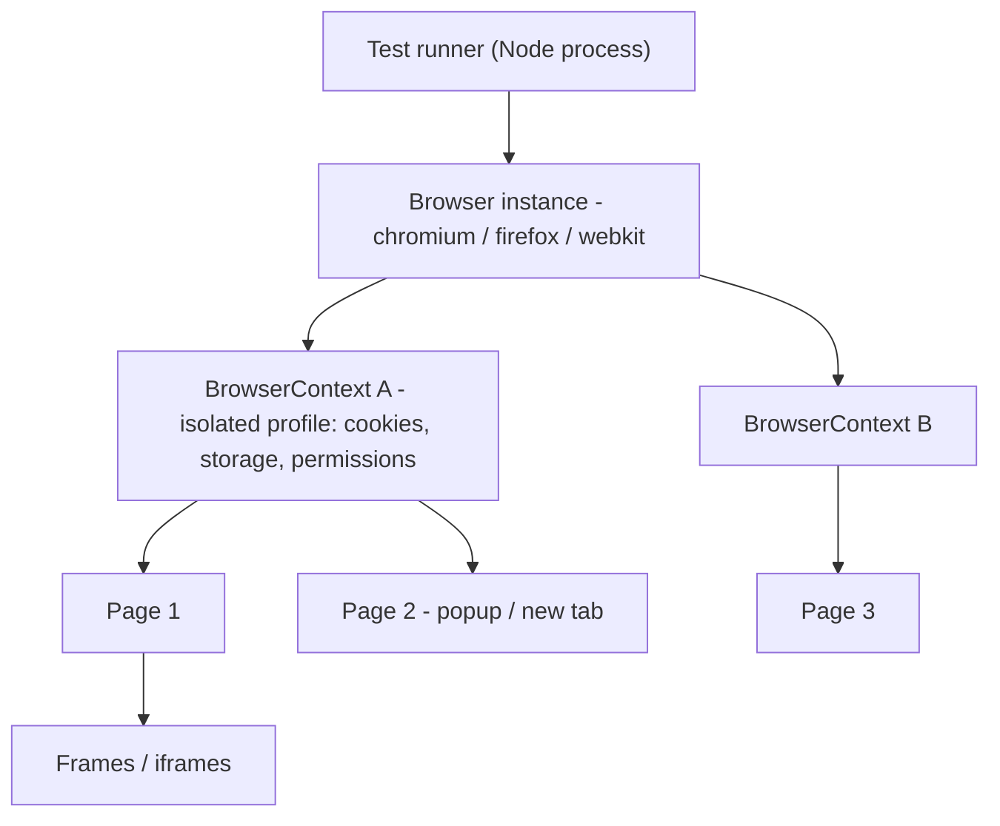
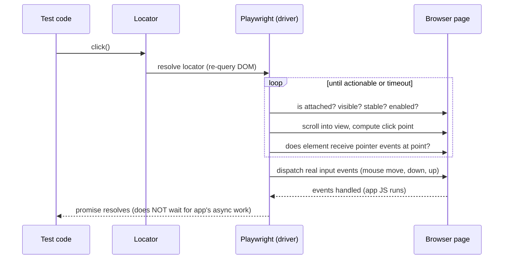
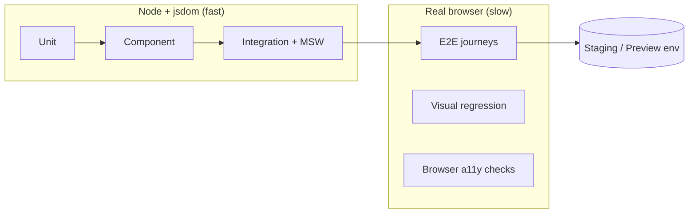
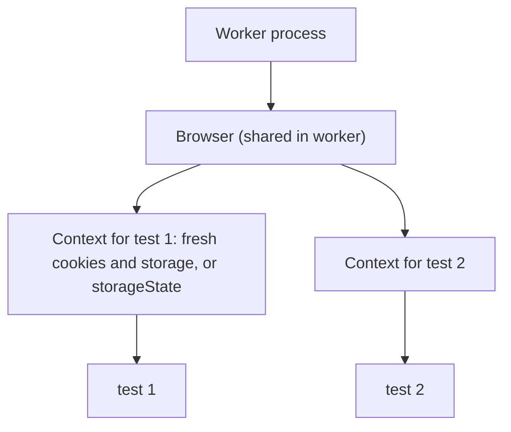
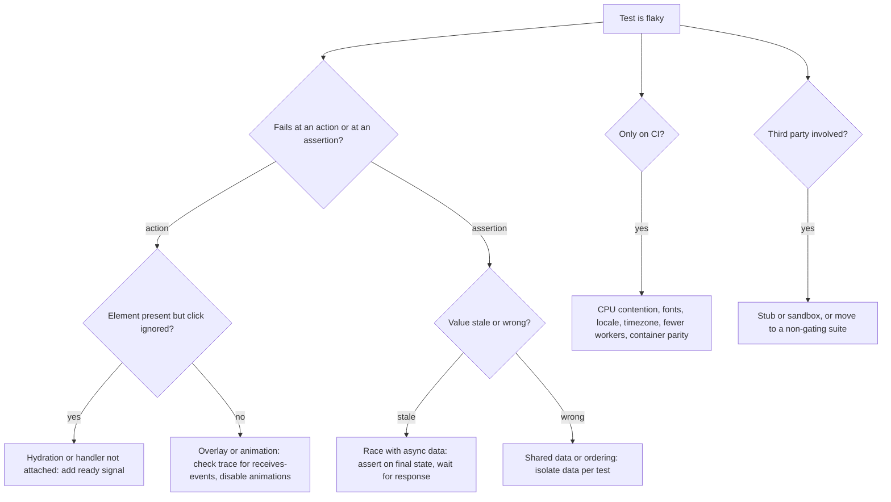

# 08 / 09 — End-to-End Testing with Playwright: Real Browsers, Real Journeys, Deterministic Suites

## 1. Lesson metadata

| | |
|---|---|
| **Level** | Advanced |
| **Study time** | 5–6 hours (reading 2 h, hands-on 2 h, exercises 1.5–2 h) |
| **Prerequisites** | [08 / 01 — Test strategy and the pyramid](./01-test-strategy-and-pyramid.md), [08 / 03 — React Testing Library](./03-react-testing-library.md), [08 / 04 — Testing async updates](./04-testing-async-updates.md), [08 / 08 — Integration testing](./08-integration-testing.md), [00 / 01 — How the browser works](../00-web-and-javascript-foundations/01-how-the-browser-works.md), [00 / 15 — HTTP, caching, navigation](../00-web-and-javascript-foundations/15-http-caching-and-navigation.md) |
| **Next** | [10 — Accessibility testing](./10-accessibility-testing.md) |
| **Related later** | [12 — Visual regression](./12-visual-regression.md), [15 — CI checks](./15-ci-checks.md), [16 — Avoiding brittle tests](./16-avoiding-brittle-tests.md), [09 / 01 — SPA, SSR, SSG, streaming](../09-advanced-rendering-and-ecosystem/01-spa-ssr-ssg-streaming.md) |

**Version note.** Checked against `@playwright/test` **1.64** (latest on 2026-10-22; the test runner package, the library `playwright` is separate). The config, fixtures, `page.clock`, `expect(...).toPass`, setup projects with `dependencies`, `tag`, `storageState`, `merge-reports` and `AxeBuilder` code in this lesson was type-checked with `tsc --strict` against 1.64.1 and `@axe-core/playwright` 4.14, and the timeouts/clock/auth/sharding/annotations claims were checked against playwright.dev. The Playwright docs list system requirements as Node.js latest 22.x, 24.x or 26.x (not 18). One removal matters here: the experimental component-testing packages (`@playwright/experimental-ct-react` etc.) are **no longer published as of 1.63**; 1.62 introduced a stories/gallery `mount` fixture instead (see the comparison tables below). React 19.x and Vite 5–7 for the application under test.

**Learning objectives.** After this lesson you can:
1. State what E2E tests are uniquely for, and select the few journeys that deserve E2E coverage.
2. Explain Playwright's architecture (runner, browser, context, page), its auto-waiting/actionability model, and web-first assertions, and why those remove most `sleep`-style flakiness.
3. Write robust locators using user-facing handles (`getByRole`, `getByLabel`, `getByText`, test ids as fallback) and chain/filter them.
4. Configure `playwright.config.ts` for a Vite/React app: `webServer`, projects (browsers/mobile), retries, parallelism, tracing, reporters.
5. Handle authentication once via setup projects and `storageState`, create test data through APIs, and keep tests independent and parallel-safe.
6. Use network interception (`page.route`) selectively to simulate failures and isolate third parties, while keeping the rest real.
7. Debug failures with traces, UI mode, `--debug`, and screenshots/videos, and diagnose flaky tests systematically.
8. Integrate E2E into CI with sharding, artifacts, and a sensible gating policy.

**Concepts covered:** E2E purpose and scope, Playwright runner/browser/context/page, isolation per test, locators and strictness, actionability checks, auto-waiting, web-first assertions, `expect.poll`/`toPass`, fixtures, setup projects and `storageState`, API-driven setup, `page.route`, `waitForResponse`, trace viewer, UI mode, codegen, hermetic test environments, parallelism and sharding, tagging, hydration-readiness, clock control, mobile emulation, a11y/visual hooks, flake triage.

---

## 2. Deep conceptual explanation

### 2.1 What problem is this lesson solving?

Everything in the earlier lessons runs in **Node with a simulated DOM** (jsdom). That is fast and deterministic, but it cannot tell you whether:

- The production **bundle** loads and executes (code splitting, chunk URLs, CSP, source of truth for environment variables).
- **CSS** and **layout** make the button visible, clickable, and not covered by an overlay.
- **Real navigation** works: history API, deep links, reload, back/forward, new tabs, redirects.
- **Cookies**, `localStorage`, **CORS**, and auth redirects behave in a real browser engine.
- **Cross-browser** differences (Chromium, Firefox, WebKit) don't break core flows.
- **SSR/hydration** actually yields an interactive page.
- **Third-party** scripts, iframes (payment), file uploads/downloads, and real focus behavior work.
- The **deployed system**, front-end plus API plus database, is wired together correctly.

End-to-end tests drive a **real browser** against the **running application** the way a user would. They are the only layer that observes these properties. They are also the slowest, the most failure-prone, and the hardest to diagnose, so their use must be deliberate (see [lesson 01](./01-test-strategy-and-pyramid.md): *few critical journeys, not exhaustive branches*).

### 2.2 What belongs in E2E (and what does not)

| Belongs in E2E | Does not belong in E2E |
|---|---|
| Critical revenue/safety journeys: sign up → verify → first purchase | Every validation message and branch (integration/component tests) |
| Auth flows with real cookies/redirects | Pure calculations and formatting (unit tests) |
| Things only a browser reveals: layout overlap, focus, scrolling, file download, iframe payment fields | Exhaustive permission matrices (integration tests with data tables) |
| Smoke checks of the deployed environment | Performance budgets (use dedicated tools; E2E timing is too noisy) |
| Cross-browser sanity for a small core flow | Visual pixel comparisons of every component (visual regression tooling; see [12](./12-visual-regression.md)) |
| Integration with real third parties in *sandbox mode* (payment test mode) | Anything you can cover at integration level with equal confidence |

**Rule of thumb:** an E2E test earns its place if (a) the failure would be severe, and (b) no cheaper layer can observe it. A common healthy ratio is a handful to a few dozen E2E tests for a mid-size app, run in minutes, not hundreds.

### 2.3 Playwright's model

Playwright (by Microsoft) automates Chromium, Firefox, and WebKit with one API. Key objects:



| Object | Meaning | Notes |
|---|---|---|
| **Test runner** (`@playwright/test`) | Discovers specs, runs in parallel **workers** (processes), reports, retries | Each worker launches a browser; tests in a worker reuse it |
| **Browser** | A launched browser process | Heavy; reused across tests within a worker |
| **BrowserContext** | An isolated, incognito-like session: its own cookies, storage, cache, permissions | **Each test gets a fresh context by default**: this is Playwright's isolation guarantee |
| **Page** | A tab in a context | `page` fixture |
| **Locator** | A *recipe* to find element(s), re-resolved on every action | Not a handle to a specific DOM node |
| **APIRequestContext** (`request` fixture) | HTTP client sharing config (baseURL, storage) | For API setup/teardown |

*Implementation detail:* Playwright drives browsers over browser-specific debugging protocols (Chrome DevTools Protocol for Chromium; patched builds for Firefox and WebKit) through a driver process. You normally never touch this, but it explains why Playwright downloads its own browser builds (`npx playwright install`).

### 2.4 Auto-waiting and actionability: Playwright's anti-flake mechanism

Before performing an action (`click`, `fill`, `check`, …), Playwright automatically waits for the target to be **actionable**. For `click` the documented checks include: the element is **attached**, **visible**, **stable** (not animating), **receives events** (not obscured by another element at the click point), and **enabled**. If a check fails it retries until the action timeout or test timeout. Then it performs the action. You do **not** insert manual waits for elements to appear.

*Consequence:* the dominant source of flakiness in older Selenium-style suites (acting before the element is ready) is eliminated by design for actions. Remaining flake sources are about **assertions** and **application state** (e.g., clicking before hydration attaches handlers: the element is visible and enabled but nothing happens).

**Web-first assertions** extend this to checks: `await expect(locator).toBeVisible()` retries until the condition holds or `expect.timeout` (default 5 s, per the Playwright timeouts docs). Compare:

```ts
// ❌ checks once, immediately
expect(await page.getByRole("status").textContent()).toBe("Saved");

// ✔ retries until it's true or times out
await expect(page.getByRole("status")).toHaveText("Saved");
```

### 2.5 Locators: choose like a user (same philosophy as RTL)

Playwright's recommended locators mirror Testing Library's priorities:

| Locator | Use |
|---|---|
| `page.getByRole("button", { name: "Pay" })` | Interactive elements, headings, links; verifies roles/names |
| `page.getByLabel("Email")` | Form fields |
| `page.getByPlaceholder(...)`, `getByText(...)`, `getByAltText(...)`, `getByTitle(...)` | Others |
| `page.getByTestId("order-total")` | Fallback; attribute is `data-testid` by default (configurable via `use.testIdAttribute`) |
| `page.locator("css=...")` / XPath | Last resort; couples to markup |

Locators are **strict**: if a locator matches more than one element, actions throw ("strict mode violation"). Use `.filter()`, `.nth()` (sparingly), `.first()` (as a conscious choice), or chaining: `page.getByRole("listitem").filter({ hasText: "Espresso" }).getByRole("button", { name: "Remove" })`.

### 2.6 Isolation, data, and parallelism

Playwright runs test files in parallel across workers (and tests within a file in parallel if `fullyParallel: true`). Therefore:

1. **Each test must own its data.** Two tests mutating the same shared user/order will conflict. Create unique users/records per test (via API) or per worker (`testInfo.workerIndex`).
2. **Order independence.** Never rely on one test creating data for the next. Use **fixtures** for setup/teardown.
3. **Hermetic environment.** The app talks to a **test backend** (seeded, resettable) rather than production; third parties are sandbox/test mode or stubbed.
4. **Idempotent reset.** Provide a test-only endpoint or script to reset/seed the database before runs (secured so it never exists in production).

### 2.7 Authentication once, not per test

Logging in through the UI for every test is slow and multiplies flake. The standard pattern: a **setup project** logs in once (via UI or API), saves the browser state to a JSON file (`storageState`: cookies + localStorage), and dependent projects start each test with that state already loaded. Keep the file out of version control (it contains tokens). Tests *about* login itself still use the UI with a fresh, unauthenticated context.

### 2.8 Network control in E2E: use sparingly and on purpose

E2E's value is realism, so **do not stub your own API** in journey tests. Legitimate uses of `page.route`:

- Simulate **hard-to-produce failures** (a 500 on a single call, a slow response, offline) to verify error UX in a real browser.
- **Block or replace third parties** that are non-deterministic or unwanted in tests (analytics, chat widgets, ads).
- **Assert on requests/responses** (`waitForResponse`, `waitForRequest`) to synchronize on real network events instead of timing.

If you find yourself stubbing most of the API, you're writing a slow integration test; move it to Vitest + MSW ([lesson 08](./08-integration-testing.md)).

### 2.9 Common misconceptions

| Misconception | Reality |
|---|---|
| "E2E tests are flaky by nature." | Most flake is self-inflicted: shared data, missing waits on app state, timing assumptions, uncontrolled third parties. Playwright removes many causes; hermetic design removes the rest. |
| "More E2E = more safety." | Past a small core, E2E adds cost faster than confidence; failures also become harder to trust. |
| "`waitForTimeout` is fine when needed." | It's almost never needed; it encodes a guess. Wait for a **condition** (assertion, response, URL). |
| "`page.locator('.btn-primary')` is more stable than roles." | CSS classes change with styling; roles/names change with product copy: both change, but role locators also assert accessibility. |
| "Retries make tests reliable." | Retries hide flake and double CI time. Use them as a diagnostic (`trace: 'on-first-retry'`), and fix causes. |
| "E2E can replace unit/integration tests." | They cannot test branches efficiently or localize failures. |
| "Playwright component testing is the same as E2E." | Component testing mounts a component in a real browser; it's a different layer. (The old experimental `-ct-react` packages were removed in 1.63; the current model serves your own story/gallery page and uses the `mount` fixture. Check <https://playwright.dev/docs/test-components>.) |

---

## 3. Internal mechanics

### 3.1 What happens on `await locator.click()` (documented behavior, conceptual order)



*Public guarantee (docs "Actionability"):* the listed checks are performed and retried before the action. *Not guaranteed:* that the application finished reacting. After `click()` resolves, the page may still be fetching; synchronize with an **assertion or response wait**.

Playwright dispatches *real* input events through the browser (not synthetic `element.click()` in JS), so overlays, `pointer-events: none`, and hit-testing behave as for a user. (`click({ force: true })` skips actionability checks and should be a last resort.)

### 3.2 Test lifecycle and fixtures

```text
runner starts workers
  per worker: launch browser (once)
    per test: create BrowserContext + Page fixtures → run hooks → run test → teardown fixtures → close context
failure: capture trace/screenshot/video per config; maybe retry in a fresh worker
```

Fixtures are Playwright's dependency-injection mechanism: `test("...", async ({ page, request, myFixture }) => ...)`. Playwright creates only the fixtures a test requests. `test.extend` defines custom ones:

```ts
export const test = base.extend<{ account: Account }>({
  account: async ({ request }, use) => {
    const acct = await createAccount(request);   // setup via API
    await use(acct);                             // test runs here
    await deleteAccount(request, acct.id);       // teardown
  },
});
```

### 3.3 Timeouts (three distinct ones)

| Timeout | Default (verified against the Playwright timeouts docs) | Scope |
|---|---|---|
| **Test timeout** | 30 s | Whole test including hooks/fixtures |
| **Expect timeout** | 5 s | Each web-first assertion |
| **Action/navigation timeout** | none (bounded by test timeout) | `click`, `fill`, `goto` |

Tune with `timeout`, `expect: { timeout }`, `use: { actionTimeout, navigationTimeout }`. Increase deliberately and locally (`test.slow()`, `test.setTimeout(...)`, `expect(locator).toBeVisible({ timeout })`) rather than globally.

### 3.4 Retries, traces, and artifacts

- `retries: n` reruns failed tests up to `n` times (in fresh workers). A test that fails then passes is reported as **flaky**, a first-class signal.
- `trace: "on-first-retry"` records a **trace** (DOM snapshots before/after each action, network, console, source) only when a retry happens, saving overhead; open with `npx playwright show-trace path/to/trace.zip` or via the HTML report.
- `screenshot: "only-on-failure"`, `video: "retain-on-failure"` provide quick visuals.
- **UI mode** (`npx playwright test --ui`) offers time-travel debugging and watch mode; **`--debug`** opens the Inspector; **`codegen`** (`npx playwright codegen <url>`) records interactions into locators (use as a starting point, then rewrite locators to be role-based and add assertions).

### 3.5 Parallelism and sharding

- **Workers** parallelize across files by default; `fullyParallel: true` also parallelizes tests within a file.
- **Sharding** splits the suite across CI machines: `npx playwright test --shard=1/4`. Each shard uses `--reporter=blob`; the blob reports are then merged with `npx playwright merge-reports --reporter html ./all-blob-reports` (workflow verified against the Playwright sharding docs).
- Parallelism magnifies shared-state problems: any test that depends on global state will become flaky exactly when you add workers.

### 3.6 React-specific timing: hydration and effects

For a client-rendered SPA, the DOM may appear (server-rendered HTML or a skeleton) **before** React has attached handlers. Playwright's actionability sees a visible, enabled button and clicks; if the handler isn't attached yet, the click is lost and the test fails intermittently. Mitigations:

1. **Ready signal**: have the app set a marker when hydrated/mounted (e.g., `document.documentElement.dataset.ready = "true"` in a root `useEffect`, or a `data-hydrated` attribute) and wait for it: `await expect(page.locator("html")).toHaveAttribute("data-ready", "true")`. Keep this tiny and gated to non-production or harmless in production.
2. **Assert an effect first**: wait for something that only exists post-hydration (e.g., the client-fetched data).
3. **Use framework guidance**: for Next.js/Remix, check the framework's Playwright recommendations; verify current docs.

---

## 4. Step-by-step execution walkthrough: one test from `npx playwright test` to report

Spec:

```ts
import { expect, test } from "./fixtures";

test("signed-in shopper completes checkout", async ({ page, account }) => {
  await page.goto("/products/espresso-machine");
  await page.getByRole("button", { name: "Add to cart" }).click();
  await page.getByRole("link", { name: /cart/i }).click();
  await expect(page.getByRole("heading", { name: "Your cart" })).toBeVisible();
  await page.getByRole("link", { name: "Checkout" }).click();
  // … shipping, payment (sandbox iframe) …
  await expect(page.getByRole("heading", { name: "Thanks for your order" })).toBeVisible();
});
```

| # | Event | Detail |
|---|---|---|
| 1 | CLI starts | Loads `playwright.config.ts`; resolves projects; starts `webServer` (e.g., `npm run preview`) and waits for its `url` to respond |
| 2 | Project dependencies | The `setup` project runs `auth.setup.ts` first: logs in, writes `playwright/.auth/user.json` |
| 3 | Workers spawn | One browser launched per worker (per project/browser type) |
| 4 | Fixtures build | `account` fixture creates a unique user via API (`request.post("/api/test/accounts")`); `page` fixture creates a new context **with** `storageState` and a page |
| 5 | `page.goto` | Navigates relative to `baseURL`; waits for the `load` event by default (not for app data) |
| 6 | `click("Add to cart")` | Locator resolves; actionability checks; real click; app JS sends `POST /api/cart/items` |
| 7 | `click(link cart)` | Strict locator: the link name `/cart/i` must match exactly one link; if the header contains "Cart (1)" and a footer "Cart policy", Playwright throws a strict mode violation (a feature: ambiguity is a test bug) |
| 8 | `expect(heading).toBeVisible()` | Retries up to 5 s while the route renders and data loads |
| 9 | …checkout… | Payment fields are inside a provider iframe: `page.frameLocator("iframe[title='Secure card payment']").getByLabel("Card number").fill(...)` |
| 10 | Final assertion | Retried until the confirmation heading appears |
| 11 | Teardown | `account` fixture deletes the user; context closed |
| 12 | Report | Pass → `list` line; failure → trace, screenshot, video retained per config; HTML report generated |

**Predict:** at step 7, the header link reads "Cart (1)" and the page also contains a link "Cart policy". What happens with `getByRole("link", { name: /cart/i })`? **Result:** strict mode violation (two matches). Fix by making the name precise (`/^cart \(\d+\)$/i` or `{ name: "Cart (1)" }`), scoping to the header (`page.getByRole("banner").getByRole("link", { name: /cart/i })`), or giving the link an accessible name that distinguishes it (a design improvement).

---

## 5. Code examples

### 5.1 Project setup and configuration

```bash
npm i -D @playwright/test
npx playwright install --with-deps      # downloads browsers (+ OS dependencies on Linux CI)
```

```ts
// playwright.config.ts
import { defineConfig, devices } from "@playwright/test";

const CI = !!process.env.CI;

export default defineConfig({
  testDir: "./e2e",
  testMatch: /.*\.spec\.ts/,          // keep Vitest's *.test.ts separate from Playwright's *.spec.ts
  fullyParallel: true,
  forbidOnly: CI,                     // fail CI if someone committed test.only
  retries: CI ? 2 : 0,
  workers: CI ? 2 : undefined,        // tune to your runner's CPU; fewer workers = less contention flake
  reporter: CI ? [["github"], ["html", { open: "never" }]] : [["list"], ["html", { open: "never" }]],

  use: {
    baseURL: process.env.E2E_BASE_URL ?? "http://localhost:4173",
    trace: "on-first-retry",
    screenshot: "only-on-failure",
    video: "retain-on-failure",
    locale: "en-US",
    timezoneId: "UTC",
    testIdAttribute: "data-testid",
  },

  projects: [
    { name: "setup", testMatch: /.*\.setup\.ts/ },
    {
      name: "chromium",
      use: { ...devices["Desktop Chrome"], storageState: "playwright/.auth/user.json" },
      dependencies: ["setup"],
    },
    {
      name: "webkit-mobile",
      use: { ...devices["iPhone 14"], storageState: "playwright/.auth/user.json" },
      dependencies: ["setup"],
      grep: /@smoke/,                  // run only smoke tests on the extra project to save time
    },
    // add firefox/webkit desktop if your support policy requires it
  ],

  webServer: {
    command: "npm run build && npm run preview -- --port 4173 --strictPort",
    url: "http://localhost:4173",
    reuseExistingServer: !CI,
    timeout: 120_000,
  },
});
```

Line notes:
- **`testMatch` and file naming** keep Playwright specs (`*.spec.ts` in `e2e/`) separate from Vitest tests (`*.test.ts` in `src/`). Make sure Vitest's `include`/`exclude` does not pick up `e2e/` (the default Vitest include pattern `**/*.{test,spec}.?(c|m)[jt]s?(x)` matches `*.spec.ts` as well; set `test.exclude: ["e2e/**", "node_modules/**"]`, or in Vitest 4+ `test.dir`/`include` for `src`; note Vitest 4 shrank the default `exclude` to `node_modules` and `.git`, so `dist` is no longer excluded).
- Running against the **production build** (`vite build` + `vite preview`) exercises the real bundle; running against the dev server is faster but tests a different artifact (HMR, unminified, different chunking).
- `workers` on CI: more workers speed things up but increase CPU contention, which can reveal timing-sensitive flake. Start low and measure.
- `devices[...]` presets set viewport, user agent, touch, device scale factor.
- `grep` is available both at the top level and per project in the config (and as `--grep @smoke` on the command line). Tagging: put `@smoke` in the title, or use the `tag` option, e.g. `test("login", { tag: "@smoke" }, async ({ page }) => {...})` (documented on the Annotations page; tags must start with `@`).
- `locale` and `timezoneId` make date/number rendering deterministic.

### 5.2 Authentication setup project and `storageState`

```ts
// e2e/auth.setup.ts
import { expect, test as setup } from "@playwright/test";
import path from "node:path";

const authFile = path.join(__dirname, "../playwright/.auth/user.json");

setup("authenticate", async ({ page }) => {
  await page.goto("/login");
  await page.getByLabel("Email").fill(process.env.E2E_USER_EMAIL!);
  await page.getByLabel("Password").fill(process.env.E2E_USER_PASSWORD!);
  await page.getByRole("button", { name: "Sign in" }).click();

  await expect(page).toHaveURL(/\/$|\/account/);
  await expect(page.getByRole("button", { name: /account menu/i })).toBeVisible();

  await page.context().storageState({ path: authFile });
});
```

Add `playwright/.auth/` to `.gitignore`. Tests that need a *clean* user override: `test.use({ storageState: { cookies: [], origins: [] } })`.

Notes: (1) If your app stores auth in an `HttpOnly` cookie, `storageState` captures cookies: fine. If it uses `sessionStorage`, `storageState` does **not** persist it (docs note this): you need a different approach (set it in an init script). (2) Tokens expire; if the state is older than the token lifetime, tests fail confusingly: regenerate per run (the setup project does) rather than checking in the file. (3) A shared user across parallel tests is fine for *read-mostly* flows; for flows that mutate user state (cart, settings), create a user per test or per worker (fixture below).

### 5.3 Fixtures: per-test accounts via the API, custom `expect`

```ts
// e2e/fixtures.ts
import { test as base, expect, type APIRequestContext } from "@playwright/test";
import { randomUUID } from "node:crypto";

export interface Account { id: string; email: string; password: string }

async function createAccount(request: APIRequestContext): Promise<Account> {
  const email = `e2e+${randomUUID()}@example.test`;
  const res = await request.post("/api/test/accounts", { data: { email, password: "Passw0rd!" } });
  expect(res.ok(), `create account failed: ${res.status()} ${await res.text()}`).toBeTruthy();
  return { ...(await res.json()), email, password: "Passw0rd!" };
}

export const test = base.extend<{ account: Account; authedPage: import("@playwright/test").Page }>({
  account: async ({ request }, use) => {
    const account = await createAccount(request);
    await use(account);
    await request.delete(`/api/test/accounts/${account.id}`);
  },

  // A page already logged in as THIS test's own account (no UI login)
  authedPage: async ({ browser, account, baseURL }, use) => {
    const context = await browser.newContext({ baseURL });
    const resp = await context.request.post("/api/test/login", { data: { email: account.email } }); // test-only endpoint
    expect(resp.ok()).toBeTruthy();
    const page = await context.newPage();
    await use(page);
    await context.close();
  },
});

export { expect };
```

Design notes:
- The `/api/test/*` endpoints exist **only in the test environment** (guard by env var and network policy). They allow fast, deterministic setup that bypasses UI. This is the most effective flake-reduction technique after hermetic data.
- Data is unique per test (`randomUUID`), so tests parallelize safely.
- The `authedPage` fixture shows an alternative to shared `storageState`: per-test identity.
- Use **teardown** in fixtures for cleanup; but design the environment to tolerate leftovers (periodic purge) since teardown doesn't run if a worker is killed.

### 5.4 The core journey: one E2E, many assertions at checkpoints

```ts
// e2e/checkout.spec.ts
import { expect, test } from "./fixtures";

test("@smoke shopper can buy a product with a promo code", async ({ authedPage: page }) => {
  await test.step("add the product to the cart", async () => {
    await page.goto("/products/espresso-machine");
    await page.getByRole("button", { name: "Add to cart" }).click();
    await expect(page.getByRole("status")).toContainText("Added to cart");
    await expect(page.getByRole("banner").getByRole("link", { name: /cart \(1\)/i })).toBeVisible();
  });

  await test.step("apply a promo code", async () => {
    await page.getByRole("banner").getByRole("link", { name: /cart/i }).click();
    await expect(page).toHaveURL(/\/cart$/);
    await page.getByLabel("Promo code").fill("SAVE20");
    await page.getByRole("button", { name: "Apply" }).click();
    await expect(page.getByTestId("order-total")).toHaveText("$80.00");
  });

  await test.step("pay in the sandbox", async () => {
    await page.getByRole("link", { name: "Checkout" }).click();
    await page.getByLabel("Postcode").fill("12345");
    await page.getByRole("button", { name: "Continue" }).click();

    const card = page.frameLocator("iframe[title='Secure card payment']");   // provider iframe (sandbox)
    await card.getByLabel("Card number").fill("4242 4242 4242 4242");
    await card.getByLabel("Expiry").fill("12 / 34");
    await card.getByLabel("CVC").fill("123");

    const orderResponse = page.waitForResponse((r) => r.url().includes("/api/orders") && r.request().method() === "POST");
    await page.getByRole("button", { name: /pay/i }).click();
    expect((await orderResponse).status()).toBe(201);
  });

  await test.step("see the confirmation", async () => {
    await expect(page.getByRole("heading", { name: "Thanks for your order" })).toBeVisible();
    await expect(page).toHaveURL(/\/confirmation/);
    await expect(page).toHaveTitle(/order confirmed/i);
  });
});
```

Notes:
- **`test.step`** groups actions in reports and traces; a failure shows *which step* broke, mitigating the diagnosability cost of long E2E tests.
- **Start `waitForResponse` before the click**, then await after; otherwise you may miss a fast response. This synchronizes on the real network event, not time.
- Mixing role locators with a single `getByTestId` where no semantic handle exists is pragmatic.
- Branches (invalid code, declined card, validation) are **not** here; they're covered in integration tests ([lesson 08](./08-integration-testing.md)). Only the one cross-cutting journey and perhaps one failure path that needs a real redirect or iframe belong in E2E.
- Real third-party iframes in sandbox mode can be slow or flaky; consider whether the provider offers a test mode with deterministic behavior, and put these tests in a separate, non-gating suite if flake persists.

### 5.5 Failure simulation with `page.route`

```ts
test("shows a retryable error when the products API fails once", async ({ page }) => {
  let failed = false;
  await page.route("**/api/products*", async (route) => {
    if (!failed) {
      failed = true;
      await route.fulfill({ status: 503, json: { message: "Service unavailable" } });
    } else {
      await route.continue();                    // let the real backend answer on retry
    }
  });

  await page.goto("/products");
  await expect(page.getByRole("alert")).toContainText(/couldn't load products/i);

  await page.getByRole("button", { name: "Retry" }).click();
  await expect(page.getByRole("list", { name: "Products" }).getByRole("listitem").first()).toBeVisible();
});

test("remains usable when analytics is blocked", async ({ page }) => {
  await page.route(/(google-analytics|segment|hotjar)/, (route) => route.abort());
  await page.goto("/");
  await expect(page.getByRole("heading", { level: 1 })).toBeVisible();
});

test("offline shows the offline banner", async ({ page, context }) => {
  await page.goto("/dashboard");
  await context.setOffline(true);
  await page.getByRole("button", { name: "Refresh" }).click();
  await expect(page.getByRole("alert")).toContainText(/offline/i);
  await context.setOffline(false);
});
```
Notes: `route.continue()` passes the request to the real network: the retry hits the real backend (hybrid realism). `context.setOffline` toggles the browser's offline emulation. Register routes **before** the navigation or action that triggers the request. Route handlers apply to the page/context where registered.

### 5.6 Keyboard and focus (what jsdom can't judge)

```ts
test("keyboard-only user can open and close the cart drawer and focus returns", async ({ page }) => {
  await page.goto("/");
  const trigger = page.getByRole("button", { name: /open cart/i });

  await page.keyboard.press("Tab");           // move to the first focusable element (skip link)
  await trigger.focus();
  await page.keyboard.press("Enter");

  const drawer = page.getByRole("dialog", { name: /your cart/i });
  await expect(drawer).toBeVisible();
  await expect(drawer.getByRole("button", { name: /close/i })).toBeFocused();

  await page.keyboard.press("Escape");
  await expect(drawer).toBeHidden();
  await expect(trigger).toBeFocused();         // focus restored
});
```
Real focus/tab order, scroll lock, and overlay hit-testing are browser-level behaviors: E2E (or browser-mode component tests) is where they're verified. Pair with automated accessibility scans (`@axe-core/playwright`): see [10 — Accessibility testing](./10-accessibility-testing.md).

### 5.7 Incorrect examples

**(a) Sleeping and one-shot reads**
```ts
await page.getByRole("button", { name: "Save" }).click();
await page.waitForTimeout(2000);                                   // ❌ guess
expect(await page.locator(".toast").innerText()).toBe("Saved");    // ❌ no retry, CSS-coupled
```
**Fix:**
```ts
await page.getByRole("button", { name: "Save" }).click();
await expect(page.getByRole("status")).toHaveText("Saved");
```

**(b) Shared mutable data between tests**
```ts
test("create item", async ({ page }) => { /* creates "Widget" */ });
test("edit item", async ({ page }) => { /* assumes "Widget" exists */ });   // ❌ order dependent; breaks in parallel
```
**Fix:** each test creates its own item (fixture/API) with a unique name.

**(c) UI login in every test**
```ts
test.beforeEach(async ({ page }) => { await uiLogin(page); });       // ❌ slow, flaky, 30 s overhead per suite
```
**Fix:** setup project + `storageState`, or per-test API login.

**(d) Brittle selectors**
```ts
await page.locator("div.main > div:nth-child(3) button.btn-primary").click();  // ❌
```
**Fix:** `page.getByRole("button", { name: "Continue" })`.

**(e) Asserting implementation via evaluate**
```ts
const count = await page.evaluate(() => (window as any).__STORE__.cart.items.length);   // ❌ couples to internals
```
**Fix:** assert what the user sees (`cart (2)` badge).

### 5.8 Page objects vs. fixtures vs. helper functions

```ts
// e2e/pages/CartPage.ts (a light page object: encapsulates locators and user-level actions)
import { expect, type Page } from "@playwright/test";

export class CartPage {
  constructor(private readonly page: Page) {}
  heading = () => this.page.getByRole("heading", { name: "Your cart" });
  async open() { await this.page.goto("/cart"); await expect(this.heading()).toBeVisible(); }
  async applyPromo(code: string) {
    await this.page.getByLabel("Promo code").fill(code);
    await this.page.getByRole("button", { name: "Apply" }).click();
  }
  total = () => this.page.getByTestId("order-total");
}
```

```ts
test("promo reduces the total", async ({ page }) => {
  const cart = new CartPage(page);
  await cart.open();
  await cart.applyPromo("SAVE20");
  await expect(cart.total()).toHaveText("$80.00");
});
```
Page objects help when many tests share complex interactions. Keep them thin: expose *locators and user-intent methods*; keep **assertions in the tests** (so test intent is visible), and avoid deep inheritance hierarchies or hidden waits. For small suites, plain helper functions or fixtures suffice.

### 5.9 Controlling time

```ts
test("session expiry banner appears after 15 minutes of inactivity", async ({ page }) => {
  await page.clock.install({ time: new Date("2025-01-01T09:00:00Z") });     // fake Date/timers in the page
  await page.goto("/dashboard");
  await page.clock.fastForward("15:01");                                   // jump forward; timers fire as needed
  await expect(page.getByRole("dialog", { name: /session expired/i })).toBeVisible();
});
```
Playwright's clock API (introduced in 1.45) fakes time *in the browser page* (`Date`, timers, `requestAnimationFrame`, etc.). It makes real-time features (debounce, expiry, polling) testable without waiting. Interactions with network timing and server-side clocks remain real; mismatched client/server time can confuse token validity tests. Method names `install`, `fastForward`, `runFor`, `pauseAt`, `setFixedTime`, `setSystemTime` and `resume` are listed on <https://playwright.dev/docs/clock>; the docs recommend `setFixedTime` for a constant time and `install` when you need to advance it.

### 5.10 Accessibility and visual hooks (brief; covered in later lessons)

```ts
import AxeBuilder from "@axe-core/playwright";

test("checkout page has no detectable a11y violations", async ({ page }) => {
  await page.goto("/checkout/shipping");
  const results = await new AxeBuilder({ page }).analyze();
  expect(results.violations).toEqual([]);
});

test("cart page visual baseline", async ({ page }) => {
  await page.goto("/cart");
  await expect(page).toHaveScreenshot("cart.png", { maxDiffPixelRatio: 0.01 });
});
```
Axe detects only a subset of WCAG issues (commonly cited as roughly a third to half; treat as an estimate, Playwright's own docs say only that automated testing cannot detect all WCAG violations), so it complements, not replaces, manual and keyboard testing. Screenshot baselines depend on OS/browser/font rendering: generate and compare in the **same container image** (see [12 — Visual regression](./12-visual-regression.md)).

### 5.11 CI workflow (GitHub Actions sketch)

```yaml
# .github/workflows/e2e.yml
name: e2e
on: { pull_request: {}, push: { branches: [main] } }
jobs:
  e2e:
    runs-on: ubuntu-latest
    strategy:
      fail-fast: false
      matrix: { shard: [1, 2, 3, 4] }
    steps:
      - uses: actions/checkout@v7
      - uses: actions/setup-node@v7
        with: { node-version: 20, cache: npm }
      - run: npm ci
      - run: npx playwright install --with-deps chromium
      - run: npx playwright test --shard=${{ matrix.shard }}/4
        env: { CI: "true", E2E_USER_EMAIL: ${{ secrets.E2E_USER_EMAIL }}, E2E_USER_PASSWORD: ${{ secrets.E2E_USER_PASSWORD }} }
      - uses: actions/upload-artifact@v7
        if: ${{ !cancelled() }}
        with: { name: playwright-report-${{ matrix.shard }}, path: playwright-report/, retention-days: 7 }
```
Action versions and the merged-report workflow change over time (verified 2026-10-22: `actions/checkout` v7, `actions/setup-node` v7, `actions/upload-artifact` v7, `actions/download-artifact` v8; `playwright merge-reports --reporter html ./all-blob-reports` is the documented sharding workflow); check current GitHub Actions and Playwright CI docs. Install only the browsers you run; cache is possible but verify cache keys. Run the **smoke subset on PRs** and the **full suite on merge/nightly** if full-suite time is too high.

---

## 6. Visual explanations

### 6.1 Where E2E fits



### 6.2 Isolation per test



### 6.3 Actionability loop

```text
resolve locator → attached? → visible? → stable? → enabled? → scroll into view → receives events at point?
        ↑__________________________ retry until timeout ____________________________|
                                       then perform real input
```

### 6.4 Flake triage tree



---

## 7. Alternative approaches and trade-offs

### 7.1 E2E tools

| Criterion | Playwright | Cypress | Selenium/WebDriver | Puppeteer | Vitest browser mode / Playwright CT |
|---|---|---|---|---|---|
| Browsers | Chromium, Firefox, WebKit | Chromium family, Firefox, (WebKit experimental) | All major via drivers | Chromium (Firefox experimental) | Browsers (via Playwright/WebdriverIO) |
| Auto-waiting | Built in (actionability + web-first assertions) | Built in (retry-ability) | Manual/explicit waits | Manual | Built in |
| Multi-tab / multi-context | First-class | Limited | Yes | Yes | N/A |
| Parallelism | Built in (workers, shards) | Via dashboard/CI tools | Via grid | DIY | Via runner |
| Debugging | Trace viewer, UI mode, Inspector | Time-travel runner | Basic | DevTools | Real browser |
| Language | JS/TS, Python, Java, .NET | JS/TS | Many | JS/TS | JS/TS |
| Network mocking | `route` | `intercept` | Limited/external | Request interception | Depends |
| Ecosystem fit for React | Strong | Strong | Legacy | Library, not a test runner | Evolving |

(Tool capabilities evolve; verify current features before choosing. Existing team expertise and CI constraints often outweigh feature differences.)

### 7.2 Environment strategies for E2E

| Strategy | Realism | Determinism | Cost/complexity | Use when |
|---|---|---|---|---|
| **Hermetic**: local stack (front end + test API + seeded DB) in CI containers | High | High | Medium–High (containers, seeding) | Default recommendation for gating tests |
| **Shared staging** | Highest | Low (other users/data) | Low setup, high flake | Smoke/synthetic monitoring, non-gating |
| **Preview deployment per PR** with isolated backend/DB | High | Medium–High | High infra | Mature platform teams |
| **Front end real, API stubbed (route/MSW)** | Medium | High | Low | When backend can't be run; but it's an integration test in disguise |
| **Production synthetic monitoring** (read-only journeys) | Real | Medium | Low | Alerting, not testing releases |

### 7.3 When the recommended approach (few E2E journeys) is NOT best

- **Apps with heavy, browser-only logic** (a canvas editor, WebGL, rich-text, complex drag-and-drop): more of the behavior can only be validated in a real browser; invest in a larger E2E/browser-mode suite for those interactions, with strong locators (`data-testid`) and domain-level helper functions.
- **Greenfield/legacy apps with no unit seams**: when architecture prevents lower-level testing, a thin E2E safety net may be the only feasible first step before refactoring (accept the cost; use it as a bridge, not a destination).
- **Regulated flows needing evidence** (screenshots/video for audit): E2E artifacts serve a compliance purpose beyond defect detection.

---

## 8. Best practices and anti-patterns

**Do**
- Keep the E2E suite small, focused on critical journeys and browser-only behaviors; push everything else down.
- Use `getByRole`/`getByLabel`/`getByText`; add `data-testid` for non-semantic elements; configure `testIdAttribute` once.
- Use **web-first assertions**; no `waitForTimeout`; synchronize on responses, URLs, and UI state.
- Make each test **independent, data-isolated, parallel-safe**; create data via APIs/fixtures.
- Authenticate once via setup project/`storageState`, or per-test via API.
- Run against a **production build** in a **hermetic** environment; pin browsers (`playwright` version) and run in the same container image locally and in CI.
- Use `test.step` and descriptive names; capture trace on retry; review flaky reports weekly.
- Tag tests (`@smoke`, `@slow`) and run smoke on PRs.
- Disable CSS animations in test mode (inject a stylesheet via `page.addStyleTag` or a build flag) or emulate reduced motion with `use: { contextOptions: { reducedMotion: "reduce" } }` (the documented form; `reducedMotion` is a browser-context option, not a top-level `use` key), and for screenshots `animations: "disabled"` (the default for `toHaveScreenshot`).
- Treat the E2E suite as production code: lint it, review it, refactor helpers.

**Beginner mistakes**
- `waitForTimeout`, reading values once instead of asserting with retries, fragile CSS/XPath selectors.
- Sharing accounts and data across parallel tests; relying on test order.
- Logging in through the UI in every test.
- Forgetting to `await` Playwright calls (everything is async).
- Testing every branch via UI.

**Experienced-developer mistakes**
- Stubbing the whole API with `page.route` and calling it E2E.
- Page-object hierarchies that hide assertions and waits; a 3,000-line `utils.ts`.
- Using `force: true` or `dispatchEvent` to "make the click work" and masking a real overlay/handler bug.
- Increasing global timeouts and retries to cope with flake rather than fixing causes.
- Running everything on every PR so the suite becomes a blocker people bypass.
- Depending on real third-party services in gating tests.

**Smells:** `test.only` in committed code; a test with 40 steps; tests reading the DB directly to assert results (mixing layers; sometimes justified to verify persistence, but prefer API/UI); assertions on pixel positions; `retries: 5`.

**Justified exceptions:** `waitForTimeout` in a demo script or when proving a *negative over time* with the clock API unavailable (prefer clock control); `force: true` for a known-hidden file input (prefer `setInputFiles`); DB assertions for audit/persistence verification through a test-only API; page.route for sandbox-less third parties; serial mode (`test.describe.configure({ mode: "serial" })`) for a genuinely ordered flow when the state cost of independence is prohibitive, accepting reduced parallelism and the "if one fails, the rest skip" behavior.

---

## 9. Real-world application

**E-commerce (conversion-critical).** Constraints: payments in third-party iframes, inventory, promo codes, emails. E2E covers: guest checkout happy path with payment sandbox; sign-in then checkout; one declined-card path if the provider's test card creates a deterministic decline; cross-browser smoke for the primary journey on Chromium + WebKit (Safari-specific bugs are common with date inputs, `100vh`, and cookies). Emails are verified through a test mail catcher API (MailHog/Mailpit-style) rather than a real inbox. Everything else (promo math, shipping rules) lives in unit/integration tests.

**Banking/finance (security and audit).** Constraints: MFA, session timeout, strict CSP, data masking. E2E validates the security headers/CSP don't break the bundle (an app that passes integration tests can render blank in production because CSP blocks inline scripts), session-timeout UX using the clock API, masked values never appearing in the DOM after navigation, and download of statements (file download events: `page.waitForEvent("download")`). Evidence (video/trace) is retained for audit.

**SaaS dashboard (multi-tenant, many roles).** Constraints: tenancy isolation. E2E runs the same smoke journey for 2–3 role/tenant fixtures (viewer/admin; tenant A/B) and includes a **negative tenancy test**: tenant A's user requesting tenant B's resource URL gets 403/404 and no data (checked through UI and a direct `request` call). Permission matrices are integration-tested ([lesson 08](./08-integration-testing.md)).

**Realtime collaboration.** Constraints: two users, one document. Playwright's multi-context support is ideal: open `context1` and `context2`, edit in one, assert in the other (`await expect(page2.getByText("Hello")).toBeVisible()`), then go offline in one and reconcile. These tests are inherently timing-sensitive; assert eventual consistency with generous but explicit timeouts and keep the count low.

**Multi-team platform with microfrontends.** Constraints: independent deploys. A small cross-team E2E suite (owned by a platform team) verifies composition: shell + each remote loads, shared auth works, navigation across remotes works. Each team's own E2E covers its remote in isolation with a stubbed shell where appropriate.

---

## 10. Debugging and troubleshooting

### 10.1 First response to a failing test: use the trace

1. Open the HTML report (`npx playwright show-report`) → failed test → **Trace**. Or run locally: `npx playwright test --trace on` then `npx playwright show-trace test-results/.../trace.zip`.
2. Step through actions: the trace shows **before/after DOM snapshots**, the exact locator resolution, network requests (status, body), console logs and errors, and the source line.
3. Identify the failure class: **locator** (didn't find / strict violation), **actionability** ("element intercepts pointer events", "not stable"), **assertion** (expected vs. received, with the last observed value), **navigation/network** (timeouts), or **app error** (console `pageerror`).
4. Reproduce locally with `--headed --debug` or **UI mode** (`--ui`); use the Inspector's locator picker to refine locators.

### 10.2 "Element intercepts pointer events" / "element is not stable"

An overlay (cookie banner, toast, loading mask) or an animation covers the target. Resolve by: dismissing/waiting for the overlay to disappear (`await expect(overlay).toBeHidden()`), disabling the overlay in the test environment (cookie consent preset via `storageState`/init script), disabling animations, or fixing the app if it truly traps users. Avoid `force: true`.

### 10.3 "Strict mode violation: locator resolved to N elements"

The locator is ambiguous. Print what matched (trace/inspector), narrow the locator (name, scope with `getByRole("banner")`/`within` equivalent via chaining, `filter({ hasText })`), or improve app semantics (distinct accessible names). Don't default to `.first()`; ask whether *first* is meaningful.

### 10.4 Click "succeeds" but nothing happens (hydration/handler timing)

1. In the trace, the click action passes but the next assertion fails; the network panel shows no request.
2. Hypothesis: handler not yet attached. Add a hydration/ready signal and wait for it before interacting; or wait for a post-hydration element.
3. Verify by repeating the test 100× (`--repeat-each=100`) before and after.

### 10.5 Passes locally, fails in CI

Check: (1) **resource constraints**: CI is slower; reduce workers; avoid fixed sleeps; (2) **environment parity**: Node, browser versions (Playwright pins browser builds to versions), container image, fonts (screenshot diffs), locale/timezone; (3) **data**: seeded state different; (4) **base URL/webServer**: server not ready (use `url` readiness); (5) **secrets/env** missing; (6) **headless vs headed** differences (rare; some CSS or `prefers-reduced-motion`). Run CI's Docker image locally (Playwright provides official images; verify tag matching your version).

### 10.6 Suite got slow

Measure per-test and per-step durations (`--reporter=json` or HTML report). Look for: UI login repetition, serial mode, large waits for third parties, too many projects (every test running on 3 browsers × 2 viewports), heavy seeding per test. Remedies: setup project auth, API-based data, run only smoke on extra browsers, shard, delete low-value tests, move branches down to integration level.

### 10.7 Flaky test triage workflow (team process)

1. Tag flaky tests automatically (Playwright reports "flaky" when it passes on retry); track a flake list with owner and date.
2. **Quarantine** after N flakes (skip with annotation + ticket) so the main branch isn't blocked; quarantine has an SLA.
3. Reproduce with `--repeat-each` and throttled CPU; fix the root cause (data isolation, readiness signal, locator ambiguity); remove quarantine only after 200 clean runs.
4. Monitor the flake rate as a metric; set a budget (e.g., <1 % of runs).

---

## 11. Exercises

### Level A — Knowledge
A1. List five things E2E can verify that jsdom-based integration tests cannot.
A2. What does Playwright's actionability check for `click`, and what does it *not* guarantee about the app after the click?
A3. Why is `await expect(locator).toHaveText("x")` preferable to `expect(await locator.textContent()).toBe("x")`?
A4. What is a `BrowserContext` and how does it relate to test isolation?
A5. What problem does a setup project with `storageState` solve, and what are two caveats?

### Level B — Code comprehension
B1. This test is intermittently red. Identify three problems:
```ts
test("save profile", async ({ page }) => {
  await page.goto("/profile");
  await page.locator(".input-name").fill("Ada");
  await page.locator("button.save").click();
  await page.waitForTimeout(1000);
  expect(await page.locator(".toast").textContent()).toBe("Saved");
});
```
B2. In 5.4 the `waitForResponse` promise is created before the click. What bug appears if it is created after `await ...click()`?
B3. Two tests both use the shared authenticated user and each adds an item to "the" cart, then assert the cart badge equals 1. They pass serially and fail in parallel. Explain and give two fixes.

### Level C — Implementation
C1. Write a Playwright test for a login form that verifies: invalid credentials show an accessible error and keep the user on `/login`; valid credentials land on `/account`; and a deep link `/account/settings` while logged out redirects to `/login?redirectTo=...` and returns after login. Use appropriate fixtures to avoid repeating UI login in unrelated tests.
C2. Write a test that simulates a 500 on the *second* `POST /api/orders` call only, verifying the UI shows an error then succeeds on retry without creating duplicate orders (check via the API).
C3. Write a fixture `seededProduct` that creates a product via API with a unique SKU, deletes it after the test, and use it in a test that edits the product price via the UI and verifies the public product page shows the new price.

### Level D — Debugging
D1. A test clicks "Add to cart" and then asserts the badge "Cart (1)". In CI it fails ~5 % of runs; trace shows the click passed and no `POST` was sent. What is the likely cause and your investigation/fix plan?
D2. After enabling `fullyParallel: true`, three previously stable tests fail randomly. All create a "Test Project" with the same name. Explain and fix.
D3. `getByRole("button", { name: "Delete" })` throws a strict mode violation on a table page with 20 rows. Provide two fixes (one test-side, one app-side) and say which you prefer.

### Level E — Architecture and engineering decisions
E1. Your product team wants "full E2E regression" of 400 scenarios on every PR. Propose a testing portfolio and CI policy that preserves confidence while keeping PR feedback under 10 minutes.
E2. Decide between a hermetic local stack and shared staging for gating E2E in a company with 12 microservices. Provide criteria, a recommendation, and the migration path.

### Level F — Expert challenge
F1. Design E2E coverage and infrastructure for a real-time collaborative editor (two users editing, offline edits, conflict resolution, presence cursors), covering multi-context tests, determinism strategies (clock, network control), and how to keep the suite reliable.

---

## 12. Detailed answers and explanations

> Attempt the exercises first.

**A1.** Any five: (1) the production bundle loads/executes (chunks, CSP, env vars); (2) CSS/layout (overlaps, visibility, responsive behavior); (3) real navigation/history/deep links/reload; (4) cookies, storage, CORS, redirects with a real browser engine; (5) cross-browser behavior; (6) real focus/tab order and scroll behavior; (7) SSR/hydration interactivity; (8) iframes/third-party widgets; (9) file upload/download; (10) the deployed system wiring (front end + API + DB).

**A2.** For `click`: element attached, visible, stable, enabled, and receives pointer events at the click point (not obscured); retried until timeout, then real input is dispatched. It does **not** guarantee the app has processed the click or completed async work (network, state updates); you must assert on resulting state or wait for a response.

**A3.** The first form is a **web-first assertion** that retries until the expectation holds or times out, tolerating async rendering. The second reads once immediately (`textContent()` resolves with the *current* text) and then asserts synchronously, so it fails if the text updates a moment later, and its failure message lacks retry context.

**A4.** A `BrowserContext` is an isolated browser session (cookies, localStorage, cache, permissions) inside a browser process. Playwright creates a fresh context per test by default, so tests don't share state through cookies/storage; isolation of *server-side data* is still your responsibility.

**A5.** Logging in once per run (setup project) and reusing saved cookies/localStorage (`storageState`) removes per-test login cost and flake. Caveats: (1) `sessionStorage`-based auth isn't captured, (2) tokens expire so regenerate each run, (3) a shared identity creates data contention for tests that mutate user state, (4) the file contains secrets and must not be committed.

**B1.** Problems: (1) CSS-class locators (`.input-name`, `button.save`) are brittle; use `getByLabel("Name")` and `getByRole("button", { name: "Save" })`. (2) `waitForTimeout(1000)` is a guess: slow CI may take longer, fast machines waste time; wait for a condition. (3) `expect(await ...textContent()).toBe(...)` reads once without retry and couples to `.toast`; use `await expect(page.getByRole("status")).toHaveText("Saved")`. Bonus: nothing ensures the page is hydrated before filling/clicking.

**B2.** If the response arrives before `waitForResponse` is registered (a fast backend), the promise never resolves and the test times out waiting for an event that already happened. Always start the wait, perform the action, then await the wait: `const p = page.waitForResponse(...); await click(); await p;` (or `Promise.all([page.waitForResponse(...), click()])`).

**B3.** Both tests mutate the same user's cart; in parallel their operations interleave, so the badge can show 2 or 0. Fixes: (1) create a unique user per test (fixture + API) so carts are isolated; (2) reset the cart through a test API at the start of each test *and* run those tests serially (less preferable); (3) use per-worker accounts (`workerIndex`) if each worker runs tests sequentially. Prefer (1).

**C1.**
```ts
import { expect, test } from "@playwright/test";

test.describe("login", () => {
  test.use({ storageState: { cookies: [], origins: [] } });           // start logged out

  test("invalid credentials show an accessible error and stay on /login", async ({ page }) => {
    await page.goto("/login");
    await page.getByLabel("Email").fill("ada@example.test");
    await page.getByLabel("Password").fill("wrong");
    await page.getByRole("button", { name: "Sign in" }).click();
    await expect(page.getByRole("alert")).toContainText(/invalid/i);
    await expect(page).toHaveURL(/\/login$/);
  });

  test("valid credentials land on /account", async ({ page }) => {
    await page.goto("/login");
    await page.getByLabel("Email").fill(process.env.E2E_USER_EMAIL!);
    await page.getByLabel("Password").fill(process.env.E2E_USER_PASSWORD!);
    await page.getByRole("button", { name: "Sign in" }).click();
    await expect(page).toHaveURL(/\/account$/);
  });

  test("deep link redirects to login and returns after sign-in", async ({ page }) => {
    await page.goto("/account/settings");
    await expect(page).toHaveURL(/\/login\?redirectTo=%2Faccount%2Fsettings/);
    await page.getByLabel("Email").fill(process.env.E2E_USER_EMAIL!);
    await page.getByLabel("Password").fill(process.env.E2E_USER_PASSWORD!);
    await page.getByRole("button", { name: "Sign in" }).click();
    await expect(page).toHaveURL(/\/account\/settings$/);
    await expect(page.getByRole("heading", { name: "Settings" })).toBeVisible();
  });
});
```
Notes: `test.use({ storageState: ... })` resets the shared authenticated state for this describe; other specs keep using the saved state. Credentials come from environment variables, not source. The URL regex for the encoded `redirectTo` depends on how your app encodes; `toHaveURL` accepts a regex or a predicate.

**C2.**
```ts
test("a failed first order attempt can be retried without duplicates", async ({ page, request, account }) => {
  let attempts = 0;
  await page.route("**/api/orders", async (route) => {
    if (route.request().method() !== "POST") return route.continue();
    attempts++;
    if (attempts === 1) {
      return route.fulfill({ status: 500, json: { message: "boom" } });
    }
    return route.continue();
  });

  // ... drive the UI to the payment step (helper), then:
  await page.getByRole("button", { name: /pay/i }).click();
  await expect(page.getByRole("alert")).toContainText(/couldn't place your order/i);

  await page.getByRole("button", { name: /pay/i }).click();            // retry
  await expect(page.getByRole("heading", { name: "Thanks for your order" })).toBeVisible();

  const orders = await request.get(`/api/test/accounts/${account.id}/orders`);   // test-only endpoint
  expect(await orders.json()).toHaveLength(1);                         // no duplicates
});
```
Key points: only the *first* attempt is faked, so the retry exercises the real backend; the final assertion checks server truth (one order) rather than only UI. If the app uses an idempotency key, also verify the second request carries the same key via `route.request().headers()`.

**C3.**
```ts
// fixtures.ts (extend)
seededProduct: async ({ request }, use) => {
  const sku = `E2E-${randomUUID().slice(0, 8)}`;
  const res = await request.post("/api/test/products", { data: { sku, name: `Widget ${sku}`, priceCents: 1000 } });
  expect(res.ok()).toBeTruthy();
  const product = (await res.json()) as { id: string; sku: string; name: string };
  await use(product);
  await request.delete(`/api/test/products/${product.id}`);
},
```
```ts
test("admin price edit is visible on the public product page", async ({ page, seededProduct }) => {
  await page.goto(`/admin/products/${seededProduct.id}`);
  await page.getByLabel("Price").fill("12.50");
  await page.getByRole("button", { name: "Save" }).click();
  await expect(page.getByRole("status")).toContainText("Saved");

  await page.goto(`/products/${seededProduct.sku}`);
  await expect(page.getByTestId("price")).toHaveText("$12.50");
});
```
(Requires the `seededProduct` type in `base.extend<...>` and an admin identity via `storageState` or fixture.) The unique SKU makes the test parallel-safe; teardown deletes the record; assertion crosses two pages (admin, public) proving data propagation (cache invalidation) in the real stack.

**D1.** Likely the click occurred before React attached the handler (hydration/mount race), so no request was sent: the element was visible/enabled but inert. Plan: (1) confirm with trace: no `POST`; (2) repeat test (`--repeat-each=50`) under CPU throttling to reproduce; (3) add a readiness signal (`data-ready` attribute set after mount/hydration) and wait for it in a fixture that wraps `page.goto`; or assert a post-hydration element first; (4) re-run repeats to confirm; (5) consider whether the app should disable controls until hydrated (a UX decision). Alternative causes to rule out: an overlay intercepting the click (trace would show failure), a debounced/disabled button state, or the click landing during a route transition.

**D2.** With `fullyParallel`, tests in the same file now run concurrently; each creates "Test Project" in the same tenant, causing uniqueness conflicts or cross-test reads. Fix: generate unique names (`Test Project ${randomUUID()}`) via a fixture, scope data per test/worker, and clean up. If the app enforces global uniqueness, tenant-per-test isolation is the strongest approach.

**D3.** Test-side: scope by row: `page.getByRole("row", { name: /Widget 12/ }).getByRole("button", { name: "Delete" })`. App-side: give each action an accessible name that includes context (`aria-label={`Delete ${item.name}`}`) so a screen reader user also hears which row the button affects. Prefer the app-side fix **plus** the scoped locator: it improves accessibility and makes tests naturally unambiguous (`getByRole("button", { name: "Delete Widget 12" })`).

**E1.** Portfolio: unit and integration tests carry the 400 scenarios (most are validations/permissions/branches); E2E has ~15–30 tests: critical journeys (signup, checkout, key admin flow), browser-only behaviors (focus management, file upload/download, iframe payment), and a cross-browser smoke subset. CI policy: PR gate = static checks + unit/integration (fast, sharded) + `@smoke` E2E (≤ ~5 tests, Chromium only, ≤ 5–6 min); merge/main = full E2E on 2 browsers; nightly = extended suite + visual + cross-browser mobile; flake budget and quarantine process; metrics (time to green, flake rate, escaped defects). Show that scenarios are *mapped* to the cheapest layer (a traceability table) so product sees coverage without paying E2E cost for every row.

**E2.** Criteria: determinism, realism, cost, time-to-feedback, ownership, data isolation, onboarding complexity. A hermetic stack with 12 microservices is expensive; but staging as the gate causes flaky failures from other teams' deploys and data. Recommendation: hermetic for the *consuming front-end's* gating E2E using a **contract-faithful backend** (the BFF/API gateway plus a minimal set of real services, with the rest provided by contract-verified stubs or service virtualization), and keep shared staging for non-gating smoke/synthetic checks. Migration: (1) identify the minimal service subset for critical journeys; (2) containerize with seeded data (Docker Compose/ephemeral environments); (3) add contract tests so stubs cannot drift; (4) move gating tests first, keeping staging smoke; (5) measure flake and runtime before/after. Reverse the decision if ephemeral environments become cheap and isolated (per-PR full stack).

**F1.** Coverage: (1) two-context live edit propagation (A types → B sees within a bounded timeout); (2) presence cursors appear/disappear on connect/disconnect; (3) offline edit in A (context offline), online edit in B, reconnect → deterministic merge result (assert final text equals expected CRDT/OT outcome); (4) conflict UI if applicable; (5) reload mid-edit restores unsaved changes; (6) permissions (viewer can't edit). Determinism: control the network via `context.setOffline` and `page.route` to delay messages deterministically; use the clock API to fast-forward heartbeats/timeouts; seed documents via API; assert on *final convergent state* with web-first assertions rather than intermediate ordering; limit concurrency (serial mode within one document test file, but separate documents per test for parallelism). Reliability: use unique document IDs per test; add test-only hooks to expose "sync idle" state (e.g., `data-sync-state="idle"`) to wait on rather than arbitrary time; retain traces for all multi-context tests; keep count small and push merge-algorithm correctness into property-based unit tests of the CRDT/OT core. Evaluation: the answer should separate algorithm correctness (unit/property tests) from browser-level concerns (E2E) and propose explicit sync signals.

---

## 13. Senior engineer interview questions

**Q1. "How do you keep E2E tests from becoming flaky?"**
*Strong answer:* Design for determinism: hermetic backend with per-test data created via API; independent, parallel-safe tests; role-based locators and web-first assertions (no sleeps); explicit readiness signals for hydration; control or stub non-deterministic third parties; same container image locally and CI; limited workers; traces on first retry; and a process to quarantine and fix flakes with metrics. Retries are diagnostic, not a remedy.

**Q2. "What belongs in E2E vs. integration tests?"**
*Strong answer:* E2E: a few critical journeys and behaviors only a real browser/deployment can show (bundle, CSS/layout, real navigation, cookies/CORS, cross-browser, iframes, downloads). Integration (jsdom + MSW): branches, validations, permissions, error handling, shared-state wiring. If the failure would be caught equally well lower, it doesn't deserve E2E.

**Q3. "Explain Playwright's auto-waiting."**
*Strong answer:* Before actions it waits for actionability (attached, visible, stable, enabled, receives events) and retries; web-first assertions retry until timeout. This removes element-readiness waits. It doesn't know about application-level readiness (hydration, pending requests), so I synchronize on user-visible outcomes or network responses and sometimes a ready signal.

**Q4. "How do you handle authentication in a large E2E suite?"**
*Strong answer:* A setup project logs in once and saves `storageState` for dependent projects; for tests that mutate user state, create per-test/per-worker identities through a test-only API and log in via API. UI login is tested explicitly in a few auth tests with a clean context. Secrets come from CI env, state files are not committed, and token expiry is handled by regenerating per run.

**Q5. "A test passes locally but fails on CI 10 % of the time. Walk me through it."**
*Strong answer:* Collect the trace/video/screenshots of failures; classify action vs assertion failure; reproduce with `--repeat-each` under CPU limits in the CI container; check readiness (hydration), overlays/animations, data isolation, third parties, locale/timezone, worker count. Fix the root cause (e.g., add readiness signal, unique data), verify with hundreds of runs; avoid raising timeouts or adding retries as primary fixes.

---

## 14. Further learning resources

| Resource | URL | Covers / why | Level | Study |
|---|---|---|---|---|
| Playwright — Getting started | <https://playwright.dev/docs/intro> | Install, first test, running, reports | Beginner | Whole page |
| Playwright — Best practices | <https://playwright.dev/docs/best-practices> | Locators, isolation, web-first assertions, CI | Intermediate | Whole page |
| Playwright — Locators | <https://playwright.dev/docs/locators> | `getByRole`, filtering, strictness | Beginner–Int. | Whole page |
| Playwright — Auto-waiting (Actionability) | <https://playwright.dev/docs/actionability> | The exact checks per action | Intermediate | Whole page |
| Playwright — Assertions | <https://playwright.dev/docs/test-assertions> | Web-first assertions, `expect.poll`, soft assertions | Intermediate | Whole page |
| Playwright — Authentication | <https://playwright.dev/docs/auth> | Setup projects, `storageState`, per-worker accounts | Intermediate | Whole page |
| Playwright — Test configuration / `webServer` | <https://playwright.dev/docs/test-webserver> | Starting the app for tests | Intermediate | Whole page |
| Playwright — Network (`route`) | <https://playwright.dev/docs/network> | Mocking, modifying, HAR | Intermediate | Whole page |
| Playwright — Trace viewer | <https://playwright.dev/docs/trace-viewer> | Debugging failed tests | Beginner | Whole page |
| Playwright — Clock | <https://playwright.dev/docs/clock> | Fake time in the page | Intermediate | Whole page |
| Playwright — Continuous integration | <https://playwright.dev/docs/ci> | CI setups, sharding, containers | Intermediate | Whole page |
| Playwright — Accessibility testing | <https://playwright.dev/docs/accessibility-testing> | Axe integration | Intermediate | Whole page |
| Playwright — Docker/Release notes | <https://playwright.dev/docs/release-notes> | Version changes (verify API drift) | All | Latest releases |
| web.dev — Testing | <https://web.dev/learn/testing/> | Broader testing guidance | Beginner | Overview |

URLs in this table were checked for HTTP 200 on 2026-10-22; any still marked *(unverified)* could not be checked automatically (blocked or unreachable). A 200 response does not guarantee the page content still matches the description; if a link has moved, search the site for the quoted title.

---

## 15. Knowledge checkpoint

**You should now understand**
- What E2E uniquely verifies, and why it must remain a small, deliberate layer.
- Playwright's runner/browser/context/page model, per-test isolation, actionability and auto-waiting, and web-first assertions.
- How to configure projects, `webServer`, retries, tracing, and CI sharding; how to authenticate once and create data via APIs.
- How to use `page.route`, `waitForResponse`, and the clock responsibly, and how to debug with traces.

**You should be able to explain without notes**
- Why `waitForTimeout` and one-shot reads cause flake and what replaces them.
- Why parallelism requires data isolation, and how fixtures provide it.
- Why hydration timing can make "successful" clicks do nothing, and how to synchronize.

**You should be able to implement**
- A hermetic Playwright setup for a Vite/React app: config, setup project, fixtures with API-created data, a critical-journey test with `test.step` and response synchronization, failure-simulation tests, and a CI workflow with shards.

**You should be able to debug**
- Strict-mode violations, intercepted clicks, inert clicks from hydration, CI-only failures, slow suites, and flaky tests, using traces, UI mode, and repeat runs.

**Before moving on:** continue to [10 — Accessibility testing](./10-accessibility-testing.md), which builds on the role-based locators and keyboard tests here and adds automated and manual accessibility strategies.
