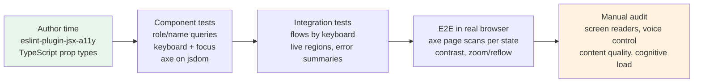

# 08 / 10 — Accessibility Testing: Automated Checks, Role-Based Queries, Keyboard and Focus

## 1. Lesson metadata

| | |
|---|---|
| **Level** | Intermediate–Advanced |
| **Study time** | 4–5 hours (reading 2 h, experiments 1.5 h, exercises 1.5 h) |
| **Prerequisites** | [01 — Test strategy and pyramid](./01-test-strategy-and-pyramid.md), [03 — React Testing Library](./03-react-testing-library.md), [04 — Testing async updates](./04-testing-async-updates.md), [09 — E2E with Playwright](./09-e2e-with-playwright.md) |
| **Next** | [11 — Component contract testing](./11-component-contract-testing.md) |
| **Related** | [14 — Linting and static analysis](./14-linting-and-static-analysis.md) (static a11y lint rules), [15 — CI checks](./15-ci-checks.md), [16 — Avoiding brittle tests](./16-avoiding-brittle-tests.md) |

**Learning objectives.** After this lesson you can:
1. Explain what automated accessibility tools can and cannot detect, and why "zero axe violations" is not "accessible".
2. Use role-based queries as an accessibility assertion rather than just a locator strategy.
3. Add axe-based checks at the component level (jsdom) and at the page level (real browser with Playwright), and know why the two see different things.
4. Write keyboard-interaction and focus-management tests (tab order, focus trap, focus restoration, roving tabindex, live regions).
5. Design a layered accessibility testing strategy: static lint, component tests, E2E scans, and manual audit with assistive technology.
6. Triage and suppress violations responsibly.

**Concepts covered:** WCAG and its role, accessibility tree, accessible name/role/state, ARIA first rule, axe-core rules and impact levels, `jest-axe`/`vitest-axe`-style matchers, `@axe-core/playwright`, jsdom limitations (no layout, no real colour contrast), keyboard testing with `user-event`, focus management, live regions, `eslint-plugin-jsx-a11y`, manual screen-reader testing, accessibility regression policy.

> **Tool/API note (verified 2026-10-22).** Checked by installing and running: `vitest-axe` 0.1.0 (a fork of `jest-axe`, last published January 2025; exports `axe`, `configureAxe`; matchers from `vitest-axe/matchers`; types from `vitest-axe/extend-expect`), `axe-core` 4.14.0, `@axe-core/playwright` 4.14.0 (`AxeBuilder` default export with `withTags`, `include`, `exclude`, `disableRules`, `analyze`; see <https://playwright.dev/docs/accessibility-testing>), and `axe-playwright` 2.2.2 (`injectAxe`, `checkA11y`, `getViolations`, `configureAxe`). `vitest-axe` is lightly maintained; `jest-axe` (4.x) and plain `axe-core` calls wrapped in your own matcher are alternatives. Re-check each package's README when upgrading.

---

## 2. Deep conceptual explanation

### 2.1 What problem is this lesson solving?

Accessibility (a11y) defects are some of the most common production defects in React apps and some of the least likely to be caught by a typical test suite. A button built from a `<div onClick>` passes every functional test that uses `fireEvent.click(container.querySelector('.btn'))`, yet it cannot be reached by keyboard, is not announced as a button, and does not respond to Space or Enter. The test suite says green; a keyboard user cannot check out.

Accessibility testing is the practice of **encoding accessibility requirements as checks that run automatically**, so that regressions are caught in the same loop as functional regressions. It has a hard limit: only a portion of accessibility requirements can be machine-verified. The job of a senior engineer is to put each requirement at the cheapest layer that can actually verify it, and to be honest about what remains for humans.

### 2.2 The accessibility tree: what assistive technology actually sees

Browsers build a second tree next to the DOM: the **accessibility tree**. Each node exposes (roughly) a **role** (button, heading, checkbox), an **accessible name** (the label), a **description**, and **states and properties** (checked, expanded, disabled, required, invalid). Assistive technologies (screen readers, switch devices, voice control) consume this tree through platform accessibility APIs; they do not read your CSS or your component names.

The derivation of role and name follows specifications (HTML-AAM, ARIA, and the *Accessible Name and Description Computation*). Practical consequences:

- `<button>Save</button>` → role `button`, name "Save". No ARIA needed.
- `<div onClick>Save</div>` → role generic, no name semantics, not focusable. Invisible to the tree as an interactive control.
- `<input id="e"><label for="e">Email</label>` → role `textbox`, name "Email".
- `<input placeholder="Email">` → a name may be computed from placeholder by some implementations as a fallback, but it is not a reliable label (it disappears, has contrast problems, and is not a substitute for a label).
- `<button aria-label="Close"><svg/></button>` → name "Close" (`aria-label` overrides content).

This is the key insight for testing: **tests that query by role and accessible name exercise the same tree assistive technology uses.** A test that can find `getByRole('button', { name: /save/i })` has proven that a button with that name exists in the tree. That is an accessibility assertion, produced as a side-effect of a good locator.

### 2.3 WCAG, conformance levels, and where testing fits

The **Web Content Accessibility Guidelines (WCAG)**, published by the W3C, are the de facto standard that legal and procurement requirements reference (often via regional laws; consult your legal/compliance team for which version and level apply to you). Success criteria are organised under four principles, **POUR**: Perceivable, Operable, Understandable, Robust, and graded A, AA, AAA. Most organisations target **AA**. WCAG 2.2 (W3C Recommendation, 12 December 2024) is the current version per w3.org, which advises using it; WCAG 2.0 and 2.1 are not deprecated by it (WCAG 3.0 is still a draft).

Not all criteria are equally testable by machine:

| Class | Example criteria | Machine-checkable? |
|---|---|---|
| Structural/syntactic | Images have `alt` attribute; form control has a name; ARIA attribute is valid for the role; ids unique; `<html lang>` present | **Yes, reliably** |
| Computed-visual | Text contrast ratio, target size | **Partly**, only in a real rendering engine; gradients, images and overlays defeat it |
| Interaction | Keyboard operability, focus order, no keyboard trap, focus visible, focus not obscured | **Only by scripted interaction**; a scanner on a static DOM cannot judge |
| Semantic quality | Is the alt text *meaningful*? Is the heading hierarchy logical? Is the label *understandable*? | **No**, requires human judgement |
| Experience | Does the dialog make sense with a screen reader? Is the error message clear? | **No** |

A widely cited vendor statistic is that automated tools find somewhere between roughly a third and a little over half of issues by volume, depending on how issues are counted *(treat any specific percentage as vendor-reported; verify before quoting)*. The honest teaching claim is: **automation catches a meaningful minority-to-half of defects; the rest require interaction tests and manual review.**

### 2.4 The first rule of ARIA

The ARIA specification and the W3C's ARIA Authoring Practices state, in essence: *if you can use a native HTML element or attribute with the semantics and behaviour you need, do so instead of re-purposing an element and adding ARIA.* Native `<button>`, `<a href>`, `<input>`, `<select>`, `<dialog>`, `<details>` come with focusability, keyboard behaviour, and semantics for free. ARIA only changes the *semantics exposed*; it adds **no behaviour**. `role="button"` on a `div` does not add focus, Enter or Space handling. Tests that find `role="button"` but never press Space on it can pass on an inoperable widget.

### 2.5 What React adds to the picture

React does not change accessibility rules, but it changes where bugs come from:

- **JSX attribute names**: `htmlFor` (not `for`), `aria-*` stays hyphenated, `tabIndex` camel-cased. A typo is a silent no-op or a dev warning.
- **Client-side navigation** does not reload the page, so the browser does not reset focus or announce a new page title. Single-page apps must manage focus and announce route changes themselves (or rely on the router/framework to do it; *verify behaviour in your router*).
- **Conditional rendering** can mount/unmount a control that has focus; focus is silently lost to `<body>`.
- **Portals** (modals, tooltips) render outside the component's DOM subtree; tests that scope queries to `container` miss them (use `screen`).
- **Controlled components and rapid re-renders** can re-announce live regions repeatedly or not at all.
- **`useId`** ([React reference](https://react.dev/reference/react/useId)) produces stable unique ids that are the correct tool for associating `label`/`aria-describedby` targets, and it is SSR-safe.

### 2.6 Misconceptions

| Misconception | Reality |
|---|---|
| "axe passes, so we're accessible." | axe finds a class of detectable violations. A page can pass with unusable keyboard flow, meaningless alt text, and a confusing screen-reader experience. |
| "More ARIA is more accessible." | Incorrect ARIA is worse than none ("no ARIA is better than bad ARIA" is an ARIA Authoring Practices theme). |
| "`getByTestId` is fine; a11y is separate." | Test ids bypass the accessibility tree; you lose the free assertion. Test ids are a last resort ([Lesson 16](./16-avoiding-brittle-tests.md)). |
| "jsdom can check colour contrast." | jsdom does not do layout or full CSS cascade rendering; contrast rules are generally disabled or unreliable there. Use a real browser. |
| "Accessibility is a QA phase." | It is a property of the component's API and markup; cheapest to enforce at authoring time and in component tests. |
| "Screen reader users are the only audience." | Keyboard-only users, voice-control users, low-vision users (zoom, contrast), people with cognitive disabilities, and temporary/situational limitations all depend on the same foundations. |

---

## 3. Internal mechanics

### 3.1 How axe-core works (teaching model)

**Teaching model.** `axe-core` is a JavaScript library that runs *inside a page* (or a jsdom document). Given a context (whole document, or a subtree), it:

1. Selects candidate elements per rule via CSS selectors and matchers.
2. Runs rule checks (functions reading DOM attributes, computed styles, and for some rules an internal accessibility-tree approximation).
3. Classifies each result as **violation**, **pass**, **incomplete** (needs human review), or **inapplicable**.
4. Reports each violation with a rule id (e.g. `button-name`, `label`, `color-contrast`), an **impact** (`minor`, `moderate`, `serious`, `critical`), the offending nodes, and a help URL.

Two points matter for testing:

- **"Incomplete" results are not failures, but they are not passes.** Wrapper matchers like `toHaveNoViolations` typically only fail on `violations`. Elements axe could not decide on (e.g. contrast over a background image) silently land in `incomplete`. *Verified with vitest-axe 0.1.0 / axe-core 4.14 in jsdom:* a paragraph with inline `color: #ccc` on white produced **no violation**; `color-contrast` appeared under `incomplete`, so such a test passes `toHaveNoViolations()` while proving nothing about contrast. Surface them in reports at least periodically.
- **Rules are tagged** by standard and level (for example `wcag2a`, `wcag2aa`, `wcag21aa`, `best-practice`). You can select/deselect rules by tag or id. The tags named here are valid in axe-core 4.x (`wcag2a`, `wcag2aa`, `wcag21a`, `wcag21aa`, `best-practice`, ...); the Playwright accessibility guide uses exactly `wcag2a`, `wcag2aa`, `wcag21a`, `wcag21aa`.

**Implementation detail (do not rely on).** The exact set of rules, which ones are enabled by default, and how names are computed internally changes between axe-core releases. Pin the version in lockfile and treat upgrades as potentially introducing new (legitimate) failures.

### 3.2 Why jsdom and a real browser see different things

| Capability | jsdom (Vitest/Jest component tests) | Real browser (Playwright, Storybook test runner, Vitest browser mode) |
|---|---|---|
| DOM structure, attributes, labels, roles | Yes | Yes |
| Computed accessible name (via Testing Library's `dom-accessibility-api`) | Yes (an implementation of the spec; edge cases differ) | Native browser computation |
| CSS layout (visibility by geometry, overflow, positioned overlays) | **No layout engine** | Yes |
| Real colour contrast | **Not reliable** | Yes (subject to backgrounds/gradients) |
| `:focus-visible`, real focus ring styling | Not meaningful | Yes |
| Focus order across the real tab sequence | Approximated by `user-event`'s tab logic | Real |
| Target size, zoom/reflow at 400% | No | Yes (with viewport emulation) |
| Speed | Milliseconds per test | Hundreds of ms – seconds |

Consequently: do **structural and behavioural** a11y checks in jsdom (cheap, run on every component), and **visual/computed** checks in a real browser against assembled pages (fewer, slower).

### 3.3 How Testing Library's role queries compute roles and names

`getByRole` ([Lesson 03](./03-react-testing-library.md)) uses the **implicit role** of the element per HTML-AAM (via `aria-query` data), or the explicit `role` attribute, and the accessible name per the accessible-name algorithm. It filters out inaccessible elements by default (those with `display: none`, `visibility: hidden`, `aria-hidden="true"` ancestors, or the `hidden` attribute), which is exactly what a screen reader would skip. `getByRole('button', { hidden: true })` includes them.

This default filtering is a hidden accessibility assertion: if you accidentally apply `aria-hidden` to a subtree that contains the control the user must reach, `getByRole` fails. In jsdom, "hidden by CSS" detection depends on styles actually applied to the document; CSS Modules or Tailwind classes that are not loaded in the test environment do not hide anything. Inline styles and `hidden` attribute work.

---

## 4. Step-by-step execution walkthrough: testing an accessible dialog

We want to verify a modal "Delete project" dialog meets its accessibility contract. We decompose the contract into checkable assertions and show which layer checks each:

1. **Trigger is a real button with a name** → `getByRole('button', { name: 'Delete project' })` (component test).
2. **Activating it with the keyboard opens the dialog** → `user.keyboard('{Enter}')` on the focused trigger (component test).
3. **The dialog has role `dialog` (or `alertdialog`), is modal, and has an accessible name** → `getByRole('dialog', { name: /delete project/i })` (component test; name comes from `aria-labelledby`).
4. **Focus moves into the dialog on open** → `expect(confirmButton or the dialog).toHaveFocus()` (component test).
5. **Tab stays inside the dialog (trap)** → press Tab N+1 times, assert focus wraps (component test).
6. **Escape closes it** → `user.keyboard('{Escape}')` (component test).
7. **Focus returns to the trigger on close** → `expect(trigger).toHaveFocus()` (component test).
8. **Background content is inert/hidden from AT while open** → `queryByRole('main')` returns null when background is `aria-hidden`/`inert`, or in a browser check `inert` attribute (check how your dialog implementation hides the background).
9. **No axe violations in the open state** → axe run on the document with the dialog open (component test for structure, E2E for contrast).
10. **Contrast of destructive button, focus ring visible, 200%/400% zoom doesn't clip** → E2E in a real browser + manual check.
11. **Screen reader announces dialog title and purpose sensibly** → manual (VoiceOver, NVDA, JAWS, TalkBack).

Notice: steps 1–9 are automatable cheaply; 10 needs a real browser; 11 is human.

---

## 5. Code examples

All examples assume Vitest + React Testing Library + `@testing-library/user-event`, per [Lessons 02–03](./02-unit-testing-with-vitest.md). The setup file registers `@testing-library/jest-dom` matchers.

### 5.1 Minimal example — axe on a rendered component

```tsx
// ProfileForm.tsx
import { useId } from 'react';

export function ProfileForm({ onSubmit }: { onSubmit: (email: string) => void }) {
  const id = useId();
  return (
    <form
      onSubmit={(e) => {
        e.preventDefault();
        const data = new FormData(e.currentTarget);
        onSubmit(String(data.get('email') ?? ''));
      }}
    >
      <label htmlFor={`${id}-email`}>Email address</label>
      <input id={`${id}-email`} name="email" type="email" required />
      <button type="submit">Save profile</button>
    </form>
  );
}
```

```tsx
// ProfileForm.a11y.test.tsx
import { render } from '@testing-library/react';
import { axe } from 'vitest-axe';              // or 'jest-axe' with Jest (verified: vitest-axe 0.1.0 exports `axe` and `configureAxe`)
import * as axeMatchers from 'vitest-axe/matchers'; // verified: provides `toHaveNoViolations`
import { expect, test } from 'vitest';
import { ProfileForm } from './ProfileForm';

expect.extend(axeMatchers);

test('ProfileForm has no detectable accessibility violations', async () => {
  const { container } = render(<ProfileForm onSubmit={() => {}} />);
  expect(await axe(container)).toHaveNoViolations();
});
```

Notes:
- `axe(container)` runs axe-core against the container subtree. The call is **async**; always `await` it. *Verified with vitest-axe 0.1.0:* `expect(axe(container)).toHaveNoViolations()` without `await` does not pass vacuously; the matcher receives a Promise and throws the misleading error "No violations found in aXe results object", and the dangling `axe()` promise keeps running. The test fails, but for a confusing reason.
- `expect.extend` registration: for TypeScript, `import 'vitest-axe/extend-expect'` in a `.ts` setup file adds the `toHaveNoViolations` type to Vitest's `expect` (per the package README; the setup file must be included in `tsconfig.json`).
- The `<label htmlFor>` + `useId` pair is what the `label` rule validates. Delete the label and the test fails with rule id `label`.

**Predict:** if we change `<button type="submit">Save profile</button>` into `<button type="submit"><svg aria-hidden="true" /></button>`, which rule fails? *Answer:* `button-name` — the button has no discernible text.

### 5.2 Practical example — role queries as assertions plus a keyboard-driven dialog test

```tsx
// ConfirmDelete.tsx — a modal using the native <dialog> element
import { useId, useRef, useState } from 'react';

export function ConfirmDelete({ onConfirm, projectName }: { onConfirm: () => void; projectName: string }) {
  const dialogRef = useRef<HTMLDialogElement>(null);
  const [open, setOpen] = useState(false);
  const titleId = useId();

  const show = () => {
    dialogRef.current?.showModal(); // native: traps focus, inert background, Esc closes
    setOpen(true);
  };
  const close = () => {
    dialogRef.current?.close();
    setOpen(false);
  };

  return (
    <>
      <button type="button" onClick={show}>Delete project</button>
      <dialog ref={dialogRef} aria-labelledby={titleId} onClose={() => setOpen(false)}>
        <h2 id={titleId}>Delete {projectName}?</h2>
        <p>This cannot be undone.</p>
        <button type="button" onClick={close}>Cancel</button>
        <button type="button" onClick={() => { onConfirm(); close(); }}>Delete</button>
      </dialog>
      {/* open used only to illustrate state; see note */}
      <span hidden>{String(open)}</span>
    </>
  );
}
```

**jsdom caveat (verified on jsdom 30.1.3).** `document.createElement('dialog').showModal` and `.close` are `undefined` (calling `showModal()` throws `showModal is not a function`), and the `inert` property is not reflected; focus trapping and `:modal` handling are therefore absent too. Tests for native `<dialog>` modal semantics are therefore better in a real browser (Playwright component/E2E, Vitest browser mode). For libraries that implement dialogs in JS (Radix UI, React Aria, Headless UI), focus trap and Escape behaviours are implemented in script and *can* be tested in jsdom. This table shows how the same contract maps to environment:

| Assertion | jsdom + JS-implemented dialog | jsdom + native `<dialog>` | Real browser |
|---|---|---|---|
| Role/name via `getByRole('dialog', {name})` | Yes | Yes if open attribute set, `showModal` may be missing/polyfilled | Yes |
| Focus moves in | Yes | Unreliable | Yes |
| Tab trap | Yes (via lib code) | No | Yes |
| Escape closes | Yes | Unreliable | Yes |
| Background inert | Depends on lib (`aria-hidden`) | No | Yes |

Test against a JS-implemented dialog (illustrative, using a hypothetical `<Modal>` component with a `title`, `open`, `onClose`):

```tsx
import { render, screen } from '@testing-library/react';
import userEvent from '@testing-library/user-event';
import { expect, test, vi } from 'vitest';
import { useState } from 'react';
import { Modal } from './Modal';

function Harness() {
  const [open, setOpen] = useState(false);
  return (
    <>
      <button onClick={() => setOpen(true)}>Delete project</button>
      <Modal open={open} onClose={() => setOpen(false)} title="Delete Apollo?">
        <button>Cancel</button>
        <button>Delete</button>
      </Modal>
    </>
  );
}

test('dialog manages focus: moves in, traps, returns on Escape', async () => {
  const user = userEvent.setup();
  render(<Harness />);

  const trigger = screen.getByRole('button', { name: 'Delete project' });
  await user.click(trigger);

  const dialog = screen.getByRole('dialog', { name: 'Delete Apollo?' });
  expect(dialog).toBeInTheDocument();

  // focus moved inside the dialog
  expect(dialog).toContainElement(document.activeElement as HTMLElement);

  // Tab cycles within the dialog: after more tabs than focusable controls, still inside
  await user.tab(); await user.tab(); await user.tab();
  expect(dialog).toContainElement(document.activeElement as HTMLElement);

  await user.keyboard('{Escape}');
  expect(screen.queryByRole('dialog')).not.toBeInTheDocument();
  expect(trigger).toHaveFocus(); // focus restoration
});
```

Line notes:
- `screen.getByRole('dialog', { name: 'Delete Apollo?' })` asserts both the role **and** the accessible name (from `aria-labelledby` or `aria-label` inside `Modal`). If the dialog is unlabelled, this fails and tells you precisely what is wrong.
- `user.tab()` simulates the tab sequence using `user-event`'s own focusable-element ordering. It is a good approximation but **not** the browser's real sequence (it does not know about shadow DOM nuances or every `tabindex` edge case) *(verify in user-event docs)*.
- `expect(trigger).toHaveFocus()` is the focus-restoration assertion — the single most commonly missed requirement in custom dialogs.

### 5.3 Incorrect example

```tsx
function Toggle({ on, onChange }: { on: boolean; onChange: (v: boolean) => void }) {
  return (
    <div className="toggle" onClick={() => onChange(!on)}>
      {on ? 'On' : 'Off'}
    </div>
  );
}

// "test"
test('toggle toggles', () => {
  const onChange = vi.fn();
  const { container } = render(<Toggle on={false} onChange={onChange} />);
  fireEvent.click(container.querySelector('.toggle')!);
  expect(onChange).toHaveBeenCalledWith(true);
});
```

Why this is wrong, from an a11y perspective: the component is a click target only. It is unfocusable, has no role, no state (`aria-checked`/`aria-pressed`), no keyboard activation. The test encodes the *defect*: it passes, because `fireEvent.click` on a CSS-class query bypasses the accessibility tree entirely. It also couples to a class name.

### 5.4 Corrected implementation

```tsx
function Toggle({ on, onChange, label }: { on: boolean; onChange: (v: boolean) => void; label: string }) {
  return (
    <button type="button" role="switch" aria-checked={on} onClick={() => onChange(!on)}>
      {label}
    </button>
  );
}

test('switch exposes role, name, state and responds to keyboard', async () => {
  const user = userEvent.setup();
  const onChange = vi.fn();
  render(<Toggle on={false} onChange={onChange} label="Email notifications" />);

  const sw = screen.getByRole('switch', { name: 'Email notifications' });
  expect(sw).not.toBeChecked();      // jest-dom understands aria-checked on role=switch

  await user.tab();
  expect(sw).toHaveFocus();
  await user.keyboard(' ');          // Space activates a <button>
  expect(onChange).toHaveBeenLastCalledWith(true);
  await user.keyboard('{Enter}');    // Enter also activates
  expect(onChange).toHaveBeenCalledTimes(2);
});
```

Trade-off: `role="switch"` on a `<button>` is a recognised ARIA pattern; the alternative is `<input type="checkbox" role="switch">`, which gives native checked state and form participation. Prefer the native input when the toggle is a form value. *(Verify the ARIA Authoring Practices "Switch" pattern.)*

### 5.5 Advanced example — page-level scan in a real browser with Playwright

```ts
// e2e/a11y.spec.ts
import { test, expect } from '@playwright/test';
import AxeBuilder from '@axe-core/playwright'; // default export (verified in the Playwright a11y guide and by type-checking against 4.14)

const routes = ['/', '/pricing', '/login', '/checkout'];

for (const route of routes) {
  test(`no serious a11y violations on ${route}`, async ({ page }) => {
    await page.goto(route);
    await page.getByRole('main').waitFor();     // wait for the app to be meaningfully rendered

    const results = await new AxeBuilder({ page })
      .withTags(['wcag2a', 'wcag2aa', 'wcag21a', 'wcag21aa']) // tag names verified in the Playwright a11y guide
      .exclude('#third-party-chat-widget')        // documented, owned exclusion
      .analyze();

    const blocking = results.violations.filter(v => v.impact === 'serious' || v.impact === 'critical');
    expect(blocking, JSON.stringify(blocking.map(v => ({ id: v.id, nodes: v.nodes.length })), null, 2)).toEqual([]);
  });
}
```

Design notes:
- Waiting on `getByRole('main')` instead of `waitForTimeout` avoids scanning a loading skeleton (a scan of a spinner will pass and tell you nothing).
- Filtering to `serious`/`critical` is a **ratchet strategy** for legacy apps: block new serious regressions immediately, track lower-impact ones as backlog. For a greenfield app, fail on all violations.
- Scanning in several **states** matters: open menu, open dialog, error state of a form, empty state, dark theme. Scan the default page only and you validate perhaps a fraction of the UI. Parameterise the scan by state via interaction before `analyze()`.
- Include a keyboard script in E2E for the critical journey: complete login using only `page.keyboard.press('Tab')` / `Enter`.

```ts
test('login is completable with keyboard only', async ({ page }) => {
  await page.goto('/login');
  await page.keyboard.press('Tab');
  await expect(page.getByLabel('Email')).toBeFocused();
  await page.keyboard.type('ada@example.com');
  await page.keyboard.press('Tab');
  await page.keyboard.type('correct horse');
  await page.keyboard.press('Enter');         // submit via Enter in a form field
  await expect(page).toHaveURL(/dashboard/);
});
```

(the first Tab target depends on whether you have a "skip to content" link; that link is itself an a11y feature and its presence changes this test. Test it explicitly.)

### 5.6 Live regions and error announcements

```tsx
function SearchStatus({ count, loading }: { count: number; loading: boolean }) {
  return (
    <p role="status" aria-live="polite">
      {loading ? 'Searching…' : `${count} results found`}
    </p>
  );
}

test('announces result count via a status region', async () => {
  const { rerender } = render(<SearchStatus count={0} loading />);
  expect(screen.getByRole('status')).toHaveTextContent('Searching…');
  rerender(<SearchStatus count={12} loading={false} />);
  expect(screen.getByRole('status')).toHaveTextContent('12 results found');
});
```

What this proves: the live region exists with the right role and its text updates. What it **cannot** prove: that a particular screen reader announces it, in what order, or whether the region was present in the DOM *before* the content changed (a common cause of silent live regions; implementations differ, so a manual check is required).

---

## 6. Visual explanations

### The accessibility testing layers



Cost and fidelity both increase left to right; frequency of running decreases. A defect should be caught at the leftmost layer that can see it.

### What each tool can see

```text
                        syntax   behaviour   visual    meaning
                       (labels,  (keyboard,  (contrast, (alt text
                        ARIA)    focus)      reflow)    quality)
eslint-plugin-jsx-a11y    ◐         ·          ·          ·
RTL role queries          ●         ◐          ·          ·
axe in jsdom              ●         ·          ·          ·
user-event keyboard       ·         ●          ·          ·
axe in real browser       ●         ·          ◐          ·
Playwright keyboard       ·         ●          ·          ·
Manual + AT               ●         ●          ●          ●
● strong   ◐ partial   · none
```

### Focus flow of a modal dialog

```mermaid
sequenceDiagram
  participant U as Keyboard user
  participant T as Trigger button
  participant D as Dialog
  U->>T: Enter
  T->>D: open (render + move focus in)
  Note over D: focus on first control or title
  U->>D: Tab, Tab, Tab
  Note over D: focus wraps; background inert
  U->>D: Escape
  D->>T: close + restore focus
```

---

## 7. Alternative approaches and trade-offs

| Approach | Catches | Cost | Speed | False positives | When best |
|---|---|---|---|---|---|
| Static lint (`eslint-plugin-jsx-a11y`) | Missing alt, invalid ARIA, click-without-key handlers on static elements | Very low | Instant | Moderate (can't see through custom components unless configured) | Always on; first line of defence |
| RTL role queries (as assertions) | Wrong/missing roles and names | Free with good tests | ms | Low | Every component test |
| axe in jsdom | Structural violations in rendered output | Low | ~100s ms/test | Low–moderate | Design-system components, states of forms |
| axe in real browser (Playwright / Storybook) | Above plus contrast, visibility-dependent rules | Medium | seconds | Moderate (third-party widgets, gradients) | Page-level per critical route/state |
| Keyboard scripts (user-event / Playwright) | Operability, trap, restoration | Medium (you write them) | ms–seconds | Low | Any custom interactive widget |
| Browser extensions / Lighthouse | Ad hoc, mostly axe-based | Low | Manual | Moderate | Exploratory audit |
| Manual screen-reader + voice-control testing | Real user experience, content quality | High | Slow | N/A | Before release of new patterns; periodic audits |
| Third-party audit / user testing with disabled people | Everything, including what you did not think of | Highest | Slow | N/A | Regulated products; periodic |

**Scenario where the recommended layered automation is NOT best.** A small marketing site with ten static pages and no custom widgets: heavy component-level axe scaffolding is overkill. A CI scan of each page with Playwright + lint is enough, and the budget is better spent on a manual audit with a screen reader. Conversely, for a design system consumed by 20 teams, per-component axe + keyboard tests are the highest-leverage investment you can make because each fix propagates.

**Using a headless/accessible primitive library** (React Aria, Radix UI primitives, Headless UI, Ariakit *(names and current capabilities: verify)*) versus hand-rolling is an architecture trade-off: primitives embed years of accessibility work and test coverage for tricky widgets (combobox, menu, dialog, tabs), reducing what *you* must test to your composition and labelling. Hand-rolling is justified only for very simple widgets or very unusual requirements; it is a common source of a11y bugs.

---

## 8. Best practices and anti-patterns

### Best practices
1. **Query by role + name first.** The query is the assertion ([Lesson 03](./03-react-testing-library.md)).
2. **Run axe on every reusable component in its meaningful states** (default, error, disabled, open, loading), not only default.
3. **Test interaction contracts, not only markup.** Key handling, focus movement, restoration, and trapping.
4. **Treat `incomplete` as a backlog**, not as success.
5. **Pin axe-core versions** and upgrade deliberately; a new rule is a new legitimate failure and should be triaged, not silenced.
6. **Scope exclusions narrowly** with a comment, owner, and expiry; never disable a rule globally to get CI green.
7. **Put per-journey keyboard-only E2E tests** on checkout/login/primary tasks.
8. **Include manual testing in the definition of done** for new interaction patterns.
9. **Prefer native elements.** Fewer ARIA attributes, less to test, more robust.
10. **Test with real CSS in a real browser** for contrast and reflow.

### Anti-patterns

| Anti-pattern | Why it hurts | Fix |
|---|---|---|
| `getByTestId` everywhere | Skips the accessibility tree | Role/label queries; test id only when no accessible handle exists |
| `fireEvent.click` on a div | Passes on inoperable controls | `user-event`, and query by role |
| Snapshotting the DOM "for a11y" | Checks nothing about semantics; brittle | Assertions on role/name/state |
| `aria-label` sprinkled on everything | Overrides visible text; breaks voice control ("click Save" must match visible label — see WCAG *Label in Name*) | Use visible text; ensure accessible name contains visible label |
| `// eslint-disable jsx-a11y/...` without comment | Hides real defects | Fix, or document why with owner |
| Disabling `color-contrast` in jsdom and forgetting | No contrast coverage anywhere | Add the browser-level scan |
| Scanning only the loaded happy path | Misses error/empty/overlay states | Parameterise scans over states |
| Treating a Lighthouse score as the goal | Score ≠ conformance; gameable | Use as one signal among several |

**Justified exceptions.** A third-party widget you cannot change (payment iframe, chat) may be excluded from automated scans **if** you record the exclusion, file a vendor issue, and test a fallback path. A decorative `div` with `onClick` for analytics only (no user-facing function) is not a control.

---

## 9. Real-world application

**E-commerce checkout (multi-team).** Checkout is a revenue-critical, legally exposed flow. Strategy: (1) lint on; (2) every form field component (text, select, radio group, address autocomplete) in the shared design system has axe + keyboard tests across states (error, disabled); (3) E2E keyboard-only completion of the full purchase in CI; (4) axe scan at each step including error states (invalid card); (5) manual screen-reader pass each release for changed steps. Constraint: payment provider iframe is excluded from scans; fallback is tested by confirming the iframe has a `title` attribute and that surrounding labels exist.

**Dashboard with charts.** Charts are mostly `<canvas>` or `<svg>`: no semantic content by default. Tests: each chart has an accessible name and a text alternative or data table (`getByRole('img', { name })` plus a "view as table" toggle tested by keyboard). Colour-only encodings are a manual/visual concern (WCAG *Use of Color*); automation helps little here.

**Finance forms.** Error handling is the main risk: errors must be programmatically associated (`aria-describedby`/`aria-errormessage`), announced, and focus managed to the first invalid field or an error summary on submit. Test: submit invalid form → `getByRole('alert')` or error summary receives focus → each invalid input has `aria-invalid="true"` and `toHaveAccessibleDescription(...)` (jest-dom provides `toHaveAccessibleDescription` and `toHaveAccessibleName` in recent versions *(verify version)*).

**Realtime feeds / chat.** Live regions are tricky: too-polite announcements get lost, too-assertive ones interrupt. Test the *contract* (region exists, role, update text) in unit tests; verify announcement behaviour manually with at least one screen reader per platform.

**Multi-team design system.** Publish an a11y contract per component (role, keyboard map, name requirements, states) as documentation and as a shared test suite ([Lesson 11](./11-component-contract-testing.md)). Consumers then test only that they supply labels.

**Constraints to plan for:** CI time (a browser scan per route per state multiplies fast, so shard or select critical routes), legacy violations (ratchet), third-party code, and team skills (a11y testing needs shared knowledge, not one specialist).

---

## 10. Debugging and troubleshooting

**Symptom 1: `getByRole` fails but the element is visible on screen.**
Investigate: `screen.logTestingPlaygroundURL()` or `screen.debug()`; call `screen.getByRole('button', { name: /…/ })` with a deliberately wrong name — the error message lists all accessible roles and names found (this listing is a built-in accessibility-tree dump). Root causes: wrong implicit role (`div`), name missing (icon button without label), element has `aria-hidden` ancestor, or `display: none` applied inline. Fix the markup, not the query.

**Symptom 2: axe passes in the test but fails in the browser extension (or vice versa).**
Root causes: (a) jsdom has no layout/CSS so contrast, visibility and some landmark rules differ; (b) the test renders the component without its provider/theme; (c) the extension scans the whole page including parts your component test does not render (landmarks, `<html lang>`, page title, duplicate ids). Component scans should disable page-level rules (like `region`) that only make sense on full pages (verified: scanning `document.body` of a bare fragment reported `region`, and `configureAxe({ rules: { region: { enabled: false } } })` removed it; scanning the RTL `container` did not report it); page-level scans should run in a browser.

**Symptom 3: "act" warnings or flaky focus assertions after `user.tab()`.**
Cause: focus moves in an effect after a state change; assertion runs before it. Use `await` on `user-event` calls and `await waitFor(() => expect(el).toHaveFocus())` or `findBy…` for async focus changes ([Lesson 04](./04-testing-async-updates.md)). Do not add `setTimeout` sleeps.

**Symptom 4: Axe reports `duplicate-id` after rendering several components.**
Cause: hard-coded ids across instances; or two renders appended to `document.body` without cleanup. Use `useId` and ensure RTL auto-cleanup is active ([Lesson 03](./03-react-testing-library.md)).

**Symptom 5: A modal test passes in jsdom but keyboard users get trapped or lose focus in production.**
Cause: environment gaps (§3.2, §5.2). Reproduce in a real browser: Tab through; observe `document.activeElement` in DevTools console (`$0`, or watch with a live expression); check the Accessibility pane in DevTools for the node's computed role/name and the tree. Fix, then add a Playwright test asserting `toBeFocused()` at each step.

**Investigation toolkit:** DevTools → Elements → Accessibility pane (computed properties, name source); `Tab` while watching a live expression `document.activeElement`; Rendering tab → "Emulate vision deficiencies" and "Emulate focused page"; Lighthouse/axe DevTools for ad hoc scans; Playwright trace viewer for step-by-step snapshots; and a real screen reader (VoiceOver on macOS: Cmd+F5 — *verify shortcut for your OS version*).

**Validate the fix** by writing the failing test first (red), fixing (green), and confirming manually with the same assistive path that revealed the bug.

---

## 11. Exercises

### Level A — Knowledge
A1. Name the four dimensions of the accessible-name/role/state model that a screen reader consumes from the accessibility tree.
A2. State the first rule of ARIA in your own words and give one example of ARIA making a component *worse*.
A3. List three WCAG-relevant requirements that axe cannot verify.
A4. Why can `toHaveNoViolations` pass while an `incomplete` result exists?
A5. Why does jsdom not support meaningful colour-contrast checking?

### Level B — Code comprehension
B1. What does this test prove and not prove?
```tsx
render(<IconButton icon="trash" onClick={fn} />);
fireEvent.click(screen.getByTestId('icon-btn'));
expect(fn).toHaveBeenCalled();
```
B2. Predict whether this passes and why.
```tsx
render(<div role="button" onClick={fn}>Save</div>);
await userEvent.setup().tab();
expect(screen.getByRole('button', { name: 'Save' })).toHaveFocus();
```
B3. A test does `expect(axe(container)).toHaveNoViolations()` with no `await`. What are the consequences?
B4. Why might `screen.getByRole('dialog')` throw even though a modal is visibly open on screen in a real browser?

### Level C — Implementation
C1. Write an RTL test for a `Tabs` component (arrow keys move between tabs, only the selected tab has `tabIndex=0`, `aria-selected` tracks selection, `tabpanel` is labelled by its tab).
C2. Write a test for a form that must, on invalid submit, move focus to an error summary with `role="alert"` listing links to invalid fields.
C3. Write a Playwright scan for `/settings` that runs axe in the default state and with the "Delete account" dialog open.

### Level D — Debugging
D1. axe reports `button-name` for the following. Fix it and write a regression test.
```tsx
<button onClick={close}><CloseIcon /></button>
```
D2. A dropdown menu test passes in CI but keyboard users report they cannot reach the second item. List three hypotheses and one experiment for each.
D3. After closing a modal, focus jumps to the top of the page. Explain the likely root cause and the test that would have caught it.

### Level E — Architecture and engineering decisions
E1. Your design system has 60 components. Propose what a11y tests live in the library vs in consuming apps. Justify.
E2. A legacy app has 1,200 axe violations. Design a rollout that prevents regressions without blocking all delivery.
E3. Choose between building a combobox from scratch and adopting a headless accessible primitive library. Evaluate with at least five criteria.

### Level F — Expert challenge
F1. Design an automated check for "focus is never lost to `<body>` after an interaction" that can run across a whole E2E suite with minimal per-test code. Discuss false positives and implementation.

---

## 12. Detailed answers and explanations

> Attempt the exercises first.

**A1.** Role, accessible name, description, and states/properties (checked, expanded, disabled, invalid, etc.). Value (for sliders/inputs) is also exposed. *Why plausible wrong answers fail:* "tag name, class, id, text" are DOM facts, not what AT consumes.

**A2.** Use native semantics/behaviour if available; ARIA only modifies exposed semantics and adds no behaviour. Example of worse: `role="button"` on a `div` without keyboard handling and focusability (announced as a button, impossible to operate by keyboard — worse than plain text, which at least would not promise interaction). Another: `aria-label` on a link that differs from visible text, breaking voice control. Edge case: `role="presentation"` on a focusable element is ignored by browsers in conflict resolution.

**A3.** Any three of: meaningfulness of alt text; logical heading hierarchy/reading order; keyboard operability of custom widgets (only scripted interaction tells); focus order sensible; error message clarity; consistent navigation; captions accuracy; cognitive load; motion/animation safety beyond basic detection; contrast over images/gradients (often `incomplete`).

**A4.** The matcher fails on `violations` only; `incomplete` means axe could not decide and requests human review. They are reported separately in the results object. Edge: some wrappers can be configured to surface them; inspect results directly in periodic audits.

**A5.** jsdom has no layout/paint engine and does not implement the full cascade/rendering needed to compute rendered foreground/background colours (images, stacking, opacity, blending). axe's contrast rule needs rendered geometry and colours. Thus it is disabled or yields unreliable results; use a real browser.

**B1.** Proves a handler is wired to *some* element with that test id. Does not prove: the element is a button, focusable, named (icon-only button with no label passes), keyboard operable, or reachable by users. Coupled to test id. Better: `await user.click(screen.getByRole('button', { name: /delete/i }))`; this fails if the icon button has no accessible name, which is the real defect.

**B2.** Fails. `user.tab()` moves focus to the next *tabbable* element; a `div` without `tabindex` is not focusable, so focus stays on body and `toHaveFocus()` fails. Query itself succeeds because `role="button"` gives it the role. The failure demonstrates ARIA ≠ behaviour. Fix with `<button>`, or (inferior) `tabIndex={0}` plus Enter/Space key handlers.

**B3.** Without `await`, `expect(promise)` receives a Promise, not results; `toHaveNoViolations` evaluates the wrong value (verified with vitest-axe 0.1.0: it throws "No violations found in aXe results object", so the test fails with a misleading message and the real scan is abandoned). With other matcher libraries the check may silently never run. Either way the test is unreliable. Enable the lint rule `@typescript-eslint/no-floating-promises` ([Lesson 14](./14-linting-and-static-analysis.md)) and `await` the call.

**B4.** (a) Role queries exclude inaccessible elements: an ancestor with `aria-hidden` or `hidden`/`display:none` inline. (b) The dialog is rendered in a portal and you scoped the query to `container` rather than `screen`. (c) The dialog is a native `<dialog>` not opened in jsdom (`open` attribute absent) so it is inaccessible. (d) The dialog has a role other than `dialog` (e.g. `alertdialog`). Investigate by reading the listing printed by the failing `getByRole` error.

**C1 (sample).**
```tsx
test('Tabs follow the roving-tabindex pattern', async () => {
  const user = userEvent.setup();
  render(<Tabs tabs={[{ id: 'a', label: 'Alpha', content: 'A body' }, { id: 'b', label: 'Beta', content: 'B body' }]} />);

  const [alpha, beta] = screen.getAllByRole('tab');
  expect(alpha).toHaveAttribute('aria-selected', 'true');
  expect(alpha).toHaveAttribute('tabindex', '0');
  expect(beta).toHaveAttribute('tabindex', '-1');

  await user.tab();                    // enters the tablist on the selected tab
  expect(alpha).toHaveFocus();
  await user.keyboard('{ArrowRight}');
  expect(beta).toHaveFocus();
  expect(beta).toHaveAttribute('aria-selected', 'true'); // automatic activation variant; manual variant requires Enter

  expect(screen.getByRole('tabpanel', { name: 'Beta' })).toHaveTextContent('B body');
});
```
Evaluation criteria: uses roles, asserts roving tabindex, arrow key behaviour, panel labelled by tab, notes the automatic-vs-manual activation choice. Edge cases: Home/End keys, wrap-around, RTL direction swapping arrows, disabled tabs. (Verify the ARIA Authoring Practices Tabs pattern.)

**C2 (sample).**
```tsx
test('invalid submit focuses the error summary', async () => {
  const user = userEvent.setup();
  render(<SignupForm />);
  await user.click(screen.getByRole('button', { name: 'Create account' }));

  const summary = await screen.findByRole('alert');
  expect(summary).toHaveFocus();          // requires tabIndex={-1} on the summary
  const link = within(summary).getByRole('link', { name: /email is required/i });
  await user.click(link);
  expect(screen.getByLabelText('Email')).toHaveFocus();
  expect(screen.getByLabelText('Email')).toBeInvalid(); // aria-invalid or constraint validation
});
```
Criteria: awaits async focus; uses `findBy`; checks `aria-invalid`; summary is programmatically focusable (`tabIndex={-1}`). Edge: summary role `alert` plus focus may cause double announcement; manual check.

**C3 (sample).** Use `AxeBuilder` twice: after `goto`, then `await page.getByRole('button', { name: 'Delete account' }).click(); await page.getByRole('dialog').waitFor();` then scan again. Assert `violations` equals `[]` (or filtered per ratchet). Criteria: waits on a semantic signal, scans both states, scopes exclusions.

**D1.** Add an accessible name: `<button onClick={close} aria-label="Close"><CloseIcon aria-hidden="true" focusable="false" /></button>`, or visually hidden text. Regression: `expect(screen.getByRole('button', { name: 'Close' })).toBeInTheDocument()` plus the axe test. Why not `title` alone: title is inconsistently exposed and not available on touch; prefer `aria-label` or visually hidden text. Note label-in-name concerns if visible text exists.

**D2.** Hypotheses: (1) the menu uses `tabindex` incorrectly (roving not implemented; all items `-1`); experiment: inspect tabindex attributes during keyboard use. (2) Arrow keys handled on a different element than the focused one (`onKeyDown` bound to container but focus on item with `stopPropagation`); experiment: log `event.target` and key. (3) Test passed in jsdom because items were clicked via `fireEvent`, never keyboard-navigated; experiment: write the keyboard test and see it fail. (4) CSS hides second item from tab order in the real browser (`visibility`), not seen in jsdom.

**D3.** Root cause: focus was on a control inside the dialog, which unmounted; with no restoration, focus falls to `body`. Test: after closing, `expect(trigger).toHaveFocus()`. Fix: store the previously focused element on open (or use a primitive that does) and restore on close; if the trigger unmounts too, focus a sensible fallback (heading of the page). Edge: opening from a menu item that closes with the menu.

**E1 (evaluation criteria).** Library: role/name/state contract per component, keyboard map, focus management, axe per state in jsdom, docs, plus a real-browser Storybook/visual pass. Apps: that labels/names are supplied, composition-level flows (forms, error summaries), page-level scans, journeys. Reason: a bug fixed in the library fixes all consumers; apps cannot test internals they do not own and should not duplicate. Include shared helpers (`expectAccessibleControl`), prop types that *require* labels ([Lesson 13](./13-typescript-correctness.md)).

**E2 (example answer).** Baseline: run scans, store violation fingerprints (rule + selector/route) in a file. CI fails on **new** fingerprints and on any violation in newly-touched files; burn down by impact level and by high-traffic routes; lint on `error` for new code via overrides in changed paths; assign owners; publish trend. Criteria: ratchet not big-bang, avoids blanket disables, deals with false positives, includes manual testing for the top journeys, communicates with product on legal exposure.

**E3 (evaluation criteria).** Correctness across AT/browsers (combobox is notoriously difficult), time, bundle size, styling control, test burden, upgrade/maintenance, team skills, licensing. Example conclusion: adopt a headless primitive; own only the styling and composition; test labelling and your integration; hand-roll only if requirements are outside the primitive's model. Note: verify the primitive's documented a11y support and test it yourself in your target AT matrix.

**F1 (example approach).** Add a Playwright fixture that, after each action (wrap `page` methods or use an `afterEach` hook), evaluates `document.activeElement === document.body`; but focus on body is legitimate after clicking non-interactive content or at page load. Reduce false positives by checking only after **keyboard** actions or after actions flagged as "should keep focus", and by recording `document.activeElement` before an action that unmounts the previously focused element (using a `MutationObserver` or `focusout` with `relatedTarget === null` and checking that the previously focused node is no longer connected). Report these as warnings first, then promote to failures once the false-positive rate is understood. Evaluation: acknowledges the false-positive problem, scopes to keyboard-triggered changes, suggests a ratchet.

---

## 13. Senior engineer interview questions

**Q1. "Our axe tests pass. Can we claim WCAG AA conformance?"**
*Strong answer:* No. Automated tools can only verify a subset of criteria; many require interaction (keyboard traps, focus order), perceptual judgement (contrast over images), or semantic judgement (alt text quality, headings). Conformance claims require evaluating all applicable success criteria across representative pages and states, usually via a documented audit. Automation's role is **regression prevention** on the machine-checkable subset.

**Q2. "Why prefer `getByRole` to `getByTestId` beyond style?"**
*Strong answer:* Role/name queries traverse the same information assistive tech uses, so a passing query demonstrates the control is present and named in the accessibility tree; a missing label makes the test fail for the right reason. Test ids bypass that and also persist through refactors that break real users. They remain acceptable when no accessible handle exists (e.g. a canvas) but should be the exception.

**Q3. "Where would you run colour-contrast checks and why not jsdom?"**
*Strong answer:* In a real browser (Playwright/Storybook), because contrast needs computed, rendered colours including layering and opacity, which jsdom lacks. Also because design tokens can be checked statically for contrast pairs, which is cheaper and earlier: validate token pairs in a unit test, then browser scans catch composition issues.

**Q4. "How do you test focus management in a custom modal?"**
*Strong answer:* Assert (1) focus moves in on open, (2) Tab/Shift+Tab cycle within, (3) Escape closes, (4) focus restores to the trigger, (5) background is inert/hidden, using `user-event` for JS-based implementations and a real browser for native `<dialog>` semantics where jsdom is incomplete. Mention that a headless primitive reduces the surface to composition tests.

**Q5. "How would you introduce a11y checks to a legacy codebase with many violations?"**
*Strong answer:* Baseline and ratchet: fail only on new violations (fingerprinted) and on impact levels you decide to enforce immediately; enforce lint in changed files; prioritize journeys by traffic/legal risk; track burn-down; avoid blanket rule disables; add manual audits for key flows. Explain why big-bang gating fails (teams disable the check).

**Q6. "Can ARIA fix a div-button?"**
*Strong answer:* It can fix the *semantics* (role, state), not the *behaviour*: you also need focusability (`tabindex`), Enter and Space handling, and often disabled semantics. At that point you've reimplemented `<button>` worse; use the native element.

---

## 14. Further learning resources

| Resource | URL | Covers / why | Level | Study |
|---|---|---|---|---|
| WCAG 2.2 (W3C) | <https://www.w3.org/TR/WCAG22/> | Normative success criteria (2.2 is current, Dec 2024) | Intermediate | Principles 1–4 overview, criteria relevant to forms/keyboard |
| WAI-ARIA Authoring Practices Guide | <https://www.w3.org/WAI/ARIA/apg/> | Keyboard maps and patterns for dialogs, tabs, menus, combobox | Intermediate | Patterns you build |
| MDN — Accessibility | <https://developer.mozilla.org/en-US/docs/Web/Accessibility> | Overviews of ARIA, keyboard, semantics | Beginner | ARIA, keyboard-navigable widgets |
| React docs — Accessibility | <https://legacy.reactjs.org/docs/accessibility.html> *(legacy docs; verify whether a newer page exists)* | React-specific guidance (labels, focus, forms) | Beginner | Whole page |
| React reference — `useId` | <https://react.dev/reference/react/useId> | Generating accessibility-related ids | Beginner | Usage |
| Testing Library — About queries | <https://testing-library.com/docs/queries/about/> | Query priority; `ByRole` | Beginner | Priority section |
| Testing Library — `ByRole` | <https://testing-library.com/docs/queries/byrole/> | Role query options (`name`, `hidden`) | Intermediate | Options |
| `user-event` docs | <https://testing-library.com/docs/user-event/intro> | Keyboard/tab simulation | Intermediate | `keyboard`, `tab` |
| axe-core (Deque) | <https://github.com/dequelabs/axe-core> | Engine, rule list, API | Intermediate | README, API docs |
| `@axe-core/playwright` | <https://playwright.dev/docs/accessibility-testing> | Official Playwright guide on a11y testing with axe | Intermediate | Whole page |
| `eslint-plugin-jsx-a11y` | <https://github.com/jsx-eslint/eslint-plugin-jsx-a11y> | Static rules | Beginner | Rule list |
| WebAIM | <https://webaim.org/> | Practical articles, screen-reader surveys, contrast checker | Beginner | Articles on keyboard, alt text |

Deep links not fetched in this session are best confirmed via each site's search; hub URLs above are well-known.

---

## 15. Knowledge checkpoint

**You should now understand**
- The accessibility tree and why role/name queries double as assertions.
- What automated tools can and cannot prove, and why jsdom and real browsers differ.
- The first rule of ARIA, and that ARIA adds semantics not behaviour.

**You should be able to explain without notes**
- A layered a11y testing strategy and which requirement belongs to which layer.
- Why `incomplete` axe results matter.
- How you'd roll out a11y gating in a legacy app.

**You should be able to implement**
- Component axe tests; keyboard + focus tests for dialogs, tabs and forms; a Playwright page scan with state coverage; live-region assertions.

**You should be able to debug**
- Failing `getByRole` queries using the printed role listing; focus loss after unmount; differences between jsdom and browser scan results.

**Before moving on:** read [11 — Component contract testing](./11-component-contract-testing.md), which generalises "a11y contract per component" into a full contract (props, events, states, types).
