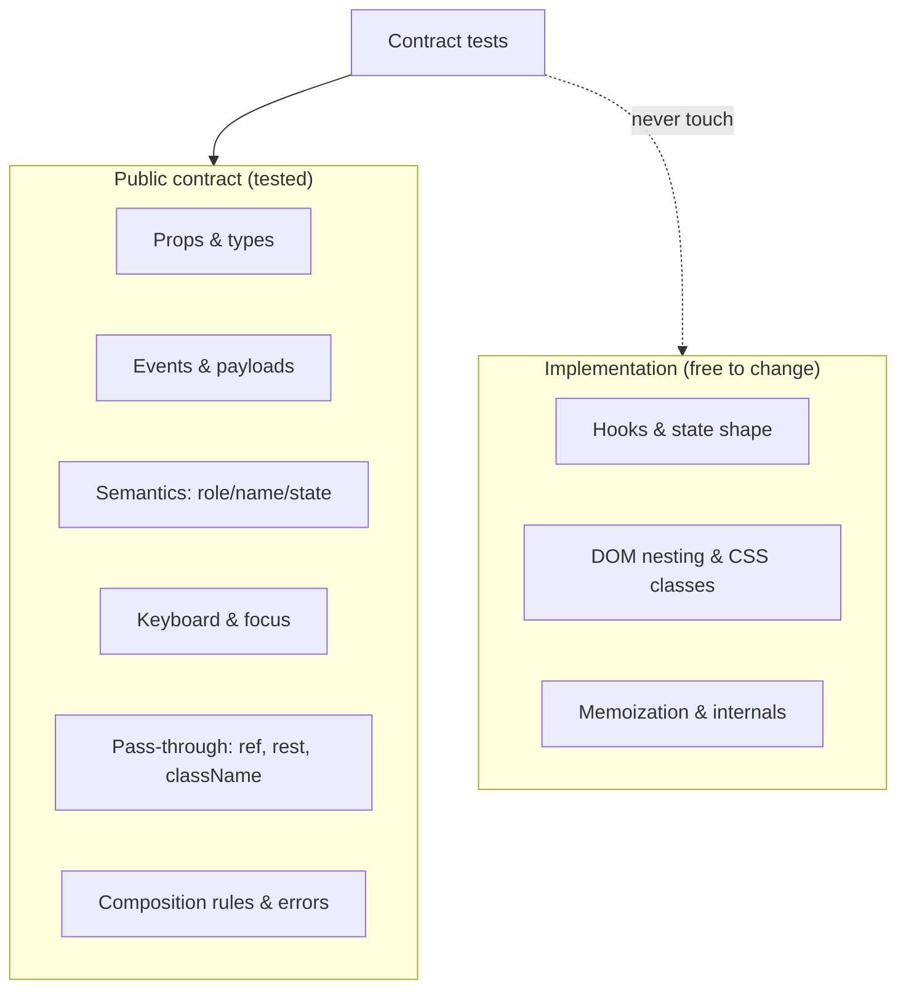
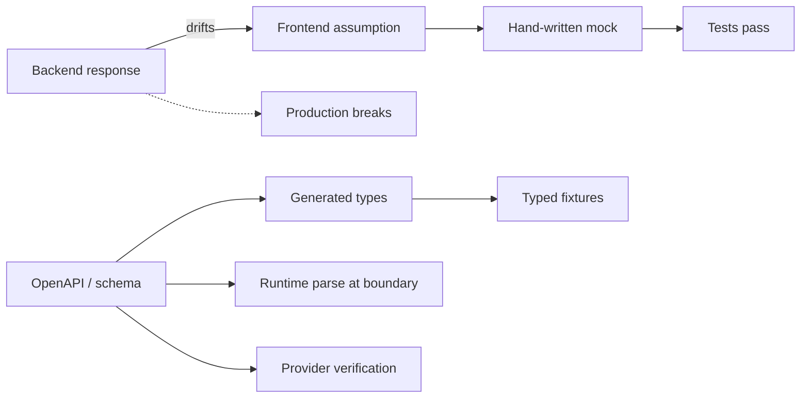

# 08 / 11 — Component Contract Testing: Props, Events, States, Types, and API Boundaries

## 1. Lesson metadata

| | |
|---|---|
| **Level** | Advanced |
| **Study time** | 4–5 hours (reading 2 h, experiments 1.5 h, exercises 1.5 h) |
| **Prerequisites** | [03 — React Testing Library](./03-react-testing-library.md), [06 — Mocking strategies and MSW](./06-mocking-strategies-and-msw.md), [07 — Testing API interactions](./07-testing-api-interactions.md), [10 — Accessibility testing](./10-accessibility-testing.md) |
| **Next** | [12 — Visual regression](./12-visual-regression.md) |
| **Related** | [13 — TypeScript correctness](./13-typescript-correctness.md), [16 — Avoiding brittle tests](./16-avoiding-brittle-tests.md), Phase 4 component design lessons (see [ROADMAP](../ROADMAP.md)) |

**Learning objectives.** After this lesson you can:
1. Define a component's *contract* and separate it from its implementation.
2. Enumerate the dimensions of a contract: inputs (props), outputs (events/callbacks, rendered semantics), states, composition rules, accessibility, and type-level guarantees.
3. Write contract tests that survive refactors of internals, and reusable contract suites that run against multiple implementations.
4. Test prop-driven variants systematically (`it.each`, state matrices) without combinatorial explosion.
5. Type-test component APIs (compile-time failures as assertions).
6. Apply the same idea at the network boundary: validate API responses with schemas, share fixtures between mocks and real providers, and understand consumer-driven contract testing.

**Concepts covered:** public vs private API, behavioural contract, props/events/states matrix, controlled/uncontrolled contract, composition (slots, children, render props), ref and `className`/rest-prop passthrough, shared contract suites, type-level tests (`expectTypeOf`, `// @ts-expect-error`), runtime schema validation at boundaries, mock/real drift, consumer-driven contracts (Pact-style), Storybook stories as living contracts.

> **Tool note (verified 2026-10-22).** `expectTypeOf` and typecheck mode were run on Vitest 3.2.7 (type tests are matched by `typecheck.include`, default `**/*.{test,spec}-d.?(c|m)[jt]s?(x)`, and run with `vitest --typecheck`; `tsc --noEmit` also checks them). Storybook's portable stories are documented at <https://storybook.js.org/docs/api/portable-stories/portable-stories-vitest>: `import { composeStories } from '@storybook/<your-framework>'` (for example `@storybook/react-vite`), `const { Primary } = composeStories(stories)`, then `await Primary.run()`, plus `setProjectAnnotations` for global config. Pact (`@pact-foundation/pact`) was not run here; check its docs before adopting. The component code in §5.1-5.2 (Button, the TextField contract suite) was executed and passes on React 19.3 + RTL 16.3.

---

## 2. Deep conceptual explanation

### 2.1 What problem is this lesson solving?

Most React test suites test one of two extremes: tiny implementation details ("`useState` was called with 0", "this child component received prop X") or whole-page flows. The middle layer, the **component as a unit with a public API consumed by other developers**, is often under-specified. For a shared component (a `Button`, `DataTable`, `DatePicker`, or a team's `<UserMenu>`) the question is:

> *What can a consumer rely on, and does a test fail if that promise is broken?*

That promise is the component's **contract**. Without explicit contract tests, a refactor of a design-system component can silently break fifty consumers: the `onChange` payload shape changes, `ref` no longer reaches the DOM node, an `aria-label` prop is no longer forwarded, `className` is overwritten instead of merged. None of those failures are caught by that component's snapshot test, because the snapshot was regenerated by the author.

### 2.2 Contract vs implementation

| | Contract (public) | Implementation (private) |
|---|---|---|
| Examples | Props and their types; callbacks and their payloads; roles/names/states exposed; keyboard behaviour; documented slots; which props are controlled/uncontrolled; what is forwarded (`ref`, rest props) | Internal state variable names, hooks used, child component tree, CSS class names, memoisation, DOM nesting depth |
| Who depends | Consumers (other teams, other files, assistive technology, end users) | Only the component's author |
| Test strategy | Assert through the public surface; fail on contract change | Do not test directly; free to refactor |
| Change policy | Versioned/semantic; breaking changes announced | Any time |

The test of whether something belongs in a contract test: **if I rewrote this component from scratch, keeping the documented behaviour, should this test still pass?** Yes → contract. No → implementation detail ([Lesson 16](./16-avoiding-brittle-tests.md)).

### 2.3 The dimensions of a React component contract

1. **Inputs (props).** Required/optional; allowed values; defaults; combinations that are invalid (a discriminated union); what happens with `undefined` vs omitted.
2. **Outputs.** Callback props and their payload semantics (when called, how many times, with what arguments, in what order relative to other callbacks); render output *as exposed semantics* (role, name, state, text), not markup structure.
3. **Interaction states.** Default, hover/focus/active (where behavioural), disabled, loading, error, empty, selected, expanded.
4. **Controlled vs uncontrolled.** If `value` is provided the component must not hold its own value; if only `defaultValue`, the component owns state; switching between modes is a documented hazard. See the controlled/uncontrolled treatment in [Phase 3](../03-react-state-and-hooks/17-derived-state.md) and [Phase 1](../01-react-fundamentals/) forms lessons.
5. **Composition.** `children`, slots, render props, compound components (`<Select><Select.Option/></Select>`): what is allowed, what happens with invalid children, context requirements ("`Select.Option` must be inside `Select`").
6. **Pass-through.** `ref` (in React 19 a regular prop for function components; `forwardRef` is the pre-19 mechanism, still works, and react.dev says it will be deprecated in a future release), `className`/`style` merging, spreading unrecognised props (`data-*`, `aria-*`, event handlers) onto the root DOM element, and the **polymorphic `as` prop** where applicable.
7. **Accessibility.** Role, name requirements, keyboard map, focus behaviour ([Lesson 10](./10-accessibility-testing.md)).
8. **Type-level.** The TypeScript signature **is** part of the contract: invalid prop combinations should fail to compile.
9. **Non-functional commitments** (only when you have them): no re-render on unrelated updates, SSR-safe, no layout shift, stable ids. Test sparingly.

### 2.4 Contracts at the boundaries of your system

A component also sits between **data and UI**. At the network boundary the contract is the shape and semantics of API responses. The danger is *mock drift*: tests pass against hand-written fixtures that no longer match what the backend returns. Defences, in increasing strength:

1. **Typed fixtures** generated from the same source of truth (OpenAPI/GraphQL schema types) so a spec change makes the fixture fail to compile.
2. **Runtime schema validation** (for example Zod, Valibot, or similar) at the data-fetching boundary; the same schema validates fixtures in tests ([Lesson 07](./07-testing-api-interactions.md), [Phase 6 normalisation](../06-data-fetching-and-state-ecosystems/04-api-normalization.md)).
3. **Provider verification / consumer-driven contract tests** (Pact-style): the consumer's tests record the requests it makes and responses it needs; the provider's CI replays them to verify. This catches drift across team boundaries, at the cost of infrastructure and process.
4. **End-to-end smoke tests** against a real or staging environment ([Lesson 09](./09-e2e-with-playwright.md)).

### 2.5 Misconceptions

| Misconception | Reality |
|---|---|
| "Snapshot tests are contract tests." | A snapshot records *current output*, not *intended behaviour*; authors update it reflexively. It documents nothing a consumer can rely on. |
| "100% coverage means the contract is tested." | Coverage measures executed lines, not asserted behaviour. A line can run without any assertion about its outcome. |
| "TypeScript makes tests of props unnecessary." | Types check shape at compile time, not behaviour (call counts, ordering, focus) and not runtime data crossing the network. They *are* a contract layer, but a partial one. |
| "Contract testing means Pact." | Pact is one implementation of consumer-driven *API* contracts. Component contracts are about props/events/semantics. Same philosophy, different scope. |
| "Every internal component needs a contract suite." | Contracts matter in proportion to the number and distance of consumers. A private one-use component needs ordinary behavioural tests. |

---

## 3. Internal mechanics

### 3.1 How tests "see" the contract

A component contract test in the Testing Library style interacts only with what a consumer or user can: it **renders** with props, **queries** by role/label/text, **acts** through `user-event`, and **asserts** on (a) the DOM exposed semantics and (b) callback spies. It never imports internals, never inspects state, and never queries by CSS class. This restriction is what makes the test refactor-proof: a rewritten implementation passes if the contract holds.

### 3.2 Why controlled/uncontrolled behaviour needs explicit tests

A controlled input ([React docs: `<input>`](https://react.dev/reference/react-dom/components/input)) takes its value from props; React re-applies `value` after each event, so if the parent does not update state in `onChange`, the displayed value does not change. A contract test for a controlled component must therefore render it **inside a harness that owns state**, or assert that a stateless parent that ignores the change keeps the displayed value. Tests that render `<Input value="a" onChange={spy} />` and then type "b" will observe the DOM still showing "a", which is *correct*, and a common source of confusion.

```tsx
// Controlled contract: the parent decides.
render(<Input value="a" onChange={spy} label="Name" />);
await user.type(screen.getByLabelText('Name'), 'b');
expect(spy).toHaveBeenCalledTimes(1);
expect(screen.getByLabelText('Name')).toHaveValue('a'); // React reverted to the controlled value
```

### 3.3 Type-level contracts at compile time

TypeScript type assertions are evaluated by the compiler, not at runtime. Two common mechanisms:

- **`// @ts-expect-error`**: the compiler *requires* an error on the next line. If a refactor makes invalid usage valid (a regression in type strictness), the directive itself becomes an error ("Unused '@ts-expect-error' directive"). So negative type tests need only `tsc --noEmit` in CI.
- **Assertion helpers** (`expectTypeOf` in Vitest, `tsd`, `expect-type`, `@type-challenges/utils`-style `Equal`): compare inferred types. Vitest can run `*.test-d.ts` files in a typecheck mode (`vitest --typecheck` or `test.typecheck.enabled`; the default include glob is `**/*.{test,spec}-d.?(c|m)[jt]s?(x)`; verified).

Type tests are checked by the type checker; Vitest's *runtime* execution of ordinary test files does not check types (esbuild strips them). This is why [Lesson 13](./13-typescript-correctness.md) insists on `tsc --noEmit` as a separate CI job.

### 3.4 Where contract suites hook in

A **shared contract suite** is a function that takes a factory for "an implementation" and registers tests against it:

```mermaid
flowchart LR
  S[contractSuite(name, render)] --> T1[tests for role/name]
  S --> T2[tests for keyboard]
  S --> T3[tests for controlled/uncontrolled]
  A[Button from design-system v1] --> S
  B[Button from design-system v2 rewrite] --> S
  C[App-specific wrapper of Button] --> S
```

The same suite verifies the legacy and the rewrite, and wrapper components that claim to keep the base contract. This is the foundation of safe migrations ([Phase 10](../10-production-engineering/) and [Phase 11](../11-senior-and-architect-mastery/) cover large-scale migrations).

---

## 4. Step-by-step execution walkthrough: writing a contract for `TextField`

Scenario: A `TextField` shared component. Steps from requirement to tests:

1. **List the documented behaviours** (the "README contract"):
   - Renders a visible `<label>` associated with the input (`label` prop required).
   - `description` and `error` props linked via `aria-describedby`; `error` sets `aria-invalid`.
   - Controlled (`value` + `onChange`) or uncontrolled (`defaultValue`).
   - `onChange` called with the new **string value** (not the event) this payload shape is a contract decision; many libraries pass the event instead.
   - Forwards `ref` to the `<input>`; spreads rest props onto the `<input>`; merges `className` on the root.
   - `disabled` prevents typing and removes from tab order.
2. **Map each to an observable assertion** via public surface (role, label, description).
3. **Decide the environment**: jsdom is sufficient (no layout dependency).
4. **Write tests table-first**: each contract bullet is one `test`.
5. **Write the negative type tests**: `label` is required; `value` without `onChange` is rejected (or `readOnly`).
6. **Add the a11y scan** ([Lesson 10](./10-accessibility-testing.md)) across states.
7. **Review**: remove anything asserting DOM structure or class names beyond the documented `className` merge.

---

## 5. Code examples

### 5.1 Minimal example — contract of a `Button`

```tsx
// Button.tsx — React 19: ref is a regular prop on function components
import type { ComponentPropsWithRef } from 'react';

export type ButtonProps = ComponentPropsWithRef<'button'> & {
  variant?: 'primary' | 'secondary' | 'danger';
  loading?: boolean;
};

export function Button({ variant = 'primary', loading = false, disabled, children, className, ...rest }: ButtonProps) {
  return (
    <button
      type="button"
      {...rest}
      className={['btn', `btn-${variant}`, className].filter(Boolean).join(' ')}
      disabled={disabled || loading}
      aria-busy={loading || undefined}
    >
      {children}
    </button>
  );
}
```

Line notes:
- `ComponentPropsWithRef<'button'>`: in React 19 types, `ref` is part of function-component props, so no `forwardRef` wrapper is required (verified: this `Button` passes the `ref` test on React 19.3.1 + @types/react 19). With React 18 types you need `forwardRef`.
- `type="button"` first, then `{...rest}`: consumers can override with `type="submit"`. Order is a contract decision; tests pin it.
- `disabled={disabled || loading}`: loading implies non-interactive.

```tsx
// Button.test.tsx
import { createRef } from 'react';
import { render, screen } from '@testing-library/react';
import userEvent from '@testing-library/user-event';
import { describe, expect, test, vi } from 'vitest';
import { Button } from './Button';

describe('Button contract', () => {
  test('exposes role button with the given name', () => {
    render(<Button>Save</Button>);
    expect(screen.getByRole('button', { name: 'Save' })).toBeInTheDocument();
  });

  test('does not submit forms by default, but can opt in', async () => {
    const user = userEvent.setup();
    const onSubmit = vi.fn((e: React.FormEvent) => e.preventDefault());
    render(
      <form onSubmit={onSubmit}>
        <Button>Default</Button>
        <Button type="submit">Submit</Button>
      </form>,
    );
    await user.click(screen.getByRole('button', { name: 'Default' }));
    expect(onSubmit).not.toHaveBeenCalled();
    await user.click(screen.getByRole('button', { name: 'Submit' }));
    expect(onSubmit).toHaveBeenCalledTimes(1);
  });

  test('loading disables interaction and exposes busy state', async () => {
    const user = userEvent.setup();
    const onClick = vi.fn();
    render(<Button loading onClick={onClick}>Pay</Button>);
    const btn = screen.getByRole('button', { name: 'Pay' });
    expect(btn).toBeDisabled();
    expect(btn).toHaveAttribute('aria-busy', 'true');
    await user.click(btn);
    expect(onClick).not.toHaveBeenCalled();
  });

  test('forwards ref and rest props, merges className', () => {
    const ref = createRef<HTMLButtonElement>();
    render(<Button ref={ref} data-analytics="cta" aria-describedby="hint" className="custom">Go</Button>);
    const btn = screen.getByRole('button', { name: 'Go' });
    expect(ref.current).toBe(btn);
    expect(btn).toHaveAttribute('data-analytics', 'cta');
    expect(btn).toHaveAccessibleDescription; // see note
    expect(btn).toHaveClass('custom');
  });
});
```

Notes. The line `expect(btn).toHaveAccessibleDescription;` is a **bug as written** (a property access, not a call: it asserts nothing). It is left here deliberately: spot it. The fix is `expect(btn).toHaveAttribute('aria-describedby', 'hint')` (the contract is "forwarded") — or provide an element with id `hint` and call `toHaveAccessibleDescription('...')`. Lint rules for jest-dom and Testing Library can catch some of these ([Lesson 14](./14-linting-and-static-analysis.md)); this is an example of why assertion mistakes need review.

`toHaveClass('custom')` asserts only the documented merge, not `btn-primary`; the generated variant class names are implementation detail unless you document them as public styling hooks.

**Predict:** `<Button loading disabled={false}>X</Button>` — is it disabled? *Yes*, `false || true`.

### 5.2 Practical example — a reusable contract suite

```tsx
// contracts/textFieldContract.tsx
import { useState, type ComponentType } from 'react';
import { render, screen } from '@testing-library/react';
import userEvent from '@testing-library/user-event';
import { describe, expect, test, vi } from 'vitest';

export interface TextFieldLikeProps {
  label: string;
  value?: string;
  defaultValue?: string;
  onChange?: (value: string) => void;
  error?: string;
  disabled?: boolean;
}

export function textFieldContract(name: string, TextField: ComponentType<TextFieldLikeProps>) {
  describe(`${name} satisfies the TextField contract`, () => {
    test('label is programmatically associated', () => {
      render(<TextField label="Email" />);
      expect(screen.getByRole('textbox', { name: 'Email' })).toBeInTheDocument();
    });

    test('uncontrolled: owns its value and reports string payloads', async () => {
      const user = userEvent.setup();
      const onChange = vi.fn();
      render(<TextField label="Email" defaultValue="a" onChange={onChange} />);
      const input = screen.getByRole('textbox', { name: 'Email' });
      await user.type(input, 'bc');
      expect(input).toHaveValue('abc');
      expect(onChange).toHaveBeenNthCalledWith(1, 'ab');
      expect(onChange).toHaveBeenNthCalledWith(2, 'abc');
    });

    test('controlled: displays the parent value, not its own', async () => {
      const user = userEvent.setup();
      const onChange = vi.fn();
      render(<TextField label="Email" value="fixed" onChange={onChange} />);
      const input = screen.getByRole('textbox', { name: 'Email' });
      await user.type(input, 'x');
      expect(onChange).toHaveBeenCalledWith('fixedx');
      expect(input).toHaveValue('fixed');
    });

    test('controlled with state owner follows updates', async () => {
      const user = userEvent.setup();
      function Harness() {
        const [v, setV] = useState('');
        return <TextField label="Email" value={v} onChange={setV} />;
      }
      render(<Harness />);
      const input = screen.getByRole('textbox', { name: 'Email' });
      await user.type(input, 'hi');
      expect(input).toHaveValue('hi');
    });

    test('error is exposed as invalid state with an accessible description', () => {
      render(<TextField label="Email" error="Enter a valid email" />);
      const input = screen.getByRole('textbox', { name: 'Email' });
      expect(input).toBeInvalid();
      expect(input).toHaveAccessibleDescription('Enter a valid email');
    });

    test('disabled is not focusable and ignores typing', async () => {
      const user = userEvent.setup();
      const onChange = vi.fn();
      render(<TextField label="Email" disabled onChange={onChange} />);
      await user.tab();
      expect(screen.getByRole('textbox', { name: 'Email' })).not.toHaveFocus();
      await user.type(screen.getByRole('textbox'), 'x');
      expect(onChange).not.toHaveBeenCalled();
    });
  });
}
```

```tsx
// TextField.contract.test.tsx
import { textFieldContract } from './contracts/textFieldContract';
import { TextField } from './TextField';
import { LegacyTextField } from './legacy/LegacyTextField';
textFieldContract('TextField', TextField);
textFieldContract('LegacyTextField (adapter)', (props) => <LegacyTextField {...props} />);
```

Why this is powerful: the contract is one file. During a rewrite (e.g. replacing a hand-rolled input with a headless primitive), the old and new implementations run the same suite; differences surface as failing contract tests rather than production bugs. **Trade-off:** the contract suite must stay at the lowest common denominator of behaviours that *both* implementations promise; behaviours specific to one go in its own tests.

### 5.3 Incorrect example — testing implementation, not contract

```tsx
import { shallow } from 'enzyme'; // legacy, historical; shown only to illustrate the anti-pattern

test('TextField sets internal state', () => {
  const wrapper = shallow(<TextField label="x" />);
  wrapper.find('input').simulate('change', { target: { value: 'abc' } });
  expect(wrapper.state('inner')).toBe('abc');
});
```

Problems: Enzyme is unmaintained for modern React (do not use with React 19; historical here); shallow rendering and `state()` inspect internals; `simulate` bypasses real event semantics; the test fails when the author converts the class to hooks even though behaviour is unchanged, and passes when the DOM is broken.

A second incorrect variation in modern syntax:

```tsx
test('passes onChange to Input', () => {
  const spy = vi.spyOn(InputModule, 'Input');
  render(<TextField label="x" onChange={vi.fn()} />);
  expect(spy).toHaveBeenCalledWith(expect.objectContaining({ onChange: expect.any(Function) }), undefined);
});
```
This asserts how the component is composed internally (and the second argument is a legacy artifact). Any refactor that inlines `Input` breaks it.

### 5.4 Corrected implementation
The behaviour-through-DOM tests of §5.2: type, assert displayed value and callback payload.

### 5.5 Advanced example — type-level contract tests

```tsx
// TextField.types.ts
export type TextFieldProps =
  | { label: string; 'aria-label'?: never; value: string; onChange: (v: string) => void; defaultValue?: never }
  | { label: string; 'aria-label'?: never; value?: never; onChange?: (v: string) => void; defaultValue?: string };
```

```ts
// TextField.test-d.ts  (run with `vitest --typecheck` or `tsc --noEmit`; both verified)
import { expectTypeOf, test } from 'vitest';
import type { TextFieldProps } from './TextField.types';

test('controlled needs onChange; cannot mix with defaultValue', () => {
  const ok1: TextFieldProps = { label: 'A', value: 'x', onChange: () => {} };
  const ok2: TextFieldProps = { label: 'A', defaultValue: 'x' };

  // @ts-expect-error — controlled without onChange is rejected
  const bad1: TextFieldProps = { label: 'A', value: 'x' };
  // @ts-expect-error — value and defaultValue together are rejected
  const bad2: TextFieldProps = { label: 'A', value: 'x', onChange: () => {}, defaultValue: 'y' };
  // @ts-expect-error — label is required
  const bad3: TextFieldProps = { defaultValue: 'x' };

  expectTypeOf(ok1.onChange).toEqualTypeOf<(v: string) => void>();                                // narrowed by the assignment
  expectTypeOf<TextFieldProps['onChange']>().toEqualTypeOf<((v: string) => void) | undefined>();   // the declared union
  void [ok1, ok2, bad1, bad2, bad3];
});
```

Notes: **the first `expectTypeOf` line asserts the narrowed type, not the union's.** TypeScript narrows a variable declared with a union type on assignment, so `ok1` is the first member (where `onChange` is required) and `ok1.onChange` is `(v: string) => void`. An earlier draft of this lesson asserted `((v: string) => void) | undefined` there; running it under `tsc --strict` and `vitest --typecheck` failed with a `toEqualTypeOf` constraint error, which is why the second line asserts the declared union explicitly with `TextFieldProps['onChange']`. Discriminated unions that enforce "valid prop combinations" give consumers autocompletion errors at the call site instead of runtime warnings.

Each `@ts-expect-error` must be followed by exactly the line that errors. Put `tsc --noEmit` ([Lesson 13](./13-typescript-correctness.md)) in CI; otherwise these tests never run.

### 5.6 Advanced example — compound component composition contract

```tsx
import { createContext, use, useId, type ReactNode } from 'react';

const TabsCtx = createContext<{ baseId: string } | null>(null);

function useTabsCtx(component: string) {
  const ctx = use(TabsCtx); // React 19: `use` can read context, also conditionally; useContext also works
  if (!ctx) throw new Error(`<${component}> must be rendered inside <Tabs>`);
  return ctx;
}

export function Tabs({ children }: { children: ReactNode }) {
  const baseId = useId();
  return <TabsCtx value={{ baseId }}>{children}</TabsCtx>; // React 19: context object is itself a provider
}
export function Tab({ id, children }: { id: string; children: ReactNode }) {
  const { baseId } = useTabsCtx('Tab');
  return <button role="tab" id={`${baseId}-${id}`}>{children}</button>;
}
```

```tsx
test('Tab outside Tabs fails loudly with an actionable message', () => {
  const spy = vi.spyOn(console, 'error').mockImplementation(() => {});
  expect(() => render(<Tab id="a">A</Tab>)).toThrow('<Tab> must be rendered inside <Tabs>');
  spy.mockRestore();
});
```

Why `console.error` is mocked: React 18 logged errors that propagate during render; React 19 rethrows them through `act` without logging (verified on 19.3.1: 0 `console.error` calls), so the mock is harmless but no longer needed there. `render` (RTL 16.3.3) throws the render error, so `expect(() => render(...)).toThrow(...)` works. Contract thinking: an *error contract* ("misuse throws a clear message") is as legitimate as a success contract.

### 5.7 Boundary contract: schema-validated fixtures shared by UI tests and MSW

```ts
// api/schemas.ts
import { z } from 'zod'; // Zod 4.x verified (4.6.7): `z.string().email()` still works but is deprecated in favour of `z.email()`
export const UserSchema = z.object({
  id: z.string(),
  name: z.string(),
  email: z.string().email(),
  role: z.enum(['admin', 'member']),
});
export type User = z.infer<typeof UserSchema>;
export const UsersResponse = z.object({ users: z.array(UserSchema) });
```

```ts
// test/fixtures.ts
import { UsersResponse, type User } from '../api/schemas';

export function makeUser(overrides: Partial<User> = {}): User {
  return { id: 'u1', name: 'Ada Lovelace', email: 'ada@example.com', role: 'member', ...overrides };
}
export function usersResponse(users: User[]) {
  return UsersResponse.parse({ users }); // fixture cannot drift from schema: throws if invalid
}
```

```ts
// handlers.ts (MSW 2.x syntax; a relative URL works under jsdom while MSW listens, see lesson 06 §3.3)
import { http, HttpResponse } from 'msw';
import { usersResponse, makeUser } from './fixtures';
export const handlers = [
  http.get('/api/users', () => HttpResponse.json(usersResponse([makeUser(), makeUser({ id: 'u2', role: 'admin' })]))),
];
```

Impact: if the backend adds `role: 'owner'`, updating the schema fails every fixture that uses an invalid value (compile-time through `z.infer` and runtime through `.parse`) instead of passing silently. The production code uses the **same** `UsersResponse.parse` in its fetch function, so the test exercises the real validation path. Trade-off: schema validation costs runtime CPU and bundle size; for hot paths validate once at the boundary, not per render.

**Consumer-driven contract testing (Pact-style)** extends this across teams: your UI tests record interactions into a contract file; the backend verifies it in its CI. It is valuable when frontend and backend deploy independently and the API is not already governed by a typed spec (OpenAPI/GraphQL with breaking-change detection). Often a typed schema + generated types + a few E2E checks give 80% of the value with 20% of the infrastructure. (Read the Pact documentation for the JavaScript library and broker setup before committing to it; not executed here.)

---

## 6. Visual explanations

### What a component contract covers



### Test pyramid positioning of contract tests

```text
        /\         E2E smoke (few)           real browser, real(ish) backend
       /  \        Integration flows         pages composed from components, MSW
      /----\       Component contracts  <--  this lesson: per shared component, jsdom
     /------\      Unit (pure functions, reducers, utils)
    /--------\     Static: types, lint, schema validation
```

### Mock drift and how each defence closes it



---

## 7. Alternative approaches and trade-offs

| Approach | Refactor safety | Detects real breakages | Authoring cost | Maintenance | Best for |
|---|---|---|---|---|---|
| Behavioural contract tests (RTL) | High | High for covered behaviours | Medium | Low | Shared components, design systems |
| Snapshot tests of rendered DOM | Low (breaks on harmless markup change) | Low–medium; relies on human review of diffs | Very low | High churn | Tiny pure presentational pieces with stable markup; serialised data structures |
| Storybook stories + interaction tests (`play` functions) | High if using role queries | Medium–high | Medium; doubles as docs | Medium | Teams already on Storybook; living documentation |
| Type-level tests | N/A (compile time) | High for prop-shape regressions | Low | Low | Libraries with generic/polymorphic APIs |
| Visual regression ([Lesson 12](./12-visual-regression.md)) | High for markup, **low** for behaviour | High for appearance | Low–medium | Medium (baseline updates) | Style-heavy components |
| Consumer-driven API contracts (Pact-style) | N/A | High for API drift | High | High | Independent frontend/backend release cadences |
| Typed + validated fixtures | N/A | Medium–high for API drift | Low | Low | Almost every app; default choice |
| Integration tests of consumers only | High | Medium, shows breakage late | Medium | Medium | Private components with one consumer |

**Scenario where contract suites are NOT best.** A product team's single-use `PricingCard` has one consumer: the pricing page. Writing a contract suite adds ceremony; a page-level integration test with real children is cheaper and catches more. Likewise for an early prototype where the API changes daily: lock down contracts when stabilising, not before. Over-specified contracts calcify design: if every prop name is pinned by dozens of tests, evolution slows. Contract tests are most valuable *where change is expensive*.

---

## 8. Best practices and anti-patterns

### Best practices
1. **Write the contract in prose first** (README/Storybook docs), then derive tests. If you cannot state a behaviour in a sentence, it is probably not a contract.
2. **Assert via the public surface**: roles, labels, text, callbacks.
3. **Cover the pass-through set** (`ref`, `className`, rest props, event handlers) for any wrapper component: it is where design-system regressions hide.
4. **Test states as a matrix, not as a Cartesian product.** Choose orthogonal states and test interactions only where they plausibly interact (e.g. `loading × disabled`, not `variant × size × loading × disabled`).
5. **Use `it.each` / `test.each` for variants** to keep the tests readable and exhaustive for enumerable inputs.
6. **Prefer typed builders/factories** (`makeUser`) and one source of truth for fixtures.
7. **Keep negative contract tests**: invalid use produces clear errors/compile errors.
8. **Version your contract.** Breaking test changes should accompany a changelog entry and (for libraries) a major version/codemod.
9. **Run type tests in CI** via `tsc --noEmit`.
10. **Validate API data at the boundary** and reuse the schemas in tests.

### Anti-patterns

| Anti-pattern | Why it's bad | Better |
|---|---|---|
| Snapshot everything | Reflexive `-u` updates; no intent | Targeted assertions |
| Asserting on internal child props (spying on child components) | Couples to composition | Assert rendered semantics |
| Querying by class names for contract | Class names are private unless documented | Role/label |
| Mocking the unit's own collaborators in contract tests | Tests the mock | Mock only boundaries (network, time) |
| One mega-test per component | Hard to diagnose | One behaviour per test |
| Fixtures duplicated per test with drift | Silent mismatch | Shared typed builders |
| Contract suite with tests specific to one implementation | Blocks migration | Separate shared vs specific |
| Asserting number of renders | Implementation detail (StrictMode and React changes alter counts) | Only when render count *is* the contract (performance tests, [Phase 7](../07-performance/03-why-components-rerender.md)) |

**Justified exceptions.** Snapshot tests are reasonable for serialisable *data* outputs (e.g. a formatter returning a structured object, a generated route table) where a diff is meaningfully reviewable. Asserting on a child component's props is acceptable when you are testing a *generic wrapper* whose contract literally is "forwards these props to the supplied component" (e.g. a HOC-like adapter), and then you assert via a test double passed *through the public API*, not by spying on module internals.

---

## 9. Real-world application

**Design system with multiple consuming apps.** A platform team owns `Button`, `TextField`, `Select`, `DataTable`. Each has a contract doc, a shared suite, a11y scan, and a type test. Releases run the suites against **consumer smoke apps** that import the built package (not source) to catch packaging bugs (missing `exports`, CSS not shipped). Constraint: backward compatibility; a deprecation policy (warn in dev, remove next major).

**Finance dashboard with typed API.** Server responses include money amounts as strings to preserve precision *(domain convention; verify your API's choice)*. The boundary schema asserts string format and a decimal regex; fixtures use builders; UI tests assert formatted output. A schema change in the API fails the build before it reaches users. Constraint: schema validation of large tables costs CPU; validate at fetch time, off the hot render path (and consider validating a sample in production, all in tests).

**Multi-team micro-frontends.** Teams publish shared components and events across boundaries. A contract is the event name + payload type; use a shared typed package and consumer tests that import the real type; the host app runs a contract suite per remote at integration time. Constraint: independent deploys mean version skew; test the oldest supported contract version.

**Forms library wrappers.** A company-wide `<Field>` wraps `react-hook-form` (or similar) controllers. Contract: `name`, `rules`, error display, a11y wiring, `onChange` semantics. Tests render within a real form provider, not a mocked one. *(Library API details: verify against its current docs.)*

**Realtime widget.** Contract includes ordering/idempotence of callbacks: "`onMessage` called once per unique id, in server order, even after reconnect". Contract tests use a fake socket implementation passed through the public API.

---

## 10. Debugging and troubleshooting

**Symptom 1: A contract test passes against the new implementation but a consumer broke.**
Root cause candidates: the contract was incomplete (e.g. pass-through not tested), or the consumer relied on a private behaviour (class name, DOM structure). Investigate the consumer's diff/stack trace, reproduce in a minimal test, **add the missing contract clause** (if intentional) or fix the consumer (if private). The postmortem outcome is a *new contract test*.

**Symptom 2: Controlled-component test shows an unchanged value after `user.type`.**
Cause: parent did not update state (see §3.2). Fix: harness with state, or assert that the value stays (if that is the point). Check with `screen.debug()` after each keystroke.

**Symptom 3: `@ts-expect-error` is reported as unused.**
It means the compiler *no longer* errors there, i.e. the type became more permissive. That is the intended signal. Investigate the type change (a union member widened? `any` leaked in?). Use `tsc --noEmit --pretty` and hover in the editor to see the inferred type.

**Symptom 4: Shared suite fails only for the legacy implementation.**
Determine whether the failure shows (a) a true contract violation (fix legacy or document the deviation), or (b) an intentional difference (move the test out of the shared suite into a per-implementation file). Keep a list of known deviations with owners.

**Symptom 5: MSW-based tests pass, staging fails with a parse error.**
Cause: fixture drift or schema too strict/loose. Capture a real staging response, run `UsersResponse.safeParse` on it, and look at `error.issues`. Decide whether the schema or the backend is wrong; update schema and add the captured response (sanitised) as a fixture.

**Symptom 6: Tests are slow because each contract test renders many variants.**
Investigate with Vitest's reporter timings; reduce `it.each` combinations, split heavy states into integration tests, avoid per-test `userEvent.setup()` network waits. Do not "fix" speed by sharing rendered DOM between tests; isolation matters ([Lesson 16](./16-avoiding-brittle-tests.md)).

---

## 11. Exercises

### Level A — Knowledge
A1. Define "component contract" and list five dimensions.
A2. Why is `ref` pass-through part of a design-system component's contract? What changed with React 19?
A3. What does `// @ts-expect-error` enforce that a comment `// this should error` does not?
A4. What is mock drift and name three defences.
A5. Give one situation where a snapshot test is justifiable.

### Level B — Code comprehension
B1. Does this test pass? Explain.
```tsx
render(<TextField label="N" value="a" onChange={() => {}} />);
await userEvent.setup().type(screen.getByLabelText('N'), 'bcd');
expect(screen.getByLabelText('N')).toHaveValue('abcd');
```
B2. What is wrong with this contract test?
```tsx
test('Button has primary class', () => {
  const { container } = render(<Button>Hi</Button>);
  expect(container.firstChild).toHaveClass('btn-primary');
});
```
B3. In the §5.5 types, why is `value` + `defaultValue` rejected, and what runtime warning does React emit if you do both on a native input? *(Check the React docs for `<input>`.)*
B4. Explain why `toHaveBeenNthCalledWith(1, 'ab')` appears in the uncontrolled test with `defaultValue="a"` and typing "bc".

### Level C — Implementation
C1. Write a contract suite for a `Select`-like component that has `options`, `value`/`onChange`, and keyboard selection, usable against two implementations.
C2. Write type tests for a polymorphic `Box` with an `as` prop where `href` is only valid when `as="a"`.
C3. Write a fixture builder and MSW handler for an `Order` resource with a status enum validated by Zod.

### Level D — Debugging
D1. A wrapper `IconButton` swallows `aria-label`. Write the failing contract test, then fix it.
D2. A consumer team reports their `data-testid` on `Card` no longer appears after your refactor. What process change prevents recurrence?
D3. Your `.test-d.ts` file never fails even after you deliberately break the type. List three reasons.

### Level E — Architecture and engineering decisions
E1. You must migrate 80 usages of a legacy `Modal` to a new implementation across 6 teams. Design the test strategy and rollout.
E2. Decide whether to adopt Pact-style contract tests for a frontend consuming 4 internal services. Evaluate on at least five criteria.
E3. Where should the *source of truth* for API shapes live and how do tests derive from it?

### Level F — Expert challenge
F1. Design a contract-test harness that automatically verifies, for every exported component in a design system package: `ref` forwarding to a DOM element, rest-prop spreading, and no axe violations in the default story, without hand-writing a test per component. Discuss its limits.

---

## 12. Detailed answers and explanations

> Attempt the exercises first.

**A1.** The set of behaviours consumers (developers, users, assistive tech) may rely on; separated from implementation. Dimensions (any five): props/types; callbacks/events and payload semantics; rendered semantics (role/name/state); interaction states; controlled/uncontrolled; composition rules and error behaviour; pass-through (`ref`, `className`, rest); accessibility/keyboard; type-level guarantees; non-functional commitments (SSR-safe, ids).

**A2.** Consumers use refs for focus management, measurement, third-party integration, and form libraries. If a wrapper drops it, "focus the first invalid field" breaks. In React 19, `ref` is a regular prop for function components, so wrappers that spread `...rest` forward it automatically; with React 18 and earlier `forwardRef` was required, and forgetting it was a classic regression. (React 19 upgrade guide: `ref` as a prop; `forwardRef` still works but will be deprecated.)

**A3.** The compiler *requires* an error on the next line; if none occurs, that itself is a compile error. A plain comment asserts nothing and rots. Edge: the directive suppresses *all* errors on that line, so keep the line minimal to avoid masking unrelated errors.

**A4.** Hand-written test doubles diverge from the real API, so tests pass while production fails. Defences: typed fixtures from a shared schema/spec; runtime schema validation at the boundary reused in tests; consumer-driven/provider-verified contracts; E2E smoke tests; (also) recording real responses periodically.

**A5.** Serialisable data with reviewable diffs, e.g. an ESLint config or generated route map; a pure formatter's structured output; an error message catalogue. Fails as justification for large rendered DOM trees.

**B1.** Fails (value stays `'a'`). The component is controlled, the `onChange` is a no-op and never updates the parent state, so React restores `'a'`. The callback may have been called, but display never changes. Fix: harness with state. Wrong answer "passes with 'abcd'" ignores the controlled contract.

**B2.** It couples to a class name that is an implementation detail (unless documented as a styling hook); asserts nothing about behaviour or semantics; passes if the button is `<div>`. Better: assert via role/name and, for variant styling, use visual regression ([Lesson 12](./12-visual-regression.md)). If `variant` has behavioural consequences (e.g. `danger` requires confirmation) test that.

**B3.** The union uses `defaultValue?: never` in the controlled branch and `value?: never` in the uncontrolled branch, so the compiler rejects both together. React warns in development when an input has both `value` and `defaultValue` ("contains an input of type … with both value and defaultValue props") and when `value` is provided without `onChange`/`readOnly` *(exact message text: verify in current React)*. Types move the error from runtime-dev-warning to compile time.

**B4.** `user.type` types each character as a separate keystroke; starting from "a", typing "b" yields "ab" (call 1), then "c" yields "abc" (call 2). The callback receives the **new string**, per the documented contract. Note that StrictMode double-invocation applies to render/effects, not DOM event handler calls, so counts are unaffected.

**C1 (sample).**
```tsx
export function selectContract(name: string, Select: ComponentType<SelectLikeProps>) {
  describe(`${name} contract`, () => {
    const options = [{ value: 'a', label: 'Alpha' }, { value: 'b', label: 'Beta' }];
    test('exposes a labelled combobox/listbox trigger', () => {
      render(<Select label="Letter" options={options} value="a" onChange={() => {}} />);
      expect(screen.getByRole('combobox', { name: 'Letter' })).toBeInTheDocument();
    });
    test('keyboard selection calls onChange with the option value', async () => {
      const user = userEvent.setup();
      const onChange = vi.fn();
      render(<Select label="Letter" options={options} value="a" onChange={onChange} />);
      await user.tab();
      await user.keyboard('{ArrowDown}{Enter}');   // verify: key map depends on implementation (select-only combobox pattern)
      await user.click(await screen.findByRole('option', { name: 'Beta' })); // fallback if menu requires click
      expect(onChange).toHaveBeenCalledWith('b');
    });
  });
}
```
Criteria: options passed via the public API; asserts value payload; avoids implementation-specific roles (document which ARIA pattern the contract requires; if two implementations use different patterns, the contract must pick one or be split). Edge cases: disabled options, typeahead, controlled mode, empty list.

**C2 (sample).** Define `type BoxProps<E extends ElementType> = { as?: E } & ComponentPropsWithoutRef<E>`. Tests: `const a: BoxProps<'a'> = { as: 'a', href: '/x' }` compiles; `// @ts-expect-error` on `{ as: 'div', href: '/x' }`. Note: the generic must be inferred at the *call site* (`<Box as="a" href="…"/>` in a `.test-d.tsx`), so test with JSX in a type test file rather than only with annotated variables. Criteria: negative test present; uses JSX for inference; mentions the cost of polymorphic types on compile time and error legibility.

**C3 (sample).** Schema `OrderSchema = z.object({ id: z.string(), status: z.enum(['pending','paid','shipped']), totalCents: z.number().int() })`; `makeOrder(overrides)` returns parsed object; handler `http.get('/api/orders/:id', ({ params }) => HttpResponse.json(makeOrder({ id: String(params.id) })))`. Also a test overriding with `server.use(...)` for the `shipped` state. Criteria: parse in builder; money in integer minor units; per-test overrides rather than global state mutation.

**D1.** Failing test: `render(<IconButton aria-label="Close" icon="x" />); expect(screen.getByRole('button', { name: 'Close' }))…` fails because the wrapper builds its own props object and omits `aria-label`. Fix: spread rest onto the `<button>`; type props as `ComponentPropsWithRef<'button'>`. Also add the missing-name type constraint: require either `aria-label` or visible `children` (union).

**D2.** Root cause: pass-through of `data-*` was never part of the written contract, so the refactor dropped it. Process: add rest-prop spreading to the contract for all shared components and to the shared harness (F1); document supported attributes; add a changelog/compat check; consider a consumer-smoke-app CI job that exercises real usage. Note that using `data-testid` in consumers is itself debatable ([Lesson 16](./16-avoiding-brittle-tests.md)) but pass-through is cheap and expected.

**D3.** (1) Type tests are not being type-checked: the runner executes them but esbuild strips types; run `tsc --noEmit` or Vitest typecheck mode. (2) `.test-d.ts` is excluded from `tsconfig` `include`. (3) The type became `any` (e.g. through an untyped import or `skipLibCheck` hiding errors in `.d.ts`), making everything assignable. (4) `expectTypeOf` used with a non-strict comparison on unions; use `toEqualTypeOf` rather than `toMatchTypeOf` when exactness is intended (`toEqualTypeOf` is strict equality of types; `toMatchTypeOf` only checks assignability, which is why `((v: string) => void) | undefined` vs a narrowed function type behaves differently).

**E1 (evaluation criteria).** Write the **old** modal's contract tests first (characterisation), run them against the old to validate the tests, then against the new implementation behind an adapter; fix deviations or document them; migrate via codemod or compatibility wrapper (`LegacyModal` implemented over the new one); ship per team behind feature flags; monitor errors; delete old after burn-down. Include a11y (focus trap/restoration), portal/z-index/scroll lock, SSR, nested modals, and a visual regression baseline. Mention rollback.

**E2 (evaluation).** Criteria: number of independent consumers/providers; release independence; existence of typed spec (OpenAPI/GraphQL) with breaking-change detection; team capacity for broker/CI infra; frequency of API drift incidents; E2E coverage. Example conclusion: if the 4 services publish OpenAPI specs with breaking-change checks and the frontend generates types + validates at the boundary, add schema-based tests and a few E2E checks; adopt Pact when drift incidents persist across independently deployed services or when services lack specs. Verify Pact's JS tooling and broker/hosted offerings.

**E3.** The API spec (OpenAPI/GraphQL schema) or a shared schema package is the source of truth; generate types, derive/validate schemas, and build fixtures from them; MSW handlers import the generated types so spec changes fail compilation; production fetch layer validates with the same schemas. If the backend has no spec, the frontend's schema becomes the de facto record, and provider verification becomes more valuable.

**F1 (example answer).** Use a registry (barrel export enumeration or a Storybook CSF index) and **portable stories** (`composeStories` from `@storybook/<framework>`, then `await Story.run()` per the Storybook portable-stories docs) to render each component's default story. Generic checks: (1) render; find the root DOM node; pass `ref` (callback ref capturing node), assert node is an `HTMLElement` and is contained in the container; (2) pass `data-contract="x"` and assert it's on *some* element; (3) run axe. Limits: required props/context differ per component (stories supply them), components that render nothing or portals, components whose root is not the element receiving rest props by design, and false confidence (generic checks don't validate behaviour). Evaluation: acknowledges per-component opt-outs with reasons, keeps the generic harness as a floor, not a ceiling.

---

## 13. Senior engineer interview questions

**Q1. "What's the difference between testing a component's behaviour and testing its implementation, concretely?"**
*Strong answer:* Behaviour = what a consumer or user can observe through public inputs/outputs: rendered semantics, callbacks with payloads, focus, errors. Implementation = state shape, hooks, child structure, class names. A behaviour test survives a rewrite that preserves documented behaviour; an implementation test fails on a harmless refactor and can pass on broken behaviour. The heuristic: "would a user or consumer notice?".

**Q2. "Why aren't snapshot tests enough for a design system?"**
*Strong answer:* They freeze current output, not intent; changes are accepted by regeneration; they don't test interaction, focus, a11y, or type contracts; and they churn with markup changes. Use targeted assertions for behaviour, visual regression for appearance, type tests for API shape.

**Q3. "How do you prevent mocks from diverging from the real API?"**
*Strong answer:* Single source of truth: generate types from the spec; build fixtures from typed factories; validate real responses at runtime with the same schema; verify provider against consumer expectations if teams deploy independently; keep a few E2E tests on real environments. Say which you'd choose given team structure.

**Q4. "A refactor to hooks changed a class component's `ref` behaviour and broke consumers. How do you prevent that?"**
*Strong answer:* Make `ref` forwarding part of the written contract with an explicit test; use the type (`ComponentPropsWithRef`) to make forwarding visible; run contract suites against old and new during the migration; explain the React 19 change (`ref` as prop) and legacy `forwardRef`.

**Q5. "How would you test that invalid prop combinations are rejected?"**
*Strong answer:* Model them as discriminated unions with `never` to exclude combinations, then add `@ts-expect-error` negative tests checked by `tsc --noEmit`; for runtime invariants (children validity, context), test that misuse throws an actionable error. Types for compile-time, runtime errors for JS consumers and dynamic data.

---

## 14. Further learning resources

| Resource | URL | Covers / why | Level | Study |
|---|---|---|---|---|
| Testing Library — Guiding principles | <https://testing-library.com/docs/guiding-principles/> | "The more your tests resemble the way your software is used…" | Beginner | Whole page |
| Testing Library — Queries | <https://testing-library.com/docs/queries/about/> | Priority; accessibility-based queries | Beginner | Priority |
| Vitest — Testing Types | <https://vitest.dev/guide/testing-types> | `expectTypeOf`, typecheck mode | Intermediate | Whole page |
| TypeScript Handbook — Everyday Types / Unions | <https://www.typescriptlang.org/docs/handbook/2/everyday-types.html> | Union and discriminated union basics | Beginner | Unions |
| TypeScript Handbook — Narrowing | <https://www.typescriptlang.org/docs/handbook/2/narrowing.html> | Discriminated unions | Intermediate | Discriminated unions |
| React — `<input>` reference | <https://react.dev/reference/react-dom/components/input> | Controlled vs uncontrolled semantics | Beginner | Controlling an input |
| React — Upgrade Guide (v19) | <https://react.dev/blog/2024/04/25/react-19-upgrade-guide> | `ref` as prop, `forwardRef` status | Intermediate | Ref changes |
| MSW docs | <https://mswjs.io/docs/> | Network mocking | Intermediate | Getting started, handlers |
| Zod docs | <https://zod.dev/> | Schema validation and inference (Zod 4) | Intermediate | Basics |
| Pact documentation | <https://docs.pact.io/> | Consumer-driven contract testing concepts | Advanced | Introduction, JS guides |
| Storybook docs | <https://storybook.js.org/docs> | Stories, interaction tests, portable stories (`composeStories`, `Story.run()`) | Intermediate | Testing section |

---

## 15. Knowledge checkpoint

**You should now understand**
- What a component contract is, its dimensions, and how it differs from implementation.
- Why controlled/uncontrolled, pass-through and composition rules deserve explicit tests.
- How compile-time (types) and runtime (schemas) contracts complement behavioural tests.

**You should be able to explain without notes**
- Why snapshots are not contracts and when they are acceptable.
- How shared contract suites make migrations safer, and their limits.
- How to prevent mock drift at the API boundary and when Pact-style testing pays off.

**You should be able to implement**
- A component contract test file; a shared contract suite; negative type tests; typed fixtures with schema validation and MSW handlers.

**You should be able to debug**
- Controlled-input test confusion; unused `@ts-expect-error`; consumer breakage not caught by tests; fixture/schema drift.

**Before moving on:** read [12 — Visual regression](./12-visual-regression.md), which covers the one dimension contract tests deliberately leave out: how components look.
