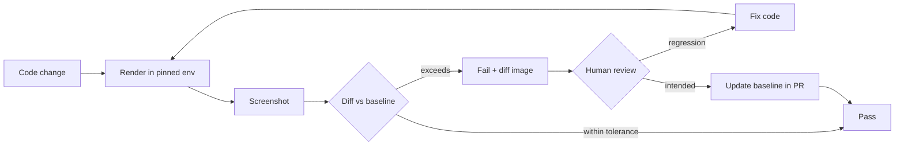
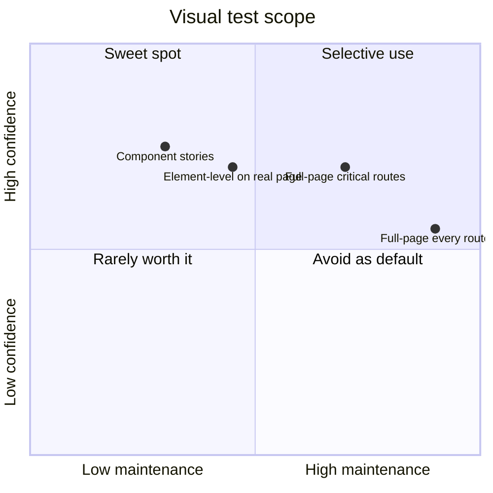

# 08 / 12 — Visual Regression Testing: Screenshots, Determinism, and Review Workflows

## 1. Lesson metadata

| | |
|---|---|
| **Level** | Intermediate–Advanced |
| **Study time** | 3–4 hours (reading 1.5 h, experiments 1 h, exercises 1–1.5 h) |
| **Prerequisites** | [01 — Test strategy and pyramid](./01-test-strategy-and-pyramid.md), [09 — E2E with Playwright](./09-e2e-with-playwright.md), [11 — Component contract testing](./11-component-contract-testing.md); browser rendering background from [Phase 0 lesson 03](../00-web-and-javascript-foundations/03-browser-rendering-pipeline.md) |
| **Next** | [13 — TypeScript correctness](./13-typescript-correctness.md) |
| **Related** | [15 — CI checks](./15-ci-checks.md), [16 — Avoiding brittle tests](./16-avoiding-brittle-tests.md), [10 — Accessibility testing](./10-accessibility-testing.md) |

**Learning objectives.** After this lesson you can:
1. Explain what visual regression testing (VRT) catches that functional and contract tests cannot, and what it cannot catch.
2. Describe how screenshot comparison works (baseline, capture, diff, thresholds) and why anti-aliasing and fonts create noise.
3. Make screenshots **deterministic**: control fonts, animations, time, data, network, viewport, and platform.
4. Choose a scope: full page, component in isolation (Storybook-style), or element; and choose between self-hosted (Playwright snapshots) and hosted review services.
5. Design a baseline update and review workflow that humans actually follow.
6. Diagnose flaky visual tests and decide when VRT is the wrong tool.

**Concepts covered:** baseline images, pixel diff, perceptual thresholds, `maxDiffPixels`/`maxDiffPixelRatio`/`threshold`, masking, animation disabling, font loading and platform-specific rendering, Docker-pinned browsers, per-platform snapshot names, component-level vs page-level screenshots, DOM-snapshot vs pixel-snapshot services, review workflows, ratcheting, cost.

> **Tool note (verified 2026-10-22).** The Playwright option names used below (`maxDiffPixels`, `maxDiffPixelRatio`, `threshold`, `animations`, `caret`, `mask`, `stylePath`, `fullPage`, `scale`, `snapshotPathTemplate` tokens, `--update-snapshots`) were checked against the Playwright 1.64 docs (`toHaveScreenshot` API reference, Visual comparisons guide, `testConfig.snapshotPathTemplate`). Storybook's test runner and hosted services (Chromatic, Percy, and others) change often; check their docs. Vitest browser mode (stable-labelled in the current docs, with `toMatchScreenshot` and a dedicated screenshot-directory config in Vitest 5) is a newer option for component-level visual checks; read its docs before relying on it.

---

## 2. Deep conceptual explanation

### 2.1 What problem is this lesson solving?

A component can pass every behavioural, contract, and accessibility test and still look wrong: a CSS refactor collapses padding on mobile; a z-index change hides a dropdown behind a modal; a design-token update turns text near-white on white; a font fails to load and the layout shifts; a dependency upgrade changes default `box-sizing`. None of these changes the DOM roles, names, or callbacks. Behavioural tests (even `toBeVisible()`) see only **computed style flags** in jsdom, which has no layout engine ([Lesson 10 §3.2](./10-accessibility-testing.md)).

Visual regression testing closes that gap: render the UI in a **real browser**, capture an image, compare to an approved **baseline**, and fail on differences. The hard part is not the diff; it is making the same code produce the same pixels every time, then managing the human workflow of approving *intended* changes.

### 2.2 How screenshot comparison works (teaching model)

1. **Baseline**: an approved image per (test, browser, viewport, platform), committed to the repo or stored by a service.
2. **Capture**: the test drives the UI to a state, waits until stable, and takes a screenshot.
3. **Diff**: an algorithm compares captured and baseline images. Common approach: for each pixel pair compute a colour distance in a perceptual-ish colour space; pixels exceeding a **threshold** are "different". Libraries in this space (for example pixelmatch, used by Playwright *(verify)*) include anti-aliasing detection to ignore subpixel edge differences.
4. **Verdict**: fail if the count (or ratio) of differing pixels exceeds an allowed amount; emit a diff image highlighting changes.
5. **Review**: a human accepts the new image as the baseline (intended change) or fixes the code (regression).

Two numeric ideas to keep separate:
- **Per-pixel threshold**: how different two colours must be to count as different (sensitivity).
- **Allowed pixel budget**: how many differing pixels are tolerated (`maxDiffPixels` as a count, `maxDiffPixelRatio` as a fraction of total).

### 2.3 Pixel snapshots vs DOM snapshots

| | Pixel screenshots | DOM/CSS snapshot services |
|---|---|---|
| What is stored | PNG per state | Serialised DOM + CSS, re-rendered per browser by the service |
| Sensitivity | Everything visible, including font rasterisation | Structure + styles; cross-browser re-rendering in the cloud |
| Noise sources | Fonts, anti-aliasing, GPU, OS | Service rendering quirks; external resources |
| Self-hostable | Yes (Playwright) | Usually hosted (Percy/Chromatic-style) (check each vendor's docs) |
| Typical cost | CI minutes, repo size | Subscription |

Teaching point: both are *visual* tests; they differ in where rendering happens and who manages determinism.

### 2.4 What VRT is good and bad at

| Good at | Poor at |
|---|---|
| Layout/spacing/colour/typography regressions | Behaviour (focus, keyboard, data flow) |
| Cross-browser/viewport rendering differences | Content correctness ("is this the right number?") |
| Catching accidental CSS cascade side effects | Accessibility semantics (screen reader output) |
| Design-system token changes with wide blast radius | Performance |
| Documenting intended visual changes in review | States that need real data, time, or randomness unless controlled |

### 2.5 Sources of nondeterminism

Visual flakiness almost always comes from a short list:

1. **Fonts**: different fonts per OS; web fonts not yet loaded; font hinting/subpixel rendering differences across OS and between headless/headed.
2. **Animations/transitions** captured mid-flight; carets blinking; spinners; CSS `:hover` residue from the mouse position.
3. **Time and randomness**: "posted 3 minutes ago", dates, random avatars, charts with animation.
4. **Data**: unseeded API responses, ordering, third-party content (ads, maps, embeds).
5. **Layout timing**: images loading late, lazy components, skeletons replaced.
6. **Platform**: macOS vs Linux CI differences in text rendering, GPU/software rasterisation.
7. **Viewport and device scale factor**.
8. **Scrollbars** (overlay vs classic), caret, focus rings.

Mitigation for every item is the same pattern: **control the input, wait on a semantic signal, or mask the region**.

### 2.6 Misconceptions

| Misconception | Reality |
|---|---|
| "Visual tests replace functional tests." | They complement; a pixel-perfect broken button is still broken. |
| "Just raise the threshold until it stops flaking." | A loose threshold hides real regressions (1px shifts, subtle colour changes). Fix the nondeterminism; tolerate noise only after. |
| "Generate baselines on my Mac and run on Linux CI." | Text rendering differs by OS; mismatches are guaranteed. Generate baselines in the same environment that verifies them (CI/Docker). |
| "Screenshots belong in every test." | Hundreds of full-page screenshots multiply review cost and flakiness; use them where visual risk is high. |
| "If the diff is small, accept it." | Review diffs semantically; a 20-pixel diff can be a missing icon. |
| "VRT will find accessibility problems." | Only a narrow subset (e.g. obviously low contrast), and only by human review. |

---

## 3. Internal mechanics

### 3.1 What happens during a Playwright screenshot assertion (teaching model)

For `await expect(page).toHaveScreenshot()` the test runner conceptually:

1. Resolves the **expected path**: snapshot directory + test name + a **platform/browser suffix** (for example `-chromium-linux`), so each platform has its own baseline (verified in the docs: `example.spec.ts-snapshots/example-test-1-chromium-darwin.png`, i.e. test-name, project, platform; configurable via `snapshotPathTemplate`).
2. If no baseline exists: capture, **write it as the new baseline**, and **fail the test** with a message that a baseline was created (so you review before committing). Behaviour on first run is intentional and documented: the runner reports `Error: A snapshot doesn't exist at …, writing actual.`
3. If a baseline exists: capture a screenshot, then **stabilise**: Playwright takes consecutive screenshots until two in a row match (a stability heuristic), up to the timeout, to avoid capturing a moving frame. It applies options such as `animations: 'disabled'` (finite CSS animations fast-forward to completion; infinite animations are reset to initial state), `caret: 'hide'`, and masks overlay regions with a solid colour.
4. Compare with the pixel-diff algorithm and the configured tolerance.
5. On mismatch: write `expected`, `actual`, and `diff` images to the test results directory and attach them to the HTML report.

**Implementation detail.** The exact stabilisation algorithm and defaults vary by version. The portable lesson: *the tool helps reach a stable frame but cannot know about your app's data or fonts.*

### 3.2 Why text rendering differs per platform

Text rasterisation depends on the OS font stack, hinting settings, subpixel positioning, and the rendering backend (software vs GPU). Chromium on Linux uses FreeType-based rendering with different defaults than macOS (Core Text) or Windows (DirectWrite). Even within Linux, different installed fonts (fallback fonts for a missing glyph) change layout. This is why VRT is typically run in a **pinned container image** that includes the exact browsers and fonts used for both generating and verifying baselines (Playwright publishes official Docker images; *verify image tags for your Playwright version*).

### 3.3 Where the screenshot is taken in the render pipeline

The screenshot reflects the browser's **composited output** after style, layout, paint ([Phase 0 lesson 03](../00-web-and-javascript-foundations/03-browser-rendering-pipeline.md)). React-specific timing concerns:

- React commits DOM updates, but **effects run after paint** (for `useEffect`); a screenshot immediately after an action may precede effect-driven UI (for example a layout measured in `useLayoutEffect` is in the first paint, but data fetched in `useEffect` is later). Wait for a semantic marker, not time.
- **Suspense fallbacks** and **transitions** ([Phase 3 modern hooks](../03-react-state-and-hooks/22-modern-hooks-and-apis.md)): a screenshot can capture the fallback. Wait for the final UI (`await expect(page.getByRole('heading', …)).toBeVisible()`).
- **StrictMode** double-invocation is dev-only and does not appear visually; but dev-only warnings overlays (Vite error overlay) can. Run VRT against a production-like build or ensure no overlay.

### 3.4 Component-level vs page-level capture

- **Component-level** (isolated stories): fast, parallelisable, small images, failures point at one component. Need a harness (Storybook, a custom `/__playground` route, or Playwright's stories/gallery component-testing fixture (the old experimental `-ct-react` packages were removed in 1.63)).
- **Page-level**: catches composition issues (z-index stacking, global CSS, responsive layouts) but images are large and sensitive to any change anywhere on the page (high churn). Use for a handful of critical pages.
- **Element-level** (`expect(locator).toHaveScreenshot()`): capture only a region from a real page: a compromise.

---

## 4. Step-by-step execution walkthrough: a first visual test on a pricing card

1. **Choose the state**: `PricingCard` "Pro" plan, highlighted, in light and dark themes, at mobile and desktop widths. That is 4 screenshots, not 40.
2. **Provide a deterministic harness**: a route `/__visual/pricing-card?plan=pro&theme=dark` that renders the component with fixed props (no network, no time).
3. **Pin the environment**: run in the Playwright Docker image in CI; developers update baselines through the same container (a script `npm run test:visual:update` that runs Docker).
4. **Wait for stability**: wait for fonts (`await page.evaluate(() => document.fonts.ready)`) and for the component's heading to be visible.
5. **Freeze motion**: `animations: 'disabled'`, and set `prefers-reduced-motion: reduce` via `page.emulateMedia({ reducedMotion: 'reduce' })` (the app should respect it; verifies that path too).
6. **Capture** the element with `toHaveScreenshot('pricing-pro-dark-mobile.png')`.
7. **First run** creates baselines and fails; review the images visually; commit them.
8. **Later change**: a PR modifies padding. CI fails; the report shows expected/actual/diff; the author confirms intent; runs update in Docker; commits new baseline; the reviewer sees image diffs in the PR (most platforms render PNG diffs).
9. **Policy**: baseline changes require a reviewer who owns design for that area.

---

## 5. Code examples

### 5.1 Minimal example — Playwright page screenshot

```ts
// e2e/visual/home.spec.ts
import { test, expect } from '@playwright/test';

test('home page looks right', async ({ page }) => {
  await page.goto('/');
  await expect(page.getByRole('heading', { level: 1 })).toBeVisible();
  await expect(page).toHaveScreenshot('home.png', {
    fullPage: true,
    animations: 'disabled',
  });
});
```

Notes:
- The assertion compares to `home.png` in the snapshot directory (by default next to the spec file in a `*-snapshots` folder with a platform suffix, per the Playwright docs).
- `fullPage: true` captures the entire scrollable page; this makes the image depend on page height, so any content change anywhere shifts all pixels below it.

**Predict:** you run this test for the first time. Does it pass? *Answer:* It fails the first time (baseline missing) and writes the baseline; the second run passes if rendering is stable. Treat first-run failure as expected.

### 5.2 Practical example — deterministic component screenshots with masking and controlled time/data

```ts
// e2e/visual/activity-feed.spec.ts
import { test, expect } from '@playwright/test';

test.use({ viewport: { width: 390, height: 844 }, colorScheme: 'light', reducedMotion: 'reduce' });

test('activity feed (seeded)', async ({ page }) => {
  // 1. Freeze time so "3 minutes ago" is stable. (`page.clock` exists since Playwright 1.45)
  await page.clock.install({ time: new Date('2026-01-15T12:00:00Z') });

  // 2. Deterministic data via network interception
  await page.route('**/api/activity', (route) =>
    route.fulfill({
      json: [
        { id: 'a1', user: 'Ada', text: 'Merged PR #42', at: '2026-01-15T11:57:00Z', avatar: '/test-assets/ada.png' },
        { id: 'a2', user: 'Linus', text: 'Opened issue #43', at: '2026-01-15T11:30:00Z', avatar: '/test-assets/linus.png' },
      ],
    }),
  );

  await page.goto('/__visual/activity-feed');
  await page.evaluate(() => document.fonts.ready);             // web fonts loaded
  await expect(page.getByRole('list', { name: 'Activity' })).toBeVisible();
  await expect(page.getByText('Merged PR #42')).toBeVisible();

  // 3. Mask genuinely dynamic regions instead of loosening tolerance globally
  await expect(page.getByRole('list', { name: 'Activity' })).toHaveScreenshot('activity-feed-mobile.png', {
    animations: 'disabled',
    caret: 'hide',
    mask: [page.getByTestId('live-presence-dot')],           // pulses/changes by design
    maxDiffPixelRatio: 0.001,                                 // tiny allowance for anti-aliasing noise
  });
});
```

Line notes:
- `test.use({ ... })` pins viewport, colour scheme and reduced motion for the whole file so every screenshot in it is comparable.
- Time freezing: if your Playwright version predates `page.clock`, you can use an `addInitScript` that overrides `Date` (hand-rolled Date mocking is error-prone). Prefer the app having a testable clock seam.
- Data: network stubbing gives deterministic content. The avatar URLs point to local test assets to avoid third-party images ([Lesson 06](./06-mocking-strategies-and-msw.md) for broader mocking strategies).
- Masking: `mask` paints a solid colour over the region in both baseline and actual so it cannot differ. Use it for inherently dynamic regions (live indicators, ads placeholders), **not** to hide flaky layout.
- `maxDiffPixelRatio: 0.001` allows 0.1% differing pixels; choose from measurement, not guesswork (see §10).
- `getByTestId` is used here for a purely visual hook: acceptable, since there is no accessible handle for a decorative element ([Lesson 16](./16-avoiding-brittle-tests.md)).

### 5.3 Incorrect example

```ts
test('dashboard', async ({ page }) => {
  await page.goto('/dashboard');
  await page.waitForTimeout(3000);                     // hope everything has loaded
  await expect(page).toHaveScreenshot({ fullPage: true, maxDiffPixelRatio: 0.2 });
});
```

Problems:
1. `waitForTimeout(3000)` is a guess: flaky on slow CI, wasteful on fast.
2. Live production-like data (counts, timestamps, charts) changes every run.
3. `maxDiffPixelRatio: 0.2` tolerates 20% of the page being different: a regression that removes a whole sidebar would pass.
4. Whole-page screenshot of a dashboard has huge blast radius for unrelated changes.
5. No animation control; chart libraries animate on mount.
6. Baseline likely generated on a developer laptop.

### 5.4 Corrected implementation

```ts
test.describe('dashboard visual', () => {
  test.beforeEach(async ({ page }) => {
    await page.route('**/api/**', (route) => route.fulfill({ path: `e2e/fixtures${new URL(route.request().url()).pathname}.json` }));
    await page.emulateMedia({ reducedMotion: 'reduce' });
  });

  test('summary cards', async ({ page }) => {
    await page.goto('/dashboard');
    const cards = page.getByRole('region', { name: 'Summary' });
    await expect(cards.getByRole('heading', { name: 'Revenue' })).toBeVisible();
    await expect(cards).toHaveScreenshot('dashboard-summary.png', { animations: 'disabled' });
  });

  test('revenue chart', async ({ page }) => {
    await page.goto('/dashboard');
    const chart = page.getByRole('img', { name: /revenue over time/i });
    await expect(chart).toBeVisible();
    await expect(chart).toHaveScreenshot('dashboard-revenue-chart.png', { animations: 'disabled', maxDiffPixelRatio: 0.002 });
  });
});
```

Improvements: fixtures replace live data (the route-to-fixture mapping above is a simplistic sketch; ensure the fixture path logic fits your API shapes), semantic waits, element-scoped screenshots (changes in one widget do not fail another), reduced motion, small tolerance for chart anti-aliasing measured empirically. Trade-off: fixtures must be maintained ([Lesson 11 §5.7](./11-component-contract-testing.md) for typed fixtures).

### 5.5 Advanced example — Docker-pinned workflow and config

```ts
// playwright.config.ts (excerpt)
import { defineConfig, devices } from '@playwright/test';

export default defineConfig({
  testDir: './e2e',
  expect: {
    toHaveScreenshot: {
      maxDiffPixelRatio: 0.001,
      animations: 'disabled',
      caret: 'hide',
    },
  },
  snapshotPathTemplate: '{testDir}/__screenshots__/{projectName}/{testFilePath}/{arg}{ext}', // tokens verified in the docs; note there is no {platform} token here, so baselines are only valid for ONE OS (the pinned Docker image)
  projects: [
    { name: 'visual-chromium', testMatch: /visual\/.*\.spec\.ts/, use: { ...devices['Desktop Chrome'], deviceScaleFactor: 1 } },
    { name: 'visual-mobile', testMatch: /visual\/.*\.spec\.ts/, use: { ...devices['iPhone 13'] } },
  ],
});
```

```json
// package.json (excerpt) – run in the official Playwright image so fonts/browsers match CI
{
  "scripts": {
    "test:visual": "playwright test --project=visual-chromium --project=visual-mobile",
    "test:visual:docker": "docker run --rm -v $PWD:/work -w /work mcr.microsoft.com/playwright:v1.64.0-noble npx playwright test --grep @visual",
    "test:visual:update": "docker run --rm -v $PWD:/work -w /work mcr.microsoft.com/playwright:v1.64.0-noble npx playwright test --grep @visual --update-snapshots"
  }
}
```

(The image tag must match your installed `@playwright/test` version; the Playwright Docker docs currently show `mcr.microsoft.com/playwright:v1.64.0-noble` (Ubuntu 24.04), not the older `-jammy` tags. Mounting `node_modules` from a macOS host into a Linux container can break native dependencies; many teams `npm ci` inside the container or use a bind-mount strategy.)

Design notes:
- Global `expect.toHaveScreenshot` defaults centralise tolerance; individual tests may override with a justification comment.
- Separate projects for device/viewport variants produce distinct baselines automatically.
- `--update-snapshots` regenerates baselines; in a PR the reviewer inspects the image diffs. Never run it blindly in CI to "make it green".

### 5.6 Storybook-driven visual testing (outline)

Storybook stories render components in isolation with fixed args; a test runner (or a hosted service's CLI) visits each story and screenshots it. Benefits: stories are already the catalogue of states, so VRT coverage grows with documentation. Sketch of an approach with Playwright pointed at a static Storybook build:

```ts
import { test, expect } from '@playwright/test';

const stories = ['button--primary', 'button--danger', 'button--loading']; // better: read /index.json from Storybook (the story index file of Storybook 7+)

for (const id of stories) {
  test(`story ${id}`, async ({ page }) => {
    await page.goto(`/iframe.html?id=${id}&viewMode=story`);
    await page.locator('#storybook-root').waitFor();
    await expect(page.locator('#storybook-root')).toHaveScreenshot(`${id}.png`, { animations: 'disabled' });
  });
}
```

`iframe.html?id=…&viewMode=story` and `#storybook-root` are Storybook conventions that have been stable; confirm them for your Storybook version (Storybook 10 is current). Hosted tools (Chromatic and similar) automate story enumeration, parallelism, and review UIs (check current features and pricing).

---

## 6. Visual explanations

### The VRT loop



### Sources of noise and the control for each

```text
Fonts            -> pinned container, await document.fonts.ready, local font files
Animations       -> animations:'disabled', reducedMotion, no autoplay in harness
Time/random      -> clock control, seeded data, injected IDs
Network/data     -> route fixtures, local assets, no third-party embeds
Platform         -> same OS/image for baseline and verify
Layout timing    -> wait for semantic element, not timeouts
Truly dynamic    -> mask region
```

### Scope vs cost



(The chart is a qualitative teaching illustration, not measured data.)

---

## 7. Alternative approaches and trade-offs

| Approach | Setup | Flake risk | Review UX | Cost | Cross-browser | Best for |
|---|---|---|---|---|---|---|
| Playwright `toHaveScreenshot` (self-hosted) | Low | Medium (needs pinned env) | PR image diffs + HTML report | CI minutes + repo size | Chromium/Firefox/WebKit via projects | Teams already on Playwright; few critical views |
| Storybook + hosted VRT service | Medium | Low–medium (service normalises) | Dedicated review UI, approval status checks | Subscription | Often multiple browsers | Design systems with many component states |
| Storybook test-runner + Playwright snapshots | Medium | Medium | Same as self-hosted | CI minutes | Via config | Teams that want story-driven coverage without a service |
| DOM/CSS snapshot assertions in jsdom | Very low | Low | Text diff | Free | None | Not visual testing: only structure; avoid as substitute |
| Manual visual QA | None | N/A | Human | Highest long-term | Whatever tester uses | Early-stage products, exploratory review |
| Computed-style assertions (`toHaveCSS`) | Low | Low | Text | Free | In browser | A few high-value invariants (focus ring visible, token applied) |
| Design-token tests (unit) | Low | Low | Text | Free | None | Contrast pairs, spacing scale validity |

**Scenario where VRT is NOT best.** An early-stage product whose UI changes daily: baselines churn constantly, reviewers learn to click "accept all", and the suite loses value while consuming time. Start with token unit tests and a small set of stable component stories. Another: heavy data-driven visualisations with inherent nondeterminism; test the data transformation and a11y alternative, and use VRT only on layout chrome. A third: accessibility-critical visuals (focus rings, contrast) are better asserted with targeted computed-style checks and axe in a real browser ([Lesson 10](./10-accessibility-testing.md)).

---

## 8. Best practices and anti-patterns

### Best practices
1. **Pin the environment**; generate and verify baselines in the same container/image.
2. **Control inputs**: fixtures, frozen time, local assets, no third-party content.
3. **Wait on semantics**, not timers.
4. **Prefer component/element scope** over full pages; keep full-page for a few critical routes.
5. **Choose states deliberately**: default, hover/focus only where styled, error, empty, long text, RTL, dark mode, narrow width.
6. **Use `mask` for truly dynamic regions**; never raise global tolerance to hide flake.
7. **Measure tolerance** by running the test repeatedly on a stable build and observing the maximum diff, then set a small margin.
8. **Treat baseline updates as code review**: owners/reviewers for design areas; attach before/after in the PR description.
9. **Run on pull requests, keep the suite fast** by sharding ([Lesson 15](./15-ci-checks.md)).
10. **Keep baselines small**: tight crops, limited device-scale-factor variants, compress PNGs; consider Git LFS if the repo grows *(trade-off: LFS adds tooling friction)*.
11. **Quarantine** flaky visual tests with an owner and deadline; do not retry-until-green silently.

### Anti-patterns

| Anti-pattern | Consequence | Fix |
|---|---|---|
| Baselines made on laptops | Constant platform diffs | Container workflow |
| Updating all snapshots to unblock the pipeline | Regressions approved unseen | Review diff images; scoped update by test name |
| Massive tolerance | Blind to real regressions | Fix source of noise |
| Full-page screenshots of data-rich pages | High churn | Element scope + fixtures |
| `waitForTimeout` | Flaky | Semantic waits |
| Screenshotting loading skeleton by accident | Meaningless baseline | Assert final content first |
| Screenshot tests for behaviour | Wrong tool | Contract/E2E tests |
| No owner for baselines | Review fatigue | CODEOWNERS for snapshot dirs (CODEOWNERS is GitHub's mechanism; other hosts have equivalents) |
| Visual tests on dev server with HMR overlays | Overlay captured | Production build/preview server |

**Justified exceptions.** For a legacy app with unreliable data, a *very* loose tolerance on a "smoke" visual test (to catch only catastrophic layout failure) can be better than nothing, provided it is labelled as a smoke check and not mistaken for regression coverage.

---

## 9. Real-world application

**Design system (multi-team).** Stories for every component state; hosted service or Playwright against a static Storybook; PR checks show changed stories with approvals required from the design-system owners. Constraint: hundreds of stories mean cost; use per-component change detection (only run stories affected by changed files; some services support "TurboSnap"-style dependency tracing *(verify availability)*).

**E-commerce product page.** Critical for conversion; visual tests at three breakpoints with seeded product data, with localisation variants (long German strings, RTL Arabic) to catch overflow. Constraint: images from CDN are replaced with local placeholders; promos masked.

**Finance dashboard.** Charts animate and update; use fixtures, disable animations, mask live tickers, screenshot axes/legends separately from live series. Constraint: number formatting by locale: assert formatted text in unit tests, visual tests for layout.

**Auth flows/forms.** Error states (inline errors, long messages, disabled button) are layout-sensitive; element screenshots of the form at 320px width reveal clipping that DOM tests cannot.

**White-label/themed apps.** Run the same stories under N themes; each theme is a project. Constraint: combinatorics; sample themes rather than all, or test token contrast separately.

**Realtime/collab UI.** Presence cursors and timestamps are dynamic; mask them and test their logic elsewhere.

---

## 10. Debugging and troubleshooting

**Symptom 1: Tests pass locally, fail in CI with tiny widespread diffs.**
Repro: download the CI report artifact (expected/actual/diff). Zoom on text: edges differ slightly. Root cause: platform/font/rasteriser mismatch. Validation: reproduce locally in the same Docker image; regenerate baselines there. Do not loosen tolerance.

**Symptom 2: Intermittent diff of a single region.**
Investigate: re-run 20× with `--repeat-each=20` (a documented Playwright CLI flag) to measure flake rate; open the diffs; typical causes: animation mid-flight, image lazy-load, caret, focus ring, hover from mouse position, async data arriving late. Fix by waiting for a stable signal, disabling animation, moving the mouse (`page.mouse.move(0,0)`), or masking.

**Symptom 3: A diff shows layout shifted by 1–2 pixels everywhere below a point.**
Cause: an element above changed height (font fallback, image dimension, scrollbar appearing). Check `document.fonts.status`; confirm web fonts are loaded; compare `getBoundingClientRect` before/after; check whether a scrollbar appears only in headless (set `scrollbar-width` / hide scrollbars in the harness via an injected style, or use consistent viewport).

**Symptom 4: All screenshots differ after a Playwright upgrade.**
Cause: browser version upgrade changed rasterisation. Treat as an expected, reviewed mass update: regenerate in the new image, spot-check a sample, merge as a standalone "chore: update visual baselines" PR so it is not mixed with feature changes.

**Symptom 5: Visual test captures a loading state or error overlay.**
Add an assertion that the final content is visible before the screenshot; run against the production preview build; check console errors in the trace viewer.

**Symptom 6: The repo is large and clones are slow.**
Measure baseline directory size; shrink crops; limit device scale factors; prune obsolete baselines (Playwright has no automatic prune by default: delete when tests are removed; check your tooling); consider LFS or an external service.

**Tools:** Playwright HTML report (image diff slider), trace viewer (`--trace on` captures steps and DOM snapshots), `npx playwright show-report`, DevTools Rendering tab (emulate media features, paint flashing), and running with `--headed` only for investigation (headed and headless can render differently).

---

## 11. Exercises

### Level A — Knowledge
A1. Distinguish the per-pixel threshold from the allowed pixel budget.
A2. List five sources of visual nondeterminism and one control for each.
A3. Why does the first run of `toHaveScreenshot` with no baseline fail?
A4. Why can't jsdom do visual regression testing?
A5. What is the difference between masking and loosening tolerance?

### Level B — Code comprehension
B1. What can go wrong with this test?
```ts
await page.goto('/profile');
await expect(page).toHaveScreenshot('profile.png');
```
B2. A teammate sets `maxDiffPixelRatio: 0.05` globally. Compute how many pixels may differ for a 1280×720 screenshot and explain the risk.
B3. In §5.2, why is `document.fonts.ready` awaited and why is `reducedMotion: 'reduce'` set?
B4. Why might a screenshot taken immediately after `click()` capture a stale UI in a React app using `startTransition`?

### Level C — Implementation
C1. Write a Playwright visual test for a `Toast` component in success and error variants at 320px width, deterministic and masked appropriately.
C2. Write an npm script and CI step to update baselines in Docker only on request (workflow dispatch or label).
C3. Write a visual test for dark mode and RTL for a `NavBar` using Playwright config `use` options.

### Level D — Debugging
D1. The diff image shows slightly different text edges across the whole page only on CI. List the diagnosis steps and fix.
D2. A screenshot test flakes ~5% of runs on a card with an avatar. Find likely causes and fixes.
D3. After merging a feature, visual tests for an unrelated page start failing by a 16px shift. How do you find the cause?

### Level E — Architecture and engineering decisions
E1. Decide between Playwright self-hosted snapshots and a hosted service for a 150-component design system used by 8 teams. Evaluate at least six criteria.
E2. Design the review policy for baseline changes (who approves, SLAs, how to avoid rubber-stamping).
E3. Your product has 300 routes. Propose a visual-test coverage plan.

### Level F — Expert challenge
F1. Propose a strategy to detect "visual regressions" in a canvas-rendered chart whose pixels vary slightly by GPU. Include at least two techniques beyond pixel diffs.

---

## 12. Detailed answers and explanations

> Attempt the exercises first.

**A1.** Threshold: how different two corresponding pixels' colours must be to count as differing (sensitivity per pixel). Pixel budget: how many differing pixels (absolute `maxDiffPixels` or fractional `maxDiffPixelRatio`) are tolerated before failing. Tuning threshold affects *which* pixels count; tuning budget affects *how many* may. Both loosen the test; both can hide regressions.

**A2.** Fonts: pin container, await `document.fonts.ready`, serve fonts locally. Animation: `animations: 'disabled'`, reduced motion. Time: freeze clock/inject. Data: fixtures/seeds. Third-party content: stub/replace/mask. Also: platform (container), viewport/DPR (pin), scrollbars/caret (hide), hover state (move mouse).

**A3.** There is nothing to compare to; the tool writes the captured image as the new baseline and fails so that a human reviews and commits it rather than silently accepting an unreviewed image as truth. (Behaviour per the Playwright docs: "A snapshot doesn't exist at …, writing actual".)

**A4.** jsdom has no layout/paint pipeline; it produces no pixels. It can store style declarations but cannot compute geometry, so there is nothing to screenshot.

**A5.** Masking removes specific regions from comparison (both sides filled), preserving strict comparison elsewhere. Loosening tolerance weakens comparison **everywhere**, so small real regressions slip through. Mask surgically, tolerate minimally.

**B1.** No wait for content or fonts; data may be live (avatar, "last seen" timestamp); animations; first run baseline; platform baseline; possibly captures skeleton; default viewport differs per config. Fix: seeded route, semantic wait, fonts ready, animations disabled, pinned environment, element scope.

**B2.** 1280×720 = 921,600 pixels × 0.05 = 46,080 pixels. That's about a 215×215 square: a missing icon, a changed button, even an entire card could differ unnoticed. Use around 0.001 (≈ 921 pixels) or less, measured.

**B3.** Fonts: if web fonts load after the screenshot, text renders in fallback font with different metrics, shifting layout. Reduced motion: respects the app's `prefers-reduced-motion` handling, removing JS-driven animations that `animations: 'disabled'` (CSS-only) does not control, and tests that code path. Edge: if the app ignores the media query, JS animations still run; stub or disable them in the harness.

**B4.** `click()` resolves after the click event is dispatched; a transition update (`startTransition`) renders at lower priority and may not have committed; the UI may still show the old state or a pending indicator. Wait for an element signalling the new state. Playwright's auto-waiting applies to actions/assertions on locators; a bare screenshot has no knowledge of React's scheduling beyond its stability heuristic.

**C1 (sample).**
```ts
test.use({ viewport: { width: 320, height: 640 }, reducedMotion: 'reduce' });
for (const variant of ['success', 'error'] as const) {
  test(`toast ${variant}`, async ({ page }) => {
    await page.goto(`/__visual/toast?variant=${variant}&autoclose=off`);
    const toast = page.getByRole(variant === 'error' ? 'alert' : 'status');
    await expect(toast).toBeVisible();
    await expect(toast).toHaveScreenshot(`toast-${variant}-320.png`, { animations: 'disabled' });
  });
}
```
Criteria: autoclose disabled in the harness (otherwise the toast disappears), role-based locator, no timers, one baseline per variant, small viewport, mention long-text variant.

**C2 (sample).** Script: `"test:visual:update": "docker run … playwright test --grep @visual --update-snapshots"`. CI: a workflow triggered by `workflow_dispatch` (or label `update-visuals`) that runs the update in the pinned image, commits the changed PNGs to the PR branch (with a bot commit) and comments the diff summary. Criteria: runs in the same image as verify; does not run on every push; reviewers still review diffs; permissions/credentials minimal (see [Lesson 15 §8](./15-ci-checks.md) on secrets in PRs from forks).

**C3 (sample).** Projects: `{ name: 'dark', use: { colorScheme: 'dark' } }`; RTL via harness query `?dir=rtl` setting `document.documentElement.dir = 'rtl'` before render, or `locale`/`lang`. Baselines named by project automatically. Criteria: uses config over duplicated code; RTL checks icon mirroring; doesn't multiply all tests by all variants.

**D1.** Steps: download artifacts; confirm pattern (anti-aliasing noise everywhere = rasteriser); confirm CI image vs local OS; reproduce in the CI Docker image locally; regenerate baselines there; document the workflow; do not loosen tolerance. Fix: baseline generation in CI image; add a README note and script.

**D2.** Likely: image loads after screenshot (network latency or lazy-load), fallback initials vs image swap, decode timing, HTTP cache differences. Fixes: serve avatar from local static assets, wait for `img.complete && naturalWidth > 0` via `expect(avatar).toHaveJSProperty('complete', true)` or a loaded callback, or use a fixed placeholder in the harness. Validate with `--repeat-each`.

**D3.** Bisect: use the diff images to see which element moved; inspect DOM/CSS of that region; compare computed styles between commits (`git bisect` + the failing test); candidates: global CSS reset change, new layout wrapper, font-size/line-height token change, scrollbar introduced by a new element, a shared component's margin. Fix at the source (scope the CSS) and confirm with the full suite.

**E1 (evaluation criteria).** Criteria: component count/story volume (parallelism), cross-browser needs, review UX for designers (non-engineers), flake management responsibility, cost, data residency/security of screenshots (do images contain sensitive data?), vendor lock-in, repo size, CI time, offline/reproducibility. Example answer: With 8 teams and designers in the loop, a hosted service reduces determinism burden and gives approval workflow; self-hosting wins if screenshots must not leave the network or budget is nil and one team can own the Docker pipeline. Mention verifying pricing/features.

**E2 (example).** CODEOWNERS for the snapshot dirs by area; required reviewer from design/owning team; PR template requires "why this visual change" and before/after; block "update all" commits by checking changed baseline count against changed source files (large-delta warning); SLA of 1 business day; a periodic audit of accepted diffs; baseline-only PRs for tool upgrades. Pitfall: review fatigue: mitigate with scoped, small baselines.

**E3 (example).** Tier routes by revenue/traffic/risk: Tier 1 (≈10: login, checkout, home, product) → element-level screenshots at 2–3 breakpoints with seeded data; Tier 2 (≈30) → one breakpoint, stable regions only; Tier 3 (rest) → no VRT, rely on component stories and smoke E2E. Component stories cover the design system. Revisit tiers quarterly based on incident data. Criteria: risk-based, bounded cost, explicit non-coverage.

**F1 (example).** Techniques: (1) test the data and the scale/axes mapping as pure functions (the source of truth), (2) snapshot the chart's *spec* (the config object passed to the chart lib) as serialised data, (3) render with `devicePixelRatio=1`, animation off, software rendering, and use a coarser comparison (downscale + blur before diffing, or structural similarity rather than per-pixel) with a measured tolerance, (4) provide a data table alternative and assert on it, (5) screenshot only legend/axes/chrome around the canvas and mask the plot area, (6) if the library has an SVG renderer, use it for tests. Evaluation: acknowledges what is lost (exact plot pixels) and justifies.

---

## 13. Senior engineer interview questions

**Q1. "Visual tests are flaky on our CI. What do you do?"**
*Strong answer:* Do not loosen tolerance first. Classify the flake: platform (generate baselines in the CI image), timing (animations, fonts, lazy images → semantic waits), data (fixtures, frozen time), third-party (stub/mask). Measure with repeat runs; fix root causes; mask surgically; quarantine with an owner if needed. Explain that raising tolerance hides real regressions.

**Q2. "When would you not add visual regression tests?"**
*Strong answer:* Rapidly churning early-stage UI, data-dominated views with inherent variance, or when the team lacks capacity to review baselines (rubber-stamping makes the suite worthless). Prefer token tests, contract tests, and targeted computed-style assertions; adopt VRT for stable, high-blast-radius areas such as the design system.

**Q3. "Pixel diffs vs DOM snapshots?"**
*Strong answer:* Pixel diffs see what users see but inherit rendering noise and platform dependence; DOM-snapshot services re-render centrally and reduce environment noise but depend on the vendor, and may differ from real browsers. DOM text snapshots in jsdom aren't visual tests at all.

**Q4. "How do you keep the baseline review process honest?"**
*Strong answer:* Make intent explicit in the PR, keep screenshots small and scoped so diffs are legible, require owner approval, separate tool-upgrade baseline churn from feature PRs, audit approvals, and keep false-positive rate low so reviewers trust failures.

**Q5. "How does React's rendering model affect screenshot timing?"**
*Strong answer:* Commit and paint are distinct; effects (and data fetched in them), transitions, and Suspense fallbacks can mean the first paint is not the final UI. Wait for a semantic signal of the final state; run against a production-like build to avoid dev overlays; use frozen data/time.

---

## 14. Further learning resources

| Resource | URL | Covers / why | Level | Study |
|---|---|---|---|---|
| Playwright — Visual comparisons | <https://playwright.dev/docs/test-snapshots> | `toHaveScreenshot`, updating, options | Intermediate | Whole page |
| Playwright — `expect` assertions: `toHaveScreenshot` | <https://playwright.dev/docs/api/class-pageassertions> | Option reference | Intermediate | `toHaveScreenshot` |
| Playwright — Docker | <https://playwright.dev/docs/docker> | Official images for consistent rendering | Intermediate | Image tags, usage |
| Playwright — Clock | <https://playwright.dev/docs/clock> | Controlling time | Intermediate | Install/fast-forward |
| Playwright — Trace viewer | <https://playwright.dev/docs/trace-viewer> | Diagnosing failures | Intermediate | Whole page |
| Storybook — Visual tests | <https://storybook.js.org/docs/writing-tests/visual-testing> | Storybook's guidance on visual testing | Intermediate | Overview |
| Chromatic docs | <https://www.chromatic.com/docs/> | Hosted VRT for Storybook *(verify features)* | Intermediate | Getting started |
| Percy docs | <https://www.browserstack.com/docs/percy> *(verify; vendor docs move)* | Hosted visual testing | Intermediate | Overview |
| pixelmatch | <https://github.com/mapbox/pixelmatch> | The diff algorithm family used by many tools | Advanced | README (threshold, AA) |
| MDN — `prefers-reduced-motion` | <https://developer.mozilla.org/en-US/docs/Web/CSS/@media/prefers-reduced-motion> | Media feature for motion | Beginner | Whole page |

---

## 15. Knowledge checkpoint

**You should now understand**
- What visual regression adds to the testing portfolio and where it is the wrong tool.
- How baseline/capture/diff works, and why platform, fonts, time, data and animation produce noise.
- Why baselines must be generated and verified in the same pinned environment.

**You should be able to explain without notes**
- Threshold vs pixel budget, masking vs tolerance.
- Scope trade-offs: component vs element vs full page.
- A baseline review policy that avoids rubber-stamping.

**You should be able to implement**
- Deterministic Playwright visual tests with fixtures, frozen time, masks, and a Docker update workflow; story-driven snapshots.

**You should be able to debug**
- CI-only diffs, intermittent regions, layout shifts after upgrades, and screenshots of loading states.

**Before moving on:** read [13 — TypeScript correctness](./13-typescript-correctness.md), where the "tests" are compile-time checks that run before any browser is launched.
