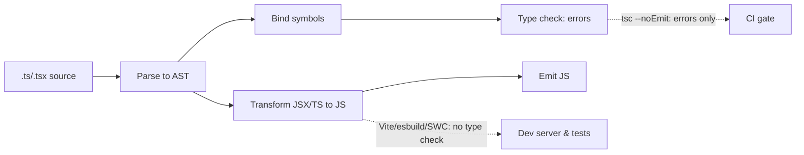
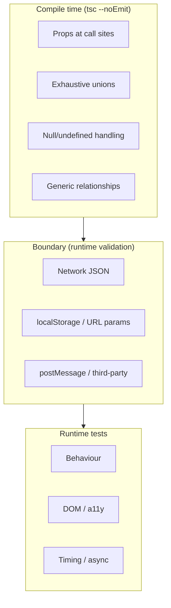

# 08 / 13 — TypeScript Correctness: Types as a Test Layer for React Code

## 1. Lesson metadata

| | |
|---|---|
| **Level** | Intermediate–Advanced |
| **Study time** | 4–5 hours (reading 2 h, experiments 1.5 h, exercises 1.5 h) |
| **Prerequisites** | [02 — Unit testing with Vitest](./02-unit-testing-with-vitest.md), [11 — Component contract testing](./11-component-contract-testing.md); basic TypeScript syntax (see [ROADMAP](../ROADMAP.md) for where it is introduced) |
| **Next** | [14 — Linting and static analysis](./14-linting-and-static-analysis.md) |
| **Related** | [15 — CI checks](./15-ci-checks.md), [07 — Testing API interactions](./07-testing-api-interactions.md) |

**Learning objectives.** After this lesson you can:
1. Explain what the type checker proves and what it cannot prove, and where runtime validation is still required.
2. Configure `tsconfig.json` for a strict, React-appropriate baseline and justify each flag.
3. Model component props, events, state machines and async state so that illegal states are unrepresentable.
4. Use discriminated unions, `satisfies`, `as const`, generics with constraints, and `unknown` narrowing correctly; avoid `any` and unsafe `as` assertions.
5. Type React 19 APIs correctly (`ref` as a prop, `useActionState`, `use`, event handlers, `ComponentProps`).
6. Make type checking a first-class CI step (`tsc --noEmit`), separate from the test runner, and test types themselves.
7. Spot the runtime/type-system gap (JSON, `localStorage`, `postMessage`, third-party data).

**Concepts covered:** structural typing, soundness gaps, `strict` family flags, `noUncheckedIndexedAccess`, `exactOptionalPropertyTypes`, `verbatimModuleSyntax`/`isolatedModules`, discriminated unions, exhaustiveness checks with `never`, `satisfies`, `as const`, branded types, generics, `ComponentProps`/`ComponentPropsWithRef`, event types, boundary validation, project references, `tsc` vs bundler transpilation, type tests, declaration-file hazards, `skipLibCheck`.

> **Version note (verified 2026-10-22).** The curriculum baseline is TypeScript 5.x ([ROADMAP](../ROADMAP.md) §0); the §3.2 `tsconfig` and the §3.5 typing claims below were run through `tsc --noEmit` on **TypeScript 5.9.3 and TypeScript 7.0.2** with `@types/react` 19.3 and gave identical results. **TypeScript 6.0 and 7.0 (the native Go port, ~10x faster) are released**, and 7.0 adopts 6.0's new defaults and hard errors (per the TypeScript 7.0 announcement): `strict` is now true by default, `module` defaults to `esnext`, `noUncheckedSideEffectImports` is true by default, and removed/unsupported options include `target: es5`, `downlevelIteration`, `moduleResolution: node/node10` and `classic`, `module: amd/umd/systemjs/none`, and `baseUrl` (use `paths` relative to the project root). Nothing in the baseline `tsconfig` below uses a removed option, but legacy configs with `baseUrl` or `moduleResolution: node` will need migration. Reference: the [TSConfig reference](https://www.typescriptlang.org/tsconfig/).

---

## 2. Deep conceptual explanation

### 2.1 What problem is this lesson solving?

Tests check the paths you thought to exercise. A type checker checks **every path of a certain kind, in every file, on every change, before any code runs**. For React code this means: every component call site agrees with the component's props, every callback payload matches its consumer, every `switch` handles every variant, every `null` is handled before use. Types are the cheapest, widest, fastest test layer in the pyramid ([Lesson 01](./01-test-strategy-and-pyramid.md)), and "correctness" in this lesson means using them so they actually *prove* things, rather than decorate code while `any` and `as` silently disable the proof.

### 2.2 What TypeScript proves, and what it does not

| Proves (when used soundly) | Does **not** prove |
|---|---|
| Call sites supply required props with right types | Runtime values from the network/storage have the declared shape |
| Union variants are handled (with exhaustiveness checks) | Business logic is correct (a function can return the wrong number of the right type) |
| Possibly-`null`/`undefined` values are checked before use (strict null checks) | Array/Map access is safe (unless `noUncheckedIndexedAccess`) |
| Refactors (renames, signature changes) propagate everywhere | Rendering behaviour, performance, accessibility |
| Dead/unused branches and impossible comparisons are flagged | That a `useEffect`'s dependencies are right (lint's job) |
| Generic relationships (this callback receives *that* item type) | Absence of `any`/`as` escapes (you must lint for them) |

**TypeScript is intentionally unsound in places** (the language design document lists non-goals around a "provably correct" type system): bivariant method parameters, `as` assertions, index signatures, mutable array covariance, and `any`. Correctness work is largely about *closing the holes you control* and *validating at the boundaries you do not*.

### 2.3 Structural typing in React

TypeScript compares types **structurally**: `{ id: string }` is assignable wherever `{ id: string }` is expected, regardless of name. For React this implies:

- A component accepting `{ user: User }` accepts any object with at least `User`'s fields (excess-property checks apply only to **fresh object literals**).
- `UserId` and `OrderId` aliases of `string` are interchangeable unless branded.
- Prop types are open for extension: passing `<Button onClick={…} data-testid="x" />` works because `ComponentProps<'button'>` includes `data-*` allowance in JSX.

### 2.4 The compile-time/runtime split (erasure)

Types are **erased**: the compiled JavaScript contains no types. Therefore:

- `JSON.parse(text) as User` performs no check. It is a *promise by the author*, not a verification.
- `fetch(...).then(r => r.json())` returns `any` (or `Promise<any>`); assigning it to a typed variable disables checking for that value.
- Anything crossing a trust boundary — network responses, `localStorage`, URL params, `postMessage`, form data, `window.__INITIAL_STATE__`, third-party SDK callbacks — needs **runtime validation** (schema libraries) or must be typed `unknown` and narrowed.

Vitest/Vite/esbuild/SWC/Babel **strip types without checking them**: a test suite can be fully green while `tsc` reports hundreds of errors ([Lesson 02](./02-unit-testing-with-vitest.md)). Hence `tsc --noEmit` (or `tsc -b`) is a mandatory separate CI job ([Lesson 15](./15-ci-checks.md)).

### 2.5 "Make illegal states unrepresentable"

Instead of:

```ts
type RequestState = { loading: boolean; data?: User; error?: Error };
```
which allows `{ loading: true, data: user, error: err }` (four boolean-ish combinations, only three meaningful), model:

```ts
type RequestState =
  | { status: 'idle' }
  | { status: 'loading' }
  | { status: 'success'; data: User }
  | { status: 'error'; error: Error };
```

This ties directly to reducer/state-machine design ([Phase 3 `useReducer`](../03-react-state-and-hooks/03-usereducer-and-reducer-architecture.md), [Phase 6 state machines](../06-data-fetching-and-state-ecosystems/12-state-machines-and-xstate.md)). The compiler then forces components to handle each state and prevents reading `data` while `loading`.

### 2.6 Misconceptions

| Misconception | Reality |
|---|---|
| "Types make tests unnecessary." | Types do not check behaviour, timing, DOM, a11y, or network data. |
| "Tests passing means types are fine." | Test runners strip types. Run `tsc`. |
| "`as` converts values." | It only tells the compiler to trust you. No runtime effect. |
| "`any` is fine for now." | `any` is contagious: it flows through inference and silently disables checks downstream. |
| "`React.FC` is required for components." | Not required; many style guides prefer plain function declarations with typed props. Historically `React.FC` implicitly added `children` (pre-React 18 types); that implicit `children` was removed in `@types/react` 18. *(Verify with your `@types/react` version.)* |
| "Strict mode is too hard to adopt." | Incremental adoption flags exist; but new code should be strict from day one. |
| "`skipLibCheck: true` is harmless." | It skips checking *all* `.d.ts` files (including your own), which can hide declaration errors; it is a pragmatic default for build speed, but know the trade. |

---

## 3. Internal mechanics

### 3.1 The compilation pipeline: checking vs emitting



**Teaching model.** `tsc` does both; bundlers do only the right-hand path (**transpile-only**, per file, which is why `isolatedModules` exists: it makes the compiler flag constructs that cannot be correctly transpiled one file at a time, such as re-exporting types without `export type`). `verbatimModuleSyntax` (TS 5.x) makes `import type` mandatory for type-only imports so transpilers can safely drop them (`verbatimModuleSyntax` + `isolatedModules` were both enabled in the verified tsconfig below).

### 3.2 `tsconfig` for a Vite + React 19 app (baseline)

```jsonc
{
  "compilerOptions": {
    "target": "ES2022",
    "lib": ["ES2023", "DOM", "DOM.Iterable"],
    "module": "ESNext",
    "moduleResolution": "bundler",
    "jsx": "react-jsx",
    "strict": true,
    "noUncheckedIndexedAccess": true,
    "exactOptionalPropertyTypes": true,
    "noImplicitOverride": true,
    "noFallthroughCasesInSwitch": true,
    "noUnusedLocals": true,
    "noUnusedParameters": true,
    "isolatedModules": true,
    "verbatimModuleSyntax": true,
    "skipLibCheck": true,
    "noEmit": true,
    "types": ["vite/client", "vitest/globals"]
  },
  "include": ["src", "e2e", "vite.config.ts"]
}
```

Every flag above was accepted by `tsc` 5.9.3 and 7.0.2 (verified). Notes by flag:

| Flag | Why it matters for React correctness | Cost |
|---|---|---|
| `strict` | Enables `strictNullChecks`, `noImplicitAny`, `strictFunctionTypes`, `strictPropertyInitialization`, `useUnknownInCatchVariables`, etc. Without `strictNullChecks`, `useRef<HTMLDivElement>(null)` and optional props are unsound. | Initial migration effort |
| `noUncheckedIndexedAccess` | `arr[i]` is `T \| undefined`. Prevents "cannot read property of undefined" for list rendering `items[0].name`. | More narrowing code; some friction with loops |
| `exactOptionalPropertyTypes` | Distinguishes "absent" from "explicitly `undefined`" for optional props; matters for `{...rest}` spreading and `style`/`value` props. | Occasional friction with libraries not designed for it (check the types of the libraries you use) |
| `jsx: "react-jsx"` | Automatic runtime; no `import React` needed. | None |
| `noUnusedLocals/Parameters` | Dead code; also catches forgotten hook results. | Sometimes noisy; prefix `_` for intentional |
| `verbatimModuleSyntax` / `isolatedModules` | Transpiler-safe imports/exports | `import type` discipline |
| `noEmit` | Type-check only; bundler emits | – |

### 3.3 Narrowing and exhaustiveness

TypeScript performs **control-flow analysis**: after `if (state.status === 'success')`, `state.data` is available. An exhaustiveness helper makes the compiler fail when a union member is unhandled:

```ts
function assertNever(x: never): never {
  throw new Error(`Unhandled variant: ${JSON.stringify(x)}`);
}
```
In a `switch` with all cases handled, the `default` branch receives type `never`; adding a union member makes `x` no longer `never`, producing a compile error at every non-exhaustive site. This is how adding `'refunded'` to an order status fails the build at every place that forgot it, which is a refactoring tool no runtime test matches.

### 3.4 Generics and constraints for components

Generic components (`<Select<T> options={…} onChange={(item: T) => …} />`) tie input and output types. TypeScript infers `T` from props. Constraints (`T extends { id: string }`) express requirements. Generic components cannot be wrapped in `memo`/`forwardRef` without losing the generic (type assertion needed), a known ergonomics issue; in React 19 with ref as a prop, you can keep a generic function component *and* accept `ref` in its props, which removes one common reason for that cast (verified: `function Generic<T extends { id: string }>({ items, ref }: { items: T[]; ref?: Ref<HTMLUListElement> })` type-checks with `@types/react` 19.3).

### 3.5 React 19 typing notes (verified against `@types/react` 19.3 with `tsc` 5.9.3 and 7.0.2)

- **`ref` as prop**: type it with `ComponentPropsWithRef<'input'>` or `Ref<HTMLInputElement>`; no `forwardRef` needed for new code.
- **Ref callback cleanup**: callback refs may return a cleanup function in React 19; `@types/react` 19 reflects this and flags returning something other than a function/undefined from an implicit-return arrow `ref={el => (x = el)}` pattern (verified: the implicit-return form is a type error; use `ref={(el) => { x = el; }}`).
- **`useRef`** requires an argument in React 19 types (`useRef<T>(null)`); verified: `useRef<number>()` is an error.
- **`JSX` namespace** now `React.JSX`; global `JSX` removed from `@types/react` 19 (verified: `Cannot find namespace 'JSX'`); relevant if your code uses `JSX.Element` as a return type (prefer inferring, or `React.ReactNode`).
- **`useActionState`**: `[state, formAction, isPending] = useActionState(action, initialState)` where `action: (prevState: S, payload: FormData) => S | Promise<S>`.
- **`use`**: `use(promise)` / `use(context)`; typed as `Awaited<T>` for promises.

---

## 4. Step-by-step execution walkthrough: how one wrong type becomes a compile error

Scenario: product adds a `'refunded'` order status.

1. Developer edits the union: `type OrderStatus = 'pending' | 'paid' | 'shipped' | 'refunded'`.
2. Editor (TS language server) re-checks open files; red squiggles appear on `switch (status)` in `StatusBadge.tsx` because `default: return assertNever(status)` now receives `'refunded'` rather than `never`.
3. `npm run typecheck` (`tsc --noEmit`) lists all sites: badge, filter dropdown (`Record<OrderStatus, string>` is missing a key), analytics mapper, test factory.
4. Developer fixes each. For `Record<OrderStatus, string>`, TypeScript requires all keys, so there is no silent `undefined` label.
5. CI runs the typecheck job; a missing site fails the PR before a reviewer sees it.
6. Runtime tests then verify behaviour (the badge renders "Refunded", a11y name correct).

Observe: the type checker found *everywhere the union is consumed*, including places no test touches.

---

## 5. Code examples

### 5.1 Minimal example — props typed with a discriminated union

```tsx
type AlertProps =
  | { kind: 'info'; message: string }
  | { kind: 'error'; message: string; onRetry: () => void };

export function Alert(props: AlertProps) {
  if (props.kind === 'error') {
    return (
      <div role="alert">
        {props.message}
        <button type="button" onClick={props.onRetry}>Retry</button>
      </div>
    );
  }
  return <div role="status">{props.message}</div>;
}

<Alert kind="error" message="Failed" />;            // error: Property 'onRetry' is missing
<Alert kind="info" message="Saved" onRetry={fn} />; // error: excess property in this variant
```

Note: destructuring props in the parameter (`({ kind, onRetry })`) loses the narrowing link between variables in older TS; TS 4.6+ supports narrowing of destructured discriminated unions when destructured from a *parameter* with `const` semantics *(verify conditions in the TS release notes)*. Safest teaching practice: keep `props` whole while narrowing.

**Predict:** does `<Alert kind="info" message="Saved" onRetry={fn} />` compile? *No*: for a fresh object literal (JSX attributes), TypeScript checks excess properties against the matching union member and rejects `onRetry` for `kind: 'info'`.

### 5.2 Practical example — typed async state and exhaustive rendering

```tsx
type Result<T> =
  | { status: 'idle' }
  | { status: 'loading' }
  | { status: 'success'; data: T }
  | { status: 'error'; error: Error };

function assertNever(x: never): never {
  throw new Error(`Unexpected: ${String(x)}`);
}

export function UserPanel({ state }: { state: Result<{ id: string; name: string }> }) {
  switch (state.status) {
    case 'idle':    return null;
    case 'loading': return <p aria-busy="true">Loading…</p>;
    case 'success': return <h2>{state.data.name}</h2>;
    case 'error':   return <p role="alert">{state.error.message}</p>;
    default:        return assertNever(state);
  }
}
```

Explanation: inside `case 'success'`, `state.data` exists; outside it does not. Adding `{ status: 'stale'; data: T }` to `Result` immediately fails compilation at `assertNever(state)` ("Argument of type '{ status: "stale"; … }' is not assignable to parameter of type 'never'"), forcing every consumer to decide.

Trade-off: the discriminated union makes you write more code than `{ loading, data, error }`, but eliminates impossible combinations. Libraries like TanStack Query expose a similar discriminated shape (`status: 'pending' | 'error' | 'success'`) *(verify current naming in the docs)*.

### 5.3 Incorrect example — the escape hatches that disable the proof

```tsx
interface User { id: string; name: string; email: string }

function useUser(id: string) {
  const [user, setUser] = useState<User>({} as User);           // 1. lie: empty object cast
  useEffect(() => {
    fetch(`/api/users/${id}`)
      .then((r) => r.json())                                      // 2. any
      .then((u) => setUser(u));                                   // 3. any flows into User silently
  }, [id]);
  return user;
}

export function Profile({ id }: { id: string }) {
  const user = useUser(id);
  return <p>{user.email.toLowerCase()}</p>;                       // 4. throws TypeError on first render
}
```

Issues: (1) `{} as User` claims every field exists; the type says `email: string` but the runtime value is `undefined` during first render; (2–3) `any` flows from `json()`; no validation; (4) the compiler is happy, production crashes. Also race conditions and missing error state — type correctness cannot fix those, but modelling state as `Result<User>` would at least force handling loading.

### 5.4 Corrected implementation

```tsx
import { z } from 'zod'; // Zod 4.x verified (4.6.7): `z.string().email()` still works but is deprecated in favour of the top-level `z.email()`

const UserSchema = z.object({ id: z.string(), name: z.string(), email: z.string().email() });
type User = z.infer<typeof UserSchema>;

async function fetchUser(id: string, signal: AbortSignal): Promise<User> {
  const res = await fetch(`/api/users/${encodeURIComponent(id)}`, { signal });
  if (!res.ok) throw new Error(`HTTP ${res.status}`);
  const json: unknown = await res.json();       // unknown, not any
  return UserSchema.parse(json);                // runtime validation; throws ZodError if invalid
}

function useUser(id: string): Result<User> {
  const [state, setState] = useState<Result<User>>({ status: 'loading' });
  useEffect(() => {
    const controller = new AbortController();
    setState({ status: 'loading' });
    fetchUser(id, controller.signal)
      .then((data) => setState({ status: 'success', data }))
      .catch((error: unknown) => {
        if (controller.signal.aborted) return;
        setState({ status: 'error', error: error instanceof Error ? error : new Error(String(error)) });
      });
    return () => controller.abort();
  }, [id]);
  return state;
}
```

Line notes: `unknown` forces validation before use; `.parse` ties the runtime to the static type through `z.infer`; `catch (error: unknown)` (strict mode's `useUnknownInCatchVariables` makes this the default) forces narrowing; abort handling per [Phase 6 cancellation](../06-data-fetching-and-state-ecosystems/02-cancellation-and-race-conditions.md). In real apps prefer TanStack Query for this plumbing ([Phase 6](../06-data-fetching-and-state-ecosystems/08-tanstack-query.md)) and keep schemas at the fetch function.

### 5.5 `satisfies`, `as const`, and branded types

```ts
// satisfies: check against a type without widening the inferred type
const routes = {
  home: '/',
  user: (id: string) => `/users/${id}`,
} satisfies Record<string, string | ((...args: never[]) => string)>;

routes.home;          // type string (a plain object literal widens its string properties; add `as const` to keep '/')
routes.user('42');    // ok: function type preserved
```

```ts
// as const: literal types & readonly
const STATUSES = ['pending', 'paid', 'shipped'] as const;
type Status = (typeof STATUSES)[number];        // 'pending' | 'paid' | 'shipped'
function isStatus(x: unknown): x is Status { return typeof x === 'string' && (STATUSES as readonly string[]).includes(x); }
```

```ts
// Branded type to prevent mixing ids
type Brand<T, B extends string> = T & { readonly __brand: B };
type UserId = Brand<string, 'UserId'>;
type OrderId = Brand<string, 'OrderId'>;
const asUserId = (s: string) => s as UserId;     // the single sanctioned cast, ideally after validation
declare function loadOrder(id: OrderId): void;
loadOrder(asUserId('u1'));                        // error: UserId is not assignable to OrderId
```

Trade-off: brands add ceremony; use them where mix-ups are costly (money units, ids of different entities passed positionally). A simpler alternative is to pass objects with named fields.

### 5.6 Event and ref typing in React 19

```tsx
import { useRef, type ChangeEvent, type ComponentPropsWithRef, type FormEvent } from 'react';

type InputProps = ComponentPropsWithRef<'input'> & { label: string };

export function LabeledInput({ label, id, ref, ...rest }: InputProps) {
  // React 19: `ref` arrives as a normal prop in function components
  return (
    <label>
      {label}
      <input ref={ref} id={id} {...rest} />
    </label>
  );
}

export function SearchForm({ onSearch }: { onSearch: (q: string) => void }) {
  const inputRef = useRef<HTMLInputElement>(null);

  function handleSubmit(e: FormEvent<HTMLFormElement>) {
    e.preventDefault();
    const value = inputRef.current?.value ?? '';   // narrowing: current may be null
    onSearch(value.trim());
  }
  function handleChange(e: ChangeEvent<HTMLInputElement>) {
    console.log(e.currentTarget.value);             // currentTarget is typed to the element the handler is attached to
  }
  return (
    <form onSubmit={handleSubmit}>
      <LabeledInput label="Query" ref={inputRef} onChange={handleChange} />
    </form>
  );
}
```

Notes: `e.currentTarget` is typed as the element the handler is attached to; `e.target` may be a descendant: on `FormEvent`/`MouseEvent` it is a plain `EventTarget`, so reading `.value` is a type error (verified), whereas `ChangeEvent<HTMLInputElement>` types `target` as `EventTarget & HTMLInputElement`, so `e.target.value` compiles there (verified with `@types/react` 19.3 on `tsc` 5.9/7.0). Prefer `currentTarget` for handlers that read the element they are attached to. Wrapping inline handlers in the JSX attribute (`onChange={(e) => …}`) infers the event type contextually, so annotate only for extracted handlers. Under React 18 types you would write `forwardRef<HTMLInputElement, Props>`.

### 5.7 Advanced example — a type-safe polymorphic-lite component and type tests

```tsx
import type { ComponentPropsWithoutRef, ElementType, ReactNode } from 'react';

type TextProps<E extends ElementType> = {
  as?: E;
  children: ReactNode;
} & Omit<ComponentPropsWithoutRef<E>, 'as' | 'children'>;

export function Text<E extends ElementType = 'span'>({ as, children, ...rest }: TextProps<E>) {
  const Component: ElementType = as ?? 'span';
  return <Component {...rest}>{children}</Component>;
}
```

```tsx
// Text.test-d.tsx  — type-level tests, checked by tsc / `vitest --typecheck` (configuration verified for `*.test-d.ts`)
<Text>ok</Text>;
<Text as="a" href="/x">link</Text>;
// @ts-expect-error — href is not valid on a span
<Text href="/x">nope</Text>;
// @ts-expect-error — unknown element prop
<Text as="div" bogus>nope</Text>;
```

Cautions: the `ElementType` annotation on `Component` (an intentional loosening inside the implementation) keeps the *public* signature precise while the body uses a wide type; this is a legitimate use of a local escape hatch, documented, covered by type tests. Polymorphic components degrade compile-time performance and error message readability in large codebases; evaluate whether a few specialised components (`Heading`, `Link`) are simpler.

### 5.8 Type tests with Vitest

```ts
// types.test-d.ts  — run via `vitest --typecheck` (type-checks `*.test-d.ts` alongside runtime tests) or `vitest --typecheck.only`; verified on Vitest 3.2.7
import { expectTypeOf, test } from 'vitest';
import type { Result } from './result';

test('Result narrows', () => {
  const r = { status: 'success', data: 42 } as Result<number>;
  if (r.status === 'success') expectTypeOf(r.data).toEqualTypeOf<number>();
});
```

Alternative with only the compiler: put negative cases behind `// @ts-expect-error` in a normal `.ts` file included in `tsconfig`, then rely on `tsc --noEmit`. This needs no extra tooling.

---

## 6. Visual explanations

### Where each kind of correctness is enforced



### The `any` leak

```text
const raw = await res.json();      // any
const user: User = raw;            // allowed (any is assignable to everything)
render(user.profile.name)          // no error even if "profile" does not exist
        ^ proof is gone from here down the dataflow
```

### Strictness ladder (typical adoption order)

```text
1. strict: true                       (nulls, implicit any)
2. noUncheckedIndexedAccess           (array/record access)
3. lint: no-explicit-any, no-unsafe-* (type-aware lint rules; see Lesson 14)
4. exactOptionalPropertyTypes         (absent vs undefined)
5. boundary schemas for all external data
6. type tests for public component APIs
```

---

## 7. Alternative approaches and trade-offs

| Approach | Guarantees | Cost | When it fits |
|---|---|---|---|
| Strict TS + boundary schemas (recommended default) | Static + runtime at edges | Medium: schemas + narrowing | Most apps |
| TS without strict | Partial, mostly autocomplete | Low upfront; high long-term | Temporary migration step only |
| JS + JSDoc types checked by `tsc --checkJs` | Similar checking in JS files | Medium | Teams that cannot adopt TS syntax; small libs |
| PropTypes (legacy) | Runtime dev warnings for props | Low | Historical (React 19 removed the propTypes checks from the React package and silently ignores `propTypes`, per the React 19 upgrade guide); not recommended |
| Runtime-only validation everywhere (no static types) | Runtime | High CPU/boilerplate | Rarely |
| Generated types from OpenAPI/GraphQL | Static match to spec | Tooling setup | APIs with specs |
| End-to-end typed RPC (tRPC-style, GraphQL codegen) | Static across client/server | Architecture commitment | Same-language full-stack teams (verify fit) |
| Flow | Alternative checker | Ecosystem much smaller | Legacy codebases |

**Scenario where strictest settings are NOT best.** A large legacy JS codebase being migrated incrementally: turning on `noUncheckedIndexedAccess` and `exactOptionalPropertyTypes` repo-wide at once will produce thousands of errors and stall the migration. Adopt `strict` for new directories (`tsconfig` paths/project references or per-folder configs), enforce no new `any` via lint, then ratchet. Also: `exactOptionalPropertyTypes` can be a poor fit if heavy third-party typings were not authored with it.

---

## 8. Best practices and anti-patterns

### Best practices
1. **`strict: true` from day one**; add `noUncheckedIndexedAccess` for new code.
2. **Run `tsc --noEmit` in CI** as its own job and on pre-push if fast (project references / `--incremental` help).
3. **Parse, don't assume**: `unknown` at boundaries, schemas validate, then trust the static type.
4. **Model state as discriminated unions**; reducers return the union; `assertNever` for exhaustiveness.
5. **Derive types from values** (`as const`, `typeof`, `z.infer`, `ReturnType`) rather than duplicating.
6. **Prefer `ComponentProps<'button'>`-style derivation** for wrappers to inherit native attributes correctly.
7. **Require what is required** (label for inputs) via types so a11y misuse fails to compile (ties to [Lesson 10](./10-accessibility-testing.md)).
8. **Use `import type`** for type-only imports (enforced by `verbatimModuleSyntax`).
9. **Treat `as` as a code smell requiring a comment**; allow `as const` and narrowing assertions after validation.
10. **Type test public APIs** of shared components and utilities.
11. **Keep generated/third-party types in check**: pin `@types/*` to match library major versions.

### Anti-patterns

| Anti-pattern | Why wrong | Fix |
|---|---|---|
| `any` to silence an error | Contagious, disables checking downstream | `unknown` + narrowing; fix the real mismatch |
| `as unknown as T` | Double-cast defeats the checker entirely | Validate, redesign type |
| `// @ts-ignore` | Suppresses without alerting when error disappears | `@ts-expect-error` with explanation |
| Non-null assertion `x!` as a habit | Runtime crash if wrong | Narrow, early return, or throw with message |
| Optional everything (`foo?:`) | Callers can omit what is really required | Required props; unions |
| Booleans for modes (`isLoading`, `isError`) | Impossible combinations | Discriminated unions |
| `Object`, `{}`, `Function` types | Too broad to be useful | Specific shapes/signatures |
| Enums for simple unions | Runtime artifact; nominal quirks (numeric enums reverse mappings) | String literal unions + `as const` |
| `React.FC` + implicit children assumptions | Obscures prop contract | Plain function with explicit props |
| `Record<string, X>` for known keys | Allows any key; with `noUncheckedIndexedAccess` forces undefined checks | Specific key union |
| Casting API JSON to types | No runtime proof | Schema parse |

**Justified exceptions.** `any` is acceptable in the implementation of a deliberately generic utility (a type-guard library, or a test helper) when the *public signature* is precise and covered by type tests. `as` is acceptable immediately after validation or for DOM narrowing (`document.getElementById('root') as HTMLElement` in `main.tsx`, though a null check with a thrown error is safer). Enums (`const enum`, regular) are justified when interoperating with existing code or when you want reverse mapping.

---

## 9. Real-world application

**Design systems.** Props encode accessibility requirements (a `Button` with icon-only must have `aria-label`: model as a union `{ children: ReactNode } | { 'aria-label': string; icon: ReactNode }`). Generics for `Select<T>`, `Table<Row>`. Type tests for each public export. Constraint: type-heavy APIs affect compile time and IDE responsiveness; benchmark with `tsc --extendedDiagnostics` *(verify flag)*.

**Finance/e-commerce.** Brand money (`Cents`, `Dollars`) or use objects `{ amount: bigint; currency: 'USD' | 'EUR' }`; never mix. Order lifecycle as a union with exhaustiveness. Boundary schemas parse API amounts. Constraint: floating-point arithmetic is a runtime issue types don't prevent; unit tests cover rounding.

**Forms.** Form schemas (Zod/Valibot) as the single source for validation + types (`z.infer`), reused on the server where the language allows. Constraint: forms library generics can be intricate; ensure field name paths are typed *(depends on library; verify)*.

**Dashboards with many API endpoints.** Generate types from OpenAPI; typed query keys (`as const` tuples) for TanStack Query; typed hooks per endpoint. Constraint: generated types can drift behind the server; regenerate in CI and fail on diff.

**Multi-team monorepo.** Project references (`tsc -b`) so each package type-checks incrementally; shared `tsconfig.base.json`; public API types exported from package entry points only; API-extractor-style checks for breaking type changes *(tool names: verify)*. Constraint: CI time grows; use caching ([Lesson 15](./15-ci-checks.md)).

**Realtime/WebSocket.** Messages as a discriminated union on `type`; runtime-validate each incoming message; reducers exhaustively handle events.

---

## 10. Debugging and troubleshooting

**Symptom 1: Tests pass but `tsc` fails (or vice versa).**
Cause: Vitest does not type-check. Check CI has a typecheck job; run `npx tsc --noEmit -p tsconfig.json` locally. If the editor shows no error but `tsc` does, the editor may be using a different TypeScript version (workspace vs bundled) or a different tsconfig (a test folder not included in `include`). Fix `include`; select the workspace TS version.

**Symptom 2: A type error message is 40 lines long.**
Cause: deep generic/union mismatch. Technique: read the *last* lines (the innermost mismatch); simplify by assigning to an intermediate variable with an explicit type; use `type Debug<T> = { [K in keyof T]: T[K] }` to expand display *(works as a hover trick)*; use `// @ts-expect-error` temporarily to bisect; check library version mismatch (`@types/react` duplicates: `npm ls @types/react`).

**Symptom 3: `Property 'x' does not exist on type 'never'`.**
Cause: narrowing eliminated all union members (a contradictory check) or an exhaustive branch. Inspect the type at the preceding line via hover; check discriminant property types (string vs literal widening: `let kind = 'info'` widens to `string`; use `as const`/annotation).

**Symptom 4: `Type 'undefined' is not assignable to type 'string'` appears after enabling `exactOptionalPropertyTypes`.**
Cause: passing `prop={maybeUndefined}` to `prop?: string`. Fix by conditionally spreading `{...(v !== undefined && { prop: v })}`, or declare `prop?: string | undefined` where `undefined` is a legitimate value.

**Symptom 5: Runtime crash with perfectly typed code.**
Investigate: where did the data come from? Search for `as`, `any`, `JSON.parse`, `r.json()` along the data path; add boundary parse and a test with a malformed fixture; consider a Sentry/log of schema errors in production (do not log PII).

**Symptom 6: Slow type checking / IDE lag.**
Investigate with `tsc --extendedDiagnostics` and `--generateTrace <dir>` (both long-standing compiler flags); look for huge unions, recursive conditional types, deep `Omit<…>` chains; split projects; avoid computing types from enormous literal objects.

**Validate the fix** by adding a regression case: a `@ts-expect-error` negative test (for type-level bugs) or a malformed-data unit test (for boundary bugs).

---

## 11. Exercises

### Level A — Knowledge
A1. Name three things `strict: true` enables and why each matters in React code.
A2. Why does `JSON.parse(x) as User` provide no safety?
A3. What does `noUncheckedIndexedAccess` change for `items[0]`?
A4. Difference between `@ts-ignore` and `@ts-expect-error`.
A5. Why do Vite/Vitest not report type errors?

### Level B — Code comprehension
B1. Does this compile? Explain.
```tsx
type P = { kind: 'a'; x: number } | { kind: 'b'; y: string };
function C(p: P) { return p.kind === 'a' ? p.y : p.x; }
```
B2. What is the inferred type of `s`?
```ts
const a = ['x', 'y'] as const;
type S = (typeof a)[number];
declare const s: S;
```
B3. Why might `e.target.value` fail to compile in a handler but `e.currentTarget.value` compile?
B4. What does this do at runtime? What does the type system conclude?
```ts
const el = document.getElementById('root') as HTMLCanvasElement;
```

### Level C — Implementation
C1. Write a `Result<T, E>` union and an `isSuccess` type guard; use it in a component.
C2. Define props for a `Button` that requires `aria-label` when `children` is absent (icon-only) and write `@ts-expect-error` tests.
C3. Write a typed reducer for a checkout flow (`cart → shipping → payment → confirmed`) where each state carries only valid data, with exhaustive handling.

### Level D — Debugging
D1. The compiler says `Type 'string | undefined' is not assignable to type 'string'` on `<Avatar src={user.avatarUrl} />`. List three legitimate fixes and the trade-off of each.
D2. After adding `'refunded'` to a union, one place silently shows `undefined` for the label at runtime, although `tsc` passes. Find how.
D3. CI typecheck passes locally but fails in CI with errors in `node_modules/@types`. Diagnose.

### Level E — Architecture and engineering decisions
E1. Decide between Zod-style runtime schemas and OpenAPI-generated types alone for API data. Evaluate with at least five criteria.
E2. Plan the migration of a 400-file JS React app to TypeScript. Include sequencing, tooling, and guardrails.
E3. Should the design system expose generic polymorphic components? Evaluate.

### Level F — Expert challenge
F1. Design a lint+type strategy that makes it a compile or lint error to call `fetch(...).then(r => r.json())` without runtime validation. Discuss the achievable and unachievable parts.

---

## 12. Detailed answers and explanations

> Attempt the exercises first.

**A1.** `strictNullChecks`: `null`/`undefined` must be handled, preventing "cannot read properties of undefined" and making `useRef(null)` types honest. `noImplicitAny`: untyped params become errors, so event handlers and callbacks can't silently be `any`. `strictFunctionTypes`: callback parameter contravariance for function-typed props (not methods). Others: `useUnknownInCatchVariables`, `strictBindCallApply`, `strictPropertyInitialization` (class fields; mostly legacy class components). *Verify the full list in the TSConfig reference.*

**A2.** `as` is a compile-time assertion; JavaScript emitted has no check. If the JSON lacks a field, runtime code crashes later and the type annotations at that point lie. Use `unknown` + schema parse or a type guard.

**A3.** `items[0]` becomes `T | undefined`; you must check before property access, catching empty-array crashes. Edge: `for…of`, `.map`, and destructuring from tuples are unaffected; `Array.prototype.at` is `T | undefined` always.

**A4.** `@ts-ignore` suppresses any error on the next line with no signal if there is no error; `@ts-expect-error` requires an error and reports an error when none occurs, so stale suppressions are detected. Prefer the latter with a comment (lint can require descriptions *(typescript-eslint `ban-ts-comment`: verify)*).

**A5.** They only strip types (esbuild/SWC/Babel transpile per file). Type checking needs whole-program analysis, which `tsc` or the language server provides. Vite plugins can run checkers in a separate process (verify tool names), but CI should run `tsc` explicitly.

**B1.** Does not compile: in the `'a'` branch `p.y` doesn't exist (narrowed to `{kind:'a'; x:number}`) and in the else branch `p.x` doesn't exist (`{kind:'b'; y:string}`). The ternary is swapped; correct is `p.kind === 'a' ? p.x : p.y`. Plausible wrong answer "compiles because both properties exist on some member" fails because property access on a union requires the property to exist on **all** members unless narrowed.

**B2.** `'x' | 'y'`. `as const` makes the array a `readonly ['x','y']` tuple of literals; indexing by `number` yields the union of element types.

**B3.** It depends on the event type. For `ChangeEvent<HTMLInputElement>`, React's types declare `target: EventTarget & HTMLInputElement`, so `e.target.value` compiles there; for generic `SyntheticEvent` or `MouseEvent<HTMLButtonElement>`, `target` is plain `EventTarget` and `.value` fails. `currentTarget` is reliably typed as the element the handler is attached to, whereas `target` can be any descendant at runtime, so prefer `currentTarget`. *(Verify against your `@types/react` version.)*

**B4.** Runtime: returns the element or `null`; no cast or check happens; if it's a `div`, later `el.getContext('2d')` throws "not a function". Type system: trusts you; the type is `HTMLCanvasElement` and `null` is no longer represented. Safer: `const el = document.getElementById('root'); if (!(el instanceof HTMLCanvasElement)) throw new Error(...)` which narrows with a real runtime check.

**C1 (sample).**
```tsx
type Result<T, E = Error> = { ok: true; value: T } | { ok: false; error: E };
const isOk = <T, E>(r: Result<T, E>): r is Extract<Result<T, E>, { ok: true }> => r.ok;
// Component
function Price({ r }: { r: Result<number> }) {
  return r.ok ? <span>{r.value.toFixed(2)}</span> : <span role="alert">{r.error.message}</span>;
}
```
Criteria: discriminant is a literal; narrowing without casts; the guard is optional (since `r.ok` already narrows), so explain redundancy: type guards are needed for non-trivial predicates.

**C2 (sample).**
```tsx
type ButtonProps = Omit<ComponentPropsWithRef<'button'>, 'children' | 'aria-label'> &
  ({ children: ReactNode; 'aria-label'?: string } | { children?: never; 'aria-label': string; icon: ReactNode });
<Button>Save</Button>;
<Button aria-label="Close" icon={<X />} />;
// @ts-expect-error – icon-only without a name
<Button icon={<X />} />;
```
Criteria: negative test; discusses that `aria-label` presence doesn't guarantee a *good* name (type can't check semantics); `Omit` on unions flattens, so applying it to the base before intersecting avoids losing union structure.

**C3 (sample).**
```ts
type Checkout =
  | { step: 'cart'; items: Item[] }
  | { step: 'shipping'; items: Item[]; address?: Address }
  | { step: 'payment'; items: Item[]; address: Address }
  | { step: 'confirmed'; orderId: string };
type Action = { type: 'NEXT_SHIPPING' } | { type: 'SET_ADDRESS'; address: Address } | { type: 'PAY_SUCCESS'; orderId: string };
function reduce(s: Checkout, a: Action): Checkout {
  switch (s.step) {
    case 'cart': return a.type === 'NEXT_SHIPPING' ? { step: 'shipping', items: s.items } : s;
    case 'shipping': return a.type === 'SET_ADDRESS' ? { step: 'payment', items: s.items, address: a.address } : s;
    case 'payment': return a.type === 'PAY_SUCCESS' ? { step: 'confirmed', orderId: a.orderId } : s;
    case 'confirmed': return s;
    default: return assertNever(s);
  }
}
```
Criteria: states carry only valid data (`payment` requires `address`), impossible transitions return same state, exhaustive; a unit test per transition complements the types.

**D1.** (a) Provide a fallback: `src={user.avatarUrl ?? defaultAvatar}`; trade-off: hides missing data. (b) Make `Avatar.src` optional and render initials when absent; trade-off: component handles more states, but models reality. (c) Narrow earlier: `if (!user.avatarUrl) return <Initials/>`; (d) non-null assertion `!` is a wrong fix unless guaranteed; explain it will crash/render broken image if wrong. Best: (b) when absence is legitimate domain state.

**D2.** Likely `Record<string, string>` or an indexed object used for labels (`labels[status]`) instead of `Record<OrderStatus, string>`: the checker allows any string key and (without `noUncheckedIndexedAccess`) types the result as `string`. Also a `default:` branch in a switch returning a fallback instead of `assertNever`. Fix: typed `Record<OrderStatus, string>`, `satisfies`, remove default; enable `noUncheckedIndexedAccess`.

**D3.** Different TypeScript or `@types` versions in CI (lockfile ignored: `npm install` instead of `npm ci`), `skipLibCheck` off in CI config, duplicate `@types/react` versions via transitive dependencies (`npm ls @types/react`), or a different tsconfig (`-p`). Fix: `npm ci`, pin versions, dedupe with overrides/resolutions, consistent config.

**E1 (evaluation criteria).** Criteria: trust in backend conformance; payload size/performance; error visibility in production; bundle size; DX/maintenance; spec availability; versioning/rollout; partial-failure strategy (strict reject vs lenient parse). Example: validate with schemas at the boundary for third-party/legacy APIs and user-controlled data; for a first-party API with CI-enforced OpenAPI conformance, generated types plus targeted validation of risky endpoints may suffice. State the risk if the backend can drift.

**E2 (example).** Phase 0: add `tsconfig` with `allowJs`, `checkJs: false`; CI typecheck job; lint rules. Phase 1: convert leaf utilities and shared types; Phase 2: components bottom-up by dependency order (leaf → shells); Phase 3: pages/routes; Phase 4: ratchet strictness per-folder. Guardrails: `noImplicitAny` for converted dirs, ban new `.js`, eslint `no-explicit-any` as warn→error, codeowners, `// @ts-expect-error` ledger. Tools: codemod-assisted renames, `ts-migrate`-style tools *(verify maintenance status)*. Criteria: continuous delivery, measurable progress, avoiding big-bang.

**E3 (evaluation).** Benefits: flexibility (`as`), consistent styling; costs: type complexity, compile-time, error messages, accessibility pitfalls (`as="div"` with `onClick` reintroduces non-semantic controls). Recommendation: expose a narrow set (`Heading level`, `Text as` limited to a union of tags), avoid arbitrary `as` for interactive components, use type tests.

**F1 (example answer).** Achievable: ban `Response.prototype.json` usage returning `any` via lint (`@typescript-eslint/no-unsafe-assignment`, `no-unsafe-member-access`, `no-unsafe-argument` flag `any` flowing into typed positions); wrap fetching in a single `fetchJson(schema, url)` helper and use `no-restricted-syntax`/`no-restricted-properties` to forbid direct `.json()` outside the helper; declaration-merge `Body.json(): Promise<unknown>` via a global `.d.ts` so `.json()` returns `unknown` *(technique: verify; modifies global lib typing and may affect libraries)*. Unachievable: proving that the *schema* matches the server; proving someone doesn't write a wrong schema; third-party code. Evaluation: acknowledges type-aware lint cost ([Lesson 14](./14-linting-and-static-analysis.md)), centralises the unsafe operation in one reviewed place.

---

## 13. Senior engineer interview questions

**Q1. "Our tests are green and TS compiles, but production crashes on `undefined`. Where do you look?"**
*Strong answer:* Along the data path for unsound escapes: `any` from `json()`, `as` casts, `!` assertions, missing `noUncheckedIndexedAccess`, optional fields the backend omits, `localStorage` reads. Add boundary validation (schemas) and malformed-data tests; enable strictness flags and `no-unsafe-*` lint rules; add logging for schema failures.

**Q2. "Why is `tsc --noEmit` a separate CI step when we already run Vitest?"**
*Strong answer:* Vitest transpiles without checking; whole-program type analysis only happens in the compiler. Without the separate step, type errors never fail the build. Also because type tests (`@ts-expect-error`) only execute under `tsc`.

**Q3. "Discriminated unions vs booleans for async state?"**
*Strong answer:* Booleans allow impossible combinations and optional data that is undefined in states where it should exist; unions couple fields to states, enable exhaustive checks, and enforce handling when states are added. Cost: slightly more verbose; mitigated by helpers or using libraries with discriminated results.

**Q4. "When is `as` acceptable?"**
*Strong answer:* After a real runtime check the compiler cannot see (e.g., schema validated, `instanceof` doesn't narrow in some framework contexts), `as const`, and DOM element narrowing where a failure would be a programmer error. Not to silence errors. Prefer type guards/assertion functions; lint with `no-unnecessary-type-assertion` and review.

**Q5. "What changed for typing refs in React 19?"**
*Strong answer:* `ref` is a regular prop on function components, so wrappers use `ComponentPropsWithRef` and pass `ref` through; `forwardRef` is legacy but works; callback refs can return cleanup functions; `useRef` requires an initial argument in types. Flag as version-sensitive and confirm in the upgrade guide.

---

## 14. Further learning resources

| Resource | URL | Covers / why | Level | Study |
|---|---|---|---|---|
| TypeScript Handbook | <https://www.typescriptlang.org/docs/handbook/intro.html> | Language reference | Beginner–Int. | Everyday Types, Narrowing, Generics |
| TSConfig Reference | <https://www.typescriptlang.org/tsconfig/> | Every compiler flag | Intermediate | `strict` family, `moduleResolution`, `verbatimModuleSyntax` |
| TypeScript Handbook — Narrowing | <https://www.typescriptlang.org/docs/handbook/2/narrowing.html> | Control flow, discriminated unions, `never` exhaustiveness | Intermediate | Whole page |
| TypeScript — `satisfies` (3.x/4.9 release notes) | <https://www.typescriptlang.org/docs/handbook/release-notes/typescript-4-9.html> | `satisfies` operator | Intermediate | The `satisfies` section |
| React docs — TypeScript | <https://react.dev/learn/typescript> | Official guidance for typing components, hooks, events | Beginner–Int. | Whole page |
| React 19 upgrade guide | <https://react.dev/blog/2024/04/25/react-19-upgrade-guide> | TS-related changes (`ref`, `JSX`, `useRef`) | Intermediate | TypeScript changes section |
| Vitest — Testing Types | <https://vitest.dev/guide/testing-types> | `expectTypeOf`, typecheck | Intermediate | Whole page |
| typescript-eslint | <https://typescript-eslint.io/> | Type-aware lint rules (`no-unsafe-*`, `no-floating-promises`) | Intermediate | Rules, "Typed linting" |
| Zod | <https://zod.dev/> | Runtime schemas + inference (Zod 4) | Intermediate | Basics, `safeParse` |
| DefinitelyTyped / `@types/react` | <https://github.com/DefinitelyTyped/DefinitelyTyped> | Source of React type definitions | Advanced | `types/react` |

---

## 15. Knowledge checkpoint

**You should now understand**
- What the compiler proves, what it cannot, and the type-erasure boundary.
- Strict flags and their trade-offs; why bundlers don't check types.
- How discriminated unions and exhaustiveness make illegal states unrepresentable.

**You should be able to explain without notes**
- Why `as` and `any` void the proof and where boundary validation belongs.
- The React 19 typing changes (`ref` as prop, ref cleanup, `useRef` argument, `React.JSX`), (verified against `@types/react` 19.3).
- Why `tsc --noEmit` must be its own CI job.

**You should be able to implement**
- Typed async state, reducers with exhaustiveness, typed wrappers with `ComponentProps`, schema-validated fetchers, type tests with `@ts-expect-error`/`expectTypeOf`.

**You should be able to debug**
- Long error messages, `never` narrowing surprises, `exactOptionalPropertyTypes` fallout, runtime crashes in "typed" code, CI/local type discrepancies.

**Before moving on:** read [14 — Linting and static analysis](./14-linting-and-static-analysis.md), which adds rules the type system cannot express (hook dependencies, `no-floating-promises`, accessibility lint, import boundaries).
