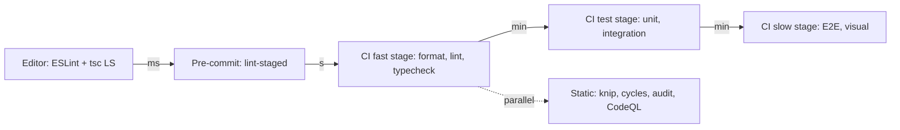

# 08 / 14 — Linting and Static Analysis: Rules That Catch Bugs Before Tests Run

## 1. Lesson metadata

| | |
|---|---|
| **Level** | Intermediate–Advanced |
| **Study time** | 3.5–4.5 hours (reading 1.5 h, experiments 1.5 h, exercises 1–1.5 h) |
| **Prerequisites** | [13 — TypeScript correctness](./13-typescript-correctness.md), [03 — React Testing Library](./03-react-testing-library.md), [10 — Accessibility testing](./10-accessibility-testing.md); hooks background from [Phase 3 lesson 05](../03-react-state-and-hooks/05-effect-dependencies-and-stale-closures.md) and [lesson 16](../03-react-state-and-hooks/16-rules-of-hooks-and-composition.md) |
| **Next** | [15 — CI checks](./15-ci-checks.md) |
| **Related** | [16 — Avoiding brittle tests](./16-avoiding-brittle-tests.md), [Phase 7 — memoization](../07-performance/04-memoization-trade-offs.md) (compiler-aware linting) |

**Learning objectives.** After this lesson you can:
1. Explain the difference between formatting, linting, type checking, and other static analysis, and what each is for.
2. Configure ESLint with the modern **flat config** for a React 19 + TypeScript + Vitest project, including type-aware rules.
3. Explain why `react-hooks/rules-of-hooks` and `react-hooks/exhaustive-deps` exist and how to respond to their warnings correctly (never by blanket-disabling).
4. Use lint rules to encode architectural constraints (import boundaries, banned APIs) and testing hygiene (Testing Library and Vitest rules).
5. Run complementary static analyses: dead-code/unused-dependency detection, circular dependency detection, security scanning, bundle-size budgets.
6. Introduce linting into a legacy codebase with a ratchet strategy, and manage suppressions responsibly.

**Concepts covered:** AST-based linting, rule severity, flat config (`eslint.config.js`), shareable configs/plugins, type-aware linting (`projectService`), `eslint-plugin-react-hooks`, `eslint-plugin-jsx-a11y`, `eslint-plugin-testing-library`, Vitest lint plugin, `no-floating-promises`, `no-misused-promises`, `no-restricted-imports`, formatters (Prettier/Biome), autofix vs suggestions, suppressions and unused-disable reporting, dead-code tools (knip), cycle detection, dependency auditing, code scanning.

> **Tool note (verified 2026-10-22).** The §5.2 flat config was executed with **ESLint 10.13.0**, `typescript-eslint` 8.72.0, `eslint-plugin-react-hooks` 7.1.1, `eslint-plugin-jsx-a11y` 6.10.2, `eslint-plugin-testing-library` 7.16.2, `@vitest/eslint-plugin` 1.6.27 and `@eslint/js` 10.0.1 against sample files; it reported the expected rule violations (rules-of-hooks, exhaustive-deps, no-floating-promises, jsx-a11y rules, Testing Library rules). Facts to know: flat config is the only format in **ESLint 10** (the old `.eslintrc` format is no longer supported, per the ESLint 10 migration guide); `tseslint.config()` still works but is **deprecated in favour of ESLint core's `defineConfig()`** from `eslint/config`, which this lesson now uses; `eslint-plugin-jsx-a11y` 6.10.2 declares peer support only up to ESLint 9, so installing it next to ESLint 10 needed `--legacy-peer-deps` (it still ran correctly); `eslint-plugin-react-hooks` 7.x exports `configs.flat.recommended` and also ships React-Compiler-derived rules (`purity`, `refs`, `immutability`, `set-state-in-effect`, `set-state-in-render`, and others). Plugin export names change between majors, so re-check READMEs when upgrading.

---

## 2. Deep conceptual explanation

### 2.1 What problem is this lesson solving?

Some bug classes are neither type errors nor easy to test:

- A `useEffect` whose dependency array omits a prop → stale closure ([Phase 3 lesson 05](../03-react-state-and-hooks/05-effect-dependencies-and-stale-closures.md)). The code compiles; a test must happen to change that prop *and* assert on the stale value.
- A hook called after an early `return` → hook order changes between renders ([Phase 3 lesson 16](../03-react-state-and-hooks/16-rules-of-hooks-and-composition.md)): crashes only on some paths.
- An un-awaited promise in an event handler → unhandled rejection or lost error, silent in tests.
- A forbidden import across architectural layers → slow decay, no failing behaviour.
- `<div onClick>` without keyboard support → inaccessible; [Lesson 10](./10-accessibility-testing.md).

Static analysis finds these **by reading code, without running it**. It is the cheapest feedback loop after the type checker (milliseconds to seconds, in your editor), and it encodes team knowledge ("we never do X") as an automated reviewer.

### 2.2 The static-tool landscape: what each tool is for

| Tool class | Question it answers | Examples | Runs |
|---|---|---|---|
| **Formatter** | How should this code look? (no semantics) | Prettier, Biome formatter, dprint | Editor, pre-commit, CI check mode |
| **Linter** | Does this code match patterns known to be buggy or against our conventions? | ESLint (+ plugins), Biome linter, oxlint *(verify maturity)* | Editor, pre-commit, CI |
| **Type checker** | Are values used consistently with their types? | `tsc` | Editor, CI |
| **Dead-code / dependency analysers** | What exports/files/dependencies are unused? | knip *(verify)*, ts-prune (historical), depcheck | CI |
| **Architecture/cycle analysers** | Do module dependencies respect our layering? Any cycles? | dependency-cruiser, madge, ESLint import rules, Nx module boundaries | CI |
| **Security static analysis (SAST)** | Dangerous patterns, known vulnerable deps, leaked secrets | CodeQL, Semgrep, `npm audit`, Dependabot/Renovate, secret scanners | CI / platform |
| **Bundle/size analysers** | Did we blow the budget? | `size-limit`, bundler analyzers | CI |
| **Spell/content checks** | Typos, broken links (docs) | cspell, markdown link checkers | CI |

Separating formatting from linting matters: a formatter's output is canonical and non-negotiable (no debate, automatically fixed); a linter finds *problems* and sometimes needs judgement. Historic practice of embedding formatting rules in ESLint produced slow, conflicting setups; modern practice is Prettier (or Biome) for format, ESLint for correctness, with config that disables ESLint's stylistic rules where they overlap *(verify current guidance in ESLint and Prettier docs; ESLint has deprecated its own formatting rules in recent versions)*.

### 2.3 How a linter works (teaching model)

1. **Parse** source into an **AST** (ESLint uses a parser, e.g. `@typescript-eslint/parser` for TS/TSX).
2. **Traverse** the AST; each rule registers *visitors* for node types (`CallExpression`, `JSXOpeningElement`…).
3. A rule inspects the node (and optionally **scope analysis** and, for type-aware rules, the **TypeScript type checker**), and **reports** a problem with a location, message, optional **fix** (automatic) or **suggestions** (offered, require choice).
4. Results are collected per file, printed, and the process exits non-zero if any `error`-severity problem exists (or warnings exceed `--max-warnings`).

Consequences:
- Lint rules are **local pattern matchers**; they are fast but cannot prove global properties. `exhaustive-deps` reasons about the *syntactic* function body and dependency list, not about runtime semantics. Hence false positives and negatives exist, and the right response is to understand the rule's intent, not to silence it.
- **Type-aware rules** (those using type information) are slower (they build a TypeScript program) but catch what syntax cannot: "this expression is a Promise and is not awaited".

### 2.4 The React-specific rules that matter most

**`react-hooks/rules-of-hooks`** enforces: hooks are called only at the top level of a function component or custom hook (names starting with `use`), never conditionally, in loops, after early returns, or inside nested functions. The reason is mechanical, not stylistic: React associates hook state with **call order** within a component ([Phase 3 lesson 16](../03-react-state-and-hooks/16-rules-of-hooks-and-composition.md)). Violations produce mismatched state or errors that appear only on certain branches. The rule is nearly always right; treat violations as bugs. (`use` is documented as callable conditionally; the plugin was updated to allow this *(verify your plugin version)*.)

**`react-hooks/exhaustive-deps`** checks that every reactive value (props, state, values derived from them, functions defined in the component) read inside `useEffect`, `useMemo`, `useCallback`, and similar is listed in the dependency array. It is **a lint, not the compiler**: it cannot see through custom abstractions and does not understand your intent. When it warns:

1. First ask: *should this be an Effect at all?* ([Phase 3 lesson 07](../03-react-state-and-hooks/07-you-might-not-need-an-effect.md)). Often the answer removes the problem.
2. Then: move the function/object *inside* the Effect, hoist constants out of the component, derive values during render, or use a functional state update.
3. If you truly need "latest value without re-synchronising", React's `useEffectEvent` is the documented tool (stable since React 19.2 per the react.dev 19.2 blog and exported by `react` 19.3.1; it requires `eslint-plugin-react-hooks` v6+ so the linter does not demand it in dependency arrays; do not use it with an older React).
4. Only then, a targeted `// eslint-disable-next-line react-hooks/exhaustive-deps` **with a comment explaining why** the omission is correct.

Newer majors of `eslint-plugin-react-hooks` also ship rules derived from the **React Compiler** analysis (for example flagging mutation of props/state or reading refs during render) (verified in `eslint-plugin-react-hooks` 7.1.1: the plugin exports rules such as `purity`, `refs`, `immutability`, `set-state-in-effect`, `set-state-in-render`, `static-components`, `use-memo`, and `error-boundaries`, and `configs.flat.recommended` enables a subset; names and defaults differ by plugin version, so read the README and the React docs reference page <https://react.dev/reference/eslint-plugin-react-hooks>). Such rules are valuable even if you do not enable the compiler, because they flag genuine violations of React's purity rules ([Phase 2 lessons](../02-react-rendering-and-internals/)).

### 2.5 Misconceptions

| Misconception | Reality |
|---|---|
| "Lint passes ⇒ code is correct." | Lint covers known patterns only. |
| "Warnings can be ignored." | Unreviewed warnings accumulate until real ones hide in noise. Either fix, or demote the rule to `off`, or enforce `--max-warnings 0`. |
| "`exhaustive-deps` is noisy, turn it off." | It is flagging a real stale-closure risk in most cases; turning it off moves the bug to production. |
| "Autofix is always safe." | Autofixes are semantics-preserving by rule-author intent, but review the diff; suggestion-type fixes explicitly may change behaviour. |
| "Prettier and ESLint are alternatives." | Different jobs. Use both (or Biome for both with its own trade-offs). |
| "Type-aware lint is too slow for CI." | Slower, yes; but typically seconds to a couple of minutes for mid-size apps, cacheable. Weigh cost against bugs caught ([Lesson 15](./15-ci-checks.md)). |
| "Disabling a rule in one place is harmless." | Suppressions are technical debt with no expiry unless tracked. |

---

## 3. Internal mechanics

### 3.1 Flat config: how ESLint resolves configuration

A flat config file (`eslint.config.js` or `.mjs`/`.ts` variants (`eslint.config.ts` is supported but "requires additional setup" per the ESLint docs)) exports an **array of config objects**. For each file being linted, ESLint concatenates all objects whose `files` pattern matches (objects without `files` apply to all), with **later objects overriding earlier ones**. Each object may contain:

- `files` / `ignores`: glob patterns (an object with *only* `ignores` is a global ignore list);
- `languageOptions`: parser, `parserOptions`, `globals`, `ecmaVersion`/`sourceType`;
- `plugins`: an object mapping **namespace → plugin object** (you import the plugin; no string-name resolution, a change from legacy config);
- `rules`: rule id → severity/options;
- `settings`, `linterOptions` (for example how to report unused disable directives).

```mermaid
flowchart LR
  F[src/Button.test.tsx] --> M{Match configs}
  M --> C1[global: ignores/dist]
  M --> C2[**/*.{ts,tsx}: typescript-eslint]
  M --> C3[**/*.{ts,tsx}: react-hooks, a11y]
  M --> C4[**/*.test.{ts,tsx}: testing-library + vitest rules]
  C1 --> R[Merged rules, later wins]
  C2 --> R
  C3 --> R
  C4 --> R
```

**Implementation detail.** Exact merge semantics for each key (shallow vs deep) are documented in ESLint's configuration docs; rely on documentation, not on this model, for edge cases such as overriding `parserOptions`.

### 3.2 Type-aware linting

Rules in the `recommendedTypeChecked`-style presets of `typescript-eslint` need a TypeScript program. Modern setup uses the **project service** (`parserOptions.projectService: true`), where typescript-eslint locates the nearest `tsconfig` for each file via the same machinery editors use, replacing the older `project: ['./tsconfig.json']` lists *(verify option names and minimum versions in the typescript-eslint docs)*. Gotchas:

- Files not included by any `tsconfig` (config files, scripts) cause "file not found in project" errors; either include them, use `allowDefaultProject`, or lint them with non-type-aware config.
- Type-aware rules make lint time scale with project size; cache (`--cache`) and run only on changed files locally (lint-staged), full in CI.

### 3.3 Autofix pipeline and suppressions

- `eslint --fix` applies fixes in passes until stable (bounded). Fixable rules are marked in docs. **Suggestions** (shown in editors as quick fixes) are never auto-applied by `--fix`.
- A **suppression** comment (`eslint-disable-next-line rule -- reason`) removes a report at a location. ESLint can **report unused disable directives** so stale suppressions are surfaced (default behaviour and option name vary by version: `linterOptions.reportUnusedDisableDirectives`; verify). ESLint's newer **bulk suppressions** feature *(introduced in recent 9.x; verify)* records existing violations in a file so new code is held to the rule while legacy violations are tolerated: the ratchet primitive.

### 3.4 Static analysis beyond ESLint

- **Dead code (knip-style)** builds the module graph from entry points (from `package.json`, framework conventions, config) and reports unused files, exports, dependencies, and unlisted dependencies *(verify tool's plugins for Vite/Vitest/Storybook to avoid false positives)*.
- **Cycle detection** (dependency-cruiser, madge, ESLint `import/no-cycle`): circular imports cause initialisation-order bugs (`undefined` at import time in ES modules, [Phase 0 lesson 10](../00-web-and-javascript-foundations/10-modules-and-dependency-graphs.md)) and defeat tree shaking.
- **Dependency vulnerability scanning**: `npm audit` against the registry advisory database, plus automated update PRs. Interpreting results requires judgement (a vulnerable dev-only dependency vs a runtime one).
- **SAST**: CodeQL/Semgrep rules for patterns like `dangerouslySetInnerHTML` with unsanitised input, `eval`, `postMessage` without origin checks, open redirects. Rule coverage is pattern-based and has false positives/negatives.
- **Secret scanning**: pre-commit and platform-level.

---

## 4. Step-by-step execution walkthrough: what happens on `git commit` and in CI

1. Developer saves a file; the **editor** runs ESLint (via the ESLint extension) and `tsc` via the language server: squiggles within a second.
2. On `git commit`, a **pre-commit hook** (husky/lefthook + lint-staged *(verify tool choices)*) runs `eslint --fix` and the formatter on **staged files only**. If errors remain, the commit is blocked. Fast: seconds.
3. Developer pushes; CI **fast-fail stage** runs in parallel: `format:check`, `lint` (full, type-aware, `--max-warnings 0`), `typecheck`.
4. If all pass, CI proceeds to unit/integration tests; static analysis failures never waste time on slow suites ([Lesson 15](./15-ci-checks.md)).
5. A separate scheduled/PR job runs dead-code (knip), cycle detection, `npm audit`, CodeQL.
6. A reviewer sees only semantic questions; formatting and common bugs were handled mechanically.

---

## 5. Code examples

### 5.1 Minimal example — what the hooks rules catch

```tsx
function Profile({ userId }: { userId: string }) {
  const [user, setUser] = useState<User | null>(null);

  useEffect(() => {
    loadUser(userId).then(setUser);
  }, []);                       // react-hooks/exhaustive-deps: missing dependency 'userId'
  ...
}
```

Prediction: with `userId` changing from `'a'` to `'b'` while mounted, which user is displayed? *Answer:* user `'a'` remains: the effect ran once with the first closure. The lint warning predicts exactly this bug. The fix is `[userId]`, plus cancellation for race conditions ([Phase 6 lesson 02](../06-data-fetching-and-state-ecosystems/02-cancellation-and-race-conditions.md)).

```tsx
function Toggle({ enabled }: { enabled: boolean }) {
  if (!enabled) return null;
  const [on, setOn] = useState(false);   // react-hooks/rules-of-hooks: called conditionally
  ...
}
```
Fix: call hooks before any conditional return, or split into two components.

### 5.2 Practical example — flat config for a React 19 + TypeScript + Vitest app

```js
// eslint.config.js  (ESM). Executed with ESLint 10.13 / typescript-eslint 8.72 / react-hooks 7.1.1 (see the tool note above).
import js from '@eslint/js';
import globals from 'globals';
import tseslint from 'typescript-eslint';
import { defineConfig } from 'eslint/config';   // replaces the deprecated tseslint.config()
import reactHooks from 'eslint-plugin-react-hooks';
import jsxA11y from 'eslint-plugin-jsx-a11y';
import testingLibrary from 'eslint-plugin-testing-library';
import vitest from '@vitest/eslint-plugin';

export default defineConfig(
  // 1. Global ignores (an object with ONLY `ignores`)
  { ignores: ['dist/**', 'coverage/**', 'playwright-report/**', '**/*.d.ts', 'eslint.config.js'] },   // linting the config file itself with projectService fails unless it is in tsconfig "include" (verified)

  // 2. Baseline JS rules
  js.configs.recommended,

  // 3. TypeScript, type-aware
  ...tseslint.configs.recommendedTypeChecked,
  {
    languageOptions: {
      globals: { ...globals.browser },
      parserOptions: {
        projectService: true,                    // typescript-eslint v8 option (verified)
        tsconfigRootDir: import.meta.dirname,    // available in Node >= 20.11 (ESLint 10 itself requires Node `^20.19.0 || ^22.13.0 || >=24`, per its package.json)
      },
    },
  },

  // 4. React hooks: the plugin's own flat preset (v7: configs.flat.recommended), then tighten
  reactHooks.configs.flat.recommended,
  {
    files: ['**/*.{ts,tsx}'],
    rules: {
      'react-hooks/exhaustive-deps': 'error',    // the preset sets it to 'warn'
    },
  },

  // 5. Accessibility lint for JSX
  {
    files: ['**/*.tsx'],
    ...jsxA11y.flatConfigs.recommended,          // verified in eslint-plugin-jsx-a11y 6.10.2 (flatConfigs.recommended | strict)
  },

  // 6. Project-specific correctness rules
  {
    files: ['src/**/*.{ts,tsx}'],
    rules: {
      '@typescript-eslint/no-floating-promises': 'error',
      '@typescript-eslint/no-misused-promises': ['error', { checksVoidReturn: { attributes: false } }],
      '@typescript-eslint/consistent-type-imports': 'error',
      '@typescript-eslint/no-explicit-any': 'error',
      '@typescript-eslint/ban-ts-comment': ['error', { 'ts-expect-error': 'allow-with-description', 'ts-ignore': true }],
      'no-restricted-syntax': ['error', {
        selector: "CallExpression[callee.property.name='json'][callee.object.callee.name='fetch']",
        message: 'Use fetchJson(schema, url) from src/api/http.ts so responses are validated.',
      }],
    },
  },

  // 7. Tests: Testing Library + Vitest rules, relaxed unsafe-any for mocks
  {
    files: ['**/*.{test,spec}.{ts,tsx}'],
    ...testingLibrary.configs['flat/react'],     // verified in eslint-plugin-testing-library 7.16.2
  },
  {
    files: ['**/*.{test,spec}.{ts,tsx}'],
    plugins: { vitest },
    rules: {
      ...vitest.configs.recommended.rules,       // verified in @vitest/eslint-plugin 1.6.27
      '@typescript-eslint/unbound-method': 'off', // common noise with vi.fn / mocked methods
    },
  },

  { linterOptions: { reportUnusedDisableDirectives: 'error' } },
);
```

Line notes:
- Section ordering matters: later objects override earlier ones for matching files.
- `no-misused-promises` with `checksVoidReturn.attributes: false` allows passing `async` handlers to JSX attributes like `onClick={async () => …}` (a deliberate pragmatic relaxation; React ignores the returned promise, so errors inside are *unhandled* unless handled internally. Keep `no-floating-promises` on to force explicit handling inside handlers). Trade-off: you accept that rejected promises from handlers are your responsibility.
- `no-restricted-syntax` with an AST selector is the poor person's custom rule: the selector above bans a `fetch(...).json()` chain *(selector must be validated in the ESLint playground / AST explorer; the object being a `fetch()` call is only matched in the direct-chain form, so `const r = await fetch(); r.json()` isn't caught; see §12 F-level of Lesson 13 for the broader approach)*.
- `ban-ts-comment` forces `@ts-expect-error` to carry a description and bans `@ts-ignore`.
- `reportUnusedDisableDirectives: 'error'` fails CI on stale suppressions.

### 5.3 Incorrect example — blanket silencing

```tsx
/* eslint-disable react-hooks/exhaustive-deps */   // at the top of the file
useEffect(() => {
  socket.on('message', (m) => setMessages([...messages, m]));
  return () => socket.off('message');
}, []);
```

Problems: file-wide disable hides every future hook problem in the file; the effect captures a stale `messages` (each message overwrites with the first closure's list → only the last message plus the initial list), and `socket.off('message')` without the handler reference removes *all* listeners for that event (a cleanup bug no lint rule flags here).

### 5.4 Corrected implementation

```tsx
useEffect(() => {
  const onMessage = (m: Message) => setMessages((prev) => [...prev, m]); // functional update: no dependency on messages
  socket.on('message', onMessage);
  return () => { socket.off('message', onMessage); };
}, [socket]);
```

Rationale: the functional update removes the stale read; the named handler enables precise cleanup; `socket` is the one genuine dependency (a stable instance may be created outside React or via `useRef`/`useState` initialiser; confirm identity stability). Lint is silent, and behaviour is right. Test it with a fake socket asserting two messages produce two items ([Lesson 04](./04-testing-async-updates.md)).

### 5.5 Advanced example — architecture rules with `no-restricted-imports`

```js
// eslint.config.js (excerpt) — enforce a layered structure: ui <- features <- app; no reverse imports
{
  files: ['src/ui/**'],
  rules: {
    'no-restricted-imports': ['error', {
      patterns: [
        { group: ['@/features/*', '@/app/*'], message: 'ui/ is leaf-level: it may not import features or app code.' },
      ],
    }],
  },
},
{
  files: ['src/features/*/**'],
  rules: {
    'no-restricted-imports': ['error', {
      patterns: [
        { group: ['@/app/*'], message: 'features may not import from app/.' },
        // other features may only be imported through their public entry:
        { group: ['@/features/*/*'], message: 'Import other features via their index.ts only.' },
      ],
    }],
  },
},
```

Caveat: `no-restricted-imports` is path-pattern based and applies per file glob; a feature importing **its own** internals through the alias would also match the second pattern. Real setups use relative imports inside a feature or a dedicated boundary plugin/tool (dependency-cruiser, Nx `enforce-module-boundaries`, `eslint-plugin-boundaries`; *verify availability/config*). Mention in review that this protects module graphs and enables tree shaking and independent team ownership ([Phase 10](../10-production-engineering/) and [Phase 11](../11-senior-and-architect-mastery/) on modular architecture).

### 5.6 Lint rules for tests (Testing Library + Vitest)

Examples of mistakes these plugins catch *(rule names: verify in plugin docs)*:

```tsx
// testing-library/no-node-access, no-container, prefer-screen-queries, await-async-queries
const { container } = render(<Form />);
container.querySelector('.error');              // no-container / no-node-access: use screen.getByRole
const btn = screen.getByRole('button');
user.click(btn);                                // missing await on user-event v14 async API (await-async-events)
screen.findByText('Saved');                     // missing await (await-async-queries)
expect(screen.getByText('x')).toBeInTheDocument(); // OK; but `waitFor(() => { expect(...); doSideEffect() })` is flagged (no-wait-for-side-effects)
```

```ts
// vitest plugin: no-focused-tests (it.only), no-disabled-tests, expect-expect, no-identical-title, valid-expect
it.only('works', () => { ... });                // committed .only silently skips the rest of the suite — fail CI
it('does nothing', () => { render(<A />); });   // expect-expect: test with no assertion
```

These rules directly prevent categories discussed in [Lesson 16](./16-avoiding-brittle-tests.md).

### 5.7 Dead code, cycles, and dependencies in CI

```jsonc
// package.json scripts (excerpt)
{
  "scripts": {
    "lint": "eslint . --max-warnings 0 --cache",
    "format:check": "prettier --check .",
    "typecheck": "tsc --noEmit",
    "knip": "knip",
    "deps:cycles": "depcruise src --config .dependency-cruiser.cjs",
    "audit": "npm audit --omit=dev --audit-level=high"
  }
}
```

`--max-warnings 0` turns warnings into failures in CI while allowing developers to see them as warnings in the editor. `npm audit --omit=dev --audit-level=high` fails only on high+ severity advisories in production dependencies; tune to your risk tolerance (both flags are documented npm options; audits depend on the registry service and can fail for network reasons: treat flakiness policy accordingly).

---

## 6. Visual explanations

### Where each tool sits in the feedback loop



### Rule severity policy

```text
error   -> blocks merge (CI --max-warnings 0 also promotes warn)
warn    -> editor hint during migration; has a deadline to become error or off
off     -> rule is a conscious non-goal (documented)
Never: long-lived "warn" noise
```

### Type-aware vs syntactic rules

```text
syntactic:   reads AST only          (fast; rules-of-hooks, jsx-a11y, no-restricted-syntax)
type-aware:  AST + type checker      (slower; no-floating-promises, no-unsafe-*, no-unnecessary-condition)
```

---

## 7. Alternative approaches and trade-offs

| Approach | Strengths | Weaknesses | Best for |
|---|---|---|---|
| ESLint + typescript-eslint + plugins | Largest rule ecosystem; custom rules; type-aware; React-specific plugins | Config complexity; slower; version churn | Most React/TS teams |
| Biome (linter + formatter) | One fast tool; simple config | Smaller rule set; no ESLint plugin ecosystem; type-aware rules limited *(verify current state)* | Teams valuing speed/simplicity; greenfield |
| oxlint (as a fast pre-pass) | Very fast; can run alongside ESLint | Rule coverage evolving *(verify)* | Large monorepos needing speed |
| Prettier for format + ESLint for correctness | Clear separation | Two tools | Default |
| ESLint stylistic plugins instead of Prettier | Granular formatting control | Maintenance, slower, config debates | Teams wanting custom style |
| TypeScript strictness only (no lint) | Zero extra tooling | No hooks/a11y/test-hygiene coverage | Small, short-lived code |
| Code review only | Human judgement | Inconsistent, slow, not scalable | Never as sole control |
| Custom ESLint rules | Encode org-specific invariants precisely | Maintenance; AST skill needed | Large orgs with recurring defects |
| React Compiler's own diagnostics | Detects patterns the compiler cannot optimise | Tied to compiler adoption (the React Compiler reached v1.0, see react.dev) | Teams adopting the compiler |

**Scenario where the full ESLint setup is NOT best.** A small internal tool maintained by one developer with a 2-hour weekly budget: Biome (or even TS strict + Prettier) delivers 90% of value at 10% of configuration cost. Likewise, a repository of mostly server-side code with sparse React: type-aware rules may add CI time with little benefit. And for a legacy codebase, enabling every recommended rule as `error` on day one is counterproductive; use the ratchet (§8).

---

## 8. Best practices and anti-patterns

### Best practices
1. **Make lint a gate**: `--max-warnings 0` in CI; no merge with lint errors.
2. **Format automatically**; never debate style in review.
3. **Treat `rules-of-hooks` as non-negotiable** and `exhaustive-deps` as `error`; fix by restructuring.
4. **Enable type-aware rules** for promise/`any` safety (`no-floating-promises`, `no-misused-promises`, `no-unsafe-*` as a ratchet).
5. **Require reasons on suppressions** (`-- reason` text) and report unused ones; use ownership/expiry in comments for temporary ones.
6. **Lint tests**: Testing Library and Vitest plugins catch `.only`, missing `await`, brittle queries.
7. **Encode architecture**: import boundaries, banned APIs (e.g. `moment`, direct `localStorage` outside a wrapper), with messages explaining *why* and *what to use*.
8. **Ratchet legacy code**: enable rules for new/changed files first (overrides by path), or use bulk suppressions; burn down by directory.
9. **Cache and scope**: `eslint --cache`, lint-staged locally, full run in CI.
10. **Review config changes** like code; pin plugin versions; upgrade deliberately because new rules appear.
11. **Fix the cause when a rule flags a pattern repeatedly**; consider a codemod or a helper.

### Anti-patterns

| Anti-pattern | Why wrong | Fix |
|---|---|---|
| File-wide `eslint-disable` | Hides future issues | Line-level with reason |
| Disabling `exhaustive-deps` globally | Reintroduces stale-closure bugs | Restructure; `useEffectEvent` where available and appropriate |
| Adding every dependency to silence the rule without thinking | Can create infinite loops or over-syncing | Understand reactive values; stabilise identities; ask if an Effect is needed |
| Linting with a different config in CI than locally | "Works on my machine" | Single config; `npm run lint` |
| 800 warnings tolerated | Noise hides errors | Error or off; ratchet |
| Format rules in ESLint conflicting with Prettier | Fix loops | Disable conflicting rules via config; separate roles |
| Copy-pasting config from a blog without reading rules | Cargo-cult | Understand each rule, verify docs |
| Custom rules for one-off issues | Maintenance burden | Use `no-restricted-syntax` first |
| Lint autofix on whole repo in a feature PR | Unreviewable diffs | Dedicated mechanical PR |

**Justified exceptions.** `exhaustive-deps` disable with a comment when intentionally running an Effect only on mount for a one-time subscription to a non-reactive external system *and* you have verified no reactive value is read (modern guidance prefers restructuring or `useEffectEvent`, but until your React version supports it, a documented exception is legitimate). `no-explicit-any` off for generated code directories. `jsx-a11y/no-autofocus` exceptions in a modal where focusing the first control is the specified behaviour; document.

---

## 9. Real-world application

**Multi-team monorepo.** Shared ESLint config package (`@company/eslint-config`) versioned semantically; apps extend it and add path-specific overrides. Architectural boundary rules enforce package layering. CI runs lint per affected package (task runners with caching: Nx/Turborepo *(verify)*). Constraint: config upgrades are cross-team events; roll out new rules as `warn` with a deadline, then flip.

**E-commerce checkout.** Banned-API rules (`no-restricted-properties` on `window.localStorage` for payment data; `dangerouslySetInnerHTML` banned outside a sanitising wrapper), `no-floating-promises` for payment submission handlers. Security scanning in CI. Constraint: false positives from SAST need triage ownership.

**Dashboard/finance.** `no-restricted-imports` blocks heavy libraries from the initial bundle (`import _ from 'lodash'` → use per-method imports or native); `size-limit` budget fails PRs that exceed. Constraint: budgets must be reviewed upward consciously, not bumped to green.

**Forms and auth.** `jsx-a11y` rules (label associations, autofocus, `click-events-have-key-events`). Constraint: custom components wrapping `<input>` hide semantics from the plugin unless configured with `components`/`settings` mapping *(verify option names)*.

**Realtime apps.** Custom ESLint rule or selector to require cleanup in `useEffect` subscriptions is difficult; rely on tests for subscription lifecycle ([Lesson 04](./04-testing-async-updates.md)) and on `rules-of-hooks`/`exhaustive-deps` for baseline correctness. Understand lint limits.

**Legacy app adoption.** 5,000 existing violations: enable bulk suppression or per-directory overrides, `error` for new directories, a dashboard of remaining counts, quarterly goals.

---

## 10. Debugging and troubleshooting

**Symptom 1: Editor shows lint errors that CLI doesn't (or vice versa).**
Causes: ESLint extension using a different working directory/config (monorepo), stale server, or CLI run with different flags. Investigate: ESLint output channel in the editor, `npx eslint --print-config src/file.tsx` to see the effective config for that file *(flag name: verify)*, restart the ESLint server.

**Symptom 2: `Parsing error: ... not found by the project service`/"not included in tsconfig".**
Cause: file not covered by any `tsconfig` `include`. Fix: include tests and configs in a tsconfig (`tsconfig.eslint.json` or the main one), or configure `allowDefaultProject`; or use a non-type-aware override for those files.

**Symptom 3: Lint is very slow in CI.**
Investigate: `TIMING=1 npx eslint .` prints rule timings (documented env var; verified: it printed a per-rule timing table); typical offenders: type-aware rules, `import/no-cycle`, huge ignores missing (linting `dist`/`coverage`). Mitigations: ignore build outputs, `--cache` with CI cache restore, split type-aware rules to changed packages, consider oxlint pre-pass.

**Symptom 4: `exhaustive-deps` suggests adding a dependency that causes an infinite loop.**
Root cause: the dependency's identity changes every render (inline object/function/array) and the effect sets state. Fix identity at the source (`useMemo`/`useCallback` only if justified; or move inside the effect; or derive during render); examine with React DevTools Profiler "why did this render". Check [Phase 7 lesson 05](../07-performance/05-referential-equality.md).

**Symptom 5: A new plugin upgrade fails hundreds of files.**
Investigate rule changelog; check which rule IDs are new in `recommended`; roll out as `warn` for the new rules via explicit overrides, fix mechanical ones with `--fix`, track the rest; pin versions in the lockfile with Renovate PR for review.

**Symptom 6: Autofix breaks semantic behaviour.**
Cause: a "suggestion"-type or an aggressive fixer misapplied; or a rule conflicting with the formatter. Revert, apply per-rule fixes with `--fix-type problem,suggestion` selectively *(verify flag)*, review diffs, add a test that would have caught the regression.

---

## 11. Exercises

### Level A — Knowledge
A1. Distinguish formatter, linter, and type checker in one sentence each.
A2. Why is `rules-of-hooks` a correctness rule and not a style preference?
A3. What is the difference between a lint autofix and a suggestion?
A4. What does `--max-warnings 0` do and when would you use it?
A5. Name two things type-aware rules can catch that syntactic rules cannot.

### Level B — Code comprehension
B1. Which rule(s) does this violate, and what bug do they predict?
```tsx
function Cart({ items }: { items: Item[] }) {
  const [total, setTotal] = useState(0);
  useEffect(() => { setTotal(items.reduce((s, i) => s + i.price, 0)); }, []);
  return <p>{total}</p>;
}
```
B2. What does this ESLint flat config object do?
```js
{ files: ['src/ui/**'], rules: { 'no-restricted-imports': ['error', { patterns: ['@/features/*'] }] } }
```
B3. Why can `onClick={async () => { await save(); }}` pass `no-floating-promises` yet still hide errors?
B4. What happens at runtime if `it.only` is committed and CI runs only `vitest run`?

### Level C — Implementation
C1. Write the flat-config section that applies Testing Library rules only to test files and forbids `fdescribe/it.only`-style focused tests.
C2. Write a `no-restricted-syntax` rule that forbids `useEffect` callbacks passed as `async` functions directly and explain why that is a bug.
C3. Write scripts and a CI job order for: format check, lint, typecheck, unit tests, knip, audit. Justify the order.

### Level D — Debugging
D1. Lint is silent but an effect still reads stale state. Give three reasons the rule may not catch it.
D2. After enabling `no-unsafe-assignment` you have 2,300 errors. Plan the response.
D3. `exhaustive-deps` demands `onChange` as a dependency and the parent passes an inline arrow, creating an effect loop. Diagnose and fix.

### Level E — Architecture and engineering decisions
E1. Choose between ESLint+Prettier and Biome for a 40-engineer organisation. Evaluate on at least six criteria.
E2. Design a rule-severity governance process for a shared ESLint config used by 15 repos.
E3. Decide which checks run in pre-commit vs CI vs nightly.

### Level F — Expert challenge
F1. Specify (design, not necessarily implement) a custom ESLint rule that flags `useEffect` calls that call `setState` synchronously with a value derivable from props/state (the "derived state in Effect" smell). Cover AST detection, false positives, and a safe rollout.

---

## 12. Detailed answers and explanations

> Attempt the exercises first.

**A1.** Formatter: rewrites layout canonically without changing meaning. Linter: finds suspicious or convention-violating patterns via rules over the AST. Type checker: verifies values are used consistently with declared/inferred types across the program.

**A2.** React stores hook state in a per-component list indexed by call order within a render. Conditional or looped calls change the order between renders, associating state with the wrong hook or throwing. So the constraint is mechanical ([Phase 3 lesson 16](../03-react-state-and-hooks/16-rules-of-hooks-and-composition.md)). Style rules never change behaviour; this does.

**A3.** An autofix is applied automatically by `--fix` because the rule author considers it safe and meaning-preserving; a suggestion offers an alternative that may change behaviour, requiring explicit human choice (editor quick fix), never applied by `--fix`.

**A4.** It makes ESLint exit non-zero when warnings exceed the number given (0 means any warning fails). Use in CI so warnings cannot accumulate; locally warnings remain advisory.

**A5.** Promise misuse (`no-floating-promises`, `no-misused-promises`: needs to know an expression's type is `Promise`), `any` propagation (`no-unsafe-*`), unnecessary conditions/assertions (`no-unnecessary-condition`, `no-unnecessary-type-assertion`), `await` on non-thenables, comparing enum types.

**B1.** `exhaustive-deps`: effect reads `items` but deps is `[]`. Bug: `total` never updates when `items` changes. Further design smell: this is derived state; compute `const total = items.reduce(…)` during render (optionally `useMemo` if measured expensive) with no state or effect ([Phase 3 lesson 17](../03-react-state-and-hooks/17-derived-state.md)). Best answer fixes the design, not the dependency array.

**B2.** For files under `src/ui/`, importing anything matching `@/features/*` is an error; `patterns` entries accept gitignore-style patterns (verify exact semantics). It enforces that the UI layer does not depend on feature code. Edge: nested paths `@/features/a/b` — whether `*` matches deeper segments depends on pattern semantics; use `@/features/**` or verify in docs.

**B3.** `no-floating-promises` flags an un-awaited promise **expression**; here the promise is awaited inside the async arrow, so it passes. But the arrow itself returns a promise to React, which ignores it, so if `save()` rejects, the rejection is unhandled (an unhandled promise rejection event) with no UI error. Fix: `try/catch` in the handler setting error state, or use Actions/`useActionState` which handle pending/error flows ([Phase 3 lesson 22](../03-react-state-and-hooks/22-modern-hooks-and-apis.md)).

**B4.** Vitest (without `--allowOnly=false` behaviour or CI-specific config) runs only the focused test(s) and passes; the remaining tests silently don't run. Vitest has a setting around `allowOnly` that defaults to disallowed in CI environments (verified in the v3 config docs: `allowOnly` defaults to `!process.env.CI`); lint rule `vitest/no-focused-tests` (or Playwright's `forbidOnly`) removes reliance on that.

**C1 (sample).**
```js
{ files: ['**/*.{test,spec}.{ts,tsx}'], ...testingLibrary.configs['flat/react'] },
{ files: ['**/*.{test,spec}.{ts,tsx}'], plugins: { vitest }, rules: { 'vitest/no-focused-tests': 'error', 'vitest/no-disabled-tests': 'warn', 'vitest/expect-expect': 'error' } },
```
Criteria: `files` scoping; error on focused tests; mentions Playwright `forbidOnly` for E2E.

**C2 (sample).**
```js
'no-restricted-syntax': ['error', {
  selector: "CallExpression[callee.name='useEffect'] > ArrowFunctionExpression[async=true]",
  message: 'Effect callbacks must not be async: they return a promise instead of a cleanup function. Define an inner async function.',
}]
```
Why a bug: an Effect callback must return `undefined` or a cleanup function; an async function returns a Promise, so React cannot call cleanup (React warns in dev), and errors are unhandled. Also match `FunctionExpression[async=true]`. (typescript-eslint's `no-misused-promises` can catch this too in type-aware mode.)

**C3 (sample).** Parallel fast jobs: `format:check`, `lint`, `typecheck` (all seconds–minutes, no dependencies between them); then `test` (needs nothing from them but is slower, so gating it saves cost); `knip` and `audit` parallel but non-blocking initially (or scheduled) since false positives/ network. Justification: fail fast and cheap first; slow suites run only if static checks pass; audit separate because it depends on external service availability and advisory changes unrelated to the PR. Lockfile install shared via cache ([Lesson 15](./15-ci-checks.md)).

**D1.** (1) The stale read occurs through a reference the rule can't see (e.g. a function from a custom hook that closes over state, or a ref). (2) Dependencies were "fixed" by adding a value that is identical across renders though the *function* reading state is stale (e.g. a memoized callback with wrong deps in another hook). (3) A disable comment hides it; check `reportUnusedDisableDirectives` and grep for disables. (4) The plugin is configured with `additionalHooks` incorrectly for a custom hook that takes deps. (5) The bug is not a dependency problem but a logical one (functional update needed).

**D2.** Triage: classify by directory and root cause (`res.json()` any; untyped libs; test mocks), fix at the source with typed wrappers (one helper fixes hundreds), enable the rules at `warn` or as overrides for new/changed files, use bulk suppression for the legacy remainder, relax in test dirs where `any` for mocks is common, schedule burn-down, and track metrics. Do not blanket-disable.

**D3.** The parent's inline arrow has new identity each render, so the effect re-runs each render; if the effect sets parent state, a loop results. Diagnose using the Profiler and a log in the effect. Fixes: parent wraps the callback with `useCallback` (if truly needed); child stores the latest `onChange` in a ref updated in an effect, or uses `useEffectEvent` where available; or reconsider whether an Effect is needed at all (call `onChange` from the event handler that causes the change).

**E1 (evaluation criteria).** Rule coverage (React hooks, a11y, testing plugins), type-aware capability, speed, config complexity, ecosystem/custom rules, migration cost, editor support, maturity/stability, formatter compatibility, hiring/knowledge, vendor roadmap. Example conclusion: for 40 engineers with existing ESLint investment and custom rules, keep ESLint+Prettier; evaluate Biome/oxlint for speed in a pilot; for greenfield with no custom rule needs, Biome may suffice. Must verify current Biome rule coverage for React hooks and a11y.

**E2 (example).** Shared package semantic versioning: new rules arrive as `warn` in minor, flip to `error` in the next major with a codemod/fix guide; an RFC/ADR process for rule changes; metrics on violations per repo; a "rule owner"; an escape hatch (per-repo overrides must be documented and reviewed); automated upgrade PRs via Renovate; deprecation windows. Criteria: predictable, low-friction, transparent.

**E3 (example).** Pre-commit: format + lint on staged files (seconds), maybe typecheck changed project only if under ~10 s. CI on PR: format check, full lint (type-aware), typecheck, unit/integration, a11y component tests; knip and cycles on PR if fast (<1–2 min), else nightly. Nightly: audit/full SAST, dependency freshness, E2E extended, visual baselines audit. Criteria: feedback latency vs completeness; avoid blocking commits for slow checks which encourages `--no-verify`.

**F1 (example).** AST detection: within `useEffect` callback body, find `CallExpression` whose callee is a `setX` from a `useState` tuple (resolve via scope analysis to the `[x, setX] = useState()` declaration) at the top level of the effect (not within a conditional callback, timeout, promise, or subscription), where the argument expression references only props/state identifiers and pure operations (no calls to external functions, no `await`). Flag with a message pointing to deriving during render. False positives: intentional resets on prop change (should use `key`), effects that sync to external systems then set state in callbacks (excluded because inside callbacks). Rollout: implement as `warn` in a local plugin, run on the codebase to measure hit-rate and precision, sample manually, adjust, publish docs, then `error` for new code via overrides. Evaluation: acknowledges precision/recall trade-offs and the existence of experimental official rules *(verify)*.

---

## 13. Senior engineer interview questions

**Q1. "A teammate wants to disable `exhaustive-deps` because it 'makes effects run too often'. How do you respond?"**
*Strong answer:* The rule reveals that the effect depends on values that change; "runs too often" means either the dependency identity is unstable (inline objects/functions) or the Effect is doing something that should be derived/event-driven. Walk through the options: derive during render, move logic to an event handler, stabilise identity at the source, restructure to reduce dependencies, `useEffectEvent` when available. Disabling hides stale-closure bugs. Allow a documented, narrow exception only after analysis.

**Q2. "How do you adopt strict linting in a 5-year-old codebase?"**
*Strong answer:* Ratchet: baseline violations (bulk suppressions or per-directory overrides), enforce on new/changed code, auto-fix mechanical rules in dedicated PRs, track burn-down metrics, assign owners, and prioritise rules by bug-prevention value (hooks, floating promises, a11y) over style. Avoid big-bang that makes teams disable lint.

**Q3. "Lint vs type checking vs tests — where does each earn its keep?"**
*Strong answer:* Types: shape/consistency across the whole program. Lint: known-bad patterns and conventions, React rules types can't express. Tests: behaviour, integration, timing. Overlaps exist (`no-floating-promises` is lint using types), so place each check at the cheapest layer that can detect it.

**Q4. "How would you enforce that nobody imports from another feature's internals?"**
*Strong answer:* Boundary rules via `no-restricted-imports` patterns or a boundaries tool, plus cycle detection in CI; give clear messages with the allowed entry point; start `warn`, flip to `error`; consider package-level enforcement (monorepo packages with `exports`) for hard boundaries. Mention limits of path-pattern rules.

**Q5. "Why not rely on pre-commit hooks alone?"**
*Strong answer:* Hooks are bypassable (`--no-verify`), run only locally, and differ per machine. CI is the authoritative gate; hooks are a convenience for fast feedback.

---

## 14. Further learning resources

| Resource | URL | Covers / why | Level | Study |
|---|---|---|---|---|
| ESLint docs | <https://eslint.org/docs/latest/> | Flat config, rules, CLI | Intermediate | "Configuration Files", "Command Line Interface" |
| ESLint — Migrate to flat config | <https://eslint.org/docs/latest/use/configure/migration-guide> | Legacy → flat | Intermediate | Whole page |
| typescript-eslint | <https://typescript-eslint.io/> | TS parser/rules, typed linting | Intermediate | Getting Started, Typed Linting |
| React docs — Rules of Hooks | <https://react.dev/reference/rules/rules-of-hooks> | The rules the lint enforces | Beginner | Whole page |
| React docs — `eslint-plugin-react-hooks` reference | <https://react.dev/reference/eslint-plugin-react-hooks> | Official plugin docs | Intermediate | Rule list |
| React docs — Removing Effect Dependencies | <https://react.dev/learn/removing-effect-dependencies> | How to respond to `exhaustive-deps` | Intermediate | Whole page |
| React docs — Separating Events from Effects | <https://react.dev/learn/separating-events-from-effects> | `useEffectEvent` rationale (stable since 19.2) | Advanced | Whole page |
| `eslint-plugin-jsx-a11y` | <https://github.com/jsx-eslint/eslint-plugin-jsx-a11y> | Accessibility lint rules | Beginner | Rules list |
| `eslint-plugin-testing-library` | <https://github.com/testing-library/eslint-plugin-testing-library> | Test hygiene rules | Intermediate | Rules list |
| Vitest ESLint plugin | <https://github.com/vitest-dev/eslint-plugin-vitest> (npm package `@vitest/eslint-plugin`, verified 1.6.27) | Vitest-specific rules | Intermediate | README |
| Prettier docs | <https://prettier.io/docs/> | Formatter, integrating with ESLint | Beginner | "Integrating with Linters" |
| Biome | <https://biomejs.dev/> | Alternative toolchain *(verify capabilities)* | Intermediate | Linter, Formatter docs |
| knip | <https://knip.dev/> | Unused files/exports/deps *(verify)* | Intermediate | Getting started |
| dependency-cruiser | <https://github.com/sverweij/dependency-cruiser> | Dependency rules and cycles | Intermediate | README |

---

## 15. Knowledge checkpoint

**You should now understand**
- Formatter vs linter vs type checker vs other static analysers and the feedback loop for each.
- Why the hooks rules are correctness rules, and the escalation ladder for `exhaustive-deps` warnings.
- How flat config composes, and what type-aware linting adds and costs.

**You should be able to explain without notes**
- A ratchet strategy for adopting rules in legacy code.
- Why suppressions need reasons and unused-directive reporting.
- Why pre-commit is convenience and CI is the gate.

**You should be able to implement**
- A flat config for React/TS/Vitest with type-aware and test-specific rules; import-boundary rules; CI scripts for lint, typecheck, dead-code, audit.

**You should be able to debug**
- Editor vs CLI mismatches, project-service errors, slow lint runs, effect loops caused by satisfying `exhaustive-deps` with unstable identities.

**Before moving on:** read [15 — CI checks](./15-ci-checks.md), which assembles all of these static and dynamic checks into a pipeline with caching, parallelism, artifacts and merge gates.
