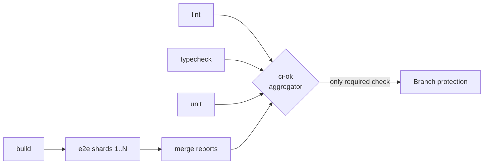
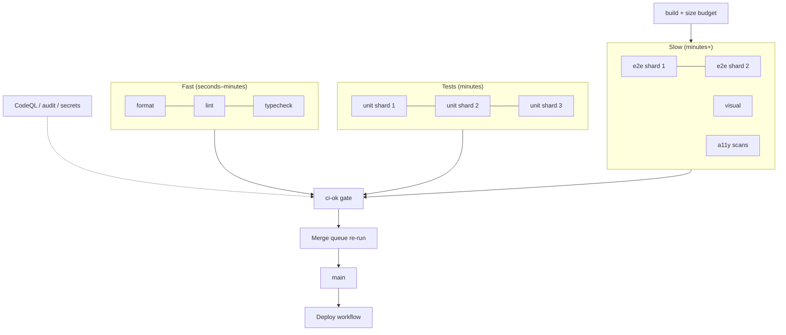
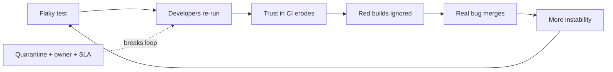

# 08 / 15 — CI Checks: Designing a Fast, Trustworthy Quality Pipeline

## 1. Lesson metadata

| | |
|---|---|
| **Level** | Advanced–Professional |
| **Study time** | 4 hours (reading 1.5 h, experiments 1.5 h, exercises 1 h) |
| **Prerequisites** | [01 — Test strategy and pyramid](./01-test-strategy-and-pyramid.md), [09 — E2E with Playwright](./09-e2e-with-playwright.md), [12 — Visual regression](./12-visual-regression.md), [13 — TypeScript correctness](./13-typescript-correctness.md), [14 — Linting and static analysis](./14-linting-and-static-analysis.md) |
| **Next** | [16 — Avoiding brittle tests](./16-avoiding-brittle-tests.md) |
| **Related** | [Phase 7 — measure before optimising](../07-performance/01-measure-before-optimizing.md) (performance budgets), Phase 10 production engineering lessons (see [ROADMAP](../ROADMAP.md)) |

**Learning objectives.** After this lesson you can:
1. Design a CI pipeline for a React app as a graph of jobs ordered by cost and information value, with fail-fast stages.
2. Write a GitHub Actions workflow that installs deterministically, caches correctly, parallelises and shards tests, uploads diagnostics, and gates merges.
3. Explain required status checks, the "aggregator job" pattern, and the interaction between path filters and required checks.
4. Set coverage, retry, timeout and flaky-test policies that preserve trust in the signal.
5. Handle secrets, permissions and fork pull requests safely.
6. Measure and reduce CI time and cost; know when *not* to add another check.

**Concepts covered:** continuous integration vs delivery vs deployment, pipeline stages, determinism (`npm ci`, lockfiles, pinned runtimes), caching layers, parallelism and sharding, test-report merging, artifacts and traces, branch protection, merge queues, coverage thresholds and their limits, retries vs flakiness, quarantine, preview deployments, bundle-size and performance budgets, supply-chain hygiene (pinned actions, least-privilege tokens, `pull_request_target` hazards), cost control.

> **Platform note (verified 2026-10-22).** Examples use GitHub Actions syntax. The seven YAML workflow blocks parse as valid YAML (the sketch blocks with `...install...` placeholders are intentionally abbreviated and not runnable as-is). Action majors checked against each repo's latest GitHub release: `actions/checkout` **v7**, `actions/setup-node` **v7**, `actions/cache` **v6**, `actions/upload-artifact` **v7**, `actions/download-artifact` **v8**; these are used below (Playwright's own CI docs still show `@v6` for checkout/setup-node). Newer majors move the actions to the Node 24 runtime and raise the minimum runner version (see each release's notes, especially for self-hosted runners). `vitest run --shard`, `--outputFile.junit`, and Playwright's `--shard` + `merge-reports --reporter html ./all-blob-reports` were confirmed in the respective docs. Runner images and branch-protection UI/API names change; the *design principles* transfer to GitLab CI, CircleCI, Buildkite, Azure Pipelines, etc.; syntax does not.

---

## 2. Deep conceptual explanation

### 2.1 What problem is this lesson solving?

You now have many quality mechanisms: types, lint, unit, integration, E2E, visual, a11y. Individually they have value; **a mechanism that is not run automatically, consistently, and on every change decays to zero value**. Continuous Integration (CI) is the discipline of integrating changes frequently and verifying every change with an automated, reproducible build and test process. But CI done badly is a tax: 40-minute pipelines, flaky red builds that teach everyone to click "re-run", and checks nobody trusts.

The engineering problem is to maximise **information per minute** and **trust per failure**:

- **Latency**: how soon does a developer learn their change is broken?
- **Signal quality**: when CI is red, is it almost always a real problem? When green, can we ship?
- **Cost**: compute minutes, and human attention.
- **Safety**: CI executes arbitrary code with credentials; it is part of your attack surface.

### 2.2 CI, CD, and deployment

| Term | Meaning |
|---|---|
| **Continuous Integration** | Every change is built and verified automatically (and merged frequently). |
| **Continuous Delivery** | Every change that passes is *releasable*; deploy is a manual button. |
| **Continuous Deployment** | Every change that passes is deployed automatically. |

This lesson covers the **verification** half (checks gating merges). Deployment and release engineering (feature flags, canaries, rollbacks) belong to [Phase 10](../10-production-engineering/).

### 2.3 Pipeline design principles

1. **Order by cost and likelihood of failure.** Cheap, high-yield checks first: format, lint, typecheck (seconds–minutes) → unit/component tests → integration → E2E/visual (minutes+). Fail fast so slow work isn't wasted.
2. **Parallelise independent jobs**; serialise only true dependencies (build artifact needed by E2E).
3. **Determinism**: same commit → same result. Pin Node version, use lockfile installs (`npm ci`), pin browser images, control time/data in tests. Non-determinism is the root of flakiness.
4. **Hermeticity**: tests should not depend on external services; use MSW/local servers ([Lesson 06](./06-mocking-strategies-and-msw.md)). The few tests that hit real staging are isolated and marked.
5. **Cache what is expensive and stable** (dependency downloads, build caches, TypeScript incremental info, Playwright browsers) with correct keys.
6. **Surface evidence**: failures should include logs, screenshots, traces, coverage and diff artifacts so no one needs to reproduce blind.
7. **Make the gate explicit**: branch protection requires specific checks; nothing merges red.
8. **Minimise bypass**: no habitual `--no-verify` or admin overrides; if the pipeline is so painful people bypass it, fix the pipeline.
9. **Treat CI config as code**: reviewed, versioned, tested on branches.

### 2.4 Where each check belongs

| Check | Typical stage | Typical runtime (mid-size app, order-of-magnitude) | Blocks merge? |
|---|---|---|---|
| Format check | Fast | seconds | Yes |
| ESLint (type-aware) | Fast | 30 s–3 min | Yes |
| `tsc --noEmit` | Fast | 30 s–3 min | Yes |
| Unit + component tests (jsdom) | Test | 1–5 min (parallel/sharded) | Yes |
| Integration (MSW) | Test | with above | Yes |
| Build (production bundle) | Build | 1–5 min | Yes (catches build-only errors) |
| Bundle-size budget | After build | seconds | Yes or warn |
| E2E (Playwright) | Slow | 5–20 min sharded | Yes (critical journeys) |
| Visual regression | Slow | 3–15 min | Yes if stable; else required-but-reviewed |
| a11y page scans | Slow | with E2E | Yes (ratchet) |
| Dead code / cycles | Parallel | 1–2 min | Often warn first |
| `npm audit`, CodeQL, secret scan | Parallel/scheduled | 1–10 min | High severity only |
| Lighthouse/perf budgets | Scheduled or on preview | minutes | Usually non-blocking trend |

(Times are rough orders of magnitude, not measurements; measure your own.)

### 2.5 Misconceptions

| Misconception | Reality |
|---|---|
| "More checks = higher quality." | Past a point, more checks = slower feedback and more flake; value per check matters. |
| "100% coverage gates guarantee quality." | Coverage measures execution not assertion; chasing a number produces assertion-free tests. Use as a smoke indicator, ratchet, or per-area floor. |
| "Retry flaky tests until green." | Retries mask nondeterminism and train people to ignore red. Use limited retries *with reporting* and a fix-or-quarantine policy. |
| "CI caching always speeds things up." | Wrong keys or huge caches can slow jobs (restore time) or serve stale results. |
| "If it passes in CI it will pass in production." | CI verifies the build in a test environment; production differs (data, scale, third parties). |
| "Skipping CI on docs-only PRs is free." | With required checks, skipped jobs can block merging (see §3.4). |
| "Secrets are safe in CI." | Any code run in a job with secrets can exfiltrate them; fork PR handling and third-party actions are real attack paths. |

---

## 3. Internal mechanics

### 3.1 Anatomy of a GitHub Actions workflow (teaching model)

- **Workflow**: YAML file under `.github/workflows/`, triggered by **events** (`push`, `pull_request`, `schedule`, `workflow_dispatch`, `merge_group`).
- **Job**: runs on a fresh **runner** (VM/container); jobs run in parallel unless linked with `needs`.
- **Step**: a shell command (`run`) or reusable **action** (`uses`).
- **Context/expressions**: `${{ … }}` evaluate event data, secrets, matrix values, job outputs.
- **Artifacts**: files uploaded from a job for later jobs/humans; **caches**: keyed storage restored at job start.
- **Permissions**: the `GITHUB_TOKEN` scopes; set minimal at workflow/job level.

Each job starts from a clean machine: **nothing persists between jobs except artifacts and caches**. This is why install steps repeat in every job and why caching matters.

### 3.2 Caching layers

| Layer | What | Key idea | Risk |
|---|---|---|---|
| Package manager download cache | npm's `~/.npm` cache | key on lockfile hash; `actions/setup-node` `cache: 'npm'` automates (setup-node v6+ limits its automatic caching to npm) | Stale only if lockfile unchanged but registry changes (rare) |
| `node_modules` cache | Entire install | Not recommended for npm: `npm ci` deletes it; native modules vary by OS/Node | Corruption, slow restore |
| Build/tool caches | `.tsbuildinfo`, ESLint `--cache` file, Vite/Turbo caches | key on source hash + config; restore-keys fallback | Stale caches causing false results if invalidation wrong |
| Playwright browsers | `~/.cache/ms-playwright` | key on Playwright version | Missing OS deps; or use the official container image |
| Remote task cache (Turborepo/Nx) | Task outputs by input hash | Content-addressed | Misconfigured inputs → wrong cache hits (dangerous) |

Principle: caches must be **correct before fast**. A cache that can return stale lint results is worse than none.

### 3.3 Parallelism and sharding

- **Job-level parallelism**: lint, typecheck, unit run as separate jobs simultaneously. Cost: each job repeats checkout + install (cacheable); benefit: wall-clock = slowest job.
- **Test sharding**: split a suite across N machines: `vitest run --shard=1/4` (documented in the Vitest CLI guide), `playwright test --shard=1/4`. Each shard produces a partial report; merge afterwards (Playwright blob reporter + `merge-reports`; Vitest `--reporter=blob` + `--merge-reports` *(verify)*).
- **Within-job workers**: Playwright `workers`, Vitest threads/forks. Tune for runner CPU count; too many workers on small runners increase flake due to CPU starvation.
- **Matrix**: run the same job across Node versions/OS/browsers. Use sparingly; each cell costs.

### 3.4 Required checks and the "aggregator job"

Branch protection lets you mark **status checks as required**; a PR cannot merge unless they pass. Pitfalls:

- Check names are strings; renaming a job silently un-requires it until the rule is updated.
- **Path-filtered workflows** (`on: pull_request: paths: […]`) that don't run for a PR leave the required check **"Expected — waiting for status"**, blocking merge. Solutions: run always and skip steps internally (`dorny/paths-filter`-style conditions; check the action's current docs), or use an **aggregator job**.
- **Aggregator ("gate") job**: one final job `ci-ok` with `needs: [lint, typecheck, test, e2e]` and `if: always()` that fails if any needed job failed or was cancelled, passes if all succeeded or were legitimately skipped. Only `ci-ok` is required in branch protection, so job names can change freely and skipped jobs don't block.



### 3.5 Merge queues and "green main"

Two PRs each green against `main` can break `main` when combined (semantic conflicts). **Merge queues** re-run CI against the *would-be merged* result (the workflow needs a `merge_group` trigger) before merging, preserving a green main at the cost of queue latency (see GitHub's merge queue docs for setup). Alternative: require branches to be up to date before merging (slower for busy repos).

### 3.6 Coverage mechanics (and limits)

Coverage tools instrument or sample execution (V8 coverage or Istanbul instrumentation; Vitest supports both (`@vitest/coverage-v8` and `@vitest/coverage-istanbul`)) to report which lines/branches/functions executed. Thresholds fail the run when below limits. Limits:

- Executed ≠ verified: a test that renders a component without asserting still "covers" it.
- Unreachable/generated code distorts totals; exclusions need review.
- Global thresholds get gamed; **diff coverage** (coverage of changed lines) is more actionable *(requires tooling such as Codecov/Coveralls or custom scripts: verify)*.

---

## 4. Step-by-step execution walkthrough: a pull request's journey

1. Developer pushes to branch `feat/cart-discount`; opens a PR.
2. GitHub triggers workflows for the `pull_request` event on the **merge commit** of the PR head and base *(by default the checked-out ref for `pull_request` is a synthetic merge commit; verify in docs)*.
3. **Concurrency control** cancels any in-progress run for the same PR (from an earlier push).
4. Parallel jobs start: `static` (format, lint, typecheck), `unit` (sharded ×3), `build`.
5. `static` fails on a lint error within 90 seconds; developer sees it in the PR checks list and the annotation on the line. The slower jobs may be cancelled or continue (policy choice: `fail-fast` in matrix cancels siblings).
6. Developer fixes and pushes; previous run cancelled; new run starts; caches restore in ~15 s.
7. `build` passes and uploads `dist` as an artifact (and bundle-size report as a PR comment/summary).
8. `e2e` (4 shards) downloads `dist`, serves it with `vite preview`, runs Playwright; one visual test fails; the report artifact includes expected/actual/diff and a trace.
9. Author inspects the diff; it is intended; updates baselines via the documented container workflow; pushes.
10. All required checks pass; the `ci-ok` aggregator succeeds; reviewer approves; merge queue re-validates the combined result; merge.
11. On `main`, a post-merge workflow runs the full (more expensive) suite and deploys to staging; failures alert the team and the author.

---

## 5. Code examples

### 5.1 Minimal example — one job, deterministic install

```yaml
# .github/workflows/ci.yml
name: CI
on:
  pull_request:
  push:
    branches: [main]

permissions:
  contents: read

concurrency:
  group: ci-${{ github.workflow }}-${{ github.ref }}
  cancel-in-progress: true

jobs:
  check:
    runs-on: ubuntu-latest
    timeout-minutes: 15
    steps:
      - uses: actions/checkout@v7            # latest major on 2026-10-22; pin by SHA in production
      - uses: actions/setup-node@v7          # latest major on 2026-10-22
        with:
          node-version-file: .nvmrc          # pin runtime in one place (or "engines"/.node-version)
          cache: npm
      - run: npm ci                          # fails if lockfile and package.json disagree
      - run: npm run format:check
      - run: npm run lint -- --max-warnings 0
      - run: npm run typecheck
      - run: npm test -- --run
```

Line notes:
- `permissions: contents: read` follows least privilege; elevate per job only if needed.
- `concurrency … cancel-in-progress` saves minutes on rapid pushes; **don't** enable cancel-in-progress for `main` deployments (cancelling a deploy mid-flight is dangerous); scope by event.
- `timeout-minutes` prevents hung jobs from consuming 6 hours of runner time by default (GitHub's default job timeout is 360 minutes).
- `npm ci` is deterministic: installs exactly the lockfile; `npm install` may update the lockfile.
- Running everything in one job is simple but serial; fine for small projects.

### 5.2 Practical example — staged, parallel pipeline with an aggregator

```yaml
name: CI
on:
  pull_request:
  merge_group:                     # needed for merge queues
  push:
    branches: [main]

permissions:
  contents: read

concurrency:
  group: ci-${{ github.event.pull_request.number || github.ref }}
  cancel-in-progress: ${{ github.event_name == 'pull_request' }}

jobs:
  static:
    runs-on: ubuntu-latest
    timeout-minutes: 10
    steps:
      - uses: actions/checkout@v7
      - uses: actions/setup-node@v7
        with: { node-version-file: .nvmrc, cache: npm }
      - run: npm ci
      - uses: actions/cache@v6
        with:
          path: .cache
          key: static-${{ runner.os }}-${{ hashFiles('package-lock.json', 'tsconfig*.json', 'eslint.config.*') }}
          restore-keys: static-${{ runner.os }}-
      - run: npm run format:check
      - run: npx eslint . --max-warnings 0 --cache --cache-location .cache/eslint
      - run: npx tsc --noEmit --incremental --tsBuildInfoFile .cache/tsc.tsbuildinfo

  unit:
    runs-on: ubuntu-latest
    timeout-minutes: 15
    strategy:
      fail-fast: false
      matrix:
        shard: [1, 2, 3]
    steps:
      - uses: actions/checkout@v7
      - uses: actions/setup-node@v7
        with: { node-version-file: .nvmrc, cache: npm }
      - run: npm ci
      - run: npx vitest run --shard=${{ matrix.shard }}/3 --reporter=default --reporter=junit --outputFile.junit=reports/junit-${{ matrix.shard }}.xml   # (syntax verified in the Vitest CLI docs: `outputFile.junit` dot notation)
      - uses: actions/upload-artifact@v7
        if: ${{ !cancelled() }}
        with:
          name: unit-reports-${{ matrix.shard }}
          path: reports/

  build:
    runs-on: ubuntu-latest
    timeout-minutes: 10
    steps:
      - uses: actions/checkout@v7
      - uses: actions/setup-node@v7
        with: { node-version-file: .nvmrc, cache: npm }
      - run: npm ci
      - run: npm run build
      - run: npx size-limit            # fails PR if bundle budget exceeded (needs a size-limit config in package.json)
      - uses: actions/upload-artifact@v7
        with: { name: dist, path: dist, retention-days: 3 }

  e2e:
    needs: build
    runs-on: ubuntu-latest
    timeout-minutes: 25
    container: mcr.microsoft.com/playwright:v1.64.0-noble      # tag must match the installed @playwright/test version
    strategy:
      fail-fast: false
      matrix:
        shard: [1, 2, 3, 4]
    steps:
      - uses: actions/checkout@v7
      - uses: actions/setup-node@v7
        with: { node-version-file: .nvmrc, cache: npm }
      - run: npm ci
      - uses: actions/download-artifact@v8
        with: { name: dist, path: dist }
      - run: npx playwright test --shard=${{ matrix.shard }}/4
        env:
          CI: 'true'
      - uses: actions/upload-artifact@v7
        if: ${{ !cancelled() }}
        with:
          name: playwright-report-${{ matrix.shard }}
          path: |
            playwright-report/
            test-results/
          retention-days: 7

  ci-ok:
    if: always()
    needs: [static, unit, build, e2e]
    runs-on: ubuntu-latest
    steps:
      - name: Fail if any required job failed or was cancelled
        run: |
          echo '${{ toJSON(needs) }}'
          if [ "${{ contains(needs.*.result, 'failure') }}" = "true" ] || [ "${{ contains(needs.*.result, 'cancelled') }}" = "true" ]; then
            exit 1
          fi
```

Design notes:
- **`static` first-class**: three cheap checks in one job (shared install) rather than three jobs each reinstalling; trade-off: sequential within the job; split if any grows beyond ~3 minutes.
- **`.cache` directory** (the cache step must come *before* the commands that read it; it saves automatically in a post-job step): ESLint cache and `tsc` incremental info persisted with a key from config hashes plus `restore-keys` fallback; the *content* validity is protected by the tools' own invalidation (they hash file contents/mtimes *(verify for your tool versions)*).
- **`fail-fast: false`** on shards so you see all failing shards, not just the first.
- **`needs: build`** for E2E; E2E runs against the built, production-like `dist`, which tests what ships ([Lesson 12 §3.3](./12-visual-regression.md) about dev overlays).
- **Container for Playwright**: aligns browsers and fonts for visual stability; GitHub-hosted runners can run a job in a container (Playwright's CI docs describe the container option; running as root in a container disables the Chromium sandbox, see the Playwright Docker docs).
- **`ci-ok`** is the only check required in branch protection; `if: always()` ensures it reports even if upstream failed; skipped needed jobs have result `skipped` and do not fail the gate.
- `if: ${{ !cancelled() }}` on artifact upload ensures reports upload on failure but not when the user cancelled.

### 5.3 Playwright config for CI behaviour

```ts
// playwright.config.ts (CI-relevant excerpt)
import { defineConfig } from '@playwright/test';

const isCI = !!process.env.CI;

export default defineConfig({
  testDir: './e2e',
  forbidOnly: isCI,                         // fail the run if a test.only is committed
  retries: isCI ? 1 : 0,                    // one retry, with flaky tests REPORTED (see below)
  workers: isCI ? 2 : undefined,
  reporter: isCI ? [['blob'], ['github']] : [['list'], ['html', { open: 'never' }]], // reporter names verified: 'blob', 'github', 'list', 'html'
  use: {
    baseURL: 'http://localhost:4173',
    trace: 'on-first-retry',                // capture trace only when a retry happens
    screenshot: 'only-on-failure',
    video: 'retain-on-failure',
  },
  webServer: {
    command: 'npm run preview -- --port 4173',
    url: 'http://localhost:4173',
    reuseExistingServer: !isCI,
    timeout: 60_000,
  },
});
```

Notes: with `retries: 1`, a test that fails then passes is categorised **flaky** by Playwright's reporter (distinct from failed). Make the pipeline surface flaky counts (summary/annotation) and create a ticket automatically or fail if flaky count exceeds a budget; otherwise retries hide decay. (The `flaky` classification is documented on the Playwright retries page.)

### 5.4 Incorrect example

```yaml
on: push
jobs:
  everything:
    runs-on: ubuntu-latest
    steps:
      - uses: actions/checkout@main
      - run: npm install
      - run: npm test || true
      - run: npm run lint || echo "lint failed but whatever"
      - run: npx playwright test --retries=5
      - uses: some-user/deploy-action@master
        with:
          token: ${{ secrets.PROD_TOKEN }}
```

Issues: `npm install` may mutate lockfile and gives non-reproducible installs; `|| true` and `|| echo` make failures invisible (the job is green when tests fail); `actions/checkout@main` and `@master` references are mutable (supply-chain risk and surprise breakage); `--retries=5` masks flakiness; no timeout/concurrency/permissions; trigger `push` only so PRs from forks and branch protection don't line up; a **third-party action with a production token on every push** (including branches) is a serious credential risk; no artifacts on failure; one giant serial job.

### 5.5 Corrected implementation

Corrections: separate jobs per concern as in §5.2, `npm ci`, no failure suppression, actions pinned (to a major version at minimum, ideally to a full commit SHA with an automated updater such as Dependabot or Renovate (see the Dependabot/Renovate docs for config)), deployment in a **separate workflow** triggered only for `main` (or tags) using an environment with required reviewers and short-lived credentials (OIDC federation to the cloud provider rather than long-lived tokens *(verify provider support)*), minimal `permissions`.

```yaml
# .github/workflows/deploy.yml (sketch)
name: Deploy
on:
  workflow_run:
    workflows: [CI]
    types: [completed]
    branches: [main]
permissions:
  contents: read
  id-token: write          # for OIDC to a cloud provider or for npm provenance
jobs:
  deploy:
    if: ${{ github.event.workflow_run.conclusion == 'success' }}
    runs-on: ubuntu-latest
    environment: production        # can require manual approval
    steps:
      - uses: actions/checkout@<full-commit-sha>   # pin
      # ... fetch built artifact, assume cloud role via OIDC, deploy
```

### 5.6 Coverage thresholds as a ratchet

```ts
// vitest.config.ts (excerpt; `thresholds` option names verified in the Vitest v3 config docs: lines/functions/branches/statements, plus glob-pattern keys)
import { defineConfig } from 'vitest/config';

export default defineConfig({
  test: {
    coverage: {
      provider: 'v8',
      reporter: ['text-summary', 'lcov'],
      include: ['src/**/*.{ts,tsx}'],
      exclude: ['src/**/*.stories.tsx', 'src/**/*.d.ts', 'src/test/**'],
      thresholds: {
        lines: 80,
        branches: 70,
        // per-path floors protect critical modules more strictly than the global number
        'src/domain/**': { lines: 95, branches: 90 },
      },
    },
  },
});
```

Strategy: set thresholds just below current values and **raise only when coverage rises**; stricter floors on critical domain code (pricing, permissions) than on glue code. Never lower to "make CI pass" without a recorded justification. Combine with mutation testing on critical modules to test the tests (Stryker *(verify)*; [Lesson 16](./16-avoiding-brittle-tests.md)).

### 5.7 Reporting flakiness and test timing

```yaml
      - name: Summarise Playwright results
        if: ${{ !cancelled() }}
        run: node scripts/summarise-playwright.mjs >> "$GITHUB_STEP_SUMMARY"   # parse JSON/blob report: counts of passed/failed/flaky/skipped and slowest tests
```

Operational policy (write it down):
1. A test that fails then passes on retry is **flaky**; it is logged to a tracker with the failing trace.
2. A flaky test gets an owner and a **48-hour/one-sprint** SLA to fix; otherwise **quarantined** (`test.fixme` or tagged `@quarantine` and run in a non-blocking job) with a ticket.
3. Quarantine list size is a dashboard metric; a growing list is a team health problem.
4. Never "just re-run": re-running must be accompanied by a link to the flake record.

---

## 6. Visual explanations

### Pipeline graph with fail-fast ordering



### Feedback latency vs completeness

```text
latency   <-- editor (ms) -- pre-commit (s) -- CI fast (1-3 min) -- CI full (10-20 min) -- nightly (hours) -->
coverage  --> low ---------------------------------------------------------------------------> high
Put each check at the earliest tier where it is reliable and affordable.
```

### The flake feedback loop



---

## 7. Alternative approaches and trade-offs

| Approach | Strengths | Weaknesses | Best for |
|---|---|---|---|
| Few large jobs (serial) | Simple, cheap to set up | Slow feedback, poor failure isolation | Small projects |
| Many parallel jobs + aggregator | Fast wall-clock; clear failure location | More YAML; repeated install (cached); more runner minutes | Most teams |
| Test sharding | Scales suites linearly | Report merging; uneven shard times | Large E2E/unit suites |
| Task-graph caching (Nx/Turborepo remote cache) | Skip unchanged work in monorepos | Setup, input declaration correctness | Monorepos |
| "Affected only" testing (`vitest --changed`, Nx affected) | Big time savings | Risk: missed dependencies → false green; needs full run on main | Large repos with good dep graph |
| Merge queue | Keeps main green with concurrency | Added latency, setup | Busy repos |
| "Up-to-date branch" requirement | Simple | Rebase churn for busy repos | Small teams |
| Self-hosted runners | Cost control, powerful hardware, internal network | Security (persistent state), maintenance | Heavy workloads, regulated envs |
| Ephemeral preview environments per PR | Realistic E2E, design review | Cost, complexity, data handling | Customer-facing apps |
| Pre-commit-only enforcement | Instant feedback | Bypassable, inconsistent | Convenience layer only |
| Nightly full suites + lighter PR checks | Cheaper PRs | Late failure detection | Very large E2E suites |

**Scenario where the recommended "everything on every PR" is NOT best.** A monorepo with 60 packages and a 90-minute full E2E suite: running everything on every PR kills throughput. Use affected-only detection for PR checks, a critical-path smoke E2E subset, and run the full suite on `main` and nightly, with automatic bisect/revert when main breaks. The cost of occasionally catching a regression after merge (with fast revert tooling) is lower than the cost of every developer waiting 90 minutes. Conversely, for a payments flow the opposite holds: run the full journey suite before merge despite cost.

---

## 8. Best practices and anti-patterns

### Best practices
1. **Pin everything that affects results**: Node (`.nvmrc`), package manager version (`packageManager` field/Corepack), lockfile, browser image, action versions (SHA for third-party).
2. **`npm ci` (or equivalent frozen-lockfile install)** only.
3. **Least-privilege permissions** per workflow and job; no long-lived cloud credentials: prefer short-lived OIDC tokens where supported.
4. **Never run untrusted code with secrets**: understand `pull_request` (no secrets for forks) vs `pull_request_target` (runs with base-repo secrets; checking out and executing PR code there is a known critical vulnerability pattern). Keep privileged jobs separate from jobs that execute PR code.
5. **Fail on flake budgets**, not just on failures.
6. **Upload diagnostics always** (`if: ${{ !cancelled() }}`): traces, screenshots, junit, coverage.
7. **Timeouts at job and step/test level**.
8. **Keep PR feedback under ~10 minutes** for the required path where possible; push slow checks to post-merge/nightly with alerting if justified.
9. **Treat CI changes as risky changes**: test on a branch; use `workflow_dispatch` to experiment; code-owner review for `.github/`.
10. **Measure**: track p50/p95 duration, failure rate by cause, flake rate, queue time, cost per PR; set budgets and review monthly.
11. **Provide a one-command local reproduction** of every CI check (`npm run ci:local` or a documented script/container).
12. **Use Dependabot/Renovate** for dependency and Action updates with grouped PRs and automerge for safe categories after green CI.

### Anti-patterns

| Anti-pattern | Consequence | Fix |
|---|---|---|
| `|| true` on test/lint | Green builds hiding failures | Remove; fix or quarantine explicitly |
| Retrying everything 3–5× | Hides flake, wastes minutes | 0–1 retries + flake reporting |
| Branch-protection requiring job names that get renamed | Silent unprotected merges | Aggregator job |
| Unpinned third-party actions with secrets | Supply-chain compromise | Pin SHA, restrict allowed actions |
| `pull_request_target` + `actions/checkout` of PR head + `npm ci` | Remote code execution with secrets | Avoid; use two-workflow pattern with untrusted artifacts only |
| Caching `node_modules` across OS/Node versions | Corrupt/mismatched installs | Cache package download dir |
| Visual baselines updated automatically on CI without review | Regressions approved by robots | Human-reviewed update workflow |
| Coverage gate at global % only | Gaming, false confidence | Ratchet + diff coverage + critical-path floors |
| 45-minute required E2E on every push | Developers batch changes, bypass | Shard, subset, tiers |
| Tests depending on external services | Random red | Mock/stub; separate contract/smoke job |

**Justified exceptions.** More retries for a known-unreliable third-party sandbox integration test that is isolated in a non-blocking job. `cancel-in-progress: false` for deployment workflows. `pull_request_target` is legitimately used for labelling or commenting workflows that **do not** check out or execute PR code.

---

## 9. Real-world application

**E-commerce platform (several teams, trunk-based).** Required checks: static, unit, build+budget, E2E smoke (login, search, add to cart, checkout with test payment stub). Full E2E (including visual) on merge queue and nightly. Black-Friday freeze policy uses `workflow_dispatch` deploy gates. Constraint: payment provider sandbox flakes: isolate in a "third-party" job that alerts but doesn't block, plus synthetic monitoring in production ([Phase 10](../10-production-engineering/)).

**Finance dashboard (regulated).** CI must produce **evidence**: retained artifacts (test reports, SBOM, scan results), signed builds, approval gates, immutable logs. Self-hosted runners in a controlled network. Constraint: retention policies and audit requirements; slower change cadence; strict secrets management and change control.

**Design system (library).** CI also builds Storybook, runs visual and a11y tests per story, type tests, publishes to a registry via a separate trusted workflow with provenance (npm supports `--provenance` from GitHub Actions with `id-token: write`), and runs consumer smoke apps against the built package ([Lesson 11](./11-component-contract-testing.md)).

**Realtime collaboration app.** Longer-running E2E for multi-client scenarios; deterministic fake backends for most checks, plus a nightly soak/load job (not blocking PRs).

**Monorepo with many packages.** Task graph with caching, affected-only runs, per-package required checks aggregated into one gate, CODEOWNERS routing reviews.

**Small startup.** One workflow, one job, ~5 minutes: format/lint/typecheck/unit/build/E2E smoke, Renovate, preview deploys. Add complexity only when the pain is measured.

---

## 10. Debugging and troubleshooting

**Symptom 1: "Passes locally, fails in CI."**
Check differences systematically: Node version, OS (case-sensitive file systems on Linux break imports like `./Button` vs `./button`), timezone/locale (CI is usually UTC; tests with dates), environment variables, CPU/time limits (slower runner → timeouts), headless vs headed, font/browser versions, install method (`npm ci` vs `npm install`), test ordering/parallelism. Reproduce with the same container image (`docker run` the Playwright image; `act`-style local runners are approximate *(verify)*). Download artifacts first; traces answer many questions.

**Symptom 2: Required check stuck at "Expected — Waiting for status".**
Cause: workflow didn't run (path filter, wrong trigger, workflow file broken, or job renamed). Fix: aggregator job; ensure the workflow triggers for the same events as the rule; check Actions tab for "workflow file issue".

**Symptom 3: CI got slower over months.**
Instrument: per-job durations (workflow run insights or export via the API); find the long poles (install time, test count, E2E growth, cache misses). Remedies: fix cache keys, shard, remove redundant tests, move slow suites to post-merge tiers, upgrade runners, parallelise.

**Symptom 4: Cache restore takes longer than the work it saves.**
Cause: caching huge directories (`node_modules`, `.next/cache` with many files). Measure restore time; cache only download dir; use remote task cache with smarter artifacts.

**Symptom 5: Flaky E2E only on CI.**
Investigate: trace viewer for the failing step; compare timings; CPU starvation (reduce workers); animations; race conditions in the app that fast machines hide; unawaited async in test code (lint `no-floating-promises` in test files, [Lesson 14](./14-linting-and-static-analysis.md)). Repeat-each locally under CPU throttling (`--repeat-each`, DevTools CPU throttle or `cpulimit`/container CPU limits). Fix the race, not the timeout.

**Symptom 6: Secret appears in logs.**
Immediately rotate; GitHub masks known secrets but not derived/encoded values; avoid `echo`ing environment; use `::add-mask::` for runtime-generated secrets; limit `set -x`; review `toJSON(secrets)` usage (never).

**Symptom 7: Merge queue failures that never happen on the PR.**
Cause: semantic conflicts, ordering dependencies, or tests relying on stale base state. Good: the queue caught a real integration break. Investigate the combined commit's diff; add missing integration tests.

---

## 11. Exercises

### Level A — Knowledge
A1. Distinguish continuous integration, delivery, and deployment.
A2. Why is `npm ci` preferred to `npm install` in CI?
A3. What does an aggregator job solve?
A4. Explain `pull_request` vs `pull_request_target` in terms of secrets and code execution.
A5. Why can a coverage threshold encourage bad tests?

### Level B — Code comprehension
B1. What is wrong with this snippet and what will the observable symptom be?
```yaml
on:
  pull_request:
    paths: ['src/**']
```
given that `ci-ok` is a required check.
B2. In §5.2, why does the E2E job set `fail-fast: false`?
B3. What does `if: ${{ !cancelled() }}` do compared to `if: always()` on an upload step?
B4. A test failed once and passed on retry. How does Playwright classify it and what should the pipeline do?

### Level C — Implementation
C1. Write a workflow that runs lint, typecheck and unit tests as parallel jobs with a gate job, caching npm, and a 10-minute timeout each.
C2. Write a GitHub Actions snippet to shard Playwright 4 ways, upload blob reports, and a follow-up job to merge them into one HTML report. (Usage verified: `npx playwright merge-reports --reporter html ./all-blob-reports`.)
C3. Write a Renovate or Dependabot configuration (describe) that groups dev-dependency minors weekly and updates GitHub Actions pinned by SHA.

### Level D — Debugging
D1. CI fails with `Cannot find module './Button'` but local passes (macOS). Diagnose.
D2. Tests with dates fail only after 6pm local time on developers' machines but never in CI. Why, and how to prevent?
D3. E2E suite time rose from 8 to 25 minutes in a quarter without many new tests. List five hypotheses and measurements.

### Level E — Architecture and engineering decisions
E1. Design the CI strategy for a monorepo with 40 packages and a 60-minute full test run.
E2. Decide the policy for flaky tests: retries, quarantine, ownership, metrics.
E3. Decide whether to adopt a merge queue for a 12-engineer team merging ~30 PRs/day. Evaluate at least five criteria.

### Level F — Expert challenge
F1. Threat-model the CI pipeline of a public open-source React library that accepts fork PRs and publishes to npm. Identify attacks and mitigations.

---

## 12. Detailed answers and explanations

> Attempt the exercises first.

**A1.** CI: every change is automatically built and verified. Continuous delivery: every verified change is deployable at any time, release is a human decision. Continuous deployment: every verified change deploys to production automatically. The difference is where the human decision sits.

**A2.** `npm ci` installs exactly what `package-lock.json` specifies, deletes existing `node_modules`, errors if lockfile and `package.json` disagree, and never modifies the lockfile. `npm install` may resolve differently and rewrite the lockfile, making builds non-reproducible and masking out-of-sync lockfiles.

**A3.** It provides a single stable required status check summarising many jobs, so job renames and legitimately skipped jobs (path filters) don't change or block branch protection. It must run with `if: always()` and interpret `needs` results.

**A4.** `pull_request` workflows from forks run with a read-only token and no secrets, using the PR's merge commit: safe for running untrusted code. `pull_request_target` runs in the context of the **base** repository with secrets and a write-capable token; if it checks out and runs PR code it executes attacker-controlled code with those privileges. Use it only for non-executing automation or via carefully isolated two-stage workflows.

**A5.** Coverage counts executed lines, not verified behaviour; developers can add assertion-free tests (render and done) to hit a number. Gate policies like ratchets and critical-path floors, plus mutation testing, improve the signal.

**B1.** With `paths: ['src/**']`, PRs that only touch docs or config don't trigger the workflow; the required `ci-ok` check never reports, so the PR sits at "Expected — waiting for status" and cannot merge (unless admins override). Fix: remove the path filter on the workflow and make individual jobs conditional (with the aggregator treating skipped as success), or add a lightweight always-run workflow that reports the same check name.

**B2.** With matrix `fail-fast: true` (default) the first failing shard cancels the rest, hiding other failures and making fix cycles longer. With `false` all shards complete, giving a full failure picture per run (at the cost of some wasted minutes).

**B3.** `always()` runs even when the workflow is cancelled (the step may be killed mid-cancel or run while the runner is being torn down, giving partial uploads); `!cancelled()` runs on success or failure but skips on cancellation, which is the usual intention (upload diagnostics for failures, not for cancelled superseded runs). *(Verify semantics in the Actions expressions docs.)*

**B4.** Playwright reports it as "flaky" (failed then passed within retries) and, depending on configuration, the run passes. The pipeline should record the flake (counts, failing trace attached), create/update a tracking issue, and fail or warn when flaky count exceeds a budget; the test must get an owner and an SLA to fix or quarantine.

**C1 (sample).** Three jobs `lint`, `typecheck`, `unit`, each: checkout, setup-node with `cache: npm`, `npm ci`, command; each with `timeout-minutes: 10`; `gate` with `needs: [lint, typecheck, unit]`, `if: always()`, and a step failing when any result is `failure`/`cancelled`. Criteria: parallelism, caching, timeouts, aggregator semantic correctness, permissions block.

**C2 (sample).**
```yaml
e2e:
  strategy: { fail-fast: false, matrix: { shard: [1,2,3,4] } }
  steps:
    - ...install...
    - run: npx playwright test --shard=${{ matrix.shard }}/4 --reporter=blob
    - uses: actions/upload-artifact@v7
      if: ${{ !cancelled() }}
      with: { name: blob-${{ matrix.shard }}, path: blob-report, retention-days: 1 }
merge-reports:
  if: ${{ !cancelled() }}
  needs: [e2e]
  steps:
    - ...install...
    - uses: actions/download-artifact@v8
      with: { path: all-blob-reports, pattern: blob-*, merge-multiple: true }
    - run: npx playwright merge-reports --reporter html ./all-blob-reports
    - uses: actions/upload-artifact@v7
      with: { name: html-report, path: playwright-report, retention-days: 14 }
```
Criteria: blob reporter per shard; merge job `needs` shards; upload even on failure; (option names verified: `--reporter=blob`, `merge-reports --reporter html`).

**C3 (describe).** Renovate: `extends: ['config:recommended']`, `packageRules` grouping `devDependencies` minor/patch with `schedule: ['before 6am on monday']`, `automerge` only if CI is green and for non-major; `helpers:pinGitHubActionDigests` preset to pin actions by SHA (preset documented by Renovate as `helpers:pinGitHubActionDigests`); Dependabot equivalent: `version: 2`, `updates` for `npm` and `github-actions` ecosystems with `groups`. Criteria: grouping, schedule, pin, automerge rules, reviewer assignment, protect against supply-chain risk by requiring CI and maybe a release-age delay *(verify supported options)*.

**D1.** Case-sensitive file system on Linux CI: the file is `button.tsx` but imported as `./Button` (macOS default is case-insensitive). Fix the filename/import casing; enable `forceConsistentCasingInFileNames` in tsconfig; git may need `git mv` with case change because git on macOS tracked the old casing.

**D2.** Time zone: developers' local time zone vs CI's UTC. After 6pm local, `new Date()` may be a different calendar day in UTC (or vice versa), so tests assuming "today" or local-day boundaries differ. Prevention: freeze time in tests (`vi.setSystemTime`), set `TZ` in the test script (`TZ=UTC vitest`), avoid relying on local time zone, test formatting with explicit time zones.

**D3.** Hypotheses/measurements: (1) cache miss on install/browsers (compare step timings); (2) fewer shards or uneven shard distribution (shard durations); (3) new slow tests with long waits (slowest tests list from the JSON report); (4) retries inflating time (flake count); (5) runner contention/queue time (job start vs queued timestamps); (6) app startup slower (webServer wait); (7) larger fixtures/screenshots; (8) network calls to real services. Measure with reports, then act on the biggest contributor.

**E1 (evaluation criteria).** Use an affected-graph (Nx/Turborepo/Bazel-like or `pnpm --filter ...[origin/main]`) to run only impacted packages on PRs; remote cache for tasks; shard heavy packages; a smoke E2E subset on PR; full suite on merge queue/main and nightly with auto-revert tooling; aggregator gate; per-package ownership; monitor false negatives from affected detection (periodic full run compare); dependency boundary checks to keep the graph accurate. Trade-offs: speed vs risk of missing transitive impact.

**E2 (example).** Retries ≤1 on CI with flake reporting; flaky = fail-then-pass; auto-issue with owner (CODEOWNERS), SLA 1 sprint; quarantine tag to non-blocking job after SLA breach; dashboards (flake rate, quarantine count, mean time to fix); root cause categories; "fix, delete, or justify" rule; leadership visibility. Criteria: avoids normalising re-runs, preserves coverage, assigns accountability.

**E3 (evaluation).** Criteria: conflict/semantic-break frequency on main; CI duration (queue latency adds); PR volume (30/day makes concurrent queue batching worthwhile); team discipline (up-to-date requirement as alternative); cost; tooling support; main-breakage incident history. Example: if main breaks monthly due to semantic conflicts and CI is under 15 minutes, a queue is worthwhile; if main almost never breaks, rely on post-merge checks plus fast revert. Verify queue configuration.

**F1 (example).** Threats: (1) malicious fork PR modifying workflow or scripts to exfiltrate secrets → use `pull_request` (no secrets), require approval for first-time contributors' workflows, never combine `pull_request_target` with checkout of PR code; (2) compromised third-party action → pin SHA, allowlist actions, review updates; (3) dependency confusion/malicious dependency update → lockfile review, Renovate with age delay, `npm audit`/provenance checks, `--ignore-scripts` where feasible; (4) leaked publish token → OIDC trusted publishing (npm supports trusted publishing via OIDC from GitHub Actions) or scoped short-lived tokens, protected environment with required reviewers, publish only from tags on protected branch; (5) cache poisoning across PR/main → separate cache scopes (caches from fork PRs are isolated by ref), don't restore PR caches in release jobs; (6) artifact tampering between jobs → build once, publish that artifact, verify checksums/provenance; (7) script injection via untrusted context values in `run:` (PR title/branch names interpolated with `${{ }}`) → pass through environment variables and quote. Evaluation: threat-driven, layered, mentions least privilege and separation of untrusted build from privileged publish.

---

## 13. Senior engineer interview questions

**Q1. "Our CI takes 35 minutes and people merge without waiting. What do you do?"**
*Strong answer:* Measure first: per-job durations, queue time, flake/retry rate. Reorder (fail-fast static first), parallelise and shard, fix caching, remove redundant tests, move slow suites to post-merge with revert tooling or run affected-only. Set an SLO (e.g. p90 required checks < 10 min) and track it. Address human factors: a trusted fast gate reduces bypass.

**Q2. "How do you deal with flaky tests?"**
*Strong answer:* Treat flake as a defect with an owner. Detect (retry classification, repeat runs), categorise root cause (timing, shared state, data, environment, real app race), fix at the root, quarantine with deadline when blocked, and track metrics. Retries are a bridge with reporting, not a solution.

**Q3. "Why is the aggregator job pattern useful?"**
*Strong answer:* Branch protection keys on check names; the aggregator provides one stable name and handles skipped jobs/path filters. It decouples workflow refactoring from repository settings and avoids accidentally unprotected merges.

**Q4. "What's dangerous about `pull_request_target`?"**
*Strong answer:* It runs with the base repo's secrets and write token. If the workflow checks out and runs the PR's code, an attacker can exfiltrate secrets or push. Use it only for non-executing tasks; or split into unprivileged build workflow and privileged follow-up consuming sanitised artifacts.

**Q5. "Would you require 90% coverage?"**
*Strong answer:* Not as a standalone gate. Use ratchets, per-area floors for critical code, diff coverage, and quality signals (mutation testing, review). A number alone is gameable and unrelated to assertion quality, but a visible floor prevents silent erosion.

**Q6. "How do you keep E2E from dominating CI cost?"**
*Strong answer:* Test pyramid discipline ([Lesson 01](./01-test-strategy-and-pyramid.md)), few high-value journeys, run against a built app, shard, run subsets by risk/affected area, move exhaustive runs to merge queue/nightly, keep tests hermetic and fast (API-level setup, auth state reuse).

---

## 14. Further learning resources

| Resource | URL | Covers / why | Level | Study |
|---|---|---|---|---|
| GitHub Actions documentation | <https://docs.github.com/en/actions> | Workflows, jobs, caching, security | Intermediate | "Workflows", "Security guides" |
| GitHub — Security hardening for Actions | <https://docs.github.com/en/actions/security-for-github-actions/security-guides/security-hardening-for-github-actions> (reachable 2026-10-22) | Secrets, `pull_request_target`, pinning | Intermediate | Whole page |
| GitHub — Branch protection / required checks | <https://docs.github.com/en/repositories/configuring-branches-and-merges-in-your-repository/managing-protected-branches/about-protected-branches> | Required status checks | Beginner | Required status checks |
| GitHub — Merge queue | <https://docs.github.com/en/repositories/configuring-branches-and-merges-in-your-repository/configuring-pull-request-merges/managing-a-merge-queue> | `merge_group` event | Intermediate | Whole page |
| Playwright — Continuous Integration | <https://playwright.dev/docs/ci> | CI recipes, sharding, reporters | Intermediate | CI, Sharding |
| Playwright — Sharding | <https://playwright.dev/docs/test-sharding> | `--shard`, blob reports, merging | Intermediate | Whole page |
| Vitest — Coverage | <https://vitest.dev/guide/coverage> | Providers, thresholds | Intermediate | Whole page |
| Vitest — CLI / sharding | <https://vitest.dev/guide/cli> | `--shard`, `--changed`, reporters | Intermediate | Options |
| `actions/setup-node` | <https://github.com/actions/setup-node> | Node install + dependency caching | Beginner | README caching section |
| Renovate docs | <https://docs.renovatebot.com/> | Automated dependency updates | Intermediate | Presets, pinning |
| Dependabot docs | <https://docs.github.com/en/code-security/dependabot> | Alternative updater | Beginner | Version updates |
| web.dev — Performance budgets | <https://web.dev/articles/performance-budgets-101> | Budget concept for CI | Intermediate | Whole page |
| Google SRE Book — Release engineering | <https://sre.google/sre-book/release-engineering/> | Principles of reproducible, hermetic builds | Advanced | Chapter 8 |

---

## 15. Knowledge checkpoint

**You should now understand**
- CI as a pipeline graph optimised for latency, signal quality, cost and safety.
- Required checks, aggregator jobs, merge queues, and the path-filter trap.
- Why determinism, hermeticity and flake policy are the foundations of trust.

**You should be able to explain without notes**
- Why retries mask problems and how to use them responsibly.
- The risks of `pull_request_target` and unpinned actions.
- Coverage gates as ratchets rather than targets.

**You should be able to implement**
- A parallel, cached, sharded workflow with artifacts, a gate job, and CI-aware Playwright config; coverage thresholds; a flake-reporting policy.

**You should be able to debug**
- "Works locally, fails in CI" (OS case, time zone, resources); stuck required checks; slow pipelines; CI-only flakes.

**Before moving on:** read [16 — Avoiding brittle tests](./16-avoiding-brittle-tests.md), which addresses the other half of CI trust: tests that fail for the wrong reasons.
