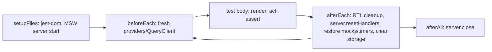
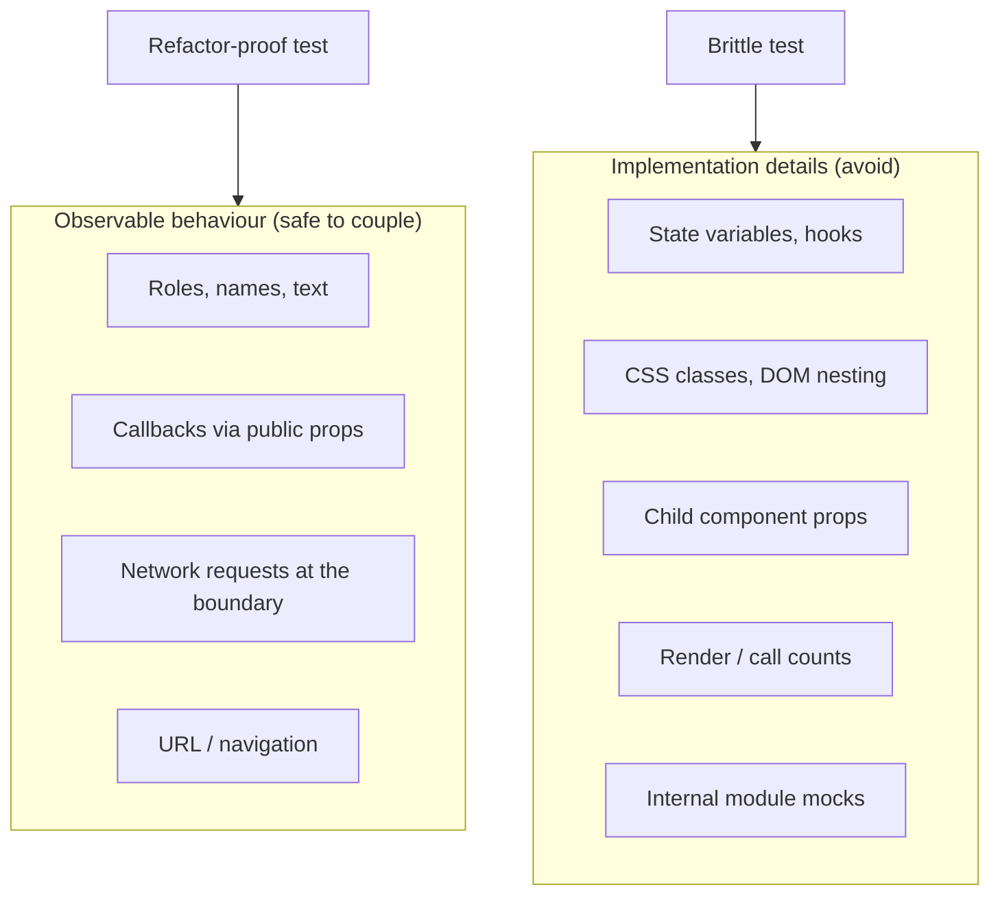
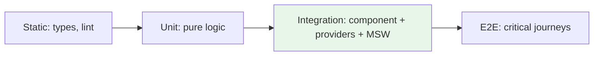

# 08 / 16 — Avoiding Brittle Tests: Refactor-Proof, Deterministic, and Diagnosable

## 1. Lesson metadata

| | |
|---|---|
| **Level** | Advanced–Professional |
| **Study time** | 4–5 hours (reading 2 h, experiments 1.5 h, exercises 1–1.5 h) |
| **Prerequisites** | [03 — React Testing Library](./03-react-testing-library.md), [04 — Testing async updates](./04-testing-async-updates.md), [06 — Mocking strategies and MSW](./06-mocking-strategies-and-msw.md), [08 — Integration testing](./08-integration-testing.md), [11 — Component contract testing](./11-component-contract-testing.md), [15 — CI checks](./15-ci-checks.md) |
| **Next** | [17 — Phase assessment](./17-phase-assessment.md) |
| **Related** | [10 — Accessibility testing](./10-accessibility-testing.md), [14 — Linting and static analysis](./14-linting-and-static-analysis.md), React rendering model: [Phase 2](../02-react-rendering-and-internals/) |

**Learning objectives.** After this lesson you can:
1. Define *brittleness* precisely as two failure modes (false failures on refactor; false passes on regression) and diagnose which one a test suffers from.
2. Recognise the six root causes of brittle React tests: implementation coupling, over-mocking, timing/async mistakes, shared state and ordering, non-determinism (time/random/network), and over-specified or unreadable tests.
3. Rewrite a brittle test into a behaviour-focused one using the Testing Library query priority, `user-event`, `findBy`/`waitFor` correctly, and well-scoped mocks.
4. Control time, randomness, network, and global state deterministically.
5. Apply structural practices: test data builders, per-test isolation, helper design that does not hide intent, appropriate use of snapshots.
6. Triage flaky tests systematically and use mutation testing and "the refactor test" to evaluate test quality.

**Concepts covered:** test coupling, the refactor test, behaviour vs implementation, query priority and its accessibility rationale, `data-testid` as last resort, snapshots and inline snapshots, over-mocking and the "mock boundary" principle, `act` and async stability, `waitFor` anti-patterns, fake timers with `user-event`, StrictMode effects on assertions, test isolation and order dependence, builders/fixtures, DAMP vs DRY, mutation testing, flake taxonomy and triage.

> **Tool note (verified 2026-10-22).** `userEvent.setup({ advanceTimers })` and `delay`, `vi.useFakeTimers`/`vi.setSystemTime`, Testing Library `configure({ reactStrictMode })` and Vitest `--sequence.shuffle`/`--sequence.seed` were checked by running them on Vitest 3.2.7, RTL 16.3.3 and user-event 14.6.8 (details in lessons 03-05). **Important:** under Vitest, `advanceTimers` alone does *not* stop `user.*`/`findBy*`/`waitFor` from hanging with fake timers (RTL's own async wrapper also waits on a faked `setTimeout`); see the fix in §3.3. Stryker was not run here; check its docs (Stryker 10 is current).

---

## 2. Deep conceptual explanation

### 2.1 What problem is this lesson solving?

Tests are valuable only if **failures are informative and passes are trustworthy**. Brittle tests violate both:

- **False failure (over-sensitivity).** A harmless refactor (rename a state variable, extract a child component, swap a CSS class, upgrade a library) breaks 40 tests that "verify" nothing a user cares about. Cost: developers learn that red means "update the tests", stop reading failures, and avoid refactoring: the suite *prevents* the improvement it was supposed to enable.
- **False pass (under-sensitivity).** A real regression slips through because the test asserted an internal call, a mock, or a snapshot that was regenerated. Cost: false confidence.
- **Intermittent failure (flakiness).** Same code, different outcome. Cost: trust collapse ([Lesson 15 §6, flake loop](./15-ci-checks.md)).

A single root principle from the Testing Library guiding principles (paraphrased): *the more your tests resemble the way your software is used, the more confidence they can give you.* Tests that interact with the app as a user (or consumer) does are coupled only to **what the user can observe**, which is exactly what must not change without intent.

### 2.2 Two axes of test quality

```text
                          Sensitivity to REAL regressions
                             low                      high
                         +-----------------+-----------------+
 Sensitivity to          | useless         | ideal           |
 harmless refactors  low | (tests nothing) | (target)        |
                         +-----------------+-----------------+
                    high | worst: noisy AND| brittle         |
                         | blind           | (fails on       |
                         |                 |  refactor)      |
                         +-----------------+-----------------+
```

The target quadrant: fails if and only if observable behaviour changes. No test is perfect; the discipline is moving tests toward that corner.

### 2.3 The refactor test (practical heuristic)

For any test, ask:

1. **Would this test fail if I refactored internals without changing behaviour?** (If yes → implementation coupling.)
2. **Would this test fail if I broke the behaviour it claims to verify?** (If no → false confidence; try mutating the code: remove the handler, return a wrong value, and see.)
3. **When it fails, does the message tell me what user-visible behaviour broke?**

Question 2 can be automated at scale by **mutation testing**: a tool makes small code changes (mutants: flip `>` to `>=`, remove a statement) and checks whether the suite fails ("kills" the mutant). Surviving mutants indicate under-asserting tests. It is slow, so apply to critical modules *(tools such as Stryker; verify support for your stack)*.

### 2.4 Root causes of brittle React tests

| # | Root cause | Typical smell | Remedy |
|---|---|---|---|
| 1 | **Implementation coupling** | Querying by class/id/DOM structure; asserting state values; spying on child components; shallow rendering; asserting render counts | Query via role/label/text; assert observable output and callbacks |
| 2 | **Over-mocking** | `vi.mock` of own modules/hooks; mocking `useState`; tests that restate the implementation | Mock only true boundaries (network, time, browser APIs); use MSW |
| 3 | **Timing mistakes** | `setTimeout` sleeps; `waitFor` wrapping side effects; asserting immediately after async action; missing `await` on `user-event` | `findBy*`, `waitFor` with pure assertions, awaited interactions, fake timers |
| 4 | **Shared state / order dependence** | Global mocks not reset; module singletons; DOM not cleaned; tests rely on previous test's data | Reset in `afterEach`; fresh render and providers per test; random order locally |
| 5 | **Non-determinism** | Real `Date`, `Math.random`, UUIDs, network, animation, locale/timezone | Inject/freeze; seed; fixtures; set `TZ`/locale |
| 6 | **Over-specification & opacity** | Giant snapshots; 200-line tests with hidden helper magic; asserting every prop; copy-paste fixtures | One behaviour per test; targeted assertions; explicit data in test |

### 2.5 React-specific sources of brittleness

- **StrictMode** (dev) double-invokes render functions and, on mount, effects (mount → unmount → mount) to surface impure code ([Phase 3 lesson 06](../03-react-state-and-hooks/06-effect-cleanup.md)). A test asserting `expect(fetchSpy).toHaveBeenCalledTimes(1)` can pass without StrictMode and fail with it, or the reverse. Tests should assert **outcomes** (the data is displayed once) rather than call counts of effect-triggered functions, or deliberately render under StrictMode to prove cleanup correctness. Testing Library offers a configuration to render with StrictMode *(`configure({ reactStrictMode: true })`; verify in RTL docs)*.
- **Batching and async updates**: state updates scheduled inside `act` are flushed together; asserting between updates that React batches is brittle. RTL's `user-event`/`findBy`/`waitFor` wrap `act` for you ([Lesson 04](./04-testing-async-updates.md)).
- **Transitions and Suspense**: under `startTransition` or Suspense, intermediate UI (old content, fallback) may appear; assert the *final* state via `findBy`.
- **Concurrent rendering and `act` warnings**: the warning "An update to X inside a test was not wrapped in act(…)" signals state updates occurring outside awaited interactions; fix by awaiting the thing that triggers them, not by suppressing the warning.
- **Controlled vs uncontrolled inputs**: `fireEvent.change` sets values that may not match real typing ([Lesson 11](./11-component-contract-testing.md)); prefer `user.type`.

### 2.6 Misconceptions

| Misconception | Reality |
|---|---|
| "Snapshots protect against regressions." | They detect *change*, not *wrongness*; large snapshots get blindly updated. |
| "`data-testid` is the stable way to find elements." | It is stable against *text and structure* changes but blind to real accessibility defects and to users; it's a last resort ([Lesson 10](./10-accessibility-testing.md)). |
| "Mock everything so tests are isolated." | Isolation from *boundaries* is good; isolation from your own collaborating code is brittle and tests wiring rather than behaviour. |
| "`waitFor` makes async tests safe." | `waitFor` polls; wrapping the wrong thing in it creates flaky or vacuous tests. |
| "More assertions = better test." | Each assertion couples the test to a detail; assert what the test claims to verify. |
| "DRY test code is good test code." | Tests are specifications; over-abstracted helpers hide intent. Prefer DAMP (Descriptive And Meaningful Phrases) where clarity is lost. |
| "Flaky tests are just CI noise." | A flaky test is a nondeterminism bug in the test **or in the product**. |

---

## 3. Internal mechanics

### 3.1 What Testing Library queries actually do

`screen.getByRole('button', { name: /save/i })` traverses the DOM, computes implicit/explicit roles and accessible names ([Lesson 10 §3.3](./10-accessibility-testing.md)), filters inaccessible elements, and returns a match or throws with a helpful dump. It is **synchronous** and **non-waiting**. The variants:

| Variant | Behaviour | Use for |
|---|---|---|
| `getBy*` | Throws if 0 or >1 match; immediate | Element must be present now |
| `queryBy*` | Returns `null` if none; throws if >1 | Asserting absence (`expect(queryBy…).not.toBeInTheDocument()`) |
| `findBy*` | Returns a promise; polls (via `waitFor`) until it appears or times out | Element that appears asynchronously |
| `getAllBy*`, `queryAllBy*`, `findAllBy*` | Multiple elements | Lists |

**Query priority** (from the Testing Library docs): `getByRole` → `getByLabelText` → `getByPlaceholderText` → `getByText` → `getByDisplayValue` → `getByAltText` → `getByTitle` → `getByTestId`. The order reflects "queries accessible to everyone" first, "semantic" second, and test ids last.

### 3.2 `waitFor` and `findBy`: polling and act

`waitFor(callback)` repeatedly runs the callback (on an interval and on DOM mutations via `MutationObserver`) until it stops throwing or a timeout elapses (defaults ~1000 ms; configurable). With React, RTL configures async utilities to run inside the appropriate `act` environment so that React work is flushed *(implementation detail; verify behaviour in RTL docs)*.

Consequences for brittleness:
- The callback may run **many times**. Side effects inside it (clicks, mutations of external state) repeat: Testing Library's lint rule `no-wait-for-side-effects` exists for this reason.
- Multiple assertions inside `waitFor` retry together; a transient mismatch in the last of three assertions fails the whole attempt: put *one* meaningful assertion, or use `findBy` which expresses "wait for this element".
- Increasing the timeout to fix a flake treats a symptom; find what the test is waiting for.

### 3.3 Fake timers and user-event

`vi.useFakeTimers()` replaces `setTimeout`, `setInterval`, `Date` (configurable) with controllable fakes. `user-event` internally awaits small delays between actions (it uses timers: `delay: 0` by default yields via `setTimeout`), so with fake timers a plain `await user.click()` hangs. **Telling user-event how to advance time is necessary but not sufficient with Vitest** (verified): RTL's `asyncWrapper`, used by every `user.*` call and by `findBy*`/`waitFor`, also waits on a faked `setTimeout(0)` and only auto-advances when a global `jest` exists. Working setup:

```ts
beforeEach(() => {
  vi.stubGlobal('jest', { advanceTimersByTime: vi.advanceTimersByTime.bind(vi) }); // makes Testing Library advance Vitest's fake time
  vi.useFakeTimers();
});
afterEach(() => { vi.useRealTimers(); vi.unstubAllGlobals(); });

const user = userEvent.setup({ advanceTimers: vi.advanceTimersByTime }); // option name verified
```
Alternatively `vi.useFakeTimers({ shouldAdvanceTime: true })` lets fake time advance with real time (it unblocks everything but makes exact-millisecond assertions racy), or fake only what the code needs and leave `setTimeout` real. Full table of variants and results: [lesson 04 §3.4](./04-testing-async-updates.md). Use fake timers **only when the code under test uses timers** (debounce, polling, toast auto-dismiss), and restore real timers in `afterEach` (`vi.useRealTimers()`), or time leaks into other tests.

### 3.4 Isolation lifecycle



Each test must construct its own world: a **new** `QueryClient` (TanStack Query caches across tests otherwise), a new router/memory history, a new store instance. Module-level singletons (a global store, a cache) are the main cause of order dependence ([Phase 6 TanStack Query lesson](../06-data-fetching-and-state-ecosystems/08-tanstack-query.md)).

---

## 4. Step-by-step execution walkthrough: diagnosing and rewriting one brittle test

Starting test (written against a `UserList`):

```tsx
test('loads users', async () => {
  const spy = vi.spyOn(api, 'fetchUsers').mockResolvedValue([{ id: 1, name: 'Ada' }]);
  const { container } = render(<UserList />);
  await new Promise((r) => setTimeout(r, 100));
  expect(spy).toHaveBeenCalledTimes(1);
  expect(container.querySelectorAll('.user-row').length).toBe(1);
  expect(container).toMatchSnapshot();
});
```

Walkthrough of defects:
1. **Mocks the module's own API function** (`api.fetchUsers`): if `UserList` is refactored to use TanStack Query with the same endpoint, or `fetchUsers` is renamed, the test breaks; conversely the real HTTP layer (URL, headers, parsing) is never exercised.
2. **Sleeps 100 ms**: arbitrary; fails on slow CI, wastes time on fast machines; if rendering takes 101 ms it fails.
3. **`toHaveBeenCalledTimes(1)`**: under StrictMode (mount-unmount-mount) effect-triggered fetch may run twice; a refactor to a data library with deduping changes the count. The user does not care.
4. **`.user-row` class selector**: coupled to CSS naming; passes even if rows are invisible or unlabelled.
5. **Snapshot of `container`**: any markup change, including an added wrapper, fails; reviewers regenerate.

Rewrite process:
1. Decide the **behaviour**: "the user sees a list of user names after loading; an error message if loading fails; a loading indicator meanwhile".
2. Mock the **network boundary** with MSW, returning a JSON body ([Lesson 06](./06-mocking-strategies-and-msw.md)).
3. Render with a fresh provider; assert loading state; `await screen.findByRole('listitem', { name: … })` or `findByText('Ada')`.
4. Add a failure test using `server.use(...)` override to return 500; assert `findByRole('alert')`.
5. Remove call-count and snapshot assertions.

---

## 5. Code examples

### 5.1 Minimal example — query priority

```tsx
// Brittle                                        // Robust
screen.getByTestId('submit-btn');                 screen.getByRole('button', { name: /submit order/i });
container.querySelector('.email input');          screen.getByLabelText('Email');
container.querySelector('p.error');               screen.getByRole('alert');
screen.getByText('Total: $19.99');                screen.getByText(/total/i) // plus asserting number via formatter helper
```

Notes: matching by `name: /submit order/i` couples to the visible label, which **is** part of the contract (user-visible text), so changing it should require a test update, appropriately. Avoid brittle exact-string copy for text you don't care about: use regex or `exact: false` for incidental wording, exact strings for contractual content.

**Predict:** is `getByText('Save')` robust if the page has "Save" and "Save as draft"? *No*: default `getByText` string matching is **exact, full-string, case-sensitive after trimming/normalising whitespace**, so `'Save'` matches only the element whose text is exactly "Save"; but `getByText(/save/i)` would match both and throw on multiple matches. Choose queries that identify the specific element: role + exact name.

### 5.2 Practical example — rewriting §4 into a robust test with MSW and a fresh QueryClient

```tsx
// test-utils.tsx
import { QueryClient, QueryClientProvider } from '@tanstack/react-query';
import { render, type RenderOptions } from '@testing-library/react';
import type { ReactElement, ReactNode } from 'react';

export function renderWithProviders(ui: ReactElement, options?: RenderOptions) {
  const client = new QueryClient({ defaultOptions: { queries: { retry: false, gcTime: 0 } } }); // fresh per test; no retries to speed failures
  const Wrapper = ({ children }: { children: ReactNode }) => (
    <QueryClientProvider client={client}>{children}</QueryClientProvider>
  );
  return { client, ...render(ui, { wrapper: Wrapper, ...options }) };
}
```

TanStack Query v5 uses `gcTime` (v4 called it `cacheTime`).

```tsx
// UserList.test.tsx
import { http, HttpResponse } from 'msw';
import { screen } from '@testing-library/react';
import { server } from './test/server';
import { renderWithProviders } from './test-utils';
import { UserList } from './UserList';
import { expect, test } from 'vitest';

test('shows users after loading', async () => {
  server.use(http.get('/api/users', () => HttpResponse.json([{ id: '1', name: 'Ada Lovelace' }])));

  renderWithProviders(<UserList />);

  expect(screen.getByRole('status')).toHaveTextContent(/loading/i);          // loading state is observable
  expect(await screen.findByRole('listitem', { name: /ada lovelace/i })).toBeInTheDocument();
  expect(screen.queryByRole('status')).not.toBeInTheDocument();              // loading indicator gone
});

test('shows an error message when loading fails', async () => {
  server.use(http.get('/api/users', () => new HttpResponse(null, { status: 500 })));

  renderWithProviders(<UserList />);

  expect(await screen.findByRole('alert')).toHaveTextContent(/could not load users/i);
});
```

Why this survives refactors: no module paths of internals; network boundary only; roles/names; no counts, no snapshot, no timing. It would also survive replacing `fetch` with Axios, or hand-rolled hooks with TanStack Query, or splitting `UserList` into `UserListItem` children. It fails when users do not appear or error handling breaks, which is the point.

`findByRole('listitem', { name })` requires list items to have an accessible name; `listitem` does not get its name from content (verified on DTL 10.4.2: `getByRole('listitem', { name: 'Ada Lovelace' })` found nothing for `<li>Ada Lovelace</li>`). Prefer `findByText('Ada Lovelace')` or `within(screen.getByRole('list')).findByText(...)` if names aren't supported for the role; check [ARIA role naming rules](https://www.w3.org/TR/wai-aria-1.2/#namefromcontent). This is a real-world example of verifying role capabilities before relying on them.

### 5.3 Incorrect example — asserting implementation through mocks of own code

```tsx
vi.mock('./useCart', () => ({ useCart: () => ({ items: [{ id: 1, price: 10 }], total: 10, add: vi.fn() }) }));

test('Cart shows total', () => {
  render(<Cart />);
  expect(screen.getByTestId('total')).toHaveTextContent('10');
});
```

Problems: `useCart` is the app's own logic; mocking it removes the logic under test (reducer, selectors, persistence), leaving a test of the JSX; the hook's return shape is duplicated (drift when `useCart` changes → test still passes while the real component crashes); test id coupling; and no user behaviour (adding items) is verified.

### 5.4 Corrected implementation

```tsx
test('adding two items updates the total', async () => {
  const user = userEvent.setup();
  renderWithProviders(<ProductPage product={{ id: 'p1', name: 'Mug', priceCents: 1250 }} />); // real cart provider inside the helper

  await user.click(screen.getByRole('button', { name: /add mug to cart/i }));
  await user.click(screen.getByRole('button', { name: /add mug to cart/i }));

  expect(screen.getByRole('region', { name: /cart/i })).toHaveTextContent('$25.00');
});
```

Trade-offs: slightly broader, so a failure points to a slice of code not a single function; combine with fast unit tests of the pure cart reducer ([Lesson 02](./02-unit-testing-with-vitest.md)) so diagnosis is easy. The integration-style test protects behaviour across refactors; the reducer unit tests protect algorithmic edge cases (rounding, limits).

### 5.5 Advanced example — deterministic time, debounce and fake timers

```tsx
function SearchBox({ onSearch }: { onSearch: (q: string) => void }) {
  const [q, setQ] = useState('');
  useEffect(() => {
    const id = setTimeout(() => { if (q) onSearch(q); }, 300);
    return () => clearTimeout(id);
  }, [q, onSearch]);
  return (
    <label>
      Search
      <input value={q} onChange={(e) => setQ(e.target.value)} />
    </label>
  );
}
```

```tsx
test('debounces search by 300ms and sends only the latest query', async () => {
  vi.stubGlobal('jest', { advanceTimersByTime: vi.advanceTimersByTime.bind(vi) });   // see §3.3: without this, user.type hangs under vi.useFakeTimers()
  vi.useFakeTimers();
  const user = userEvent.setup({ advanceTimers: vi.advanceTimersByTime });
  const onSearch = vi.fn();
  render(<SearchBox onSearch={onSearch} />);

  await user.type(screen.getByLabelText('Search'), 'rea');
  expect(onSearch).not.toHaveBeenCalled();

  await act(async () => { vi.advanceTimersByTime(299); });
  expect(onSearch).not.toHaveBeenCalled();           // boundary: 1 ms before

  await act(async () => { vi.advanceTimersByTime(1); });
  expect(onSearch).toHaveBeenCalledTimes(1);         // here the count IS the contract: "only the latest"
  expect(onSearch).toHaveBeenCalledWith('rea');

  vi.useRealTimers();                                // better in afterEach (with vi.unstubAllGlobals()) to run even on failure
});
```

Walkthrough/prediction: typing 'r','e','a' with `advanceTimers` advances fake time slightly per keystroke (user-event's default `delay: 0` is tiny); each keystroke re-runs the effect, clearing the previous timeout, so only one timer is pending when typing ends. After 299 ms nothing; after 300, one call with `'rea'`. Note `act` is imported from `@testing-library/react` (it wraps React's `act`) and wraps the timer-advance so React flushes state/effects.

Why `toHaveBeenCalledTimes(1)` is legitimate here: the *requirement* is "only one request for the final query" so the count is behaviour, unlike the §4 fetch-count example. **Counting is brittle when the number is an incidental implementation artefact; correct when the number is the requirement.**

`onSearch` must be stable (passed from the test as a single `vi.fn()`); in production if the parent passes an inline function, the effect resets the debounce each render: another example where lint `exhaustive-deps` ([Lesson 14](./14-linting-and-static-analysis.md)) reveals design issues.

### 5.6 Test data builders and per-test explicitness

```ts
// builders.ts
import type { User } from './types';
let seq = 0;
export const buildUser = (over: Partial<User> = {}): User => ({
  id: `user-${++seq}`,
  name: 'Test User',
  email: `user${seq}@example.test`,
  role: 'member',
  ...over,
});
```

```tsx
test('admins see the "Invite" button', () => {
  render(<TeamPage viewer={buildUser({ role: 'admin' })} />);
  expect(screen.getByRole('button', { name: 'Invite' })).toBeInTheDocument();
});
```

Principle: the test **states only the data that matters** (`role: 'admin'`); the builder fills irrelevant fields with valid defaults, so adding a required field to `User` changes one builder, not 80 tests. Avoid a shared mutable "fixture user" that tests modify; avoid random data unless seeded (random failures are hard to reproduce; if you use property-based testing, record the seed).

### 5.7 Snapshots, used well

```tsx
// Acceptable: small, serialisable data, with inline snapshot so the expectation is in the test
expect(formatInvoiceLines(order)).toMatchInlineSnapshot(`
  [
    "Mug × 2 — $25.00",
    "Shipping — $4.00",
  ]
`);
```

Why it's acceptable: the output is a small structured value; the diff is readable in review; the snapshot lives next to the test; it's data, not a DOM tree. Avoid `toMatchSnapshot()` on rendered component trees except for tiny, stable, presentational output with reviewers who read diffs; prefer explicit assertions.

### 5.8 Order independence and isolation hygiene

```ts
// vitest.config.ts (excerpt; option names verified in the Vitest v3 config docs)
// (Vitest 5 turns `clearMocks` on by default, and `restoreAllMocks` only restores `vi.spyOn` spies since Vitest 4)
export default defineConfig({
  test: {
    environment: 'jsdom',
    setupFiles: ['./src/test/setup.ts'],
    restoreMocks: true,        // restore spies after each test
    unstubGlobals: true,       // undo vi.stubGlobal
    sequence: { shuffle: false }, // run with --sequence.shuffle periodically (CI nightly) to expose order dependence
  },
});
```

```ts
// src/test/setup.ts
import '@testing-library/jest-dom/vitest';
import { afterAll, afterEach, beforeAll, vi } from 'vitest';
import { cleanup } from '@testing-library/react';
import { server } from './server';

beforeAll(() => server.listen({ onUnhandledRequest: 'error' })); // surface un-mocked requests loudly
afterEach(() => {
  cleanup();                  // RTL auto-cleans when globals are available; explicit is harmless
  server.resetHandlers();     // drop per-test server.use overrides
  vi.useRealTimers();
  localStorage.clear();
  sessionStorage.clear();
});
afterAll(() => server.close());
```

`onUnhandledRequest: 'error'` turns "the component made an unexpected request" into a failing test rather than a mysterious network error (option verified on MSW 2.15; renamed `onUnhandledFrame` in MSW 3).

### 5.9 Making failures diagnosable

```tsx
// Opaque failure
expect(screen.getAllByRole('row').length).toBe(4);

// Informative failure: the expected content is in the assertion
expect(
  screen.getAllByRole('row').map((r) => r.textContent),
).toEqual([
  'Name Role',
  'Ada admin',
  'Linus member',
  'Grace member',
]);
```

Trade-off: asserting full row text is more coupled than a count; choose what the requirement is ("lists all team members" → names matter). Another technique: `screen.debug(undefined, 20000)` and `logRoles(container)` while writing; remove before commit.

---

## 6. Visual explanations

### Coupling depth: what the test touches



### Flaky-test taxonomy and where to look

```text
Same code, different result?
 |-- depends on TIME?      -> real clock/timers/animation/timezone     => freeze/inject clock
 |-- depends on ORDER?     -> shared state, singletons, leaked mocks   => isolate, reset, shuffle
 |-- depends on SPEED?     -> sleeps, race with async, CPU contention  => wait on conditions
 |-- depends on DATA?      -> random, ids, network, ordering           => seed, fixtures, sort
 |-- depends on ENV?       -> OS, locale, fonts, viewport              => pin environment
 `-- real product race?    -> fix the product (the test found a bug)
```

### The testing-trophy-style confidence/cost distribution (qualitative)



The integration layer (green) gives the best behaviour-per-brittleness ratio for UI code: broad enough to survive refactors, narrow enough to run in milliseconds ([Lesson 01](./01-test-strategy-and-pyramid.md), [Lesson 08](./08-integration-testing.md)).

---

## 7. Alternative approaches and trade-offs

| Approach | Refactor resilience | Regression sensitivity | Speed | Failure clarity | Best for |
|---|---|---|---|---|---|
| Role/label-based integration tests with MSW | High | High (behaviour) | Fast | Medium–High | Default for UI features |
| Pure unit tests of logic (reducers, formatters) | High | High | Very fast | Very high | Algorithms, edge cases |
| Shallow rendering/enzyme-style (legacy) | Low | Low–Medium | Fast | Low | Avoid (historical) |
| Test IDs for everything | Medium (survives markup changes) | Low a11y sensitivity | Fast | Medium | Last-resort anchors (canvas, third-party widgets) |
| Snapshot of rendered tree | Low | Low–Medium | Fast | Low | Rare: tiny stable output |
| Inline snapshots of data | High | Medium | Fast | High | Serialisable values |
| Mocking own modules heavily | Low | Low | Fast | Low | Rare: isolating truly expensive boundaries |
| Real browser component tests (Playwright stories/`mount` model, formerly experimental CT / Vitest browser mode) | High | High (layout-aware) | Slower | High | Layout/focus-dependent behaviour, native dialog |
| E2E | High | High for journeys | Slow | Medium (needs traces) | Critical flows |
| Mutation testing | N/A (evaluates tests) | Measures sensitivity | Very slow | High | Critical modules, periodic audits |
| Property-based testing | High | High for invariants | Medium | Medium (shrinking helps) | Parsers, reducers, formatters |

**Scenario where "avoid mocks and test through the UI" is NOT best.** A pricing engine with 40 combinatorial rules: driving every combination through the UI is slow and obscures failures; test the pure function exhaustively (table-driven, property-based), and keep one or two UI tests proving it is wired in. Likewise, a component whose behaviour depends on a hard-to-control browser API (IntersectionObserver, ResizeObserver, clipboard, geolocation): stub that **boundary** with a small hand-written fake (a dependency-injected seam if possible) rather than relying on jsdom's absent implementation.

---

## 8. Best practices and anti-patterns

### Best practices
1. **Follow query priority**; use `getByRole` with `name` as the default, `within` to scope.
2. **Interact via `user-event`**, `await` every call; set up with `userEvent.setup()` per test.
3. **Mock at the boundary** (network via MSW, time, randomness, browser APIs); keep own code real.
4. **Use `findBy*` for appearance, `queryBy*` for absence, `getBy*` for presence now.**
5. **Put one behaviour in each test** with a name that reads like a requirement ("shows an error when the card is declined").
6. **State only relevant data**; builders fill the rest.
7. **Isolate**: fresh providers/clients per test; reset handlers, timers, mocks, storage; run shuffled periodically.
8. **Assert outcomes, not call counts**, unless the count is the requirement (debounce, idempotency).
9. **Prefer explicit assertions to snapshots**; use inline snapshots for small data.
10. **Fail loudly on the unexpected**: MSW `onUnhandledRequest: 'error'`, fail tests on `console.error` for React warnings (a small setup helper) *(trade-off: noise from third-party warnings; allowlist)*.
11. **Lint your tests** ([Lesson 14](./14-linting-and-static-analysis.md)): Testing Library and Vitest plugin rules.
12. **Treat flake as a bug**: owner, root cause, SLA ([Lesson 15](./15-ci-checks.md)).
13. **Sample-audit with mutation testing** on critical modules; use the refactor test in code review ("could I rename this and keep the test?").

### Anti-patterns

| Anti-pattern | Why it hurts | Better |
|---|---|---|
| `await sleep(500)` / `setTimeout` waits | Arbitrary, slow, flaky | `findBy`, `waitFor(() => expect(x))`, fake timers |
| `waitFor(() => { click(); expect(...) })` | Side effects repeated on retries | Click outside; assert inside |
| `container.querySelector` in tests | Bypasses accessibility, couples to structure | `screen` queries |
| `fireEvent` for typing/clicking | Skips focus, keyboard, pointer sequence | `user-event` |
| Asserting `useState` values / internal methods | Implementation | Observable output |
| Testing that mocks were called with what you just set | Tautology | Test real behaviour |
| Mega `beforeEach` that builds the world for all tests | Hidden dependencies; slow | Local arrange per test or small helper |
| Shared mutable fixtures | Order dependence | Builders/factories |
| Silencing `act` warnings with `console.error` mocks | Hides real async bugs | Await the cause |
| Asserting entire large DOM text | Fails for incidental copy changes | Targeted regions |
| `it.skip` forever | Dead tests | Delete or fix; lint disabled tests |
| Tests that need a particular timezone/locale on dev machines | CI differences | Pin `TZ`/locale in config |
| Snapshot updates in same commit as refactor with no review | Hidden regressions | Review diffs; avoid big snapshots |

**Justified exceptions.** `getByTestId` for elements with no semantics (canvas wrapper, third-party widget host) or when internationalised text makes label queries impractical (use stable keys, document). Spying on a module boundary you own *and* have declared as a seam (analytics client injected for the purpose of being replaced) is reasonable: you assert on the *contract* with the analytics system ("`page_viewed` event with these fields" is a requirement). Call-count assertions where count is the requirement (debounce, idempotent submit, no duplicate request on double click). Snapshot tests for generated code/data where the diff is the review artefact.

---

## 9. Real-world application

**E-commerce checkout.** Tests drive the flow as a customer (fill shipping, choose method, pay) against MSW handlers, asserting totals, error states (declined card), and focus/announcements. Payment provider iframe is stubbed at the boundary. Refactoring the checkout state machine from `useReducer` to XState ([Phase 6 lesson 12](../06-data-fetching-and-state-ecosystems/12-state-machines-and-xstate.md)) does not change tests. Constraint: tax/shipping logic gets table-driven unit tests; E2E covers a happy path.

**Dashboard with polling.** Polling every 30 s with fake timers; tests advance time deterministically to assert refresh, back-off after errors, and cleanup on unmount (no pending timers: `vi.getTimerCount()` *(verify)* equals 0). Constraint: avoid asserting exact fetch counts when React Query dedupes; assert displayed freshness.

**Forms/auth.** Tests type like users, assert validation messages via `getByRole('alert')` and field description, submit via Enter key; token refresh logic tested at the network boundary with MSW handlers returning 401 then 200. Constraint: don't mock the auth library's internals; use its test utilities or boundary-level stubs.

**Realtime features.** Use a fake WebSocket class injected via the seam to push messages deterministically; assert UI ordering and de-duplication; avoid real timers for reconnection (fake timers + deterministic backoff function tested separately).

**Multi-team design system consumers.** Product teams test their composition (labels, flows) and trust the library's contract suites ([Lesson 11](./11-component-contract-testing.md)); they must not assert library DOM structure, which would couple them to its internals and block upgrades.

**Large legacy suite (thousands of tests, many snapshot-based).** Strategy: stop the bleeding (lint to ban new snapshots of DOM trees); rewrite tests opportunistically when touching features; measure flake and failure-on-refactor rates; delete tests that assert nothing (use mutation testing or coverage-of-assertions heuristics) rather than preserve them out of fear.

---

## 10. Debugging and troubleshooting

**Symptom 1: "Unable to find an accessible element with the role…"**
Use the failure output: it lists available roles/names. Typical root causes: name mismatch (copy changed, case), element not yet rendered (use `findBy`), hidden by `aria-hidden`/`display: none`, element is in a portal but queried within `container`, role not what you think (e.g. `<a>` without `href` has no `link` role). Fix the query or the markup; check `logRoles`.

**Symptom 2: "Warning: An update to X inside a test was not wrapped in act(...)".**
Meaning: a state update occurred outside an awaited, act-wrapped interaction: a promise resolved after the test ended, a timer fired, or a library updated state after assertions. Investigate: which update (the component name); what triggered it; fix by awaiting the visible outcome (`await screen.findBy…`) before the test ends, flush timers within `act`, unmount/cancel in cleanup, or wait for the network handlers to finish. Never silence globally.

**Symptom 3: Test passes alone, fails in the full run (or vice versa).**
Order dependence: run with shuffle and bisect (`vitest --sequence.shuffle --sequence.seed=<n>`, flags verified in the Vitest docs), search for module-level state, un-reset mocks/handlers/timers, DOM leftovers (`document.body.innerHTML`), `localStorage`, shared QueryClient. Make the failing pair minimal; fix isolation.

**Symptom 4: Fails only on CI.**
See [Lesson 15 §10](./15-ci-checks.md): slower CPU → timeouts, timezone/locale, case-sensitive paths, headless differences; add trace/log artifacts; reproduce under CPU throttling or constrained container; find the time-sensitivity (sleeps, tight `waitFor` timeouts, animations).

**Symptom 5: A test passes even when I break the feature.**
Mutate the code deliberately (comment out the handler or invert a condition) and see if it fails. Typical causes: assertion in an un-awaited promise, `expect` inside a callback never executed, `queryBy` assertion that trivially holds (`expect(queryByText('x')).not.toBeInTheDocument()` before anything rendered), over-mocking that replaced the logic, or `getAllBy…` count assertion that is satisfied by something else. Add a positive control (assert presence first), await everything, remove tautological mocks.

**Symptom 6: Snapshot diffs are enormous after a small change.**
Replace with focused assertions; inline snapshot the relevant data; or split the component. When forced to update, read the diff semantically in review.

**Symptom 7: Test is slow (seconds) for a small component.**
Profile (`vitest --reporter=verbose`, `--logHeapUsage`); common: `getByRole` against huge DOMs (role queries compute accessibility info; use `within` to scope or prefer `getByLabelText`/`getByText` where equally robust), real timers/long timeouts waiting for an absence (`waitForElementToBeRemoved` with long timeout), un-mocked heavy imports. *(Role-query performance on large DOMs is a known Testing Library caveat: verify in docs.)*

---

## 11. Exercises

### Level A — Knowledge
A1. Define brittleness using both failure directions.
A2. State the Testing Library query priority order and the rationale.
A3. Difference between `getBy`, `queryBy`, and `findBy`; one use of each.
A4. Why is `waitFor` with side effects inside a bug?
A5. Why can `toHaveBeenCalledTimes(1)` be brittle in a React effect-based test and when is it legitimate?

### Level B — Code comprehension
B1. List every brittleness problem in:
```tsx
test('form works', async () => {
  const { container } = render(<Login />);
  fireEvent.change(container.querySelector('#email')!, { target: { value: 'a@b.co' } });
  fireEvent.click(container.querySelector('.btn-primary')!);
  await new Promise((r) => setTimeout(r, 200));
  expect(container).toMatchSnapshot();
});
```
B2. Will this assertion ever fail? Explain.
```tsx
render(<Banner />);
expect(screen.queryByText('Error')).not.toBeInTheDocument();
```
B3. A test using fake timers hangs at `await user.click(...)`. Why, and fix?
B4. Why does `expect(screen.getByRole('list').children).toHaveLength(3)` couple to implementation more than `getAllByRole('listitem')`?

### Level C — Implementation
C1. Rewrite the B1 test with `user-event` and role/label queries, assuming the app posts to `/api/login` and shows "Welcome" on success.
C2. Write a builder for an `Order` with line items where tests specify only what matters, and use it in two tests.
C3. Write tests (with fake timers) for a toast that auto-dismisses after 5 s unless hovered (pause on hover).

### Level D — Debugging
D1. A test fails only when run after `ProfileForm.test.tsx`. Describe your investigation and three likely causes.
D2. `findByText('Saved')` times out sometimes on CI but not locally. Provide diagnosis steps.
D3. After upgrading React, many tests fail with "called 2 times" instead of 1. Explain and propose an improved approach.

### Level E — Architecture and engineering decisions
E1. Your org has 3,000 snapshot-based component tests. Propose a migration and governance plan.
E2. Decide whether to mock `fetch` directly, mock an `api` module, or use MSW for a new project. Compare on at least five criteria.
E3. Define a team policy for `data-testid` use.

### Level F — Expert challenge
F1. Design a tool or lint rule set plus CI report that estimates "brittleness risk" per test file using static signals (queries by class, snapshot size, sleeps, internal mocks) and dynamic signals (mutation score, flake rate). Discuss validity and gaming.

---

## 12. Detailed answers and explanations

> Attempt the exercises first.

**A1.** Brittleness is a test's tendency to give wrong signals: failing when behaviour is unchanged (over-sensitivity to refactors, environment, timing) and/or passing when behaviour is broken (under-sensitivity, from asserting details or mocks). Both reduce trust; intermittent failure is a special case caused by nondeterminism.

**A2.** `ByRole` → `ByLabelText` → `ByPlaceholderText` → `ByText` → `ByDisplayValue` → `ByAltText` → `ByTitle` → `ByTestId`. Rationale: prefer queries reflecting how all users, including assistive tech users, find elements; test ids reflect nothing users perceive.

**A3.** `getBy`: synchronous, throws if absent/multiple, for something that must exist now (a heading after render). `queryBy`: returns null if absent, for asserting non-existence. `findBy`: async, waits until present, for UI that appears after async work. Edge: `queryBy` also throws on multiple matches.

**A4.** `waitFor` re-executes its callback repeatedly (polling and DOM mutation triggers); a click or state-changing call inside would run multiple times, causing duplicated actions, nondeterminism, and passes that depend on retry count. Keep the action outside, assert inside.

**A5.** In dev with StrictMode, mount effects run twice (mount, cleanup, mount), so effect-triggered fetch counts can be 2; library dedupe, caching, or refactoring changes counts. Legitimate when the number is the requirement: debounced search sends exactly one request for the final input; double-click on submit sends one request; analytics event fired once per view (and even then the correct implementation must handle StrictMode).

**B1.** Problems: (1) `container.querySelector('#email')`/`.btn-primary` coupled to id/class; (2) `fireEvent.change/click` bypasses real interaction (no focus, no keyboard, no input events); (3) `setTimeout` sleep of 200 ms; (4) no mocked network: either real request fails or it hits something unintended; (5) snapshot of whole container: large, opaque, regenerated blindly; (6) no assertion about meaningful behaviour (success message); (7) no password; (8) no isolation (no providers). 

**B2.** It cannot fail in the sense of detecting a bug if the error would only appear later (async): it passes immediately because `queryBy` returns null before any error appears, even if the banner would eventually show "Error". It's also trivially true if the component never renders that text due to wrong copy. Add a positive control or await the relevant settled state (`await screen.findByText('Welcome')` then assert absence), or assert absence after a deterministic point (after `await` of the operation).

**B3.** `user-event` uses timers for its internal delays (`delay` default 0 uses `setTimeout`); with fake timers those never fire, so the promise never resolves. Fix (all verified on Vitest 3.2.7): `userEvent.setup({ advanceTimers: vi.advanceTimersByTime })` **plus** a stubbed global `jest` for Testing Library's own wrapper, or `vi.useFakeTimers({ shouldAdvanceTime: true })`, or fake only the timers you need. `delay: null` and `advanceTimers` *alone* still hang, because of RTL's `asyncWrapper` (lesson 04 §3.4).

**B4.** `.children` accesses DOM structure (a wrapper or `<li>` replaced by `<div role="listitem">` or an inserted `<li aria-hidden>` spacer changes counts), whereas `getAllByRole('listitem')` uses semantics. Both assert counts; the second survives structural refactors preserving semantics, and fails for non-semantic markup, which is a plus.

**C1 (sample).**
```tsx
test('logs in and greets the user', async () => {
  const user = userEvent.setup();
  server.use(http.post('/api/login', async ({ request }) => {
    const body = (await request.json()) as { email: string; password: string };
    return body.email === 'ada@example.com' && body.password === 'secret'
      ? HttpResponse.json({ name: 'Ada' })
      : new HttpResponse(null, { status: 401 });
  }));
  render(<Login />);
  await user.type(screen.getByLabelText('Email'), 'ada@example.com');
  await user.type(screen.getByLabelText('Password'), 'secret');
  await user.click(screen.getByRole('button', { name: 'Sign in' }));
  expect(await screen.findByText('Welcome, Ada')).toBeInTheDocument();
});
```
Criteria: labels/roles, MSW boundary, no sleep, no snapshot; negative test for 401 recommended.

**C2 (sample).** `buildOrder({ lines = [buildLine()], ...over })` returns an `Order` with computed `totalCents` derived from lines unless overridden; test 1 `buildOrder({ lines: [buildLine({ qty: 2, priceCents: 500 })] })` expects "$10.00"; test 2 `buildOrder({ status: 'refunded' })` expects the refund badge. Criteria: defaults valid; derived values consistent; tests state only relevant fields; sequences/ids unique.

**C3 (sample).**
```tsx
test('toast auto-dismisses after 5s unless hovered', async () => {
  vi.useFakeTimers();
  const user = userEvent.setup({ advanceTimers: vi.advanceTimersByTime });
  render(<Toast message="Saved" />);
  const toast = screen.getByRole('status');
  await user.hover(toast);
  await act(async () => { vi.advanceTimersByTime(10_000); });
  expect(toast).toBeInTheDocument();             // paused while hovered
  await user.unhover(toast);
  await act(async () => { vi.advanceTimersByTime(4_999); });
  expect(toast).toBeInTheDocument();             // exact-boundary check (design decision: does the timer reset or resume? clarify requirement)
  await act(async () => { vi.advanceTimersByTime(1); });
  expect(screen.queryByRole('status')).not.toBeInTheDocument();
});
```
Criteria: boundary, pause semantics (resume vs restart: the test encodes the requirement, so confirm it), cleanup of timers, restoring real timers. Note the third assertion assumes "resume remaining" or "restart 5 s" semantics consistent with the implemented requirement.

**D1.** Investigation: run the pair alone; use `--sequence.shuffle`-style bisection; check shared module state (singletons), un-reset mocks (`vi.mock` hoisting persists within a file only, but module caches across files depend on isolation settings `isolate`/pool: *verify*), `localStorage`, cookies, `document.title`, global timers, MSW handlers not reset, QueryClient created at module scope, `window.location` changes. Fix: reset in `afterEach`, create per-test instances, avoid module-scope mutable state in helpers.

**D2.** Steps: reproduce with CPU throttling or a constrained container; inspect what 'Saved' depends on (a debounced save with real timer? a network handler with delay? an animation?); check the default `findBy` timeout (1 s) vs real work; add MSW logging; check unhandled request errors; check `act` warnings; avoid raising timeout blindly: make the wait deterministic (fake timers for debounce, deterministic handler) or increase timeout only for known slow operations with justification.

**D3.** React 18+ StrictMode in dev runs mount effects twice; upgrading React or enabling StrictMode (or RTL's `reactStrictMode`) reveals tests that assumed single invocation. Also library behaviour changed. Better approach: assert user-visible outcome (the data displayed once), design effects with proper cleanup and idempotence (e.g. `AbortController` aborting the first request), and where count matters (idempotent submit) assert on server-side effect counts at MSW handler boundary with idempotency keys. Do not special-case by dividing counts by two.

**E1 (example).** Phase 1: inventory with metrics (snapshot size, change frequency, bug-catch history; use git blame/CI data); ban new `toMatchSnapshot()` for DOM via lint (allow inline snapshots for data); Phase 2: for each feature area, replace snapshot tests with behaviour tests when touched ("boy-scout rule"), time-box dedicated clean-up for high-churn files; Phase 3: delete snapshot tests with no history of catching bugs; Phase 4: governance: PR checklist, CODEOWNERS for test utils, shared test-utils library, dashboards for snapshot count/size and flake rate. Criteria: incremental, measurable, avoids freeze on feature work.

**E2 (evaluation).** Criteria: realism (MSW exercises real `fetch` path, headers, status handling, JSON parsing), refactor resilience (changing client library), cross-environment reuse (browser/Node/Storybook/E2E), setup cost, per-test override ergonomics, failure diagnosability, coupling to implementation (module mocks couple to file paths and export names), handling of unhandled requests, typing of handlers/fixtures. Conclusion: MSW at the network boundary for most; direct `fetch` mocks for tiny utility tests; module mocks only for seams explicitly designed as injectable ports.

**E3 (example policy).** Use roles/labels first; `data-testid` allowed when (1) no accessible role/name exists and adding one would be wrong (decorative canvas container), (2) content is dynamic/localised and the assertion is about structure not text, or (3) third-party components lack semantics; ids are `kebab-case` and domain-based (`order-total`), never positional/style-based; they're kept in production builds unless bundle policy strips them (decide and verify the build tooling); code review must justify; lint rule to warn (`testing-library/prefer-*` don't forbid; consider custom restricted syntax) for new usages beyond an allowlist; track count.

**F1 (example answer).** Static signals: ratio of `getByTestId`/`querySelector`, number of `vi.mock` of own modules, snapshot bytes, sleeps/`waitForTimeout`, `toHaveBeenCalledTimes` density, presence of `await` omissions (lint). Dynamic: flake rate from CI retries history, failure-on-refactor (tests failing in PRs labelled "refactor/no behaviour change"), mutation score on covered lines for sampled modules, runtime. Combine into a score for triage only. Validity threats: gaming (replace test ids with meaningless roles), false positives (legitimate test ids), mutation score cost/noise (equivalent mutants), correlation not causation. Evaluation: acknowledges to use as a prioritisation aid, validates against historical data (does the score predict refactor-induced failures?), and keeps humans in the loop.

---

## 13. Senior engineer interview questions

**Q1. "How do you decide what a test should assert?"**
*Strong answer:* Start from the requirement/user-visible behaviour; assert outcomes visible through the public interface (DOM semantics, callbacks, network requests); avoid asserting how it was achieved. Use the refactor test; use mutation to check sensitivity; balance by testing algorithmic detail in unit tests and wiring in integration tests.

**Q2. "A teammate says querying by test id is more stable than by role. Respond."**
*Strong answer:* Stable against text/markup changes but blind to accessibility, and test ids can persist while the real control becomes unusable. Role/name queries tie tests to the user-visible contract and double as a11y checks. Use test ids as a last resort with justification.

**Q3. "Explain how you'd eliminate flakiness in an async React test."**
*Strong answer:* Identify what the test waits for; replace sleeps with `findBy`/`waitFor(assertion)`; await all `user-event` calls; control time with fake timers or injected clocks; make network deterministic with MSW; ensure isolation (fresh providers, reset handlers/mocks); consider StrictMode effects; reproduce under CPU throttling; if the app has a real race, fix the app.

**Q4. "When are snapshots OK?"**
*Strong answer:* For small, serialisable, reviewable outputs where the diff is the artefact (formatters, generated config, error catalogues), preferably inline; not for rendered component trees and large outputs that reviewers rubber-stamp.

**Q5. "Mocking: what's your rule?"**
*Strong answer:* Mock the boundaries you do not own or cannot control (network, time, randomness, browser APIs, third-party services) at the narrowest seam; keep your own logic real. Over-mocking tests the wiring of mocks and creates drift; but if a seam is expensive/hard (e.g. WebGL), use a purpose-built fake.

**Q6. "How do you evaluate whether a test suite is any good?"**
*Strong answer:* Metrics beyond coverage: mutation score on critical modules, defect escape analysis (did tests catch the bugs that shipped?), flake rate, time-to-diagnose failures, change-failure correlation during refactors, and developer trust (do they refactor fearlessly?).

---

## 14. Further learning resources

| Resource | URL | Covers / why | Level | Study |
|---|---|---|---|---|
| Testing Library — Guiding principles | <https://testing-library.com/docs/guiding-principles/> | Philosophy of behaviour-based tests | Beginner | Whole page |
| Testing Library — About queries (priority) | <https://testing-library.com/docs/queries/about/> | Query types and priority | Beginner | "Priority" section |
| Testing Library — `user-event` | <https://testing-library.com/docs/user-event/intro> | Realistic interactions; `advanceTimers` | Intermediate | Setup, Options |
| Testing Library — Async methods | <https://testing-library.com/docs/dom-testing-library/api-async/> | `waitFor`, `findBy` | Intermediate | `waitFor`, `findBy` |
| Testing Library — Common mistakes (Kent C. Dodds article) | <https://kentcdodds.com/blog/common-mistakes-with-react-testing-library> | Practical anti-patterns | Intermediate | Whole article |
| `eslint-plugin-testing-library` | <https://github.com/testing-library/eslint-plugin-testing-library> | Lint rules for these mistakes | Intermediate | Rule list |
| Vitest — Mocking and timers | <https://vitest.dev/guide/mocking> | `vi.mock`, fake timers, system time | Intermediate | Timers, Dates |
| MSW docs | <https://mswjs.io/docs/> | Network-level mocking, `onUnhandledRequest` | Intermediate | Getting started, Test usage |
| React docs — `StrictMode` | <https://react.dev/reference/react/StrictMode> | Dev double-invocation | Intermediate | "Fixing bugs found by re-running Effects" |
| Stryker mutator | <https://stryker-mutator.io/> | Mutation testing (Stryker has a Vitest runner; not run here) | Advanced | Getting started |
| Google Testing Blog (general) | <https://testing.googleblog.com/> | Writings on test quality, flakiness | Intermediate | Search "flaky", "test behaviors" |
| Martin Fowler — Eradicating non-determinism in tests | <https://martinfowler.com/articles/nonDeterminism.html> | Flake taxonomy and remedies | Intermediate | Whole article |

---

## 15. Knowledge checkpoint

**You should now understand**
- Brittleness as false failures and false passes, and flakiness as nondeterminism.
- The six root causes and the matching remedies.
- Why behaviour-level, boundary-mocked, role-queried tests are refactor-proof.

**You should be able to explain without notes**
- The refactor test and mutation testing as measures of test quality.
- `getBy`/`queryBy`/`findBy`/`waitFor` semantics and the `waitFor` side-effect trap.
- When call counts and snapshots are legitimate.

**You should be able to implement**
- MSW + fresh-provider integration tests, fake-timer debounce tests with `user-event`, builders/factories, isolation setup, lint rules for tests.

**You should be able to debug**
- Order-dependent tests, `act` warnings, CI-only flakes, tests that pass despite broken features, StrictMode-induced count changes.

**Before moving on:** take the [17 — Phase assessment](./17-phase-assessment.md), which covers lessons 01–16 and sets promotion criteria for Phase 9.
