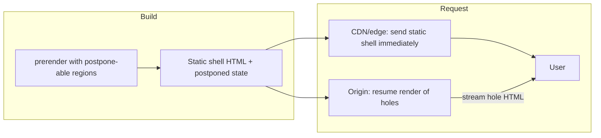
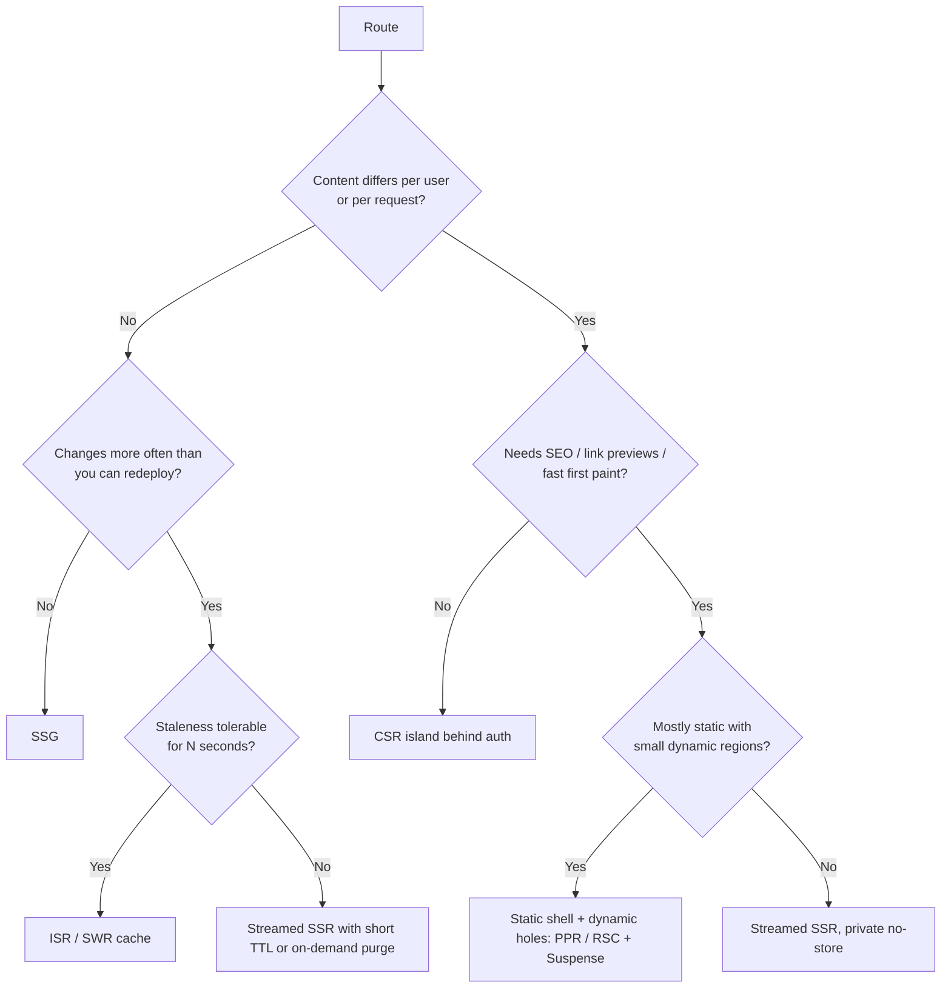
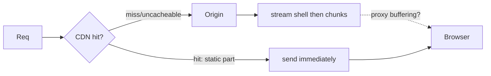

# 09 / 01 — SPA, SSR, SSG, and Streaming: Rendering Strategies as Delivery Architecture

## 1. Lesson metadata

| | |
|---|---|
| **Level** | Advanced |
| **Study time** | 5–6 hours (reading 2 h, experiments 1.5 h, exercises 2 h) |
| **Prerequisites** | [Phase 0 / 01 — How the browser works](../00-web-and-javascript-foundations/01-how-the-browser-works.md), [Phase 2 / 26 — SSR and client rendering](../02-react-rendering-and-internals/26-ssr-and-client-rendering.md), [Phase 2 / 25 — Hydration and selective hydration](../02-react-rendering-and-internals/25-hydration-and-selective-hydration.md), [Phase 6 / 14 — Server-side data loading](../06-data-fetching-and-state-ecosystems/14-server-side-data-loading.md) |
| **Next** | [02 — Hydration internals deep dive](./02-hydration-internals-deep-dive.md) |
| **Related** | [Phase 7 / 17 — Network waterfalls](../07-performance/17-network-waterfalls.md), [Phase 10 / 06 — XSS, CSRF, CSP](../10-production-engineering/06-security-xss-csrf-csp.md) |

**What this lesson is and is not.** Phase 2 lesson 26 taught *what the four strategies are* and how React renders on the server. This lesson treats them as **delivery architectures**: what travels over the wire, in which order, who pays the compute cost, what a cache can and cannot hold, and how to choose and *combine* strategies per route and even per region of a page. We assume you already know what `renderToPipeableStream` and `hydrateRoot` do. We do not re-explain them; we use them to build and reason about real systems.

**Learning objectives.** After this lesson you can:
1. Model a page load as a critical path of bytes and tasks and compute which strategy wins for a given page and audience.
2. Explain the mechanics of HTTP streaming, chunked responses, and how React's streaming HTML replaces fallbacks without JavaScript.
3. Build a streaming SSR server with correct status codes, abort timeouts, bot handling, CSP nonces, and safe data embedding.
4. Place a page on the *static ⇄ dynamic* spectrum, including incremental regeneration, stale-while-revalidate, and "static shell + dynamic holes" (partial prerendering).
5. Compare React's hydration-based model with islands and resumability and say which constraints each trades off.
6. Diagnose slow TTFB, slow LCP, "interactive late", and cache-leak incidents by strategy.

**Concepts covered:** rendering location vs rendering time, build-time vs request-time vs interaction-time work, HTTP chunked transfer / HTTP/2 streaming, shell vs boundaries, out-of-order streaming, `onShellReady` vs `onAllReady`, `prerender`, ISR / stale-while-revalidate, partial prerendering, edge vs regional rendering, islands, resumability, cache keys and `Vary`, per-request isolation, CDN behavior with streaming.

---

## 2. Deep conceptual explanation

### 2.1 The real question: who does what work, when, and where?

"SPA vs SSR vs SSG" is shorthand for three independent decisions:

| Decision | Options |
|---|---|
| **When** is the HTML (or UI description) produced? | Build time · request time · after a user interaction |
| **Where** is it produced? | Developer's CI · origin server · edge node · the user's browser |
| **How much of it** is produced before the first byte is sent? | All of it (buffered) · the shell only (streamed) · none (empty container) |

Every named strategy is a point in this space:

| Strategy | When | Where | How much before first byte |
|---|---|---|---|
| **SPA (CSR)** | After JS loads | Browser | None: static HTML shell |
| **SSG** | Build time | CI | All (it is a file) |
| **SSR, buffered** (`renderToString`, `onAllReady`) | Request time | Origin/edge | All |
| **SSR, streamed** (`onShellReady`) | Request time | Origin/edge | Shell only |
| **ISR / SWR** | Build time, refreshed on demand or on a timer | CI + origin | All (served from cache, regenerated in the background) |
| **Partial prerender (PPR)** | Build time for the shell, request time for holes | CI + origin | Static shell first, dynamic holes streamed |
| **RSC** | Build or request time | Server | Orthogonal: see [03](./03-server-components-in-depth.md) |

The mistake to avoid is treating the names as mutually exclusive product choices. A realistic production app mixes them **per route**: a marketing page is SSG, the product page is ISR with a streamed personalized region, the account area is a CSR island behind auth, and the checkout is dynamic SSR.

### 2.2 Why the question exists: the critical path

Recall from [Phase 0 / 01 §2.6](../00-web-and-javascript-foundations/01-how-the-browser-works.md) that a page is "ready" through a chain of dependent steps. For a user-visible *content* paint and for *interactivity*, the chains differ:

```text
Content visible  = HTML bytes ─┬─ (inline content?) ─→ parse ─→ paint
                               └─ else: JS download ─→ parse ─→ run ─→ data fetch ─→ render ─→ paint
Interactive      = JS download ─→ parse ─→ run ─→ hydrate (or first client render)
```

- **SPA** has the longest chain for content: HTML → JS → *then* data → render. Data fetching starts only after JS runs, so the network critical path is serialized: three round trips before pixels, and each round trip is at the mercy of the user's RTT.
- **SSR** shortens the content chain by moving data fetch and render onto a server that sits near the data (low latency, high bandwidth), but it **does not shorten the interactivity chain**; it adds hydration to it. A server-rendered page is *visible* earlier but is *interactive* no earlier than the SPA, often later. This gap is the "uncanny valley" ([Phase 2 / 25 §2.4](../02-react-rendering-and-internals/25-hydration-and-selective-hydration.md)).
- **SSG** removes both server compute and data fetching from the request path, leaving only CDN latency.
- **Streaming** breaks the all-or-nothing nature of SSR: the slowest data source no longer gates the first byte.

### 2.3 First principles: why streaming is possible at all

HTTP/1.1 supports **chunked transfer encoding**: the server can send a response body in pieces without knowing the total length. HTTP/2 and HTTP/3 have framed streams that achieve the same, so the application sees "write bytes as they become available". Browsers' HTML parsers are **incremental**: they begin building the DOM and discovering subresources as bytes arrive ([Phase 0 / 02](../00-web-and-javascript-foundations/02-html-parsing-dom-cssom-render-tree.md)). Therefore, if a server flushes `<html><head>…</head><body><header>…` early, the browser can start loading CSS and fonts and even paint the header while the rest is still being computed.

React's server renderer exploits these two facts. It writes HTML into a stream, and when a `<Suspense>` boundary's content is not ready, it writes the **fallback** inline, remembers the pending boundary, and moves on. Later, when the data resolves, it appends the completed content plus a small inline script that moves the content into place. **No client-side React is needed for this swap** — plain inline script does it, which is why streamed content can appear before the JS bundle has even finished downloading.

*Implementation detail:* the exact markup (placeholder comment nodes, hidden containers, the helper function names in the inline scripts) is internal to React's server renderer and has changed between versions. View-source on a streamed page to *see* it, but never write code that parses it. For orientation, this is what `renderToPipeableStream` (react-dom 19.3.x, executed 2026-10-22) emitted for two slow `<Suspense>` boundaries; the first chunk is the shell, the later chunks arrive as each boundary resolves:

```text
chunk 1 (t≈8 ms):  <!DOCTYPE html><html><head><link rel="preload" as="script" fetchPriority="low" href="/c.js"/></head><body>
                   <h1>Hi <!-- -->x</h1>
                   <!--$?--><template id="B:0"></template>fa<!--/$-->        ← pending boundary + fallback
                   <!--$?--><template id="B:1"></template>fb<!--/$-->
                   <script>…$RT=performance.now()…</script><script src="/c.js" id="_R_" async=""></script>
chunk 2 (t≈107):   <div hidden id="S:0"><p>slow</p></div><script>…$RB=[];$RV=function…;$RC=function…;$RC("B:0","S:0")</script>
chunk 3 (t≈209):   <div hidden id="S:1"><p>slower</p></div><script>$RC("B:1","S:1")</script>
chunk 4:           </body></html>
```

The inline `$RC` helper (first emitted with chunk 2, then reused) moves the hidden `S:n` content into place of the `B:n` placeholder and flips the marker from `<!--$?-->` (pending) to `<!--$-->` (complete). Since 19.2 it also **batches** reveals: when two or more boundaries are waiting it delays the swap briefly (roughly 300 ms after the previous reveal or first frame, and it stops throttling as the page approaches 2.5 s) so that more content appears together ([React 19.2 post](https://react.dev/blog/2025/10/01/react-19-2)). The exact names (`$RC`, `$RB`, `$RV`, `B:0`, `S:0`) are not an API.

### 2.4 The three costs of every strategy

| Cost | SPA | SSG | SSR (streamed) |
|---|---|---|---|
| **Server compute per request** | None | None (at request time) | One React render per request. CPU-bound, synchronous per segment |
| **Client compute** | Full render | Hydration | Hydration (piecewise) |
| **Freshness** | As fresh as the API call | As fresh as the last build/regeneration | As fresh as the render |
| **Personalization** | Trivial | Hard: needs client fetch or edge logic | Natural (per-request) |
| **Failure domain** | CDN (static) + API | CDN | Origin server must be up for every page view |
| **Operational complexity** | Low | Low–medium (build pipeline) | High (Node servers, scaling, per-request isolation, observability) |

No row is "free". SSR trades origin availability and CPU for earlier content; SSG trades freshness and personalization for speed and robustness.

### 2.5 The spectrum, not the menu

Think of a page as having **regions** with different volatility:

| Region | Changes how often | Per-user? | Natural strategy |
|---|---|---|---|
| Site chrome (nav, footer) | Deploy-time | No | Static |
| Article body / product description | Hours–days | No | Static + revalidate |
| Price, stock | Seconds–minutes | Sometimes | Dynamic, streamed or client-fetched |
| Recommendations, cart count | Per request | Yes | Dynamic or client island |
| Comments | Real-time | Partly | Client-fetched or streamed |

Modern strategies (ISR, SWR caching, partial prerendering, RSC with Suspense) are different ways of letting one URL contain **static and dynamic regions**, so that the cacheable part is served from a CDN near the user while the dynamic holes are filled in. Whether you can express this depends mostly on your framework, which is why [09 — Framework architecture](./09-framework-architecture.md) exists.

### 2.6 Relation to JavaScript and the browser

- **Single-threaded server rendering.** Node (and edge runtimes like V8 isolates) runs your React render on one thread per process/isolate. A slow synchronous component blocks every other request handled by that thread. Concurrency under load is therefore a matter of how much CPU time each render takes and how many processes you run.
- **Browser preload scanner.** Browsers discover `<script src>` and `<link rel="stylesheet">` in raw HTML bytes even while the parser is blocked. If the first byte of HTML arrives at 80 ms (streamed shell) rather than 900 ms (buffered), the bundle download starts 820 ms earlier. This single effect is often the biggest win of streaming: not the pixels, but the **head start on JS**.
- **Cache semantics are HTTP's, not React's.** Whether a page can be cached is decided by `Cache-Control`, `Vary`, `Set-Cookie`, and CDN configuration. React has no opinion.

### 2.7 Common misconceptions

| Misconception | Reality |
|---|---|
| "SSR makes the page interactive sooner." | It makes *content* visible sooner. Interactivity needs JS + hydration; it may be later than a SPA by the hydration cost ([02](./02-hydration-internals-deep-dive.md)). |
| "SSR is always better for SEO; SPAs can't be indexed." | Major crawlers execute JavaScript, but with delays and caveats. SSR/SSG gives *reliable* HTML for non-Google bots, social previews, and speed. Correctness of titles, metadata, status codes matters more than the label. Crawler rendering behavior changes over time; check the current Google Search Central JavaScript SEO docs rather than relying on this table. |
| "Streaming means the page loads progressively with no JS." | Content swaps do not need your JS; **interactivity does**. A streamed page with a 1 MB bundle still hydrates late. |
| "SSG means no server." | SSG removes request-time rendering; you may still need a server for ISR revalidation, APIs, auth, or forms. |
| "Streaming is just `renderToString` with faster chunks." | `renderToString` cannot wait for data; streaming renders suspended boundaries later and out of order. They are different protocols. Executed in react-dom 19.3: a still-pending `<Suspense>` boundary under `renderToString` is emitted as `<!--$!--><template data-msg="…renderToString does not support Suspense…"></template>fallback<!--/$-->` (fallback plus a "client-render this" marker; the client then renders it itself), and a throw outside any boundary makes `renderToString` throw. |
| "Edge rendering is always faster." | Edge compute moves rendering *near the user* but not necessarily *near your database*. Data round-trips from edge to a single-region DB can erase the win. |
| "You can set the status code any time." | Only before the first byte is flushed. After streaming starts, status and headers are fixed ([Phase 2 / 26 §3.3](../02-react-rendering-and-internals/26-ssr-and-client-rendering.md)). |

---

## 3. Internal mechanics

> **Labels.** **Public guarantee** = documented. **Teaching model** = faithful prediction aid. **Implementation detail** = may change; do not depend on it. Verified against react.dev reference pages and executed on react-dom 19.3.x on 2026-10-22 unless a sentence says otherwise.

### 3.1 Public guarantees you can build on

1. React exposes server rendering through `react-dom/server` (`renderToPipeableStream` for Node streams, `renderToReadableStream` for Web Streams, `renderToString`/`renderToStaticMarkup` for synchronous, non-waiting output) and static generation through `react-dom/static` (`prerender` for Web Streams, `prerenderToNodeStream` for Node). Since 19.2 the Web Streams APIs also run in Node, but the docs and the 19.2 post still recommend the Node Stream APIs in Node (they are faster, and Web Streams do not compress by default). The resume APIs (`resume`/`resumeToPipeableStream` in `react-dom/server`, `resumeAndPrerender`/`resumeAndPrerenderToNodeStream` in `react-dom/static`) arrived in 19.2. The callback contract (`onShellReady`, `onShellError`, `onAllReady`, `onError`) is documented on react.dev.
2. The **shell** is everything outside any `<Suspense>` boundary. If the shell throws, `onError` and then `onShellError` fire and no bytes are written. If the shell *suspends* with no boundary above the suspending component, `onShellReady` simply waits until that data resolves (a slow call outside a boundary gates the first byte); if the render is aborted while still waiting, you get `onShellError` (executed: "The render was aborted by the server without a reason").
3. Streaming sends HTML for boundaries **as each completes**, not in tree order.
4. On the client, `hydrateRoot` attaches to the server HTML. Whether you streamed or buffered, the client contract is the same.
5. `prerender` resolves to `{ prelude, postponed }` after all Suspense data has resolved (or the abort signal fires). `prelude` is a Web Stream of HTML suitable for static hosting; `postponed` is `null` when the prelude is complete and an opaque JSON-serializable object when the prerender was aborted with unfinished boundaries (executed: aborting a prerender with one pending boundary returned the fallback in `prelude` and a non-null `postponed`).

### 3.2 Teaching model: a streamed response as a timeline of writes

```mermaid
sequenceDiagram
  participant B as Browser
  participant S as Node server (React)
  participant DB as Data sources
  B->>S: GET /product/42
  S->>S: start render (shell: layout + skeletons)
  S->>DB: product details (fast), reviews (slow), recs (slow)
  DB-->>S: product details
  S-->>B: bytes 1: <html>…head…shell + product + fallbacks (flush)
  Note over B: parse, preload scanner starts JS+CSS, paint shell
  DB-->>S: recs
  S-->>B: bytes 2: recs HTML + swap script
  DB-->>S: reviews
  S-->>B: bytes 3: reviews HTML + swap script
  S-->>B: bytes 4: closing tags
  Note over B: JS arrives → hydrateRoot; boundaries hydrate selectively
```

Key properties:

1. **First-flush decision.** Exactly one moment decides status, headers, and cookies: the call to `pipe` in `onShellReady`.
2. **Back-pressure.** Node's `pipe` honors stream back-pressure; slow clients slow their own response without blocking other requests (but they hold server memory for buffered data).
3. **Out-of-order completion.** `recs` finishing before `reviews` means `recs` appears first. Do not rely on a visual order unless you coordinate reveal explicitly ([05 — Suspense architecture](./05-suspense-architecture.md)). Since 19.2 React also *batches* reveals for a short time, so two boundaries that resolve close together may swap in together.
4. **Chunk coalescing.** React/Node/proxies may batch writes. "Streaming works on localhost" proves nothing about production: reverse proxies and CDNs can buffer entire responses unless configured otherwise (§3.7).

### 3.3 Teaching model: server render cost

A server render is a **synchronous tree walk** (until a suspension point) producing strings. Its cost scales with the number of elements and with the work in component bodies. Consequences:

- p99 TTFB under load is dominated by **event-loop queuing** (waiting for other renders to finish their synchronous segments), not just your render time.
- Streaming doesn't reduce total CPU; it changes *when* the first bytes can leave. Total CPU per page view may increase slightly (more small writes, boundary bookkeeping).
- Caching the *result* (CDN, full-page cache, fragment cache) is the real cost lever. Rendering is expensive; copying bytes is not.

### 3.4 Static generation mechanics (`prerender`)

`prerender` returns a promise of `{ prelude, postponed }` (`prelude` is a Web Stream of final HTML; use `prerenderToNodeStream` for a Node Readable) after **all** boundaries have resolved, or when you abort it via `signal`. Used in a build script, it yields the same content a user would eventually see, as a file. Two implications:

- Everything inside must be **deterministic at build time**: no `Date.now()` for content, no per-user data, no `window`.
- Any `useEffect` data fetching won't have run, so SSG output for client-fetched regions contains only the fallback/empty state; that is the contract of "static shell plus client island".

Two documented caveats: `nonce` is **not** an option for `prerender` (a nonce must be unique per request, so it cannot be baked into static output; apply it when serving, or use hash-based CSP), and a hung boundary stalls the build unless you pass a `signal`.

React 19.2 added APIs for *resuming* an aborted prerender: `resume`/`resumeToPipeableStream` (react-dom/server, produce a live stream) and `resumeAndPrerender`/`resumeAndPrerenderToNodeStream` (react-dom/static, produce more static HTML). They take the `postponed` value returned by `prerender` and are documented on react.dev (last checked 2026-10-22, React 19.3). Most teams use them through a framework.

### 3.5 Revalidation models (the missing middle of "static vs dynamic")

| Model | How it works | Staleness bound | Risk |
|---|---|---|---|
| **Time-based regeneration (ISR)** | Serve cached HTML; after `N` seconds, the next request triggers background regeneration | ≤ `N` + regeneration time | Thundering herd if many nodes regenerate at once; per-node caches can disagree |
| **On-demand invalidation** | Webhook / API call purges or regenerates specific paths/tags | Near-immediate for purged paths | Purge coverage mistakes (stale page remains) |
| **`stale-while-revalidate` (HTTP)** | CDN serves stale for a window while refetching origin | Bounded by directive | CDN support and semantics differ; check your CDN's documentation |
| **Short TTL + origin shield** | Cache for seconds | Seconds | Origin still sees load every TTL tick |
| **Versioned asset + immutable HTML-less** | SPA style: shell cached forever, data fetched live | N/A (live API) | Content is not in HTML |

React is not involved in any of these; they are your framework or CDN's job. The architectural lesson: **choose a staleness budget per route and then pick the cheapest mechanism that enforces it**.

### 3.6 Partial prerendering (PPR) — teaching model

Idea: at build time, render the page; wherever a component requires request-time information (cookies, headers, uncached data), leave that region **postponed**, with its fallback in the static output. At request time, the CDN serves the static shell immediately; the origin concurrently renders the postponed holes and streams them into the same response.

The stable React 19.2 primitive is deliberately small: call `prerender` with an `AbortController` and abort it; boundaries that have not finished stay in their fallback state in `prelude`, and `postponed` records what is left. Later, `resume(<App/>, postponed)` returns a stream containing only the remaining boundary content (executed: the resumed stream began with `<div hidden id="S:0">…</div><script>…$RC("B:0","S:0")</script>` and the prelude already contained the closing `</body></html>`). *Which* regions get postponed, how the shell and the resumed stream are stitched into one HTTP response, and caching are framework concerns. Example: Next.js documents Partial Prerendering as the default behavior with Cache Components, where the static shell is served from a CDN and uncached or runtime data streams behind its `<Suspense>` fallback ([Next.js Cache Components](https://nextjs.org/docs/app/getting-started/cache-components)).



**Version-sensitive.** How "holes" are declared and how frameworks wrap the React primitives have changed repeatedly. Use this model to *reason about* what a framework is doing; check your framework's current docs before relying on its API.

### 3.7 Streaming through proxies and CDNs

Streaming only helps if intermediaries **don't buffer**:

- Some reverse proxies buffer upstream responses by default. NGINX, for example, has response-buffering directives; disabling buffering or sending an `X-Accel-Buffering: no` response header is a common remedy (documented in the nginx `ngx_http_proxy_module` docs: "Buffering can also be enabled or disabled by passing yes or no in the X-Accel-Buffering response header field"). Other proxies and CDNs have their own settings; check theirs.
- Compression middleware (gzip/brotli) may hold bytes until a block fills. Use flush-aware compression: the Express `compression` module adds `res.flush()` for exactly this ("force the partially-compressed response to be flushed"), so call it after writing a chunk. Other libraries differ.
- Many CDNs can stream pass-through for uncached dynamic responses but buffer cacheable ones. Know which mode your route is in.
- Platform constraints (serverless function response-streaming support, maximum durations, memory) vary and change; check your provider's current docs.

### 3.8 Islands and resumability (the alternatives React does *not* use)

| Model | Idea | Hydration cost | Trade-off |
|---|---|---|---|
| **React hydration** | Re-run components on the client to rebuild fibers and attach handlers | Proportional to component work in the hydrated tree | Simple programming model (one component model); cost grows with page size |
| **Islands** (e.g., Astro-style) | Page is static HTML; only marked components ("islands") ship JS and hydrate, independently | Proportional to islands only | You must explicitly partition; shared state between islands is awkward |
| **Resumability** (Qwik-style) | Serialize app and listener state into HTML; the client doesn't re-execute components at load, only loads code lazily on interaction | Near-zero at load; cost moves to first interaction (lazy fetch) | Different programming model and serialization constraints (closures must be serializable) |
| **React Server Components** | Skip shipping/hydrating server-only components; hydrate only client components | Proportional to client components | Requires a bundler/framework integration and a server/client split ([03](./03-server-components-in-depth.md)) |

These are different answers to the same question: *how much of the page must run JavaScript at startup?* RSC is React's answer inside its own model: reduce client component count rather than change the execution model. The Qwik row follows Qwik's own docs ("Qwik applications don't hydrate; they resume", with state serialized into the HTML); the Astro row follows Astro's islands-architecture docs. Frameworks evolve, so re-check their docs before making a decision.

---

## 4. Step-by-step execution walkthrough

### 4.1 One product page across five architectures

Assume: HTML shell = 4 KB; JS bundle = 280 KB gz (≈ 300 ms on the user's device to download, ≈ 250 ms to parse/execute); product API at origin = 120 ms; reviews API = 700 ms; user RTT to CDN = 40 ms, to origin = 120 ms. These numbers are illustrative; relative shape is the point.

| t (ms) | SPA | SSG (+client reviews) | SSR buffered | SSR streamed | ISR + streamed personalized |
|---|---|---|---|---|---|
| 0 | request | request | request | request | request |
| 40 | shell HTML arrives (CDN) | HTML arrives (CDN, full product content) | — | — | static shell+product arrives (CDN) |
| 120–240 | JS download starts | JS starts at 40; content painted | server rendering | origin sends shell+product at ~250 (render + product fetch) | personalized hole rendering at origin |
| ~850 | — | — | server waits for reviews (700 ms) before first byte | JS already downloading since ~250; reviews streamed ~950 | JS since 40; hole streams ~300 |
| first content | ≈ 40+300+250+120(API)+render ≈ 900 | ≈ 80 | ≈ 850+render+RTT ≈ 1000 | ≈ 300 | ≈ 80 (static part) |
| interactive | ≈ 900 (no hydration; first render) | ≈ 40+300+250+hydrate | ≈ 1000 + 300 + 250 + hydrate | ≈ 250+300+250+hydrate (piecewise) | ≈ 40+300+250+hydrate |

**Predict:** Which architecture has the earliest *interactive* time on a fast network with a 280 KB bundle? *Answer:* SSG/ISR typically, because the JS download starts at the earliest possible moment (HTML arrives from the CDN at 40 ms) and nothing gates it. SPA is close because it has no hydration, but its *content* is late. Buffered SSR is worst on both axes in this scenario because the slow reviews API gates *everything*.

### 4.2 Streamed SSR request, event by event

1. **Request enters** the Node process; routing picks a handler; the handler authenticates (cookies) and decides whether the request is cacheable.
2. **`renderToPipeableStream(<App/>)`** starts the render synchronously.
3. React walks components depth-first. Layout and header render. A `<ProductDetails/>` component reads data via a Suspense-compatible mechanism ([Phase 6 / 13](../06-data-fetching-and-state-ecosystems/13-suspense-data-loading.md)); its promise is pending; the nearest boundary is recorded as pending, its **fallback** is emitted in place.
4. Siblings continue. `<Reviews/>` suspends in its own boundary.
5. Everything outside boundaries is complete → **`onShellReady`** fires. Your handler sets the status (200 or a redirect/404 decided earlier), sets headers (including `Link: <…>; rel=preload` if desired), and calls `pipe(res)`. Bytes flush.
6. Product data resolves. React renders the boundary content into an in-memory segment and, when the stream is writable, appends it plus a swap script.
7. Reviews resolve (later). Same.
8. All boundaries done → **`onAllReady`** fires; closing markup is written; stream ends.
9. If the server timer fires first, `abort()` is called: unfinished boundaries stay as fallbacks, and the **client** is told to render them itself after hydration (the client will retry the data fetch).

---

## 5. Code examples

### 5.1 Minimal: a production-shaped streaming server (Node, TypeScript)

```tsx
// server.tsx  (run with tsx/ts-node or compile; assumes a bundler produced /static/client.js)
import { createServer } from "node:http";
import { renderToPipeableStream } from "react-dom/server";
import { App } from "./App";
import { isBot } from "./isBot";

const ABORT_AFTER_MS = 10_000;

createServer((req, res) => {
  const bot = isBot(req.headers["user-agent"] ?? "");
  let didError = false;                                       // (1)

  const { pipe, abort } = renderToPipeableStream(<App url={req.url ?? "/"} />, {
    bootstrapScripts: ["/static/client.js"],                   // (2)
    onShellReady() {
      if (bot) return;                                         // (3) bots wait for onAllReady
      res.statusCode = didError ? 500 : 200;                   // (4)
      res.setHeader("Content-Type", "text/html; charset=utf-8");
      res.setHeader("Cache-Control", "private, no-store");     // (5)
      pipe(res);
    },
    onAllReady() {
      if (!bot) return;
      res.statusCode = didError ? 500 : 200;
      res.setHeader("Content-Type", "text/html; charset=utf-8");
      pipe(res);
    },
    onShellError(error) {                                      // (6)
      console.error(error);
      res.statusCode = 500;
      res.setHeader("Content-Type", "text/html; charset=utf-8");
      res.end("<!doctype html><h1>Something went wrong</h1>");
    },
    onError(error) {                                           // (7)
      didError = true;
      console.error(error);
    },
  });

  setTimeout(() => abort(), ABORT_AFTER_MS);                   // (8)
}).listen(3000);
```

**Line notes.**
- (1) `didError` is only meaningful if set **before** the status line is written. If an error occurs *after* `pipe`, it is too late to change the status: the response is already 200. This is the documented behavior and a common source of "errors return 200" bug reports. Timing decides: executed on 19.3, a boundary whose component throws *synchronously during the initial render* calls `onError` **before** `onShellReady` (sequence `onError → shellReady → allReady`), so this handler would send 500; a boundary that rejects later (executed with a 100 ms rejected promise: `shellReady → onError → allReady`) arrives after `pipe` and stays 200.
- (2) `bootstrapScripts` makes React emit a `<script src=… async>` for your client entry at the end of the first chunk and a `<link rel="preload" as="script">` in `<head>`, so hydration code starts loading as early as possible (executed output in §2.3).
- (3)/(`onAllReady`) Differentiating by user agent only changes **delivery timing**, not content. Google's Search Central docs describe "dynamic rendering" (serving crawlers a different, server-rendered version) as a workaround rather than a recommendation, and say it is not cloaking only when the content is similar; sending the *same* final HTML late is the safe variant. Many teams simply stream for everyone.
- (4) Status is decided here, once.
- (5) For personalized streamed output, `private, no-store` is the safe default. A public cache here would share a user's HTML with others.
- (6) `onShellError` fires before any bytes: you can still send a clean 500.
- (7) `onError` fires for *all* errors, including recoverable ones inside boundaries (which don't change the outcome for the user because the client retries).
- (8) The abort timer bounds the worst case. Always have one; otherwise a hung data source holds the connection and memory forever.

**Predict:** `<Reviews/>` throws on the server after the shell has been flushed. What does the user see and what status code did they get? *Answer:* a 200 response (had it thrown before `onShellReady`, `didError` would already be true and this handler would answer 500). The reviews boundary shows its fallback in the HTML, marked client-render (`<!--$!-->`, executed), then the **client** retries rendering that boundary after hydration; if the retry succeeds, the user never sees an error; if it fails, the nearest client error boundary handles it. `onError` logged the server-side failure so you can alert on it.

### 5.2 Practical: static generation with `prerender` and a build script

```tsx
// build-static.tsx
import { prerender } from "react-dom/static";
import { writeFile, mkdir } from "node:fs/promises";
import { App } from "./App";
import { routes } from "./routes";

async function streamToString(stream: ReadableStream<Uint8Array>): Promise<string> {
  const reader = stream.getReader();
  const decoder = new TextDecoder();
  let out = "";
  for (;;) {
    const { done, value } = await reader.read();
    if (done) return out + decoder.decode();
    out += decoder.decode(value, { stream: true });
  }
}

for (const path of routes) {
  const controller = new AbortController();
  const timer = setTimeout(() => controller.abort(), 30_000);  // build-time safety net
  try {
    const { prelude } = await prerender(<App url={path} />, {
      bootstrapScripts: ["/static/client.js"],
      signal: controller.signal,
    });
    const html = await streamToString(prelude);
    const file = path === "/" ? "dist/index.html" : `dist${path}/index.html`;
    await mkdir(file.replace(/\/index\.html$/, ""), { recursive: true });
    await writeFile(file, html);
  } finally {
    clearTimeout(timer);
  }
}
```

Notes: `prerender` awaits all boundaries; a hung boundary would stall the build, hence the signal. Executed on 19.3: `prerender` from `react-dom/static` resolves to `{ prelude, postponed }` with a Web `ReadableStream` prelude; if the signal fires with a boundary still pending, the fallback is written into `prelude` and `postponed` is non-null (this script ignores it, so that route would hydrate and client-render the boundary). In Node you can use `prerenderToNodeStream` instead of converting a Web Stream. This is a *teaching skeleton*; real projects let their framework do this (routing, data loading, asset hashing, base paths).

### 5.3 Practical: a fragment-level cache that keeps personalization separate

```tsx
// page.tsx: the cacheable article is separated from the personalized widget
export async function ArticlePage({ slug }: { slug: string }) {
  return (
    <Layout>
      <ArticleBody slug={slug} />                      {/* identical for everyone */}
      <Suspense fallback={<RecsSkeleton />}>
        <PersonalizedRecs />                           {/* per-user; do not cache publicly */}
      </Suspense>
    </Layout>
  );
}
```

Whether this yields a CDN-cacheable shell depends entirely on framework support for "static shell + dynamic holes" (§3.6). Without it, **the whole response is personalized and uncacheable**, because HTTP caching is per response, not per component. This is the key limitation of "just add Suspense": the boundary improves *time to first byte* but not *cacheability*.

### 5.4 Incorrect: module-level state on the server

```tsx
// ❌ cart.ts
export const cart: string[] = [];          // module scope = one array for ALL users on this process
export function addToCart(id: string) { cart.push(id); }
```

**Why wrong:** a Node process serves many requests sequentially or interleaved; module-level mutable state is shared across them. User B can see user A's cart. This is a data leak, not a bug. **Corrected:** create state per request and pass it down (props, context created per render) or read it from a per-request store (cookie/session → DB). See [Phase 2 / 26 §3.6](../02-react-rendering-and-internals/26-ssr-and-client-rendering.md).

### 5.5 Incorrect: caching a personalized page publicly

```ts
// ❌ cache everything for 5 minutes at the CDN
res.setHeader("Cache-Control", "public, max-age=300");
// …but the HTML contains "Hello, Alice" and her order history.
```

**Why wrong:** a shared cache will serve Alice's HTML to the next visitor to that URL. **Corrected options:** (a) `private, no-store` for personalized responses; (b) move personalization to a client fetch after load; (c) split into a public shell and a personalized fragment (needs framework/edge support); (d) if a cache must be shared, vary the cache key on the identity signal (`Vary: Cookie`), which usually destroys hit rate, so prefer (b) or (c).

### 5.6 Advanced: coordinating the first flush with redirects and 404s

```tsx
// Decide routing outcomes BEFORE rendering the shell.
async function handle(req: IncomingMessage, res: ServerResponse) {
  const match = matchRoute(req.url ?? "/");
  if (!match) return send404(res);

  const loaderData = await match.loadCritical(req);    // data that decides the status
  if (loaderData.redirect) {
    res.statusCode = 302;
    res.setHeader("Location", loaderData.redirect);
    return res.end();
  }
  if (loaderData.notFound) return send404(res);

  // …now stream the shell; non-critical data stays behind <Suspense>
  renderStreaming(match, loaderData, res);
}
```

Trade-off: `loadCritical` adds to TTFB. Keep it to the minimum that determines status/redirect (existence of the product, auth). Everything else goes behind boundaries. This "critical vs deferred data" split is the single most important decision in a streamed route ([Phase 6 / 14](../06-data-fetching-and-state-ecosystems/14-server-side-data-loading.md)).

### 5.7 Advanced: safe data embedding for hydration

```tsx
function serializeForScript(data: unknown): string {
  return JSON.stringify(data)
    .replace(/</g, "\\u003c")        // prevents </script> breakouts and <!-- sequences
    .replace(/\u2028/g, "\\u2028")
    .replace(/\u2029/g, "\\u2029");
}

export function DataScript({ id, data, nonce }: { id: string; data: unknown; nonce?: string }) {
  return (
    <script
      id={id}
      type="application/json"
      nonce={nonce}
      dangerouslySetInnerHTML={{ __html: serializeForScript(data) }}
    />
  );
}
// Client: JSON.parse(document.getElementById("__data")!.textContent!)
```

`type="application/json"` makes the browser treat the content as data (not executed), the `<` escape closes the classic XSS vector, and `dangerouslySetInnerHTML` is safe **only because** the string has been escaped for this context ([Phase 10 / 06](../10-production-engineering/06-security-xss-csrf-csp.md)). Note that the data you embed is also data you pay to transfer: it is *duplicated* alongside the HTML (the "double data" problem), which RSC reduces ([03](./03-server-components-in-depth.md)).

---

## 6. Visual explanations

### 6.1 Decision flow (a starting point, not a rule)



### 6.2 Where each byte on the critical path comes from

```text
SPA          HTML ─▶ JS ───────────────▶ API ─▶ render ─▶ content ─▶ (interactive)
SSG          HTML(with content) ──▶ content           JS ─▶ hydrate ─▶ interactive
SSR buf      ──wait for all data+render──▶ HTML ─▶ content         JS ─▶ hydrate
SSR stream   shell HTML ─▶ content (shell)   later chunks ─▶ more content
                      └▶ JS starts downloading here (preload scanner)
```

### 6.3 Streaming and caching compose poorly unless you design for it



---

## 7. Alternative approaches and trade-offs

| Criterion | SPA | SSG | ISR / SWR | Streamed SSR | PPR / RSC+Suspense | Islands |
|---|---|---|---|---|---|---|
| First content (cold, public page) | Slow | Fastest | Fastest (cache hit) | Fast | Fast (shell from CDN) | Fast |
| Time to interactive | Medium | Medium | Medium | Medium–late | Better (less client JS) | Best for mostly static |
| Server cost | None | None | Low | High | Medium | None–Low |
| Per-user content | Easy (client) | Client fetch only | Client fetch only | Easy | Easy in holes | Via island |
| Operational complexity | Low | Low–Med | Medium | High | High (framework-dependent) | Medium |
| SEO reliability | Medium | High | High | High | High | High |
| Failure blast radius | API only | CDN only | CDN + origin on refresh | Origin on every view | Origin for holes | CDN |
| Team skill needed | Low | Low | Medium | High | High | Medium |

**A scenario where the "better" approach (SSR) is *not* best.** An internal analytics tool behind SSO, used by 300 people on corporate laptops with fast networks, with highly interactive charts and no SEO need. SSR would add servers to run, per-request isolation hazards, a hydration cost, and mismatch bugs for essentially no user-visible gain. A SPA with good code-splitting ([Phase 7 / 15](../07-performance/15-code-splitting-and-lazy-loading.md)) and API caching is simpler and just as fast in practice. The recommendation in §6.1 says "CSR island behind auth", which is exactly this case.

**A scenario where SSG is not best.** A marketplace with 5 million product pages, changing every minute: build time and storage explode, and most pages are never visited. Prefer on-demand rendering with an aggressive cache (ISR/SWR) or streamed SSR with caching of hot paths.

---

## 8. Best practices and anti-patterns

### Best practices
1. **Choose per route, with a staleness budget and a personalization map.** Write them down (one table per route) before choosing a mechanism.
2. **Put the LCP element in the shell** or in the earliest boundary; never behind a slow boundary.
3. **Split critical from deferred data.** Critical = decides status/redirect/LCP; everything else behind Suspense.
4. **Set a server abort timeout** and observe `onError`/`onShellError`.
5. **Measure with RUM** (TTFB, LCP, INP) segmented by route and device class; lab numbers lie about mid-range phones.
6. **Verify streaming end-to-end** (through your real proxy/CDN) with `curl -N` and a throttled browser.
7. **Make the cache boundary explicit** in code review: every response's `Cache-Control` should have an owner.

### Anti-patterns

| Anti-pattern | Why it hurts | Fix |
|---|---|---|
| SSR "because everyone does" for an authenticated tool | Cost and complexity without user benefit | SPA/CSR island |
| One giant `<Suspense>` around the page | Equivalent to buffered render: any slow part delays everything or shows a single skeleton | Boundaries per independent region |
| Spinners-everywhere shell | LCP is a skeleton; no content in the shell | Put real content (titles, hero image) in the shell |
| Module-scope singletons (stores, query clients) on the server | Cross-request leak | Factory per request |
| `Cache-Control: public` on HTML with cookies/personalization | Data leak | `private`/`no-store`, or split fragments |
| Streaming behind a buffering proxy | Zero streaming benefit, all the complexity | Configure/verify no-buffer; test in staging |
| Using `onAllReady` for all users "to be safe" | You recreated buffered SSR | Reserve for crawlers/static generation |

**Justified exception:** use `onAllReady` for everyone when the page's data is so fast that streaming adds only complexity (single query, < 50 ms) and you want the status code to reflect *all* errors.

---

## 9. Real-world application

| Domain | Typical choice | Engineering constraints |
|---|---|---|
| **E-commerce product page** | Static/ISR shell + streamed price/stock/recs | Price must be correct at purchase; SEO + LCP; cache invalidation on price change; personalization must not poison cache |
| **Marketing/content site** | SSG with on-demand revalidation | Editors expect "publish now"; preview mode needs dynamic rendering; build time at scale |
| **Dashboard (internal)** | SPA | No SEO, auth-gated, interactive; spend effort on code splitting and data caching |
| **Finance (portfolio)** | Dynamic streamed SSR or SPA | Numbers are per-user and sensitive: never cacheable publicly; audit logging; strict CSP |
| **Forms / onboarding** | SSR + progressive enhancement ([11](./11-progressive-enhancement.md)) | Must work on bad networks; server validation is the source of truth |
| **Realtime (chat, trading)** | SPA/CSR island with WebSockets | SSR provides at most an initial snapshot; hydration mismatch risk with time-varying data |
| **Multi-tenant SaaS marketing + app** | SSG for marketing, SPA for app, subdomain split | Different deploy cadences and caching rules per surface |

**Constraint to remember in every row:** the strategy is constrained by *data volatility*, *privacy*, and *failure tolerance*, not by taste.

---

## 10. Debugging and troubleshooting

### Symptom A: "TTFB went from 80 ms to 900 ms after enabling SSR."
- **Repro:** compare `curl -s -o /dev/null -w '%{time_starttransfer}\n' URL` before/after.
- **Investigation:** log time from request start to `onShellReady`; log each data call's duration. Likely a slow data call sits **outside** any Suspense boundary, so it gates the shell.
- **Root cause:** boundary placement. **Fix:** move the slow read inside a boundary; keep only status-critical reads outside. **Validate:** TTFB ≈ shell time; slow region arrives later.

### Symptom B: "Streaming works locally but arrives in one piece in production."
- **Investigation:** `curl -N -i URL` against origin directly, then through the CDN/proxy. If origin streams but the edge doesn't, the intermediary is buffering. Check compression, proxy buffering, and whether the CDN buffers cacheable responses.
- **Fix:** disable buffering for the route / add the appropriate header (for nginx, `X-Accel-Buffering: no`; check your vendor's equivalent). **Validate:** chunk arrival times in DevTools Network "Waterfall"/`curl -N` timestamps.

### Symptom C: "Page looks ready, but nothing is clickable for seconds."
- **Investigation:** Performance panel: look for script evaluation + hydration after LCP. Check JS bundle size and whether the heavy component is under `lazy`. See [02](./02-hydration-internals-deep-dive.md).
- **Root cause:** hydration cost / late JS. **Fix:** reduce client JS (RSC, code-splitting), prioritize hydration of interactive regions, add `defer`/`async` correctly, preload critical chunks.

### Symptom D: "A user saw another user's data."
- **Treat as a security incident.** Check, in order: `Cache-Control`/`Vary` on that route; CDN cache keys; module-level singletons on the server; per-request query-client/store creation; shared memoization caches.
- **Reproduce:** two sessions, same URL, alternating requests; inspect response headers and `Age`/`X-Cache`.

### Symptom E: "Errors are logged but the status is always 200."
- **Root cause:** error occurred after `pipe`. **Fix:** move status-determining logic before the first flush; for errors inside the shell use `onShellError`. Accept 200 for boundary-level errors, or log them with route tags for alerting.

### Symptom F: "Crawler sees spinners."
- **Root cause:** crawler took the streamed variant and indexed before boundaries resolved, or content is client-fetched. **Fix:** wait for completion for bot traffic (`onAllReady`) or put indexable content in the shell/SSG output. Confirm what the crawler actually saw with Search Console's URL Inspection (rendered HTML).

---

## 11. Exercises

### Level A — Knowledge
A1. Name the three independent axes that distinguish rendering strategies, and place SSG, SPA and streamed SSR on them.
A2. Why does SSR not necessarily improve time-to-interactive?
A3. What does `onShellReady` guarantee, and what may still be pending?
A4. Why can streamed HTML swap in a completed boundary before the JS bundle has loaded?
A5. Give two reasons a streaming server might deliver a single buffered response in production.

### Level B — Code comprehension
B1. In §5.1, what status does the user get if `<Reviews/>` throws on the server inside a boundary? What if the **shell** throws?
B2. What does this do, and what's the risk?
```ts
res.setHeader("Cache-Control", "public, s-maxage=60, stale-while-revalidate=300");
```
for a route whose HTML includes the signed-in user's name.
B3. For the timeline in §4.1, recompute first content for streamed SSR if the product API takes 600 ms instead of 120 ms and the product details sit **outside** a boundary.

### Level C — Implementation
C1. Write a `renderToPipeableStream` handler that streams for normal users but uses `onAllReady` when the `User-Agent` matches a crawler list, including a 15 s abort and correct error status.
C2. Implement `serializeForScript` so that `{"a":"</script><script>alert(1)</script>"}` cannot break out of a `<script type="application/json">` tag. Add a unit test.

### Level D — Debugging
D1. A route is streamed, but `Network` shows the HTML arriving in one chunk at 1.8 s. Locally it streams. List the diagnostics you run, in order.
D2. After deployment, users occasionally see the previous user's locale. The server code has `let locale = "en"; export function setLocale(l) { locale = l }` called per request. Explain and fix.

### Level E — Architecture and engineering decisions
E1. A news site (SEO-critical, 2M articles, breaking news must show within 30 s, a paywall decides per user whether to show the full text). Propose a rendering architecture: strategies per region, cache keys, invalidation, and how you keep paywalled text out of the public cache.
E2. Evaluate "move everything to edge SSR" for a company whose database lives in one region.

### Level F — Expert challenge
F1. Design an experiment to determine whether streaming SSR improved your real users' LCP and INP. Include metric segmentation, the confounders (cache hit rate, device class, hydration cost), and how you'd decide between rolling back, keeping, or going to RSC.

---

## 12. Detailed answers and explanations

> Attempt the exercises first.

**A1.** *When* (build/request/interaction), *where* (CI/origin/edge/browser), *how much before first byte* (all/shell/none). SSG: build time, CI, all. SPA: after JS loads, browser, none. Streamed SSR: request time, origin/edge, shell only.

**A2.** Interactivity requires JS download+execute and hydration. SSR moves *content* earlier but adds hydration to the interactive path; on slow devices, hydration can take hundreds of ms. A SPA's first render doubles as its hydration, so interactive time can be comparable even though content is late. Wrong answer "SSR is faster": that conflates paint with interactivity.

**A3.** The shell (everything outside Suspense) rendered successfully, so status/headers can be decided and the first bytes can be written. Boundaries may still be pending: their fallbacks are in the shell HTML and their content streams later. Not guaranteed: that data is loaded, that no errors occurred in boundaries, or that the client JS is loaded.

**A4.** The server appends the completed HTML and a tiny inline script that relocates it in the DOM; this is plain JS embedded in the response, independent of React's client bundle. *Implementation detail:* the specific script/marker mechanism is internal.

**A5.** (1) A reverse proxy or CDN buffers the upstream response. (2) Compression middleware holds bytes. (3) The platform's function runtime doesn't support response streaming. (4) The route is cacheable and the CDN buffers cacheable responses. Any two.

**B1.** Boundary error: with the §5.1 handler the status depends on *when* the error is reported. If the boundary throws before `onShellReady` fires (synchronous throw during the initial render; `onError` runs first), `didError` is true and the handler answers 500. If it fails after `pipe` (a later rejection), the response is 200. In both cases the fallback is in the HTML; the client retries the boundary after hydration; `onError` logs. Shell error: `onShellError` fires before bytes; handler sets 500 and sends an error page. Wrong assumption: "any error gives 500". Only errors known before the first flush can.

**B2.** It lets a shared cache hold the response for 60 s and serve stale for up to 300 s. With a personalized body, this serves one user's HTML to others: a privacy incident. Corrected: don't mark personalized HTML public; render personalization in a client-fetched or non-cached fragment, or use `private`.

**B3.** The shell now waits for 600 ms of data before `onShellReady`. First flush ≈ 600 + render + origin RTT ≈ 750–850 ms; the JS head start also shifts to ~850 ms. Fix: put the product details in a boundary with a skeleton in the shell *if* the LCP element isn't product-dependent, otherwise accept it or cache product details. This shows why "what's outside the boundary" is a performance contract.

**C1.** Sample solution (core):
```tsx
const bot = isBot(req.headers["user-agent"] ?? "");
let didError = false;
const { pipe, abort } = renderToPipeableStream(<App url={req.url!} />, {
  bootstrapScripts: ["/client.js"],
  onShellReady() { if (!bot) start(); },
  onAllReady() { if (bot) start(); },
  onShellError(e) { res.statusCode = 500; res.end("<h1>Error</h1>"); },
  onError(e) { didError = true; console.error(e); },
});
function start() {
  res.statusCode = didError ? 500 : 200;
  res.setHeader("Content-Type", "text/html; charset=utf-8");
  pipe(res);
}
setTimeout(abort, 15_000);
```
Edge cases: with `onAllReady` and bots, a hung boundary is capped by `abort` (after abort, `onAllReady` still fires with fallbacks so the response completes); clear the timer on finish to avoid leaks; HEAD requests; compressing.

**C2.** Implementation as in §5.7. Test: `expect(serializeForScript(x)).not.toContain("</script>")` and `JSON.parse(serializeForScript(x))` deep-equals `x` (`JSON.parse` turns `\u003c` back into `<`; executed with the §5.7 function, both assertions hold). Edge cases: U+2028/2029 (valid in JSON and, since ES2019, in JS string literals, but still a hazard for older JS parsers and some tooling); `<!--` sequences, covered by the `<` escape; `undefined` fields dropped by JSON.

**D1.** Order: (1) `curl -N` direct to origin: if chunks arrive progressively, React works. (2) Same through the CDN/proxy: buffering? (3) Check compression middleware and `Content-Encoding`; (4) Check the server platform supports streaming responses; (5) Check that the shell isn't gated on the slow data (maybe it's one chunk because all data is fast, or because the boundary is missing); (6) Check HTTP version and any `Content-Length` set by middleware (a `Content-Length` header forces buffering). Validate with timestamps per chunk.

**D2.** Module-level `locale` is shared by all concurrent requests in the process, so request B can overwrite A's value mid-render (interleaving at awaits). Fix: create locale per request and pass via props/context, or use an async-local-storage-style per-request context (Node's `AsyncLocalStorage`; support on edge/worker runtimes varies, so check your runtime's docs). The bug is intermittent because it needs concurrency; reproduce with two parallel requests with an artificial `await` between setting and reading.

**E1 (evaluation criteria).** Good answers: per-region split: article body (ISR/static, on-demand purge via webhook within 30 s), paywall decision (per user) not in the public HTML: either serve teaser publicly and fetch/stream the rest from an authenticated endpoint, or edge logic that picks between two cached variants keyed by entitlement (small key set: anonymous/subscriber); `Vary` strategy; comments and recommendations client-fetched or streamed holes; purge strategy for breaking news; origin shield; observability on cache hit ratio; fallback if purge fails (short TTL). Pitfalls: caching full text publicly; key explosion; ignoring search-engine requirements for paywalled content (Google documents paywalled-content structured data, `isAccessibleForFree`, so paywalls are not mistaken for cloaking; see its Search Central docs). Example answer: Public cached HTML contains headline, summary, and metadata; entitlement-aware streamed region (or authenticated fetch) supplies the body; purge on publish.

**E2.** Criteria: data locality (latency edge→DB), runtime constraints (APIs, CPU limits, no native modules), cold starts, observability, cost, per-region compliance. If the DB is single-region, each data call from the edge pays cross-region latency; for N sequential queries this is N × RTT, often worse than regional SSR. Options: regional SSR near the DB plus CDN caching; read replicas/edge-compatible data layer; edge only for cacheable static shell and routing. Recommendation: edge for static shell/redirects/auth checks; keep data-heavy rendering near the data unless you can globally distribute reads.

**F1 (criteria).** A/B or staged rollout by traffic percentage at route level; RUM with consistent sampling; segment by device class/network/geography; compare p75 TTFB, LCP, INP, plus error rate and server CPU; control for cache hit ratio and traffic mix; watch hydration long tasks; define success thresholds beforehand; a rollback trigger; examine whether LCP element is in the shell; if INP regressed from hydration, consider reducing client JS/RSC; a statistically valid window including weekly cycles. Wrong approach: comparing lab numbers from a dev laptop.

---

## 13. Senior engineer interview questions

**Q1. "When would you choose a SPA over SSR in 2026?"**
*Strong answer:* When the product is behind auth, has no SEO or social-preview need, is highly interactive, and the team cannot afford the operational and consistency costs of server rendering (per-request isolation, mismatch bugs, Node capacity). The causal chain: SSR's value comes from content-before-JS; if content before JS has no business value, its costs (CPU, complexity, hydration) have no offset. I'd still invest in code splitting and fast APIs, and I'd revisit if the surface becomes public.

**Q2. "Streaming SSR improved TTFB but not INP. Why?"**
*Strong answer:* Streaming changes when HTML bytes arrive; INP measures post-load responsiveness, which depends on main-thread availability: JS size, hydration cost, and event-handler work. Hydration still runs on the client for the same components. To improve INP you reduce client JS (RSC, lazy), use selective hydration effectively, and cut long tasks.

**Q3. "Why can't you set a 404 after streaming begins, and how do you work around it?"**
*Strong answer:* HTTP status is in the first bytes. Streaming flushes before all data is known. Work around by resolving existence/redirect/auth in a critical loader before calling `pipe`; defer the rest. Trade-off: that loader contributes to TTFB.

**Q4. "How would you cache a page that is 90% identical for everyone?"**
*Strong answer:* Separate the shared part (CDN-cacheable) from the personal part. Options: client-fetch the personal bits; edge-composition; PPR-style static shell + streamed holes. Without separation, HTTP caching can't help because it operates on whole responses. Keep `Vary` keys small. Explain the privacy failure mode of getting it wrong.

**Q5. "SSR vs islands vs resumability: what's the actual difference?"**
*Strong answer:* All reduce startup JS. React hydration re-executes the components to rebuild its tree; islands limit hydration to marked components; resumability avoids re-execution by serializing state and lazy-loading handlers. React's own mitigation is RSC plus selective hydration. Trade-offs are programming-model constraints vs startup cost. I'd mention that exact claims about other frameworks should be verified in their docs.

**Q6. "Walk me through diagnosing a slow LCP on an SSR page."**
*Strong answer:* Break LCP into TTFB, resource load delay, load duration, render delay. Identify the LCP element; is it in the shell? Is the image discovered in HTML (preloaded) or after hydration? Is the server render gated by a slow call outside a boundary? Is the CDN caching? Verify with Performance panel and RUM breakdown.

---

## 14. Further learning resources

| Resource | URL | Covers / why | Level | Section to study |
|---|---|---|---|---|
| React — `renderToPipeableStream` | <https://react.dev/reference/react-dom/server/renderToPipeableStream> | Callback contract, shell, abort, status codes | Adv | Entire page; "Streaming more content as it loads" |
| React — `renderToReadableStream` | <https://react.dev/reference/react-dom/server/renderToReadableStream> | Web Streams variant for edge runtimes (also runs in Node since 19.2, where Node Streams are still recommended); `allReady` promise | Adv | Usage |
| React — `prerender` | <https://react.dev/reference/react-dom/static/prerender> | Static generation API: `{ prelude, postponed }`, abort, `nonce` caveat | Adv | Usage, abort |
| React — `hydrateRoot` | <https://react.dev/reference/react-dom/client/hydrateRoot> | Client contract for server HTML | Adv | Caveats |
| React — `<Suspense>` | <https://react.dev/reference/react/Suspense> | Boundary semantics used by streaming | Int | "Providing a fallback for server errors and client-only content" |
| web.dev — Rendering on the Web | <https://web.dev/articles/rendering-on-the-web> | Overview of SSR/CSR/static trade-offs | Int | Whole article |
| web.dev — Optimize LCP | <https://web.dev/articles/optimize-lcp> | LCP breakdown into TTFB, load delay, load time, render delay | Int | Subparts |
| MDN — `Cache-Control` | <https://developer.mozilla.org/en-US/docs/Web/HTTP/Headers/Cache-Control> | Cache directives incl. `private`, `s-maxage`, `stale-while-revalidate` | Int | Directives |
| MDN — HTTP caching | <https://developer.mozilla.org/en-US/docs/Web/HTTP/Caching> | Shared vs private caches, `Vary` | Int | Whole page |
| React repository | <https://github.com/facebook/react> | Source of server renderer; read to verify implementation claims | Expert | `packages/react-server`, `packages/react-dom`, `packages/react-dom-bindings` |

All URLs above were fetched on 2026-10-22 and resolved to real pages (react.dev answers HTTP 200 even for missing pages, so content was checked); the `prerender` and `renderToPipeableStream` pages were read against this lesson. Also worth reading: [`resume`](https://react.dev/reference/react-dom/server/resume) and [`resumeAndPrerender`](https://react.dev/reference/react-dom/static/resumeAndPrerender) for partial prerendering.

---

## 15. Knowledge checkpoint

**You should now understand**
- Strategies are positions on when/where/how-much axes, mixed per route and per region.
- SSR moves content earlier but not interactivity; streaming moves the first byte earlier and gives JS a head start.
- Status, headers, and cookies are fixed at the first flush; cacheability is an HTTP property of whole responses.
- Per-request isolation and cache-key design are the dominant correctness risks of server rendering.

**You should be able to explain without notes**
- Why buffered SSR is gated by the slowest data source and streaming isn't.
- Why Suspense improves TTFB but not cacheability.
- How ISR/SWR/PPR place static and dynamic content in one URL.

**You should be able to implement**
- A streaming server with status handling, abort, bot handling, and safe data embedding.
- A static-generation build step with `prerender`.

**You should be able to debug**
- Buffering intermediaries, slow shell gating, personalization leaks, 200-on-error.

**Prerequisite for the next lesson** ([02 — Hydration internals deep dive](./02-hydration-internals-deep-dive.md)): you should be able to say what the client must have in hand to hydrate (HTML, JS, same inputs), because next we open the hydration algorithm itself.
