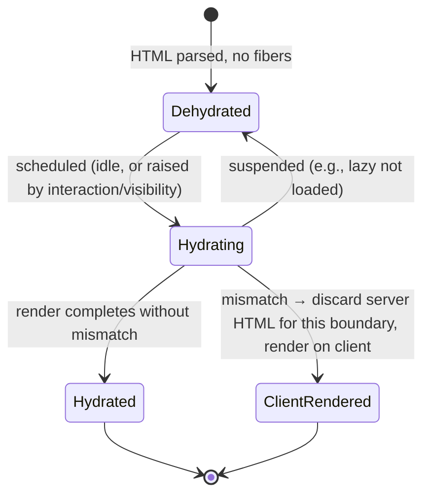
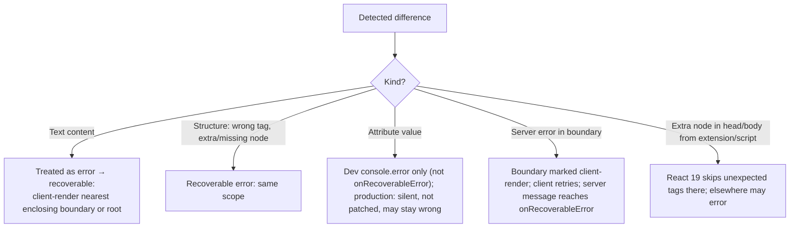

# 09 / 02 — Hydration Internals Deep Dive: The Cursor, the Markers, the Mismatch Paths, and the Cost

## 1. Lesson metadata

| | |
|---|---|
| **Level** | Advanced |
| **Study time** | 5–6 hours (reading 2 h, experiments 1.5 h, exercises 2 h) |
| **Prerequisites** | [Phase 2 / 25 — Hydration and selective hydration](../02-react-rendering-and-internals/25-hydration-and-selective-hydration.md), [Phase 2 / 24 — Suspense conceptual internals](../02-react-rendering-and-internals/24-suspense-conceptual-internals.md), [Phase 2 / 37 — Scenario F: hydration mismatch](../02-react-rendering-and-internals/37-scenario-f-hydration-mismatch.md), [01 — SPA, SSR, SSG, streaming](./01-spa-ssr-ssg-streaming.md) |
| **Next** | [03 — Server Components in depth](./03-server-components-in-depth.md) |
| **Related** | [Phase 3 / 20 — `useSyncExternalStore`](../03-react-state-and-hooks/20-usesyncexternalstore-and-external-stores.md), [Phase 2 / 28 — Strict Mode](../02-react-rendering-and-internals/28-strict-mode-behavior.md) |

**What this lesson is and is not.** Phase 2 lesson 25 established *what* hydration is, why server and client output must match, and what selective hydration changes. Here we go one level lower: we **build a toy hydrator** to make the cursor algorithm concrete, decode the markers React leaves in the HTML, enumerate every mismatch path and its blast radius, quantify the cost model, and develop a practical toolbox for reducing and monitoring it. We assume you know the Phase 2 vocabulary (dehydrated boundary, selective hydration, recoverable error). We do not re-teach it.

**Learning objectives.** After this lesson you can:
1. Implement a minimal hydration algorithm (walk server DOM with a cursor, claim nodes, attach listeners) and use it to predict React's behavior.
2. Read the Suspense and text-separator comment markers in server HTML and say what each state means.
3. Classify any mismatch as *text*, *attribute*, *structure*, or *environmental* and predict how React 19 handles it and how far the client-render fallback spreads.
4. Break hydration cost into download, parse/execute, render, and effect components, and choose a reduction technique per component.
5. Use `onRecoverableError`, DevTools, and the Performance panel to find, rank, and monitor hydration problems in production.
6. Explain when hydration is the wrong tool (client-only islands, `ClientOnly`, `suppressHydrationWarning`).

**Concepts covered:** hydration cursor, claiming vs creating DOM, dehydrated Suspense boundary markers, text node separators, mismatch taxonomy, recoverable vs fatal hydration errors, blast radius, event capture and replay, hydration priority, lazy components under hydration, two-pass rendering, environmental DOM mutation (extensions/scripts), `useId`, `getServerSnapshot`, hydration cost model.

---

## 2. Deep conceptual explanation

### 2.1 The problem hydration solves and its shape

The server sent HTML. The browser already built a DOM from it. React on the client has **no fiber tree** yet, only JavaScript and the same component code. Two things must happen:

1. React must **construct the fiber tree** by running the components (it needs the tree to know what to update later).
2. React must **associate** each host fiber with the *existing* DOM node and **attach** event handling, instead of creating nodes.

If React instead threw away the server DOM and rendered from scratch (`createRoot`), the user would see a flash, scroll position could reset, focus and text selection would be lost, and the server's work would have been wasted. So hydration is "an initial render that *adopts* DOM". That sentence has a surprising consequence: **hydration is a render**. Every component function runs; every hook initializes; the cost is the same order of magnitude as a client render minus DOM creation.

### 2.2 What React trusts, and what it does not

The central design decision: **React does not diff the server DOM against the client output the way it diffs updates.** It *assumes* they match and walks the DOM in lockstep with the render. It does not repair arbitrary differences: attributes that differ are **not patched** (React 19.3, executed in jsdom: the DOM keeps the server's `class`, development logs "This won't be patched up", production is silent); text differences and structural differences (wrong tag, missing or extra element) are treated as errors that trigger client re-rendering of a region, reported through `onRecoverableError`. Why so strict?

- Verification of the entire DOM against the output is costly, and React's goal is a *cheap adoption*.
- A diff-and-patch would need a policy for every kind of difference (which side wins?) and would hide bugs. React chooses "assume equality; if you notice inequality, re-render client-side and report".
- Matching guarantees that the client's fibers (and their handlers) are paired with the right nodes. If React kept a mismatched node, the DOM would show the server's attributes and text for an item whose handlers belong to the client's item at that position (the Symptom D bug in lesson 25).

*Version-sensitive:* error wording and which mismatches are detected have changed over time (React 18 → 19). Everything below was executed against react-dom 19.3.x in jsdom on 2026-10-22 and checked against the react.dev `hydrateRoot` reference; the `hydrateRoot` page itself only promises that mismatches are bugs, that dev mode warns, and that "there are no guarantees that attribute differences will be patched up".

### 2.3 Definitions

| Term | Meaning |
|---|---|
| **Hydratable instance** | A server-rendered DOM node (element or text) that React is permitted to claim for a host fiber |
| **Cursor** (teaching model) | The "next hydratable instance" pointer React advances while rendering host fibers |
| **Claim** | Associating an existing DOM node with a host fiber instead of creating a new node |
| **Dehydrated boundary** | A Suspense boundary whose server HTML exists in the DOM but whose fibers have not been created yet |
| **Recoverable error** | A hydration problem React can survive by client-rendering the affected part. Reported through `onRecoverableError` |
| **Blast radius** | How much of the tree is discarded and re-rendered on the client because of one mismatch (nearest Suspense boundary, or the whole root) |
| **Two-pass rendering** | Render the server-compatible output first; after hydration (in an effect), render the client-only difference |
| **Environmental mutation** | Changes to server DOM made by something other than React (extensions, injected scripts, translation tools, CDNs rewriting HTML) |

### 2.4 Why hydration is expensive: the cost decomposition

Hydration cost for one page ≈ `T_download + T_parse_exec + T_render + T_effects + T_attach`, where:

- `T_download`: bundle bytes over the network (often overlapped with HTML streaming).
- `T_parse_exec`: JS parse/compile/top-level execution. **Proportional to bundle size**, not to component count visible on screen.
- `T_render`: running every client component function in the hydrated tree, including hooks initialization and any `useMemo`/`useState` initializers.
- `T_effects`: passive and layout effects after hydration commit (subscriptions, measurements, analytics).
- `T_attach`: negligible per node (React uses event delegation at the root; see [Phase 1 / 10](../01-react-fundamentals/10-event-handling.md)).

Two non-obvious consequences:

1. A component's contribution to hydration cost does **not** depend on whether it is "visible" or "interactive". A fully static `<Footer/>` implemented as a client component still ships its code and re-runs on hydration. This is the problem RSC solves: not shipping/running non-interactive components ([03](./03-server-components-in-depth.md)).
2. Total cost is paid on the **main thread**, competing with input. React's selective hydration breaks it into prioritized pieces, but it does not reduce total work.

### 2.5 Misconceptions (beyond those in lesson 25)

| Misconception | Reality |
|---|---|
| "Hydration diffs the DOM and fixes differences." | It assumes equality and falls back to client rendering on detected inequality. Attribute differences are especially not guaranteed to be repaired. |
| "`suppressHydrationWarning` fixes mismatches." | It silences the **dev warning** for one element's immediate text/attribute difference; it does not make React patch the DOM (executed: the server text/attribute stays in the DOM), and it isn't recursive (executed: a mismatching *child* of a suppressed element still triggers a full recoverable error). |
| "A hydration error means the page is broken." | Many are *recoverable*: the user sees correct content after client re-render, at the cost of lost server benefits for that region and a flash. Track them as performance/quality defects. |
| "Browser extensions causing mismatches are my bug." | Sometimes yes; React 19 skips over unexpected tags in `<head>` and `<body>` that third-party scripts or extensions add (React 19 announcement; executed with `hydrateRoot(document, …)`: an extra `<style>` in head and extra `<div>`s at the start and end of body produced no error). Elsewhere, environmental mutation can still cause errors. |
| "If the client markup is 'close enough', it's fine." | Event handlers attach by position/type; "close enough" can attach a handler to the wrong element. |
| "Hydration happens once." | Per **boundary**, at different times, and again on any client re-render fallback. |

---

## 3. Internal mechanics

> **Labels.** **Public guarantee** = documented. **Teaching model** = faithful conceptual model. **Implementation detail** = names/markup/algorithms that may change. We do not name internal React functions; to verify details, read the reconciler and `react-dom` hydration code in the repository ([Phase 2 / 31](../02-react-rendering-and-internals/31-reading-react-source.md)).

### 3.1 Public guarantees

1. `hydrateRoot(domNode, reactNode, options?)` attaches React to server-rendered HTML. The `reactNode` must produce the same output as on the server.
2. React 19 root options include `onRecoverableError` (called with the error and an `errorInfo` containing `componentStack`; used for hydration mismatches and for server-error boundaries that the client re-renders), `onCaughtError` (errors caught by an error boundary), and `onUncaughtError` (errors not caught), plus `identifierPrefix` for `useId` collision avoidance when multiple roots share a page (it must match the prefix used on the server).
3. Text and attributes: `hydrateRoot` expects identical content and treats mismatches as bugs. React cannot guarantee that attribute differences will be patched up. In development it warns; executed on 19.3, text and structure mismatches reach `onRecoverableError` (production: "Minified React error #418"), while an **attribute** mismatch only produces a `console.error` in development and nothing at all in production. Attribute mismatches therefore never reach `onRecoverableError`.
4. `suppressHydrationWarning` on an element suppresses the warning for **one level deep** of unavoidable differences (e.g., timestamps). The docs add: "React will not attempt to patch mismatched text content".
5. A component that is a `lazy` import must have loaded before its boundary can hydrate; the boundary stays dehydrated and server HTML remains visible meanwhile ([Phase 2 / 25 §3.6](../02-react-rendering-and-internals/25-hydration-and-selective-hydration.md)).
6. During hydration, `useSyncExternalStore` uses `getServerSnapshot`, then re-checks against `getSnapshot` and re-renders if they differ ([Phase 3 / 20](../03-react-state-and-hooks/20-usesyncexternalstore-and-external-stores.md)).

### 3.2 Teaching model: the cursor algorithm

During normal rendering React builds fibers and, at commit, creates DOM. During hydration, the same render happens, but whenever React reaches a **host component** (`<div>`, text), instead of "create a DOM node later", it asks "is the next unclaimed DOM node at this position the right kind?"

```text
hydrate(fiberTree, domRoot):
  cursor = first child of domRoot (skipping non-hydratable stuff)
  walk fibers depth-first (the usual render order):
    on host element <tag props>:
       if cursor is an element with matching tag:
           claim: fiber.stateNode = cursor
           (dev: compare props/attrs and warn on difference)
           descend: cursor = cursor.firstChild
       else:
           MISMATCH
    on text:
       if cursor is a text node: claim; (dev: compare content)  → mismatch if text differs
       else MISMATCH
    on Suspense boundary:
       if cursor is a marker comment "boundary start":
           read its state (complete / pending / error) → dehydrate or hydrate
           jump cursor to the matching "boundary end" for dehydrated ones
    after finishing children: cursor = next sibling of the claimed element
  at end: leftover unclaimed server nodes ⇒ MISMATCH (extra nodes)
```

The cursor model explains four facts at once:

1. **Order matters.** The server output and client render must produce host nodes *in the same order*.
2. **Everything is matched by position and type**, not by id. So a server `<div>` where the client renders `<span>` is a mismatch, and so is an extra wrapper.
3. **Conditional rendering that differs between server and client** (e.g., `typeof window !== 'undefined' && <Widget/>`) shifts the cursor and breaks claiming for everything after it (executed: an extra client `<span>`, a missing client `<span>`, and `<p>` vs `<section>` all raised one recoverable "Hydration failed because the server rendered HTML didn't match the client" error whose dev message is a diff with `+` client and `-` server lines).
4. **Components that render `null` are free**, since they produce no host node to claim.

### 3.3 A runnable toy hydrator (teaching tool)

This 60-line TypeScript program models the algorithm for a tiny virtual element type. It is **not React**; it shows the cursor/claim/mismatch logic so predictions become mechanical.

```ts
type VNode = string | { tag: string; props?: Record<string, string>; on?: Record<string, () => void>; children?: VNode[] };

class HydrationMismatch extends Error {}

function hydrate(vnode: VNode, parent: Node, cursorRef: { node: Node | null }): void {
  const cur = cursorRef.node;

  if (typeof vnode === "string") {
    if (!cur || cur.nodeType !== Node.TEXT_NODE) throw new HydrationMismatch("expected text");
    if (cur.textContent !== vnode) throw new HydrationMismatch(`text "${cur.textContent}" != "${vnode}"`);
    cursorRef.node = cur.nextSibling;                     // claim and advance
    return;
  }

  if (!cur || cur.nodeType !== Node.ELEMENT_NODE ||
      (cur as Element).tagName.toLowerCase() !== vnode.tag) {
    throw new HydrationMismatch(`expected <${vnode.tag}>`);
  }
  const el = cur as Element;
  for (const [name, handler] of Object.entries(vnode.on ?? {})) {
    el.addEventListener(name, handler);                   // "attach": claim == wire handlers
  }
  // Dev-only: report attribute differences, but do NOT patch (mirrors React's stance)
  for (const [k, v] of Object.entries(vnode.props ?? {})) {
    if (el.getAttribute(k) !== v) console.warn(`attr mismatch ${k}: "${el.getAttribute(k)}" vs "${v}"`);
  }
  const inner = { node: el.firstChild as Node | null };
  for (const child of vnode.children ?? []) hydrate(child, el, inner);
  if (inner.node) throw new HydrationMismatch("extra server nodes inside <" + vnode.tag + ">");
  cursorRef.node = el.nextSibling;                        // done with this element
}

export function hydrateRootToy(container: Element, root: VNode): "hydrated" | "client-rendered" {
  try {
    hydrate(root, container, { node: container.firstChild });
    return "hydrated";
  } catch (e) {
    if (e instanceof HydrationMismatch) {
      console.error("recoverable:", e.message);           // → onRecoverableError
      container.replaceChildren(/* build from scratch */);
      return "client-rendered";                           // blast radius = the whole root here
    }
    throw e;
  }
}
```

*(Executed 2026-10-22: the toy below runs unmodified under Node 24 with jsdom's `Node` global; the predictions in this section and exercise B1 print exactly the stated errors. It typechecks under `tsc --strict` apart from the harness's `jsdom` import.)*

**Predict.** Server HTML: `<div><p>Hi</p></div>`. Client vnode: `{tag:"div", children:[{tag:"p", children:["Hi"]}, {tag:"span", children:["!"]}]}`. What happens? *Answer:* after the `<p>` is claimed the cursor is `null`, so the `<span>` check throws "expected `<span>`": the client rendered **more** than the server. The reverse (server had an extra node) triggers the "extra server nodes" path at the end of the parent. Both are mismatches; the boundary around the discrepancy defines the blast radius.

**What the toy omits** (important!): Suspense boundaries, concurrent/time-sliced traversal, whitespace and comment skipping, form-control state, `dangerouslySetInnerHTML`, portals, and React's recovery granularity. The *lesson* is the lockstep walk.

### 3.4 The markers in server HTML (implementation detail)

Streamed/server HTML contains **comment nodes** that React's client uses as boundaries and separators. Conceptually:

| Marker (conceptual) | Meaning |
|---|---|
| Start-of-boundary comment, "complete" state | Server finished this boundary's content inline; the following nodes up to the end marker are its content |
| Start-of-boundary comment, "pending" state | Server emitted the fallback and will stream the content later |
| Start-of-boundary comment, "client-render/error" state | Server failed or gave up; the client must render this boundary (fallback or retry) |
| End-of-boundary comment | Closes the range |
| Empty comment between adjacent text | Prevents the browser's HTML parser from merging two React text children into one DOM text node |

In practice (view-source) these are short comments such as `<!--$-->` (complete), `<!--$?-->` (pending; followed by `<template id="B:0"></template>` and the fallback), `<!--$!-->` (client-render; followed by a `<template data-msg=… data-stck=… data-cstck=…>` carrying the server error text and stacks), `<!--/$-->` (end), and `<!-- -->` between text. React 19.2+ also uses a transient `<!--$~-->` while a streamed boundary is queued for batched reveal (visible in the inline `$RC`/`$RV` script). All of these were observed in react-dom 19.3.x output. *Implementation detail:* the literal markers, the way pending content is swapped in, and data attached to them are internal and have changed historically. **Never** write code that depends on them; use them as a debugging aid.

The text separator is worth understanding: JSX like `<p>Hello {name}</p>` yields two text children; the HTML parser would create **one** text node `"Hello Ada"`. Without a separator, the cursor would expect two text nodes and find one. The empty comment between them makes two text nodes at parse time, so client and server agree. (This is also why `{"a"}{"b"}` produce visible `<!-- -->` in server HTML and why template literals reduce marker noise.)

### 3.5 Teaching model: boundaries, dehydration and hydration order



- **Initial hydration** of the *root shell* happens first; each Suspense boundary inside it that arrived in complete state is a *dehydrated boundary* with its own later hydration task.
- **Priority.** Hydration of dehydrated boundaries runs at a low priority; user-initiated interaction (a discrete event such as a click) on a dehydrated boundary raises that boundary's priority so it hydrates before others. Conceptually this uses the same lane machinery as updates ([Phase 2 / 14](../02-react-rendering-and-internals/14-lanes.md)).
- **Interruptibility.** Hydration is a render-phase activity and can yield to the browser between units of work when run in a concurrent (time-sliced) mode, which is what makes the page responsive during hydration. It is *abandoned and restarted* if something more urgent preempts it.
- **Blocking.** An update to a not-yet-hydrated region can't be rendered (there are no fibers). React hydrates that region first, then applies the update.

### 3.6 Events on dehydrated boundaries (hydrate-then-dispatch, limited replay)

Event handlers aren't attached per DOM node (delegation at the root; see [Phase 1 / 10](../01-react-fundamentals/10-event-handling.md)). The root listeners exist as soon as `hydrateRoot` is called on that container, **but** the handler a click would invoke is only known once the target's fiber exists. For events on dehydrated regions React (as described in the React 18 working group's "New Suspense SSR Architecture" discussion) hydrates the target boundary with raised priority so the event is not lost. What react-dom 19.3 actually does, from reading the client bundle and executing it in jsdom:

- **Discrete events** in an internal list (`click`, `keydown`, `input`, `change`, `reset`, `mousedown`/`mouseup`, `touchstart`/`touchend`, `pointerdown`/`pointerup`, `dblclick`, `contextmenu`, `copy`/`cut`/`paste`, `compositionstart`/`compositionend`, and others) that land on a dehydrated boundary make React **hydrate that boundary synchronously first and then dispatch the event** to the now-live handler. Executed: three sibling boundaries, a click on the second one right after `hydrateRoot(...)` ran `render B`, then `click B` (handler ran inside the same synchronous dispatch), and only afterwards `render A`, `render C`. If the boundary *cannot* hydrate yet (executed: its content is a `lazy` component whose chunk has not loaded), the click is **dropped**: the handler did not run later, and only a second click after hydration worked. That is why critical actions need progressive enhancement.
- **A few continuous events** (`focusin`, `dragenter`, `mouseover`, `pointerover`, ...) are *queued*, the latest per type is replayed after hydration. Other continuous events such as `pointermove` are not.

Which events are in these lists and how they are processed are implementation details that change between versions. Design assumption to keep: **do not rely on pre-hydration events being handled by your logic; use progressive enhancement for critical actions** ([11 — Progressive enhancement](./11-progressive-enhancement.md)).

### 3.7 Mismatch taxonomy and recovery paths



Notes:
- **Blast radius** = nearest Suspense boundary **above** the mismatch, otherwise the root. Executed: with `<main><h1/><Suspense><section/></Suspense><footer/></main>` a text mismatch inside the boundary kept the original `<h1>` and `<footer>` DOM nodes and replaced only the boundary's content; with no boundary the `<h1>`, `<section>` and `<footer>` nodes were all replaced. *This is the reason to place boundaries around risky, dynamic regions*: a timestamp mismatch inside a boundary costs you that region's server HTML, not the whole page's.
- **Attributes.** Because attribute differences (e.g., `className`, `href`, `data-*`, inline `style`) aren't guaranteed to be fixed, the DOM can keep the *server's* value while React believes it holds the client's. Later updates diff client-old vs client-new, so the stale server value may **persist** until the attribute changes. This produces "styles wrong until hover" style bugs. Executed: server `class="srv"`, client `class="cli"` left `class="srv"` in the DOM, with no `onRecoverableError` call. Treat attribute mismatches as bugs even though nothing is thrown (and nothing is logged at all in production).
- **Reporting.** Text and structure mismatches surface via `onRecoverableError(error, errorInfo)` with `errorInfo.componentStack`. React 19 consolidated mismatch messaging into a single diff-style message in development; for a text mismatch it ends with lines such as `+     two` (client) and `-     one` (server) under the component path. Production builds give "Minified React error #418" with `args[]=text` or `args[]=HTML`. An attribute mismatch is a separate dev-only `console.error` ("A tree hydrated but some attributes of the server rendered HTML didn't match the client properties. This won't be patched up.") with a `+`/`-` diff of the props.
- **Environment.** React 19 skips over unexpected `<head>`/`<body>` children inserted by scripts/extensions during hydration, per its release notes; this does not generalize to extensions that change nodes *inside* your app container.

### 3.8 Hydration-specific rules for hooks and APIs

| API | Rule during hydration |
|---|---|
| `useState`/`useMemo` initializers | Run on the client during hydration; must produce the same *rendered output* as the server did (so don't read `window`, `Date.now()`, `Math.random()` in render) |
| `useId` | Produces ids that match server and client because they derive from tree position, not call order of a global counter (conceptually). Use it for label/for pairs; set `identifierPrefix` (same value on server and client) for multiple roots on one page. The generated format is internal and has changed: the default prefix was `:r:` in 19.0, `«r»` in 19.1 and `_r_` since 19.2 (changed so ids are valid `view-transition-name` / XML 1.0 names; executed on 19.3: `_R_0_`), so treat ids as opaque strings |
| `useSyncExternalStore` | Needs `getServerSnapshot` that returns the **same** value the server rendered (must also be deterministic and serialized, e.g., from the HTML payload) |
| `useEffect` / `useLayoutEffect` | Run **after** hydration commit. On the server neither runs. Executed on 19.3: `renderToString` of a component using `useLayoutEffect` produced no warning (older React versions warned) |
| `use(promise)` / Suspense | A promise with no resolved value at hydration time suspends the boundary; with streaming, the server may have already sent the resolved HTML |
| Context | Value must be the same on both sides; context providers rendered with client-only values will mismatch |
| Refs | Attached at commit, after claim |
| Portals | Not supported by the server renderer: executed on 19.3, `renderToString` threw "Portals are not currently supported by the server renderer. Render them conditionally so that they only appear on the client render." Render them after hydration (e.g. behind a `useSyncExternalStore` client flag) |

### 3.9 Strict Mode and hydration

In development, Strict Mode double-invokes render functions and effect setups ([Phase 2 / 28](../02-react-rendering-and-internals/28-strict-mode-behavior.md)). Hydration is a render, so impure render code (random ids, `Date.now()`) is exposed by the double invocation. If a mismatch only appears in dev with Strict Mode, suspect impurity first. React 19.3 also double-invokes **effects** during hydration, matching client-rendered roots (changelog "Double invoke Effects in Strict Mode during hydration"; executed: a hydrated component's effect logged `setup, cleanup, setup`).

---

## 4. Step-by-step execution walkthrough

### 4.1 One page, three boundaries, a mismatch in the middle one

Page shell (no boundary): `Header`, `Main`. Boundaries: `B1: Comments`, `B2: Clock` (renders `new Date().toLocaleTimeString()` in render), `B3: Recs`.

1. Browser receives streamed HTML; it paints header and fallbacks. JS is downloading.
2. `hydrateRoot(root, <App/>)` runs after the bundle executes. React begins the **root** render in hydration mode and walks the cursor over header and main. For each Suspense boundary whose server content is complete, React notes it as **dehydrated**: its fibers are not created now; the cursor skips to the end marker.
3. The shell commits: handlers for header elements are live, and the dehydrated boundaries are visible but inert.
4. Hydration tasks for B1, B2, B3 are scheduled at a low priority; the user clicks a button inside **B3** early. The event lands on a dehydrated boundary, so React raises B3's priority.
5. React hydrates B3 first. No mismatch. B3 commits and the click is delivered to the now-live handler, which runs (executed on 19.3: the boundary is hydrated synchronously and the handler runs within the same dispatch).
6. React proceeds to B1 (fine), then B2. The server wrote `"10:03:41 AM"`; the client render computes `"10:03:42 AM"`. Text mismatch → recoverable error. **Blast radius: B2's content only**, since B2 is a Suspense boundary. React discards the server HTML for B2 and renders it on the client. `onRecoverableError` is called.
7. The page is fully interactive; B2 flashed from "…41" to "…42". The page's other regions never lost their server DOM.

**Predict:** What if there had been no boundary around the clock? *Answer:* the nearest enclosing boundary or the root is client-rendered: the whole shell's server DOM is discarded and re-created. Scroll position and focus in that region can be disturbed. That is what `suppressHydrationWarning` and boundaries are for.

### 4.2 The same page with the clock made hydration-safe (two-pass)

```tsx
function Clock() {
  const [now, setNow] = useState<string | null>(null);   // server + first client render: null
  useEffect(() => {
    setNow(new Date().toLocaleTimeString());
    const id = setInterval(() => setNow(new Date().toLocaleTimeString()), 1000);
    return () => clearInterval(id);
  }, []);
  return <time>{now ?? "--:--:--"}</time>;
}
```

Timeline: server renders `--:--:--`; hydration renders `--:--:--` (match); the effect runs after commit, sets state, and a normal client update replaces the text. No mismatch, one extra render, a brief placeholder. Trade-off: not in the server HTML (SEO, no-JS), visible flash of placeholder. Reserve space (fixed width) to avoid layout shift.

---

## 5. Code examples

### 5.1 Minimal: monitoring hydration errors

```tsx
import { hydrateRoot } from "react-dom/client";
import { App } from "./App";

hydrateRoot(document.getElementById("root")!, <App />, {
  onRecoverableError(error, errorInfo) {
    // error: the hydration problem; errorInfo.componentStack: where (when available)
    reportToMonitoring({
      kind: "recoverable",
      message: String((error as Error)?.message ?? error),
      componentStack: errorInfo?.componentStack,
      route: location.pathname,
    });
    console.error(error);   // keep default visibility
  },
});
```

**Notes.** Overriding `onRecoverableError` replaces the default, which reports the error to the global error handler (`reportError`; in react-dom 19.3 the default callback just calls the internal `reportGlobalError`), so keep logging. Group alerts by *route + component stack*, not by raw message (messages include variable text; in production they are "Minified React error #418" with `args[]=text` or `args[]=HTML`). The react.dev reference documents `errorInfo.componentStack` (executed: it was the only key, e.g. `"\n    at p (<anonymous>)\n    at div (<anonymous>)"` in jsdom); the docs also say some recoverable errors carry the original error as `error.cause`. Guard for `undefined` anyway. The callback also fires when the client re-renders a boundary the server marked as failed (executed: message "Switched to client rendering because the server rendering errored: …"), so not every call is a mismatch. **It does not fire for attribute mismatches** (dev `console.error` only; silent in production), so monitoring this callback alone under-reports attribute drift; catch those with a hydration test in CI (see C3).

### 5.2 Practical: a `ClientOnly` wrapper (two-pass render) with reserved space

```tsx
import { useSyncExternalStore, type ReactNode } from "react";

const subscribe = () => () => {};                  // never changes
export function ClientOnly({ children, fallback = null }: { children: ReactNode; fallback?: ReactNode }) {
  const isClient = useSyncExternalStore(subscribe, () => true, () => false);
  return <>{isClient ? children : fallback}</>;
}
```

`getServerSnapshot` returns `false` (server and hydration render), and React re-renders with `true` after hydration. This avoids a state + effect and avoids a separate "mounted" flag in every component. Use it for widgets that can't render on the server (maps, charts reading `window`). Pair with a fallback of **the same dimensions** to prevent layout shift ([14 — Accessibility and SEO](./14-accessibility-and-seo.md) for the SEO consequences of hiding content).

### 5.3 Practical: browser-only values with `useSyncExternalStore`

```tsx
function subscribeOnline(cb: () => void) {
  window.addEventListener("online", cb);
  window.addEventListener("offline", cb);
  return () => { window.removeEventListener("online", cb); window.removeEventListener("offline", cb); };
}
export function useOnline(): boolean {
  return useSyncExternalStore(
    subscribeOnline,
    () => navigator.onLine,     // client snapshot
    () => true,                 // server + hydration snapshot: must be a fixed, agreed value
  );
}
```

If the user is actually offline at hydration, React renders with `true` first (match), then notices the client snapshot differs and re-renders: a correct, flicker-minimized resolution of a classic mismatch ([Phase 2 / 25 §5.2](../02-react-rendering-and-internals/25-hydration-and-selective-hydration.md)).

### 5.4 Incorrect: `typeof window` in render

```tsx
// ❌
function Banner() {
  if (typeof window !== "undefined" && localStorage.getItem("dismissed")) return null;
  return <aside>Cookie notice</aside>;
}
```
**Why wrong:** The server renders `<aside>`; a returning client renders `null` during hydration → the cursor expects no node but finds `<aside>` → leftover server node / mismatch. **Corrected:** render the server-compatible output and reconcile after hydration:

```tsx
function Banner() {
  const dismissed = useSyncExternalStore(
    subscribeDismissed,
    () => localStorage.getItem("dismissed") === "1",
    () => false,                          // server assumption
  );
  return dismissed ? null : <aside>Cookie notice</aside>;
}
```
Trade-off: returning users briefly see the banner (flash). If that is unacceptable, put the decision in a **cookie** the server can read, so server and client agree from the first byte. That is the architecture fix; the hook is the mitigation.

### 5.5 Incorrect: invalid HTML nesting

```tsx
// ❌ <p> cannot contain <div>
<p>Intro <div>block</div></p>
```
The HTML parser closes `<p>` before the `<div>`, so the server DOM differs structurally from what React renders. React warns in development (invalid nesting) and hydration mismatches follow. **Fix:** valid nesting (`<div>`/`<span>`), `<table>` needs `<tbody>` in the DOM (parser inserts it; React DOM warns about `<tr>` directly under `<table>`). Lint it.

### 5.6 Corrected/advanced: placing boundaries to bound blast radius

```tsx
<Layout>
  <ArticleBody />                          {/* deterministic, no boundary needed */}
  <Suspense fallback={<TimeSkeleton />}>
    <LocalTimes />                         {/* risky: locale/timezone/time-dependent */}
  </Suspense>
  <Suspense fallback={<RecsSkeleton />}>
    <Recommendations />                    {/* personalized/volatile */}
  </Suspense>
</Layout>
```

A boundary does not *prevent* mismatches; it limits the cost of one. Combine with `suppressHydrationWarning` only for text-only leaf differences that are intentional and harmless (e.g., a `<time>` element with a formatted date).

```tsx
<time dateTime={iso} suppressHydrationWarning>{formatLocal(iso)}</time>
```
Executed on 19.3 (development and production builds): with `suppressHydrationWarning` and different text or a different `title` attribute, no error or warning was produced and the **server's text/attribute stayed in the DOM** until a later client update changes it. The documented intent is *unavoidable* differences like timestamps, "one level deep"; the docs also say "React will not attempt to patch mismatched text content". Prefer making formatting deterministic (explicit locale + timeZone) so the issue disappears.

### 5.7 Advanced: deterministic formatting to eliminate a class of mismatches

```ts
// ✅ same output on server and client regardless of host locale/timezone
const fmt = new Intl.DateTimeFormat("en-GB", {
  dateStyle: "medium", timeStyle: "short", timeZone: "UTC",
});
export const formatTimestamp = (d: Date) => fmt.format(d);
```
Server and browser can differ in default locale and timezone. Pass them explicitly, from the request (`Accept-Language`, cookie) or fixed. Show "local time" as a *post-hydration* enhancement if required.

### 5.8 Advanced: measuring hydration in the browser

```ts
// Mark around hydrateRoot for a rough number; use the Performance panel for details.
performance.mark("hydrate-start");
const root = hydrateRoot(container, <App />, { onRecoverableError });
// Hydration is concurrent: it finishes later. Observe via a root-level effect:
function HydrationDone() {
  useEffect(() => { performance.mark("hydrate-end"); performance.measure("hydrate", "hydrate-start", "hydrate-end"); }, []);
  return null;
}
```
Notes: because selective hydration spreads work over time and across boundaries, a single "end" mark measures only the **root shell** commit. For per-boundary timing, add the same marker effect inside each boundary's content. Also use React DevTools Profiler (it records the hydration commit) and the Performance panel's main-thread flame chart to find long tasks.

---

## 6. Visual explanations

### 6.1 Cursor walk and mismatch point

```text
Server DOM:           <div> ── <h1> ── "Hi" ── <ul> ── <li>A</li> <li>B</li>
Client render order:  div → h1 → "Hi" → ul → li → "A" → li → "B" → li → "C"
                                                      ✓     ✓      ✗ (no third <li>)
Blast radius: nearest Suspense boundary above <ul>, else root
```

### 6.2 Timeline of selective hydration with interaction

```mermaid
gantt
  dateFormat X
  axisFormat %Lms
  section Main thread
  Parse/execute bundle      :a, 0, 300
  Hydrate shell             :b, after a, 80
  Hydrate B1 (idle priority):c, after b, 60
  Click on B3 (raised)      :crit, d, after b, 5
  Hydrate B3 first          :crit, e, after d, 70
  Click handler runs        :f, after e, 5
  Hydrate B2 (mismatch → client render) :g, after f, 120
```
(Illustrative durations; the order shows raised priority.)

### 6.3 Server HTML vs fibers over time

```text
t0 (HTML parsed):      DOM ✓   fibers ✗   handlers ✗
t1 (shell hydrated):   DOM ✓   fibers: shell only   handlers: shell
t2 (all hydrated):     DOM ✓   fibers ✓   handlers ✓
Client-render fallback: DOM for the region replaced by client-created nodes
```

---

## 7. Alternative approaches and trade-offs

| Technique | How it avoids hydration cost/mismatch | Cost | Best when |
|---|---|---|---|
| **Fix the mismatch (deterministic render)** | Same output both sides | Design discipline | Always the default |
| **Two-pass (`useEffect` + state / `useSyncExternalStore`)** | Server-compatible first pass, client truth later | Extra render, placeholder flash | Browser-only values that matter after load |
| **`suppressHydrationWarning`** | Silences intended text/attr difference (one level) | DOM can keep stale value; hides real bugs if overused | Timestamps, intentionally different markup |
| **`ClientOnly` / skip server render** | No server HTML for region | No SEO/content before JS; layout shift | Maps, charts, canvas widgets |
| **Suspense boundary around volatile region** | Bounds blast radius | Added boundary/fallback design | Dynamic leaf regions |
| **`lazy` + delayed hydration of below-fold** | Delay JS and hydration work | Late interactivity for that region | Heavy, non-critical widgets |
| **Server Components for non-interactive parts** | Not shipped/hydrated at all | Architecture change ([03](./03-server-components-in-depth.md)) | Content-heavy pages |
| **Islands/partial hydration (other frameworks)** | Only islands hydrate | Different model | Mostly-static sites |
| **Pure CSR (`createRoot`)** | No hydration at all | No SSR benefits | Authenticated apps |

**Scenario where the recommended approach (fix + two-pass) is NOT best.** A page's main content is a live trading chart that depends on `window` sizes and WebSocket data. Making the SSR output "match" is meaningless there; the correct design is `ClientOnly` with a skeleton of identical size, with static content (title, description) server-rendered around it. Forcing SSR of the chart wastes server CPU and creates mismatches.

---

## 8. Best practices and anti-patterns

### Best practices
1. **Render purity is the primary defense**: no `Date.now()`, `Math.random()`, `window`, `localStorage`, `navigator` in render for hydrated components.
2. **Serialize decisions, not recompute them**: time of render, locale, theme, experiment variants, feature flags: decide on the server, embed, read the same value on the client.
3. **Make external-store reads hydration-safe** (`getServerSnapshot`).
4. **Wrap volatile regions in boundaries** to bound the damage.
5. **Alert on `onRecoverableError` volume**; treat sustained increases as regressions, grouped by route and component.
6. **Test hydration**: render server HTML in a test, hydrate it, and fail on console errors ([08 testing](../08-testing-and-quality/08-integration-testing.md)).
7. **Reserve layout space** for two-pass/`ClientOnly` content.

### Anti-patterns

| Anti-pattern | Problem | Fix |
|---|---|---|
| Sprinkling `suppressHydrationWarning` on containers | Hides real mismatches; not recursive anyway | Use only on leaf text; fix the cause |
| `useEffect(() => setMounted(true))` everywhere | Duplicated logic, extra renders, layout shift | One `ClientOnly`/`useSyncExternalStore` abstraction |
| Reading cookies/localStorage in render | Different on server/client | Read cookie on server → pass down |
| Building ids with `Math.random()`/counters | Mismatch + a11y link breakage | `useId` |
| Hydrating the entire page "just in case" | Cost without value | Reduce client components, RSC ([03](./03-server-components-in-depth.md)) |
| Ignoring recoverable errors because "the page works" | Hidden perf regression, flashes, lost server benefits | Monitor and fix |
| Wrapping the whole app in `ClientOnly` | You rebuilt CSR with extra steps | Use `createRoot` or narrow the wrapper |

**Justified exception:** apps behind login whose only SSR benefit is the shell may deliberately disable SSR for the authenticated area (pure `createRoot`) to eliminate mismatches entirely.

---

## 9. Real-world application

| Domain | Hydration risk | Mitigation |
|---|---|---|
| **E-commerce** | Prices with currency/locale formatting; "recently viewed" from localStorage; A/B variants | Format with explicit locale/currency; read variant from cookie on server; localStorage reads post-hydration |
| **Dashboards** | Charts, resize-dependent layouts | `ClientOnly` with fixed-size skeleton; data embedded and `getServerSnapshot` consistent |
| **Finance** | Number formatting; time zones; sensitive data in serialized props | Explicit `Intl` options; filter fields; no secrets in payload |
| **Forms** | Autofill and browser translation changing DOM; controlled inputs with initial values | Don't render user-specific defaults only on the client; test with autofill and translation tools |
| **Auth** | "Signed in" vs "Signed out" nav differing between server (cookie) and client (token in memory) | Single source: cookie/session read on the server; client mirrors it |
| **Realtime** | Live counters differ between server render and hydration | Snapshot embedded in HTML; update after hydration |
| **Multi-team** | Different teams add third-party scripts that mutate DOM | Governance on scripts; load third-party tags after hydration (see also [Phase 10 / 06](../10-production-engineering/06-security-xss-csrf-csp.md) for script allow-listing) |

---

## 10. Debugging and troubleshooting

### Symptom A: "Hydration failed because the server rendered HTML didn't match the client."
- **Repro:** run a *development* build locally (production builds only print "Minified React error #418"); load the page with network throttling; open the console.
- **Investigation:** React 19 prints a single diff-style message in development ("Hydration failed because the server rendered text didn't match the client. As a result this tree will be regenerated on the client. …" followed by the component path with `+` client / `-` server lines); in production it is "Minified React error #418", so reproduce in a development build. Identify the component from the component stack. Classify (text/attr/structure). Diff `view-source` HTML against `document.body.innerHTML` before hydration (disable JS and compare, or capture HTML from `curl`).
- **Root causes:** time/random/locale in render; browser-only branch; invalid nesting; whitespace differences; data differing between server fetch and client read; extension or translation tool.
- **Validate:** console clean in dev; `onRecoverableError` count at zero for that route in staging.

### Symptom B: "Styles or attributes are wrong until some interaction."
- **Likely cause:** attribute mismatch that React did not patch. Compare server HTML attributes with client props (`className`, `style`, `href`, `aria-*`). A conditional className based on client-only state is the classic cause.
- **Fix:** same inputs; two-pass for client-only variants.

### Symptom C: "Page flashes between SSR and final content right after load."
- **Cause:** client-render fallback for a boundary (blast radius), or two-pass update. Check `onRecoverableError`; check for `ClientOnly` placeholders of different height.

### Symptom D: "Mismatch only for some users."
- **Investigate:** locale, timezone, device, flags, cookies, translation tool/extension, ad blockers modifying DOM, CDN HTML minifier/rewriter (e.g., email obfuscation, injected analytics). Reproduce by emulating locale/timezone in DevTools; test with a clean browser profile; compare raw HTML from CDN vs origin.

### Symptom E: "Clicks do nothing for a few seconds after paint."
- **Investigate:** Performance panel: bundle execution, hydration long tasks. If a long task coincides with the click, you're in the input-delay window; if replay exists, the click executes later. Reduce JS ([03](./03-server-components-in-depth.md)), split code, prioritize critical boundaries.

### Symptom F: "Works in production, mismatches in development."
- **Cause:** Strict Mode double-render exposing impurity; dev-only warnings (attribute checks) not present in production. Treat dev warnings as real defects.

### Symptom G: "Hydration passes but memory/CPU spikes."
- **Investigate:** React Profiler: which components render during hydration commit; effect counts; large `useMemo` initializers. Consider lazy hydration of heavy widgets.

---

## 11. Exercises

### Level A — Knowledge
A1. Why is hydration a "render" and not "attaching event handlers"?
A2. What do the empty comment nodes between adjacent text nodes in server HTML accomplish?
A3. Name three kinds of mismatch and how React 19 treats text vs attributes in production.
A4. What bounds the blast radius of a hydration mismatch?
A5. What does `suppressHydrationWarning` do, and what does it not do?

### Level B — Code comprehension
B1. With the toy hydrator, server HTML is `<ul><li>A</li><li>B</li></ul>` and the client vnode renders three `<li>`. Which error occurs and where?
B2. Predict the outcome of hydrating this component when the user is on a device whose locale is `de-DE` and the server's is `en-US`:
```tsx
function Price({ cents }: { cents: number }) {
  return <span>{(cents / 100).toLocaleString(undefined, { style: "currency", currency: "EUR" })}</span>;
}
```
B3. `useSyncExternalStore(sub, () => window.innerWidth, () => 1024)`. At hydration with a 390 px viewport, what is rendered first, what second, and is there a mismatch?

### Level C — Implementation
C1. Implement `useHydrated(): boolean` (false during server/hydration render, true after) without `useEffect`.
C2. Extend the toy hydrator to **skip** whitespace-only text nodes in the DOM when the vnode expects an element, and to compare adjacent text correctly given `<!-- -->` separators.
C3. Write a Vitest test that server-renders `<App/>` with `renderToString`, hydrates it with `hydrateRoot` in jsdom, and fails if any recoverable error is reported.

### Level D — Debugging
D1. Users report that the "Add to cart" button in one product card triggers the **wrong** product. Hydration warnings appeared in staging but were ignored. Explain the mechanism and the investigation.
D2. A page produces `onRecoverableError` calls only in Safari. List hypotheses and the experiments that discriminate between them.

### Level E — Architecture and engineering decisions
E1. Your design system exports a `<RelativeTime>` ("3 minutes ago") used in 40 places. Design its hydration behavior. Consider server/client clock skew, updating, SEO, and layout shift.
E2. Decide between: hydrate everything; `ClientOnly` for the heavy chart; RSC for the content; or full CSR for an analytics page with 2 MB of client JS. Provide criteria.

### Level F — Expert challenge
F1. Design a production monitoring system for hydration quality: what you collect, how you aggregate, how you detect regressions after a deploy, how you attribute them to a team, and how you keep PII out of reports.

---

## 12. Detailed answers and explanations

> Attempt the exercises first.

**A1.** React must run the components to build fibers (hooks, state, effects), then claims DOM during that render. Handlers are delegated at the root; "attaching" is almost free. The work is the render. Wrong answer: "React just adds listeners": that's the pre-React mental model; it ignores that React must know the component tree.

**A2.** The HTML parser would merge adjacent text into one text node; the client render expects separate text children (one fiber each). The separator comment forces two text nodes so the cursor sees the same structure. It's an implementation detail but explains `<!-- -->` in view-source.

**A3.** Text, structure (tag/extra/missing node), attribute (also environmental). Text and structure mismatches are recoverable errors with client re-render of the nearest boundary or root; attributes are warned in dev and not guaranteed to be patched in production, so the wrong value may persist.

**A4.** The nearest Suspense boundary above the mismatch; if none, the root. Also whether the mismatch is detected (attributes may not be).

**A5.** It suppresses the warning for one element's text content/attribute difference, one level deep. It does not repair the DOM, does not cascade to children, and does not prevent React from using the client value in later updates or leaving the server value in the DOM.

**B1.** After claiming two `<li>`, the cursor is `null`; the client vnode's third `<li>` throws "expected `<li>`". Detected while hydrating `<ul>`'s children; blast radius in the toy = the whole root; in React = nearest boundary or root.

**B2.** The server output is `€12.34`-style en-US formatting; the German client produces `12,34 €`. Text mismatch → recoverable error → client re-render of the nearest boundary/root. Fix: pass explicit locale (from request) to `toLocaleString`, or use `suppressHydrationWarning` on the span *if* the difference is acceptable (and know the DOM may then show the server text until updated), or format after hydration. Best: deterministic locale from the request.

**B3.** First render (server and hydration) uses `getServerSnapshot` → `1024`: no mismatch. After commit React reads `getSnapshot` = `390`, sees it differs, and re-renders synchronously-ish with `390`: one extra render, possible visual flash of the 1024 layout. Not a mismatch error. If the layout at 1024 would be wrong for mobile, prefer CSS media queries over JS width reads.

**C1.**
```tsx
const noop = () => () => {};
export function useHydrated(): boolean {
  return useSyncExternalStore(noop, () => true, () => false);
}
```
Edge cases: during a client-only `createRoot` render, the client snapshot `true` is used from the start (no hydration), which is the correct behavior.

**C2.** Key points: when `vnode` is an element and `cur` is a whitespace-only text node, advance `cursor` before the check; for text, treat a comment node with data `""` (or any comment) as a separator: skip it, and treat the two adjacent text vnodes `"Hello "`, `"Ada"` as consuming two text nodes when separators exist. In real React, whitespace and comment skipping follow React's own rules, which we did not verify in detail; do not generalize your toy.

**C3.** Sample:
```tsx
// @vitest-environment jsdom
import { act } from "react";
import { renderToString } from "react-dom/server";
import { hydrateRoot } from "react-dom/client";
(globalThis as any).IS_REACT_ACT_ENVIRONMENT = true;

it("hydrates without errors", async () => {
  const html = renderToString(<App />);
  const container = document.createElement("div");
  container.innerHTML = html;
  document.body.append(container);
  const errors: unknown[] = [];
  const spy = vi.spyOn(console, "error").mockImplementation((...a) => errors.push(a));
  await act(async () => {
    hydrateRoot(container, <App />, { onRecoverableError: (e) => errors.push(e) });
  });
  expect(errors).toEqual([]);
  spy.mockRestore();
});
```
Executed with Vitest 3 + jsdom on 19.3 (with `esbuild.jsx: "automatic"`): this pattern passed for a matching component and recorded errors for a component whose client text differed from the server text. The `console.error` spy matters, because attribute mismatches are only reported there. Caveats: jsdom doesn't replicate browser layout/locale behaviors; `act` environment flags (`IS_REACT_ACT_ENVIRONMENT`) must be set; test with fixed `TZ`/locale to catch environment sensitivity.

**D1.** Mechanism: a structural mismatch (e.g., card order or conditional wrapper differed) shifted the cursor; if React proceeds with claiming mismatched nodes in some situations (or the stale server DOM remains for attributes like `data-id`/`form` values) a handler can end up associated with a DOM node whose server-rendered attributes/text belong to another item. Even with recoverable fallbacks the visible state and handlers can disagree for attributes not patched (e.g., `href`, `value`). Investigation: reproduce with the same data; diff server HTML vs client render; check list `key`/ordering differences between server and client (sort by `Math.random`, unstable sort, different default sort per locale); fix determinism; add `onRecoverableError` alerting. *Evaluation:* credit answers that tie the bug to nondeterministic ordering/data divergence and don't rely on a precise internal claim.

**D2 (hypotheses).** Safari-specific: different `Intl` defaults/formatting; date parsing differences (`new Date("2024-01-01 10:00")`); autofill/translation; ITP/cookie behavior making cookie-based decisions differ between server and client; extensions; different default locale; feature detection (`'IntersectionObserver' in window`) in render. Experiments: capture `errorInfo`/message in Safari; compare raw HTML between browsers (cookies!); emulate locale; disable extensions; bisect components via boundaries; log values used in render on both sides.

**E1 (criteria).** Expectations: deterministic first render, e.g., render an absolute formatted time (`<time dateTime>`) server-side using fixed locale/timezone; after hydration, update to relative text in an effect or via `useSyncExternalStore` on a shared ticking clock (one timer for all 40 instances); avoid clock skew by passing server render time as a prop; `suppressHydrationWarning` on `<time>` only if you choose to render different text; reserve width; keep accessible: `<time dateTime>`; SEO sees absolute time. Trade-off: flash from absolute→relative; alternative: render only absolute. Example answer sketches the shared clock store with `getServerSnapshot` = server render timestamp.

**E2 (criteria).** Weighted decision: SEO need, auth, interactivity density, JS budget, team capability, infra. If authenticated analytics: CSR (no hydration) likely; if public with static content and heavy interactive chart: RSC for content + `ClientOnly`/lazy chart; hydrating everything is rarely best with 2 MB of JS. Provide measurements to decide (INP, TBT on mid-tier devices).

**F1 (criteria).** Good design: collect `onRecoverableError` with normalized message class (strip dynamic values), route, component stack hash, build id, browser/locale/timezone buckets, sampling; no user content (scrub messages); aggregate error rate per 1k page views per route/build; alert on delta vs previous release (canary comparison); ownership via CODEOWNERS mapping from component paths to teams (source maps / component stack); also measure hydration duration with marks and INP correlation; dashboards with top mismatch signatures; dev: tests that fail on hydration errors; privacy: sanitize, sampling, retention. Wrong: raw stack/message with user data.

---

## 13. Senior engineer interview questions

**Q1. "Explain hydration to a teammate who thinks it's 'attaching event listeners'."**
*Strong answer:* It's a render that adopts DOM. React needs fibers to manage future updates, so it runs components and walks the existing DOM in lockstep with the render (cursor), claiming nodes by type and position. Listeners are delegated, so attachment is cheap; the render is the cost. Mismatch means the lockstep assumption broke.

**Q2. "Why doesn't React just patch the DOM when it finds a mismatch?"**
*Strong answer:* Verifying and patching everything defeats cheap adoption; there's no universally correct resolution (server vs client), and silently patching hides bugs. React chooses assume-equality, detect-cheaply, fallback to client render for the affected region, and report. Attributes are the weak spot because they aren't guaranteed to be repaired.

**Q3. "We have 30 hydration warnings in staging. Prioritize."**
*Strong answer:* Rank by user impact and blast radius: structural/text errors in root-level or above-the-fold regions (large client re-render), then ones in interactive controls (event misattachment risk), then attribute mismatches (stale values), then benign leaf text with intent. Group by root cause (formatting, browser-only branches, invalid HTML). Fix causes in shared utilities first (formatters, `useId`).

**Q4. "How do you make `localStorage`-based UI work with SSR?"**
*Strong answer:* Server can't read it. Render the server-compatible default, then reconcile after hydration via `useSyncExternalStore` with `getServerSnapshot`. If flash is unacceptable, move the state to a cookie so the server can render the right output. Reserve space for visual stability.

**Q5. "What reduces hydration cost the most?"**
*Strong answer:* Shipping and running less client code: RSC/not hydrating non-interactive components, code splitting, lazy hydration of non-critical widgets, avoiding heavy effects/initializers at mount. Micro-optimizations of component bodies matter least relative to bundle size and component count.

**Q6. "Why might a click work before the component 'looks' hydrated?"**
*Strong answer:* Root listeners exist as soon as `hydrateRoot` runs. For certain discrete events (click, keydown, input, ...) on a dehydrated boundary, React hydrates that boundary first and then delivers the event; a few continuous events are queued and replayed. If the boundary cannot hydrate yet (for example, its `lazy` chunk is still loading) the event can be dropped. The exact set and timing are implementation details, so critical flows (forms) should be progressively enhanced.

---

## 14. Further learning resources

| Resource | URL | Covers / why | Level | Section to study |
|---|---|---|---|---|
| React — `hydrateRoot` | <https://react.dev/reference/react-dom/client/hydrateRoot> | Contract, options (`onRecoverableError`, `identifierPrefix`), caveats about mismatches, `suppressHydrationWarning` | Adv | Whole page; "Troubleshooting" |
| React — `useSyncExternalStore` | <https://react.dev/reference/react/useSyncExternalStore> | `getServerSnapshot` and hydration | Adv | "Adding support for server rendering" |
| React — `useId` | <https://react.dev/reference/react/useId> | Id stability across server/client | Int | Caveats |
| React 18 announcement | <https://react.dev/blog/2022/03/29/react-v18> | Streaming SSR and selective hydration overview | Int | "New Suspense SSR features" |
| React 19 announcement | <https://react.dev/blog/2024/12/05/react-19> | Hydration error diffs, third-party tag handling | Int | "Improvements to hydration errors" |
| React Working Group — "New Suspense SSR Architecture in React 18" | <https://github.com/reactwg/react-18/discussions/37> | Primary-source explanation of selective hydration and event handling during hydration | Adv | Whole discussion |
| MDN — HTML parsing / `Node.nodeType` | <https://developer.mozilla.org/en-US/docs/Web/API/Node/nodeType> | Why comments/text nodes matter | Beg | Constants |
| React repository | <https://github.com/facebook/react> | Verify implementation claims | Expert | Reconciler hydration context code *(search; paths change)* |

All URLs above were fetched on 2026-10-22 and resolved to real pages (react.dev answers HTTP 200 even for missing pages, so content was checked; the discussion title is "New Suspense SSR Architecture in React 18"; the `hydrateRoot` page was read against this lesson). Newer in React 19.3: [`browser()`](https://react.dev/blog/2026/09/09/react-19-3) lets a component call `use(browser())` to opt out of server rendering, leaving the nearest `<Suspense>` fallback in the HTML (an alternative to `ClientOnly` in §5.2; the server APIs accept `onBrowserBailout` to report it).

---

## 15. Knowledge checkpoint

**You should now understand**
- Hydration is a render that adopts DOM via a lockstep cursor; cost is the render and the bundle, not attaching listeners.
- Markers and separators exist so client structure equals parsed server structure.
- Mismatch types, how far errors spread (blast radius), and why attributes are the quietest hazard.
- Events on dehydrated boundaries are mostly handled by hydrating first and then dispatching, but this must not be relied on for critical flows (a click can be dropped if the boundary cannot hydrate yet).

**You should be able to explain without notes**
- Why `typeof window` in render breaks hydration.
- How a Suspense boundary changes the *cost* but not the *cause* of a mismatch.
- Why two-pass rendering fixes mismatches and what it costs.

**You should be able to implement**
- `ClientOnly`, `useHydrated`, hydration-safe external-store hooks, hydration monitoring.

**You should be able to debug**
- Text/structure/attribute mismatches, per-user mismatches, Safari-only mismatches, wrong-item handlers.

**Prerequisite for the next lesson** ([03 — Server Components in depth](./03-server-components-in-depth.md)): you should now see that "less client code" is the only way to cut hydration meaningfully, which is what Server Components are for.
