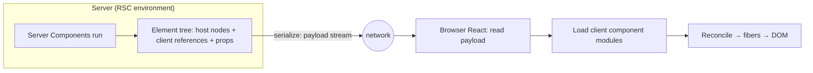
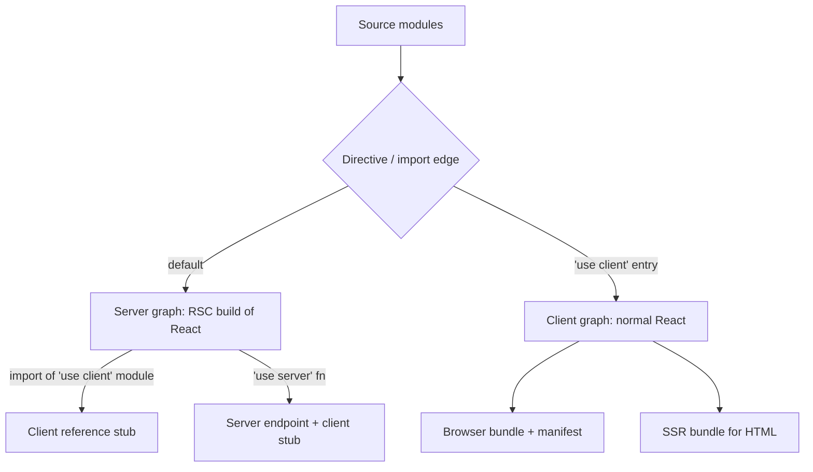

# 09 / 03 — Server Components in Depth: Environments, the Payload, Bundler Integration, and Server Functions

## 1. Lesson metadata

| | |
|---|---|
| **Level** | Advanced / Professional |
| **Study time** | 6–7 hours (reading 2.5 h, experiments 2 h, exercises 2 h) |
| **Prerequisites** | [Phase 2 / 27 — React Server Components intro](../02-react-rendering-and-internals/27-react-server-components-intro.md), [Phase 2 / 26 — SSR and client rendering](../02-react-rendering-and-internals/26-ssr-and-client-rendering.md), [Phase 2 / 24 — Suspense conceptual internals](../02-react-rendering-and-internals/24-suspense-conceptual-internals.md), [02 — Hydration internals](./02-hydration-internals-deep-dive.md), [Phase 6 / 14 — Server-side data loading](../06-data-fetching-and-state-ecosystems/14-server-side-data-loading.md) |
| **Next** | [04 — Client/server boundaries and serialization](./04-client-server-boundaries-and-serialization.md) |
| **Related** | [Phase 4 / 16 — Server vs client state](../04-react-architecture/16-server-vs-client-state.md), [09 — Framework architecture](./09-framework-architecture.md), [12 — Auth boundaries](./12-auth-boundaries.md) |

> **Volatility notice.** The React-level programming model of Server Components (what you write, what `'use client'` and `'use server'` mean) is documented and stable for application authors in React 19. **Everything about how bundlers and frameworks implement it** (module conditions, manifests, the wire format, server-function transport and encryption, caching layers) is an integration surface that React documents as *not following semver* and that evolves. Items still marked ⚠ below are framework- or version-specific and deliberately left hedged; check your framework's documentation before relying on them.
>
> **Currency and security (verified 2026-10-22; latest React is 19.3.0).** 19.2 added `cacheSignal` (RSC only); 19.3 lets a Server Component render a Context imported from a `'use client'` module directly (no wrapper Provider), lets Flight carry `<Activity>`, and transports `Error.cause` / `AggregateError.errors` to the client. The `react-server-dom-*` packages had a critical remote-code-execution flaw, CVE-2025-55182 (CVSS 10), in 19.0 to 19.2.0 (fixed in 19.0.1, 19.1.2, 19.2.1), followed by denial-of-service and source-exposure CVEs (CVE-2025-55184, -67779, -23864, -55183) fixed in 19.0.4, 19.1.5, 19.2.4; later patches continue through 19.2.x. Keep `react-server-dom-*` and your framework on a patched release: this is the clearest proof that Server Functions are a public attack surface.

**What this lesson is and is not.** Lesson 27 introduced RSC: the three kinds of components, "RSC is not SSR", composition rules, server functions at a glance. This lesson explains the *machinery behind those rules* so that when a framework error message appears you can reason about which side of which graph you are in. We build a toy RSC serializer, examine the two-environment build, dissect payload semantics (streaming, references, promises), examine caching and request-scoped memoization, error propagation, refresh semantics, and the lifecycle and security of Server Functions. We link to lesson 27 for the basics and do not repeat them.

**Learning objectives.** After this lesson you can:
1. Explain the build and runtime architecture of an RSC app: two (or three) module graphs, the `'use client'` boundary as a graph cut, client references, manifests.
2. Describe what the payload contains and how it streams, using a runnable toy serializer to predict output for a given tree.
3. Predict re-render, state-preservation and caching behavior across navigation, refresh, and server function calls.
4. Design data access in Server Components: parallelism, request-scoped memoization, preloading, and error handling.
5. Implement and secure Server Functions (validation, authorization, idempotency, error shape).
6. Diagnose the common failure classes (server-only imports leaking, wrong-graph hooks, non-serializable props, waterfalls).
7. Decide where RSC is *not* appropriate.

**Concepts covered:** server and client environments, module graph cut, client reference, `react-server` condition, manifests, payload rows and streaming, promise props and `use`, async components, `cache` memoization, build-time vs request-time rendering, error digests, refresh and reconciliation, Server Functions (`'use server'`), action IDs, replay/CSRF considerations, taint APIs (experimental).

---

## 2. Deep conceptual explanation

### 2.1 The problem, restated precisely

A client-rendered React app ships **all component code and its dependencies** to the browser, runs it there, and fetches data over the network from the browser. Two inefficiencies result:

1. **Code that exists only to produce output** (markdown renderer, date library, syntax highlighter, a component that formats a database row into markup) is shipped and executed on every client even though its result is deterministic from server-side data.
2. **Data fetching waterfalls through the browser**: component A renders, then fetches; its child B renders, then fetches. Each hop pays browser↔API latency.

RSC's insight: let **some components run only on the server, once per request or once per build**, and send the *result of running them* (a description of UI) rather than their code. Interactive components remain client components. The framework glues them into one React tree.

### 2.2 The mental model: one tree, evaluated in two places

Everything in a Server Components app belongs to one conceptual component tree. But **evaluation** of that tree is split:

- Server Components are evaluated **on the server**; their output is a tree fragment consisting of host elements, text, *and placeholders for client components*.
- Client Components are evaluated **in the browser** (and also on the server during SSR to produce HTML; see §2.3).
- The server evaluation's output is serialized into the **payload** and shipped; the browser's React reads it, loads the referenced client components, and treats the whole thing as an ordinary element tree for reconciliation.



### 2.3 Three execution contexts, not two

It is easy to say "server and client", but there are really three:

| Context | What runs | When | Purpose |
|---|---|---|---|
| **RSC environment** | Server Components, shared components (server graph) | Request or build | Produce the payload |
| **SSR environment** | Client Components (and the RSC output as input) in a Node/edge runtime | Request or build | Produce **HTML** from payload + client components so the user sees content before JS ([Phase 2 / 26](../02-react-rendering-and-internals/26-ssr-and-client-rendering.md)) |
| **Browser** | Client Components + React runtime + payload reader | In the user's browser | Hydrate and become interactive |

Crucially the RSC environment and the SSR environment are **different module graphs and may be different React copies/conditions**: the RSC environment resolves packages with React's server-side build (no hooks like `useState`), while SSR resolves the normal client build. This is why "Server Component" and "Client Component" aren't merely *where* but *which build of React and which module graph*. ⚠ Whether a framework runs RSC and SSR in the same process, same isolate, or separate workers is its own choice.

### 2.4 The `'use client'` directive: a cut in the module graph

Phase 2 lesson 27 states the rule. Here is the mechanism:

- A module with `'use client'` at the top marks a **boundary in the import graph**. When the server graph's bundler encounters an `import` of that module, it doesn't bundle the module's contents; it replaces its exports with **client references** (stubs that serialize as identifiers). The module and *everything it imports* is placed in the client graph.
- Therefore `'use client'` is not "this component runs in the browser", but "this module is the **entry point** to the client graph". Its imports are client code by transitivity, **without** needing their own directive.
- The directive affects **imports from the server graph**. Where a module is imported from a client module, it's already client code.

Consequences:
1. Put `'use client'` as **deep (leaf-ward) as possible**; it pulls the module's entire import subtree into the client bundle.
2. A shared utility imported by both sides ends up *duplicated* in both graphs (once per graph's bundle).
3. A server-only module (database client) imported from a `'use client'` module is a mistake the bundler can detect only if you mark the module (e.g., with the `server-only` package, which throws when resolved outside the `react-server` condition; supported by Next.js and others).

### 2.5 `'use server'` is not the inverse of `'use client'`

Common confusion: `'use client'` marks **components that run in the browser**; `'use server'` marks **functions callable from the browser that run on the server** (Server Functions). It does **not** mark Server Components. Server Components have *no* directive; they are the default in the server graph. Mixing these up is the #1 vocabulary error in RSC code review.

### 2.6 What RSC does *not* change

| Aspect | Unchanged |
|---|---|
| Component semantics | Pure functions of props; same JSX |
| Client reconciliation | The browser reconciles the payload like any element tree |
| Client Components | Full hooks, effects, browser APIs; SSR'd and hydrated as before |
| The need for HTTP caching/CDN thinking | Still your job ([01](./01-spa-ssr-ssg-streaming.md)) |

### 2.7 Misconceptions (deeper than lesson 27's)

| Misconception | Reality |
|---|---|
| "Server Components re-run in the browser on navigation." | They never run in the browser; navigation requests fresh payload for changed segments from the server. |
| "RSC replaces client state management." | They own *server-derived* data rendering; interactive state remains in client components ([Phase 4 / 16](../04-react-architecture/16-server-vs-client-state.md)). |
| "RSC eliminates hydration." | Client Components still hydrate; only server-only components don't. |
| "`async` components are async *client* components." | `async` is supported in Server Components; async Client Components are not allowed (use `use`). Confirmed: react.dev's Server Components page says async components are not supported on the client. |
| "Server Functions are RPC with type safety for free." | They are public HTTP endpoints with an ergonomic call syntax; type safety stops at the wire; **you must validate input at runtime**. |
| "RSC = Next.js." | RSC is a React feature with a bundler/framework integration contract. Next.js App Router is the most widely deployed implementation; others exist (e.g. React Router, Waku, Parcel via `react-server-dom-parcel`, added in 19.1); check each framework's current status. |
| "Everything should be a Server Component." | Interactive and browser-API-dependent code must be client. The goal is to move *non-interactive* weight to the server, not to eliminate client code. |

---

## 3. Internal mechanics

> **Labels.** **Public guarantee** = documented in React docs. **Teaching model** = faithful prediction aid. **Implementation detail ⚠** = bundler/framework/wire-format specifics; do not depend on them, and verify.

### 3.1 Public guarantees

1. Server Components render ahead of time in an environment separate from the client app/SSR server; at build time or per request.
2. They can be `async` and use `await`; React suspends rendering until resolved and integrates with Suspense streaming.
3. `'use client'` marks the client boundary; `'use server'` marks Server Functions. Server Components have no directive.
4. Props crossing from server to client must be serializable by React's protocol (including JSX, promises, and Server Functions; see [04](./04-client-server-boundaries-and-serialization.md)).
5. Server Components can't use state or effects (`useState`, `useEffect` and similar), and can't attach event handlers; the `use` API is available.
6. Frameworks implement RSC by building the app for multiple environments; the bundler/framework APIs for this are not covered by semver.
7. Server Functions can be passed from Server Components to Client Components as props and called from event handlers, forms (`action`), and Actions via transitions.

### 3.2 The two-graph build (teaching model)

```text
Source files
 ├─ page.tsx           (no directive → server graph by default)
 ├─ db.ts              ("server-only" marker)
 ├─ Chart.tsx          ('use client')   ← cut point
 │    └─ chartLib      (client graph by transitivity)
 └─ format.ts          (shared; no directive; no server-only features)

Server graph (RSC):   page.tsx → db.ts, format.ts, [client ref: Chart]
Client graph:         Chart.tsx → chartLib, format.ts
SSR graph:            same source as Client graph, built for Node/edge
```

Bundler responsibilities (conceptual):

1. **Resolve** server-graph modules with the React server condition so that package entry points can export server-specific builds (React itself does this). The `react-server` export condition is the established mechanism (verified: `react-server-dom-webpack/server.node` loads under `node --conditions react-server`, and `react` resolves to its server build there).
2. **Transform** every `'use client'` module imported from the server graph into a reference module (an object whose exports are client reference stubs).
3. **Emit** a **client manifest** mapping a reference id to the client chunk(s) and export name, for the browser (and SSR) to load. ⚠ Format varies by bundler.
4. **Transform** `'use server'` functions into endpoints with stable ids and generate client-side stubs that call them. ⚠ Id generation, encryption of closed-over values, and transport are framework-defined.
5. **Enforce** server-only/client-only markers (e.g., packages named `server-only` and `client-only`) by making the wrong-graph import throw at build time. ⚠ Verify.

React's role is the runtime: `react-server-dom-*` packages (webpack, turbopack, parcel and esm variants exist; the security advisories name webpack, parcel and turbopack) provide the serializer/reader. App authors rarely touch them.

### 3.3 A toy RSC serializer (runnable, teaching tool)

The goal is to make payload behavior predictable. This is **not** React's wire format; it shows the concepts: server components are *evaluated away*, client components become *references*, props are *serialized*, async work produces *later chunks*.

```ts
// toy-rsc.ts — a conceptual model, not React
type Props = Record<string, unknown>;
type Elt = { type: string | ServerComp | ClientRef; props: Props };
type ServerComp = (props: Props) => Elt | string | Promise<Elt | string>;
type ClientRef = { $$ref: string; name: string };            // what a 'use client' import becomes on the server

type Out =
  | string
  | { host: string; props: Props; children: Out[] }
  | { clientRef: string; props: Record<string, Out | string | number | boolean | null> }
  | { pending: number };                                       // placeholder for an unresolved async subtree

const isRef = (t: unknown): t is ClientRef => typeof t === "object" && t !== null && "$$ref" in t;

export async function renderServer(root: Elt, emit: (id: number, chunk: Out) => void) {
  let nextId = 1;
  const pendings: Promise<void>[] = [];

  function walk(node: Elt | string): Out {
    if (typeof node === "string") return node;

    if (typeof node.type === "function") {
      const result = node.type(node.props);                   // RUN the Server Component here (server only)
      if (result instanceof Promise) {
        const id = nextId++;
        pendings.push(result.then((r) => emit(id, walk(r))));  // later chunk, streamed when ready
        return { pending: id };
      }
      return walk(result);
    }

    if (isRef(node.type)) {
      // Do NOT run it. Serialize props (children may be server output!).
      const { children, ...rest } = node.props as { children?: Elt | string | (Elt | string)[] } & Props;
      const kids = children === undefined ? undefined : Array.isArray(children) ? children.map(walk) : walk(children);
      for (const v of Object.values(rest)) {
        if (typeof v === "function") throw new Error("Functions cannot be passed to Client Components");
      }
      return { clientRef: node.type.$$ref, props: { ...(rest as Props), ...(kids !== undefined ? { children: kids } : {}) } as never };
    }

    const kids = ([] as (Elt | string)[]).concat((node.props.children as never) ?? []);
    return { host: node.type, props: { ...node.props, children: undefined }, children: kids.map(walk) };
  }

  emit(0, walk(root));                                         // first chunk: shell with pending placeholders
  await Promise.all(pendings);                                 // (nested pendings push more; real impl loops)
}
```

**Predict.** Given a server component `Page` that renders `<h1>{title}</h1>` and `<Counter initial={3}>` where `Counter` is a client ref and `<Comments/>` is an `async` server component taking 500 ms: what chunks are emitted, in which order, and what do they contain?

*Answer.* Chunk `0` (immediately): `{ host: "main", children: [ {host:"h1", children:["Title"]}, {clientRef:"Counter", props:{initial:3}}, {pending:1} ] }`. Chunk `1` (≈500 ms later): the *resolved subtree* of `Comments`. `Counter`'s code does not appear; only an identifier and its props. `Comments`'s code never appears at all.

**What the toy omits:** module ids and chunk lists, a full type system for serializable values, promises as props, Suspense boundary semantics, deduplication of repeated references, error rows, binary data, server function references, and React's streaming flow control. It does capture the core idea: *Server Components are consumed by the server; the payload carries their output.*

### 3.4 The payload on the wire (⚠ implementation detail)

Conceptually, the payload is a stream of **rows**, each identified by an integer id; a row can reference other rows (so large or late subtrees can be sent separately), and some rows describe **module references** (for client components) or **errors**. The root row describes the tree. The in-the-wild format has resembled newline-delimited rows with a short prefix per row type and JSON-like content, using special string prefixes for references (to other rows, to promises, to lazily-resolved content). ⚠ This format is internal ("Flight" is the informal name), has changed across versions, and is **not a public API**. To see it, open your framework's RSC response in DevTools Network. For authoritative detail read the `react-server-dom-*` sources and `packages/react-server` in the React repository.

Properties that *are* conceptually stable and worth understanding:

| Property | Why it matters |
|---|---|
| **Streamed** | Late (suspended/async) parts arrive as additional rows; the client React fills the corresponding placeholders. This gives async Server Components streaming "for free" |
| **References, not code** | Client components arrive as module+export references; the *client* downloads the code via the manifest, in parallel with other work |
| **Props are serialized data** | Everything passed to a Client Component is visible to the user in the payload; it's a data-exposure surface ([04](./04-client-server-boundaries-and-serialization.md)) |
| **Deduplication is limited** | The same data passed to several client components may be serialized several times (props), a cost to watch |
| **Elements, not HTML** | The payload is a React element tree description, which is what allows client state preservation on refresh ([§3.7](#37-refresh-navigation-and-state-preservation)) |

### 3.5 Request-time vs build-time evaluation

A Server Component may be evaluated:

- **At build time**: produces a static payload (and static HTML with SSR). Everything it reads must be available at build time.
- **At request time**: per request, with access to request-scoped inputs (headers, cookies, URL), via framework APIs.
- **Revalidated**: evaluated at build time, re-evaluated later on a timer or event (ISR-like, [01 §3.5](./01-spa-ssr-ssg-streaming.md)); framework-controlled.

React doesn't decide which; the **framework infers** from which request-time APIs you used, or from config. This coupling makes "a single `cookies()` call turned my page dynamic" a recurring surprise ⚠ framework-specific.

### 3.6 Data access, `cache`, and request-scoped memoization

Because multiple server components under one request may need the same data, React provides `cache(fn)` for Server Components: calls to the cached function **with the same arguments within one request/render** return the same result and execute once. Scope and invalidation: per request (React's server render), not across requests.

```ts
import { cache } from "react";
import { db } from "./db";   // server-only module

export const getUser = cache(async (id: string) => {
  return db.user.findUnique({ where: { id } });
});
// Layout calls getUser(id) for the header; Page calls getUser(id) for settings → one DB query.
```

Semantics to remember:
- Arguments are compared by identity (`Object.is`-style) for objects: passing a freshly created object each call defeats it. Use primitives or stable keys (react.dev: calls share a result when arguments are the same; objects by reference).
- It memoizes the **promise**, so concurrent callers share one in-flight request.
- It's *not* a cross-request cache. Cross-request caching (data cache, HTTP cache, `fetch` extensions) is framework/infrastructure territory.
- React 19.2 added `cacheSignal()` (RSC only; documented on the `cache` page) which returns an `AbortSignal` that aborts when React has finished rendering, so cached work can be cancelled. Note also that `cache` caches thrown errors for the same arguments, and each `cache(fn)` call creates a separate cache.

### 3.7 Refresh, navigation, and state preservation

Because the payload is an **element tree**, a server refresh is an *update*, not a remount:

1. The framework requests a new payload for the changed segment(s).
2. Browser React receives the new tree and **reconciles** against the current one ([Phase 2 / 06–07](../02-react-rendering-and-internals/06-reconciliation-fundamentals.md)).
3. Client Components at the same position and type keep state; props update; server-rendered subtrees are replaced.

Practical implications:
- **Keys and positions matter exactly as in client rendering.** If a Server Component conditionally renders a different wrapper, client state beneath it is lost.
- A client component *inside* children passed from a server parent keeps state while the server children refresh.
- A **navigation** swaps segments by layout/route boundaries; layouts typically persist (framework behavior ⚠), preserving their client state across routes.

### 3.8 Errors in Server Components

- An error thrown while rendering a Server Component is serialized as an **error row**; in production the message is **redacted** and replaced by an opaque `digest` so that server internals (stack, message with secrets) aren't exposed to browsers. The same digest appears in server logs so you can correlate. ⚠ Digest semantics are framework/React-version specific; verify.
- Where the error is **caught**: the nearest **client-side error boundary** above the corresponding position in the tree (error boundaries are class/ library components, thus client components; see [Phase 4 / 19](../04-react-architecture/19-error-boundaries.md)). Frameworks provide route-level error UI conventions.
- Errors inside an `async` server component *within a Suspense boundary* **don't** abort the whole stream: React serializes the error for that region; the client boundary reacts.
- Expected failures (validation, not found) should be **values** (return a result type) or framework-specific control-flow helpers (not-found/redirect), not generic thrown errors.

### 3.9 Server Functions in depth

Lesson 27 §3.7 showed one. The mechanics:

**Definition.** A function marked `'use server'` (file-level directive, or inside an async function body; both documented on react.dev) is compiled into a server endpoint. A **reference** (id) to it is what the client receives.

**Invocation.** Clients call it like a function. Under the hood a request is made (typically `POST`) containing the id and serialized arguments, including `FormData`; the server executes and returns a serialized result (and possibly an updated RSC payload, so one round trip can mutate and re-render; ⚠ framework-specific).

**Properties:**

| Property | Detail |
|---|---|
| Public endpoint | Anyone can craft a request to the endpoint with arbitrary arguments, including unauthenticated users. Treat as such. |
| Arguments | Must be serializable by React's protocol; **runtime-validate** (TypeScript types vanish at the wire) |
| Return values | Serializable; keep small. Prefer returning state for `useActionState` |
| Ordering | In Next.js, Server Function calls from the client are dispatched sequentially (its Server Actions guide: "Sequential dispatch on the client"); react.dev's Server Function pages do not state an ordering guarantee, so treat it as a framework behaviour that affects parallel mutation design |
| Idempotency | Retries and double-submits happen; design mutations with idempotency keys where money or inventory is involved |
| Closed-over variables | Frameworks may allow closures over server values by encrypting them into the reference (Next.js encrypts captured variables, with `NEXT_SERVER_ACTIONS_ENCRYPTION_KEY` needed for multi-instance deployments); don't rely on it for secrets |
| Dead code elimination | Unused server functions may be removed from the build (Next.js does this and encrypts action ids); framework-specific, don't count on "unreferenced = unreachable" for security |
| CSRF/origin | Frameworks add origin checks/tokens; verify what yours does (Next.js compares Origin to Host and offers `serverActions.allowedOrigins`) and what it doesn't |

**Why they matter for forms:** `<form action={serverFn}>` works with progressive enhancement: before hydration the browser submits a normal form POST, the framework routes it to the function, and returns a page; after hydration React intercepts and uses fetch + transitions ([11 — Progressive enhancement](./11-progressive-enhancement.md), [13 — Forms, actions and mutations](./13-forms-actions-and-mutations.md)).

### 3.10 Taint and server-only guarantees (experimental)

React has experimental APIs to **taint** objects/values so that attempts to pass them to Client Components throw (`experimental_taintObjectReference`, `experimental_taintUniqueValue`). They're a *defense in depth* aid, not a security boundary. Still experimental as of 2026-10-22: react.dev documents them only for `react@experimental` builds and says not to use them in production; names and availability may change. The robust approach is data minimization: build explicit **DTOs** at the boundary ([04](./04-client-server-boundaries-and-serialization.md)).

---

## 4. Step-by-step execution walkthrough

### 4.1 First load of `/orders/42` (RSC + SSR + hydration)

Tree: `Layout (server) → Page (server, async) → OrderHeader (server) + <Suspense><Timeline (server, async)/></Suspense> + <CancelButton (client)/>`.

1. **Request** arrives. The framework routes to `Layout` and `Page`; authentication reads the session cookie (request-time API) → page is dynamic.
2. **RSC render** begins in the RSC environment. `Layout` renders. `Page` awaits `getOrder(42)` (30 ms). `OrderHeader` renders (server) → host nodes. `Timeline` begins `await getEvents(42)` (400 ms) → boundary pending; payload row for the pending boundary is deferred; `CancelButton` becomes a **client reference** with props `{ orderId: 42 }`.
3. **Payload stream** starts: shell rows (layout + header + fallback + client reference) flush.
4. **SSR environment** consumes the payload stream: it renders the tree as HTML. For client reference `CancelButton`, SSR *loads and runs the real component* (client graph build) to get its HTML. The HTML stream's first chunk goes to the browser (≈ 60–100 ms in).
5. **Browser** paints server HTML. It also receives the payload rows (embedded or via a parallel stream ⚠ framework-specific) and the client bundle references.
6. At 430 ms, `Timeline` resolves; a new payload row is produced and streamed; SSR emits its HTML chunk; swap script reveals it.
7. **Client hydration:** browser React reads the payload (no server component code needed), loads `CancelButton`'s chunk, constructs the tree, and hydrates (claiming DOM). `Timeline`'s HTML is static: no fibers needed beyond host elements.
8. User clicks `CancelButton`: client handler calls a Server Function (§4.2).

**Predict:** which of these appear in the *client* JS bundle: `getOrder`, `OrderHeader`, `Timeline`, `CancelButton`? *Answer:* only `CancelButton` (and its imports). `getOrder`, `OrderHeader`, `Timeline` are server graph only, even though `OrderHeader` and `Timeline` render in the browser's DOM (as host elements) via the payload/HTML.

### 4.2 Cancel order via Server Function

```mermaid
sequenceDiagram
  participant U as User
  participant C as CancelButton (client)
  participant R as React client
  participant S as Server (RSC)
  U->>C: click
  C->>R: startTransition(async () => cancelOrder(42))
  R->>S: POST action id + args (42)
  S->>S: authenticate, authorize, validate, mutate
  S->>S: revalidate order path (framework) → re-render affected server components
  S-->>R: result + new RSC payload for affected segment
  R->>R: reconcile new tree; CancelButton keeps its state; isPending false
```

Timeline notes: during the pending period the old UI stays visible (transition semantics, [Phase 2 / 23](../02-react-rendering-and-internals/23-transitions-and-deferred-rendering.md)); optimistic UI with `useOptimistic` can show "Cancelled" immediately ([07](./07-modern-react-apis.md)).

---

## 5. Code examples

### 5.1 Minimal: the server/client split with a context-free design

```tsx
// app/orders/[id]/page.tsx  (Server Component; no directive)
import { Suspense } from "react";
import { getOrder } from "@/server/orders";           // server-only module
import { CancelButton } from "./CancelButton";         // 'use client'
import { Timeline } from "./Timeline";                 // server

export default async function OrderPage({ params }: { params: Promise<{ id: string }> }) {
  const { id } = await params;                          // Next.js 15+: params is a Promise (verified, nextjs.org page.js docs); older versions: plain object
  const order = await getOrder(id);
  return (
    <main>
      <h1>Order {order.number}</h1>
      <p>{order.customerName}</p>
      <CancelButton orderId={order.id} disabled={order.status !== "open"} />
      <Suspense fallback={<p>Loading timeline…</p>}>
        <Timeline orderId={order.id} />
      </Suspense>
    </main>
  );
}
```

```tsx
// CancelButton.tsx
"use client";
import { useTransition } from "react";
import { cancelOrder } from "@/server/actions";         // 'use server' module: imported as a reference

export function CancelButton({ orderId, disabled }: { orderId: string; disabled: boolean }) {
  const [pending, start] = useTransition();
  return (
    <button disabled={disabled || pending} onClick={() => start(async () => { await cancelOrder(orderId); })}>
      {pending ? "Cancelling…" : "Cancel order"}
    </button>
  );
}
```

Line notes: the props passed to `CancelButton` are primitives (serializable, visible in the payload). `getOrder` never reaches the browser. `cancelOrder` is imported into a client module from a `'use server'` file; the bundler gives the client a *reference stub*. The `params` shape in the page is framework-specific (a Promise in Next.js 15 and later).

### 5.2 Practical: parallel data, request-scoped dedupe, and streaming

```tsx
// server/queries.ts
import "server-only";
import { cache } from "react";

export const getCustomer = cache(async (id: string) => db.customers.get(id));
export const getOrders = cache(async (customerId: string) => db.orders.list(customerId));
export const getRecs = cache(async (customerId: string) => recsApi.forCustomer(customerId));
```

```tsx
// app/customers/[id]/page.tsx
export default async function CustomerPage({ params }: { params: Promise<{ id: string }> }) {
  const { id } = await params;
  // Start independent work immediately; do NOT await sequentially.
  const ordersPromise = getOrders(id);
  const recsPromise = getRecs(id);
  const customer = await getCustomer(id);               // needed for the shell

  return (
    <>
      <Header customerId={id} />                         {/* calls getCustomer(id) again → deduped */}
      <h1>{customer.name}</h1>
      <Suspense fallback={<OrdersSkeleton />}>
        <Orders ordersPromise={ordersPromise} />         {/* uses use(ordersPromise) or an async server child */}
      </Suspense>
      <Suspense fallback={<RecsSkeleton />}>
        <Recs recsPromise={recsPromise} />
      </Suspense>
    </>
  );
}
```

Why this shape: `getOrders` and `getRecs` start before the page awaits the customer, so all three run in parallel; the shell needs only `customer`. Passing a **promise** to a child lets that child suspend inside its boundary. `Header` calling `getCustomer(id)` again costs nothing (memoized per request). Trade-off: starting work you may not render (e.g., if a redirect is decided after `await getCustomer`) wastes backend calls; acceptable when redirects are rare.

### 5.3 Practical: hardened Server Function (validate, authorize, return a result)

```ts
// server/actions.ts
"use server";
import { z } from "zod";
import { getSession } from "./auth";
import { revalidateOrder } from "./cache";           // illustrative framework-specific invalidation

const Input = z.object({ orderId: z.string().uuid(), reason: z.string().max(500).optional() });

export type CancelResult =
  | { ok: true }
  | { ok: false; code: "unauthorized" | "invalid" | "conflict"; message: string };

export async function cancelOrder(raw: unknown): Promise<CancelResult> {
  const session = await getSession();
  if (!session) return { ok: false, code: "unauthorized", message: "Please sign in." };

  const parsed = Input.safeParse(typeof raw === "string" ? { orderId: raw } : raw);
  if (!parsed.success) return { ok: false, code: "invalid", message: "Invalid request." };

  const order = await db.orders.get(parsed.data.orderId);
  if (!order || order.customerId !== session.customerId)           // authorization = ownership check
    return { ok: false, code: "unauthorized", message: "Not allowed." };
  if (order.status !== "open") return { ok: false, code: "conflict", message: "Order already processed." };

  await db.orders.update(order.id, { status: "cancelled", reason: parsed.data.reason });
  revalidateOrder(order.id);
  return { ok: true };
}
```

Decisions: (1) accept `unknown` and parse, because TypeScript types don't exist at runtime; (2) *authorization is a data check* (ownership), not just "logged in"; (3) expected failures are **values**, so the client can render them and the production error redaction doesn't swallow them; (4) the invalidation call is framework-specific.

### 5.4 Incorrect: leaking a server-only module into the client graph

```tsx
// ❌ Chart.tsx
"use client";
import { db } from "@/server/db";              // client graph now includes the DB client
export function Chart({ id }: { id: string }) { /* … */ }
```
**Why wrong:** a `'use client'` module's imports are client code. Best case, the bundler errors on Node-only dependencies; worst case, credentials or logic ship to browsers. **Fix:** do data access in a Server Component parent and pass the *results*; mark data-access modules `server-only` so that this import fails at build time ⚠ verify the marker mechanism in your framework.

### 5.5 Incorrect: cross-request module state in an RSC

```ts
// ❌ queries.ts
const memo = new Map<string, Promise<User>>();           // module-level: shared by every request
export const getUser = (id: string) => memo.get(id) ?? (memo.set(id, fetchUser(id)), memo.get(id)!);
```
**Why wrong:** this is a cross-request cache with no invalidation and no per-user scoping: stale data for everyone, and a privacy bug if `fetchUser` reads the session. Use React's `cache` for per-request memoization and your framework/infra cache (with explicit keys and TTL) for cross-request caching.

### 5.6 Incorrect: waterfall via sequential awaits and nested async components

```tsx
// ❌ each child fetches only after its parent resolved
export default async function Page() {
  const user = await getUser();
  return <Posts userId={user.id} />;               // async child awaits getPosts(user.id) — fine if dependent
}
async function Posts({ userId }: { userId: string }) {
  const posts = await getPosts(userId);
  return posts.map((p) => <Post key={p.id} post={p} />);   // each Post awaits getComments(p.id) → N+1 waterfall
}
```
**Fix:** independent data starts in parallel at the top (§5.2); batch (`getCommentsForPosts(ids)`) instead of per-item awaits; use `Suspense` per item only where the UX benefits. Server waterfalls cost less than browser waterfalls but still delay streamed content ([Phase 7 / 17](../07-performance/17-network-waterfalls.md)).

### 5.7 Advanced: the donut pattern, server content inside client interactivity

```tsx
// Modal.tsx
"use client";
import { useState, type ReactNode } from "react";
export function Modal({ trigger, children }: { trigger: string; children: ReactNode }) {
  const [open, setOpen] = useState(false);
  return (
    <>
      <button onClick={() => setOpen(true)}>{trigger}</button>
      {open && <dialog open><button onClick={() => setOpen(false)}>Close</button>{children}</dialog>}
    </>
  );
}

// page.tsx (server)
<Modal trigger="Show terms">
  <TermsContent />        {/* server component rendered on the server, passed as children */}
</Modal>
```
Why it works: `children` is a **React element already rendered on the server**; it's serialized as part of the props. The client component never imports `TermsContent`. Cost note: the terms content is in the payload (and HTML) even if the dialog is never opened; for large content consider loading it on demand via a client-initiated fetch or a server function returning the payload (framework-specific) ⚠.

### 5.8 Advanced: context from a server tree

Server Components can't create/provide context themselves, but can render a client provider and pass server children:

```tsx
// Providers.tsx
"use client";
import { ThemeContext } from "./theme";
export function Providers({ theme, children }: { theme: "light" | "dark"; children: React.ReactNode }) {
  return <ThemeContext value={theme}>{children}</ThemeContext>;   // React 19: context as provider
}
// layout.tsx (server) → <Providers theme={cookieTheme}>{children}</Providers>
```
Server Components can't *read* client context either; pass what they need as props. Use per-request values (theme from a cookie) so server and client agree ([02](./02-hydration-internals-deep-dive.md)).

---

## 6. Visual explanations

### 6.1 Build: how one source tree becomes graphs



### 6.2 What travels on one navigation

```mermaid
sequenceDiagram
  participant B as Browser
  participant F as Framework router
  participant S as Server RSC
  B->>F: navigate /orders/43
  F->>S: request payload for changed segments
  S-->>F: stream rows (element tree, client refs, promises)
  F->>B: reconcile; persistent layouts keep client state
  Note over B: JS for new client components loaded on demand via manifest
```

### 6.3 Who owns what

| Concern | Server Component | Client Component | Server Function |
|---|---|---|---|
| Read DB / secrets | Yes | No | Yes |
| `useState` / effects | No | Yes | n/a |
| Event handlers | No | Yes | invoked by them |
| Browser APIs | No | Yes | No |
| Mutations | Prefer no (render should be pure) | Calls functions | Yes (validate!) |
| In client bundle | No | Yes | Stub only |
| Visible to user | Output only | Code + props | Reference + return value |

---

## 7. Alternative approaches and trade-offs

| Criterion | Client-only SPA + API | SSR + client fetch | RSC | BFF + client components |
|---|---|---|---|---|
| Client JS size | Largest | Large | Smallest for content-heavy pages | Large |
| Data waterfalls | Browser↔API | Server for first load, browser after | Server-side, low latency | Reduced by BFF aggregation |
| Interactivity model | Simple | Simple | Server/client split to learn | Simple |
| Infrastructure | Static + API | Node servers | Node/edge + bundler integration | API + BFF |
| Framework lock-in | Low | Medium | High (bundler integration) ⚠ | Low–Medium |
| Mutations | Fetch + cache mgmt | Same | Server Functions + invalidation | Fetch |
| Testing | Mature | Mature | Evolving ⚠ | Mature |
| Debugging | DevTools-centric | Mixed | Mixed; server logs + payload | Familiar |
| Caching complexity | Query cache | Query cache + HTTP | Multiple layers (`cache`, framework data cache, CDN) | HTTP + query cache |

**Scenario where RSC is *not* best.** A drag-and-drop whiteboard, spreadsheet editor, or realtime trading blotter: nearly every component is stateful and reactive to local input or sockets. There is little non-interactive weight to move to the server, yet you pay the complexity (two environments, serialization constraints, framework lock-in). A client SPA with a robust data layer ([Phase 6](../06-data-fetching-and-state-ecosystems/08-tanstack-query.md)) is simpler and as fast.

**Scenario where RSC shines.** A documentation/content/e-commerce catalogue where 90% of components are display-only, depend on server data, and the interactive 10% (cart button, filters) is small.

---

## 8. Best practices and anti-patterns

### Best practices
1. **Default to server; opt into client at the leaves.** Push `'use client'` toward the smallest interactive component.
2. **Pass data, not objects with behavior.** Props crossing the boundary are DTOs.
3. **Start parallel work early; batch dependent work;** use `cache` for shared reads.
4. **Treat Server Functions as public endpoints.** AuthN, authZ, validation, rate limiting, idempotency, audit logging.
5. **Return expected errors as values.** Reserve throws for exceptional cases (and handle with error boundaries).
6. **Mark server-only modules** (`server-only`-style) and check in CI.
7. **Make the payload observable**: log payload size per route; budget it like a JS bundle.
8. **Co-locate** server data fetching with the component that needs it, but hoist *starting* the fetch for parallelism.

### Anti-patterns

| Anti-pattern | Problem | Fix |
|---|---|---|
| `'use client'` at the top of every file "to make errors go away" | You rebuilt a client app with extra complexity | Learn which side each module belongs on; split components |
| Passing entire DB rows as props | Leaks fields; bloats payload | Map to minimal DTOs |
| `await` in a loop in an async component | N+1 waterfall | Batch / `Promise.all` |
| Relying on `useEffect` in a server file | Error; mistaken mental model | Move interactivity to a client component |
| Server Function without auth because "only my UI calls it" | Public endpoint | Authorize every call |
| Using Server Functions for reads | Designed for mutations; sequential queue and POST semantics | Use Server Components or GET endpoints for reads |
| Large static JSON imported into a Client Component | Ships to every user | Import in server, pass slices |
| Module-level caches on the server | Cross-request leaks | `cache` per request; explicit infra cache |

**Justified exception:** a `'use client'` file at a high level is fine for a deliberately fully interactive subtree (an editor), where the server tree only provides the initial data.

---

## 9. Real-world application

| Domain | RSC fit | Engineering constraints |
|---|---|---|
| **E-commerce catalogue/product pages** | Excellent: server rendering of descriptions, price tables; small client islands (gallery, add-to-cart) | Price freshness vs cache; personalization boundaries; payload size of variant data |
| **Dashboards** | Mixed: static layout + data cards as server components; charts as client | Charts need serialized data props; streaming per widget; auth per widget |
| **Finance** | Server-side formatting and entitlement checks; fewer secrets in browsers | Server Function audit trails; idempotency; no client-side trust; regulatory logging |
| **Forms-heavy apps** | Server Functions + `useActionState` | Validation duplicated? Share Zod schemas; progressive enhancement; file uploads need transport awareness ⚠ |
| **Auth areas** | Session read on server; render per role | Every Server Function and *every data-returning server component* must authorize ([12](./12-auth-boundaries.md)) |
| **Realtime** | RSC for the initial snapshot; sockets in client components | Hydration consistency; avoid refresh storms |
| **Multi-team** | Clear contract: server data modules vs client UI | Boundary governance (lint for imports across graphs), shared types without shared runtime code |

---

## 10. Debugging and troubleshooting

### Symptom A: "You're importing a component that needs `useState`. It only works in a Client Component…"
- **Root cause:** a server-graph module uses a client-only API. **Investigation:** find the nearest module without `'use client'` in the import chain. **Fix:** add `'use client'` to the *interactive* component's module (not its parent) or split the component.

### Symptom B: "Functions cannot be passed directly to Client Components…"
- **Root cause:** a server component passed a non-Server-Function callback. **Fix:** move the handler into the client component; or pass a Server Function; or pass data and let the client compose behavior ([04](./04-client-server-boundaries-and-serialization.md)).

### Symptom C: "`server-only` / Node module in the client bundle."
- **Investigation:** run the bundler's analyzer; trace imports from the failing client entry; the offending import is inside a `'use client'` module's transitive imports. **Fix:** move to server, pass data.

### Symptom D: "Page became dynamic after I added a header/cookie read."
- **Root cause:** request-time API usage (framework-specific). **Fix:** isolate request-dependent code in a Suspense-wrapped component or leaf so the rest can remain static ⚠ framework-specific.

### Symptom E: "Production errors show a generic message and a digest."
- **Root cause:** deliberate redaction. **Investigation:** search server logs for the digest; add structured logging in `onError`-equivalent hooks. **Validate:** you can map a user report to a server stack.

### Symptom F: "Client state resets after a Server Function call."
- **Root cause:** the returned tree changed position/type/key of the client component. **Investigation:** React DevTools: compare component identity before/after; check conditional wrappers or changing `key`. **Fix:** stabilize structure.

### Symptom G: "Payload is huge."
- **Investigation:** inspect the RSC response size per route; look for large props (arrays) passed to client components and duplicated data. **Fix:** paginate, send IDs and fetch on demand, move rendering of lists to the server, minimize DTOs.

### Symptom H: "Same query runs five times per request."
- **Root cause:** different argument identities defeat `cache`, or multiple data layers don't dedupe. **Fix:** primitive arguments; one data-access module wrapped by `cache`.

---

## 11. Exercises

### Level A — Knowledge
A1. What does `'use client'` do to the module graph? Why is it not "this component runs only in the browser"?
A2. List the three execution contexts in an RSC + SSR app and the output of each.
A3. Why does a client component not "see" a Server Component's code even though the server component's output is rendered inside it?
A4. What is request-scoped memoization with `cache`, and what is it not?
A5. Why are expected failures better returned as values from Server Functions?

### Level B — Code comprehension
B1. For each import, state which graph the module ends up in:
```tsx
// page.tsx (no directive)
import { Chart } from "./Chart";          // Chart.tsx: 'use client'; imports "./colors" and "d3"
import { format } from "./format";        // format.ts: no directive
import { db } from "./db";                // db.ts: no directive; imports "server-only"
```
B2. Predict the toy serializer's chunks for a server `<Page>` rendering `<Greeting name="Ada"/>` (sync, server) and `<Likes id={1}/>` (async server, 200 ms) wrapped in `<Card>`, where `Card` is a client ref taking `children`.
B3. A server component renders `<ClientList items={items} onPick={(id) => console.log(id)} />`. What error appears and why? Give two valid redesigns.

### Level C — Implementation
C1. Convert this to run both queries in parallel and dedupe the customer lookup across `Layout` and `Page`.
C2. Implement a typed Server Function `updateProfile(prev, formData)` for `useActionState`, with Zod validation and field errors returned as values.
C3. Extend the toy serializer to throw a descriptive error when a client ref receives a `Date`-containing class instance (non-plain object), and to allow `Date`.

### Level D — Debugging
D1. After adding `'use client'` to `Layout.tsx` "to use a hook", bundle size jumped by 600 KB. Explain, and fix without losing the hook.
D2. A Server Function works in development but returns "Unauthorized" for some logged-in users in production. List hypotheses relating to the transport (cookies, origins, caching) and the experiments to separate them.

### Level E — Architecture and engineering decisions
E1. Design the server/client component boundary for a product listing page with filters, sorting, pagination, infinite scroll option, and "add to cart". State where each piece lives and why.
E2. Evaluate adopting RSC for an existing 300-component SPA with 40 routes behind login. Include migration strategy, risks, and a go/no-go criterion.

### Level F — Expert challenge
F1. Design an automated "boundary lint" for a monorepo: what rules (import graph, serializability, server-only markers, Server Function checklists) would you enforce, what tooling, and how do you avoid false positives?

---

## 12. Detailed answers and explanations

> Attempt the exercises first.

**A1.** It marks the module as an entry to the client graph. Importers in the server graph receive references; the module and all its imports are client code. Wrong view "runs only in the browser": client components also run on the server during SSR to produce HTML; the directive is about *bundle membership*, not exclusive runtime location.

**A2.** RSC environment → payload (element tree, references, serialized props). SSR environment → HTML (client components executed with the payload as input). Browser → hydrated, interactive UI (loads client component code, reconciles payload).

**A3.** The client component receives `children` as already-rendered elements (serialized). It never imports the server component's module; the bundler never puts that module in the client graph. The server did the rendering; the client sees only output.

**A4.** Within one request, repeated calls to the cached function with the same arguments share one result/promise, executing once. It's *not* a persistent cache; it doesn't survive across requests and doesn't implement TTLs or invalidation. Distinguish from framework data caches/CDN.

**A5.** Thrown errors in production are redacted to a digest; the client can't show a field-specific message; error boundaries are coarse. Values allow UI to render validation messages, work with `useActionState`, and avoid leaking internals.

**B1.** `Chart`, `./colors`, `d3` → client graph (plus a reference stub in the server graph for `Chart`). `format` → server graph if imported from the server; if also imported from a client module, it appears in both graphs (duplicated). `db` → server graph only; the `server-only` marker makes any client import fail at build time. Edge: if `format` uses server-only APIs it cannot be shared.

**B2.** Chunk 0: `{host:"main", children:[{clientRef:"Card", props:{children:[ "Hello, Ada" (the Greeting output), {pending:1}]}}]}` (the exact shape in the toy depends on how Greeting outputs text). Chunk 1 at ≈200 ms: Likes's output (e.g., `{host:"span", children:["12 likes"]}`) for pending id 1. Note that `Card`'s `children` contains a *mix* of resolved server output and a pending marker: client components receive partially streamed children.

**B3.** Error: functions cannot be passed to Client Components unless they are Server Functions: closures can't be serialized. Redesigns: (a) move the handler into the client component and pass `items`; if it must call the server, import a Server Function there; (b) pass a Server Function (`'use server'`) `pick(id)` as prop; (c) change the component to accept an `id` and emit events upward within the client tree. Wrong redesign: wrap in `useCallback` (doesn't change serializability).

**C1.**
```tsx
const getCustomer = cache(async (id: string) => db.customer.get(id));
export default async function Page({ id }: { id: string }) {
  const [customer, orders] = await Promise.all([getCustomer(id), getOrders(id)]);
  /* Layout also calls getCustomer(id): deduped by cache since same primitive arg */
  return <View customer={customer} orders={orders} />;
}
```
Edge: `Promise.all` blocks on the slower of the two; prefer a promise prop + Suspense if orders are slow and non-critical.

**C2.**
```ts
"use server";
const Schema = z.object({ name: z.string().min(1).max(80), email: z.string().email() });
export type ProfileState = { ok: boolean; errors?: Partial<Record<"name" | "email", string>>; message?: string };
export async function updateProfile(_prev: ProfileState, formData: FormData): Promise<ProfileState> {
  const session = await getSession();
  if (!session) return { ok: false, message: "Sign in required." };
  const parsed = Schema.safeParse(Object.fromEntries(formData));
  if (!parsed.success) {
    const f = parsed.error.flatten().fieldErrors;
    return { ok: false, errors: { name: f.name?.[0], email: f.email?.[0] } };
  }
  await db.users.update(session.userId, parsed.data);
  return { ok: true, message: "Saved." };
}
```
Notes: `Object.fromEntries(formData)` includes any extra fields: schema must be strict if mass assignment matters; file inputs yield `File` objects; authorization is by `session.userId`, not a client-provided id.

**C3.** Add a serializer check: allow primitives, arrays, plain objects (`Object.getPrototypeOf(v) === Object.prototype || null`), `Date`; throw on other class instances with a message naming the prop path. Edge cases: cyclic references; `Map`/`Set` support (React supports some; check the current list on react.dev).

**D1.** `'use client'` on Layout pulls Layout and *all of its imports* into the client graph; any server-component children passed as `children` stay server (good), but Layout's own imports (markdown libs, nav data, icons) now ship. Fix: revert; extract the hook-using bit (e.g., `useTheme` toggle) into a small client component rendered by the server Layout.

**D2 (hypotheses).** Cookie `SameSite`/`Secure`/domain differences between environments; CORS/origin checks rejecting the Server Function POST from another origin/CDN host; CDN caching a POST or stripping cookies; load balancer routing to an instance with different secrets (session decryption keys); stale client bundle referencing action IDs that changed on deploy ("skew") ⚠; reverse proxy dropping headers. Experiments: replicate with curl including cookies/origin; compare request headers dev vs prod; check logs for session decode errors; test across deployments for skew.

**E1 (criteria).** Server: product list page, data fetching, sort/filter application based on URL search params (so state is shareable, indexable), pagination links, product cards (display), price formatting. Client: filter controls (or progressive-enhanced forms updating URL), "add to cart" button with optimistic UI via Server Function, infinite scroll sentinel and appended pages (client component fetching more via a server function or endpoint ⚠), image gallery. Reasoning: URL as state source ([Phase 3 / 19](../03-react-state-and-hooks/19-ui-server-url-and-shared-state.md)); minimal DTO per card; streaming skeleton; cache keyed by query params with short TTL. Pitfalls: client-only filter state that can't be linked; passing whole product objects to a client list.

**E2 (criteria).** Likely answer: **don't rewrite**; adopt incrementally or not at all. Behind login ⇒ SEO irrelevant; benefit is bundle size and waterfall reduction. Migration: adopt a framework with RSC at route level, move leaf-first, start with content-heavy routes; keep existing client routes as `'use client'` islands; enforce boundaries; measure bundle/INP/TTFB before/after. Risks: framework lock-in, learning curve, testing/tooling gaps, auth model changes, infra (Node runtime). Go/no-go: measured user-facing gain on top routes (> X% JS reduction, LCP improvement) vs cost; otherwise optimize the SPA (code splitting, query caching).

**F1 (criteria).** Rules: (1) client-graph modules may not import server-only modules; (2) props to `'use client'` components (via TypeScript types) must satisfy a `Serializable` type (see [04](./04-client-server-boundaries-and-serialization.md)); (3) `'use server'` files must export only async functions, and each must call an auth helper and a schema parse (AST check); (4) no module-level mutable state in server-graph modules; (5) bundle-size budget for the client graph per route; (6) detect `'use client'` at top-level layouts. Tooling: ESLint custom rules + dependency-cruiser/madge-style import graph checks; type-level tests; CI bundle analysis. False positives: shared pure utilities; test helpers; whitelisting with justification comments.

---

## 13. Senior engineer interview questions

**Q1. "What problem do Server Components solve that SSR doesn't?"**
*Strong answer:* SSR produces HTML but still ships and runs all component code in the browser (hydration). RSC lets non-interactive components run only on the server so their code and dependencies never ship, and they can read server data directly. SSR and RSC compose: RSC output is fed to SSR to produce HTML.

**Q2. "Explain what the `'use client'` boundary is, mechanically."**
*Strong answer:* A module-graph cut. The server bundle replaces imports of such modules with references; the module and its imports go to the client bundle. It's about import edges, so the *transitive* closure matters; that's why placement determines bundle size.

**Q3. "How does state survive a server refresh?"**
*Strong answer:* The payload is an element tree; the client reconciles it. Same type and position → same fiber → state preserved. Changing wrappers/keys resets it. Server Components don't re-render in the browser; the server sends a new description.

**Q4. "Are Server Functions safe if only my UI calls them?"**
*Strong answer:* No: they're public endpoints; crafted requests can call them with arbitrary arguments or cookies. Authenticate, authorize on the specific resource, validate at runtime, rate-limit, consider CSRF/origin (framework defaults vary), and log. Types don't validate runtime input.

**Q5. "What's wrong with a module-level `Map` cache in a server component?"**
*Strong answer:* It lives across requests: stale data, unbounded memory, and potential cross-user leakage. Per-request memoization via `cache`; cross-request caching via a deliberate cache with keys/TTL/invalidation.

**Q6. "When would you advise against RSC?"**
*Strong answer:* Highly interactive, local-state-dominated apps with little server-derived static output; teams unable to absorb the framework coupling and tooling immaturity; environments unable to run server code; or where the measured bottleneck isn't client JS or waterfalls. Be specific about measurement.

**Q7. "How do you debug a slow RSC page?"**
*Strong answer:* Server side: trace render and data spans (waterfalls, N+1); client side: payload size and client JS per route; verify Suspense boundaries stream; check caching layers. Fix ordering (parallelize), batch, cache, reduce props.

---

## 14. Further learning resources

| Resource | URL | Covers / why | Level | Section to study |
|---|---|---|---|---|
| React — Server Components | <https://react.dev/reference/rsc/server-components> | Official model: build-time/request-time, async components | Adv | Whole page |
| React — `'use client'` | <https://react.dev/reference/rsc/use-client> | Boundary semantics, serializable prop types | Adv | "Serializable types" ⚠ list evolves |
| React — `'use server'` | <https://react.dev/reference/rsc/use-server> | Server Functions, security caveats | Adv | Whole page |
| React — Server Functions | <https://react.dev/reference/rsc/server-functions> | Usage with forms, transitions | Adv | Whole page |
| React — `cache` | <https://react.dev/reference/react/cache> | Request-scoped memoization | Adv | Caveats |
| React — `use` | <https://react.dev/reference/react/use> | Reading promises/context; streaming data from server to client | Adv | "Streaming data from server to client" |
| React — Server Components blog (2020 RFC) | <https://react.dev/blog/2020/12/21/data-fetching-with-react-server-components> | Original motivation (historical; the APIs described are superseded) | Int | Motivation only |
| React 19 announcement | <https://react.dev/blog/2024/12/05/react-19> | RSC/Server Functions stability statement *(date path unverified)* | Int | RSC sections |
| React RFCs repository | <https://github.com/reactjs/rfcs> | RFC for Server Components (design rationale) | Expert | `text/0188-server-components.md` |
| React repository | <https://github.com/facebook/react> | `react-server`, `react-server-dom-*` packages (verify claims here) | Expert | Packages directory |
| Your framework's RSC docs | (framework-specific) | Bundler integration, caching, error handling | Adv | Data fetching and caching chapters |

URLs in this table were checked for HTTP 200 on 2026-10-22; any still marked *(unverified)* could not be checked automatically (blocked or unreachable). A 200 response does not guarantee the page content still matches the description; if a link has moved, search the site for the quoted title.

---

## 15. Knowledge checkpoint

**You should now understand**
- RSC is one conceptual tree evaluated in two (three) environments; `'use client'` is a graph cut; payloads carry output and references, not server component code.
- Navigation/refresh are reconciliations, so client state survives when identity is stable.
- Server Functions are public mutation endpoints that you must validate and authorize.
- Which parts of the machinery (payload format, manifests, IDs, digests) are volatile.

**You should be able to explain without notes**
- Which modules land in which bundle and why.
- Why `cache` is per request and what a cross-request cache needs.
- How errors propagate and why they're redacted.

**You should be able to implement**
- Parallel, deduped server data access; hardened Server Functions with `useActionState`; the donut/provider composition patterns.

**You should be able to debug**
- Wrong-graph imports, non-serializable props, accidental dynamic rendering, state resets, payload bloat.

**Prerequisite for the next lesson** ([04 — Client/server boundaries and serialization](./04-client-server-boundaries-and-serialization.md)): you should be able to say what an arbitrary prop *means* when it crosses the boundary: is it data, a reference, or an error?
