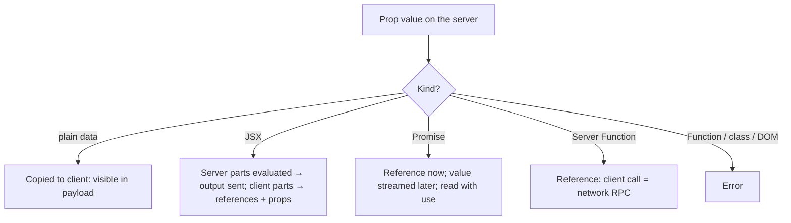
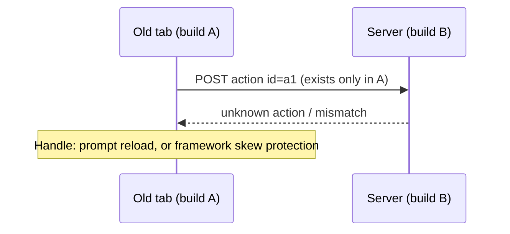

# 09 / 04 — Client/Server Boundaries and Serialization: Designing What Crosses the Wire

## 1. Lesson metadata

| | |
|---|---|
| **Level** | Advanced / Professional |
| **Study time** | 4–5 hours (reading 1.5 h, experiments 1.5 h, exercises 1.5 h) |
| **Prerequisites** | [03 — Server Components in depth](./03-server-components-in-depth.md), [Phase 2 / 27 — RSC intro](../02-react-rendering-and-internals/27-react-server-components-intro.md), [Phase 4 / 14 — API boundaries and data access](../04-react-architecture/14-api-boundaries-and-data-access.md), [Phase 4 / 16 — Server vs client state](../04-react-architecture/16-server-vs-client-state.md) |
| **Next** | [05 — Suspense architecture](./05-suspense-architecture.md) |
| **Related** | [12 — Auth boundaries](./12-auth-boundaries.md), [Phase 10 / 06 — Security: XSS, CSRF, CSP](../10-production-engineering/06-security-xss-csrf-csp.md) |

> **Volatility notice.** Which value types React can serialize across the boundary has been **expanding** across React 19.x. The lists here match the "Serializable types" section of the `'use client'` reference on react.dev and were also checked by running `react-server-dom-webpack@19.2.7` (verified 2026-10-22; React is now at 19.3); re-check for your installed version. Transport details (payload format, Server Function ids and encryption, size limits) are framework-defined.

**What this lesson is and is not.** Lesson 03 explained *how* RSC is built; lesson 27 (Phase 2) listed the rules for what can cross. This lesson is a **design discipline for the boundary itself**: treating the server→client edge as an API with a schema, a size, a security posture, and a cost. We cover the serialization contract precisely, a type-level model to enforce it, patterns for crossing with JSX/promises/functions, data minimization, duplication and payload accounting, and the reverse direction (client→server arguments).

**Learning objectives.** After this lesson you can:
1. State, per value kind, whether and how it crosses the boundary in each direction and what the receiver actually gets.
2. Explain why the boundary is both an *API contract* and a *data-exposure surface*.
3. Design DTOs and boundary-placement strategies that minimize payload size and leaked data.
4. Use JSX-as-props, promises with `use`, and Server Functions as the three "behavior-carrying" crossings, and know when each is appropriate.
5. Implement a type-level guard that makes illegal crossings fail at compile time, and a runtime guard for Server Function inputs.
6. Debug serialization failures, duplicated data, and boundary-induced waterfalls.
7. Run a boundary review on a pull request using a checklist.

**Concepts covered:** serializable value categories, identity loss, Date/Map/Set handling, class instances and prototypes, functions vs Server Functions, JSX as data, promise props, children-as-props composition, DTOs and projection, payload accounting and duplication, double data (HTML + payload), taint (experimental), client→server argument validation, `FormData`, versioned boundaries across deployments (skew), type-level `Serializable`.

---

## 2. Deep conceptual explanation

### 2.1 The boundary is a network

In a client-only app, passing a prop is a pointer copy in one heap. In an RSC app, every prop that crosses from a Server Component to a Client Component is **written to bytes, sent over a network, and re-created in another JavaScript realm**. It's closer to `JSON.stringify` → HTTP → `JSON.parse` than to a function call. Four consequences follow directly:

1. **Identity is lost.** Two references to the same object on the server may become two objects (or, if the protocol dedupes within a single response, one) on the client; mutation on one side is never visible on the other.
2. **Behavior is lost.** A function is not data. Only specially marked functions (Server Functions) cross, as *references to remote procedures*, not as closures.
3. **Everything is visible.** The browser receives the bytes: anything you serialize can be read by the user through DevTools or by scripts.
4. **It costs bytes and parse time.** Large props enlarge the payload, which is processed on the main thread and (for the initial load) is sent in addition to the HTML ([§2.5](#25-double-data-html-and-payload)).

Hold this mnemonic: **a Client Component prop is a public API response**. Design it with the same care as a REST/GraphQL response: minimal, stable, reviewed for sensitive fields, versioned.

### 2.2 Directions and kinds of crossing

| Crossing | Mechanism | Receiver gets | Typical use |
|---|---|---|---|
| **Server → Client, data** | Serialized prop | A *copy* of plain data | Display values, config |
| **Server → Client, JSX** | Element serialized as prop/children | A React element, already rendered on the server (or a client reference placeholder) | Slots, children, "donut" composition |
| **Server → Client, promise** | Promise prop; resolved value streams later | A promise the client reads with `use` | Streaming non-critical data |
| **Server → Client, function** | Only Server Functions | A reference callable over the network | Mutations |
| **Client → Server, via Server Function args** | Serialized arguments (incl. `FormData`) | A copy of data; types erased | Form posts, mutations |
| **Client → Server, via URL/cookies/headers** | Standard HTTP | Strings | Navigation state, session |
| **Client → Server, JSX** | Not possible | n/a | (Client components can't send elements up; they only pass server-created elements *through*) |

The last row is the source of a frequent confusion: the "client component renders server component" pattern isn't the client sending JSX to the server; it's the server **pre-rendering** the server component and handing the *result* to the client component as `children`.

### 2.3 Why serialization limits exist (first principles)

React could, in principle, serialize anything: classes, closures, DOM nodes. It doesn't, because serialization is only well-defined for values whose *meaning is entirely contained in their structure*:

- **Plain data** (strings, numbers, arrays, plain objects, dates) is meaning-in-structure.
- **Class instances** carry meaning in their *prototype* (methods, getters, private fields, brand checks). Reconstructing the prototype on the client requires shipping the class: now it's code, not data, and identity checks (`instanceof`) are ambiguous across realms.
- **Closures** carry meaning in *captured variables* and in executable code; capturing server variables and shipping them would leak and cannot be reconstructed.
- **Symbols, WeakRefs, DOM nodes, streams** are realm-local.

Server Functions are the exception that proves the rule: instead of serializing the closure, React serializes a **name** (an id the server resolves). The "function" the client holds is a stub that does an RPC.

### 2.4 Responsibility: who owns the schema?

The prop types of a `'use client'` component *are* the schema of the boundary. In a monorepo or multi-team project ([Phase 4 / 23](../04-react-architecture/23-multi-team-ownership.md)), that has an organizational consequence: the client component's author owns the **contract**, the server component's author owns the **data**. Without a contract (explicit DTO types), the common failure is "server dev adds a field to a DB row, and the field silently appears in the browser payload because the row was passed whole".

### 2.5 Double data: HTML and payload

On an initial navigation there are usually *two* encodings of the same rendered content in the response:

1. **HTML** (for first paint), produced by SSR.
2. **Payload** (embedded in the HTML as inline scripts or sent as a parallel stream; framework-specific), so that client React can reconstruct the tree without re-fetching.

Plus for **Client Components**, the props inside the payload. Consider a `<ProductGrid products={products} />` client component receiving 200 full product objects: the HTML contains the rendered grid; the payload contains the 200 objects *again* as props; and the client JS (the grid component) re-renders them at hydration. If instead the grid is a **server component** rendering `<ProductCard>` host markup, the payload carries only the rendered element tree (no source objects). Moving rendering to the server therefore often shrinks *both* JS and data.

### 2.6 Misconceptions

| Misconception | Reality |
|---|---|
| "Props to client components are private because they're server-rendered." | They're in the payload (and sometimes the HTML). Treat as public. |
| "TypeScript prevents invalid props at the boundary." | TS types vanish at runtime; wrong values from Server Function callers are only caught by runtime validation. Compile-time checks only help for your own call sites. |
| "I can pass a callback from server to client if it's a `useCallback`." | No: memoization doesn't make a closure serializable. |
| "A `Date` becomes a string." | In React 19 `Date` is supported and arrives as a `Date` (executed: server `Date` → client `instanceof Date`; an *invalid* Date is sent as `null`). Older guidance said to serialize to ISO strings; that is still the safest choice for cross-system data. |
| "Class instances work if they have a `toJSON`." | React does not call `toJSON`; class instances (with or without `toJSON`) are rejected with an error ("Objects with toJSON methods are not supported. Convert it manually to a simple value"). Convert to plain objects explicitly. |
| "The payload is only a performance concern." | It's also a security and privacy concern (data minimization, PII, regulatory scope). |
| "Server Function arguments are trusted because the UI builds them." | Anyone can POST arbitrary arguments. |

---

## 3. Internal mechanics

> **Labels.** **Public guarantee** documented; **Teaching model**; **Implementation detail ⚠** protocol-specific.

### 3.1 Public guarantees (verified against react.dev and by execution, 2026-10-22)

React's documentation for `'use client'` describes serializable props, broadly:

| Supported (documented categories) | Notes |
|---|---|
| Primitives: `string`, `number`, `bigint`, `boolean`, `undefined`, `null` | Special numbers round-trip (executed: `NaN`, `Infinity`, `-Infinity`, `-0`); `bigint` arrives as `bigint`; `undefined` is preserved (also in array holes, which arrive as `undefined`) |
| `Symbol`s registered with `Symbol.for` | Not arbitrary local symbols, nor well-known ones such as `Symbol.iterator` (executed: error) |
| Iterables of serializable values: `String`, arrays, `Map`, `Set`, typed arrays and `ArrayBuffer` | Containers are copied; `Map`/`Set` arrive as `Map`/`Set` (executed). Other iterables (e.g. a generator) arrive as a one-shot iterator |
| `Date` | Arrives as `Date` |
| Plain objects (created with object initializers) whose properties are serializable | Not class instances. **Null-prototype objects (`Object.create(null)`) are rejected**: error says "Classes or null prototypes are not supported" (executed) |
| **Server Functions** | As remote references |
| **Client or Server Component elements (JSX)** | Rendered output / client references |
| **Promises** | Read with `use` on the client |

| Not supported | Why |
|---|---|
| Arbitrary functions (incl. inline handlers, `useCallback` results) | Not data |
| Class instances; objects with custom prototypes or null prototype; `RegExp`, `URL`, `WeakMap`/`WeakSet` | Prototype is behavior (all executed: error) |
| Non-registered symbols | Realm-local |
| DOM nodes, streams | Realm-local |

Treat this table as a **teaching summary**: the authoritative list is on react.dev, and your framework may layer extra restrictions. **Beyond the documented list**, the 19.2.7 serializer also accepted `FormData`, `Blob`, `URLSearchParams` (lossy: arrives as an array of pairs), and `Error` objects (production: opaque reference; development: with stack); treat these as implementation behaviour, not guarantees. **Server Function arguments (client to server) use the *reply* direction**, which is narrower: executed with `encodeReply`/`decodeReply`, `Date`, `Map`, `Set`, `bigint`, `NaN`, `undefined`, `FormData` and `Blob` (arrives as `File`) round-trip, while class instances, null-prototype objects, `Error` and client-created functions throw, and `Symbol.for` symbols throw unless the framework supplies a temporary reference set.

### 3.2 Teaching model: serialization as a tree transformation

For each prop value, the serializer does:

```text
serialize(v):
  primitive           → encode literally
  Date/Map/Set/typed  → encode with a type tag + contents (recursively)
  array / plain obj   → encode recursively
  React element:
     host element      → encode type + props (recursively)
     server component  → NOT encoded as itself: it was already evaluated; encode its OUTPUT
     client component  → encode a client reference (id) + serialized props (recursively)
  promise             → encode a promise reference; later row streams the resolved value
  server function     → encode a function reference (id)
  anything else       → throw (build/runtime error) naming the prop path
```

Two subtleties:

1. **Server elements are evaluated, not shipped.** `children` containing `<ServerThing/>` doesn't require the client to know `ServerThing`; by the time the serializer sees it, it has been replaced by output.
2. **Recursion applies to what you pass.** A "small" object that references a big graph (an ORM entity with lazily loaded relations, an Express request) serializes *the whole reachable graph* or throws. Plain data projections avoid this.

### 3.3 Identity, sharing and cycles

- Within one payload, React preserves **shared references** (executed: `[x, x]` is sent once and referenced) and **cyclic** structures (executed: `o.self = o` round-trips with `circ.self === circ`); across payloads (a refresh) there is no identity continuity. Do not use object identity of props from the server as a cache key on the client; use stable ids.
- The client's `useMemo`/`React.memo` comparisons on props received from a refreshed payload see *new* objects even when contents are unchanged ⇒ memoized children re-render on each refresh. Use stable primitive props (ids) or compare by value where it matters ([Phase 7 / 05](../07-performance/05-referential-equality.md)).

### 3.4 Teaching model: promises as props and `use`

```tsx
// Server
const commentsPromise = getComments(postId);           // not awaited
return <Suspense fallback={<Skeleton />}><Comments commentsPromise={commentsPromise} /></Suspense>;

// Client
"use client";
function Comments({ commentsPromise }: { commentsPromise: Promise<Comment[]> }) {
  const comments = use(commentsPromise);               // suspends until the server streams the value
  return <ul>{comments.map(c => <li key={c.id}>{c.text}</li>)}</ul>;
}
```

What happens: the payload carries a promise reference; the server resolves the underlying promise and streams a row with the value; on the client `use` suspends until it arrives; the nearest `<Suspense>` shows its fallback; during SSR, the server can wait and render real HTML. Rules and caveats:

- The promise value must itself be serializable; **rejections** are serialized as errors (redacted in production) and thrown at the `use` call site to the nearest error boundary.
- Promises created **in a Client Component's render** are not stable across renders; `use` needs a promise with stable identity ([07](./07-modern-react-apis.md)). Promises created in a *Server Component* and passed down are stable for the payload's lifetime.
- It's a *data* streaming mechanism; for UI streaming prefer async Server Components in Suspense boundaries.

### 3.5 Teaching model: Server Function references and arguments

```ts
"use server";
export async function addComment(postId: string, formData: FormData): Promise<{ ok: boolean }> { /* … */ }
```

On the client (after passing as a prop or importing), `addComment` is an *opaque callable*; `addComment.bind(null, postId)` creates a **bound** function that still serializes as a reference (the bound arguments travel with the call). Framework-specific: how bound args are protected varies (Next.js encrypts closure/bound values with a build-time key; see [its Server Actions guide](https://nextjs.org/docs/app/guides/server-actions)); treat bound arguments as **client-controllable** and re-validate on the server.

Argument serialization uses the same protocol as props (`FormData`, plain data, etc.), so the **same category rules** apply in reverse: you can't send a class instance or function *to* the server either.

### 3.6 Version skew across deployments

A browser tab loaded yesterday may hold references (Server Function ids, client chunk ids) from the previous build while the server has been redeployed. Possible outcomes: "unknown action", chunk load errors, payload/reader mismatches. Frameworks mitigate with skew protection, deployment ids, or forced reloads. As an app author: (1) make Server Function inputs **backward-compatible** across at least one deploy, (2) handle chunk-load/action-not-found errors with a reload prompt, (3) avoid renaming/removing exported server functions without a deprecation window. Verify your framework's skew guarantees.

### 3.7 Payload accounting

Treat the payload like a bundle. For a route, track:

| Metric | How | Budget thinking |
|---|---|---|
| Payload bytes (compressed) | DevTools Network on the RSC response; or server logging | Compare with HTML bytes; > HTML size by a lot ⇒ suspicious |
| Props bytes crossing into client components | Instrument a wrapper in dev, or analyze the payload | Top offenders: arrays of full objects |
| Duplicate data | Same entity in several props | Pass ids + a shared client store or restructure |
| Parse/hydrate cost | Performance panel | Large payloads cost main-thread time |

---

## 4. Step-by-step execution walkthrough

### 4.1 A product card list, three boundary designs

Data: 100 products, each `{ id, name, price, description(600 chars), images[8], internalCost, supplierId, createdAt }`.

**Design 1: pass whole rows to a client list.**
1. Server component fetches 100 rows (full), renders `<ProductList products={rows} />` (client).
2. Serializer encodes 100 × (~1.5 KB) ≈ 150 KB of props into the payload, including `internalCost` and `supplierId`. **Data leak** (internal cost visible in DevTools).
3. SSR renders the list HTML (another ~60 KB).
4. Browser downloads HTML + payload + the list component's JS. Hydration re-renders 100 cards.

**Design 2: project to a DTO.**
1. Server maps rows to `{ id, name, priceLabel, thumbUrl }` (≈ 150 bytes each → 15 KB).
2. Same client list. Payload 10× smaller; no leak. The client still hydrates 100 cards.

**Design 3: server renders cards; client handles only the interactive affordance.**
1. Server renders `<ProductCard>` as a server component (host elements) and wraps each in `<AddToCart productId=…>` (client, tiny).
2. Payload carries the rendered element tree (~30 KB total, comparable to HTML) plus 100 client references with `{productId}`.
3. Client JS: only `AddToCart`. Hydration: 100 tiny components.

**Predict:** which design has the smallest *client JS* and which the smallest *payload*? *Answer:* Design 3 has the smallest client JS; Design 2 may have the smallest payload (a compact DTO beats a rendered element tree for repetitive structure) but ships the full list component. The best choice depends on whether the cards are interactive: if only the button is, Design 3 wins on total cost; if the cards are drag-sortable or filtered locally, Design 2 is necessary.

### 4.2 A form post crossing the boundary in reverse

1. Client `<form action={updateProfile}>` → on submit, React collects `FormData`.
2. Serialized, POSTed with the action id (and bound args, if any).
3. Server decodes: `FormData` entries are strings/`File`s. Types are *strings* regardless of the TS model.
4. Server validates (`z.coerce.number()` etc.), authorizes, mutates, returns state.
5. Returned state (plain object) is serialized back; `useActionState` shows it.

Note that step 3's data is **attacker-controlled**; it includes any field a caller chooses to add.

---

## 5. Code examples

### 5.1 Minimal: DTO projection at the boundary

```tsx
// server/dto.ts
import "server-only";
import type { ProductRow } from "./db";

export type ProductCardDTO = Readonly<{
  id: string;
  name: string;
  priceLabel: string;      // formatted on the server → no locale mismatch, no Intl on the client
  thumbUrl: string;
  inStock: boolean;
}>;

export function toProductCardDTO(row: ProductRow, locale: string): ProductCardDTO {
  return {
    id: row.id,
    name: row.name,
    priceLabel: new Intl.NumberFormat(locale, { style: "currency", currency: row.currency }).format(row.priceCents / 100),
    thumbUrl: row.images[0]?.url ?? "/placeholder.png",
    inStock: row.stock > 0,
  };
}
```

Why this shape: explicit allow-list (no `...row` spread); presentation-ready strings avoid shipping formatting code and locale data to the client; `Readonly` signals "copy, don't mutate"; the type is importable by both sides *as a type* (no runtime code) so the contract is shared without crossing the module-graph cut ([`import type` erases at build](../00-web-and-javascript-foundations/10-modules-and-dependency-graphs.md)).

### 5.2 Practical: a compile-time `Serializable` guard (approximation)

```ts
type Primitive = string | number | boolean | bigint | null | undefined;
type TypedArray =
  | Int8Array | Uint8Array | Uint8ClampedArray | Int16Array | Uint16Array
  | Int32Array | Uint32Array | Float32Array | Float64Array;

export type Serializable =
  | Primitive
  | Date
  | ArrayBuffer
  | TypedArray
  | ReadonlyMap<Serializable, Serializable>
  | ReadonlySet<Serializable>
  | readonly Serializable[]
  | { readonly [key: string]: Serializable }     // matches type aliases / object literals, NOT interfaces or class instances with methods
  | Promise<Serializable>
  | React.ReactElement;

/** Fails to compile if any prop of P is not Serializable. */
export type BoundaryProps<P> = { [K in keyof P]: P[K] extends Serializable ? P[K] : never };

// Usage: declare client component props through the guard
type ChartProps = { points: readonly { x: number; y: number }[]; onSelect: (i: number) => void };
declare function Chart(props: BoundaryProps<ChartProps>): React.ReactElement;
// <Chart points={…} onSelect={fn} />  → error: `onSelect` is `never`, a function is not assignable
```

Notes: (1) the index-signature trick rejects **interfaces** and class instances (they lack implicit index signatures / contain function members), which mirrors the runtime rule; but it also rejects *legitimate* interface-typed plain data, so prefer `type` aliases for DTOs. (2) **Server Functions** are functions and would be rejected; to allow them, widen the guard for specific props (`ServerAction<Args, R>` branded by your framework's type; framework-specific). (3) This is an *approximation*: TypeScript can't prove runtime plain-ness (a class instance typed as a plain object passes). Treat it as a lint-level guard, not a proof.

### 5.3 Practical: JSX as data. Slots from server into a client layout

```tsx
// Tabs.tsx
"use client";
import { useState, type ReactNode } from "react";

export function Tabs({ tabs }: { tabs: readonly { id: string; label: string; panel: ReactNode }[] }) {
  const [active, setActive] = useState(tabs[0].id);
  return (
    <section>
      <div role="tablist">
        {tabs.map((t) => (
          <button key={t.id} role="tab" aria-selected={t.id === active} onClick={() => setActive(t.id)}>{t.label}</button>
        ))}
      </div>
      {tabs.map((t) => <div key={t.id} role="tabpanel" hidden={t.id !== active}>{t.panel}</div>)}
    </section>
  );
}

// page.tsx (server)
<Tabs tabs={[
  { id: "spec", label: "Specs", panel: <SpecTable id={id} /> },       // server components, rendered on the server
  { id: "reviews", label: "Reviews", panel: <Suspense fallback={<Skeleton/>}><Reviews id={id} /></Suspense> },
]} />
```

`panel: ReactNode` is serializable (the server already rendered it). Behavior: all panels' output is **in the payload even when hidden** (`hidden` attribute). Trade-off: simple, instant tab switching, SEO-friendly content, versus payload size and render cost for tabs the user never opens. Alternative for heavy tabs: render only the active tab on the server and navigate via URL segments ([10 — Routing and nested layouts](./10-routing-and-nested-layouts.md)).

### 5.4 Incorrect: passing behavior from server to client

```tsx
// ❌ page.tsx (server)
<ClientTable rows={rows} formatCell={(v: number) => v.toFixed(2)} />
```
**Error:** functions cannot be passed to Client Components (unless Server Functions). **Corrected, option A:** do the formatting on the server and pass strings: `rows.map(r => ({...r, valueLabel: r.value.toFixed(2)}))`. **Option B:** move the formatter into the client module (shared pure function imported by the client). **Option C:** make the table a server component if it's non-interactive. Choose by who needs the formatting at what time: if the client re-formats on interaction (user toggles precision), B; if static, A.

### 5.5 Incorrect: class instance with methods

```tsx
// ❌
class Money { constructor(public cents: number) {} format() { return `$${this.cents/100}`; } }
<Cart total={new Money(1299)} />     // class instance → not serializable
```
**Corrected:** pass `{ cents: 1299 }` (plain) and construct or format on the receiving side, or pass the formatted label. Rule: *send state, not behavior*.

### 5.6 Incorrect: overposting data into a client component

```tsx
// ❌ 
const user = await db.user.findUnique({ where: { id }, include: { sessions: true, billing: true } });
return <ProfileEditor user={user} />;    // passwordHash, sessions, billing → the browser
```
**Corrected:**
```tsx
const profile = { id: user.id, displayName: user.displayName, email: user.email, avatarUrl: user.avatarUrl } satisfies ProfileDTO;
return <ProfileEditor profile={profile} />;
```
Defense in depth: mark DB modules `server-only`; add a lint rule forbidding DB entity types in client props ([§8](#8-best-practices-and-anti-patterns)); optionally use taint APIs (still `experimental_`, react.dev says "only available in React experimental versions"; not a stable guarantee) ([03 §3.10](./03-server-components-in-depth.md)).

### 5.7 Advanced: Server Function with bound arguments and runtime validation

```tsx
// actions.ts
"use server";
import { z } from "zod";

const Args = z.object({ listId: z.string().uuid(), title: z.string().trim().min(1).max(200) });

export async function addItem(listId: string, _prev: unknown, formData: FormData) {
  const session = await getSession();
  if (!session) return { ok: false as const, error: "unauthorized" };
  const parsed = Args.safeParse({ listId, title: formData.get("title") });   // bound arg is re-validated!
  if (!parsed.success) return { ok: false as const, error: "invalid" };
  await assertCanEditList(session.userId, parsed.data.listId);               // authorize on the resource
  await db.items.insert(parsed.data);
  return { ok: true as const };
}

// Client usage:  const [state, action] = useActionState(addItem.bind(null, listId), null);
```

Why re-validate `listId`? It's bound on the client (`bind(null, listId)`); a malicious caller can send another list's id. **Authorization checks the resource, not the form.**

### 5.8 Advanced: measuring props crossing into client components (dev tool)

```tsx
// dev-only wrapper; place around client components you suspect
export function withPayloadProbe<P extends object>(name: string, C: React.ComponentType<P>) {
  return function Probed(props: P) {
    if (process.env.NODE_ENV !== "production") {
      const bytes = new TextEncoder().encode(JSON.stringify(props, (_k, v) => (typeof v === "bigint" ? v.toString() : v))).length;
      if (bytes > 20_000) console.warn(`[boundary] ${name} received ~${bytes} bytes of props`);
    }
    return <C {...props} />;
  };
}
```
Approximate (JSON size ≠ payload size; JSX children and promises not counted) but it surfaces "someone passed the whole catalogue". For exact numbers inspect the payload in DevTools.

---

## 6. Visual explanations

### 6.1 What happens to a prop



### 6.2 Boundary placement and bytes

```text
Server tree:   Page ── ProductList(server) ── ProductCard(server) ×100 ── AddToCart(client) ×100
                                  └ output → payload (elements)         └ ref + {productId}

vs

Server tree:   Page ── ProductList(client)  ← props: 100 DTOs
                                  └ payload carries the data; client code renders
```

### 6.3 Version skew



---

## 7. Alternative approaches and trade-offs

| Criterion | Pass DTOs to client component | Render on server, pass JSX | Fetch on client (API) | Promise prop + `use` | URL-driven (re-render per navigation) |
|---|---|---|---|---|---|
| Client JS | Larger (rendering code) | Smallest | Larger | Medium | Smallest |
| Payload size | Data | Rendered output | None initially | Streamed data | Per navigation |
| Interactivity on data (sort/filter locally) | Best | Needs round trip | Good | Good | Round trip per change |
| First-load speed | Good | Best for content | Slowest (waterfall) | Good (stream) | Good |
| Caching | Per-request | Per-request | HTTP/query cache | Per-request | URL-keyed, cacheable |
| Security exposure | Props visible | Output visible | API visible | Streamed data visible | Output visible |
| Complexity | Low | Medium | Medium | Medium | Medium |

**Scenario where "render on server, pass JSX" is *not* best.** A client-side filterable data grid with 5,000 rows where filtering/sorting happens in memory at keystroke latency (< 16 ms). A round trip per keystroke would be unusable; pass a compact DTO array (or typed-array columns) and render on the client with virtualization ([Phase 7 / 09](../07-performance/09-windowing-and-virtualization.md)).

**Scenario where passing DTOs is not best.** A 100-item catalogue where only a button per card is interactive: DTOs plus a client list needlessly ship rendering code and double the data; use server cards with tiny client leaves.

---

## 8. Best practices and anti-patterns

### Best practices
1. **Define DTO types for every client component that receives server data.** Name them; keep them in a shared types module imported with `import type`.
2. **Allow-list fields**; never spread DB rows/ORM entities into props.
3. **Format on the server** when the client doesn't need to re-format (dates, money). It removes locale code from bundles and eliminates a mismatch class ([02](./02-hydration-internals-deep-dive.md)).
4. **Prefer JSX/children slots** to prop-drilled data when the child is non-interactive.
5. **Use ids, not objects, for identity.** Send `productId`; look up in a client store if needed.
6. **Re-validate every Server Function input** (including bound args) and authorize the specific resource.
7. **Budget payload size** per route; alert on regressions.
8. **Design for skew**: tolerant server functions, graceful action-not-found handling.
9. **Treat `FormData` values as strings** and coerce/validate.
10. **Keep boundary props flat and small**; avoid deeply nested graphs.

### Anti-patterns

| Anti-pattern | Problem | Fix |
|---|---|---|
| Prop-spreading entities (`{...user}`) | Leaks fields; unpredictable size | DTO mapping |
| "Just make the whole subtree client" | Loses RSC benefits | Split interactive leaves |
| Serializing Dates as locale strings | Parsing ambiguities on the client | Pass `Date` (modern React) or ISO + explicit parsing, or preformatted label |
| Client-side re-fetch of data the server already has | Double fetch, waterfall | Pass it as prop/promise |
| Relying on TS types for Server Function safety | Types erased | Runtime schema validation |
| Giant promise props (megabytes) | Streams but still costs bytes and main-thread parse | Paginate; fetch on demand |
| Using Server Functions for read-heavy queries from client components | Sequential queue, POST semantics, no HTTP caching | Server Components, route handlers/GET endpoints, query library |
| Mutating props received from the server | Props are immutable by contract | Copy into state if you must edit |

**Justified exception:** passing a larger-than-ideal DTO to a client component is fine when the client genuinely needs the data for local, latency-sensitive operations (sorting 2,000 rows) and the size is measured and budgeted.

---

## 9. Real-world application

| Domain | Boundary design | Constraints |
|---|---|---|
| **E-commerce** | Server-rendered catalogue; `AddToCart` and `VariantPicker` client leaves taking `{productId, variants: DTO[]}` | Price integrity (server recomputes totals), inventory races, no cost fields in payload |
| **Dashboards** | Server renders KPI cards; chart client component gets compact series (`Float32Array`/arrays of numbers) | Payload size of time series; downsampling on the server; auth per widget |
| **Finance** | Account statements as server-rendered tables; client only for filters/export triggers | PII minimization; masked identifiers (`****1234`) formatted on the server; audit logs for Server Function calls |
| **Forms** | Forms post `FormData` to Server Functions; field errors returned as values | Validation schema shared between client (UX) and server (authority) |
| **Auth** | User DTO with role flags for UI; never tokens | Roles for UI affordances only; every action re-checks on the server ([12](./12-auth-boundaries.md)) |
| **Realtime** | Initial snapshot as promise/props; deltas over WebSocket | Snapshot vs stream consistency; skew between snapshot version and socket version |
| **Multi-team** | Contract: `*.dto.ts` with `import type` across team packages; lint on boundary | Ownership clarity; changes to DTOs reviewed like API changes |

---

## 10. Debugging and troubleshooting

### Symptom A: "Only plain objects can be passed to Client Components from Server Components. Classes or null prototypes are not supported."
- **Root cause:** a class instance (ORM entity, `Decimal`, `Money`) in props. **Investigation:** the message names the prop path; inspect `Object.getPrototypeOf`. **Fix:** map to plain objects; convert special numerics (`Decimal` → string/number) deliberately.

### Symptom B: "Functions cannot be passed directly to Client Components unless you explicitly expose it by marking it with 'use server'."
- **Fix:** see §5.4.

### Symptom C: "Payload is megabytes."
- **Investigation:** DevTools → Network → RSC response → search for repeated large substrings; instrument with §5.8; compare to list lengths. **Fix:** projections, pagination, server rendering of lists, `Float32Array` for numeric series, drop unused fields.

### Symptom D: "Secret/internal field visible in the page."
- **Treat as an incident:** search payload and HTML for the field name; trace which component passed it; rotate secrets if applicable; add DTO + lint + (optionally, experimental) taint. Add a CI check that greps built payload snapshots for forbidden keys in test environments.

### Symptom E: "Client memo/effects fire after every refresh although data is unchanged."
- **Root cause:** new object identities from each payload. **Fix:** depend on primitives/ids; use `useMemo` keys that are stable; compare by value; reconsider memoization ([Phase 7 / 04](../07-performance/04-memoization-trade-offs.md)).

### Symptom F: "Server Function works locally, 'unknown action' after deploy for some users."
- **Root cause:** skew. **Fix:** framework skew protection; reload prompt; keep old actions alive for a deploy window.

### Symptom G: "`use(promise)` suspends forever / re-suspends each render."
- **Root cause:** promise created in a client render (new identity each time) rather than passed from the server. **Fix:** create on the server and pass down, or cache by key ([05](./05-suspense-architecture.md)).

---

## 11. Exercises

### Level A — Knowledge
A1. List four value kinds that cannot cross from server to client as props, and explain why each fails from first principles.
A2. What does a client component receive when the server passes `children={<ServerThing/>}`?
A3. Why must Server Function arguments be re-validated even with TypeScript?
A4. What is the "double data" effect?
A5. Why can `React.memo` on a client component be ineffective after a server refresh?

### Level B — Code comprehension
B1. Which of these props are legal? For each illegal one, state the reason.
```tsx
<Widget a={new Date()} b={new Map([[1, "x"]])} c={() => 1} d={user /* ORM entity class */} e={Promise.resolve(5)} f={<p>hi</p>} g={Symbol("s")} h={saveAction /* 'use server' */} />
```
B2. In §5.3, how many panels' content are in the payload initially? What changes if `Reviews` is moved behind a client-side fetch on tab activation?
B3. Predict the TypeScript result for `BoundaryProps<{ id: string; onClick: () => void }>`.

### Level C — Implementation
C1. Write `toOrderDTO(row, locale)` that exposes only id, status label, total label, and itemCount; include a unit test that asserts no extra keys exist.
C2. Write an ESLint-style AST rule description (pseudocode is fine) that flags passing identifiers whose type comes from `@prisma/client` (or your ORM) into JSX props of components imported from a `'use client'` module.
C3. Write a Server Function wrapper `defineAction(schema, handler)` that validates input, enforces authentication, and returns a discriminated-union result.

### Level D — Debugging
D1. The checkout page payload is 900 KB. List your investigation steps and three likely culprits.
D2. Users report seeing another user's email in a client-only "profile menu" after login switch on a shared kiosk. The page is server-rendered with a layout that reads the session. Hypothesize, with the boundary in mind.

### Level E — Architecture and engineering decisions
E1. Decide between passing a promise prop and an async server component in Suspense for a recommendation carousel that is partly interactive (drag/snap). Justify.
E2. Design the boundary contract for a design-system `DataTable` that must be usable from Server Components with large datasets. Consider serialization, formatting, sorting, pagination, and accessibility.

### Level F — Expert challenge
F1. Propose a testing strategy that detects boundary regressions (new leaked fields, payload bloat, non-serializable props) in CI for a large RSC app, with measurable thresholds and a plan for flaky tolerance.

---

## 12. Detailed answers and explanations

> Attempt the exercises first.

**A1.** Functions (closures/behavior cannot be reconstructed remotely); class instances (prototype/methods are code); non-registered symbols (identity is realm-local); DOM nodes/streams (bound to the browser/server runtime). Server Functions are allowed because they're sent as *names* (references), not closures.

**A2.** An already-rendered React element (its server-evaluated output, or client references for nested client components). The client component can place it anywhere in its JSX; it doesn't know or import `ServerThing`.

**A3.** TS types are erased. Attackers (or stale clients) can POST arbitrary shapes. Runtime schemas enforce shape, ranges, and coerce `FormData` strings. Also bound arguments can be tampered.

**A4.** The same content appears as HTML (for first paint) and as payload data (for client React), and for client components also as props inside the payload, so the page transfers more bytes than the visible content implies. Mitigate by rendering more on the server.

**A5.** Each refresh deserializes props into new objects; shallow comparison sees new references even if the values are equal, so memoized children re-render. Use primitive props or value-aware comparison.

**B1.** `a` legal (Date). `b` legal (Map). `c` illegal (function). `d` illegal (class instance). `e` legal (promise; consume with `use`). `f` legal (element). `g` illegal (unregistered symbol; `Symbol.for` ones OK). `h` legal (Server Function reference). Checked against react.dev and by execution on 19.2.7.

**B2.** Both panels (the `Specs` content and the `Reviews` boundary) are in the payload from the start; hidden panels are still serialized, and `Reviews` streams in as it resolves. With a client-side fetch on activation, the payload shrinks, but the first reveal needs a round trip (and SEO/no-JS lose the content); a loading state is required.

**B3.** `{ id: string; onClick: never }`: assigning a function to `never` fails, producing a compile error at call sites.

**C1.**
```ts
export type OrderDTO = Readonly<{ id: string; statusLabel: string; totalLabel: string; itemCount: number }>;
export const toOrderDTO = (r: OrderRow, locale: string): OrderDTO => ({
  id: r.id,
  statusLabel: STATUS_LABELS[r.status],
  totalLabel: new Intl.NumberFormat(locale, { style: "currency", currency: r.currency }).format(r.totalCents / 100),
  itemCount: r.items.length,
});
// test
expect(Object.keys(toOrderDTO(row, "en-US")).sort()).toEqual(["id", "itemCount", "statusLabel", "totalLabel"]);
```
Edge cases: unknown status (exhaustive `Record` type forces mapping); currency minor units differ (JPY has no decimals: `Intl` handles formatting but `/100` is wrong for such currencies, so store minor-unit exponent) — a good senior observation.

**C2 (criteria).** Rule: for each JSXOpeningElement whose component resolves (via import) to a module whose first statement is `'use client'`, for each attribute value expression, if its TS type (via type-checker) is, or contains a property of, a type declared in the ORM package or marked `@internal-entity`, report. Handle spread attributes (`{...x}`) as high-risk. Allow escape comments with justification. False positives: shared plain types re-exported from ORM; mitigate by allow-listing DTO types. Pseudocode accepted if it uses the type checker rather than regexes.

**C3.**
```ts
export function defineAction<S extends z.ZodTypeAny, R>(
  schema: S,
  handler: (input: z.infer<S>, ctx: { userId: string }) => Promise<R>,
) {
  return async (raw: unknown): Promise<{ ok: true; data: R } | { ok: false; code: "unauthorized" | "invalid" | "error"; message: string }> => {
    const session = await getSession();
    if (!session) return { ok: false, code: "unauthorized", message: "Sign in required." };
    const parsed = schema.safeParse(raw);
    if (!parsed.success) return { ok: false, code: "invalid", message: "Invalid input." };
    try { return { ok: true, data: await handler(parsed.data, { userId: session.userId }) }; }
    catch (e) { logServerError(e); return { ok: false, code: "error", message: "Something went wrong." }; }
  };
}
```
Caveat (unverified here, framework-specific): a wrapper returning a function from a `'use server'` module may not be recognized by every framework's compiler as a Server Function (Next.js, for instance, requires `'use server'` file exports to be async functions, and checks this at build time); test it in your framework. Also authorization (resource-level) still belongs in each handler.

**D1.** Steps: capture the RSC response; sort rows by size; find largest props; map to components; check lists of full entities, repeated catalogues, base64 images, entire config. Culprits: cart items with full product objects (plus recommendations); unminified i18n message bundles passed as props; duplicated user/session objects passed to many client components; serialized ORM relations.

**D2.** Hypotheses: the layout (server) cached/memoized a user object at module scope or in a data cache keyed without the user; a client component state/store persisted across logins because the root layout wasn't remounted (client state survives refresh when positions match: [03 §3.7](./03-server-components-in-depth.md)) so the profile menu retained old props in state (copied from props into `useState` once); CDN/browser cache serving the old payload. Fixes: derive from props (not copied state), key client subtrees by user id so they reset, disable caching for personalized payloads, clear client stores on logout.

**E1 (criteria).** Async server component in Suspense when the carousel's items are display-only except drag/snap: server renders slides; a tiny client wrapper handles drag. Promise prop + `use` when the interactive component needs the *data* (e.g., client-side reordering, analytics per item) but you want streaming. Trade-offs: payload (rendered elements vs data), JS size, hydration. Evaluate on: need for data on the client; size; streaming UX; error handling.

**E2 (criteria).** Good answer: split into a server `DataTable` shell that renders rows from server data (server-side sort/filter/pagination via URL search params) plus optional `'use client'` enhancements (column resize, selection) passed *render-agnostic* props; cell formatting via preformatted strings or a column spec of plain data (`{key, label, kind: "money"}`) instead of functions; server pagination; accessibility (`<table>` semantics, `aria-sort`) works pre-hydration. For client-mode large datasets: typed arrays, virtualization, column specs rather than render callbacks. Contract documents which props are serializable and offers two entry points (server and client variants).

**F1 (criteria).** Combine: (1) snapshot tests of DTO shapes per route (key allow-lists); (2) a CI step that renders key routes in a test env and scans the RSC payload and HTML for forbidden keys/PII patterns; (3) payload size budgets per route with tolerance bands (e.g., +10% soft, +25% hard) computed against a rolling median to avoid flakiness; (4) type-level `BoundaryProps` + lint; (5) e2e test to call Server Functions with malformed/forged inputs (fuzz); (6) skew tests: old client against new server. Document flakiness handling: deterministic seed data; separate budgets for authenticated vs anonymous.

---

## 13. Senior engineer interview questions

**Q1. "Why can't you pass a function prop from a Server Component to a Client Component?"**
*Strong answer:* Props cross a network as serialized bytes. A function is code plus captured scope; shipping it would require shipping code (turning server components into client code) and its closure (leaking server state), and the receiver realm can't reconstruct it faithfully. Server Functions are the sanctioned alternative: they pass a *reference* resolved on the server.

**Q2. "How do you prevent leaking sensitive fields to the browser in an RSC app?"**
*Strong answer:* Defense in depth: DTOs with allow-lists; `server-only` markers on data modules; lint/type rules against entity types in client props; taint APIs (experimental) as backstop; payload scanning in CI; code review checklist; principle that every prop to a Client Component is a public API response.

**Q3. "What's the difference between passing JSX as children and passing data?"**
*Strong answer:* JSX is serialized *after* server evaluation: output, not code; the client doesn't need the component's dependencies, but the output is paid for in bytes even if hidden. Data requires client code to render it, shipping that code and doing the render work on the client. Choose by interactivity and size.

**Q4. "A Server Function takes a `listId` bound on the client; is validation needed?"**
*Strong answer:* Yes. Bound arguments are controlled by the caller (framework may sign/encrypt some closure values but don't rely on it). Validate shape and authorize access to *that* resource each time.

**Q5. "How do you evolve a Server Function signature safely?"**
*Strong answer:* Treat it as an API: additive changes, accept old shapes for a deprecation window, version names when behavior changes, handle action-not-found by prompting reload, use skew protection if provided, and test old-client/new-server combinations.

**Q6. "Why does the payload sometimes double the data?"**
*Strong answer:* Content appears as HTML and in the payload (and props inside it); to reduce: render on the server to host elements rather than shipping data to client renderers; minimize props; avoid duplicate entities.

---

## 14. Further learning resources

| Resource | URL | Covers / why | Level | Section to study |
|---|---|---|---|---|
| React — `'use client'` | <https://react.dev/reference/rsc/use-client> | Authoritative serializable-types list; boundary semantics | Adv | "Serializable types returned by Server Components / props" |
| React — `'use server'` | <https://react.dev/reference/rsc/use-server> | Server Function arguments/returns, security notes | Adv | "Caveats" |
| React — Server Functions | <https://react.dev/reference/rsc/server-functions> | Server Functions in forms and transitions | Adv | Whole page |
| React — `use` | <https://react.dev/reference/react/use> | Promise props, streaming data | Adv | "Streaming data from the server to the client" |
| React — `taintObjectReference` / taint APIs | <https://react.dev/reference/react/experimental_taintObjectReference> | Experimental defense-in-depth | Adv | Whole page |
| MDN — Structured clone algorithm | <https://developer.mozilla.org/en-US/docs/Web/API/Web_Workers_API/Structured_clone_algorithm> | The browser's analogous "what can be cloned" model; useful comparison (React's protocol differs) | Int | Supported types |
| OWASP — Top ten / Mass assignment cheat sheet | <https://owasp.org/www-project-top-ten/> | Over-posting / data exposure categories (general reading) | Int | Broken access control, data exposure |
| React repository | <https://github.com/facebook/react> | Verify the protocol: `react-server` serializer code | Expert | Search "serializable" in server DOM packages (paths change) |

URLs in this table were checked for HTTP 200 on 2026-10-22; any still marked *(unverified)* could not be checked automatically (blocked or unreachable). A 200 response does not guarantee the page content still matches the description; if a link has moved, search the site for the quoted title.

---

## 15. Knowledge checkpoint

**You should now understand**
- The boundary is a network: prop = public API response; types erase; identity and behavior don't cross.
- JSX, promises, and Server Functions are the three ways behavior-like things cross, each as data/reference.
- Payload and HTML both carry content; design to minimize duplication and exposure.
- Server Function input is attacker-controlled; bound args too.

**You should be able to explain without notes**
- Why class instances and closures fail and what replaces them.
- When to pass DTOs vs JSX vs promises.
- What skew is and how to survive it.

**You should be able to implement**
- DTO mappers, `BoundaryProps` guard, hardened Server Function wrappers, payload probes.

**You should be able to debug**
- Non-serializable prop errors, payload bloat, leaked fields, memo ineffectiveness, skew errors.

**Prerequisite for the next lesson** ([05 — Suspense architecture](./05-suspense-architecture.md)): you now know promises and async server components are the *source* of suspension; next, how to design where and how boundaries reveal that content.
