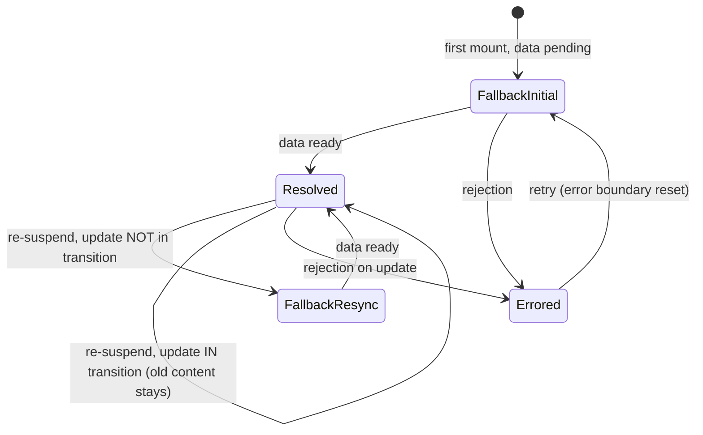
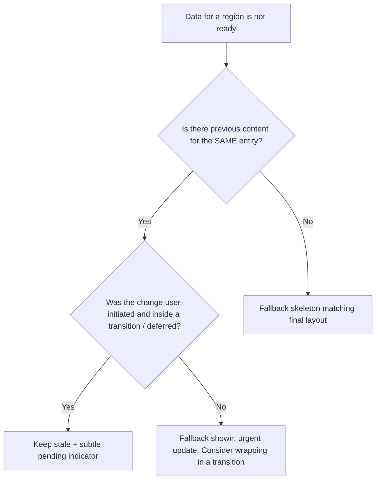
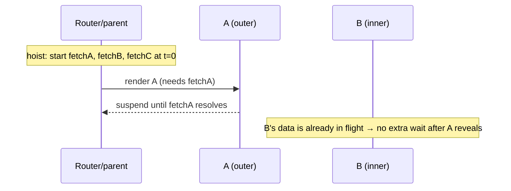

# 09 / 05 — Suspense Architecture: Designing Loading, Reveal, and Failure at Scale

## 1. Lesson metadata

| | |
|---|---|
| **Level** | Advanced / Professional |
| **Study time** | 5 hours (reading 2 h, experiments 1.5 h, exercises 1.5 h) |
| **Prerequisites** | [Phase 2 / 24 — Suspense conceptual internals](../02-react-rendering-and-internals/24-suspense-conceptual-internals.md), [Phase 2 / 36 — Scenario E: suspend](../02-react-rendering-and-internals/36-scenario-e-suspend.md), [Phase 6 / 13 — Suspense data loading](../06-data-fetching-and-state-ecosystems/13-suspense-data-loading.md), [Phase 4 / 19 — Error boundaries](../04-react-architecture/19-error-boundaries.md), [01 — Streaming](./01-spa-ssr-ssg-streaming.md), [04 — Boundaries and serialization](./04-client-server-boundaries-and-serialization.md) |
| **Next** | [06 — Concurrent rendering in practice](./06-concurrent-rendering-in-practice.md) |
| **Related** | [Phase 7 / 12 — `useTransition` in practice](../07-performance/12-usetransition-in-practice.md), [Phase 7 / 17 — Network waterfalls](../07-performance/17-network-waterfalls.md), [10 — Routing and nested layouts](./10-routing-and-nested-layouts.md) |

**What this lesson is and is not.** Phase 2 lesson 24 taught *how a boundary works*: the protocol of suspending (a component signals "not ready"), the fallback/primary tree, retry and fallback throttling, sibling behavior, interaction with transitions. We do **not** repeat that. This lesson is about **architecture**: *where* to put boundaries, how they compose with transitions, error boundaries, routing, caching, and streaming; how to choreograph reveals; how to measure and test loading behavior; and how to avoid the failure modes of overuse (popcorn UI, layout shift, waterfalls, spinners-for-everything) and underuse (all-or-nothing pages).

**Learning objectives.** After this lesson you can:
1. Classify boundaries by role (shell, route, region, widget, item) and choose among them using UX and engineering criteria.
2. Design reveal choreography: all-at-once, progressive, ordered; and implement ordered reveal without experimental APIs.
3. Combine Suspense, transitions, and `useDeferredValue` so that navigation and updates keep stale content instead of flashing fallbacks.
4. Place error boundaries relative to Suspense boundaries so that failures degrade locally and are recoverable (retry).
5. Prevent waterfalls structurally (preloading, hoisted fetch starts, route-level data) rather than by luck.
6. Manage identity: reset boundaries with `key`, preserve content with transitions, and understand state loss across fallbacks.
7. Build a boundary component and instrument loading timelines for debugging and RUM.
8. Reason about server streaming behavior of boundaries (shell, out-of-order, hydration) as an architectural constraint.

**Concepts covered:** boundary taxonomy, popcorn loading, skeleton fidelity and CLS, reveal order, nested boundary waterfall, preloading, render-as-you-fetch, transition-aware navigation, `key` resets, stale-while-revalidate UI, error + Suspense pairing, retry strategies, `lazy` + Suspense, SSR/hydration interactions, `SuspenseList` (not stable), Activity-based preservation, testing and metrics.

---

## 2. Deep conceptual explanation

### 2.1 Suspense is a layout decision

A Suspense boundary decides a **unit of loading**: the set of UI that appears together. Everything inside is revealed atomically (modulo React's internal batching); everything outside is unaffected. This makes boundaries similar to *layout containers* or *API response shapes*: their placement determines user-visible behavior and engineering cost.

The key insight: **a boundary encodes a product decision**, not a technical one. "Should the price appear with the title, or can it come in later?" "Is the sidebar worth showing a skeleton for, or should the page wait until it's ready?" Engineers who decide this alone (usually by whatever is easiest to wrap) end up with UX nobody designed.

### 2.2 The cost model of a boundary

| Dimension | Cost of adding a boundary | Benefit |
|---|---|---|
| UX | One more thing that can show a fallback and later "pop" in | Independent loading; faster first useful paint |
| Layout stability | Fallback must reserve the final size, or layout shifts | n/a |
| Engineering | Fallback design, error handling, tests | Isolation of slow/failing parts |
| Server rendering | A pending boundary is flushed as fallback then replaced (out of order) | Streaming (shell isn't blocked) |
| Hydration | Each boundary is a separate hydration unit | Selective hydration, bounded mismatch blast radius ([02](./02-hydration-internals-deep-dive.md)) |
| Runtime | Markers, extra fibers for fallback/primary trees | Minor; not a reason to avoid boundaries |

Boundaries are cheap at runtime and expensive in **design attention**. The question is never "can I afford another boundary?" but "does a user benefit from this region loading independently, and have I designed its loading and failure states?"

### 2.3 A taxonomy of boundary roles

| Role | Scope | Typical fallback | Example | Typical owner |
|---|---|---|---|---|
| **Shell boundary** | Whole app | Minimal frame/splash (rarely visible with SSR) | Root-level boundary for lazy route chunks | Platform team |
| **Route/page boundary** | One route's content under persistent layout | Page skeleton | `/orders/:id` content area | Feature team |
| **Region boundary** | A major page section | Section skeleton | "Recommendations", "Reviews" | Feature team |
| **Widget boundary** | A self-contained component with its own data | Compact skeleton or inline spinner | Notification bell, weather widget | Component owner |
| **Item boundary** | One row/card in a collection | Row skeleton | Each product in a grid that loads independently | Rarely needed; can produce popcorn |
| **Overlay boundary** | Modals, popovers, lazily loaded chunks | Small inline spinner | Settings dialog content | Component owner |

Practical guideline (opinion, not rule): **start with route and region boundaries; add widget boundaries where a component is slow, volatile, or owned by a different team; avoid item-level boundaries unless items have wildly different latencies and users benefit from seeing the fast ones first.**

### 2.4 Loading-state taxonomy

"Loading" isn't one state. Different situations need different treatments, and Suspense + transitions can express most of them:

| Situation | Best treatment | React mechanism |
|---|---|---|
| **First load, nothing to show** | Skeleton matching layout | Boundary fallback |
| **Navigating to a similar page** | Keep old page, show subtle pending indicator | Navigation in a transition ([Phase 7 / 12](../07-performance/12-usetransition-in-practice.md)) |
| **Refreshing data in a visible region** | Keep stale content, dim/indicate | Transition or `useDeferredValue` |
| **Revalidating in background** | Silent (or tiny indicator) | Data-layer stale-while-revalidate ([Phase 6 / 08](../06-data-fetching-and-state-ecosystems/08-tanstack-query.md)) |
| **User action (mutation)** | Optimistic UI + pending state | `useOptimistic`, Actions ([07](./07-modern-react-apis.md)) |
| **Lazy-loaded chunk for an overlay** | Inline spinner in the overlay | Boundary inside overlay |
| **Failure** | Local error with retry | Error boundary adjacent to the Suspense boundary |

The architectural insight: **fallbacks should appear only when there is nothing better to show**. Whenever previous content exists, prefer keeping it (transition) over replacing it (fallback). React's design supports this by default for transitions: already-revealed boundaries are not re-hidden by a transition (public behavior documented on the `<Suspense>` and `useTransition` reference pages).

### 2.5 Reveal choreography

Three models:

1. **All at once**: wrap related regions in one boundary. Users see one skeleton, then the full content. Best when partial content is misleading (a total and its line items) or when you want to avoid layout churn.
2. **Progressive/independent**: each region in its own boundary; regions appear as ready (possibly out of order). Best when regions are independent and some are slow.
3. **Ordered/sequential**: regions reveal top-to-bottom (or in a designed order) even if data arrives out of order, to avoid content jumping above where the user is looking. Achievable by nesting (below); `SuspenseList` is an experimental-channel-only API, not part of stable React.

*Version note (checked 2026-10-22):* `SuspenseList` is not exported by the stable `react` package (19.3.1 exports `Suspense`, `Activity`, `ViewTransition`, but no `SuspenseList` or `unstable_SuspenseList`) and has no react.dev reference page; it exists only in the experimental channel. The design below achieves ordering with stable features.

**Ordered reveal via nesting.** A nested boundary's content can't render (and its data can't be *read*) until the parent's content has rendered; so nesting `B` inside `A`'s content orders `A` before `B` — but it also **serializes data fetching** (a waterfall) unless fetches are started earlier (hoisted/preloaded). The recipe: *hoist the fetch start, nest the render.*

```tsx
function Page({ id }: { id: string }) {
  // Start all fetches immediately (cache keyed by id), regardless of reveal order.
  const a = loadSummary(id); const b = loadTimeline(id); const c = loadRecs(id);
  return (
    <Suspense fallback={<SummarySkeleton />}>
      <Summary resource={a} />
      <Suspense fallback={<TimelineSkeleton />}>
        <Timeline resource={b} />
        <Suspense fallback={<RecsSkeleton />}>
          <Recs resource={c} />
        </Suspense>
      </Suspense>
    </Suspense>
  );
}
```
Reading `Summary` first; if `Timeline` data arrives before `Summary` it waits (hidden behind the parent fallback), preserving top-to-bottom reveal at zero extra fetch cost because all three requests started up front.

### 2.6 Misconceptions (beyond lesson 24)

| Misconception | Reality |
|---|---|
| "More boundaries = faster app." | Boundaries don't make data faster; they change *what's blocked on what*. Too many produce popcorn UI and layout shift. |
| "One boundary at the root is fine; React handles it." | It gives all-or-nothing loading: the slowest data gates the first useful paint. |
| "Suspense replaces loading flags." | It replaces *imperative loading flags in components*; you still design loading UX. Pending states for transitions/mutations come from `isPending`/Actions. |
| "Suspense is only for `lazy` and frameworks." | Any Suspense-compatible source (`use`, framework data APIs, `lazy`, query libraries with suspense mode) can suspend; the architecture applies to all. |
| "A fallback means data fetching is slow." | A fallback also appears for code (lazy chunks) and for server-streamed boundaries (SSR). Distinguish in telemetry. |
| "Wrapping with Suspense fixes my waterfall." | It shows *something* during the waterfall. The waterfall remains until fetches start earlier. |
| "Error boundaries are separate; Suspense doesn't care about errors." | A rejected promise is thrown on retry to the nearest error boundary. Placement relative to Suspense boundaries determines blast radius and retry UX. |

---

## 3. Internal mechanics

> **Labels.** **Public guarantee** documented; **Teaching model**; **Implementation detail (may change)**. For the base protocol and sibling behavior see [Phase 2 / 24](../02-react-rendering-and-internals/24-suspense-conceptual-internals.md).

### 3.1 Public guarantees relevant to architecture

1. A `<Suspense>` boundary shows its `fallback` while any descendant suspends and shows children when ready.
2. When an update happens **inside a transition**, React does not replace already-visible content with a fallback for boundaries that are already revealed (it keeps showing old UI while rendering the new one in the background). Newly mounting boundaries may still show fallbacks.
3. To make a boundary **show its fallback again** on navigation (rather than keep stale content), give it a different `key` (documented technique).
4. State of components inside a boundary that is **already shown** is preserved when it re-suspends and shows the fallback (React hides the content with `display: none` rather than unmounting it; layout effects are cleaned up and re-run on reveal, while passive effects (`useEffect`) are *not* cleaned up. Verified in a Vitest + RTL run on React 19.3.1; see also the Caveats of the react.dev `<Suspense>` page and lesson 24). On the *first* mount, nothing is preserved because nothing committed.
5. `lazy(() => import(...))` integrates with Suspense; code-load suspension is a normal suspension.
6. Server rendering: a suspended boundary's fallback is in the shell, and the content streams later (outside the shell, out of order) ([01](./01-spa-ssr-ssg-streaming.md)).
7. Errors thrown (including rejected data) propagate to the nearest error boundary; a boundary that has not shown content yet has no content to preserve.

### 3.2 Teaching model: boundaries as a tree of loading states

Each boundary is in one of: **resolved**, **fallback (initial)**, **fallback (re-suspended)**, **errored (via an error boundary above)**. A page's loading state is the tuple of its boundaries' states. Design is about which tuples are *allowed* and *visible*:



### 3.3 Teaching model: the waterfall rule

> *A component can only start reading data when React renders it; React renders it only if its parent's content has rendered; a parent's content has rendered only if everything it read before has resolved.*

Three consequences:
1. **Data dependencies encoded in the component tree become a critical path**, even if the data itself is independent.
2. **Sibling reads in the same component run in sequence** if each `use`/read suspends: React throws on the first pending read and doesn't reach the second until it resolves. Start the promises first, then read.
3. **Nested boundaries don't create waterfalls by themselves; late *starts* do.** A child boundary's content begins fetching when it's rendered; if the parent has already rendered (parent not suspended), React can render the child boundary's content in the same pass, so siblings/children in different boundaries can fetch in parallel. The waterfall happens when a child is only reached after an ancestor *suspends*, because React stops rendering that subtree's remaining children. React 19 softens this: when a component suspends, React immediately commits the nearest boundary's fallback without rendering the rest of the siblings, then schedules another render of the siblings to "pre-warm" lazy requests (React 19 upgrade guide; an executed test logged `A render, A render, B render` for `<A/><B/>` with `A` suspended). Pre-warming starts *later* requests earlier than before, but it is an optimization: do not rely on it for correctness, and still hoist fetch starts.

Therefore the architectural fix is **start earlier**, not "add boundaries":

| Technique | Where it starts the fetch | Notes |
|---|---|---|
| Route-level loader (framework) | Before rendering the route | Best; framework-provided ([09](./09-framework-architecture.md)) |
| Event-time prefetch | On hover/focus/intent | Cache the promise/data for the soon-to-render component |
| Hoisted start in a parent | Parent creates promises, passes down | Pairs with `use(promise)` |
| `preload()` in module/parent | Triggers cache population | Needs keyed cache; avoid unbounded caches |
| Server: start promises at the top of async server component | Before awaits | [03 §5.2](./03-server-components-in-depth.md) |

### 3.4 Teaching model: transitions and boundary identity

- **Same boundary identity (no key change) + transition:** content stays; `isPending` indicates work; new content appears when ready. Use for *same page, new data* (tab switch, pagination, filters).
- **Different `key` on the boundary (or the route component) + transition:** React treats it as a new subtree: the old subtree is unmounted and the new boundary is a *fresh mount*, so its **fallback is shown** instead of the previous content (react.dev: "React treats the profiles as different content and resets the Suspense boundary during navigation"; confirmed by an executed test, see §4.2). The documented purpose of `key` here is to **reset** the boundary and its state; use it deliberately, e.g., navigating between *different entities* (user A → user B) where stale content of A would be misleading.
- **`useDeferredValue(value)`**: the component reading the deferred value re-renders in the background; if it suspends, React keeps showing the old content (no fallback) because the update is not urgent. Good when you can't wrap the state update in a transition (value arrives via props/context) ([Phase 7 / 13](../07-performance/13-usedeferredvalue-in-practice.md)).

### 3.5 Suspense with error boundaries: the pairing

```tsx
<ErrorBoundary fallbackRender={({ error, resetErrorBoundary }) => <InlineError error={error} onRetry={resetErrorBoundary} />}>
  <Suspense fallback={<WidgetSkeleton />}>
    <Widget />
  </Suspense>
</ErrorBoundary>
```

Order matters:
- **Error boundary outside Suspense (above):** Suspense handles loading; the error boundary catches rejections from inside; retry resets **both** (re-mount the Suspense subtree). Local failure; the rest of the page is unaffected. This is the standard pairing for widgets.
- **Suspense outside error boundary:** if the *error boundary's fallback or content* suspends, Suspense shows its fallback; errors in content are caught inside. Rarely what you want; used for lazy-loaded error UI.
- **Retry must change the data source**, not just re-render: a cached rejected promise would be re-thrown. Reset the cache entry for that key on retry (TanStack Query v5 exports `QueryErrorResetBoundary` and `useQueryErrorResetBoundary`; other libraries differ) ([Phase 6 / 15](../06-data-fetching-and-state-ecosystems/15-error-recovery-and-retries.md)).

### 3.6 Suspense + SSR/hydration architecture

| Phase | Behavior | Architectural implication |
|---|---|---|
| **Server shell** | Everything outside boundaries; pending boundaries emit fallbacks | Place the LCP element in the shell/first boundary |
| **Streaming** | Boundary content arrives out of order | Visual order may differ from tree order; design skeletons so late arrivals don't shift content users are reading |
| **Hydration** | Each completed boundary hydrates separately; interaction raises priority | Boundaries around interactive widgets enable earlier interactivity for others |
| **Errors on server** | Boundary falls back to client rendering | Client retry; plan error UI for the client case |
| **`lazy` in SSR** | Chunk must load before hydration of that boundary | Preload critical chunks; the dehydrated content stays visible meanwhile |

React 19.2 batches reveals of server-rendered Suspense boundaries for a short time so more content is revealed together, aligning with client-rendered behavior (19.2 release post, "Batching Suspense Boundaries for SSR"); on the client, React reveals suspended content at most once every 300 ms (react.dev `<Suspense>` Caveats). Treat reveal *granularity* and timing as non-contractual.

### 3.7 Preserving UI across hide/show

Beyond Suspense, React 19.2 introduced the stable `<Activity>` component (`mode` is `"visible"` (default) or `"hidden"`; more modes are planned) to hide parts of the UI while *preserving state*. When hidden, React hides the DOM with `display: none`, destroys the children's Effects (cleaning up subscriptions), and keeps re-rendering them for new props at lower priority; on becoming visible it restores state and re-creates Effects (react.dev `<Activity>`; verified by an executed test). It addresses a related architectural need: keeping route/tab content alive but not visible. Suspense's own hide/show during re-suspension is an internal mechanism, not a general-purpose "keep alive" tool.

---

## 4. Step-by-step execution walkthrough

### 4.1 A dashboard with four regions, three designs

Regions: `Header` (instant), `KPIs` (150 ms), `Chart` (900 ms), `Activity` (2,500 ms). Page requested via client navigation (no SSR for clarity).

**Design A: one boundary around everything.**
- t=0 navigation starts; the route's content is new → fallback (full-page skeleton).
- t=2500 all data ready → everything appears at once.
- **Result:** Time to useful content = 2.5 s. Simple. Bad if `Activity` is not critical.

**Design B: boundary per region (progressive).**
- t=0 `Header` visible (not suspending), other three skeletons.
- t=150 KPIs appear; t=900 Chart; t=2500 Activity.
- Skeleton heights equal final heights → no layout shift. **Time to useful content = 150 ms.**
- Risk: three "pops" in 2.5 s; acceptable if each region is independently useful.

**Design C: ordered reveal via nested boundaries with hoisted fetch starts.**
- t=0 all fetches start. `KPIs` is outer; `Chart` nested; `Activity` nested inside `Chart`.
- t=150 KPIs appear; t=900 Chart; t=2500 Activity. Same timings as B here, **but** if `Activity` happened to resolve first (400 ms) it would wait for Chart (hidden), preserving top-down order.
- Cost: more code, intentional waiting.

**Predict:** Which design has the lowest *total data wait* (last byte at 2.5 s) and which has the best *first useful paint*? *Answer:* All three finish at 2.5 s (the slowest fetch dominates). B/C show useful content at 150 ms; A at 2.5 s. C trades earliest-possible reveal of fast later regions for ordering.

### 4.2 Navigating between two users inside a transition

State: `UserPage` for user 1, content shown. The user clicks user 2 (wrapped in `startTransition`).

Case 1: the `Suspense` boundary has **no key** change (same route component, new `id` prop).
1. Transition render begins with `id=2`; `UserDetails` suspends (not yet loaded).
2. The boundary is already revealed → React **keeps showing user 1's details**; `isPending` is true.
3. Data for user 2 resolves; React commits; user 2's details replace user 1's.
- Hazard: for a while the page shows user 1's data under user 2's URL. Mitigate with a pending indicator (and, if semantically wrong, a different key).

Case 2: the boundary has `key={id}`.
1. Transition render builds a new subtree for user 2 (new boundary instance); it suspends.
2. A new boundary has no already-revealed content to protect, so React commits **its fallback** and unmounts user 1's subtree (state discarded). Executed on React 19.3.1: log was `layout-cleanup 1`, `unmount-effect 1`, `fallback mounted`, then after resolve `layout-setup 2`, `fallback unmounted`, `mount-effect 2`; the DOM showed only the fallback in between, and `isPending` returned to `false` as soon as the fallback committed. This matches react.dev ("the key resets the boundary, so the fallback shows instead of the previous user's bio. Try removing the key: the previous bio stays visible").
3. Net effect: `key` is the deliberate "this is different content" switch. Use it for user A → user B; omit it for same-entity refreshes.

**Experiment (do it).** Build both cases with a `console.log` in the fallback's mount effect and in the content's mount effect; navigate inside `startTransition`; observe that without `key` the fallback never mounts and input state in the content persists, and with `key` the fallback mounts and state resets. Record your React version.

---

## 5. Code examples

### 5.1 Minimal: a composable `AsyncBoundary`

```tsx
import { Suspense, type ReactNode } from "react";
import { ErrorBoundary, type FallbackProps } from "react-error-boundary";   // or your own class boundary

type AsyncBoundaryProps = {
  children: ReactNode;
  fallback: ReactNode;
  /** Changing this resets both error state and loading identity (e.g., the entity id). */
  resetKey?: string | number;
  onError?: (error: Error) => void;
  errorLabel?: string;
};

export function AsyncBoundary({ children, fallback, resetKey, onError, errorLabel = "This section failed to load." }: AsyncBoundaryProps) {
  return (
    <ErrorBoundary
      resetKeys={resetKey === undefined ? undefined : [resetKey]}
      onError={(e) => onError?.(e as Error)}
      fallbackRender={({ resetErrorBoundary }: FallbackProps) => (
        <div role="alert">
          <p>{errorLabel}</p>
          <button onClick={resetErrorBoundary}>Retry</button>
        </div>
      )}
    >
      <Suspense fallback={fallback} key={resetKey}>
        {children}
      </Suspense>
    </ErrorBoundary>
  );
}
```

Notes: (1) the error boundary is **outside** the Suspense boundary (the standard pairing). (2) `key={resetKey}` on `Suspense` forces fresh loading (fallback, state reset) for a new entity even inside a transition; omit `key` to preserve stale content in transitions. (3) `resetErrorBoundary` re-renders children; a **cache that memoized the rejection must be cleared** by the caller (see §5.4). (4) `react-error-boundary` is a widely used third-party package; any class-based error boundary works ([Phase 4 / 19](../04-react-architecture/19-error-boundaries.md)).

### 5.2 Practical: a keyed promise cache for client-side `use`

```tsx
type Entry<T> = { promise: Promise<T>; status: "pending" | "fulfilled" | "rejected"; at: number };

export function createResource<K extends string, T>(load: (key: K, signal: AbortSignal) => Promise<T>, ttlMs = 30_000) {
  const cache = new Map<K, Entry<T>>();

  function read(key: K): Promise<T> {
    const hit = cache.get(key);
    if (hit && Date.now() - hit.at < ttlMs && hit.status !== "rejected") return hit.promise;   // stable identity
    const controller = new AbortController();
    const entry: Entry<T> = {
      status: "pending", at: Date.now(),
      promise: load(key, controller.signal).then(
        (v) => ((entry.status = "fulfilled"), v),
        (e) => ((entry.status = "rejected"), Promise.reject(e)),
      ),
    };
    cache.set(key, entry);
    return entry.promise;
  }
  return { read, invalidate: (key: K) => cache.delete(key), clear: () => cache.clear() };
}

const userResource = createResource((id: string, signal) => fetch(`/api/users/${id}`, { signal }).then(r => { if (!r.ok) throw new Error(String(r.status)); return r.json() as Promise<User>; }));

function UserDetails({ id }: { id: string }) {
  const user = use(userResource.read(id));      // same promise identity across renders until TTL/invalidate
  return <h2>{user.name}</h2>;
}
```

Why this shape: `use` requires the **same promise** across re-renders of the same logical read; a keyed cache ensures it. Rejections are not cached (`hit.status !== "rejected"`), so **retry works** after `resetErrorBoundary`. Limitations: no eviction beyond TTL (memory), no cancellation on unmount, no deduping across tabs, no SSR serialization; production code should use a data library ([Phase 6 / 08](../06-data-fetching-and-state-ecosystems/08-tanstack-query.md)) or framework loaders. This is for teaching. Also note the `controller` isn't aborted anywhere here: a real implementation would abort when no component references an entry anymore.

### 5.3 Practical: a transition-aware navigation that keeps old content

```tsx
function Tabs({ tabs }: { tabs: readonly { id: string; label: string }[] }) {
  const [active, setActive] = useState(tabs[0].id);
  const [isPending, startTransition] = useTransition();

  return (
    <div aria-busy={isPending}>
      <div role="tablist">
        {tabs.map((t) => (
          <button key={t.id} role="tab" aria-selected={t.id === active}
                  onClick={() => startTransition(() => setActive(t.id))}>
            {t.label}
          </button>
        ))}
      </div>
      <div style={{ opacity: isPending ? 0.6 : 1, transition: "opacity 150ms" }}>
        <AsyncBoundary fallback={<PanelSkeleton />}>      {/* no key → old panel stays during transition */}
          <TabPanel id={active} />
        </AsyncBoundary>
      </div>
    </div>
  );
}
```

Expected behavior: first mount shows the skeleton (nothing to preserve). On tab change, the previous panel stays visible, dimmed, until the new one is ready; no skeleton flash. `aria-busy` informs assistive tech. Trade-off: for a few hundred ms the **tab selection** changes before... careful: `active` is updated in the transition, so `aria-selected` also lags until the new panel is ready. If you want the tab to highlight immediately, track a separate **urgent** `selected` state (updated outside the transition) and a transition-updated `shown` state; render the tab strip from `selected` and the panel from `shown`.

### 5.4 Practical: retry that actually refetches

```tsx
function UserCard({ id }: { id: string }) {
  return (
    <ErrorBoundary
      resetKeys={[id]}
      onReset={() => userResource.invalidate(id)}                 // clear the cache BEFORE re-render
      fallbackRender={({ resetErrorBoundary }) => <button onClick={resetErrorBoundary}>Retry</button>}
    >
      <Suspense fallback={<CardSkeleton />}>
        <UserDetails id={id} />
      </Suspense>
    </ErrorBoundary>
  );
}
```

The `onReset` callback runs before the boundary re-renders its children. Without invalidation, a cache that stored the rejected promise would immediately rethrow the same error; infinite error loop for the user. (Our `createResource` doesn't cache rejections, but many do.)

### 5.5 Incorrect: boundary around the whole app, spinner everywhere

```tsx
// ❌
<Suspense fallback={<FullPageSpinner />}>
  <Header /><Sidebar /><Feed /><Recommendations /><Footer />
</Suspense>
```
**Problems:** any slow region replaces the whole page with a spinner; on later navigations *not* in transitions the whole page spinner reappears. **Corrected:** persistent layout outside boundaries; region boundaries with skeletons; transitions for navigations.

### 5.6 Incorrect: popcorn UI (boundary per list item)

```tsx
// ❌ 40 products, each in its own boundary, each loading its price
{products.map(p => <Suspense key={p.id} fallback={<PriceSkeleton/>}><Price id={p.id}/></Suspense>)}
```
**Problems:** 40 independent pops; 40 requests; layout churn. **Corrected:** fetch prices in **one batched call** at the list level and render the list inside one boundary; or if prices are slow and secondary, one boundary around the "price column" with per-row skeleton placeholders of identical size. Use item-level boundaries only when per-item data is truly independent and slow.

### 5.7 Incorrect: waterfall via sequential reads

```tsx
// ❌ second read starts only after the first resolves
function Profile({ id }: { id: string }) {
  const user = use(fetchUser(id));          // new promise each render! (also wrong: unstable identity)
  const posts = use(fetchPosts(user.id));   // starts after user resolves; fine if dependent
  ...
}
```
**Problems:** (1) unstable promise identity → the fallback never resolves on the client: each retry creates a new pending promise (an executed test re-rendered ~47 times in 500 ms with a 10 ms promise and never left the fallback; react.dev: "If a new Promise is created directly in render, React will display the Suspense fallback on every re-render"). `use` needs stable promises: create them in a cache/loader or a Server Component; (2) if `posts` doesn't depend on `user`, you've serialized needlessly. **Corrected:** create promises in a cache keyed by args, start independent ones before reading:
```tsx
const userP = userResource.read(id);
const postsP = postsResource.read(id);       // independent: both in flight
const user = use(userP);
const posts = use(postsP);
```

### 5.8 Advanced: instrumenting loading for debugging and RUM

```tsx
function useLoadingMarks(name: string) {
  useEffect(() => { performance.mark(`${name}:content`); performance.measure(`${name}:ready`, `${name}:fallback`); }, [name]);
}

function InstrumentedFallback({ name, children }: { name: string; children: ReactNode }) {
  useEffect(() => { performance.mark(`${name}:fallback`); }, [name]);
  return <>{children}</>;
}

function Section({ name, fallback, children }: { name: string; fallback: ReactNode; children: ReactNode }) {
  return (
    <AsyncBoundary fallback={<InstrumentedFallback name={name}>{fallback}</InstrumentedFallback>}>
      <Reveal name={name}>{children}</Reveal>
    </AsyncBoundary>
  );
}
function Reveal({ name, children }: { name: string; children: ReactNode }) { useLoadingMarks(name); return <>{children}</>; }
```
The fallback's mount effect marks "fallback shown"; the content's mount effect marks "content shown" and measures the difference: **fallback duration** as the user experienced it. (Caveats: if content renders without ever showing a fallback, `measure` throws because the start mark is missing; guard with try/catch in production, or use `performance.getEntriesByName`.) Aggregate by boundary name in RUM; compare p75 across releases. For SSR-streamed boundaries, the fallback is server HTML (no React effect), so measure via a `PerformanceObserver` on LCP/element timing or markers emitted from the streamed content script (framework-specific).

---

## 6. Visual explanations

### 6.1 Boundary placement for a product page

```text
<Layout>                                   ← outside any boundary (shell): nav, breadcrumbs
  <Suspense> ProductHero          </Suspense>   ← region: title/price/images (LCP). Fast, cached.
  <Suspense> Specs                </Suspense>   ← region: medium
  <Suspense> Reviews + Q&A        </Suspense>   ← region: slow, below the fold
  <Suspense> Recommendations      </Suspense>   ← widget: personalized, slow
</Layout>
Rule of thumb: boundaries *around* what is slow, not around what is important.
```

### 6.2 Fallback vs keep-stale decision



### 6.3 Nested boundaries and the data start



---

## 7. Alternative approaches and trade-offs

| Criterion | One page boundary | Region boundaries | Item boundaries | Route-level loader (no component Suspense) | Client-side loading flags |
|---|---|---|---|---|---|
| First useful paint | Slowest | Fast | Fastest per item, noisy | Navigation waits (or old page stays) | Fast skeleton, manual |
| Layout stability | Good (one swap) | Good with sized skeletons | Poor | Excellent (page appears whole) | Depends |
| Code simplicity | Highest | Medium | Low | Medium | Low (flags everywhere) |
| Waterfalls | Likely | Controlled with hoisting | Likely | Avoided by design | Common |
| Error isolation | Whole page | Per region | Per item | Route error boundary | Per component, manual |
| Streaming/SSR friendliness | Poor (shell blocked) | Excellent | Good but verbose | Framework-dependent | Poor |
| Team ownership boundaries | Poor | Good | n/a | Good | Poor |
| Accessibility (announcements) | One live region | Multiple; careful | Noisy | Route announcements | Manual |

**Scenario where the recommended approach (region boundaries) is not best.** A checkout summary where partial totals would mislead (subtotal visible, tax missing). Use **one boundary** around the summary so the user never sees a plausible-but-wrong total, accept a slightly longer skeleton, and consider optimistic estimates labelled as such.

**Scenario where route-level loaders beat component Suspense.** Navigating between heavily data-bound pages where you prefer the old page to stay until the new one is ready (with a global progress bar) rather than showing a skeleton of the new page. A router-level pending state combined with a transition achieves this ([10](./10-routing-and-nested-layouts.md)).

---

## 8. Best practices and anti-patterns

### Best practices
1. **Decide reveal behavior with design.** For each region: independent, grouped, or ordered? Write it in the spec.
2. **Make fallbacks size-accurate.** Reserve height/width; use CSS `min-height`, aspect ratios; test CLS.
3. **Prefer keeping stale content** for same-entity refreshes; use fallbacks for first loads and different entities.
4. **Pair every non-trivial Suspense boundary with an error boundary** and a retry that clears caches.
5. **Start data early** (route loaders, hoisted promises, intent prefetch); treat boundaries as presentation, not fetch orchestration.
6. **Keep the LCP element and primary content in the shell or first boundary**.
7. **Instrument fallbacks** (shown count, duration) and track in RUM.
8. **Accessibility:** announce loading state changes sparingly (`aria-busy` on regions, polite live regions for important updates); never rely on spinners alone; skeletons are decorative (`aria-hidden`) with an accessible status elsewhere.
9. **Test loading states** in isolation (Storybook/tests with delayed promises) and under network throttling.
10. **Limit boundary nesting depth** for reveal design; deep ordered chains are hard to reason about.

### Anti-patterns

| Anti-pattern | Why it hurts | Fix |
|---|---|---|
| Boundary per leaf | Popcorn, many requests | Group; batch data |
| Spinner-only fallbacks | Layout shift; no sense of content | Skeletons of final geometry |
| Boundary inside a list virtualization item | Rows resize on reveal → scroll jumps | Reserve row height; load at list level |
| Cache that stores rejections without invalidation | Retry loops | Evict on reject/reset |
| `key` changing on every render | Constant remount/fallback | Stable keys; deliberate entity ids only |
| Hiding errors inside fallbacks ("skeleton forever") | Users wait forever | Timeouts + error UI |
| Using Suspense for imperative control flow | Unpredictable | Explicit state/Actions |
| Not wrapping navigation in transitions | Fallback flashes for revisits | `startTransition` / router integration |

**Justified exception:** a full-page spinner is acceptable in a **cold start of an authenticated app shell** where there is genuinely nothing to render until the session and config load (and the time is short and bounded).

---

## 9. Real-world application

| Domain | Boundary design | Constraints |
|---|---|---|
| **E-commerce PDP** | Shell: header + breadcrumb. Hero region (price/availability) fast and cached. Reviews, recommendations in separate boundaries below the fold. Checkout summary one atomic boundary. | LCP image in hero; price integrity; CLS budget; personalized recs don't block SEO content |
| **Dashboards** | KPI row, charts, tables each a region; ordered reveal for narrative top→bottom; transitions for filter changes | Different SLAs per data source; partial failure shows partial dashboard with per-widget retry |
| **Finance** | Account balances region and transactions region; atomic boundary for statements with totals | Never show stale balances as fresh: pair stale content with "as of" timestamps and pending indicators; audit |
| **Forms** | Lazy-load rich editors inside overlay boundaries; field-level async validation is not Suspense (use Actions/pending) | Preserve typed input across re-suspension; don't unmount forms |
| **Auth** | Session check before any app boundary (shell-level) | Avoid flashes of unauthorized content; redirect before streaming (status codes) |
| **Realtime** | Initial snapshot boundary; live updates via store subscription (not Suspense) | Don't re-suspend on each tick |
| **Multi-team** | Each team's widget has its own boundary + error boundary + fallback contract | Fallback dimensions documented; widget failures don't take down the page; shared `AsyncBoundary` primitive in the design system |

---

## 10. Debugging and troubleshooting

### Symptom A: "Entire page flashes a skeleton when I switch tabs/filters."
- **Repro:** change a filter that triggers a new data read.
- **Investigation:** is the update in a transition? Is the boundary `key`ed by the changing value? DevTools Components: see Suspense nodes and whether the fallback mounts (a "suspended" marker appears on the boundary).
- **Fix:** wrap the state update in `startTransition` or use `useDeferredValue`; remove the `key` if stale content is acceptable. **Validate:** the fallback no longer mounts (log in fallback effect).

### Symptom B: "Content loads in a jarring order; layout jumps."
- **Investigation:** Performance panel with "Layout Shift Regions"; check skeleton sizes; check out-of-order streaming.
- **Fix:** size-accurate skeletons; order via nesting; `min-height`; reserve space for ads/embeds.

### Symptom C: "Loading takes N × latency."
- **Investigation:** Network waterfall: requests starting sequentially after previous responses. Trace the component tree for dependency chains (child fetches after parent renders).
- **Fix:** hoist/preload; route-level loader; batch endpoints ([Phase 7 / 17](../07-performance/17-network-waterfalls.md)).

### Symptom D: "Retry button does nothing / immediately errors again."
- **Root cause:** cached rejected promise re-thrown. **Fix:** invalidate in `onReset`; don't cache rejections; verify with a flaky endpoint that fails once.

### Symptom E: "Input text disappears when data refreshes."
- **Root cause:** a `key` change or boundary remount resets state; or first mount (nothing to preserve). **Fix:** keep inputs outside the re-suspending subtree; stabilize keys; use transitions so content isn't replaced.

### Symptom F: "On SSR the fallback is visible in view-source but content never replaces it."
- **Investigation:** streaming completed? The swap script blocked by CSP (missing nonce) or a proxy truncating the stream; check console for CSP violations and compare raw response ([01 §3.7](./01-spa-ssr-ssg-streaming.md)).

### Symptom G: "An update I made hides content that was already visible (the fallback flashes)."
- **Root cause:** a synchronous (non-transition) update caused a visible boundary to re-suspend, so React hid the content (`display: none`, layout effects cleaned up) and showed the fallback. Executed on React 19.3.1: no error or warning is raised in this case (the React 18-era message "A component suspended while responding to synchronous input" does not exist in the 19.3.1 `react-dom` build). **Fix:** wrap the update in `startTransition` or use `useDeferredValue`.

### Symptom H: "Accessibility: screen reader says nothing while loading."
- **Fix:** provide an accessible status for long loads (visually hidden polite live region on region level), `aria-busy`; avoid announcing every skeleton.

---

## 11. Exercises

### Level A — Knowledge
A1. Name the six boundary roles and one example fallback for each.
A2. Why is "add a Suspense boundary" not a fix for a data waterfall?
A3. What is the difference between keeping stale content and showing a fallback, in terms of React mechanisms?
A4. Why should the error boundary be outside the Suspense boundary in the standard widget pairing?
A5. What is popcorn UI and why does it happen?

### Level B — Code comprehension
B1. Given the nested boundaries in §2.5 and fetch times Summary=600 ms, Timeline=200 ms, Recs=900 ms (all started at t=0), when does each region appear?
B2. In §5.3, why might the tab highlight lag behind the click, and how would you fix it?
B3. Predict what happens in §5.7 (the incorrect snippet) on the client and why.

### Level C — Implementation
C1. Implement a `useDelayedFallback(ms)`-style `DelayedFallback` component that renders nothing for the first `ms` milliseconds then renders a skeleton, so fast loads never flash. Explain its trade-offs.
C2. Implement a resource cache with request deduping, TTL, and invalidation that does not cache rejections. Write tests with fake timers.
C3. Write an `AsyncBoundary` variant that logs boundary loading duration to an analytics function once per mount.

### Level D — Debugging
D1. A page with six widgets shows a skeleton for each, but the total time to complete is 3× the slowest request. Diagnose with the Network panel and propose fixes.
D2. After a failed request, clicking "Retry" shows the skeleton for a frame and the error returns immediately without a network request. Explain and fix.

### Level E — Architecture and engineering decisions
E1. Design the Suspense boundary map for an email client (folder list, message list, message pane, attachments, search). Specify loading states, error states, transitions, and what persists on navigation.
E2. Your company has 5 teams contributing widgets to a home page. Propose a contract (props, fallbacks, error behavior, size, telemetry) and governance (how it's enforced).

### Level F — Expert challenge
F1. Design an experiment and metrics framework to decide between "one boundary" and "three region boundaries" on a high-traffic landing page, including UX metrics, business metrics, and guardrails (CLS, INP, error rate).

---

## 12. Detailed answers and explanations

> Attempt the exercises first.

**A1.** Shell (app-level lazy route chunk → splash), route (page skeleton), region (section skeleton), widget (compact skeleton/spinner), item (row skeleton), overlay (inline spinner in dialog).

**A2.** A boundary changes *what is shown* while waiting, not *when requests start*. Waterfalls come from late starts (children render after parents resolve). Fix by starting fetches earlier (loaders, hoisting, preloading) or batching.

**A3.** Keeping stale content happens when the update is in a transition (or deferred): React renders the new UI in the background and doesn't commit a fallback for an already-revealed boundary. A fallback is shown when the update is urgent (non-transition) or the boundary is new/keyed differently.

**A4.** So that errors thrown by rejected data inside the Suspense subtree are caught by the error boundary, whose reset re-mounts the Suspense subtree to retry; it also isolates failure to the widget. If Suspense were outside, the error boundary would sit *inside* the loading unit: a rejection would swap content for error UI inside an already-resolved region, and retry would not re-enter the loading state cleanly. Both orders are legal; the outside-error-boundary order matches the usual UX (error UI replaces the whole widget; retry shows the skeleton again).

**A5.** Many independent small boundaries resolving at different times cause many small reveals ("pops"); it happens when boundaries are placed per leaf/item without design intent.

**B1.** All start at t=0. Summary is outermost: appears at 600 ms. Timeline (200 ms) is ready but nested inside Summary's content, which hasn't rendered, so it can't appear until 600 ms; at 600 ms, Summary and Timeline appear together (Timeline's data is ready, so no separate pop). Recs (900 ms) appears at 900 ms. Timeline: 600 ms, not 200. This shows ordering costs "earliness" for the nested items.

**B2.** `active` is set inside the transition, so React doesn't commit the new `active` (and therefore `aria-selected`) until the new panel is ready. Fix: two states: `selected` updated urgently (outside transition) for the tab strip; `shown` updated in a transition for the panel. Or derive `selected` from `shown` plus optimistic `useOptimistic` ([07](./07-modern-react-apis.md)).

**B3.** `fetchUser(id)` returns a new promise each render; `use` suspends on it; when it resolves React retries rendering, which creates a *new* promise → suspends again → never settles (React logs "A component was suspended by an uncached promise" only in some replay situations; it did not fire in an executed loop test, so don't rely on the warning). Fix by caching promises (§5.2) or passing from server/loader.

**C1.**
```tsx
function DelayedFallback({ ms = 200, children }: { ms?: number; children: ReactNode }) {
  const [show, setShow] = useState(false);
  useEffect(() => { const t = setTimeout(() => setShow(true), ms); return () => clearTimeout(t); }, [ms]);
  return show ? <>{children}</> : null;
}
```
Trade-offs: avoids flashes for fast loads; but users see an empty region for `ms` (layout shift if the region has no reserved size — keep a container with `min-height`); the effect runs only after the fallback commits, so the timer starts a little late; for SSR-streamed fallbacks this component renders `null` in HTML (no skeleton in the shell), harming LCP/SEO; use CSS animations (delay visibility with `animation-delay` / `@keyframes`) instead for SSR-friendly delayed reveal while still reserving layout.

**C2 (criteria).** A correct answer: Map keyed by args; in-flight dedupe by storing the promise; TTL check; on rejection remove from cache (or mark and evict); `invalidate(key)`; tests: two concurrent reads call `load` once; after TTL expiry reload; after rejection next read refetches; invalidate forces refetch; use `vi.useFakeTimers()`. Edge: memory growth; abort in-flight on invalidate; key serialization of object args.

**C3.** Wrap fallback and content with marks like §5.8 using a `useRef` flag to report once; guard `performance.measure`; send via `navigator.sendBeacon`; include `name`, route, build id.

**D1.** Network panel: requests sequential (each begins after previous finishes) → a waterfall. Causes: hoisting missing—widgets fetch in `useEffect` after mount only when parents render; or a shared parent suspends before rendering siblings; or each widget uses a request that depends on a shared `session` fetch. Fixes: start all requests at route level; share one cached session read; batch endpoints.

**D2.** The resource cache stored the rejected promise; Retry re-renders, `use` throws the same rejected promise immediately (after one fallback frame), so no new request. Fix: `onReset` → invalidate the cache entry (or never cache rejections); verify with network panel that a new request is sent on retry.

**E1 (criteria).** Shell: app chrome + folder list (persistent). Message list: region boundary keyed by folder (new folder → fallback allowed; same folder refresh → transition). Message pane: boundary keyed by message id; keep the previous message while loading the next (transition, no key) *or* show skeleton (key) — argue: reading flow suggests keeping stale until ready with indicator; attachments: widget boundary inside the message pane (slow, non-critical); search results: overlay/region with deferred value for typing (`useDeferredValue`); errors: local per region with retry; persistence: scroll position and selection preserved via layout outside boundaries; optimistic actions (archive) with `useOptimistic`; prefetch on hover. Evaluate on whether answers justify keying choices with user flow.

**E2 (criteria).** Contract: each widget exports a component plus a *skeleton* with declared dimensions (height/min-height or aspect ratio); required error boundary and retry; data starts via a documented loader or accepts a promise prop; no layout shifts beyond budget; telemetry names; timeouts (e.g., 3 s → degraded state); accessibility checklist; async ownership info; governance: shared `Widget` wrapper component enforcing boundaries, CI visual regression of skeleton vs final dimensions, RUM dashboards per widget, SLOs, and a deprecation path.

**F1 (criteria).** Randomized A/B with sticky bucketing; primary metrics: LCP, time to first useful content (custom marks), INP; secondary: CLS, error rate, bounce, conversion; guardrails: CLS < threshold, server CPU, request count; segment by device/network; sample size and duration (weekly seasonality); pre-register hypothesis: three boundaries improve perceived speed but may increase CLS; evaluate trade-offs; decide with confidence intervals; also qualitative review (session replays) for perceived jank.

---

## 13. Senior engineer interview questions

**Q1. "How do you decide where to put Suspense boundaries?"**
*Strong answer:* Start from product intent: what must appear together, what can arrive independently, what's slow or owned by another team. Place route and region boundaries with size-accurate skeletons; hoist data starts so boundaries don't create waterfalls; pair with error boundaries; use transitions to keep stale content for same-entity updates; verify with measurements (fallback frequency, CLS, LCP).

**Q2. "A teammate wrapped every component in Suspense 'to be safe.' What's the problem?"**
*Strong answer:* It yields popcorn UI and layout shifts, multiplies skeleton design/testing, and can hide waterfalls behind spinners. Boundaries are loading-unit decisions, not safety nets; coverage is better ensured by a few well-chosen boundaries plus an app-level catch-all.

**Q3. "Why does my page flash a skeleton on every filter change, and how do you stop it?"**
*Strong answer:* The update is urgent (not in a transition) and the suspending component sits in a boundary that shows its fallback. Wrap the state update in a transition or use a deferred value, so React keeps old UI and renders the new one in the background; show a pending indicator. Don't `key` the boundary by the filter unless a hard reset is intended.

**Q4. "How do error and loading boundaries compose, and what breaks retries?"**
*Strong answer:* Error boundary above Suspense for the widget pairing; retry should re-run the load, which fails if the cache retained the rejected promise; so invalidate on reset or don't cache rejections.

**Q5. "How does Suspense interact with SSR streaming from an architecture standpoint?"**
*Strong answer:* Boundaries define flush units: the shell includes everything outside; pending boundaries ship as fallbacks and stream later out of order; hydration is per boundary. So boundary placement decides TTFB/LCP, hydration order, and mismatch blast radius; also dictates what's in the status-code decision.

**Q6. "Can you guarantee reveal order?"**
*Strong answer:* Not with independent siblings (arrival order). You can enforce order by nesting boundaries (while hoisting fetches to avoid serialization) or by an experimental-channel-only coordination API (`SuspenseList`, not in stable React); consider whether ordering is worth delaying faster content.

---

## 14. Further learning resources

| Resource | URL | Covers / why | Level | Section to study |
|---|---|---|---|---|
| React — `<Suspense>` | <https://react.dev/reference/react/Suspense> | Boundary behavior, transitions, resetting with `key`, SSR notes | Int–Adv | "Usage": revealing content together, nested boundaries, not hiding already revealed content, indicating a transition, resetting on navigation |
| React — `useTransition` | <https://react.dev/reference/react/useTransition> | Pending state, interplay with Suspense | Int | "Caveats" |
| React — `useDeferredValue` | <https://react.dev/reference/react/useDeferredValue> | Showing stale content while loading | Int | "Showing stale content while fresh content is loading" |
| React — `lazy` | <https://react.dev/reference/react/lazy> | Code splitting with Suspense | Int | "Usage" |
| React — `use` | <https://react.dev/reference/react/use> | Reading promises; stable promise requirement | Adv | "Caveats" |
| React — `<Activity>` | <https://react.dev/reference/react/Activity> | Hiding UI while preserving state (stable since 19.2) | Adv | Whole page |
| React 19.2 release post | <https://react.dev/blog/2025/10/01/react-19-2> | Activity, SSR Suspense batching | Adv | Relevant sections |
| web.dev — Cumulative Layout Shift | <https://web.dev/articles/cls> | Layout stability for skeletons | Int | "How to improve CLS" |
| WAI-ARIA Authoring Practices | <https://www.w3.org/WAI/ARIA/apg/> | Live regions, busy states patterns | Int | "Live regions" guidance *(browse from index)* |
| TanStack Query — Suspense | <https://tanstack.com/query/latest/docs/framework/react/guides/suspense> | Suspense-mode data with error reset boundaries | Int | Error reset section |

Links were fetched (HTTP 200) on 2026-10-22.

---

## 15. Knowledge checkpoint

**You should now understand**
- Boundaries are loading-unit design decisions with a taxonomy and cost model.
- Fallbacks are for "nothing to show"; transitions/deferred values keep stale content; `key` forces fresh loading.
- Waterfalls come from late starts; fix by hoisting/preloading, not by adding boundaries.
- Error boundaries pair outside Suspense; retries must clear cached rejections.
- Streaming and hydration make boundaries flush and hydration units.

**You should be able to explain without notes**
- The difference between popcorn UI, ordered reveal, and atomic reveal and when each is right.
- Why nested ordered reveal costs earliness and how hoisting preserves parallel fetching.

**You should be able to implement**
- `AsyncBoundary`, a keyed promise cache, transition-aware tabs, delayed fallbacks, fallback instrumentation.

**You should be able to debug**
- Skeleton flashes, waterfalls, retry loops, layout shift, lost input state.

**Prerequisite for the next lesson** ([06 — Concurrent rendering in practice](./06-concurrent-rendering-in-practice.md)): you should be comfortable that transitions decide *which* updates may be deferred; next we examine how concurrency changes the correctness rules for your code.
