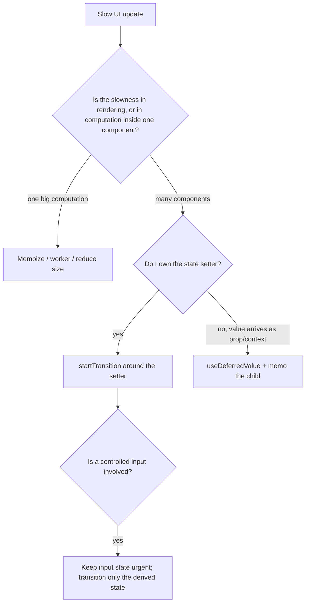

# 09 / 06 — Concurrent Rendering in Practice: Correctness Rules, Patterns, and Measurement

## 1. Lesson metadata

| | |
|---|---|
| **Level** | Advanced / Professional |
| **Study time** | 5–6 hours (reading 2 h, experiments 2 h, exercises 1.5 h) |
| **Prerequisites** | [Phase 2 / 13 — Scheduler and priorities](../02-react-rendering-and-internals/13-scheduler-and-priorities.md), [Phase 2 / 14 — Lanes](../02-react-rendering-and-internals/14-lanes.md), [Phase 2 / 15 — Interruptible, restartable, abandoned rendering](../02-react-rendering-and-internals/15-interruptible-restartable-abandoned-rendering.md), [Phase 2 / 16 — Concurrent React misconceptions](../02-react-rendering-and-internals/16-concurrent-react-misconceptions.md), [Phase 2 / 23 — Transitions and deferred rendering](../02-react-rendering-and-internals/23-transitions-and-deferred-rendering.md), [Phase 2 / 35 — Scenario D: transition vs urgent](../02-react-rendering-and-internals/35-scenario-d-transition-vs-urgent.md), [Phase 7 / 12 — `useTransition` in practice](../07-performance/12-usetransition-in-practice.md), [Phase 7 / 13 — `useDeferredValue` in practice](../07-performance/13-usedeferredvalue-in-practice.md), [05 — Suspense architecture](./05-suspense-architecture.md) |
| **Next** | [07 — Modern React APIs](./07-modern-react-apis.md) |
| **Related** | [Phase 3 / 20 — `useSyncExternalStore`](../03-react-state-and-hooks/20-usesyncexternalstore-and-external-stores.md), [Phase 2 / 28 — Strict Mode](../02-react-rendering-and-internals/28-strict-mode-behavior.md) |

**What this lesson is and is not.** Phases 2 and 7 explained *how* the concurrent renderer works (lanes, interruptible rendering) and *how to use* `useTransition`/`useDeferredValue` to keep input responsive. This lesson is about **writing code that stays correct under concurrency** and about **engineering workflows**: what rendering guarantees you must stop assuming, how tearing arises and is prevented, how to structure code so work can be interrupted and discarded safely, how Actions use transitions, how to avoid races between transitions and effects, how to measure with the tools, and how to audit an existing codebase. We assume you know the vocabulary; we don't re-teach lanes.

**Learning objectives.** After this lesson you can:
1. List the guarantees concurrent React gives (and the ones it removes) about render, commit, and effect execution.
2. Write render code that is safe to run multiple times, partially, or never commit.
3. Identify and fix **tearing** and other external-data inconsistencies using `useSyncExternalStore`.
4. Design urgent vs non-urgent state splits (input state vs query state) and choose between a transition and a deferred value.
5. Handle async transitions (Actions), pending state, error handling, and the "update after `await`" caveat.
6. Prevent request races when state updates are deferred or interrupted.
7. Measure concurrent behavior with the React Profiler, the browser Performance panel, and React's performance tracks (stable since React 19.2).
8. Perform a "concurrency readiness" audit of a codebase and prioritize findings.

**Concepts covered:** render purity as a correctness requirement, double/partial/abandoned render, tearing, external stores, urgent vs transition updates, starvation/expiration (conceptual), `startTransition` rules, async transitions, `useDeferredValue` with memoized children, `flushSync`, event ordering, effects and committed state, `isPending` UX, race conditions, concurrent testing, Profiler/Performance tracks.

---

## 2. Deep conceptual explanation

### 2.1 What concurrency is, as an app developer experiences it

In legacy synchronous rendering, once React began rendering a tree it ran to completion before the browser could do anything else. Under concurrent rendering (the default when you use `createRoot`), React may:

1. **Pause** a render to let the browser handle input or paint, and resume it later.
2. **Restart** a render from the top, because a higher-priority update arrived or data changed.
3. **Abandon** a render entirely; its work is discarded and no commit happens.
4. **Render the same component more than once** before committing once (e.g., the Strict Mode double render, restarts, or rendering a low-priority and a high-priority version).
5. **Prepare** a new tree in the background while the old one stays on screen (transitions, Suspense).

Importantly, **concurrency is not parallelism**: JavaScript still runs on one thread; React slices *its own* work and yields between slices. And concurrency is **opt-in per update**: updates are urgent by default (rendered synchronously-ish in their lane); only updates wrapped in a transition or deferred values are non-urgent ([Phase 2 / 16](../02-react-rendering-and-internals/16-concurrent-react-misconceptions.md)).

### 2.2 The contract change: what you may no longer assume

| Old assumption (sync React) | Concurrent reality | Consequence for your code |
|---|---|---|
| "If my component rendered, it was committed." | Renders can be discarded. | No side effects in render (logging analytics, mutating refs/globals, subscribing, counters) |
| "My component renders once per update." | May render multiple times per commit. | Render must be idempotent; initializers pure |
| "Everything in a render pass sees one consistent world." | External mutable data can change *between slices*. | Reading mutable external state during render can **tear** |
| "Render order equals update order." | Updates are prioritized; low-priority renders may be superseded. | Don't rely on seeing every intermediate state |
| "Effects run for each render." | Effects run only for **committed** renders. | Subscriptions and logging belong in effects |
| "A state update in a handler renders immediately." | Batched; urgent updates in the same event are processed together; transitions later. | Read after write via the updated value, not through DOM or refs |

These aren't new rules; they are the same purity rules from [Phase 1 / 12](../01-react-fundamentals/12-component-purity.md) and [Phase 2 / 12](../02-react-rendering-and-internals/12-why-rendering-must-be-pure.md), now **enforced by reality** rather than by convention. Strict Mode double-invocation exists to expose violations in development ([Phase 2 / 28](../02-react-rendering-and-internals/28-strict-mode-behavior.md)).

### 2.3 Tearing: the canonical concurrency bug

**Tearing** is when different parts of the UI, rendered in the same pass or in the same committed screen, show **different versions** of the same external data. It's possible only when the data is *mutable and external* to React (a global store, `window.matchMedia`, a mutable singleton) and rendering is **interruptible**:

```text
Slice 1: Component A reads store.count → 5     (render pauses; browser handles an event)
          Meanwhile: store.count is mutated to 6 by a non-React callback
Slice 2: Component B reads store.count → 6     (render resumes)
Commit:   A shows 5, B shows 6 → the screen shows an impossible state
```

State that React owns (`useState`, `useReducer`, context) cannot tear: React snapshots it per render lane. External mutable data requires **`useSyncExternalStore`** (uSES), which tells React how to read a *consistent snapshot* and how to subscribe; React then makes sure the whole committed UI reflects one snapshot (it may force a synchronous re-render, including de-opting a transition, when the snapshot changes mid-render). This is why libraries like Redux, Zustand, and others adopted uSES ([Phase 3 / 20](../03-react-state-and-hooks/20-usesyncexternalstore-and-external-stores.md)).

### 2.4 Urgent vs non-urgent as a design tool

Every state change in a UI falls into one of two categories:

| Category | Meaning | Examples | Treatment |
|---|---|---|---|
| **Urgent** | The user must see the result *immediately* to feel direct manipulation | Typing in a controlled input, toggling a checkbox, dragging a handle, hover/press feedback | Default updates (no transition) |
| **Non-urgent (transition)** | The result can lag behind; showing the old UI meanwhile is acceptable | Navigating to a new view, applying a filter to a large list, switching tabs, expensive derived views | `startTransition`, `useDeferredValue` |

The architectural technique is **splitting one user gesture into an urgent update and a deferred consequence**:

```tsx
const [text, setText] = useState("");              // urgent: the input
const deferredText = useDeferredValue(text);        // non-urgent derivative
<input value={text} onChange={(e) => setText(e.target.value)} />
<Results query={deferredText} />                    // expensive; may lag
```

Two critical implementation rules (documented on react.dev):
1. A **controlled input's value must be urgent**: don't put `setText` inside a transition, or the input lags/reverts.
2. The expensive child must **skip re-rendering with the old value**; `useDeferredValue` only helps if the child is memoized (e.g., `React.memo`) so that re-rendering with the *same deferred value* during the urgent pass is cheap ([Phase 7 / 13](../07-performance/13-usedeferredvalue-in-practice.md)). Otherwise the urgent render still re-renders `Results` (with stale props), and you've gained nothing.

### 2.5 Transitions vs deferred values: choosing

| Aspect | `startTransition` / `useTransition` | `useDeferredValue` |
|---|---|---|
| You control the state setter | Yes (wrap it) | No: the value arrives from props/context/another hook |
| Provides pending flag | Yes (`isPending`) | Derived: `value !== deferred` |
| Granularity | Per update | Per consuming component |
| Async work (Actions) | Yes (React 19) | No |
| Typical use | Navigation, tab switching, filter application | Search-as-you-type derived views; library-provided values |
| Failure mode | Forgetting to put *all* related setters in the transition | Forgetting `memo` on expensive child |

### 2.6 Misconceptions (beyond Phase 2)

| Misconception | Reality |
|---|---|
| "Concurrent rendering makes my app faster." | It makes it *more responsive* by prioritizing; total CPU work is the same or higher (extra renders). |
| "I need to wrap slow code in `startTransition` to make it fast." | Transitions don't speed up work, they move it off the urgent path. A 2-second render in a transition still takes 2 s of CPU and can still block events between slices if slices are long (one component's render can't be interrupted *in the middle* of its function). |
| "`startTransition` delays updates by a timeout." | It's priority, not time: a transition render starts when the main thread is free and urgent work is done; there's no fixed delay. |
| "Inside a transition, my state updates are batched with urgent ones." | They're in different lanes; urgent updates render first. |
| "Concurrent features require `Suspense`." | They compose, but transitions and deferred values work without Suspense. |
| "If I don't use concurrent APIs, concurrency doesn't affect me." | Even without transitions, the renderer's contract changed (e.g., Suspense retries, Strict Mode double rendering, external stores). Impurity bugs can appear. |
| "A transition can't starve." | If urgent updates continually arrive, transitions can be delayed; React eventually forces stale work to complete (conceptually "expiration"); the exact mechanism is an implementation detail, but design with the assumption "non-urgent means *later*, not *never*, but possibly much later". |

---

## 3. Internal mechanics

> **Labels.** **Public guarantee** documented; **Teaching model**; **Implementation detail (may change)**. See [Phase 2 / 13–15](../02-react-rendering-and-internals/13-scheduler-and-priorities.md) for the machinery.

### 3.1 Public guarantees

1. `startTransition(callback)` marks state updates **scheduled synchronously inside the callback** as transitions (non-urgent). Updates in transitions can be interrupted by urgent updates.
2. `useTransition()` returns `[isPending, startTransition]`; `isPending` is true while the transition is in progress.
3. In React 19, transitions can take **async functions** (Actions); `isPending` stays true until the async work and the resulting state updates complete. State updates after an `await` inside the callback are *not automatically* marked as transition updates; wrap them in another `startTransition`. This is still documented on react.dev's `useTransition` page ("currently require wrapping any set functions after the await in an additional startTransition") and was confirmed on React 19.3.1: a `setState` after `await` inside `startTransition(async () => …)` rendered as an ordinary urgent update (a render with `isPending` still `true`), followed by a separate render with `isPending=false`; wrapped in `startTransition`, both landed in one commit.
4. `useDeferredValue(value, initialValue?)` returns the previous value while a re-render with the new value is pending in the background. React 19 added the optional `initialValue` for the first render: without it, the first render returns `value` itself (nothing to defer); with it, the component first renders with `initialValue`, then immediately re-renders in the background with `value` (executed: mount logged `dv=INIT` then `dv=a`, i.e. two renders; one render without it). The deferred render is interruptible and can be abandoned if `value` changes again. If the update is already inside a Transition, `useDeferredValue` returns the new value immediately and spawns no deferred render (react.dev caveat); if the background render suspends, the old deferred value stays visible with no fallback (executed).
5. A controlled input's state update must not be wrapped in a transition (documented).
6. `useSyncExternalStore` guarantees a consistent snapshot across a committed render and *forces synchronous rendering* of updates caused by store changes (documented: updates from uSES are always synchronous; they cannot be deferred by transitions).
7. `flushSync` forces updates inside it to be flushed synchronously; it's an escape hatch with performance cost.
8. Effects run only for committed renders; render and commit are separate phases ([Phase 2 / 11](../02-react-rendering-and-internals/11-render-phase-and-commit-phase.md)).
9. Strict Mode (development) double-invokes component functions, initializers, updaters, and reducers to surface impurity (executed on 19.3.1: every render in the `useTransition`/`useDeferredValue` examples logged twice, e.g. `render n=0 p=true` ×2 then `render n=1 p=false` ×2; mount ran effect → cleanup → effect). React 19.3 also double-invokes Effects during hydration, matching client-rendered roots ([Phase 2 / 28](../02-react-rendering-and-internals/28-strict-mode-behavior.md)).

### 3.2 Teaching model: one gesture, two renders

User types "r" → "re" → "rea" quickly with `deferredQuery` + memoized results:

```mermaid
sequenceDiagram
  participant U as User
  participant S as State (query)
  participant R as React renderer
  participant L as Results (memo, slow)
  U->>S: keypress "r" (urgent)
  R->>R: urgent render: input shows "r"; deferred still ""
  R->>R: schedule background render with deferred="r"
  U->>S: keypress "e" (urgent) before background render finishes
  R->>R: urgent render: input "re"; abandon/restart background with deferred="re"
  Note over L: Results never rendered for "r": work discarded
  R->>L: background render with deferred="re" completes → commit
```

Observations:
- The input is **never blocked** by `Results`' cost because input updates are rendered first and `Results` is skipped in the urgent pass (memoized with stale prop).
- Intermediate values (`"r"`) never reach `Results`: React doesn't promise to render every state.
- A discarded background render did real CPU work (on slices) and produced no commit: *wasted but harmless* if render is pure.

### 3.3 Teaching model: slicing granularity

React can yield **between components** (between units of work), not in the middle of one component function. A single component that takes 300 ms to render (an expensive `useMemo` computation, a huge list rendered in one component without children boundaries) cannot be interrupted during that time. So:

- Concurrency helps when the expensive work is **spread across many components**, or can be split.
- For one expensive computation, prefer moving it off-thread (worker), memoizing it, reducing its size, or chunking it explicitly ([Phase 7 / 10](../07-performance/10-expensive-computations.md)).

### 3.4 Teaching model: how uSES prevents tearing

During a concurrent render React records the snapshots read via `getSnapshot`; before committing it **re-reads** and compares. If any snapshot changed since it was read during render, the render is **invalid**, and React re-renders synchronously with the new snapshot (so the commit is consistent). After commit, a store change triggers a synchronous re-render. The cost: store-driven updates are *not* deferrable; the price of consistency. This is one reason external stores can defeat transitions: **an update caused by a uSES store change always renders synchronously** ([Phase 3 / 20](../03-react-state-and-hooks/20-usesyncexternalstore-and-external-stores.md)).

### 3.5 Teaching model: async transitions (Actions)

```tsx
const [isPending, startTransition] = useTransition();
function save() {
  startTransition(async () => {
    await api.save(draft);             // async work: isPending stays true
    startTransition(() => {            // updates after await must be re-marked
      setSavedAt(Date.now());
    });
  });
}
```

Model: React tracks an *async transition scope* from the callback start until its promise settles; during that time `isPending` is true; state updates scheduled **synchronously** inside the callback join the transition; those scheduled after an `await` lose the implicit scope (JavaScript has no async context propagation here), hence the explicit nested `startTransition`. This limitation is documented on react.dev as of 19.3; React may lift it later. Multiple async transitions in flight are **batched into one** pending/committed set: react.dev's `useTransition` and `useActionState` pages both say "If there are multiple ongoing Transitions/Actions, React batches them together. This is a limitation that may be removed in a future release." Executed on 19.3.1: two async Actions on two separate `useTransition` hooks, the fast one resolving first, did not commit until the slow one also finished, and both `isPending` flags flipped together. React 19.3's changelog says Transitions "render independently instead of being entangled", so a slow *synchronous* Transition no longer holds up unrelated ones (executed: transition A suspended behind a slow promise while transition B's update committed) but do not assume that for parallel *async* Actions.

Errors: if the async callback throws, the error is thrown to the nearest error boundary during render (Actions error handling), unless you catch it inside.

### 3.6 Event handling and ordering

- Updates scheduled in the same event are **batched**; urgent updates from discrete events (click, keydown) are flushed *synchronously at the end of the event* in the default lane (they feel immediate).
- Transitions scheduled in that same event render after the urgent ones.
- `flushSync(() => setX(...))` forces a synchronous render and commit before continuing; use it only when you need to read updated DOM immediately (scroll to the new item, focus management), not to "fix" ordering bugs ([Phase 2 / 22](../02-react-rendering-and-internals/22-automatic-batching.md)).

### 3.7 Races: render ordering vs request ordering

Deferring or interrupting renders does **not** order network responses. A classic bug:

```tsx
useEffect(() => {
  fetch(`/api/search?q=${deferredQuery}`).then(r => r.json()).then(setResults);   // ❌ out-of-order responses
}, [deferredQuery]);
```
If "re" responds after "rea", stale results overwrite fresh ones. **Fix with cancellation or ignore flags** ([Phase 6 / 02](../06-data-fetching-and-state-ecosystems/02-cancellation-and-race-conditions.md)), or use a data layer that handles it, or Suspense-based reads keyed by query where React ignores stale branches. Transitions help the *rendering* race (React drops superseded renders); the *network* race remains yours.

### 3.8 Tools for observing concurrency

| Tool | Shows | Notes |
|---|---|---|
| **React DevTools Profiler** | Commits, which components rendered and why, durations; whether a commit was caused by a transition (flagging varies by DevTools version) | Use "Record why each component rendered" |
| **Browser Performance panel** | Main-thread tasks; React's yielding appears as multiple short tasks instead of one long task | Look for "Long Task" markers; compare with/without transition |
| **React performance tracks in Chrome DevTools** (React 19.2+) | Custom tracks: a Scheduler track (priorities such as "blocking" vs "transition") and component tracks, emitted by React's dev/profiling builds | Introduced in React 19.2 ([release post](https://react.dev/blog/2025/10/01/react-19-2), [reference](https://react.dev/reference/dev-tools/react-performance-tracks)) |
| **`<Profiler onRender>`** | Programmatic commit timing (`phase`, `actualDuration`) | Dev/profiling builds; production profiling build needed |
| **`performance.mark/measure`** in effects | End-to-end latency from event to committed UI | You control the instrumentation |

---

## 4. Step-by-step execution walkthrough

### 4.1 Typing in a search box over 5,000 rows

Setup: `App` holds `query` (urgent). `deferred = useDeferredValue(query)`. `Results` is `memo`'d, filters 5,000 rows, each `Row` costs ~0.04 ms → ~200 ms if rendered fully; the filter returns ~30% of rows.

| t (ms) | Event | Urgent lane | Deferred (transition) lane | Screen |
|---|---|---|---|---|
| 0 | keypress "a" | Render App: input "a"; `Results` skipped (props deferred = "") | Schedule: App with deferred="a" | Input "a"; results for "" |
| 5 | commit urgent | — | begin background render (slices) | same |
| 60 | keypress "b" (during background render) | Render App: input "ab"; `Results` skipped; commit | Abandon "a" work; restart with deferred="ab" | Input "ab"; results for "" |
| 70–270 | idle | — | background render for "ab" completes in slices; the browser handles other events between slices | same |
| 270 | commit | — | commit `Results` for "ab" | results for "ab" |

**Predict:** how many times does `Results` *commit* and for which queries? *Answer:* once, for "ab". "a" was superseded before completing. The user never saw results for "a" (acceptable here). If the user pauses after "a" for 300 ms, results for "a" commit, then a new background render for "ab" starts, etc.

**Predict (trap):** if `Results` is *not* memoized, what changes? *Answer:* the urgent render of `App` re-renders `Results` with the *stale* deferred value, a full 200 ms render in the urgent lane for each keystroke: the input lags. `useDeferredValue` didn't help because the expensive child still re-rendered urgently.

### 4.2 Tearing in a clock widget (without uSES)

```tsx
const clock = { now: Date.now() };                    // external mutable
setInterval(() => { clock.now = Date.now(); }, 10);   // mutates outside React

function Seconds() { return <span>{Math.floor(clock.now / 1000)}</span>; }
function Millis()  { return <span>{clock.now % 1000}</span>; }
function Clock()   { return <><Seconds /><Millis /></>; }
```
In a concurrent render of a large tree containing `<Clock/>` *interrupted between* `Seconds` and `Millis`, `clock.now` can change: `Seconds` shows 12 while `Millis` is from 13.002 → the rendered pair "12.002" never existed. Even without tearing across seconds, the two displays are from different instants. **Fix:** read through uSES (one snapshot per render), or keep time in React state.

---

## 5. Code examples

### 5.1 Minimal: urgent input + deferred expensive child

```tsx
import { memo, useDeferredValue, useState } from "react";

const Results = memo(function Results({ query, rows }: { query: string; rows: readonly Row[] }) {
  const q = query.trim().toLowerCase();
  const filtered = q ? rows.filter((r) => r.name.toLowerCase().includes(q)) : rows;
  return <ul>{filtered.map((r) => <li key={r.id}>{r.name}</li>)}</ul>;
});

export function Search({ rows }: { rows: readonly Row[] }) {
  const [query, setQuery] = useState("");
  const deferredQuery = useDeferredValue(query);
  const isStale = query !== deferredQuery;
  return (
    <>
      <input value={query} onChange={(e) => setQuery(e.target.value)} aria-label="Search" />
      <div aria-busy={isStale} style={{ opacity: isStale ? 0.6 : 1 }}>
        <Results query={deferredQuery} rows={rows} />
      </div>
    </>
  );
}
```

Notes: `memo` is **essential**. `rows` must be referentially stable (same array across keystrokes) or `memo` fails ([Phase 7 / 05](../07-performance/05-referential-equality.md)). `isStale` is the pending indicator without extra state. The filter itself runs in render: for very large sets consider moving it to a memoized derived value or index.

### 5.2 Practical: navigation as a transition with an urgent selection

```tsx
function Inbox({ folders }: { folders: readonly Folder[] }) {
  const [selected, setSelected] = useState(folders[0].id);        // urgent: highlights immediately
  const [shown, setShown] = useState(folders[0].id);               // non-urgent: drives heavy view
  const [isPending, startTransition] = useTransition();

  function select(id: string) {
    setSelected(id);                                               // urgent lane
    startTransition(() => setShown(id));                           // transition lane
  }

  return (
    <div>
      <Sidebar folders={folders} selected={selected} pending={isPending} onSelect={select} />
      <MessageList folderId={shown} dimmed={isPending} />
    </div>
  );
}
```

This fixes the "tab highlight lags" issue from [05 §5.3](./05-suspense-architecture.md): the control is urgent; the expensive view is not. **Consistency risk:** for a moment `selected !== shown`; any component that assumes they're equal (breadcrumbs, `aria-current`) must choose one deliberately.

### 5.3 Practical: an external store read safely (no tearing)

```tsx
type Listener = () => void;
export function createStore<T>(initial: T) {
  let state = initial;
  const listeners = new Set<Listener>();
  return {
    get: () => state,                                         // must return the SAME reference if unchanged
    set(next: T) { if (Object.is(next, state)) return; state = next; listeners.forEach((l) => l()); },
    subscribe(l: Listener) { listeners.add(l); return () => { listeners.delete(l); }; },
  };
}

const themeStore = createStore<"light" | "dark">("light");

export function useTheme() {
  return useSyncExternalStore(themeStore.subscribe, themeStore.get, () => "light" as const);
}
```

Rules enforced by uSES (violations produce warnings or infinite loops): `getSnapshot` must be **pure and cached** (return the same value if the store didn't change, e.g., don't create a new object/array each call; if you need derived data use a stable selector/memoization), and `subscribe` must be a stable function (otherwise React resubscribes every render). `getServerSnapshot` supplies the SSR/hydration value ([02 §5.3](./02-hydration-internals-deep-dive.md)).

### 5.4 Incorrect: render side effects that break under double/abandoned rendering

```tsx
// ❌
let renderCount = 0;
function Product({ id }: { id: string }) {
  analytics.track("product_view", { id });      // fires for discarded renders and double renders
  renderCount++;                                // global mutation in render
  return <Details id={id} />;
}
```
**Why wrong:** analytics counts renders (not views): doubled in dev Strict Mode, inflated by restarts/abandoned renders. **Corrected:** move to an effect (committed renders only), idempotent by key:

```tsx
function Product({ id }: { id: string }) {
  useEffect(() => { analytics.track("product_view", { id }); }, [id]);   // runs per committed id change (and twice in dev Strict Mode: make tracking idempotent or accept dev double)
  return <Details id={id} />;
}
```
Production nuance: effects can still run more than you expect (remounts, Strict Mode in dev, Activity hide/show), so analytics needs deduping when exactness matters.

### 5.5 Incorrect: wrapping the controlled input in a transition

```tsx
// ❌
<input value={text} onChange={(e) => startTransition(() => setText(e.target.value))} />
```
**Why wrong:** React must render the new input value synchronously to keep the DOM value in sync with state; deferring it makes the input lag, drop or revert characters. **Corrected:** urgent `setText`; transition/deferral for *derived* heavy state only.

### 5.6 Incorrect: mutating a ref during render to "remember" the last value

```tsx
// ❌
function Chart({ data }: { data: Series }) {
  const prev = useRef(data);
  const changed = prev.current !== data;     // reading
  prev.current = data;                       // writing in render: not safe if this render is discarded
  return <Plot data={data} animate={changed} />;
}
```
**Why wrong:** If the render is abandoned, the ref has already been mutated, so the next *committed* render sees `prev.current === data` and `changed` is false: the animation is skipped. **Corrected:** store "previous" in state with the documented derive-from-previous-state pattern ([Phase 3 / 17](../03-react-state-and-hooks/17-derived-state.md)) or compute in an effect after commit:

```tsx
const [prevData, setPrevData] = useState(data);
const [changed, setChanged] = useState(false);
if (data !== prevData) { setPrevData(data); setChanged(true); }   // render-phase update on own state: allowed pattern
```

### 5.7 Advanced: race-safe deferred fetching with Suspense and a keyed cache

```tsx
function SearchPage() {
  const [query, setQuery] = useState("");
  const deferred = useDeferredValue(query);
  return (
    <>
      <input value={query} onChange={(e) => setQuery(e.target.value)} />
      <AsyncBoundary fallback={<ResultsSkeleton />} /* no key → stale results stay during deferred updates */>
        <ResultsList query={deferred} />
      </AsyncBoundary>
    </>
  );
}

function ResultsList({ query }: { query: string }) {
  const results = use(searchResource.read(query));   // keyed promise cache from lesson 05 §5.2
  return <ul>{results.map((r) => <li key={r.id}>{r.title}</li>)}</ul>;
}
```

**Race analysis.** Reads are keyed by query; React renders whichever `deferred` value is current; a slow response for an old query isn't applied because no component reads it anymore. The **network** requests for superseded queries still occur (wasteful) and may complete; add `AbortController` wired to cache eviction, or debounce the *deferred* source ([Phase 7 / 14](../07-performance/14-debounce-and-throttle.md)) to cut requests. First load shows the skeleton; subsequent queries keep old results with a dim indicator (`query !== deferred`).

### 5.8 Advanced: a concurrency lab for your own app (Profiler + marks)

```tsx
function Lab() {
  const [n, setN] = useState(0);
  const [isPending, startTransition] = useTransition();
  return (
    <Profiler id="heavy" onRender={(id, phase, actual) => console.table({ id, phase, actual: actual.toFixed(1) })}>
      <button onClick={() => { performance.mark("click"); startTransition(() => setN((x) => x + 1)); }}>
        Heavy update ({isPending ? "pending" : "idle"})
      </button>
      <Heavy n={n} onCommit={() => { performance.mark("committed"); performance.measure("click→commit", "click", "committed"); }} />
      <input placeholder="type while heavy update runs" />
    </Profiler>
  );
}
```
Procedure: record in the Performance panel; compare typing latency with the update wrapped in `startTransition` and without it; observe long tasks vs many short tasks. Record: longest task, event handler delay for keystrokes, click→commit time. Expect the transition version to have *longer* click→commit (it yields) and *better* keystroke responsiveness. That trade-off is the whole point.

---

## 6. Visual explanations

### 6.1 Lanes and a discarded background render

```mermaid
gantt
  dateFormat X
  axisFormat %Lms
  section Urgent lane
  input "a" render+commit :a1, 0, 5
  input "ab" render+commit :a2, 60, 5
  section Transition lane
  render for "a" (abandoned) :crit, t1, 5, 55
  render for "ab" (slices)   :t2, 65, 200
  commit "ab"                :milestone, 270, 0
```



### 6.2 Decision: what do I use?



### 6.3 Where state lives vs what React guarantees

| Data source | Can tear? | Why |
|---|---|---|
| `useState`/`useReducer`/context | No | React versions it per lane |
| Module variable / singleton mutated outside React | **Yes** | No snapshot |
| `window.innerWidth` read in render | Yes | Changes between slices |
| External store via `useSyncExternalStore` | No | Consistent snapshot enforced |
| Refs read in render | Yes (also impure) | Mutable cell |

---

## 7. Alternative approaches and trade-offs

| Criterion | Transition | Deferred value | Debounce | Throttle | Web Worker / off-thread | Virtualization | `flushSync` |
|---|---|---|---|---|---|---|---|
| Keeps input responsive | Yes | Yes | Yes (delays work) | Yes | Yes | Yes (reduces work) | No |
| Reduces total CPU | No | No (maybe discards some) | Yes (fewer runs) | Yes | Moves CPU | Yes | No |
| Latency to final result | Same or longer | Same or longer | Longer by wait | Bounded | Depends | Short | Short |
| Needs `memo` | Often | Yes | No | No | No | No | No |
| Handles async work | Yes (Actions) | No | n/a | n/a | n/a | n/a | n/a |
| Cancelable work | Superseded renders dropped | Superseded dropped | Timer cleared | n/a | Terminate | n/a | n/a |
| Complexity | Low | Low | Low | Low | High | Medium | Low (but risky) |

**Scenario where transitions are *not* the best tool.** A 3-second synchronous computation in one component (e.g., parsing a large file in render). React cannot slice inside a function, so a transition doesn't unblock input. Move to a worker, chunk the work with explicit yielding, or precompute on the server. **Another:** a list of 50 rows that is slow because each row does layout thrashing; fix the rows (cost per unit) rather than reprioritizing.

**Scenario where debouncing beats deferring.** Each query triggers a paid API call: deferring still renders and fetches for intermediate values; debouncing reduces requests. They can be combined.

---

## 8. Best practices and anti-patterns

### Best practices
1. **Make render pure and idempotent**; treat Strict Mode warnings as defects ([Phase 2 / 28](../02-react-rendering-and-internals/28-strict-mode-behavior.md)).
2. **Read external mutable data through `useSyncExternalStore`.** Never during render directly.
3. **Split urgent and non-urgent state** per gesture; keep inputs urgent.
4. **Memoize the expensive child** when relying on `useDeferredValue`; stabilize props.
5. **Provide pending feedback** (`isPending`, `query !== deferred`) with accessible semantics (`aria-busy`, live regions where needed).
6. **Cancel/ignore stale async work** independently of rendering.
7. **Re-mark updates after `await`** in async transitions.
8. **Measure before and after** with the same interaction script: INP and long-task counts; transitions can *worsen* time-to-final-result.
9. **Keep transitions short in scope**: wrap only the state updates that are non-urgent.
10. **Test with Strict Mode on** in development and CI.

### Anti-patterns

| Anti-pattern | Problem | Fix |
|---|---|---|
| Transition around everything "just in case" | Delays important updates; stale UI | Wrap only deferrable updates |
| Using transitions to hide a 2 s computation | Doesn't help; one function can't be sliced | Fix the computation |
| `setTimeout(…, 0)` to "defer" renders | Not integrated with React priorities | Transition/deferred value |
| Global mutable singleton read in render | Tearing, hydration mismatches | uSES |
| `flushSync` to force order | Defeats batching; can cause layout thrash | Restructure state/ordering |
| Effects that assume a render's props are "latest" | Races with superseded renders | Cleanup/abort; use effect events carefully ([07](./07-modern-react-apis.md)) |
| Deriving "previous value" through refs written in render | Unsafe under abandoned renders | State-based derivation or effect-based tracking |
| Ignoring the pending state | Users think the app is frozen | Pending UI |

**Justified exception:** `flushSync` is legitimate for imperative DOM integration (focus the new input right after add, scroll into view after insertion) and in testing utilities.

---

## 9. Real-world application

| Domain | Concurrency application | Constraints |
|---|---|---|
| **E-commerce** | Filter/sort a product grid via transition; keep price slider urgent; skeleton for first load | INP budget; avoid layout shift when grids swap; analytics must fire per committed view |
| **Dashboards** | Date range change as a transition; charts as deferred consumers; realtime streams via uSES | Realtime updates are synchronous (uSES) and may starve transitions; throttle streams or batch |
| **Finance** | Table sorting of large ledgers; live quote tickers | Tearing between quote and total is a correctness (and regulatory) bug: single snapshot per render; show "as of" timestamps |
| **Forms** | Typing urgent; validation-derived views deferred; submit as async transition (Action) | Preserve input during pending; handle errors from Actions; prevent double submit |
| **Auth** | Role switching re-renders big trees; transition for navigation after login | Don't render stale privileged UI under new identity (reset state with `key` and guard data) |
| **Realtime** | WebSocket feeds into a store | Many updates/second → uSES synchronous renders; coalesce updates per frame (`requestAnimationFrame` batching) |
| **Multi-team** | Shared design-system components must be render-pure and concurrent-safe | Lint rules; Strict Mode in CI; documentation of required memoization contracts |

---

## 10. Debugging and troubleshooting

### Symptom A: "Typing is still laggy after adding `useDeferredValue`."
- **Investigation:** Profiler: does `Results` render in the *urgent* commit (with the old deferred value)? If yes, the child isn't memoized or its props aren't stable (`rows` re-created each render, inline objects).
- **Fix:** `memo` + stable props; move the heavy work below the memo boundary. **Validate:** urgent commit duration < ~16 ms, heavy renders only in background commits.

### Symptom B: "UI shows two different values for the same data."
- **Likely tearing.** Search for external mutable reads in render (`window.*`, singletons, module state). **Fix:** uSES or state. **Repro:** artificially yield during render (large siblings + mutation in a timer).

### Symptom C: "The pending indicator never appears / appears but nothing changes."
- **Causes:** the update wasn't inside the transition; a uSES store update is forcing synchronous rendering (not deferrable); the slow part is inside one component (no yield points); setState after `await` not re-wrapped.
- **Investigation:** log `isPending` transitions; Performance panel for one long task.

### Symptom D: "Analytics shows 2–3× more events than users."
- **Cause:** firing in render or in effects without idempotency under Strict Mode/restarts. **Fix:** effects + dedupe key; server-side idempotency.

### Symptom E: "Stale results overwrite fresh ones occasionally."
- **Cause:** network race (not rendering). **Fix:** abort/ignore stale responses; keyed reads; verify by adding random latency in dev.

### Symptom F: "Transition never completes / takes forever under load."
- **Investigation:** continuous urgent updates (a rapid store feed, animations in React state) starve the transition lane. **Fix:** reduce urgent update rate (batch/throttle), move animation off React state (CSS/compositor), split the store.

### Symptom G: "Component state/ref was updated in render and now behaves differently in dev vs prod."
- **Cause:** impure render exposed by double invocation. **Fix:** purity.

### Symptom H: "Input drops characters."
- **Cause:** controlled value updated in a transition or via an async source; the displayed value doesn't match state. **Fix:** urgent update of the input state ([§5.5](#55-incorrect-wrapping-the-controlled-input-in-a-transition)).

---

## 11. Exercises

### Level A — Knowledge
A1. List four things that may happen to a render under concurrent rendering besides "complete and commit".
A2. Define tearing and name the one data category that can tear.
A3. Why must a controlled input's state update be urgent?
A4. Why does `useDeferredValue` need a memoized child to help?
A5. What is the documented caveat about state updates after `await` in an async transition?

### Level B — Code comprehension
B1. In §4.1, what are the commits (urgent and background) if the user types "a", waits 400 ms, then types "b"?
B2. Is this safe under concurrency? Explain.
```tsx
function Counter() {
  const [n, setN] = useState(0);
  const ref = useRef(0);
  ref.current += 1;                 // "render count"
  return <button onClick={() => setN(n + 1)}>{n} / {ref.current}</button>;
}
```
B3. A `useSyncExternalStore` hook's `getSnapshot` returns `{ ...store.state }`. What happens and why?

### Level C — Implementation
C1. Implement `useDebouncedDeferredValue(value, ms)`: a hook returning a value that updates after `ms` of quiet and is additionally deferred for rendering priority. Explain the interaction between the two mechanisms.
C2. Implement a `useLatest`-safe `useAsyncTransition` helper that runs an async function in a transition, re-wraps post-`await` updates, and exposes `{ pending, error, run }`. State assumptions about React's documented behavior.
C3. Write a test (Vitest + Testing Library) that proves a component doesn't tear when a store changes mid-render (simulate with a store mutation inside a sibling's render, then assert consistent output).

### Level D — Debugging
D1. A chart animates incorrectly "sometimes" in production: the animation flag depends on a ref compared during render. Explain and fix.
D2. A search page feels responsive in dev but laggy in production on mid-range phones. List what differs (Strict Mode, builds, devices) and how you'd isolate it.

### Level E — Architecture and engineering decisions
E1. Your product has a realtime price board (50 updates/s) plus a filterable table. Design the state architecture so filter changes don't stall and prices don't tear.
E2. Decide whether to adopt transitions across a legacy 600-component app. Propose rollout steps, audit criteria, and success metrics.

### Level F — Expert challenge
F1. Design a lint + runtime tooling plan (static rules, dev-only runtime detection, CI Strict Mode runs) to find concurrency-unsafe code at scale. Explain false positives/negatives and how you'd quantify the effect.

---

## 12. Detailed answers and explanations

> Attempt the exercises first.

**A1.** Paused, resumed later, restarted from scratch, abandoned (never committed), rendered multiple times (Strict Mode, restarts), prepared in the background while old UI stays visible.

**A2.** Tearing: different parts of a single committed UI show different versions of the same data. Only **external mutable data read during render** can tear; React-owned state is versioned.

**A3.** The DOM input's value must match React state at the time of the event; React must flush the update synchronously so the controlled value updates before the browser paints/handles the next keystroke. Deferring makes the displayed value lag state and can revert typed characters.

**A4.** The urgent render re-renders the component that calls `useDeferredValue`; without memo, children re-render with the old deferred value, repeating the expensive work in the urgent lane. Memo lets React skip the child when props are unchanged (the old deferred value), deferring the heavy render to the background pass.

**A5.** Updates scheduled after an `await` aren't automatically treated as part of the transition; wrap them in `startTransition` again (documented on react.dev's `useTransition` page and confirmed on React 19.3.1). React may relax this later.

**B1.** t=0: urgent commit (input "a"; results unchanged). Background render for "a" completes at ≈ 200 ms → commit of results for "a" (the render finished well before 400 ms). At t=400: urgent commit (input "ab"); background render for "ab" → commit ≈ 200 ms later. So 4 commits total: 2 urgent, 2 background; `Results` commits twice.

**B2.** Not safe. `ref.current += 1` mutates in render: Strict Mode dev double render increments by 2 per render (executed on 19.3.1: the button read `0 / 2` after mount and `1 / 4` after one click); abandoned/restarted renders also increment. Displayed "render count" is neither render count nor commit count and may differ between dev and prod. To count commits, use an effect; to count renders for debugging, use the Profiler.

**B3.** `getSnapshot` returns a new object each call → React sees the snapshot as changed on every check → React logs "The result of getSnapshot should be cached to avoid an infinite loop" and then throws "Maximum update depth exceeded" (executed on 19.3.1). Fix: return `store.state` (stable reference) or memoize/select primitives.

**C1.**
```tsx
function useDebouncedDeferredValue<T>(value: T, ms: number): T {
  const [debounced, setDebounced] = useState(value);
  useEffect(() => { const t = setTimeout(() => setDebounced(value), ms); return () => clearTimeout(t); }, [value, ms]);
  return useDeferredValue(debounced);
}
```
Interaction: debounce reduces how many distinct values are produced (and therefore how many fetches/renders are *started*); deferral lowers the priority of rendering each produced value (and allows abandoning). Debounce adds fixed latency; deferral adds none beyond scheduling. Use both when each value triggers network + heavy render.

**C2 (sample).**
```tsx
function useAsyncTransition<A extends unknown[]>(fn: (...a: A) => Promise<void>, after?: () => void) {
  const [pending, start] = useTransition();
  const [error, setError] = useState<unknown>(null);
  const run = (...args: A) => start(async () => {
    setError(null);                        // sync part: part of the transition
    try { await fn(...args); start(() => after?.()); }   // re-wrap post-await updates
    catch (e) { start(() => setError(e)); }
  });
  return { pending, error, run };
}
```
Assumptions: nested `start` is allowed (documented pattern); errors are handled locally (otherwise they'd go to an error boundary). Edge: `fn` identity changes; unmounted component updates are harmless in React 18+.

**C3 (criteria).** A correct test creates a store with a counter, two components reading via uSES (and, as a negative control, via direct reads), a sibling that mutates the store during render between them (to simulate interleaving), then asserts both outputs equal after commit. With uSES, React re-renders to a consistent state; the negative control demonstrates inconsistency. Acknowledge that jsdom doesn't provide real interleaving; the mutation-in-render trick forces it deterministically.

**D1.** The ref comparison happens during render; if a render is discarded after `prev.current = data`, the next committed render sees "no change" and skips the animation. Fix by tracking previous data in state with the render-phase derivation pattern, or run the comparison in an effect/layout effect after commit and trigger animation imperatively.

**D2.** Differences: production builds don't double-render and have no dev warnings; mid-range phones are slower so tasks are longer; transitions expose that single components can't yield. Isolation: record in a production build on a throttled CPU (4–6× slowdown) or a real device; use the Profiler production-profiling build; examine long tasks and whether an expensive single component blocks; compare INP by device in RUM; check that memoization works in prod (stable props).

**E1 (criteria).** Keep prices in an external store with uSES; coalesce incoming updates per animation frame (batch writes) to bound renders/sec; derive per-row price via selectors so only changed rows re-render (selector-based subscriptions); keep filter state in React state with a transition for applying filters to the table; ensure table rows don't subscribe to the entire price map; consider virtualizing; use "as of" timestamps; remember uSES renders are synchronous so a heavy table subscribed to prices stalls. Mention workers for aggregation and separate render lanes through isolating subscriptions.

**E2 (criteria).** Not a blanket adoption: (1) upgrade to `createRoot`, enable Strict Mode in a branch/CI, fix purity violations by priority (render side effects, ref writes); (2) replace direct external reads with uSES; (3) identify 3–5 interactions with measured INP problems; apply transitions/deferral there; (4) add pending UX; (5) measure with RUM and profiler; (6) establish team guidelines and lint. Success metrics: INP p75, long task counts, error rates, dev Strict Mode warnings count → 0, no regression in time-to-final-result for critical flows.

**F1 (criteria).** Static: ESLint rules (react-hooks, the React Compiler-powered rules in `eslint-plugin-react-hooks` v6+ (react.dev lists lints such as `purity`, `refs`, `immutability`, `set-state-in-render`), custom no-write-ref-in-render, no-global-mutation-in-component); dev runtime: a Strict Mode wrapper that logs differing outputs across the two renders (render snapshot comparison), a dev-only proxy on stores detecting mutation during render; CI: run component tests under Strict Mode and with `Math.random`/`Date.now` randomized; measure: count of findings over time, escaped defects, INP changes. False positives: legitimate lazy initialization of refs (the documented pattern) — allowlist; false negatives: dynamic access, third-party libs. Quantify with seeded-bug experiments (inject known violations, measure detection rate).

---

## 13. Senior engineer interview questions

**Q1. "What changed about the rendering contract with concurrent React?"**
*Strong answer:* Rendering became interruptible, restartable, and discardable; render can run multiple times or never commit; effects only for committed renders; external mutable data can change mid-render. Hence purity moved from convention to correctness requirement and `useSyncExternalStore` became the interface for external data.

**Q2. "Explain tearing and how React prevents it."**
*Strong answer:* Inconsistent reads of external mutable data across slices of one render. React-owned state is versioned and can't tear. For external data, uSES gives React a snapshot function and subscription; React re-checks snapshots before commit and re-renders synchronously on mismatch; store updates are rendered synchronously.

**Q3. "`useTransition` vs `useDeferredValue`; how do you choose?"**
*Strong answer:* Transition when you own the setter and want a pending flag or async work; deferred value when the value arrives from outside, or you want a derived value that lags. Both require that the expensive subtree can skip urgent renders (memoization) and don't speed up the work.

**Q4. "A transition makes my UI worse (results take longer). Why?"**
*Strong answer:* Transitions prioritize urgent work and yield, so the total wall time to final result can increase; you trade latency for responsiveness. Also restarts discard partial work. If responsiveness wasn't the bottleneck, don't use it.

**Q5. "How do you find concurrency bugs in an existing app?"**
*Strong answer:* Strict Mode in dev and tests, lint rules, grep for module-level mutable state and external reads in render, ref writes in render, analytics in render; reproduce interleaving with artificial slowdowns; use uSES; then verify with profiling.

**Q6. "How do you handle async work in transitions?"**
*Strong answer:* Use async Actions; `isPending` covers the async span; state updates after await should be re-wrapped; handle errors via try/catch or an error boundary; avoid races with cancellation; design optimistic UI to reconcile with the final state.

---

## 14. Further learning resources

| Resource | URL | Covers / why | Level | Section to study |
|---|---|---|---|---|
| React — `useTransition` | <https://react.dev/reference/react/useTransition> | Rules, async transitions, caveats | Adv | "Caveats", "Troubleshooting" |
| React — `startTransition` | <https://react.dev/reference/react/startTransition> | Non-hook API and limits | Int | Caveats |
| React — `useDeferredValue` | <https://react.dev/reference/react/useDeferredValue> | Deferral semantics, `initialValue`, memo requirement | Adv | "How does deferring a value work under the hood?" |
| React — `useSyncExternalStore` | <https://react.dev/reference/react/useSyncExternalStore> | Snapshot rules, tearing | Adv | "Caveats", "Troubleshooting" |
| React — `flushSync` | <https://react.dev/reference/react-dom/flushSync> | Escape hatch | Int | Caveats |
| React — Keeping Components Pure | <https://react.dev/learn/keeping-components-pure> | Purity foundation for concurrency | Beg–Int | Whole page |
| React — `StrictMode` | <https://react.dev/reference/react/StrictMode> | Double invocation rules | Int | "Fixing bugs found by double rendering" |
| React 18 announcement and working group | <https://react.dev/blog/2022/03/29/react-v18> | Concurrent rendering intro | Int | "What is concurrent React?" |
| React Working Group — "What is tearing?" / uSES discussion | <https://github.com/reactwg/react-18/discussions/69> | Primary source on `useSyncExternalStore` ("What is tearing?", discussion #69) | Adv | Whole thread |
| React 19.2 release post | <https://react.dev/blog/2025/10/01/react-19-2> | Performance tracks, Activity, `useEffectEvent` | Adv | Relevant sections |
| Chrome DevTools — Performance panel | <https://developer.chrome.com/docs/devtools/performance> | Long tasks, flame charts | Int | Analyze runtime performance |

Links were fetched (HTTP 200) on 2026-10-22.

---

## 15. Knowledge checkpoint

**You should now understand**
- Renders can be paused, restarted, abandoned, or repeated; effects belong to commits.
- Tearing arises from external mutable data; `useSyncExternalStore` is the fix and makes store updates synchronous.
- Urgent vs non-urgent splitting; inputs urgent; derived/heavy views deferred; memoization requirement.
- Transitions trade final-result latency for responsiveness and can't slice inside a single component.
- Network races are independent of render races.

**You should be able to explain without notes**
- Why render side effects and ref writes in render are bugs.
- Why `useDeferredValue` needs `memo`.
- What `isPending` represents in async transitions.

**You should be able to implement**
- Search with deferred results; navigation with urgent selection + transition; race-safe keyed reads; uSES stores.

**You should be able to debug**
- Laggy deferred UIs, tearing, starved transitions, duplicated analytics, dropped characters.

**Prerequisite for the next lesson** ([07 — Modern React APIs](./07-modern-react-apis.md)): Actions are transitions with async functions; you now know their scheduling semantics and their caveats.
