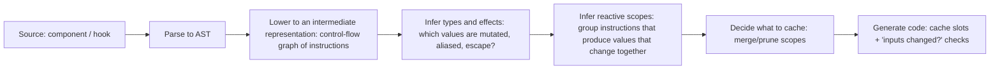
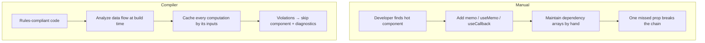
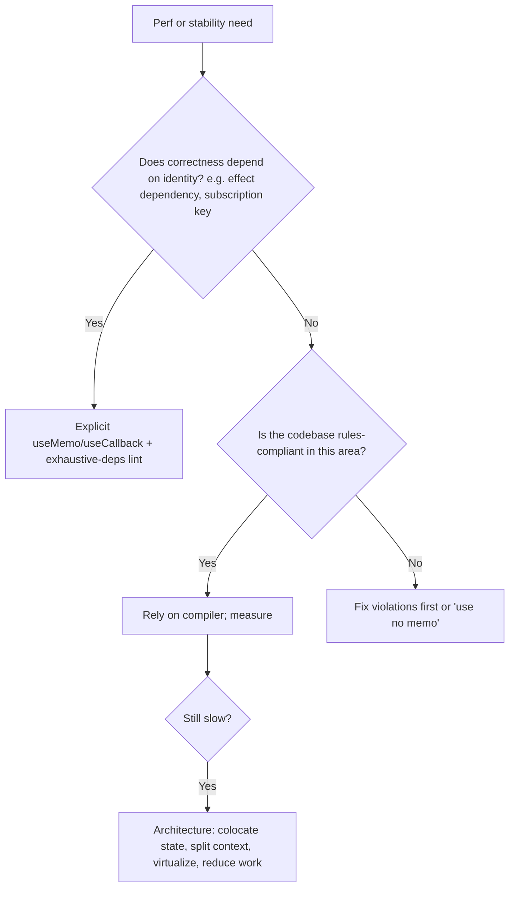

# 09 / 08 — React Compiler: Automatic Memoization, the Rules It Depends On, and How to Adopt It

## 1. Lesson metadata

| | |
|---|---|
| **Level** | Advanced / Professional |
| **Study time** | 4–5 hours (reading 1.5 h, experiments 1.5 h, exercises 1.5 h) |
| **Prerequisites** | [Phase 3 / 11 — `useMemo` and `useCallback`](../03-react-state-and-hooks/11-usememo-and-usecallback.md), [Phase 3 / 12 — `React.memo`](../03-react-state-and-hooks/12-react-memo.md), [Phase 7 / 04 — Memoization trade-offs](../07-performance/04-memoization-trade-offs.md), [Phase 7 / 05 — Referential equality](../07-performance/05-referential-equality.md), [Phase 1 / 12 — Component purity](../01-react-fundamentals/12-component-purity.md), [Phase 2 / 12 — Why rendering must be pure](../02-react-rendering-and-internals/12-why-rendering-must-be-pure.md), [Phase 2 / 28 — Strict Mode](../02-react-rendering-and-internals/28-strict-mode-behavior.md), [06 — Concurrent rendering in practice](./06-concurrent-rendering-in-practice.md) |
| **Next** | [09 — Framework architecture](./09-framework-architecture.md) |
| **Related** | [Phase 7 / 23 — Counterproductive optimizations](../07-performance/23-counterproductive-optimizations.md), [Phase 8 / 14 — Linting and static analysis](../08-testing-and-quality/14-linting-and-static-analysis.md), [15 — React API changes across versions](./15-react-api-changes-across-versions.md) |

> **HIGH-VOLATILITY LESSON.** **Status (verified 2026-10-22):** React Compiler reached **v1.0 stable on Oct 7, 2025** ([announcement](https://react.dev/blog/2025/10/07/react-compiler-1)); `babel-plugin-react-compiler` is at `1.0.0` on npm (`latest`), and React is at 19.3. The earlier beta (Oct 2024) and RC (Apr 2025) phases are over. Package names, option names and defaults, directives, DevTools badge and lint-rule names below were checked against react.dev and by **running `babel-plugin-react-compiler@1.0.0`** (and `eslint-plugin-react-hooks@7.1.1`) on this lesson's examples. What remains volatile is the *generated output shape*, the exact diagnostics wording, bundler integrations and the incompatible-library list: re-check <https://react.dev/learn/react-compiler> before you act on those. Anything I could not verify is labelled "unverified".

**What this lesson is and is not.** Earlier lessons taught manual memoization (`useMemo`, `useCallback`, `React.memo`), when it helps, when it hurts, and the referential-equality reasoning behind it. This lesson explains what the **React Compiler** automates, **why it works only for code that follows the Rules of React**, what its output conceptually looks like, what it cannot fix, how to roll it out safely in an existing codebase, and what happens to your existing manual memoization. It is *not* a tutorial on any particular bundler's configuration; those details are volatile and belong to current docs.

**Learning objectives.** After this lesson you can:
1. Explain the compiler's job (automatic fine-grained memoization at build time) and its core assumption (the Rules of React).
2. Describe, at teaching-model level, how the compiler analyzes a component and produces cached computations, and predict which parts of a component will be skipped on re-render.
3. Identify code patterns the compiler cannot safely optimize (it will *bail out* of the component or skip the part), and fix them.
4. Decide what to do with existing `useMemo`/`useCallback`/`React.memo` and with new code.
5. Plan an incremental adoption: health check, lint, targeted rollout, measurement, rollback.
6. Debug compiler-related issues: unexpected stale UI, test failures due to render counts, library incompatibilities, bail-outs.
7. Evaluate when the compiler is *not* the answer to a performance problem.

**Concepts covered:** build-time compilation, Rules of React as a contract, referential stability, reactive scopes (teaching model), dependency tracking by value, cache slots, bail-outs, compilation modes (`infer`, `annotation`, `syntax`, `all`), directives (`"use memo"`, `"use no memo"`), targets for React 17/18, ESLint integration, DevTools indicators, health check, interactions with manual memoization, library compatibility, testing implications, measuring impact.

---

## 2. Deep conceptual explanation

### 2.1 The problem: memoization is mechanical, but only the programmer was allowed to do it

Recall the manual-memoization landscape ([Phase 7 / 04](../07-performance/04-memoization-trade-offs.md)):

- A parent re-render re-runs child components unless the child bails out because its **props are referentially equal** and it's wrapped in `React.memo`.
- Props that are objects, arrays, or functions created in render are **new every time**, defeating `memo` unless wrapped in `useMemo`/`useCallback`.
- Effects and hooks that depend on such values re-run when they shouldn't.
- Therefore experienced teams sprinkle `useMemo`/`useCallback`/`memo`, with all the costs: noise, dependency-array mistakes (stale closures, missing deps), unnecessary memoization that costs more than it saves, and *incomplete* coverage (one forgotten memoized prop and the whole optimization fails).

The key observation: **deciding what to memoize and what the dependencies are is a static analysis problem** (what values does this expression read? which of those can change between renders? does the result escape in a way that makes identity matter?). Humans do it by hand, error-prone and verbose; a compiler can do it exhaustively and consistently, *provided the code obeys rules that make the analysis sound*.

### 2.2 What the compiler does, in one sentence

> **At build time, React Compiler rewrites your function components and hooks so that each piece of the computation (values and JSX) is cached and only recomputed when the inputs it reads change, as if you had added `useMemo`, `useCallback`, and `React.memo` perfectly and at fine granularity.** (Conceptual description; react.dev says it "optimizes your React app through automatic memoization" and focuses on *update* performance: skipping cascading re-renders and skipping expensive calculations inside components/hooks.)

Properties that follow:

1. **It's an optimization, not a feature.** Programs that follow the Rules of React behave identically with and without it (the intent), only faster in re-render-heavy situations.
2. **It preserves semantics by leaving out what it can't prove.** If a component violates the rules or uses constructs it can't analyze, the compiler **skips that component** (bails out), leaving it unoptimized rather than risking incorrect behavior (some violations are *not* detected, notably in-place mutation through methods such as `push`/`sort` on props; see §3.6).
3. **It memoizes at finer granularity than humans usually do**: individual expressions, JSX subtrees, callbacks, and hook inputs, including *after early returns* or conditionals, where manual hooks cannot be placed (Rules of Hooks).
4. **It is based on value comparisons** (`Object.is`) of dependencies, the same primitive that React's hooks use.

### 2.3 The contract: the Rules of React

The compiler assumes (and its lint rules help enforce):

| Rule | Why the compiler needs it |
|---|---|
| **Components and hooks are pure.** Same props/state/context → same output; no side effects in render | If render isn't pure, skipping a re-computation changes behavior |
| **Don't mutate props, state, or hook arguments / return values** | Caching assumes a value is unchanged if its reference is unchanged |
| **Don't mutate values after they've been passed to JSX or to a hook** | A memoized element or hook result could be stale |
| **Don't read or write `ref.current` during render** (except lazy init) | Refs are mutable cells outside the data-flow graph |
| **Call hooks unconditionally at the top level of components/hooks** | Standard, and enables its analysis |
| **Don't call components as functions; don't pass hooks as values** | The compiler must know what's a component/hook |
| **Side effects belong in event handlers and effects** | These run on a different schedule from render |

These are the *same* rules from [Phase 1 / 12](../01-react-fundamentals/12-component-purity.md) and [Phase 2 / 12](../02-react-rendering-and-internals/12-why-rendering-must-be-pure.md) and what concurrent rendering already requires ([06](./06-concurrent-rendering-in-practice.md)). The compiler turns "you should" into "or your optimization is skipped (or, if undetected, may misbehave)".

### 2.4 What the compiler is *not*

| It is not | Because |
|---|---|
| A way to make a render cheaper the *first* time | Memoization only helps re-renders; initial mount still runs everything (plus cache setup) |
| A fix for rendering too much *state change* (state too high, context value churn) | It skips recomputation when inputs are unchanged; if inputs do change, work is done. Architecture still matters ([Phase 3 / 18](../03-react-state-and-hooks/18-state-colocation-and-lifting.md), [Phase 7 / 06](../07-performance/06-context-propagation-cost.md)) |
| A replacement for virtualization, code splitting, or fixing algorithmic issues | It doesn't change big-O |
| A tool for server code | It optimizes components and hooks (React and React Native), focused on *re-rendering*; Server Components do not re-render on the client, so the benefit is mainly for client components (inference, not a documented statement) |
| Magic that "fixes" impure components | Impure code is skipped or misbehaves; fix the code |
| Required for React 19 | Opt-in tool; React works without it |

### 2.5 Misconceptions

| Misconception | Reality |
|---|---|
| "With the compiler, I can write sloppy code." | The opposite: it requires *stricter* adherence to the rules; violations disable optimization or cause subtle bugs. |
| "Now `useMemo`/`useCallback` are banned/deprecated." | They remain valid APIs. Guidance (react.dev, Oct 2025): for new code rely on the compiler and use `useMemo`/`useCallback` where you need precise control; for existing code either leave existing memoization in place (removing it can change compilation output) or test carefully before removing it. A common legitimate use is a memoized value used as an effect dependency. |
| "The compiler removes re-renders." | It **bails out of recomputation inside** a re-rendering component and can cause children to skip rendering (by reusing the same element objects); but the component function may still be invoked. Think "skips work", not "never runs". |
| "Compiled code is slower on first render." | There's a small cost for cache bookkeeping; usually negligible compared to savings, but not zero. Measure. |
| "It works on any code, including class components." | It only memoizes React components and hooks (not arbitrary functions, and not class components) |
| "If tests pass, the compiler is safe." | Tests that assert render counts or rely on impure behavior may change or mask issues; also tests rarely exercise rerender paths exhaustively. |
| "Enabling it can't change behavior." | For rule-following code, it shouldn't; for code that quietly relies on re-execution (impure render, mutable module state), behavior can change. Treat enabling as a behavior-affecting change in risky codebases. |

---

## 3. Internal mechanics

> **Labels.** **Public guarantee** documented by the React team; **Teaching model** a simplified account of the compiler's pipeline from talks/docs/source reading; **Implementation detail** names of passes and exact output, which change between releases. To go deeper, read the compiler's source: <https://github.com/facebook/react/tree/main/compiler> (package `compiler/packages/babel-plugin-react-compiler`, path verified) and try the Playground linked from react.dev.

### 3.1 Public guarantees (as documented on react.dev, verified 2026-10-22)

1. React Compiler is a build-time tool that automatically memoizes React components and hooks to reduce re-render cost (react.dev "React Compiler").
2. It works on code following the Rules of React; it is designed to skip components it can't analyze or that break the rules rather than break them.
3. It can be adopted **incrementally** (Babel `overrides` per directory, `compilationMode: 'annotation'` + `"use memo"`, runtime `gating`), with escape hatches for opting out (`"use no memo"`).
4. It is compatible with React 19 and, via the `react-compiler-runtime` package and the `target` option (`'17'`, `'18'`, `'19'`; default `'19'`), with React 17 and 18. React 19 output imports `c` from `react/compiler-runtime`; `target: '17' | '18'` output imports it from `react-compiler-runtime` (I confirmed both import lines by running the plugin).
5. Its lint rules ship inside **`eslint-plugin-react-hooks`** (v6+/7.x; rules such as `immutability`, `refs`, `purity`, `set-state-in-effect`, `set-state-in-render`, `static-components`, `preserve-manual-memoization`, `incompatible-library`, `unsupported-syntax` in the `recommended` / `recommended-latest` presets). The separate `eslint-plugin-react-compiler` is superseded: the v1.0 announcement says to remove it and use `eslint-plugin-react-hooks@latest` (its last npm release is `19.1.0-rc.2`). The lint rules do not require the compiler to be installed.
6. React DevTools shows a **"Memo ✨"** badge next to components optimized by the compiler (react.dev installation guide).
7. A health-check package exists: `react-compiler-healthcheck` (1.0.0). `npx react-compiler-healthcheck@latest [--src "<glob>"]` reports "Successfully compiled N out of M components", whether StrictMode is used, and whether known-incompatible libraries are used (I ran it).

### 3.2 Teaching model: from source to cached code

Conceptual pipeline (names are descriptive; the real compiler's passes differ):



Key ideas:

- **Reactive values**: anything derived from props, state, context, or hook returns, *i.e.*, values that can differ between renders. Non-reactive: constants, imports, module-level immutable values.
- **Mutability/aliasing analysis**: the compiler needs to know *when a value is finished being mutated* (e.g., building an array with `push` in a loop is fine within a render **before** it's used; after it's passed to JSX it's frozen by contract). This is why "don't mutate after passing to JSX" is a hard rule: the compiler groups the creation and all mutations of a value into one **reactive scope** and caches the *final* value.
- **Reactive scope**: a unit of cached computation: the set of instructions that compute some outputs from some inputs. Output cached; recomputed only when any input (a reactive value read by the scope) changes by `Object.is`.
- **Pruning/merging**: scopes that would produce no savings (e.g., always-changing inputs, trivial primitives) are dropped or merged to avoid overhead (heuristics; in the real output below, the filter callback, the `.filter().map()` computation and the `<ul>` are separate scopes).

### 3.3 Conceptual compiled output (illustrative, not literal)

Source:

```tsx
function ProductList({ products, query, onSelect }: Props) {
  const visible = products.filter((p) => p.name.includes(query));
  const handleClick = (id: string) => onSelect(id);
  return (
    <ul>
      {visible.map((p) => <ProductRow key={p.id} product={p} onClick={handleClick} />)}
    </ul>
  );
}
```

Conceptually compiled (**hand-simplified teaching version**; the real output, shown after the explanation, differs and is not public API):

```js
import { c as _c } from "react/compiler-runtime";        // cache hook: name/location is an implementation detail

function ProductList({ products, query, onSelect }) {
  const $ = _c(8);                                        // one cache array per component instance
  let visible;
  if ($[0] !== products || $[1] !== query) {              // inputs changed?
    visible = products.filter((p) => p.name.includes(query));
    $[0] = products; $[1] = query; $[2] = visible;
  } else {
    visible = $[2];                                       // reuse
  }
  let handleClick;
  if ($[3] !== onSelect) {
    handleClick = (id) => onSelect(id);
    $[3] = onSelect; $[4] = handleClick;
  } else {
    handleClick = $[4];                                   // stable function identity while onSelect is unchanged
  }
  let t0;
  if ($[5] !== visible || $[6] !== handleClick) {
    t0 = <ul>{visible.map((p) => <ProductRow key={p.id} product={p} onClick={handleClick} />)}</ul>;
    $[5] = visible; $[6] = handleClick; $[7] = t0;
  } else {
    t0 = $[7];                                            // same element object → React can skip reconciling this subtree
  }
  return t0;
}
```

**Predict:** the parent re-renders with the same `products`, `query`, `onSelect` references (but a new `props` object). What does React do? *Answer:* `ProductList` function runs (unless a `memo` wrapper bails out); every cache check passes; it returns the **same element** `t0`; React's reconciler sees an identical element reference for that position and can **bail out** of re-rendering the subtree (same element object ⇒ same props ⇒ no work, per standard bailout semantics, [Phase 2 / 29](../02-react-rendering-and-internals/29-reasoning-about-unnecessary-renders.md)). `ProductRow`s are skipped *without* a `React.memo` on `ProductRow`; the compiler's memoization of the JSX element does the job.

**Real output.** I compiled this exact component with `babel-plugin-react-compiler@1.0.0` (default options, executed 2026-10-22). It differs from the simplification above: `const $ = _c(12)` (12 slots); the arrow `p => p.name.includes(query)` is its own scope keyed on `query` (slots 4–5); **one outer scope** keyed on `[onSelect, products, query]` (slots 0–3) contains the `filter`, the `handleClick` closure (keyed on `onSelect`, slots 6–7), the row-render callback (keyed on `handleClick`, slots 8–9) and the `visible.map(...)` result; and the `<ul>` element is a final scope keyed on the mapped array (slots 10–11). Consequently, in the *real* output a change to only `onSelect` re-runs the filter as well, because the filter sits inside the outer scope. Constants and elements with no reactive inputs are cached with a sentinel check instead: `if ($[0] === Symbol.for("react.memo_cache_sentinel"))` (this is the output shown in react.dev's installation guide for a static `<div>Hello World</div>`). Treat slot numbers and scope boundaries as opaque.

**Why this matters:** manual equivalent would need `useMemo` for `visible`, `useCallback` for `handleClick`, `useMemo` (or `memo` on the component) for the list element: three decisions with dependency arrays. The compiler makes them all, correctly, every time.

### 3.4 Dependency tracking: finer than hooks

Manual hooks memoize *per hook call* with an explicit array. The compiler memoizes **per scope with inferred dependencies**, including **property paths** in some cases (e.g., depending on `props.user.name` rather than all of `props`). Verified: v1.0 supports optional chains and array indices as dependencies (react.dev announcement), and my runs show property-path keys such as `$[0] !== items.length`, `$[0] !== props.theme` and `$[0] !== options.a`. Consequently:

- The check is on the **references of the inferred dependencies**. When the compiler can prove it is safe, a dependency may be a narrower property path (e.g., `user.name`) rather than the whole `user` object, so replacing `user` with a new object whose `name` is unchanged may not invalidate that scope. The precision of this inference is an implementation detail and has changed between releases (it was improved in 1.0); do not design around it.
- Conditional memoization (after early returns, inside `if`) is possible because it's compiled code, not hook calls.

### 3.5 Interaction with existing manual memoization

| Existing code | Effect with compiler |
|---|---|
| `useMemo(() => compute(a), [a])` | Compiler preserves the memoization guarantee (in the real output the `useMemo` wrapper is compiled into its own cache scope keyed on the same inputs) and validates that your manual dependencies match its inference. If it cannot prove it preserves your memoization (e.g., missing deps) it **skips the whole component**: I ran a `useMemo(..., [data])` that reads `filter` and the logger reported `CompileError :: Existing memoization could not be preserved`; the `preserve-manual-memoization` lint rule reports the same. Keep `exhaustive-deps` clean |
| `useCallback(fn, deps)` | Same |
| `React.memo(Child)` | Still works; combined with compiler-stable props it bails out earlier (before invoking the child) |
| Third-party components lacking `memo` | Compiler stabilizes props you pass, but the child still re-renders when its parent re-renders *unless* the element reference is reused (which compiler-produced element caching achieves when inputs are unchanged) |
| `useEffect` with dependency arrays | Unchanged semantic; compiler may stabilize dependencies (functions/objects) so effects fire less often: **a behavior change** if your code accidentally relied on re-running (react.dev's debugging guide lists "effects over-firing, infinite loops, or missing updates" as the typical breakage when code relied on memoization for correctness) |

Practical guidance from the docs (react.dev/blog v1.0, verified): don't mass-remove existing `useMemo`/`useCallback` right after enabling the compiler, because the compiled output may differ and effect behavior can change; for **new** code you can usually omit them and rely on the compiler; use manual memoization when you need guaranteed stability for effect dependencies or want explicit control.

### 3.6 Bail-outs and what the compiler skips

The compiler won't optimize (or will reduce optimization of) a component when it detects, e.g.:

- Mutation of props/state/hook values after they're frozen; writing `ref.current` in render; reading mutable module-level variables that change.
- Constructs outside its supported subset (the set grows). Observed with 1.0.0: an inline `class` declaration inside a component (`Inline \`class\` declarations are not supported`) and an update expression on a module-level variable (`n++`: `Support UpdateExpression where argument is a global`) both made it skip the component; a `try { } catch { return <i/> }` component *did* compile (an older limitation that no longer applies).
- Hook call violations; non-component functions with component-like names used inconsistently.
- Manual memoization it cannot preserve (`Existing memoization could not be preserved`, see §3.5).
- Explicit opt-out via directive (`CompileSkip` in the logger).
- In `infer` mode, functions that do not look like components/hooks (name must be PascalCase or `use…` **and** the function must create JSX and/or call hooks): such functions are simply not considered.
- Reported diagnostics seen in my runs: `This value cannot be modified` (assigning to a prop field, `user.seen = true`) and `Cannot access refs during render` (reading/writing `ref.current`). With the default `panicThreshold: 'none'` both only skip the component; with `'critical_errors'` or `'all_errors'` the ref errors **fail the build**.

Two outcome classes (important):
1. **Detected violation → skipped component:** safe; you lose optimization; lint/diagnostics tell you why.
2. **Undetected violation → behavior drift.** Verified examples that **compiled with no diagnostic and no lint error** in 1.0.0 / `eslint-plugin-react-hooks` 7.1.1: `items.push(1)` on a prop array, `sorted.sort(...)` on an alias of a prop, reading a mutable module-level `let` (cached forever behind the sentinel), and `new Date().toLocaleTimeString()` in render (cached forever; note `Date.now()` *is* flagged by the `purity` rule, `new Date()` is not). react.dev's debugging guide states the same limit: runtime issues come from violations "the compiler couldn't detect". E.g., code that reads a mutable external value during render and *happens* to work today because the component re-renders often; under memoization it may show stale data. The compiler cannot see mutations that happen outside React's data flow. Guard with `useSyncExternalStore` ([06](./06-concurrent-rendering-in-practice.md)), and with Strict Mode and tests.

### 3.7 Third-party libraries

Some libraries expose APIs that return **stable-looking functions or objects whose results change over time without changing identity** (a function that reads internal mutable state each call). Memoizing code that depends on those identities can yield stale UI. The `incompatible-library` lint rule (in `eslint-plugin-react-hooks`) flags usages from a known list; react.dev's examples are react-hook-form's `watch()` (use `useWatch` instead) and TanStack Table's `useReactTable` (the table instance uses interior mutability). MobX `observer` also breaks memoization assumptions but is **not yet detected** by the linter; use `"use no memo"` there. The mitigation is local opt-out (`"use no memo"` on the affected component), library upgrades, or API substitution. The list is maintained by the plugin and changes between releases; check the lint output for your versions.

---

## 4. Step-by-step execution walkthrough

### 4.1 One parent update, with and without the compiler

Tree: `App` (state: `count`, `todos`) → `Counter` (button shows `count`) and `TodoList` (`todos`, `onToggle`) → many `TodoRow`.

`App` source (no manual memoization):

```tsx
function App() {
  const [count, setCount] = useState(0);
  const [todos, setTodos] = useState<Todo[]>(initial);
  const toggle = (id: string) => setTodos((ts) => ts.map((t) => (t.id === id ? { ...t, done: !t.done } : t)));
  return (
    <>
      <button onClick={() => setCount((c) => c + 1)}>Clicked {count}</button>
      <TodoList todos={todos} onToggle={toggle} />
    </>
  );
}
```

**Without compiler**, click the counter:
1. `setCount` → `App` re-renders.
2. A new `toggle` function is created → `TodoList` gets new props → re-renders (it isn't `memo`), creating 200 `TodoRow` elements; each `TodoRow` renders (not memoized).
3. Commit: only the button text changes in the DOM, but 200 rows ran their render functions.

**With compiler (conceptually):**
1. `setCount` → `App` re-renders (the function is invoked).
2. `toggle` depends only on `setTodos` (stable) → cached; the `<TodoList todos={todos} onToggle={toggle} />` element depends on `todos` and `toggle`, both unchanged → cached element reused.
3. The button element depends on `count` → recomputed.
4. React reconciles: `TodoList` element is the **same reference** → bailout, no render for the list or rows.
5. Commit: button text only. **~200 renders avoided**.

**Predict:** now click a todo to toggle it. What re-renders? *Answer:* `App` re-renders; `todos` changed → `TodoList` element recomputed → `TodoList` renders; inside it, each row's element depends on its `todo` object (replaced only for the toggled item, since `{...t}` creates a new object only for it) and on `onToggle`: if `TodoList`'s compiled code caches per-row elements (list items created in a loop are tricky: the compiler caches the whole mapped array as one scope with `todos` as input, so the entire list recomputes when `todos` changes; confirmed in the real output), then each `TodoRow` element is new, and unless `TodoRow` is wrapped in `React.memo` or the compiler memoizes at the row component (inside `TodoRow`'s own compiled body, its JSX output depends on `todo`, so a row with the unchanged `todo` reference computes the same cached output), **rows still *run* but return the same cached element tree internally**, so their children bail out. The *function calls* happen for 200 rows; the *work inside* is minimal. **Measured** (Vitest + RTL, 5 rows, `scratch/p9-d/rc`): *click the counter*: plain build re-renders `App` 1, `TodoList` 1, rows 5; compiled build re-renders `App` 1, `TodoList` 0, rows 0. *Toggle one todo*: plain `App` 1 / `TodoList` 1 / rows 5; compiled `App` 1 / `TodoList` 1 / **rows 5** (all row functions are still called because each row's element is new). Adding `React.memo` to the row component: plain build still renders 5 rows (a fresh `toggle` each render), compiled build renders **1** row. So for large lists, keep (or add) `React.memo` on row components.

This subtlety is the most common source of "the compiler didn't do what I expected": **it memoizes values and elements by their inputs; it doesn't stop React from calling a child component function whose element is new.** Use the Profiler to verify what actually re-ran ([Phase 7 / 02](../07-performance/02-profiler-workflows.md)).

### 4.2 A violation: mutating after JSX

```tsx
function Cart({ items }: { items: Item[] }) {
  const sorted = items;                 // alias, not a copy
  sorted.sort(byPrice);                 // ❌ mutates a prop
  return <List items={sorted} />;
}
```
Without compiler: works "by accident", since `Cart` re-renders each time the parent does and re-sorts the (mutated) array. With compiler: **no bail-out and no lint error** (I compiled this exact component with 1.0.0 and linted it with `eslint-plugin-react-hooks` 7.1.1: `CompileSuccess`, zero diagnostics; contrast with `user.seen = true`, which is flagged). So the mutation is undetected; the compiler caches `<List items={sorted}/>` keyed on the `items` reference, which didn't change while its contents did, so downstream output can be stale. Fix: `const sorted = items.toSorted(byPrice)` or `[...items].sort(byPrice)`.

---

## 5. Code examples

### 5.1 Minimal: enabling the compiler (verified against react.dev 2026-10-22)

```bash
npm install --save-dev --save-exact babel-plugin-react-compiler@latest
```

```ts
// vite.config.ts: @vitejs/plugin-react >= 6 (current: 6.1.x). The inline `babel` option was REMOVED in 6.0.0;
// react.dev's recommended setup is a preset applied through @rolldown/plugin-babel:
//   npm install -D @rolldown/plugin-babel
import { defineConfig } from "vite";
import react, { reactCompilerPreset } from "@vitejs/plugin-react";
import babel from "@rolldown/plugin-babel";

export default defineConfig({
  plugins: [react(), babel({ presets: [reactCompilerPreset()] })],
});

// Older plugin-react (< 6): react({ babel: { plugins: [["babel-plugin-react-compiler", { /* options */ }]] } })
```

Notes:
- The compiler's Babel plugin must run **first** in the Babel plugin list (react.dev: "the compiler needs the original source information"), i.e. `plugins: ['babel-plugin-react-compiler', /* others */]`.
- **Next.js:** `reactCompiler: true` in `next.config.ts` (top-level since Next 16, where it was stabilized; it was `experimental.reactCompiler` before). You **still install `babel-plugin-react-compiler`** (`npm i -D babel-plugin-react-compiler`); Next.js runs a custom SWC pass that only decides *which files* are relevant, and the compiler itself still runs as the Babel plugin, so builds are slightly slower. Options are passed as an object, e.g. `reactCompiler: { compilationMode: 'annotation' }`. Source: nextjs.org/docs reactCompiler page.
- **Expo:** SDK 54+ has the compiler enabled by default for new apps. **Metro/React Native:** Babel via Metro, so use the Babel setup. **Rspack/Rsbuild:** documented in their own docs. **Webpack:** community loader. **React Router:** `vite-plugin-babel`.
- **SWC/oxc:** there is no first-class SWC or oxc compiler yet; react.dev says the team is working with the swc and oxc teams on it, and that the initial stable version remains a Babel plugin.
- `create-vite` and `create-next-app` offer compiler-enabled templates.

### 5.2 Practical: incremental adoption configuration (option names verified in the plugin source and by running it)

```js
// babel.config.js (illustrative)
module.exports = {
  plugins: [
    ["babel-plugin-react-compiler", {
      compilationMode: "annotation",      // 'infer' (default) | 'annotation' | 'syntax' (Flow only) | 'all'
      // target: "18",                    // '17' | '18' | '19' (default '19', a STRING); 17/18 also need `npm i react-compiler-runtime@latest` as a dependency
      // panicThreshold: "none",          // default; 'critical_errors' | 'all_errors' fail the build
      // sources: (filename) => filename.includes("src/features/checkout"),   // exists in the plugin (default skips node_modules; an array of path substrings also works) but is not documented on react.dev; the documented route is Babel `overrides`
    }],
  ],
};
```

```tsx
// opt a component in (annotation mode, or to force compilation in infer mode)
function ExpensiveChart({ data }: { data: Series[] }) {
  "use memo";
  // …
}

// opt a component out (any mode; always wins over compilationMode)
function LegacyThing() {
  "use no memo";
  // …
}
```

Directives also work at **module level** (a `"use memo"` / `"use no memo"` string at the very top of the file), and a function-level directive overrides it (react.dev, directives reference). `ignoreUseNoForget: true` makes the plugin ignore `"use no memo"` (I confirmed it compiles an opted-out function). For runtime A/B rollout use `gating: { source, importSpecifierName }`; the compiler then emits `isOn() ? function Plain(t0){ /* compiled */ } : function Plain({a}){ /* original */ }` and the gate is evaluated **once at module evaluation time**, so it is static for the browser session (react.dev, and confirmed in the output).

Rollout ladder: (1) health check + lint; (2) `annotation` mode on a handful of hot components; (3) directory-level Babel `overrides` (or `sources`) for modern, well-tested features; (4) default (`infer`) mode globally; (5) remove obsolete manual memoization **slowly**, only with measurements. Each rung gets measurement (§8) and a rollback (turn the flag/option off; ship).

### 5.3 Practical: code that *benefits* most

```tsx
// Typical wins: derived data, inline callbacks, and JSX built from props/state
function OrdersTable({ orders, filter, onOpen }: { orders: Order[]; filter: Filter; onOpen: (id: string) => void }) {
  const rows = orders.filter((o) => matches(o, filter)).sort(byDate);   // sort on a fresh array from filter: allowed
  return (
    <table>
      <tbody>
        {rows.map((o) => (
          <OrderRow key={o.id} order={o} onOpen={() => onOpen(o.id)} />
        ))}
      </tbody>
    </table>
  );
}
```
Without the compiler `onOpen={() => onOpen(o.id)}` creates a new function per row per render, defeating `memo(OrderRow)`. In the real output (executed) the whole `rows.map(...)` result is one scope keyed on `[orders, filter, onOpen]` and the per-row closure is created inside the callback, so it is **not** stable per row, but the entire list (and the `<table>`) is reused whenever those three inputs are unchanged. The common recommended refactor is to pass `id` and the stable `onOpen` to the row (`<OrderRow order={o} onOpen={onOpen} />` and call `onOpen(order.id)` inside), which works both with and without the compiler.

### 5.4 Incorrect: mutating props / reading refs in render

```tsx
// ❌ both patterns violate the rules
function Badge({ user }: { user: User }) {
  user.seen = true;                          // mutating props
  const renderTime = useRef(Date.now());
  renderTime.current = Date.now();           // writing ref in render
  return <span>{user.name} @ {renderTime.current}</span>;   // reading ref in render
}
```
**Consequences (executed):** `react-hooks/immutability` ("This value cannot be modified"), `react-hooks/purity` (`Date.now` is impure) and `react-hooks/refs` ("Cannot access refs during render") errors, and the compiler logs `CompileError` and skips the component. **Corrected:** compute from props without mutation; if you need "time of render", you probably don't; if you need time, store it in state at an event/effect.

### 5.5 Incorrect: external mutable data read in render

```tsx
// ❌
let currentTheme = "light";                               // module-level, mutated elsewhere
export function setTheme(t: string) { currentTheme = t; }
function Card() { return <div className={currentTheme}>…</div>; }
```
With the compiler, `Card`'s output depends on a value it can't see change: **verified**: the compiled output wraps `<div className={currentTheme}>` in `if ($[0] === Symbol.for("react.memo_cache_sentinel"))`, i.e. the element is computed once per component instance and reused forever; there was no lint error or compile diagnostic. **Corrected:** `useSyncExternalStore(subscribe, getTheme)` or context/state.

### 5.6 Corrected + advanced: keep manual control where it carries meaning

```tsx
function useStableOptions<T extends object>(options: T): T {
  // Intent: a *guaranteed* stable identity as an effect dependency, independent of compiler heuristics
  const ref = useRef(options);
  if (!shallowEqual(ref.current, options)) ref.current = options;     // ❌ ref write in render → violates rules; DON'T do this
  return ref.current;
}
```
The snippet shows a **tempting anti-pattern** (ref write in render). The rules-compliant alternative is to keep `useMemo` with explicit dependencies when stability is a *semantic requirement* (e.g., a value used as an effect dependency or a subscription key):

```tsx
const options = useMemo(() => ({ pageSize, sort }), [pageSize, sort]);   // explicit, compiler-compatible, effect-safe
useEffect(() => { subscribe(options); return unsubscribe; }, [options]);
```
Rule of thumb: **if correctness depends on identity, make it explicit** (manual hook); if only performance depends on it, let the compiler handle it.

### 5.7 Advanced: verifying that compilation happened and what it saved

```tsx
// 1) DevTools: look for the "Memo ✨" badge on components (react.dev installation guide; dev builds).
// 2) Profiler: record the same interaction with the compiler on/off builds; compare "Why did this render?" and total commit duration.
// 3) Programmatic: use <Profiler> in a test harness to count commits/renders (dev/profiling builds only).

function Harness({ children }: { children: React.ReactNode }) {
  const stats = useRef({ renders: 0, actual: 0 });
  return (
    <Profiler id="harness" onRender={(_id, _phase, actualDuration) => { stats.current.renders++; stats.current.actual += actualDuration; }}>
      {children}
    </Profiler>
  );
}
```
(`Profiler`'s callback is a *commit* callback; per-component render counts require DevTools or instrumentation such as counters in effects/`console` markers in an experiment branch.) Use identical interaction scripts and CPU throttling; report deltas of **total actual duration** and **INP**, not just render counts.

### 5.8 Advanced: testing implications

```tsx
// ❌ brittle: asserts implementation (render counts)
expect(renderSpy).toHaveBeenCalledTimes(3);

// ✅ behavior-focused
await user.click(screen.getByRole("button", { name: /add/i }));
expect(await screen.findByText("Item added")).toBeInTheDocument();
```
Because the compiler changes *how often render functions run*, tests that count renders break or become meaningless ([Phase 8 / 16](../08-testing-and-quality/16-avoiding-brittle-tests.md)). In my experiment the same component produced render counts of `{app:1, list:1, row:5}` (plain) vs `{app:1}` (compiled) for an unrelated state change, so such assertions do differ. Add a CI job that runs the test suite with the compiler enabled **and** disabled during rollout to detect behavior differences (any difference is either a test coupled to implementation or a rules violation).

---

## 6. Visual explanations

### 6.1 Manual vs automatic memoization



### 6.2 What re-renders after a parent update (with compiler, conceptual)

```text
App re-renders (function runs)
 ├─ <button> element: inputs changed (count) → recomputed
 └─ <TodoList todos onToggle>: inputs unchanged → SAME element object → subtree skipped (no TodoList call, no rows)
```

### 6.3 Decision flow for "should I use the compiler / manual memo here?"



---

## 7. Alternative approaches and trade-offs

| Criterion | React Compiler | Manual `useMemo`/`useCallback`/`memo` | State colocation / architecture | Virtualization | Signals-style libraries (e.g., fine-grained stores) |
|---|---|---|---|---|---|
| Effort | Config + fix violations | Per component, ongoing | Refactor | Component rewrite | Adoption of a different model |
| Granularity | Fine, automatic | As fine as you write | N/A | Rows on screen | Very fine (per value) |
| Risk of stale deps | Low for compliant code | High (human error) | None | None | Different failure modes |
| Reduces first-render cost | No | No | Sometimes | Yes | Sometimes |
| Works with legacy impure code | No (skipped/risky) | Yes | Yes | Yes | n/a |
| Readability impact | Positive (less noise) | Negative | Positive | Neutral | Different style |
| Needs build-tool integration | Yes (Babel plugin) | No | No | No | No |
| Effect-dependency control | Implicit (can surprise) | Explicit | n/a | n/a | n/a |
| Debuggability | Compiled output differs from source | Direct | Direct | Direct | Library-specific |

**Scenario where the compiler is *not* best.** A realtime grid where thousands of cells legitimately change every frame: inputs change, so there's nothing to skip; the answer is virtualization, batching updates, or moving state out of React (canvas/WebGL/worker). Another: a codebase with pervasive mutation and legacy class components, where most components would be skipped; the cost of enabling and verifying exceeds the gain until you refactor.

**Scenario where manual memoization is still the right tool.** Stabilizing a context provider value consumed by many components *when you can't or won't compile that file*, or making an explicit stable identity for a subscription key. Also in **library code** targeting consumers who may not use the compiler: libraries can ship precompiled output (react.dev "Compiling Libraries": add the Babel plugin to the library build; for React < 19 also depend on `react-compiler-runtime` in `dependencies` (not dev) and set `target` to the minimum supported React major; test with and without compilation) or manual memoization.

---

## 8. Best practices and anti-patterns

### Best practices
1. **Start with the health check (`npx react-compiler-healthcheck@latest`) and lint (`eslint-plugin-react-hooks` `recommended`)** to see how much of your codebase is compliant; fix systematic violations first.
2. **Enable Strict Mode** and keep it on; it surfaces the impurities the compiler also dislikes ([Phase 2 / 28](../02-react-rendering-and-internals/28-strict-mode-behavior.md)).
3. **Roll out incrementally** (annotation mode or path filters) and keep a **kill switch**.
4. **Measure with the same script**: Profiler total duration, INP in lab and RUM, memory (caches add some).
5. **Run tests both with and without the compiler** during rollout; investigate every difference.
6. **Keep existing manual memoization at first**; remove only after measurement and review, and watch effects.
7. **Keep `exhaustive-deps` lint clean**: inconsistent manual deps can prevent optimization.
8. **Design components so inputs are stable and minimal** (pass ids and stable handlers rather than per-item closures): good for the compiler and for humans.
9. **Document opt-outs** (`"use no memo"` with a comment: why, owner, ticket).
10. **Track library compatibility notes** per release (the `incompatible-library` lint rule).

### Anti-patterns

| Anti-pattern | Problem | Fix |
|---|---|---|
| Enabling globally in a big legacy app and shipping | Hidden behavior changes | Incremental rollout with flags and A/B comparison |
| Deleting all `useMemo`/`useCallback` in one PR | Effect behavior changes; output diff | Gradual removal with measurement |
| Relying on render counts in tests | Fragile | Behavior assertions |
| Using `"use no memo"` as a first resort | Accumulating exceptions | Fix the violation; opt out only with justification |
| Treating the compiler as a perf strategy | Doesn't fix architecture/algorithms | Profile; fix root causes |
| Depending on compiler output shape or cache hook names | Internal and unstable | Treat as opaque |
| Mutating "just a copy" that is actually shared | Silent staleness | Immutable updates |
| Reading module/global mutable state in render | Staleness under memoization | `useSyncExternalStore`/context |

**Justified exception:** a hot path in a *non-compliant* third-party-integrated component, where `"use no memo"` plus targeted manual memoization is the pragmatic combination until the library is upgraded.

---

## 9. Real-world application

| Domain | Where the compiler helps | Constraints |
|---|---|---|
| **E-commerce** | Large PLP/PDP client trees with filters; inline handlers and derived lists; fewer cascading re-renders when unrelated state (cart count, banner) changes | Some filter components use form/table libraries (react-hook-form `watch`, TanStack Table `useReactTable` are flagged by `incompatible-library`); analytics in effects sensitive to stabilized deps |
| **Dashboards** | Many widgets re-rendering from a shared filter; compiled widgets skip when inputs unchanged | Realtime tick-driven updates still re-render legitimately; use selectors/virtualization |
| **Finance** | Complex tables with derived columns; fewer accidental re-renders | Correctness first: staleness bugs are costly; require rules-compliance audits and dual (on/off) test runs; no mutation of financial data objects |
| **Forms** | Large forms: field components skip re-rendering when other fields change | Form libraries with mutable proxies/`watch` (react-hook-form: use `useWatch`): verify compatibility; `"use no memo"` where needed |
| **Auth** | Little direct benefit | Be careful that identity changes (logout) still propagate: avoid caching user-derived values via module state |
| **Realtime** | Limited | Inputs change constantly; consider architecture |
| **Multi-team design systems** | Library authors can ship compiled artifacts or rely on consumers; reduces need for `memo` boilerplate | Version compatibility matrix (React 17/18/19 targets); document stability contracts |

---

## 10. Debugging and troubleshooting

### Symptom A: "A component isn't being optimized (no badge / no savings)."
- **Investigation:** look for the missing "Memo ✨" badge; run the lint rules for the component; check the compiler's diagnostics output (the `logger.logEvent(filename, event)` option: `CompileSuccess`, `CompileError` with `event.detail.reason`, `CompileSkip`, `CompileDiagnostic`, `PipelineError`, `Timing`); look for mutation of props/state, ref access in render, unsupported syntax, missing directives in annotation mode, file excluded by `sources`.
- **Fix:** resolve the violation; add `"use memo"` if annotation mode. **Validate:** badge present; Profiler shows skipped work.

### Symptom B: "After enabling the compiler, a part of the UI is stale."
- **Repro:** toggle the compiler per component with `"use no memo"` to bisect.
- **Root causes:** hidden mutation (props/state mutated in place), reading external mutable data in render, library API returning stable identity with changing behavior, ref.current used in render.
- **Fix:** immutable updates; uSES; library workaround; keep the opt-out only if justified.

### Symptom C: "An effect now runs less (or more) often."
- **Root cause:** compiler stabilized (or in rare cases changed) dependency identities; your effect relied on unstable identity as a trigger. **Fix:** make the trigger explicit (add a real dependency, e.g., a version counter) and review whether the effect should be an event handler ([Phase 3 / 07](../03-react-state-and-hooks/07-you-might-not-need-an-effect.md)).

### Symptom D: "Tests that count renders now fail."
- **Root cause:** implementation-coupled tests. **Fix:** assert behavior; if render counts matter (perf tests), use Profiler budgets with tolerance in a performance suite, not unit tests.

### Symptom E: "Build slower / larger."
- **Investigation:** compare build times with/without the plugin; check bundle size (compiled output adds cache logic and a small runtime). **Fix:** restrict `sources`; accept a small size increase if runtime gains justify; measure.

### Symptom F: "DevTools shows compiled components but performance didn't improve."
- **Root cause:** inputs change every render (unstable props from non-compiled parents, context value churn, state too high), or the cost is in effects/layout/network. **Fix:** profile; follow the architecture/perf lessons ([Phase 7](../07-performance/01-measure-before-optimizing.md)).

### Symptom G: "Hot reload / debugging experience is odd."
- **Context:** compiled code differs from source; source maps help but stepping can be confusing (unverified). **Fix:** debug with the compiler disabled for the file, then re-enable.

---

## 11. Exercises

### Level A — Knowledge
A1. State the compiler's contract: which assumptions about your code does it make, and what happens if they're violated?
A2. Why can the compiler memoize after an early return while `useMemo` cannot?
A3. Does the compiler reduce the cost of the initial mount? Justify.
A4. List three code patterns that are Rules of React violations relevant to the compiler.
A5. Why might removing existing `useCallback` calls change behavior after enabling the compiler?

### Level B — Code comprehension
B1. In the §3.3 conceptual output, which values change (and which cache slots are rewritten) if only `query` changes? If only `onSelect` changes?
B2. For each snippet, say whether the compiler can safely optimize it and why:
```tsx
// (a)
function A({ items }: { items: number[] }) { const total = items.reduce((s, n) => s + n, 0); return <b>{total}</b>; }
// (b)
function B({ items }: { items: number[] }) { items.push(1); return <b>{items.length}</b>; }
// (c)
function C() { const r = useRef(0); r.current++; return <b>{r.current}</b>; }
// (d)
let n = 0; function D() { n++; return <b>{n}</b>; }
```
B3. A parent compiled with the compiler passes `onSave={() => save(id)}` to a `React.memo` child. If `id` and `save` are unchanged across renders, does the child re-render? What if the parent isn't compiled?

### Level C — Implementation
C1. Refactor this component so that it's friendly to both the compiler and humans (no per-item closures defeating stability):
```tsx
{rows.map((r) => <Row key={r.id} data={r} onClick={() => select(r.id)} onHover={() => setHover(r.id)} />)}
```
C2. Write an adoption plan as a checklist for a 400-component app: tooling, lint, rollout phases, metrics with thresholds, rollback triggers.
C3. Write a test harness that runs the same Vitest suite twice (compiler on/off) and diffs the results, describing build configuration.

### Level D — Debugging
D1. After enabling the compiler, a "last updated" timestamp in a dashboard stops updating. The component computes `new Date().toLocaleTimeString()` in render. Diagnose and fix.
D2. A data table using a third-party hook shows stale sorted order after enabling the compiler for only that file. Propose a bisecting plan and three fixes with trade-offs.

### Level E — Architecture and engineering decisions
E1. Your design-system library is used by apps on React 17, 18 and 19. Decide how to handle the compiler: compile in the library, ship uncompiled source, or leave manual memoization. Evaluate maintainability, consumer experience, and risk.
E2. A team proposes "remove all memoization hooks to simplify code since we have the compiler". Argue for a safer path with measurements.

### Level F — Expert challenge
F1. Design a static analysis + runtime verification toolchain that identifies **undetected compiler-risk patterns** (hidden mutation, external mutable reads in render) across a monorepo, including how you'd evaluate precision/recall and how you'd integrate with CI and code review.

---

## 12. Detailed answers and explanations

> Attempt the exercises first.

**A1.** It assumes Rules of React: pure render, no mutation of props/state/hook values (especially after use in JSX/hooks), no ref reads/writes in render, hooks unconditionally, etc. Violations detected → the component is skipped (unoptimized) and lint reports; undetected violations may produce stale/incorrect UI, because cached values assume referential equality implies unchanged content.

**A2.** Hooks depend on call order, so they can't be called conditionally or after an early return. Compiled code uses plain conditionals on a per-component cache array, so memoization can be applied to code after returns or within branches.

**A3.** No: on the first render all scopes compute (cache empty) plus bookkeeping; memoization pays off on subsequent renders. Initial cost may be marginally higher.

**A4.** Mutating props/state/hook args; writing or reading `ref.current` in render; side effects (logging/analytics/network) in render; reading mutable module-level data in render; mutating a value after passing it to JSX; non-deterministic render (`Date.now()`, `Math.random()`) when output is expected to follow inputs.

**A5.** The compiler may produce different dependency stability patterns than your manual code: e.g., your manual `useCallback` with deps deliberately including a changing value to retrigger an effect, or the compiler's inference diverges from your manual deps (the compiler skips components whose manual memoization it cannot preserve). Removing hooks can alter when effects re-run and when memoized children re-render.

**B1.** (Answered for the simplified §3.3 output; the real 1.0.0 output groups the filter, closure and map into one outer scope, so there any change to `products`, `query` or `onSelect` re-runs the filter and the map, and only the inner callbacks/`<ul>` have their own slots.) `query` changes: scope for `visible` recomputed (`$[0]`,`$[1]` check fails → rewrite `$[0..2]`); `handleClick` unchanged (depends only on `onSelect`); element `t0` recomputed because `visible` changed (`$[5]`, `$[7]` rewritten). `onSelect` changes: `visible` reused; `handleClick` recomputed (`$[3]`,`$[4]`); element `t0` recomputed because `handleClick` changed.

**B2.** (a) Yes: pure derivation from props; memoized by `items`. (b) No, it is a violation (mutates a prop), **but 1.0.0 does not detect it**: it compiles with `CompileSuccess` and no lint error, so this is the dangerous "undetected" class. (c) No: `Cannot access refs during render` (lint `react-hooks/refs` and compiler `CompileError`; skipped). (d) No: impure (module-level mutable state in render); in 1.0.0 the compiler skips it only because `n++` on a global is an unsupported construct (`CompileError :: Support UpdateExpression where argument is a global`); a read-only use of such a variable would have been compiled and cached (see §5.5). Strict Mode would show doubled increments.

**B3.** Compiled parent: `onSave` closure depends on `id` and `save`; unchanged → same function identity across renders → `memo` child's props equal → no child re-render. Non-compiled parent: a new closure each render → `memo` bails out fails → child re-renders (unless you used `useCallback`).

**C1.**
```tsx
{rows.map((r) => <Row key={r.id} data={r} onSelect={select} onHover={setHover} />)}
// Row: onClick={() => onSelect(data.id)} onMouseEnter={() => onHover(data.id)}
```
Why better: per-item closures move into the row (created only when that row renders), the parent passes stable function references (`select` stable if from a hook/`useCallback` or compiler-stabilized, `setHover` from `useState` is stable), enabling `memo(Row)` or compiler caching of row elements. Trade-off: slightly more code inside `Row`.

**C2 (criteria).** Checklist: baseline measurements (INP, Profiler on 5 key flows, bundle size, build time); health check; fix top violation categories; turn on lint as error for new code; Strict Mode enabled; adopt annotation mode on 5–10 hot components; dual test runs; staged rollout by directory with feature flag/build variants; canary release; RUM comparison (INP p75, error rate); thresholds (e.g., no regression in error rate; INP improvement or neutral; bundle +≤X KB); rollback trigger (any severity-1 stale-data bug); documentation of opt-outs; schedule to remove redundant memoization with before/after tests.

**C3 (sketch).** Two Vitest configs: base and compiler-enabled (a small Vite `transform` plugin that runs `@babel/core` with `babel-plugin-react-compiler`, or `@rolldown/plugin-babel` with `reactCompilerPreset()`; I used the former, see `tools/sandbox/scratch/p9-d/vitest.config.mjs`). CI matrix job runs both; compare failing sets; any test failing only with compiler is triaged. Add a script that diffs JUnit XML reports. Verify configuration details in current docs.

**D1.** Render computes the time from `Date.now()`: impure/non-deterministic; compiler caches the result keyed on inputs (none) → never updates. Before, it "worked" only because something re-rendered the component. Fix: keep the time in state updated by a timer (`useEffect`/interval) or via `useSyncExternalStore` subscription to a clock; or pass the timestamp from a parent that updates it.

**D2 (criteria).** Bisect: add `"use no memo"` to the component (stale fixed → compiler/library interaction); within the component, isolate which values come from the library hook; check the library's compatibility notes; fixes: (1) `"use no memo"` on that component: quick, loses optimization; (2) wrap the library's mutable accessor with `useSyncExternalStore` or derive from state you own: more work, more robust; (3) upgrade/replace the library: long-term. Validate with tests that mutate sort order and assert the UI.

**E1 (criteria).** Considerations: consumers' React versions and toolchains; compiled output requires runtime support for older React via `target` plus the `react-compiler-runtime` dependency; shipping compiled code locks you to compiler version behavior and complicates debugging/stack traces; shipping source requires consumers to compile node_modules (unusual); manual memoization remains version-agnostic. Reasonable decision: library stays rules-compliant (so consumers who compile are safe), keeps minimal manual memoization where identity is semantic (context values, stable callbacks exposed in APIs), evaluates shipping compiled builds only with a verified matrix and tests across React 17/18/19 (react.dev's "Compiling Libraries" guide supports this, with `target` set to the minimum React version). Document stability guarantees in API docs.

**E2 (criteria).** Argue for: (1) benchmark and keep existing code until compiler in production for a cycle; (2) lint to ensure compliance; (3) remove memoization in leaf components with no effect dependencies first; (4) keep memoization used for effect deps or for non-compiled files; (5) measure before/after; (6) keep a revert path. Cite risk: behavior changes in effects and mismatch between manual and inferred deps.

**F1 (criteria).** Components: AST rules (mutation of parameters/props, `ref.current` in render, module-level `let` reads in components, `Date`/`Math.random` in render), type-aware checks (identify objects from props), compile with diagnostics logging aggregated per file, runtime dev-mode proxies that detect mutation of frozen props/state in tests, dual-mode test diffs, a seeded-bug evaluation to measure precision/recall (inject known violations), integration as PR comments and a dashboard of compliance over time; privacy and noise management: suppressions with expiry.

---

## 13. Senior engineer interview questions

**Q1. "What does React Compiler do, and what must be true of your code for it to be safe?"**
*Strong answer:* It analyzes components/hooks at build time and caches computations and JSX by their inputs, equivalent to fine-grained `useMemo`/`useCallback`/`memo`. It's safe for code that follows the Rules of React (purity, no mutation of props/state, no render-time ref access); otherwise it bails out or, when it can't detect the problem, may produce stale UI.

**Q2. "We enabled the compiler and one widget shows stale data. How do you approach it?"**
*Strong answer:* Bisect with `"use no memo"`; confirm it's compiler-related; inspect for mutation, external mutable reads, or library APIs with stable identity but changing results; fix at the source with immutability or `useSyncExternalStore`; keep the opt-out only if needed, documented; add a regression test.

**Q3. "Should we delete our `useMemo` and `useCallback` calls?"**
*Strong answer:* Not wholesale. The compiler treats them as part of the program and removal can change compiled output and effect behavior. For new code rely on the compiler; keep explicit memoization where identity is semantically important; remove old hooks gradually with measurements and lint.

**Q4. "Why doesn't the compiler fix our slow list?"**
*Strong answer:* If inputs change on every render (state too high, context churn, new data) there's nothing to skip; also it doesn't change algorithmic cost or first-render cost. Profile; colocate state, virtualize, reduce work, then recheck what the compiler can add.

**Q5. "How do you roll out a build-time optimization safely at scale?"**
*Strong answer:* Baseline metrics, compliance tooling, incremental enablement, dual-run tests, canary + RUM, thresholds and rollback, documentation of exceptions, and a plan to remove obsolete manual optimizations gradually.

**Q6. "How does the compiler relate to concurrent rendering and Strict Mode?"**
*Strong answer:* All require pure, idempotent render. Strict Mode's double-render finds many violations; concurrent rendering may discard/repeat renders; the compiler caches results assuming purity. Code that passes Strict Mode scrutiny is far more likely to be compiler-safe.

---

## 14. Further learning resources

| Resource | URL | Covers / why | Level | Section to study |
|---|---|---|---|---|
| React docs — React Compiler | <https://react.dev/learn/react-compiler> | Official overview, installation, incremental adoption, debugging (all fetched 2026-10-22) | Int–Adv | Whole section |
| React docs — React Compiler reference | <https://react.dev/reference/react-compiler/configuration> | `compilationMode`, `gating`, `logger`, `panicThreshold`, `target`, directives, Compiling Libraries (all verified) | Adv | Configuration, directives |
| React blog — React Compiler v1.0 | <https://react.dev/blog/2025/10/07/react-compiler-1> | Stable release, ESLint merge, memoization guidance | Int | Whole post |
| React docs — Rules of React | <https://react.dev/reference/rules> | The contract the compiler relies on | Int | Components and hooks must be pure; React calls components and hooks; Rules of hooks |
| React docs — Keeping Components Pure | <https://react.dev/learn/keeping-components-pure> | Purity foundations | Beg–Int | Whole page |
| React Compiler repository directory | <https://github.com/facebook/react/tree/main/compiler> | Source, README, issues for compatibility discussions (path verified) | Expert | README, packages |
| React blog — compiler beta and RC | <https://react.dev/blog/2025/04/21/react-compiler-rc> | Release-candidate post (URL verified; the beta post is linked from the 1.0 announcement) | Int | Whole post |
| React Conf talks on React Compiler | <https://conf.react.dev/> | Deep dives by the team (site verified; specific talk URLs not) | Adv | Compiler talks |
| eslint-plugin-react-hooks | <https://react.dev/reference/eslint-plugin-react-hooks> | Lint rules including the compiler-powered ones (rule names verified; presets `recommended` / `recommended-latest`) | Int | Recommended rules |
| React DevTools | <https://react.dev/learn/react-developer-tools> | "Memo ✨" compiler badge, Profiler | Int | Components, Profiler |

All URLs above returned HTTP 200 on 2026-10-22 except where noted. **Because this tool evolves, treat any blog post older than a few months as potentially outdated.**

---

## 15. Knowledge checkpoint

**You should now understand**
- The compiler automates fine-grained memoization at build time, relying on the Rules of React.
- It caches by inputs using value comparison; JSX elements are cached so children can bail out.
- It skips what it can't prove safe; undetected violations can cause stale UI.
- It doesn't help first renders, algorithmic cost, or inputs that legitimately change every time.
- Adoption is incremental, measured, and reversible; manual memoization remains for semantic identity needs.

**You should be able to explain without notes**
- Why mutation after JSX or ref reads in render break caching.
- What stays the same and what changes about effects after enabling it.
- Why tests should not count renders.

**You should be able to implement**
- An incremental rollout plan with dual test runs and metrics; refactors that produce compiler-friendly components; opt-outs with documentation.

**You should be able to debug**
- Stale UI after enabling, non-optimized components, effect behavior changes, unchanged performance.

**Prerequisite for the next lesson** ([09 — Framework architecture](./09-framework-architecture.md)): with rendering strategies (01–02), Server Components (03–04), Suspense (05), concurrency (06), modern APIs (07), and the compiler (08) understood, we can now study how frameworks assemble these pieces into routing, data loading, and build systems, and what you're delegating when you adopt one.

**Reminder:** options and defaults here were verified against `babel-plugin-react-compiler@1.0.0` and react.dev on 2026-10-22; if you ship a later compiler release, re-check the changelog, especially generated-output shape, diagnostics wording and the incompatible-library list.
