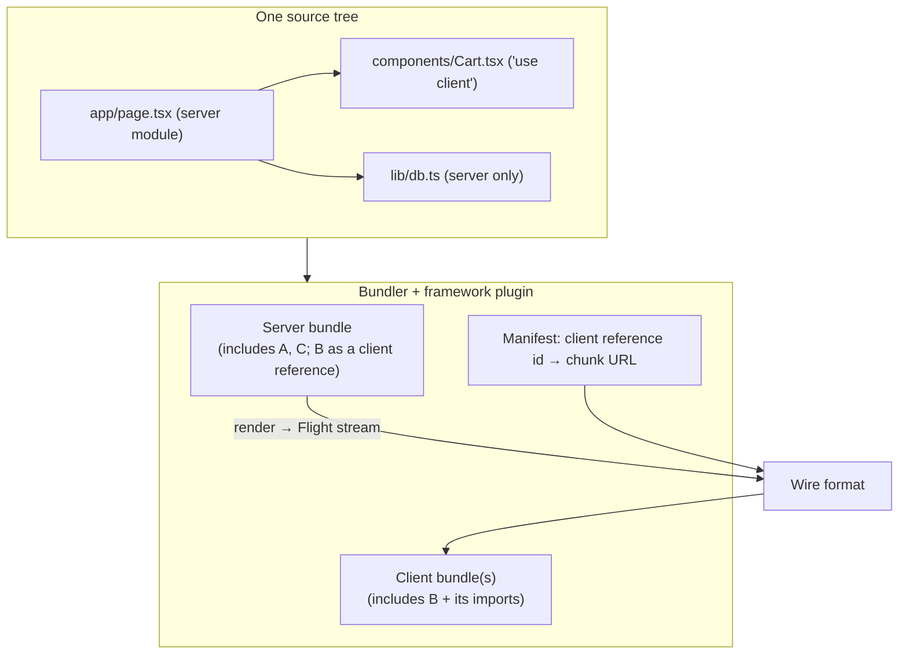
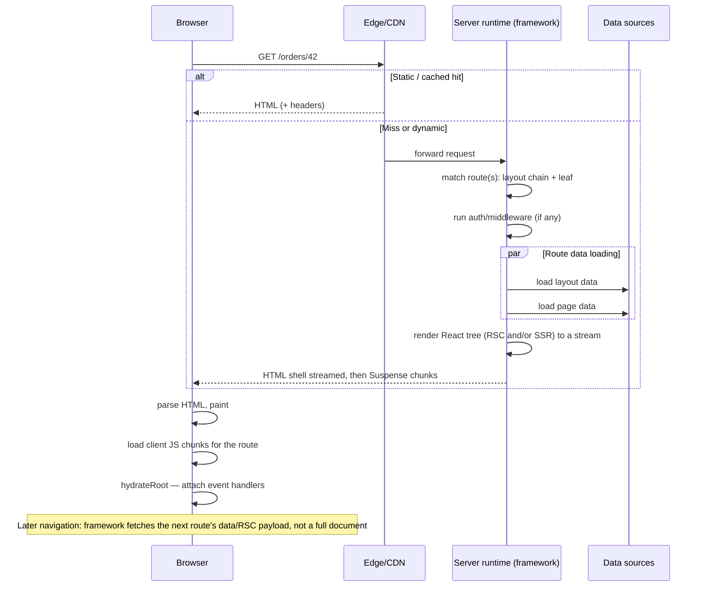
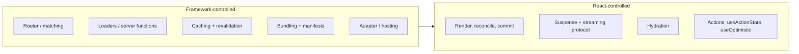
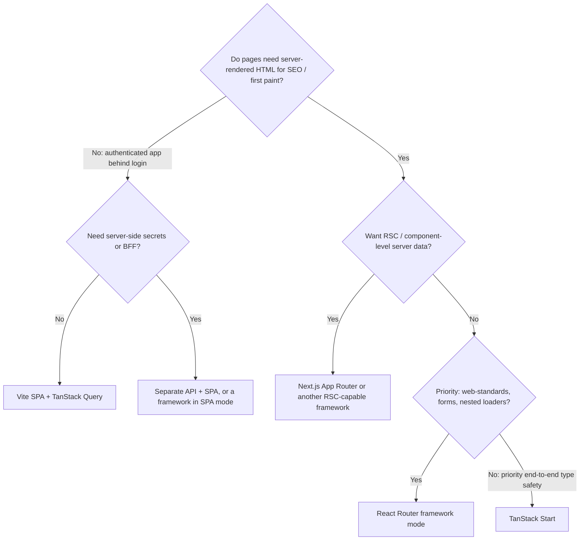

# 09 / 09 — Framework Architecture: What a React Framework Actually Provides

> **Version note (reviewed 2026-10-22).** This lesson separates *stable concepts* (what any React framework must solve) from *framework APIs* (file names, function names, config keys, defaults). Framework APIs change between majors, sometimes between minors, so the identifiers below were checked against the docs current on 2026-10-22: **React 19.3**, **Next.js 16.4** (App Router), **React Router 8.5** (v7 lineage; v8 needs React 19.2.7+ and Node 22.22+), **TanStack Start 1.169+** (first stable release) on TanStack Router 1.x. Re-check them before you depend on them; where a detail could not be verified, the text says so.

## 1. Lesson metadata

| | |
|---|---|
| **Level** | Advanced |
| **Study time** | 5–6 hours (reading 2.5 h, comparing frameworks 1.5 h, exercises 1.5 h) |
| **Prerequisites** | [01 — SPA, SSR, SSG, streaming](./01-spa-ssr-ssg-streaming.md), [03 — Server Components in depth](./03-server-components-in-depth.md), [04 — Client/server boundaries and serialization](./04-client-server-boundaries-and-serialization.md), [05 — Suspense architecture](./05-suspense-architecture.md), [Phase 4/18 — Routing architecture](../04-react-architecture/18-routing-architecture.md), [Phase 6/14 — Server-side data loading](../06-data-fetching-and-state-ecosystems/14-server-side-data-loading.md) |
| **Next** | [10 — Routing and nested layouts](./10-routing-and-nested-layouts.md) |
| **Related** | [12 — Auth boundaries](./12-auth-boundaries.md), [13 — Forms, actions and mutations](./13-forms-actions-and-mutations.md), [Phase 11/15 — Framework selection](../11-senior-and-architect-mastery/15-framework-selection.md) |

**Learning objectives.** After this lesson you can:
1. List the responsibilities that React itself deliberately does *not* implement and that a framework must supply (bundling, routing, server runtime, data loading, caching, mutations, deployment).
2. Describe how a framework integrates React Server Components, SSR, streaming and hydration through a bundler, and why that integration is the reason RSC is "a framework feature".
3. Explain the architecture of Next.js App Router, React Router framework mode (Remix lineage) and TanStack Start at the level of *request lifecycle and ownership of concerns*, not at the level of memorized APIs.
4. Evaluate frameworks against explicit criteria (hosting, team skills, data model, RSC need, lock-in, upgrade cost) and recognize when "no framework" (Vite SPA) is the right answer.
5. Separate framework conventions from React guarantees so you can read an unfamiliar framework quickly.

**Concepts covered:** what React does and does not own, meta-framework, bundler integration for RSC, dual environments (server/client/edge), route-as-unit-of-code-splitting, loaders and server functions, cache layers, rendering strategy per route, deployment targets, adapters, framework lock-in, Remix lineage and React Router v7 merge, TanStack Start, "framework-defined React".

---

## 2. Deep conceptual explanation

### 2.1 What problem is this lesson solving?

You have learned React as a library: `createRoot`, components, state, effects. Phase 9 has since introduced SSR, hydration, streaming and Server Components. Each of those features raised the same question: **who runs this code, when, and with what infrastructure?**

- React can render a tree to a stream of HTML on the server (`react-dom/server`). It does not start an HTTP server.
- React defines Server Components and the `"use client"` / `"use server"` directives. It does not decide how a bundler splits the module graph into server and client bundles.
- React defines Suspense and `use`. It does not decide how a route's data gets fetched before navigation, or how responses are cached.
- React defines Actions and `<form action>`. It does not define the HTTP endpoint that receives a submission.

The unowned space between "React renders" and "a user in Lisbon gets a page" is large. A **framework** is the opinionated answer to all of it. Learning to *read* that answer, rather than memorize one framework's, is the senior-level skill.

### 2.2 What React owns, and what it leaves open

| Concern | React's position | Who answers it |
|---|---|---|
| Component model, state, effects, Suspense, transitions | **Owns.** | React |
| Rendering to DOM / to HTML stream | **Owns the renderer APIs** (`react-dom`, `react-dom/client`, `react-dom/server`). | React, driven by a framework or your server |
| Server Components protocol (the serialized "Flight" payload), `"use client"`, `"use server"` semantics | **Specifies the model and ships the runtime packages**; documents that bundler/framework integration is required. The bundler/framework integration surface is aimed at framework and bundler authors, not app developers. | React + framework + bundler plugin |
| Routing | **Does not own.** | Framework or router library |
| Data loading orchestration (when to fetch, prefetch, waterfalls) | Gives primitives (`use`, Suspense, `cache` on the server). Does not own strategy. | Framework / query library |
| HTTP server, request/response, cookies, headers | **Does not own.** | Framework / hosting runtime |
| Build: compile TS/JSX, split code, hash assets, produce server + client bundles | **Does not own.** | Bundler (Vite, webpack, Turbopack, Rspack…) driven by framework |
| Caching, ISR/revalidation, CDN integration | **Does not own.** | Framework + hosting |
| Mutation endpoints and CSRF defenses | Gives Actions as an *API shape*. | Framework |
| Deployment adapters (Node, edge, serverless, static export) | **Does not own.** | Framework + platform |

> **Public guarantee (react.dev).** Verified against <https://react.dev/learn/creating-a-react-app> on 2026-10-22: "If you want to build a new app or website with React, we recommend starting with a framework." The page lists three recommended full-stack frameworks: **Next.js (App Router)**, **React Router (v7)** and **Expo** (native apps). It also lists "up-and-coming" frameworks working towards the full-stack React vision (TanStack Start, labelled "Beta" on that page even though 1.169 is the first stable release, and RedwoodSDK). For building from scratch it points to Vite, Parcel or Rsbuild. Create React App was deprecated in February 2025 and is no longer a starting point. The list is revised from time to time, so re-read it.

### 2.3 The frameworks in one paragraph each

*(Teaching model; positions as of 2026-10-22. Frameworks evolve.)*

**Next.js (App Router).** Vercel's full-stack framework. The App Router (the `app/` directory) is the most complete production integration of React Server Components, streaming SSR and Server Functions ("Server Actions" in Next terminology). Routes are directories; special files (`page`, `layout`, `loading`, `error`, `not-found`, `route`) define UI and boundaries. The latest major is **Next.js 16** (16.4.x on npm). Next 16 made Turbopack the default bundler for `next dev` and `next build` (`--webpack` opts out), renamed the `middleware` file convention to `proxy` (`proxy.ts`, Node.js runtime only; `middleware` is deprecated), and removed the synchronous compatibility for `params`, `searchParams`, `cookies()`, `headers()` and `draftMode()` that Next 15 had kept. Caching changed twice: Next 14 cached `fetch` and `GET` route handlers by default, Next 15 stopped doing so, and Next 16 introduced **Cache Components** (`cacheComponents: true`, the `use cache` directive, `cacheLife`, `cacheTag`) as the opt-in model, which also makes Partial Prerendering the default rendering behaviour. Apps created with the current `create-next-app` have it enabled. Treat caching defaults as the most version-sensitive part of Next.

**React Router v7 "framework mode" (Remix lineage).** Remix (2020–2024) was a framework built on React Router, centered on **loaders**, **actions**, nested routes, web-standard `Request`/`Response`/`FormData`, and progressive enhancement. React Router v7 absorbed the Remix feature set: it can be used as a plain client router ("library mode") or with a Vite plugin as a full framework ("framework mode") with typed route modules, SSR, SPA mode and pre-rendering. The current major is **React Router 8** (8.5.0 on npm; v7 is still maintained). v8 requires React 19.2.7+ and Node 22.22+, ships ESM only, removes the `react-router-dom` package (import `RouterProvider`/`HydratedRouter` from `react-router/dom`, everything else from `react-router`) and makes middleware always on. **"Remix 3" is a different project, not a successor to Remix v2**: `remix@3.0.0` is published on npm as a web-standards toolkit with its own component runtime (not React). The React-based Remix v2 lineage continues as React Router. RSC support in React Router (framework and data modes) is documented but flagged **unstable/experimental** and may break in minor releases.

**TanStack Start.** A full-stack framework built on **TanStack Router** (fully type-safe routing with search-param validation) and Vite, with server functions and SSR/streaming. It emphasizes type safety and explicit control; **TanStack Start reached its first stable release in 1.169** (`@tanstack/react-start` 1.169.3 is `latest` on npm; it builds with Vite 8 or Rsbuild). Its RSC support is documented as **experimental** and not enabled by default.

**Others you will meet:** Astro (content-first, islands, can host React components), Waku (minimal RSC framework; still a release candidate on npm, `1.0.0-rc.4`, when checked), RedwoodSDK (full-stack, Cloudflare-oriented; listed on react.dev as an up-and-coming framework), Expo Router (React Native/web), Gatsby (largely legacy for new projects). They are mentioned for orientation only.

### 2.4 Why RSC makes the framework non-optional

Before RSC, SSR was a *library-level* feature: you wrote an Express server, called `renderToString` (later `renderToPipeableStream`), and shipped the same bundle to the client. A hobbyist could assemble it.

With RSC, the module graph is **split by directive**:



For this to work:
1. The bundler must understand `"use client"` as an *edge of the graph*: on the server it replaces the imported module with a **reference** (id + export name); on the client it bundles the real module.
2. It must produce a **manifest** so the server can tell the client which JS chunk contains reference `X`.
3. `"use server"` functions must become **addressable endpoints** with stable ids, plus an encryption/validation story for closed-over variables (implementation detail that differs per framework; Next.js, for example, generates encrypted, non-deterministic action ids and encrypts captured variables with a per-build key, per its Data Security guide).
4. The server must run React with the right **export conditions** (e.g. `react-server`), so that server-only React APIs are available and client-only APIs (state, effects) are rejected.
5. The router must understand that navigation fetches a **new server-rendered subtree** and merges it into the existing client tree, preserving client state in untouched layouts.

None of that is application code. It is why you cannot "just add RSC" to a Vite SPA by hand without writing (or adopting) a framework. Lesson [03](./03-server-components-in-depth.md) §Internal mechanics covers the protocol; this lesson covers who implements the glue.

### 2.5 The unit of a framework: the route

Nearly every framework chooses the **route** as the organizing unit because the route is where four things coincide:

| Concern | Why it aligns with routes |
|---|---|
| **Code splitting** | A URL change is the most natural moment to load more code. |
| **Data loading** | A URL determines which data a screen needs; loading at route level enables *parallel* fetching and avoids render-fetch waterfalls ([Phase 7/17](../07-performance/17-network-waterfalls.md)). |
| **Rendering strategy** | Static, dynamic, streamed; per-route choice. |
| **Error and loading boundaries** | A route segment is a meaningful failure and pending unit. |

The differences between frameworks are mostly *how* each concern attaches to a route:

| | Next.js App Router | React Router framework mode | TanStack Start |
|---|---|---|---|
| Route definition | Filesystem (`app/…/page`) | Config file (`routes.ts`) with optional file-based helpers | File-based by default (TanStack Router); code-based possible |
| Data loading | Async server components + `fetch`/DB calls in components; `generateStaticParams` etc. | Route module `loader` (server) / `clientLoader` | Route `loader` (**isomorphic**: runs on server for the first load, in the browser on client navigations) + `createServerFn` for server-only code |
| Mutations | Server Functions ("Server Actions") invoked from forms or handlers | Route `action` + `<Form>` / `useFetcher` | Server functions (`createServerFn`) invoked from client |
| Default server-rendered component model | **RSC** (server components by default) | Client components + SSR; RSC support experimental (docs flag it unstable) | Client components + SSR; RSC support experimental, opt-in |
| Typing across the boundary | Generated route-aware helpers such as the global `PageProps<'/blog/[slug]'>` (types produced by `next dev`/`next build`/`next typegen`) | Generated route types (`Route.LoaderArgs`, `Route.ComponentProps`) | Inferred from router definitions |
| Build tool | Turbopack by default in Next 16 (webpack via `--webpack`) | Vite | Vite |

### 2.6 Common misconceptions

| Misconception | Reality |
|---|---|
| "Next.js is React." | Next.js is one framework that integrates React. `useState` is React; `layout.tsx` is Next. |
| "SSR always means a Node server." | SSR needs *a JS runtime that can execute the render* (Node, edge/worker runtimes, Deno, Bun). Static prerendering needs only a build step. Many frameworks support all, via adapters. |
| "RSC replaces SSR." | RSC and SSR are orthogonal. RSC decides *where components run and what ships as JS*; SSR produces HTML on first load. In practice they're combined: RSC output is also server-side-rendered to HTML. See [01](./01-spa-ssr-ssg-streaming.md), [03](./03-server-components-in-depth.md). |
| "Frameworks without RSC are obsolete." | RSC trades bundle size and data colocation for a stricter mental model and tighter infrastructure coupling. Loader-based SSR remains a coherent, simpler design. |
| "The framework choice is a styling-level choice." | It determines your data-loading model, mutation model, hosting options and upgrade cadence. It is a structural choice. |
| "Server Actions are just API routes with nicer syntax." | They are *public HTTP endpoints* that happen to be invoked by generated client code. They require the same authN/authZ and validation as any endpoint ([12](./12-auth-boundaries.md)). |

---

## 3. Internal mechanics

### 3.1 The request lifecycle, framework-independent

Almost every framework implements this skeleton. Learn it once.



*Teaching model:* five phases — **match → guard → load → render → hydrate/navigate**. When debugging any framework, ask "which phase is this bug in?"

### 3.2 Framework-controlled vs React-controlled



*Public guarantee:* React's render/commit/hydration semantics hold regardless of framework. *Teaching model:* the framework is a *host* for React in the sense that the DOM is. *Implementation detail:* the exact wire format between server and client (RSC payload) is private to React + framework pairs; do not parse or depend on it.

### 3.3 Server Component integration: what the bundler does (conceptual)

For Next.js App Router, the compilation produces (conceptually) separate **server**, **client** and (where applicable) **edge** compilation targets. Client references produced from `"use client"` boundaries become entries in a client manifest. Server functions become entries in a server manifest keyed by an opaque id. *Implementation detail.* The naming, id derivation, encryption of captured variables, and how chunks are loaded are internal and change between versions. Read the framework's source and release notes if you must debug at this level, and treat your reading as version-specific.

### 3.4 Data loading models compared mechanically

| Model | Where data fetch code lives | Parallelism | Typical failure |
|---|---|---|---|
| **Loader per route** (React Router, TanStack Router) | Route module, outside components | Framework fires all matched routes' loaders in parallel | A loader for a layout slows every child page; over-fetching in shared layouts |
| **Async server components** (Next App Router) | Inside components that render on the server | Parallel only if you start fetches before awaiting (or siblings are independent subtrees under Suspense) | Sequential `await` in parent → child → grandchild waterfall |
| **Client fetching with a query library** | Hooks in components | Parallel if hooks mount together; waterfalls across nested components | Render-then-fetch waterfalls; spinner chains |
| **Hybrid** (server prefetch + client cache hydration) | Server loader dehydrates cache; client query library takes over | Good | Dual sources of truth if mutation invalidation isn't coordinated |

Lessons: [Phase 6/14 — Server-side data loading](../06-data-fetching-and-state-ecosystems/14-server-side-data-loading.md), [Phase 6/08 — TanStack Query](../06-data-fetching-and-state-ecosystems/08-tanstack-query.md).

### 3.5 Caching layers (the part that bites)

A framework app has **multiple caches**; confusion about *which* one served a stale value is the #1 framework production complaint.

| Layer | What it caches | Who controls it |
|---|---|---|
| Browser HTTP cache | Static assets, maybe documents | `Cache-Control` headers |
| CDN / edge cache | Full responses | Headers, platform config |
| Framework full-route cache | Rendered output of static/ISR routes | Framework config, revalidation APIs |
| Framework data cache | Results of `fetch` or `use cache` functions | Framework (defaults changed across Next versions, see below) |
| Router (client) cache | Prefetched route payloads for instant navigation | Framework (staleness windows are framework- and version-specific) |
| React `cache` (per-request memoization on the server) | Dedupes calls within a single render pass | React API; scope is one request |
| Query library cache | Client-side server state | TanStack Query etc. |
| Database / upstream caches | Anything | Your infrastructure |

> **Version-sensitive (verified against the Next.js docs, 2026-10-22).** Next 15 made `fetch` requests and `GET` route handlers **uncached by default** (opt in with `cache: 'force-cache'`). Next 16 added **Cache Components**: with `cacheComponents: true`, data fetching is dynamic by default and you opt in to caching per function or component with the `use cache` directive, tune it with `cacheLife`, and label it with `cacheTag`. For invalidation, `updateTag(tag)` (Server Functions only) expires the tag immediately for read-your-own-writes, while `revalidateTag(tag, profile)` now takes a second argument (`"max"` is recommended, giving stale-while-revalidate); calling it with one argument is deprecated. Docs for the pre-Cache-Components model live in the "Caching and Revalidating (Previous Model)" guide. The durable lesson: when data is stale, **enumerate layers** before changing code.

---

## 4. Step-by-step execution walkthrough

Scenario: an e-commerce **product page** `/products/shoe-123` in a framework with nested layouts, a streamed reviews section, and an "Add to cart" Server Function. The walkthrough uses Next-style RSC to be concrete; the loader-model differences are noted.

1. **Request arrives at the CDN.** The product page is configured for time-based revalidation. A cached copy exists but is past its window → the CDN serves *stale* and triggers regeneration (stale-while-revalidate), if the platform supports it (platform-specific behavior).
2. **Regeneration request hits the server runtime.** Framework matches `/products/[slug]` → layout chain: `RootLayout → ShopLayout → ProductPage`.
3. **Guard phase.** Middleware/proxy-level code may rewrite or redirect (e.g., locale). It must **not** be the only authorization check ([12](./12-auth-boundaries.md)).
4. **Load phase (RSC model).** React begins rendering the server tree. `RootLayout` and `ShopLayout` render (cheap). `ProductPage` is an `async` component: `const product = await getProduct(slug)`. The `<Reviews>` child is wrapped in `<Suspense fallback={<ReviewsSkeleton/>}>`.
   *Loader model:* the framework would call `loader` for each matched route in parallel before rendering anything; the page component then receives `loaderData`. Streaming of slow data is done by returning un-awaited promises (in React Router, as keys of an object) and unwrapping them with `<Await>` or React's `use` under Suspense.
5. **Render to stream.** React renders `ProductPage` up to the Suspense boundary; `<Reviews>` suspends on its own fetch. React emits HTML for everything outside the boundary plus the fallback, flushes the shell, and keeps the stream open ([05](./05-suspense-architecture.md)).
6. **Client component references** (`<AddToCartButton>` marked `"use client"`) are serialized as references in the Flight payload, with their props (`productId`, price) required to be serializable ([04](./04-client-server-boundaries-and-serialization.md)).
7. **Browser paints the shell.** The user sees title, price, image, skeleton for reviews. No JS needed yet for this paint.
8. **Reviews resolve.** The server streams the reviews HTML and a tiny instruction that swaps the fallback; the payload also carries the RSC data for hydration.
9. **Client JS loads** (framework runtime + the chunk for `AddToCartButton` + any shared chunks). `hydrateRoot` runs; selective hydration prioritizes boundaries the user interacts with ([02](./02-hydration-internals-deep-dive.md)).
10. **User clicks "Add to cart" before the Reviews boundary hydrates.** If the button's boundary has hydrated, the handler runs; the Server Function is invoked via a framework-generated `POST` (Next.js documents that actions use only the POST method) with the arguments serialized.
11. **Server function runs.** It authenticates the request, validates input, mutates the cart, and calls a revalidation API so affected cached output is invalidated, then returns. The framework sends back an updated RSC payload for the affected route (Next.js documents a single round trip for the updated UI plus data; other frameworks differ).
12. **Client reconciles.** The router merges the new server subtree; client state in unchanged parts (e.g., an open image zoom) is preserved because identity/positions match ([Phase 1/16](../01-react-fundamentals/16-state-preservation-and-reset.md)).

---

## 5. Code examples

All examples are TypeScript. Framework snippets reflect Next.js 16, React Router 7/8 and TanStack Start 1.169 as checked against their docs on 2026-10-22 (they are trimmed for teaching and not complete apps).

### 5.1 Minimal — the same "product page" in three architectures

**Next.js App Router (async server component).**

```tsx
// app/products/[slug]/page.tsx   (in Next 15+ `params` is a Promise; in Next 16 synchronous access is removed)
import { Suspense } from "react";
import { notFound } from "next/navigation";
import { getProduct } from "@/lib/products";      // server-only data access
import { Reviews } from "./reviews";
import { AddToCart } from "./add-to-cart";        // "use client" component

type Props = { params: Promise<{ slug: string }> };

export default async function ProductPage({ params }: Props) {
  const { slug } = await params;
  const product = await getProduct(slug);
  if (!product) notFound();

  return (
    <article>
      <h1>{product.name}</h1>
      <p>{product.priceFormatted}</p>
      <AddToCart productId={product.id} />
      <Suspense fallback={<p>Loading reviews…</p>}>
        <Reviews productId={product.id} />
      </Suspense>
    </article>
  );
}
```

Line notes:
- The component is `async` and runs **only on the server**. `getProduct` can read a database directly; its code and secrets never reach the client bundle ([03](./03-server-components-in-depth.md)).
- `notFound()` is a Next function that throws a control-flow signal rendering the nearest `not-found` UI. It is a *framework API*.
- `<Reviews>` is an async server component; wrapping it in `Suspense` lets the shell stream first.
- `productId` is a string: a **serializable prop** crossing into a client component.

**React Router framework mode (loader).**

```tsx
// app/routes/product.tsx   (React Router 7/8 framework mode; ./+types/* is generated by `react-router typegen`)
import { data } from "react-router";
import type { Route } from "./+types/product";
import { getProduct, getReviews } from "~/lib/products.server";

export async function loader({ params }: Route.LoaderArgs) {
  const product = await getProduct(params.slug);
  if (!product) throw data("Not found", { status: 404 });
  // Do NOT await reviews: stream them.
  return { product, reviews: getReviews(product.id) };
}

export default function Product({ loaderData }: Route.ComponentProps) {
  const { product, reviews } = loaderData;
  return (
    <article>
      <h1>{product.name}</h1>
      <ReviewsSection reviews={reviews} />
    </article>
  );
}
```

Notes: the `.server` suffix is a convention that tells the bundler to exclude a module from the client bundle (verified in the React Router docs). Returning an un-awaited promise lets the framework stream it; the loader must return an object (you cannot return a bare promise), and you consume it with `<Await>` or React 19's `use` under `<Suspense>`. The component below, `ReviewsSection`, would do that. `data(...)` is how you throw or return a response with a status in v7/v8; the old `json()` and `defer()` helpers are gone in v8 (checked: neither is exported by `react-router@8.5.0`). By default React Router rejects still-pending streamed promises after 4950 ms (`streamTimeout` export in `entry.server.tsx`).

**TanStack Start (route + server function).**

```tsx
// src/routes/products.$slug.tsx   (@tanstack/react-start 1.169+)
import { createFileRoute, notFound } from "@tanstack/react-router";
import { createServerFn } from "@tanstack/react-start";

const fetchProduct = createServerFn({ method: "GET" })
  .validator((slug: string) => slug)     // `.validator()` is current; `.inputValidator()` was removed in 1.169
  .handler(async ({ data: slug }) => {
    const product = await db.products.findBySlug(slug);
    if (!product) throw notFound();
    return product;
  });

export const Route = createFileRoute("/products/$slug")({
  loader: ({ params }) => fetchProduct({ data: params.slug }),
  component: ProductPage,
});

function ProductPage() {
  const product = Route.useLoaderData();
  return <h1>{product.name}</h1>;
}
```

Notes: `createServerFn` marks code that must run on the server; the build replaces call sites on the client with RPC stubs. `db` is imagined here. The validator method was named `inputValidator` in release candidates and is `.validator()` in the stable 1.169 line (the migration guide lists `.inputValidator()` as removed).

**Predict:** in all three, which parts of the module graph end up in the *browser* bundle? Answer: Next — `AddToCart` and its imports only (server component code is excluded). React Router — the *route module's default export and components* (the `loader` and `.server` modules are stripped by the build). TanStack Start — the component, router, and RPC stubs for server functions (handler bodies are stripped). The key invariant: **server-only code and secrets are removed by the bundler, not by convention**, so a mistake in file naming/directive can leak server code to clients ([04](./04-client-server-boundaries-and-serialization.md) covers `server-only`).

### 5.2 Practical — a framework-agnostic data access boundary

Frameworks change; your data layer should not. Keep framework-specific code in thin route files and pure logic in modules you own.

```ts
// lib/orders/get-order.ts  — no framework imports
import type { Session } from "@/lib/auth/session";
import { db } from "@/lib/db";

export class NotFoundError extends Error {}
export class ForbiddenError extends Error {}

export type OrderView = {
  id: string;
  status: "pending" | "paid" | "shipped";
  totalCents: number;
};

export async function getOrderForUser(session: Session, orderId: string): Promise<OrderView> {
  const row = await db.order.findUnique({ where: { id: orderId } });
  if (!row) throw new NotFoundError();
  if (row.userId !== session.userId) throw new ForbiddenError();
  return { id: row.id, status: row.status, totalCents: row.totalCents }; // explicit DTO
}
```

```tsx
// Next adapter: translate domain errors → framework signals
import { notFound } from "next/navigation";
export default async function OrderPage({ params }: { params: Promise<{ id: string }> }) {
  const { id } = await params;
  const session = await requireSession();
  try {
    const order = await getOrderForUser(session, id);
    return <OrderDetails order={order} />;
  } catch (e) {
    if (e instanceof NotFoundError || e instanceof ForbiddenError) notFound();
    throw e;
  }
}
```

Why: the same `getOrderForUser` can be called by a React Router loader, a Start server function, a cron job and a test, without mocking a framework. Authorization lives with the data, not in a layout ([12](./12-auth-boundaries.md)). Returning an explicit DTO prevents leaking row columns to client components. Mapping `ForbiddenError` to `notFound()` is a policy choice (avoid revealing existence); make it deliberate. See [Phase 4/13 — Application services and adapters](../04-react-architecture/13-application-services-and-adapters.md).

### 5.3 Incorrect — framework conventions treated as React semantics

```tsx
// app/dashboard/page.tsx  (Next, server component)
import { useState } from "react";            // ❌ client-only API in a server module

export default async function Dashboard() {
  const [open, setOpen] = useState(false);   // build error in server components
  const data = await getStats();
  return <button onClick={() => setOpen(!open)}>{data.total}</button>;
}
```

**Why wrong:** this file is a Server Component by default; state and event handlers belong to client components. The beginner reads the error as "React doesn't support useState" — it does, in the client environment.

### 5.4 Corrected

```tsx
// app/dashboard/page.tsx (server) — fetches, passes serializable data
import { getStats } from "@/lib/stats";
import { StatsToggle } from "./stats-toggle";

export default async function Dashboard() {
  const stats = await getStats();
  return <StatsToggle total={stats.total} />;
}
```

```tsx
// app/dashboard/stats-toggle.tsx
"use client";
import { useState } from "react";

export function StatsToggle({ total }: { total: number }) {
  const [open, setOpen] = useState(false);
  return <button aria-expanded={open} onClick={() => setOpen((o) => !o)}>{total}</button>;
}
```

### 5.5 Advanced — a loader-model route with a client query cache handoff

*(Hybrid architecture.)* Server loader prefetches into a query cache; the client continues with TanStack Query for background refetch and optimistic UI. Pseudocode shape; helper names vary by framework and query-library version.

```tsx
// route module (framework-agnostic shape)
export async function loader({ request }: LoaderArgs) {
  const qc = new QueryClient();
  await qc.prefetchQuery({ queryKey: ["orders"], queryFn: () => listOrders(request) });
  return { dehydratedState: dehydrate(qc) };
}

export default function Orders() {
  const { dehydratedState } = useLoaderData<typeof loader>();
  return (
    <HydrationBoundary state={dehydratedState}>
      <OrdersTable />   {/* useQuery({ queryKey: ["orders"], queryFn }) — data already present at first render */}
    </HydrationBoundary>
  );
}
```

Trade-off: two caches (framework + query) must agree on invalidation. After a mutation, invalidate the query *and* trigger the framework's revalidation, or you will see "stale until refresh" bugs. This hybrid is worth it only when the screen needs rich client-side cache behavior (polling, optimistic updates, infinite scroll); for a read-mostly page, the loader alone suffices.

---

## 6. Visual explanations

### 6.1 Layering of a full-stack React application

```mermaid
flowchart TB
  U[User code: components, domain, data access]
  F[Framework: routing, loaders/actions or RSC integration, caching, conventions]
  B[Bundler: Vite / Turbopack / webpack / Rspack]
  R[React + react-dom (client, server, rsc packages)]
  P[Platform: Node / edge / serverless / static host / CDN]
  U --> F --> B
  F --> R
  F --> P
```

### 6.2 Render environments and what runs where

```text
                       Build time          Request time (server)       Browser
Static route           render → HTML       (CDN serves file)           hydrate / navigate
Dynamic SSR route      -                   render → stream HTML        hydrate
Server component       -/(or build)        run once per request*       never runs; receives output
Client component       (SSR'd on server)   SSR pass for HTML           runs, hydrates, re-renders
Server function        stub generated      executes on invocation      calls it via generated RPC
* or at build time if the route is static
```

### 6.3 Choosing: decision flow



---

## 7. Alternative approaches and trade-offs

| Criterion | Vite SPA (no framework) | Next.js App Router | React Router framework mode | TanStack Start |
|---|---|---|---|---|
| First-load HTML content | Empty shell | Server-rendered/streamed | Server-rendered/streamed (or SPA mode) | Server-rendered/streamed |
| RSC | No | **Yes, production-grade** | Experimental (docs flag unstable) | Experimental |
| Data model | Client fetch + query library | Server components + Server Functions | Loaders/actions | Loaders + server functions |
| Progressive enhancement | Poor (requires JS) | Possible for forms with Server Functions ([11](./11-progressive-enhancement.md)) | Strong by design | Possible, depends on usage (not verified for this review) |
| Type-safe routing | Via TanStack Router or manual | Typed `PageProps`/route helpers generated for params; links are not fully type-checked by default | Generated route types | Strong, core feature |
| Hosting flexibility | Any static host | Best on Vercel; self-hosting supported but needs care for caching/ISR features (see §9) | Node, edge, static via adapters | Node/edge/serverless via Vite or Rsbuild builds and hosting presets (e.g. Nitro) |
| Lock-in surface | Low | High (conventions, caching, build tooling) | Medium | Medium |
| Upgrade churn | Low | Higher (major releases change defaults: 15 uncached fetch, 16 Cache Components, `middleware` to `proxy`) | Medium (Remix v2 to RR v7 merge, then v8 raised React/Node minimums) | Medium (stable since 1.169; release-candidate history included removed APIs) |
| Best for | Internal tools, dashboards behind auth | Content+app hybrids, SEO sites, teams that want RSC | Form-heavy apps, teams valuing web standards | Type-safety-driven teams, complex search-param UIs |

**When the generally recommended approach (use a full-stack framework for new apps) is *not* best:** an internal admin dashboard behind SSO served from a static bucket, with a mature REST API. A Vite SPA with TanStack Query has no server to operate, no cache layers to reason about, and no RSC security surface. Adding a framework adds operational cost with no SEO or first-paint benefit. Another case: a team with no Node hosting and a strict static-hosting policy; a framework's static export may suffice but loses dynamic features.

**Trade-off axes to always weigh:** where complexity lives (in framework magic vs in your code), the cost of leaving, and whether the team can *debug the layer beneath* (cache, bundler) when it misbehaves.

---

## 8. Best practices and anti-patterns

**Do**
- Keep domain logic and data access framework-agnostic; keep route files thin ([Phase 4/14](../04-react-architecture/14-api-boundaries-and-data-access.md)).
- Pin framework versions, read release notes for *every* minor in the RSC era, and treat codemods as part of upgrades.
- Decide rendering strategy **per route** deliberately (static / ISR / dynamic / streamed) and document why.
- Enumerate cache layers when debugging staleness.
- Treat Server Functions and route `action`s as public endpoints: authenticate, authorize, validate.
- Keep RSC-related packages patched; critical advisories affecting RSC server packages have been published. React's December 2025 notice (CVE-2025-55182, CVSS 10.0, unauthenticated remote code execution) affected `react-server-dom-*` in 19.0, 19.1.0, 19.1.1 and 19.2.0 and was fixed in 19.0.1, 19.1.2 and 19.2.1; follow-up denial-of-service and source-exposure advisories (CVE-2025-55184, CVE-2025-67779, CVE-2025-55183) were fixed in later patch releases. Stay on current patch releases of React (19.3.x at the time of review) and your framework, and check advisories for your exact versions.

**Beginner mistakes**
- Confusing framework features with React features.
- Putting `"use client"` at the top of everything to silence errors (lose RSC benefits; see [04](./04-client-server-boundaries-and-serialization.md)).
- Fetching in `useEffect` inside a framework that offers loaders/server components.

**Experienced-developer mistakes**
- Choosing a framework for the demo, not for operations (hosting, observability, upgrade cost).
- Treating middleware as an authorization layer.
- Over-relying on framework caching without a way to inspect or purge it.
- Sharing server data to client components wholesale (serializing full DB rows), leaking fields.

**Smells:** framework imports throughout `lib/`; tests that need the framework runtime to test business rules; `export const dynamic = "force-dynamic"` sprinkled to "fix" staleness without understanding (with Cache Components enabled the Next.js migration guide says to remove it); copy-pasted `use client` directives.

**Justified exceptions:** a prototype may couple tightly to one framework for speed; a content site may happily use all of Next's conventions and image/font optimizations because it will not migrate.

---

## 9. Real-world application

*Multi-team e-commerce platform.* Constraints: SEO for product pages, personalized cart/header, regional pricing, five teams, 2-week release cadence, hosting on the company's Kubernetes cluster (not Vercel).

- **Product/category pages:** static or ISR-style output with on-demand revalidation triggered by a catalog webhook. Constraint: self-hosted deployments must provide a shared cache handler across replicas, or each pod serves a different version. The Next.js self-hosting guide documents this: each pod keeps its own cache by default, so configure `cacheHandler` (route/data cache) and `cacheHandlers` (`use cache`) with shared storage such as Redis, and note that `revalidateTag()` on one instance does not reach the others unless the handler implements tag coordination (`refreshTags`).
- **Personalized fragments (cart count, price per region):** isolate behind Suspense boundaries or client islands so the rest of the page can remain cacheable.
- **Checkout:** server-side mutation endpoints with idempotency keys; form-first for resilience ([11](./11-progressive-enhancement.md), [13](./13-forms-actions-and-mutations.md)).
- **Multi-team:** route-segment ownership maps to CODEOWNERS; shared layout is a governance risk (one team's slow layout loader slows everyone), so layouts load only shared, cheap data ([Phase 4/23](../04-react-architecture/23-multi-team-ownership.md)).
- **Observability:** instrument per-route render time, cache hit ratio, and Server Function error rates ([Phase 10/04](../10-production-engineering/04-observability-and-logging.md)).

*Finance dashboard.* Real-time, heavy client interactivity, authenticated: a Vite SPA (or a framework in SPA mode) plus a BFF often wins; SSR adds little and complicates auth/session handling and caching. This is the counter-example to "always use a framework".

---

## 10. Debugging and troubleshooting

**Symptom 1: "Data is stale after a mutation until I hard refresh."**
1. Identify the layers (§3.5): browser cache? CDN? framework full-route cache? client router cache? query cache?
2. Reproduce with DevTools **Network** (disable cache) and response headers (`Cache-Control`, platform cache headers like `x-vercel-cache`, which are platform-specific).
3. Check whether the mutation triggered the framework's revalidation call and for the right path/tag.
4. Root cause examples: revalidated the wrong path; client router cache served a prefetched payload; a CDN ignored a revalidation because of a different cache key.
5. Validate: perform mutation, observe network call for fresh payload, confirm headers show a miss/revalidated.

**Symptom 2: "Hydration mismatch only in production."** Often caused by environment-dependent output (dates, locale, `Math.random`, `window` checks). See [02](./02-hydration-internals-deep-dive.md). In frameworks, also check that server and client use the same time zone/locale configuration.

**Symptom 3: "Server secret appeared in the client bundle."** Use the framework's bundle analyzer, search the client output for the string, and verify `server-only`/`.server` boundaries. Rotate the secret; treat it as leaked.

**Symptom 4: "Works in dev, 500s in production."** Dev servers often disable caching and bundling differences; run the **production build locally** (framework's `build` + `start`) and reproduce; check runtime differences (Node vs edge APIs unavailable such as certain `fs`/crypto modules).

**Symptom 5: "Navigation is slow but the first load is fast."** Layout loaders or server components re-running on each navigation; check the Network panel for route payload requests and their timing; look for sequential awaits (waterfall) in the server trace.

---

## 11. Exercises

### Level A — Knowledge
A1. Name five responsibilities of a React framework that React itself does not implement.
A2. Why can't RSC be adopted by "just installing a package" in a Vite SPA?
A3. What is the relationship between RSC and SSR?
A4. Why is the route the unit around which frameworks organize code splitting and data loading?
A5. Which cache layer is scoped to a single request and implemented by React itself?

### Level B — Code comprehension
B1. Look at the corrected example in §5.4. Which file contributes to the client bundle? Which props are crossing the boundary? Why is `total` safe?
B2. In the React Router loader of §5.1, why is `getReviews(product.id)` not awaited? What would happen if it were?
B3. In the Next example, `AddToCart` receives `productId`. Suppose someone changes it to receive `product` (the full DB row including `costPriceCents`). What are the consequences?

### Level C — Implementation
C1. Refactor the following so business logic is framework-agnostic and the route file is a thin adapter:
```tsx
export default async function Page({ params }: { params: Promise<{ id: string }> }) {
  const { id } = await params;
  const o = await db.order.findUnique({ where: { id } });
  if (!o) notFound();
  return <div>{o.total}</div>;
}
```
C2. Write a TypeScript function `classifyRouteStrategy(route: { personalized: boolean; changesOften: boolean; needsSEO: boolean }): "static" | "isr" | "dynamic-stream" | "client-only"` implementing a defensible default policy, and document two cases where you would override it.

### Level D — Debugging
D1. A team deploys a Next app to three containers behind a load balancer. After a CMS update, users see old or new product pages depending on which request they hit. Diagnose.
D2. A developer adds `"use client"` to a layout to use `useState` for a sidebar toggle. Bundle size grows and several data-fetching components stop working. Explain and fix.
D3. A TanStack/Router loader fetches `/api/me` on every navigation, making each transition 400 ms slower. Suggest an investigation and two fixes.

### Level E — Architecture decisions
E1. Choose a framework (or none) for: (a) a marketing site with a blog and A/B tests, (b) an internal HR tool behind SSO with 15 screens of forms, (c) a Shopify-like storefront with merchants authoring pages. Justify with at least four criteria each.
E2. Your company standardizes on one framework for 40 teams. Write the decision criteria and an exit strategy.

### Level F — Expert challenge
F1. Design the minimal architecture (no framework) required to support server components and streaming SSR in Vite: list the build outputs, manifests, runtime responsibilities and the failure modes you'd have to solve. Then argue whether a team should build it.

---

## 12. Detailed answers and explanations

> Attempt the exercises first.

**A1.** Any five of: routing; bundling/code-splitting; HTTP server and request handling; data loading orchestration; caching/revalidation; mutation endpoints; server/client module-graph splitting for RSC; deployment adapters; asset optimization (images/fonts); metadata/SEO helpers; dev server/HMR. Wrong answer to avoid: "state management" — React owns that.

**A2.** RSC requires the bundler to treat `"use client"`/`"use server"` as graph boundaries, emit manifests for client references and server function ids, compile separate server and client targets with different resolve conditions, and a router that can fetch and merge server-rendered subtrees. These are build + runtime integration, not a library import. (Experimental standalone integrations exist; they are essentially tiny frameworks.)

**A3.** Orthogonal. RSC: component placement and what JS ships; SSR: producing HTML for the first response. Typical apps do both: Server Components render to an RSC payload; the payload (and client components) are server-rendered to HTML; the browser hydrates only client components. Wrong: "RSC is SSR with a new name" — RSC output can also be consumed on client navigations with no HTML at all.

**A4.** URL change = natural split point for code; URL determines data needs (enabling parallel prefetch); rendering strategy decided per URL; error/loading boundaries match segments. A weaker alternative — organizing by component — can't know early enough what data a page needs.

**A5.** React's `cache` for Server Components memoizes per-request (deduplicating calls within one render pass). Not the framework's data cache and not the query library's cache. Verified against react.dev/reference/react/cache: it is for Server Components only and gives a separate memoized function per server request.

**B1.** `stats-toggle.tsx` (the `"use client"` module) and its imports. Only `total: number` crosses. A number is serializable and exposes nothing sensitive beyond what the page shows. `page.tsx` and `getStats` stay on the server.

**B2.** Not awaiting returns a pending promise inside the loader data so the framework can send the shell and stream the reviews when ready (consumed with `use`/`Await` under Suspense). Awaiting it would block the response (or at least the navigation) until reviews resolve; TTFB/transition time becomes max(product, reviews). Trade-off: streamed data needs a fallback UI and has SEO implications if crawlers don't wait for streamed content ([14](./14-accessibility-and-seo.md)).

**B3.** The full row is serialized into the RSC payload / props sent to the browser; `costPriceCents` (a sensitive business field) becomes visible in DevTools and in the HTML/payload even if the component never renders it. Fix: pass a DTO with only needed fields; consider `server-only` and the taint APIs (`experimental_taintObjectReference` / `experimental_taintUniqueValue`, which react.dev still lists as available only in Experimental builds of React, not stable).

**C1. Reference.**
```ts
// lib/orders/get-order.ts
export async function getOrderTotal(orderId: string): Promise<number | null> {
  const o = await db.order.findUnique({ where: { id: orderId }, select: { total: true } });
  return o ? o.total : null;
}
```
```tsx
// route file (thin adapter)
export default async function Page({ params }: { params: Promise<{ id: string }> }) {
  const { id } = await params;
  const total = await getOrderTotal(id);
  if (total === null) notFound();
  return <div>{total}</div>;
}
```
Evaluation: domain function has no framework import; selects minimal columns; adapter maps null → framework signal. Edge case: the original omitted authorization; flag it — a senior answer adds `getOrderForUser(session, id)` ([12](./12-auth-boundaries.md)).

**C2. Example.**
```ts
type R = { personalized: boolean; changesOften: boolean; needsSEO: boolean };
export function classifyRouteStrategy(r: R): "static" | "isr" | "dynamic-stream" | "client-only" {
  if (!r.needsSEO && r.personalized) return "client-only";
  if (r.personalized) return "dynamic-stream";
  return r.changesOften ? "isr" : "static";
}
```
Overrides: (1) personalized header on an otherwise static page → static shell + client-fetched or streamed personalized island rather than making the whole route dynamic; (2) a page that changes on a webhook rather than a timer → static with on-demand revalidation. Evaluation criteria: acknowledges that "personalized" is usually a fragment, not the whole page.

**D1.** Multi-instance deployment with per-instance local file/memory caches: revalidation hit only the instance that received the webhook. Fix: shared cache backend/handler for the framework's data/route cache (framework-specific; for Next.js see the self-hosting guide's `cacheHandler`/`cacheHandlers` and tag-coordination sections), or route revalidation to all instances, or use CDN-level purge with consistent keys, or reduce reliance on route caching. Validation: after CMS update, request the page repeatedly via each instance directly and compare responses/headers. Wrong guesses: "browser cache" (differs per request path, not per user), "hydration bug".

**D2.** `"use client"` on a layout turns the layout *and everything it imports* into client modules; its children passed as `children` can still be server components, but anything it *imports* directly is client code. Imported server-only code (DB access) then breaks the build or leaks. Fix: extract the toggle into a small client component (`SidebarToggle`) and keep the layout a server component; compose with `children`/props ([04](./04-client-server-boundaries-and-serialization.md)).

**D3.** Investigation: Network panel for the `/api/me` request on each transition; check whether it is in a parent route loader (re-run on every navigation if revalidation is not skipped) and whether it's duplicating a root loader. Fixes: load the user once in a root loader and read via route context/loader data; set the framework's loader-revalidation policy (`shouldRevalidate` in React Router; `staleTime` or `shouldReload` on a TanStack Router route); or use a query cache with `staleTime`. Validate by measuring navigation time before and after.

**E1.** Expected reasoning, not unique answers. (a) Marketing/blog: static generation with framework (Next, Astro, RR pre-render); criteria: SEO, build-time rendering, edge caching, A/B testing at edge (middleware/edge) — RSC beneficial for low JS. (b) Internal HR tool: Vite SPA or RR in SPA mode; criteria: no SEO, SSO auth in BFF, forms-heavy → loaders/actions optional; operational simplicity wins. (c) Storefront with merchant-authored pages: Next App Router (RSC + ISR/on-demand revalidation) or Remix-lineage with CDN caching; criteria: SEO, dynamic content from CMS, cache invalidation per merchant, preview mode, team familiarity. Penalize answers that choose by popularity.

**E2.** Criteria: product needs (SEO, RSC), hosting constraints, team skills/hiring, upgrade cost history, escape hatches, ecosystem (auth, i18n, CMS integrations), security response track record, licensing/governance (single-vendor risk), observability support. Exit strategy: keep domain logic framework-agnostic ([Phase 4](../04-react-architecture/13-application-services-and-adapters.md)), isolate framework imports in route adapters, avoid framework-specific caching APIs in shared libraries, maintain E2E tests that are framework-agnostic ([Phase 8/09](../08-testing-and-quality/09-e2e-with-playwright.md)), keep an ADR documenting assumptions ([Phase 10/16](../10-production-engineering/16-architecture-decision-records.md)).

**F1.** A strong answer lists: two Vite environments (server/client) with different resolve conditions; a plugin that rewrites `"use client"` modules to client references in the server build and records a manifest; a plugin that turns `"use server"` exports into endpoint ids with a dispatcher; a runtime that renders the RSC tree to a Flight stream and a second pass that SSRs that stream to HTML; a client runtime that reads the embedded stream, hydrates, and handles navigation by fetching and merging RSC payloads; a router; chunk loading by manifest; error handling (stream errors, redirects thrown during render); cache/revalidation; CSRF for server functions; dev HMR for both environments; deployment adapters. Failure modes: manifest/version skew during deploys (clients with old chunks calling new server), duplicate React instances, leakage of server code, serialization errors. Recommendation: do **not** build it unless you're a framework vendor or have extreme constraints; adopt or contribute to an existing framework (e.g., minimal ones like Waku exist as references; Waku was still at `1.0.0-rc.4` on npm when checked). Criteria for good answers: concrete component list, awareness of skew, security, a build-vs-adopt argument.

---

## 13. Senior engineer interview questions

**Q1. "What does a framework give you that React doesn't, and when is it the wrong choice?"**
*Strong answer:* Routing, build/bundling with server/client split, a server runtime, data loading orchestration, caching, mutation endpoints, deployment adapters. Wrong when there is no SEO/first-paint need and the team already has an API — a static SPA avoids operating a server and reasoning about cache layers. Reasoning: complexity should be paid only for benefits you need.

**Q2. "Why did Server Components force the ecosystem toward frameworks?"**
*Strong answer:* They need build-time graph splitting, manifests, separate resolve conditions and router integration to merge server-rendered subtrees. These cut across bundler, runtime and routing, so a library alone cannot offer them; a framework (or bundler plugin + router) must.

**Q3. "A page is stale in production but fresh locally. Walk me through it."**
*Strong answer:* Enumerate caches (browser, CDN, framework route/data cache, client router cache, React per-request cache, query cache, upstream). Dev mode disables most. Inspect response headers, test each hop, check revalidation calls (path/tag) and multi-instance cache sharing. Fix at the correct layer, then verify with headers.

**Q4. "Compare loaders to async server components for data fetching."**
*Strong answer:* Loaders centralize data needs per route, run in parallel before render and are easy to reason about for waterfalls, but separate data from the component that uses it. Async components colocate data with UI and enable fine-grained streaming, but nested awaits can create waterfalls and make data needs implicit. Both can stream; choice depends on team preference, RSC adoption, and cache model.

**Q5. "How do you avoid framework lock-in?"**
*Strong answer:* Keep domain/data logic in framework-free modules; route files as thin adapters; avoid framework-specific APIs in shared packages; framework-agnostic E2E tests; ADRs. Accept some lock-in where benefits (e.g., image optimization) outweigh migration odds.

**Q6. "Are Server Actions safe by default?"**
*Strong answer:* No. They are HTTP endpoints. Frameworks add some protections (Next.js, for example, compares the Origin header to the host, with an `allowedOrigins` option, and uses encrypted non-deterministic action ids, and removes unused actions from the client bundle), but authentication, authorization and input validation are your responsibility ([12](./12-auth-boundaries.md)).

---

## 14. Further learning resources

| Resource | URL | Covers / why | Level | Study |
|---|---|---|---|---|
| React — Creating a React app / frameworks | <https://react.dev/learn/creating-a-react-app> | Official stance on frameworks vs build-from-scratch | Beginner–Int. | Full-stack frameworks section |
| React — Server Components reference | <https://react.dev/reference/rsc/server-components> | Official model of server components | Intermediate | Whole page |
| React — Server Functions | <https://react.dev/reference/rsc/server-functions> | `"use server"` semantics | Intermediate | Whole page |
| Next.js documentation | <https://nextjs.org/docs/app> | App Router, caching, deployment | All | Routing, Data Fetching, Caching, Deploying sections |
| React Router documentation | <https://reactrouter.com> | Framework mode, loaders, actions | All | Framework mode sections |
| TanStack Start documentation | <https://tanstack.com/start> | Server functions, SSR | All | Overview, Server Functions |
| TanStack Router documentation | <https://tanstack.com/router> | Type-safe routing, search params | Intermediate | Routing concepts |
| Vite documentation | <https://vite.dev> | Bundler used by RR/Start; SSR guide | Intermediate | SSR guide |
| Astro documentation | <https://docs.astro.build> | Islands architecture as an alternative | Intermediate | Islands, React integration |

Links were checked on 2026-10-22 (react.dev pages returned HTTP 200); use each site's search if a path moves.

---

## 15. Knowledge checkpoint

**You should now understand**
- What React owns vs what a framework must supply, and why RSC made frameworks near-mandatory.
- The five-phase request lifecycle (match, guard, load, render, hydrate/navigate) that all frameworks implement.
- The architectural differences among Next App Router, React Router framework mode and TanStack Start, with the caveat that APIs are volatile.
- The cache-layer model and why staleness bugs need layer enumeration.

**You should be able to explain without notes**
- Why Server Functions are public endpoints.
- Why the route is the framework's organizing unit.
- When a plain SPA beats a framework.

**You should be able to implement**
- A framework-agnostic data access layer with thin route adapters.
- A defensible per-route rendering strategy policy.

**You should be able to debug**
- Staleness across cache layers; accidental server code in client bundles; slow navigations from layout loaders.

**Before moving on:** read [10 — Routing and nested layouts](./10-routing-and-nested-layouts.md), which zooms into the route tree that every framework in this lesson is built around.
