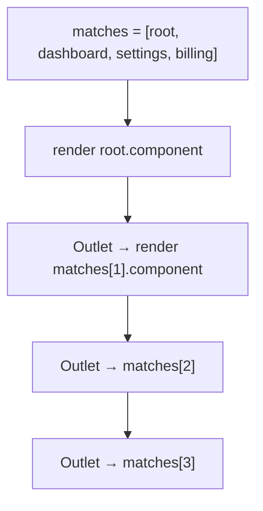
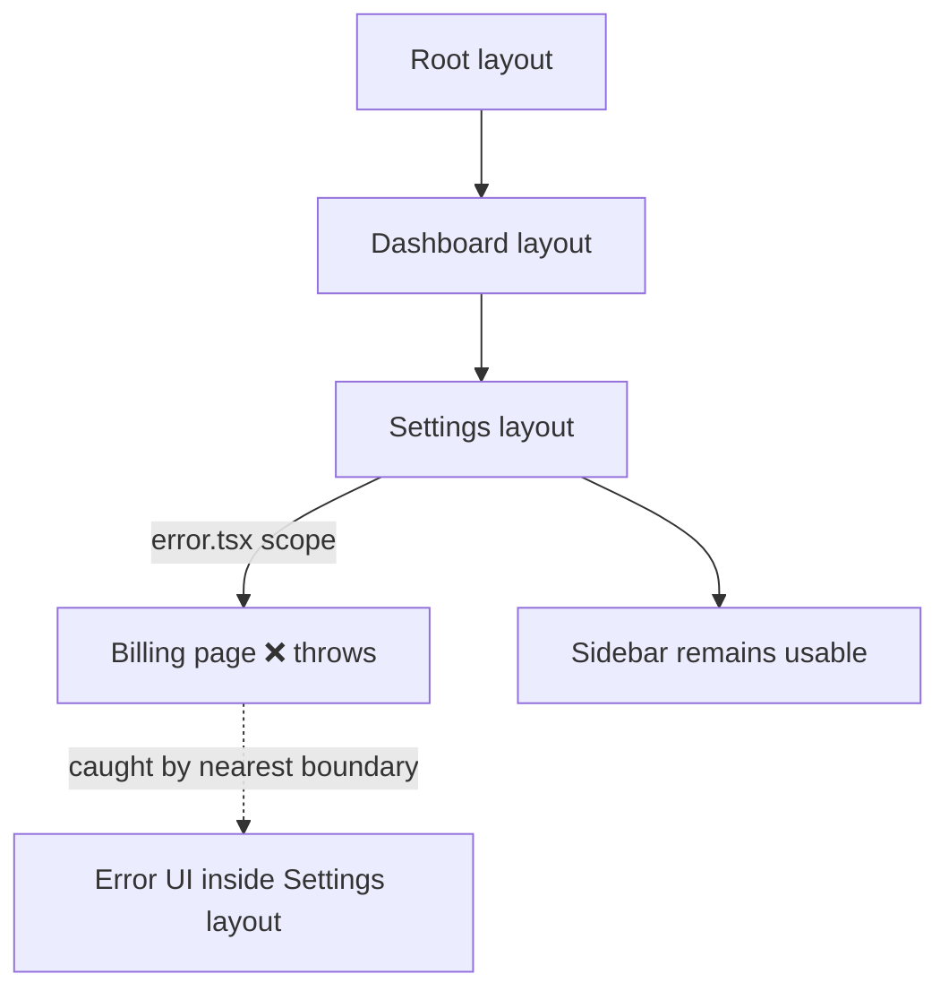

# 09 / 10 — Routing and Nested Layouts

> **Version note (reviewed 2026-10-22).** Route file names, conventions, hooks and config shown for Next.js, React Router and TanStack Router are *examples of a stable idea* (the route tree). They were checked against **Next.js 16.4**, **React Router 8.5** (v7 APIs shown here are unchanged in v8) and **TanStack Router 1.x / Start 1.169**. Exact APIs still change between majors; confirm them in each project's documentation.

## 1. Lesson metadata

| | |
|---|---|
| **Level** | Advanced |
| **Study time** | 4–5 hours (reading 2 h, building the nested-route model 1 h, exercises 1.5 h) |
| **Prerequisites** | [09 — Framework architecture](./09-framework-architecture.md), [05 — Suspense architecture](./05-suspense-architecture.md), [Phase 4/18 — Routing architecture](../04-react-architecture/18-routing-architecture.md), [Phase 1/16 — State preservation and reset](../01-react-fundamentals/16-state-preservation-and-reset.md), [Phase 4/19 — Error boundaries](../04-react-architecture/19-error-boundaries.md), [Phase 6/18 — URL state management](../06-data-fetching-and-state-ecosystems/18-url-state-management.md) |
| **Next** | [11 — Progressive enhancement](./11-progressive-enhancement.md) |

**Learning objectives.** After this lesson you can:
1. Model a URL as a **route tree match** that yields a chain of nested layouts, and explain what is preserved, re-rendered or re-mounted on each kind of navigation.
2. Explain how nested routes enable parallel data loading, per-segment loading/error UI and partial navigation.
3. Compare file-system routing, config routing and code routing, and identify what typing and tooling each enables.
4. Explain advanced route features conceptually: dynamic segments, catch-alls, route groups, pathless/layout routes, parallel routes, intercepting routes (modals), search-param state, and prefetching.
5. Debug state-reset, scroll, focus, redirect-loop and layout-waterfall bugs in nested routing.

**Concepts covered:** route tree, route matching, layout route, index route, dynamic and splat segments, nested outlet/`children` composition, pathless/grouped routes, template vs layout (re-mount semantics), parallel and intercepting routes, search params as state, history API, link prefetching, navigation transitions, scroll/focus restoration, route-level error boundaries and pending UI, redirect and not-found control flow.

---

## 2. Deep conceptual explanation

### 2.1 What problem is this lesson solving?

A single-page app starts with one question: *which component tree should this URL display?* The flat answer ("a `switch` over paths") fails as soon as screens share chrome. A settings area has a sidebar; inside it, a profile tab and a billing tab; inside billing, an invoice detail panel. A flat router would re-render the sidebar on each tab change, lose its scroll position, and re-fetch its data.

**Nested routing** says: *a URL is matched against a tree, and the match is a chain of segments; each segment contributes a layout and optionally data, loading UI and error UI. Navigation changes only the segments that differ.* This simple idea underlies the Next.js App Router, React Router (v6+), TanStack Router, Remix, Ember, and SvelteKit-style frameworks.

It solves five problems at once:

| Problem | How nesting solves it |
|---|---|
| Shared chrome persists | Parent layout stays mounted across child navigation: its state, DOM and scroll survive. |
| Data loading waterfalls | The router knows the whole chain at navigation time and can load all segments' data in parallel (loaders) or stream per-segment (RSC + Suspense). |
| Error isolation | An error in a child segment renders the child's error UI inside the parent layout, not a blank page. |
| Pending UI granularity | A segment shows its own skeleton while siblings and parents stay interactive. |
| Code splitting | Each segment is a lazy chunk; only differing segments are fetched on navigation. |

### 2.2 The route tree and a match

```text
/                           root layout
├─ (marketing)/             pathless group (no URL segment)
│   └─ about                /about
├─ dashboard/               dashboard layout   (auth required)
│   ├─ (index)              /dashboard
│   ├─ settings/            settings layout (sidebar)
│   │   ├─ profile          /dashboard/settings/profile
│   │   └─ billing/         /dashboard/settings/billing
│   │       └─ [invoiceId]  /dashboard/settings/billing/inv_42
│   └─ [...rest]            catch-all inside dashboard
└─ [...404]                 global not-found
```

The URL `/dashboard/settings/billing/inv_42` matches a **chain**:

`Root layout → Dashboard layout → Settings layout → Billing route → Invoice route`

React renders this as nested composition: each layout renders an *outlet* (React Router: `<Outlet />`; Next: `children` prop; TanStack Router: `<Outlet />`) where the next segment's UI goes. Conceptually:

```tsx
<RootLayout>
  <DashboardLayout>
    <SettingsLayout>
      <BillingPage>
        <InvoiceDetail id="inv_42" />
      </BillingPage>
    </SettingsLayout>
  </DashboardLayout>
</RootLayout>
```

When the user navigates to `/dashboard/settings/profile`, the chain becomes `Root → Dashboard → Settings → Profile`. The first three elements are **at the same position with the same type**, so React reconciliation preserves them and their state ([Phase 2/07](../02-react-rendering-and-internals/07-identity-keys-and-reconciliation.md)). Only the leaf changes. **Nested routing is an application of reconciliation identity, not a separate mechanism.**

### 2.3 Layout vs template vs page

| Concept | Preserved across sibling navigation? | Typical use |
|---|---|---|
| **Layout** | Yes (stays mounted; state preserved) | Nav bars, sidebars, providers |
| **Template** (Next `template` file; or a layout with a `key` tied to the URL) | No (re-mounted per navigation) | Per-page enter animations, resetting state, per-navigation effects/analytics |
| **Page / leaf route** | Replaced per match | Screen content |
| **Index route** | The match when the parent path is exact | Default child (e.g., `/dashboard`) |
| **Pathless layout route** | Wraps children without a URL segment | Auth guard group, shared chrome across unrelated URLs |

*Public guarantee (React):* a component of the same type at the same position keeps state; changing the `key` re-mounts. *Teaching model:* a "template" is a layout with a key derived from the segment/URL. Framework semantics differ. In the Next App Router, layouts do **not** re-render on navigation between their child pages (the layout docs say so explicitly), which is why layout-level auth checks are not sufficient ([12](./12-auth-boundaries.md)); and `template.js` gets a unique key per navigation, so child Client Components reset state, effects re-sync and Suspense fallbacks inside it show on every navigation (inside a layout they show only on first load).

### 2.4 Segment kinds

| Segment kind | Example (Next-style / RR-style) | Matches | Notes |
|---|---|---|---|
| Static | `/billing` | Exactly that text | |
| Dynamic param | `[id]` / `:id` / `$id` | One segment, captured as string | Always a string; validate and parse |
| Optional param | `{-$id}` (TanStack) / `:id?` (React Router) | Zero or one | Next has no single optional param; it only has the optional *catch-all* `[[...slug]]` |
| Catch-all / splat | `[...slug]` (Next, `params.slug` is a `string[]`) / `*` (React Router) / `$` (TanStack, value under `_splat`) | Remaining path | Splats rank below static and dynamic segments; verified in React Router with `matchRoutes` |
| Pathless/layout | `(group)` / layout route without `path` | None | Organization and shared UI without URL cost |
| Parallel slot | `@modal` (Next) | N/A: renders simultaneously as a named slot | Independent navigation state per slot; slot folders are not URL segments; needs `default.js` for unmatched slots after a hard navigation |
| Intercepting | `(.)photo/[id]` (Next; also `(..)`, `(..)(..)`, `(...)`) | Intercepts a navigation to render in a different context | Modal-over-list with shareable deep link; the markers count route segments, not folders |

### 2.5 URL state: search params and hash

A URL has more than a path: **search params** (`?sort=price&page=2`) and **hash**. Treat them as *state that the user can bookmark, share, and navigate back to*. The decision procedure from [Phase 6/18](../06-data-fetching-and-state-ecosystems/18-url-state-management.md):

- If the state defines **what the user is looking at** (filter, sort, page, selected tab, selected entity), put it in the URL.
- If it is ephemeral UI state (hover, open dropdown), keep it in component state.

Routers differ in how typed and validated search params are: TanStack Router makes search params first-class with schema validation; React Router exposes `URLSearchParams` helpers; Next provides `searchParams` props for pages and hooks on the client. A recurring bug: reading `searchParams` in a layout, which won't update when only the query changes in some frameworks. In Next, layouts do not re-render on navigation and do not receive `searchParams` at all (verified in the layout docs): read the page's `searchParams` prop, or use `useSearchParams` in a Client Component. Reading `searchParams` or `params` is request-time access, so wrap such Client Components in `<Suspense>` when the route is prerendered.

### 2.6 Navigation is a transition

On a client navigation, the router: (1) determines the new match, (2) starts loading code and data for changed segments, (3) either keeps the old UI displayed while pending (transition semantics) or shows a pending fallback, (4) commits the new tree and updates the history entry, (5) restores/reset scroll, and (6) manages focus ([14](./14-accessibility-and-seo.md)).

Modern routers wrap navigation in `startTransition` ([Phase 7/12](../07-performance/12-usetransition-in-practice.md)) so that Suspense boundaries *already visible* do not revert to fallbacks while the next route loads; the old screen remains until the new one is ready (or the transition's pending state is shown via an indicator). Behavior is framework-specific and has changed over versions. React Router (v7 and v8) wraps router state updates in `React.startTransition` by default, and offers a `useTransitions` prop to opt out (or, in React 19, to opt in to the `useOptimistic`-based variant that v8 plans to make the default). A Next `loading.js` is an automatic Suspense boundary for the segment. Check whether your router shows old UI, a fallback, or both.

### 2.7 Common misconceptions

| Misconception | Reality |
|---|---|
| "Parent layouts re-render when children navigate." | In nested routers they *stay mounted*; whether they re-render depends on framework and whether their own inputs changed. Assume they do not re-run server work unless the framework says so. |
| "Putting an auth check in the layout protects all child routes." | In frameworks where layouts persist across navigation, the check doesn't re-run per child. Check at the data access point and per route ([12](./12-auth-boundaries.md)). |
| "Route params are typed numbers if I name them `id`." | Params are strings from the URL. `Number(params.id)` can be `NaN`; validate. |
| "Links and `router.push` are equivalent." | `<Link>`/`<a>` supports middle-click, open-in-new-tab, prefetch and no-JS navigation. `router.push` in a click handler loses all that and is inaccessible for navigation semantics. |
| "Nested routing requires file-system routing." | It's a conceptual model. React Router config, TanStack code routes and file-based routes all implement it. |

---

## 3. Internal mechanics

### 3.1 Matching algorithm (conceptual)

*Teaching model.* Routers compile the route tree into a ranked list of branches; each branch is a sequence of route records with path patterns. For a URL:

1. Normalize (trailing slash policy, case sensitivity, base path/locale prefix).
2. For each branch compute a **rank**: static segments beat dynamic, dynamic beat splat; deeper specific matches win; ties resolved by definition order or an explicit rule.
3. Return the best branch as an ordered array of **matches** `{route, params, pathname}`.

*Public guarantee:* documented ranking rules in each router. *Implementation detail:* data structures (tries, regexes). Conflicts such as `/users/new` vs `/users/:id` are resolved by static-beats-dynamic in mainstream routers (executed against `react-router@8.5.0` `matchRoutes`: `/users/new` matched the static route even though the dynamic route was listed first).

### 3.2 Rendering a match chain



Each `Outlet` reads the *next* match from context ([Phase 3/13 — useContext](../03-react-state-and-hooks/13-usecontext-and-propagation.md)) and renders it. In the file-based RSC model (Next), the framework builds the nested element tree on the server, with `children` and named slots as props. Same concept; different mechanism.

### 3.3 Navigation lifecycle

```mermaid
sequenceDiagram
  participant U as User
  participant L as Link
  participant R as Router
  participant N as Network
  participant RT as React
  U->>L: hover / viewport (prefetch trigger)
  L->>R: prefetch(to)
  R->>N: fetch route chunks + data/RSC payload (cacheable)
  U->>L: click
  L->>R: navigate(to) [preventDefault, history.pushState]
  R->>R: diff matches vs current
  R->>N: load only changed segments (parallel)
  R->>RT: startTransition(() => setLocation(new))
  RT-->>U: keep old UI + pending indicator, or fallback for new boundary
  N-->>R: segments ready
  RT->>RT: commit new tree; unchanged layouts preserved
  R->>R: scroll/focus handling, announce route change
```

Prefetch triggers differ: Next's `<Link>` prefetches when it enters the viewport and only in production; React Router's `<Link prefetch="intent" | "viewport" | "render" | "none">` is opt-in per link.

Interactions with `popstate` (back/forward): the router restores the previous match and, where supported, scroll position; cached payloads make this instant. A client router cache's staleness window and what it caches differ by framework and version. Note that Next 16 with `cacheComponents: true` also uses React's `<Activity>` so that recently visited routes are kept `"hidden"` (state preserved, effects cleaned up, DOM retained) instead of unmounted, so "unmount" below describes the default model.

### 3.4 Data loading semantics per segment

| Strategy | Mechanics | Pitfall |
|---|---|---|
| **Loader per segment, parallel** | All loaders of changed matches run concurrently | Slow layout loader delays everything; revalidate policy determines whether unchanged layouts' loaders rerun after actions |
| **Async server components per segment** | Each segment renders on server; nested awaits sequential unless split by Suspense or started early | Layout awaiting data before rendering `children` blocks the page content |
| **Client fetch in leaf** | Fetch starts after code loads and component mounts | Waterfall: route chunk → component → fetch |

Rule of thumb: *start every independent fetch at the earliest point the router knows the URL*; do not make child data depend on parent data unless it truly does.

### 3.5 Error and not-found control flow

Segments act as error boundary scopes ([Phase 4/19](../04-react-architecture/19-error-boundaries.md)). When a segment throws, the nearest segment-level boundary renders its error UI **inside** the parent layout. Frameworks distinguish:
- **Unexpected errors** (bugs, network): error boundary UI, with a retry that re-renders the segment.
- **Expected control-flow signals**: `notFound()`, `redirect()`, thrown `Response`s. They are implemented as thrown values caught by the framework and are *not* errors in the application sense (Next's `notFound()` throws a `NEXT_HTTP_ERROR_FALLBACK;404` error). Wrapping them in `try/catch` swallows them, a classic bug (reproduced for React Router's `redirect` in the sandbox: the `catch` block received it, and the redirect never happened). Also call `notFound()` in the render path, not inside an un-awaited promise.
- **Errors in the layout itself** are not caught by that same layout's boundary; they bubble to the parent's boundary (Next: `error.js` wraps `loading.js`, `not-found.js`, `page.js` and *nested* layouts, but not the `layout.js`/`template.js` above it in the same segment; use `global-error.js`, which must render its own `<html>` and `<body>`, for the root layout).

---

## 4. Step-by-step execution walkthrough

Scenario: user is on `/dashboard/settings/profile` with the sidebar scrolled and an open "Help" accordion in the **settings layout**. They click the "Billing" tab, then an invoice row. Framework with parallel loaders and nested layouts (React Router-style), annotated with RSC differences where relevant.

**Click 1: Billing.**
1. `<Link to="billing">` handles click: `preventDefault`, calls `navigate`.
2. Router computes new matches: `[root, dashboard, settings, billing]` vs old `[root, dashboard, settings, profile]`. Common prefix length = 3. **Changed:** leaf only.
3. Router starts `billing`'s loader and lazy chunk in parallel. Layout loaders for `root`, `dashboard`, `settings` are *not* re-run (unless revalidation is triggered by a mutation, a search-param change or a `shouldRevalidate` option; in React Router SSR framework mode the default is the opposite: active loaders are revalidated on every navigation unless `shouldRevalidate` opts out).
4. The router wraps the state update in a transition. Old `profile` screen stays visible; a top-level pending indicator (e.g., a progress bar from `useNavigation`) shows.
5. Loader resolves; React renders the new tree. Reconciliation: `RootLayout`, `DashboardLayout`, `SettingsLayout` same type same position → **state preserved** (Help accordion stays open, sidebar scroll intact). `Profile` is unmounted (effects cleaned up), `Billing` mounted.
6. Commit; history entry pushed; scroll restoration policy applied (usually top for the content area if configured); focus moved or announced ([14](./14-accessibility-and-seo.md)).

**Click 2: invoice `inv_42`.**
7. Matches become `[root, dashboard, settings, billing, invoice]`: now a **new child** under `billing`. `billing` stays mounted, rendering `<Outlet/>` where it previously rendered the list's "empty" detail panel.
8. Invoice loader runs. If it throws a 404 `Response`, the invoice segment's error boundary renders inside the billing page; the invoice **list remains usable**.

**Back button.**
9. `popstate` → router matches `/…/billing`. Invoice unmounts. Billing list's scroll position restored. If the router cached billing's loader data and the cache is within its freshness window, no network request occurs; otherwise it revalidates. The policy differs per framework.

**Server-rendered first load of `/dashboard/settings/billing/inv_42`.**
10. Server matches the same chain, runs guards and loaders/server components, streams HTML, then hydrates the same nested tree on the client. After hydration, subsequent navigation takes the client path above.

---

## 5. Code examples

### 5.1 Minimal — nested routes in React Router (config style)

```tsx
// routes.tsx   (React Router data mode, v7/v8)
import { createBrowserRouter, Outlet, NavLink } from "react-router";
import { RouterProvider } from "react-router/dom"; // the DOM entry wires up react-dom's flushSync

function SettingsLayout() {
  return (
    <div className="settings">
      <nav aria-label="Settings">
        <NavLink to="profile">Profile</NavLink>
        <NavLink to="billing">Billing</NavLink>
      </nav>
      <main>
        <Outlet />
      </main>
    </div>
  );
}

const router = createBrowserRouter([
  {
    path: "/dashboard/settings",
    Component: SettingsLayout,
    children: [
      { index: true, Component: () => <h1>Overview</h1> },
      { path: "profile", Component: () => <h1>Profile</h1> },
      { path: "billing", Component: () => <h1>Billing</h1> },
    ],
  },
]);

export function App() {
  return <RouterProvider router={router} />;
}
```

Line notes:
- `children` paths are *relative* to the parent. `NavLink to="profile"` is also relative to the route where it is rendered, so it resolves under `/dashboard/settings` — a frequent source of confusion when moving components around.
- `index: true` is the default child for the parent's exact path.
- `NavLink` adds `aria-current="page"` to the active link (documented, and confirmed by rendering `createMemoryRouter` with `NavLink` in jsdom), which helps assistive tech ([14](./14-accessibility-and-seo.md)).
- The `<nav>` and `<main>` live in the layout, so they persist across tab changes.

**Predict:** if `SettingsLayout` has `const [count, setCount] = useState(0)` and a button increments it, then the user clicks "Billing", what is `count` afterward? **Answer:** unchanged. The layout element sits at the same position with the same type, so its state is preserved (executed in the sandbox with `createMemoryRouter`: clicking the counter, then the Billing link, left the count at 1 and the layout's mount effect ran once). If you gave `<SettingsLayout key={location.pathname}>` it would reset on each navigation: a template-like behavior.

### 5.2 Practical — Next App Router nested layouts with loading and error UI

```text
app/
  layout.tsx                # root layout (html, body)
  (shop)/                   # group: no URL segment
    layout.tsx              # shop chrome
    products/
      layout.tsx            # filters sidebar
      page.tsx              # /products
      loading.tsx           # skeleton for the page segment
      error.tsx             # error boundary for this segment
      [slug]/
        page.tsx            # /products/[slug]
        not-found.tsx
```

```tsx
// app/(shop)/products/layout.tsx   — server component, persists across child navigation
import type { ReactNode } from "react";
import { FilterSidebar } from "./filter-sidebar"; // "use client": reads search params

export default function ProductsLayout({ children }: { children: ReactNode }) {
  return (
    <div className="grid">
      <FilterSidebar />
      <section>{children}</section>
    </div>
  );
}
```

```tsx
// app/(shop)/products/page.tsx
type SearchParams = Promise<{ sort?: string; page?: string }>; // a Promise since Next 15; sync access removed in 16

export default async function ProductsPage({ searchParams }: { searchParams: SearchParams }) {
  const { sort = "popular", page = "1" } = await searchParams;
  const pageNum = Math.max(1, Number.parseInt(page, 10) || 1);   // validate: params are strings
  const items = await listProducts({ sort: sort === "price" ? "price" : "popular", page: pageNum });
  return <ProductGrid items={items} />;
}
```

```tsx
// app/(shop)/products/error.tsx
"use client"; // error boundaries must be client components

export default function Error({ error, retry }: { error: Error & { digest?: string }; retry: () => void }) {
  return (
    <div role="alert">
      <p>Could not load products.</p>
      <button onClick={retry}>Try again</button>
    </div>
  );
}
```

Notes:
- `loading.tsx` is (conceptually) an automatic `<Suspense fallback>` around the segment's page. It makes navigation within the layout show the skeleton in the content area while the filter sidebar stays interactive.
- `error.tsx` is a segment-scoped boundary. In production, server error details are redacted from the client; `digest` correlates with server logs (documented). In Next 16.3+ the props are `error` and `retry` (`retry()` re-fetches and re-renders the segment; `reset()` still exists and only clears the error state).
- `page.tsx` parses and **normalizes** untrusted `sort` and `page`; never pass them straight to a query.
- `searchParams` in `page.tsx` makes the page dynamic: it is a request-time API, so it opts the page into dynamic rendering at request time (verified in the `page.js` docs). With Cache Components enabled, where in the tree you read it decides how much of the page can still be prerendered into the static shell.

### 5.3 Search params as typed state (TanStack Router style)

```tsx
// src/routes/products.index.tsx   (TanStack Router 1.x; Zod 4 schemas are accepted directly by validateSearch)
import { createFileRoute } from "@tanstack/react-router";
import { z } from "zod";

const searchSchema = z.object({
  sort: z.enum(["popular", "price"]).catch("popular"),
  page: z.number().int().min(1).catch(1),
});

export const Route = createFileRoute("/products/")({
  validateSearch: searchSchema,
  loaderDeps: ({ search }) => ({ sort: search.sort, page: search.page }),
  loader: ({ deps }) => listProducts(deps),
  component: Products,
});

function Products() {
  const { sort, page } = Route.useSearch();
  const navigate = Route.useNavigate();
  return (
    <button onClick={() => navigate({ search: (prev) => ({ ...prev, page: page + 1 }) })}>
      Next page ({page})
    </button>
  );
}
```

With Zod 3 you wrap the schema in `zodValidator` from `@tanstack/zod-adapter` and use its `fallback()` helper instead of `.catch()` to keep type inference. Why it is valuable: search params are *parsed once at the boundary*, typed everywhere, and part of loader cache keys (`loaderDeps`). `.catch(...)` yields defaults for malformed input rather than crashing: URLs are user input.

### 5.4 Incorrect — navigation and guards done imperatively in effects

```tsx
function Dashboard() {
  const { user } = useAuth();
  const navigate = useNavigate();

  useEffect(() => {
    if (!user) navigate("/login");
  }, [user, navigate]);

  return <Secret user={user!} />;   // renders once with user undefined ⇒ crash/flash of protected UI
}
```

**Problems:** (1) first render happens before the effect, so protected UI (or a crash) appears; (2) redirect happens after paint; (3) loses `returnTo`; (4) logic scattered per component; (5) no SSR support (effects don't run on the server).

### 5.5 Corrected — guard at the routing layer, redirect as control flow

```tsx
// React Router loader-style guard (v7/v8; `redirect` may be thrown or returned)
import type { Route } from "./+types/dashboard";
import { redirect } from "react-router";

export async function loader({ request }: Route.LoaderArgs) {
  const user = await getUserFromRequest(request);
  if (!user) {
    const url = new URL(request.url);
    throw redirect(`/login?returnTo=${encodeURIComponent(url.pathname + url.search)}`);
  }
  return { user };
}
```

```tsx
// Validate returnTo to avoid open redirects
export function safeReturnTo(value: string | null): string {
  if (!value || !value.startsWith("/") || value.startsWith("//") || value.includes("\\")) return "/dashboard";
  return value;
}
```

Notes: the redirect happens **before render**, on server and client alike. `safeReturnTo` ensures the redirect target is a same-origin path (prevents open redirect: `//evil.com` is protocol-relative; also consider backslash tricks such as `/\evil.com`, which the WHATWG URL parser (checked in Node) treats as `//evil.com`, hence the `includes("\\")` check; also verify with a URL parse against your origin). This loader-level guard is necessary but not sufficient: the data access layer still authorizes ([12](./12-auth-boundaries.md)).

### 5.6 Advanced — modal route with intercepting + parallel routes (conceptual)

Goal: clicking a photo in a gallery opens a modal *and* updates the URL; a hard refresh or shared link renders a full page.

```text
app/
  @modal/
    default.tsx                   # renders null when no modal
    (.)photos/[id]/page.tsx       # intercepts /photos/[id] when navigating from within the app
  photos/[id]/page.tsx            # full page for direct loads
  layout.tsx                      # receives { children, modal }
```

```tsx
// app/layout.tsx
export default function Layout({ children, modal }: { children: React.ReactNode; modal: React.ReactNode }) {
  return (<html lang="en"><body>{children}{modal}</body></html>);
}
```

Same URL, two presentations depending on navigation source. The structure above matches the Next docs: slot folders (`@modal`) are not route segments, so `(.)photos` matches the same segment level, and a `default.js` is required for unmatched slots after a hard navigation (otherwise Next returns an error; a `default.js` that calls `notFound()` restores the old 404 behavior). This is Next-specific and subtle (soft vs hard navigation, closing behavior). Alternatives achieving the same UX: React Router with a `state`-based `backgroundLocation` pattern, or TanStack Router masks. Choose based on whether you need the shared-link-as-full-page guarantee. Read the current "Intercepting Routes" and "Parallel Routes" docs before adopting.

---

## 6. Visual explanations

### 6.1 What changes on navigation

```text
From /dashboard/settings/profile  →  /dashboard/settings/billing

Root layout        ██ same      (preserved)
Dashboard layout   ██ same      (preserved)
Settings layout    ██ same      (preserved)  ← sidebar scroll, accordion state kept
Leaf               ▒▒ Profile → ▓▓ Billing   (unmount → mount, loader runs)

From /dashboard/settings/billing → /dashboard
Settings layout    ✕ unmounted  (state discarded)
Dashboard layout   ██ same
Leaf               Dashboard index mounted
```

### 6.2 Error containment



### 6.3 Waterfall vs parallel loading

```text
Sequential (layout awaits, then page awaits):
|-- layout data 300ms --|-- page data 400ms --|-- reviews 500ms --|   = 1200ms

Parallel (loaders / Suspense with early start):
|-- layout data 300ms --|
|-- page data 400ms ----|
|-- reviews 500ms ------|                                           =  500ms
```

---

## 7. Alternative approaches and trade-offs

### 7.1 Route definition style

| Criterion | File-system routing | Config routing | Code-based routing |
|---|---|---|---|
| Discoverability | High: folders = URLs | Medium: one config file | Medium: depends on code organization |
| Refactoring ease | Moving files changes URLs | Edit config; files free | Edit code |
| Flexibility (unusual URL shapes, programmatic routes) | Lower | High | Highest |
| Type safety potential | High with codegen | High with codegen | High (inferred) |
| Convention overhead | Special filenames to learn | Low | Low |
| Onboarding cost | Low initially, high for advanced slots/intercepts | Low | Medium |
| Best for | Large teams wanting uniformity | Teams migrating or needing custom mapping | Libraries, dynamic route generation |

### 7.2 URL state vs component state vs global store

| Criterion | URL | Component state | Global store |
|---|---|---|---|
| Shareable/bookmarkable | Yes | No | No (unless synced) |
| Survives refresh | Yes | No | Only with persistence |
| Back button integration | Native | None | Manual |
| Type safety | Needs parsing/validation | Native | Native |
| Update cost | History entry + route revalidation | Cheap | Cheap |
| Best for | Filters, pagination, selected entity | Transient UI | Cross-route app state |

**When the recommended approach (URL for view-defining state) is not best:** high-frequency state such as a slider drag or text input keystroke should *not* update the URL on each change (history spam, route revalidation, jank). Keep local state and commit to the URL on blur/debounce ([Phase 7/14](../07-performance/14-debounce-and-throttle.md)) or use `replace` rather than `push` so the back button isn't polluted.

### 7.3 Modal presentation

| Option | Deep-link as full page | Back button closes modal | Complexity |
|---|---|---|---|
| Local state modal | No | No (unless manually pushed) | Lowest |
| Route-backed modal (child route rendering in an overlay) | Yes (as page) | Yes | Medium |
| Intercepting + parallel routes | Yes | Yes | High, framework-specific |

---

## 8. Best practices and anti-patterns

**Do**
- Model screens as a route tree; use layouts for chrome that must persist.
- Use `<Link>`; reserve imperative navigation for post-action or conditional redirects.
- Parse and validate params and search params at the route boundary.
- Give every segment its own pending and error UI; keep the shell interactive.
- Keep layouts cheap: shared data that every child needs, nothing else.
- Use `replace` for redirects and refinement-type updates; `push` for new "places".
- Decide a scroll and focus policy on navigation and test it ([14](./14-accessibility-and-seo.md)).

**Beginner mistakes**
- `<a href>` for internal links in a client router (full reload) or `onClick` on a `div` for navigation.
- Using `useEffect` for redirects (§5.4).
- Trusting `params.id` as a number.
- Storing filter state in component state and then wondering why Back doesn't work.

**Experienced-developer mistakes**
- Fat layout loaders that slow every page.
- Relying on layout-level auth.
- Swallowing `redirect()`/`notFound()` signals in `try/catch`.
- Over-clever intercepting routes where a simple route-backed modal would do.
- Prefetching everything (bandwidth, server cost) with no budget.

**Smells:** `window.location.href = ...` for in-app navigation; route components >300 lines doing loading, layout, and mutation; identical loaders duplicated across siblings; deep param drilling instead of route context/hooks; `key={Math.random()}` on outlets to "reset state".

**Justified exceptions:** `window.location.assign` for leaving the SPA (e.g., to an auth provider); a full reload after deployment skew detection; `router.push` for a programmatic redirect after a client-only operation.

---

## 9. Real-world application

*Multi-tenant SaaS admin (`/org/:orgId/projects/:projectId/settings/...`).*
Constraints: deep nesting, per-tenant authorization, shareable URLs, many tabs open.
- Layout chain: `org` layout loads org summary & checks membership; `project` layout loads project header; leaf loads tab data. All independent loaders run in parallel, but `project` depends on `orgId` only through the URL — not on the org loader's result — so no dependency waterfall.
- Authorization per entity in data access, not in layouts; layouts show/hide UI only.
- Search params for table state (`?q=&status=&page=`), validated with schema.
- Cache keys include `orgId`: avoid cross-tenant cache bleed in client query caches ([Phase 6/06](../06-data-fetching-and-state-ecosystems/06-cache-consistency-and-invalidation.md)).

*E-commerce category browsing.* URL: `/c/shoes?color=red&size=42&sort=price`. SEO demands canonical URLs: normalize param order, and use `rel="canonical"` to avoid duplicate-content indexation ([14](./14-accessibility-and-seo.md)). Prefetching the first product on hover boosts perceived speed, but prefetch budgets matter on mobile data.

*Financial dashboard.* Persisting tab and time-range in the URL lets analysts share exact views; tables with virtualization (Phase 7) keep scroll state per route via the framework's scroll restoration or manually keyed storage.

---

## 10. Debugging and troubleshooting

**Symptom A: "Form state is lost when I switch tabs" or "state persists when I don't want it to."**
1. React DevTools Components tab: expand the tree; is the layout component re-mounted (new instance) or the same?
2. Look for a `key` on layouts/outlets, or a framework `template` file.
3. Check whether two routes render the *same component type at the same position* (state preserved; maybe unintentionally) — fix with distinct `key`s ([Phase 1/16](../01-react-fundamentals/16-state-preservation-and-reset.md)).
4. Validate with a console log in a mount-only effect (remember StrictMode double-invocation in dev, [Phase 2/28](../02-react-rendering-and-internals/28-strict-mode-behavior.md)).

**Symptom B: "Page content updates but layout's search-param-dependent UI is stale."** Layout doesn't receive new search params on child navigation in some frameworks. Move the read into the page or into a client component using the router's search-params hook.

**Symptom C: "Infinite redirect loop between /login and /dashboard."** Inspect Network: look at the chain of 307/302 responses. Typical root cause: login page guard redirects authenticated users to dashboard while dashboard guard considers the session invalid (cookie present but rejected; or a middleware/data-layer disagreement). Fix by having one source of truth for "is authenticated" and making guards idempotent; add a redirect-count guard in tests.

**Symptom D: "Navigation feels slow only after clicking."** Network panel on click: sequential requests (loader chunk then data then component chunk)? Prefetching disabled? Layout loader reruns after every action due to default revalidation? Use the framework's tracing/dev tools or server logs to time each loader.

**Symptom E: "Back button does weird things."** Verify `push` vs `replace` usage; ensure redirects use `replace`; check for effects that navigate on mount (creates a back-trap).

**Symptom F: "Screen reader doesn't announce new page."** SPA navigation doesn't trigger the browser's usual page-load announcements. Check for a focus management/live region strategy ([14](./14-accessibility-and-seo.md)).

---

## 11. Exercises

### Level A — Knowledge
A1. What is an index route, and what does it match?
A2. Why do params arrive as strings, and what must you do before using them?
A3. What is the difference between a layout and a template with respect to state?
A4. Why should internal navigation use `<Link>` rather than `onClick` + `router.push`?
A5. Name three kinds of state that belong in the URL and two that do not.

### Level B — Code comprehension
B1. A layout renders `<Outlet />` and holds `useState(0)`. Navigating between two child routes: what happens to the count? What if the layout is rendered as `<Layout key={pathname} />`?
B2. Given routes `/users/new` and `/users/:id`, which route matches `/users/new` in a standard ranked matcher? What if the order of definition is swapped?
B3. In the Next `ProductsPage` of §5.2, why is `Number.parseInt(page, 10) || 1` used, and what does `Math.max(1, ...)` defend against?
B4. Identify two bugs:
```tsx
async function loader({ params }: LoaderArgs) {
  try {
    const order = await getOrder(Number(params.id));
    if (!order) throw redirect("/orders");
    return order;
  } catch (e) {
    return { error: "failed" };
  }
}
```

### Level C — Implementation
C1. Write a typed `parseListSearch(sp: URLSearchParams)` returning `{ page: number; sort: "name" | "date"; q: string }` with defaults and clamping (`page` ≥ 1, `q` trimmed and max 100 chars).
C2. Write a `useUrlState<T>`-style hook that reads a single search param, writes with `replace` for refinements, and debounces typing. (Use any router's `useSearchParams`.)
C3. Design (file tree or route config) a three-level nested layout for `/orgs/:orgId/projects/:projectId/tasks/:taskId` where `task` opens in a side panel while the task list stays visible and interactive.

### Level D — Debugging
D1. After a deploy, users who navigate (without reload) see "Failed to fetch dynamically imported module". Explain and propose fixes.
D2. A layout fetches the current user and renders their name. After the user changes their name in a child route's form, the header still shows the old name. Diagnose in a loader-based and in an RSC-based framework.
D3. Pressing Back from `/products?page=3` goes to `/products?page=2` after page changes; the team wants Back to leave the listing. What would you change, and what's the trade-off?

### Level E — Architecture decisions
E1. Decide how to represent a "product quick-view modal" in a storefront with SEO needs. Compare local-state modal, route-backed modal, intercepting route. Pick one.
E2. A team asks to put all authorization in a root layout "because it wraps everything". Respond with a design.

### Level F — Expert challenge
F1. Design a client router cache policy (what to cache, key, staleness, invalidation after mutations, memory bounds, per-user isolation) for an app with personalized and public routes. Identify what must never be shared across users and how logout clears it.

---

## 12. Detailed answers and explanations

> Attempt the exercises first.

**A1.** The child route that renders when the parent's path matches exactly (e.g., `/dashboard/settings` with no further segment). It gives the parent's `<Outlet>` something to render by default. Common wrong answer: "the home page" — only for the root.

**A2.** URLs are text; routers cannot know the intended type. `Number("abc")` is `NaN`; `"1e3"` parses to 1000; `""` becomes `0`. Validate (schema or manual), normalize, handle failures with `notFound`/400 rather than passing raw values to queries.

**A3.** Layout: persists across child navigation → state preserved. Template (or keyed layout): remounted per navigation → state reset, effects rerun. Choose layout for chrome and caches; template for per-navigation animations or resets.

**A4.** `<Link>` renders a real anchor: right-click, middle-click, open in new tab, copy link, screen-reader link semantics, prefetching, and works before hydration (progressive enhancement, [11](./11-progressive-enhancement.md)). `router.push` in a button click loses all of that. Use `push` after non-navigation actions.

**A5.** In: filters, sort, page, selected tab, selected entity id, search query (committed). Out: hover state, open dropdown/tooltip, transient input drafts (before commit), animation state. Reason: shareable/restorable vs ephemeral.

**B1.** Count preserved across child navigation (same element type/position). With `key={pathname}` the layout and everything below remount on each navigation: count resets to 0 and effects/mount logic re-run; costly and hides loading UX. Edge: React DevTools shows a fresh instance.

**B2.** Standard ranked matcher: static beats dynamic, so `/users/new` matches the `new` route regardless of definition order. Older/simple routers using first-match-wins would depend on order. This was executed against React Router 8.5 `matchRoutes` with the dynamic route listed first, and the static route still won. Wrong answer: "`:id` with id=new" — that is only when no static route exists.

**B3.** `parseInt("abc",10)` is `NaN`, falsy → `|| 1` supplies the default. `Math.max(1, …)` blocks `0` and negatives (`page=-5`), which could produce negative offsets in the query. Edge: `"2.7"` → 2; `"99999999999999999999"` loses precision/becomes large — add an upper bound too.

**B4.** (1) `throw redirect(...)` inside `try` is caught by `catch` and converted into `{ error: "failed" }`, so the redirect never happens. (2) The catch hides real errors from error boundaries/monitoring. Also `Number(params.id)` isn't validated (`NaN`). Fix: remove the broad `try/catch` or rethrow control-flow responses:
```ts
export async function loader({ params }: LoaderArgs) {
  const id = Number(params.id);
  if (!Number.isInteger(id) || id < 1) throw data("Bad id", { status: 400 });
  const order = await getOrder(id);
  if (!order) throw redirect("/orders");
  return order;
}
```
(`data()` and `redirect()` are the current names in React Router 7/8: `data(body, { status })` replaced `json()`, which `react-router@8.5.0` no longer exports, and `redirect` may be thrown or returned. Import `data` and `redirect` from `react-router`.)

**C1. Reference.**
```ts
export function parseListSearch(sp: URLSearchParams) {
  const pageRaw = Number.parseInt(sp.get("page") ?? "1", 10);
  const page = Number.isFinite(pageRaw) ? Math.min(Math.max(pageRaw, 1), 10_000) : 1;
  const sortRaw = sp.get("sort");
  const sort: "name" | "date" = sortRaw === "date" ? "date" : "name";
  const q = (sp.get("q") ?? "").trim().slice(0, 100);
  return { page, sort, q };
}
```
Edge: repeated params (`?q=a&q=b`) use `get` → first; use `getAll` if arrays are intended. Whitelist `sort` rather than casting.

**C2. Sketch.**
```tsx
import { useSearchParams } from "react-router";
import { useEffect, useRef, useState } from "react";

export function useDebouncedUrlParam(key: string, delay = 300) {
  const [sp, setSp] = useSearchParams();
  const urlValue = sp.get(key) ?? "";
  const [draft, setDraft] = useState(urlValue);
  const timer = useRef<number | undefined>(undefined);

  useEffect(() => setDraft(urlValue), [urlValue]); // external navigation updates draft

  function onChange(next: string) {
    setDraft(next);
    window.clearTimeout(timer.current);
    timer.current = window.setTimeout(() => {
      setSp((prev) => {
        const n = new URLSearchParams(prev);
        if (next) n.set(key, next); else n.delete(key);
        n.delete("page");                 // refinement resets paging
        return n;
      }, { replace: true });              // do not spam history
    }, delay);
  }
  useEffect(() => () => window.clearTimeout(timer.current), []);
  return [draft, onChange] as const;
}
```
Evaluation: local draft for responsiveness, URL commit debounced, `replace`, resets `page`, cleans timer. The `useEffect` syncing draft from URL is an acceptable use (synchronizing with an external system, the URL) but note [Phase 3/07](../03-react-state-and-hooks/07-you-might-not-need-an-effect.md) alternatives (key the component by URL value).

**C3. Example (config style).**
```text
/orgs/:orgId                      OrgLayout        (loads org, parallel)
  projects/:projectId             ProjectLayout    (loads project)
    tasks                         TaskListLayout   (renders list + <Outlet/> as side panel)
      (index)                     EmptyPanel
      :taskId                     TaskPanel        (loader: task)
```
The task list lives in `TaskListLayout`, so selecting a task only swaps the panel; list scroll and filters (search params) persist. The panel's own error boundary leaves the list usable. Evaluation: panel is a *child route*, not state; selected id is in the URL.

**D1.** Version skew: the client holds an old manifest referencing chunk hashes that were deleted by the new deploy. Fixes: retain old assets for a grace period; detect failure and force a hard reload (frameworks offer handling, e.g. listening for chunk-load errors; Next documents version skew and a deployment id for self-hosting); use deploy-skew protection features of the host; version asset paths. Validate by deploying while a tab is open and navigating.

**D2.** *Loader-based:* actions trigger revalidation of loaders by default for *all* matched routes after a mutation; if you disabled revalidation or the mutation used a plain `fetch` outside the router's action system, loaders won't re-run → use router actions/`useFetcher` or call the revalidate API. *RSC:* layouts are not re-rendered on child navigation; the mutation must call the framework's revalidation for the path/tag containing the user fetch, or the header should read from a client store/cache that the action updates. Validate by observing the network for a refreshed payload.

**D3.** Use `replace: true` for pagination/refinement updates so Back leaves the listing; trade-off: users can't Back to an earlier page of results (usually acceptable for refinements; for "page" many sites prefer `push` because page is a *place*). Decision must be justified by user expectation, not dogma.

**E1.** Criteria: SEO for product page (a standalone product URL must exist), shareability, Back behavior, complexity, a11y (focus trap, `aria-modal`, restore focus). Recommended: route-backed modal where `/products/:slug` renders as a full page on direct load and as an overlay when navigated from the list (using `backgroundLocation` state or an intercepting route if on Next and the team accepts complexity). Local-state modal fails SEO and sharing; intercepting routes justified only where framework support and team expertise exist. Strong answers mention focus management and scroll locking.

**E2.** Root layouts typically persist across navigation and aren't re-run per child; also a layout can't protect non-page entry points (server functions, route handlers, API endpoints). Design: (1) authentication available through a request-scoped `getSession()`; (2) a data access layer function per resource that authorizes; (3) page/route guards for redirect UX; (4) layouts only render conditional UI; (5) tests hitting endpoints directly without the UI. See [12](./12-auth-boundaries.md).

**F1. Example answer.** Cache entries keyed by `(userId or "public", routeId, params, search)`; never cache personalized payloads under a public key; store in memory only (not localStorage) with LRU bound; staleness window short for personalized routes (seconds) and longer for public; invalidate by tag/path after mutations; clear all entries on logout and on session change (compare a session epoch in the key); prefetch only public routes automatically; on `visibilitychange`/focus revalidate stale entries; make bfcache restoration revalidate session. Evaluation criteria: per-user isolation, logout clearing, bounded memory, mutation invalidation, explicit trade-off of freshness vs instant navigation.

---

## 13. Senior engineer interview questions

**Q1. "Why do nested layouts preserve state on navigation?"**
*Strong answer:* Because the router renders the match chain as nested elements; unchanged prefix segments produce elements of the same type at the same position, so React reconciliation preserves their instances and state. A `key` change or a template forces remount. Nothing is special in React; routers exploit identity rules.

**Q2. "Where would you put an auth check in a nested-routing app, and why not just the layout?"**
*Strong answer:* Authenticate early (middleware/loader) for UX redirects, but authorize at the data access layer for each resource and each mutation, because layouts persist across child navigation, don't protect direct endpoint calls, and can be bypassed. Layout checks are display logic.

**Q3. "How do you avoid waterfalls in a deeply nested route tree?"**
*Strong answer:* Know the URL → data mapping at navigation time and start independent fetches in parallel (loaders at router level; or start promises early in server components and pass them down, wrapped with Suspense). Avoid child data depending on parent loader results unless needed, prefetch on intent, keep layout data minimal.

**Q4. "What would you put in the URL and what wouldn't you?"**
*Strong answer:* State that defines what the user is looking at and should be shareable/back-navigable — filters, sort, page, tab, selection — validated at the boundary. Not transient or high-frequency state; for typing, debounce and use `replace`. Keep an eye on SEO canonicalization and cache keys.

**Q5. "How do you handle a modal that needs a shareable URL?"**
*Strong answer:* Make it a route. Render as an overlay when navigated from the list (background location or intercepting route) and as a full page on direct load. Weigh complexity: intercepting routes are powerful but framework-specific. Attend to focus trap, Escape/Back, and restoring focus.

**Q6. "What breaks when `redirect()` is thrown inside a `try/catch`?"**
*Strong answer:* Redirect and not-found are implemented as thrown control-flow values; a broad catch intercepts them, so the framework never sees them. Rethrow or narrow the catch to expected errors; keep control-flow outside the try.

---

## 14. Further learning resources

| Resource | URL | Covers / why | Level | Study |
|---|---|---|---|---|
| React Router docs | <https://reactrouter.com> | Nested routes, `Outlet`, loaders, actions, navigation | All | Routing, Data loading, Navigation |
| Next.js docs — Layouts and Pages | <https://nextjs.org/docs/app/getting-started/layouts-and-pages> (HTTP 200 on 2026-10-22; the old `building-your-application/routing` path redirects here) | Layouts, templates, loading, error, parallel and intercepting routes | Intermediate–Adv. | Layouts and Templates; Parallel/Intercepting Routes |
| TanStack Router docs | <https://tanstack.com/router> | Type-safe routing, search params validation | Intermediate | Search Params, Data Loading |
| MDN — History API | <https://developer.mozilla.org/en-US/docs/Web/API/History_API> | `pushState`, `popstate`, scroll restoration | Intermediate | Whole page |
| MDN — URLSearchParams | <https://developer.mozilla.org/en-US/docs/Web/API/URLSearchParams> | Parsing and building queries | Beginner | Methods |
| MDN — Navigation API | <https://developer.mozilla.org/en-US/docs/Web/API/Navigation_API> | SPA navigation standard; per MDN browser-compat-data it is now in Chrome 102+, Firefox 147+ and Safari 26.2+ | Advanced | Overview |
| React — `<Suspense>` and transitions | <https://react.dev/reference/react/Suspense> | Navigation + Suspense interplay | Intermediate | "Preventing already revealed content from hiding" |
| Web Content Accessibility Guidelines overview | <https://www.w3.org/WAI/standards-guidelines/wcag/> | Focus order, page titles | Intermediate | Relevant success criteria |

Links checked on 2026-10-22; use each site's search if a path moves.

---

## 15. Knowledge checkpoint

**You should now understand**
- A URL maps to a chain of nested segments; unchanged prefix segments are preserved by ordinary reconciliation.
- How loaders, Suspense and error boundaries attach to segments, and where waterfalls come from.
- URL-as-state, its validation requirements, and when not to use it.
- Why layout-level guards are insufficient.

**You should be able to explain without notes**
- Layout vs template vs page; push vs replace; soft vs hard navigation.
- How a modal can have a shareable URL.

**You should be able to implement**
- Nested route trees with per-segment pending/error UI, typed/validated search params, and safe redirects.

**You should be able to debug**
- Unexpected state reset/persistence, stale layout data after mutation, redirect loops, chunk-load failures after deploy, lost redirects due to `try/catch`.

**Before moving on:** read [11 — Progressive enhancement](./11-progressive-enhancement.md): links and forms are the primitives that make routes work before (and without) JavaScript.
