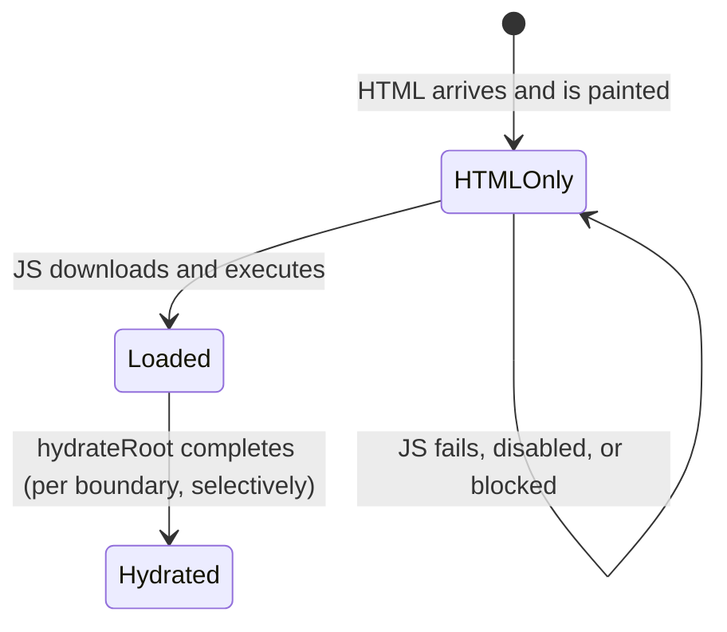
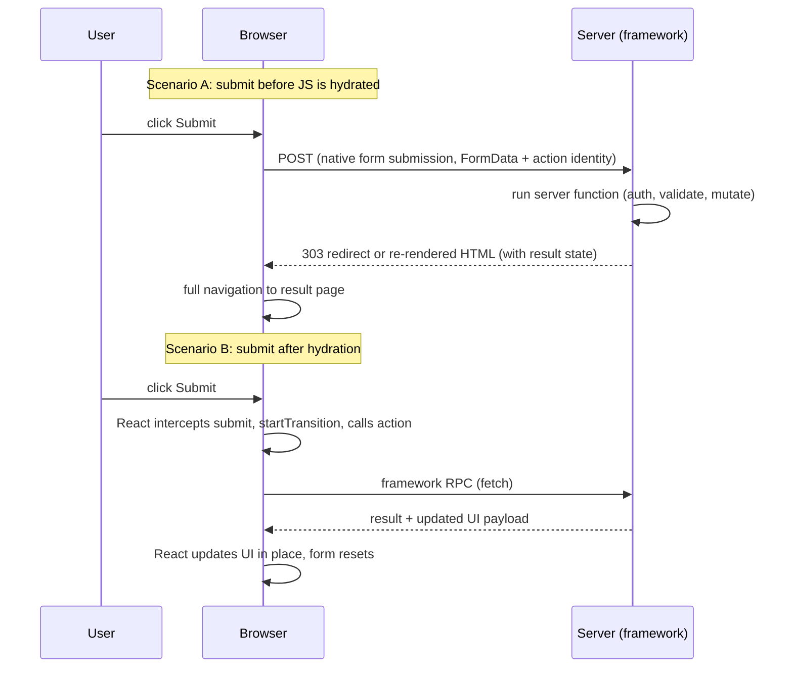
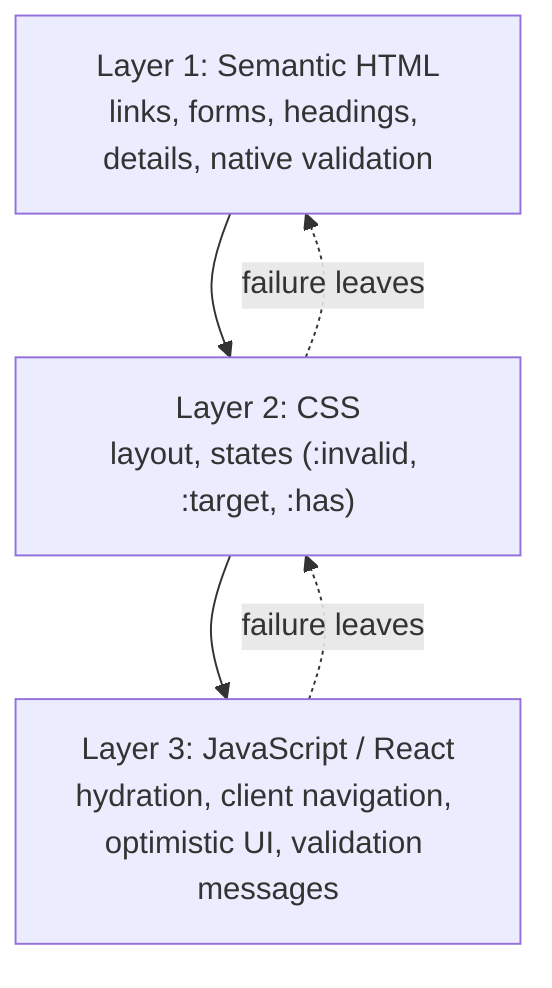
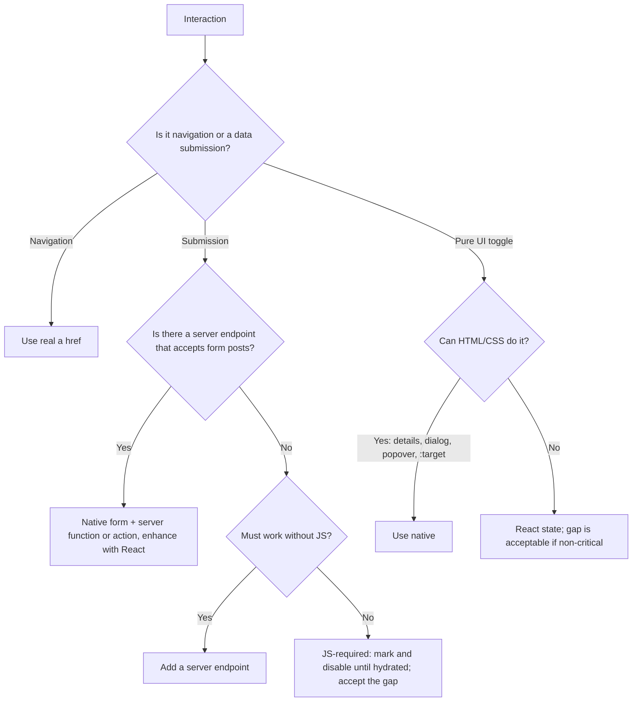

# 09 / 11 — Progressive Enhancement: Making React Work Before, Without and After JavaScript

> **Scope note (verified against react.dev and `react-dom` 19.3.1 output, 2026-10-22).** React 19's form/Action behavior before hydration depends on *framework support* for server functions. React's documentation states the conditions (see `useActionState`'s `permalink` parameter and the `<form>` page). Framework specifics (Next, React Router, TanStack Start) vary; test the no-JS path in your own framework version before relying on it in production.

## 1. Lesson metadata

| | |
|---|---|
| **Level** | Advanced |
| **Study time** | 4 hours (reading 1.5 h, no-JS experiments 1 h, exercises 1.5 h) |
| **Prerequisites** | [01 — SPA, SSR, SSG, streaming](./01-spa-ssr-ssg-streaming.md), [02 — Hydration internals](./02-hydration-internals-deep-dive.md), [09 — Framework architecture](./09-framework-architecture.md), [10 — Routing and nested layouts](./10-routing-and-nested-layouts.md), [Phase 0 — how the browser works](../00-web-and-javascript-foundations/01-how-the-browser-works.md), [Phase 1/11 — Controlled and uncontrolled inputs](../01-react-fundamentals/11-controlled-and-uncontrolled-inputs.md) |
| **Next** | [12 — Auth boundaries](./12-auth-boundaries.md) |
| **Related** | [13 — Forms, actions and mutations](./13-forms-actions-and-mutations.md), [14 — Accessibility and SEO](./14-accessibility-and-seo.md) |

**Learning objectives.** After this lesson you can:
1. Define progressive enhancement (PE) precisely and distinguish it from graceful degradation and from "SSR".
2. Identify the three states a server-rendered React page passes through (HTML-only, loaded-not-hydrated, hydrated) and what works in each.
3. Build a form and a navigation flow that function with JavaScript disabled or not yet loaded, using HTML semantics plus framework server handlers, and enhance them with React Actions.
4. Explain why `<form action={serverFunction}>` can work before hydration and what `useActionState`'s `permalink` is for.
5. Decide when progressive enhancement is worth its cost and when a JS-required app is the right choice.
6. Test and monitor the no-JS and slow-JS experience.

**Concepts covered:** HTML as the baseline, layered enhancement, hydration gap (time-to-interactive gap), native form submission (POST/redirect/GET), `<a>` navigation, constraint validation, `noscript`, event replay, hydration-dependent features, `useFormStatus`/`useActionState` before hydration, `permalink`, resilience to script failures, testing with JS disabled, CSP and PE interplay.

---

## 2. Deep conceptual explanation

### 2.1 What problem is this lesson solving?

Every React app that depends on JavaScript has a **window of non-functionality**: the user sees a page (possibly server-rendered), but event handlers are not attached until the bundle downloads, parses, executes and hydrates. The window ranges from tens of milliseconds on fast networks to many seconds on poor mobile connections, and it becomes *infinite* when:

- JavaScript fails to load (CDN outage, corporate proxy stripping scripts, ad-blocker false positive, flaky network, a deploy that deleted old chunks).
- JavaScript throws before hydration finishes (a syntax feature unsupported on an old browser, a third-party script error ordering).
- The user's browser or device is constrained (low-memory phones that crash on large bundles), or JS is disabled by policy.
- A crawler, link-previewer, or assistive/reader mode fetches HTML without executing scripts.

**Progressive enhancement** is the engineering discipline of making the core task work with the *simplest, most robust technology layer* (HTML), then layering CSS for presentation and JavaScript for richer behavior, so that failure of an upper layer leaves the lower layer functional.

### 2.2 Definitions that prevent confusion

| Term | Meaning |
|---|---|
| **Progressive enhancement** | Start from working HTML (links, forms, semantic elements). Add CSS, then JS, as *improvements*. Core tasks never *require* the upper layer. |
| **Graceful degradation** | Start from the full JS experience, add fallbacks for when pieces fail. Often incomplete; fallbacks are tested less. |
| **SSR (server-side rendering)** | Producing HTML on the server. A *prerequisite* of PE for content, not PE itself: SSR'd HTML with `<button onClick>` that does nothing until hydration is not progressively enhanced. |
| **Hydration** | Attaching React to existing HTML: reusing DOM, attaching handlers ([02](./02-hydration-internals-deep-dive.md)). |
| **Resilience** | A broader goal: behave acceptably under partial failure. PE is one tactic. |

The key sentence: **PE is a property of *interactions*, not of the page.** A page can render content without JS (SSR) yet fail PE because its "Add to cart" button needs hydrated JS. The question is always "what happens if the user performs this interaction before/without JS?"

### 2.3 The three states of a server-rendered React page



| Capability | HTML only | Loaded, not hydrated | Hydrated |
|---|---|---|---|
| Read content, scroll, find-in-page | ✔ | ✔ | ✔ |
| Follow `<a href>` links | ✔ (full page load) | ✔ (full load until the router takes over) | ✔ (client navigation) |
| Submit `<form method="post" action="/url">` | ✔ (browser POST) | ✔ | ✔ (intercepted by React/framework) |
| `<form action={clientFunction}>` | ✘ (React renders `action="javascript:throw new Error('React form unexpectedly submitted.')"`; with JS disabled nothing happens) | ◐ the submit is captured and **replayed** once the form hydrates (see §3.4) | ✔ |
| `<form action={serverFunction}>` (framework-supported) | ✔ *if* the framework renders it as a real form that posts to an endpoint | ✔ | ✔ (no full reload) |
| `onClick` handlers on `<button type="button">` | ✘ | ✘ | ✔ |
| `useState` interactions (tabs, accordions via state) | ✘ | ✘ | ✔ |
| `<details>`, `<dialog>`, `popover`, `:target`, CSS `:checked` hacks | ✔ (native) | ✔ | ✔ |
| Client-side validation via JS | ✘ | ✘ | ✔ |
| HTML constraint validation (`required`, `type="email"`, `pattern`) | ✔ | ✔ | ✔ |

This table is the practical heart of the lesson: design each interaction by deciding which column it needs to work in.

### 2.4 React's role

React 19 made the form-enhancement path first-class:

- `<form action={fn}>`: `action` may be a **function** (an *Action*). React handles submission by calling it with a `FormData`.
- If `fn` is a **server function** (`"use server"`), a supporting framework can render the form such that the *browser's native submission* reaches the server even before JS loads; after hydration, React intercepts and runs it without a full reload.
- `useActionState(action, initialState, permalink?)`: returns `[state, formAction, isPending]`; the optional **`permalink`** is a string with "the unique page URL that this form modifies", for pages with dynamic content (feeds, for example): if `action` is a Server Function and the form is submitted before the JS bundle loads, the browser navigates to that URL rather than the current page's URL. React's reference adds two conditions: the destination page must render the same form component (same action and same `permalink`) so React can pass the state through, and once the page is interactive the parameter has no effect (<https://react.dev/reference/react/useActionState>, checked 2026-10-22).
- `useFormStatus`, `useOptimistic`: *enhancements* — they require hydration and are no-ops before it. Never make correctness depend on them.

*Public guarantee:* documented behavior of `action` functions and `useActionState` with `permalink`. *Teaching model:* "the form is the contract, React is the enhancer." *Implementation detail:* how a framework encodes the action identity into the form (hidden fields, encoded ids) and how the server response re-renders the page (redirect vs inline re-render with state) are framework-specific.

### 2.5 Why PE has re-emerged

For a decade the default stack was a client-rendered SPA, where PE was mostly abandoned. Three developments revived it:

1. **Streaming SSR + selective hydration** made "HTML first" cheap.
2. **Server Components and server functions** put the mutation endpoint *next to* the form and let frameworks wire native submissions to it.
3. **Core Web Vitals and mobile reality** exposed the hydration gap as a measurable UX problem (INP, "rage clicks" before hydration).

It is also a *cost* argument: for content and transactional flows (search, login, checkout), the HTML-first path is the simplest implementation that works everywhere.

### 2.6 Common misconceptions

| Misconception | Reality |
|---|---|
| "PE means supporting users who disable JavaScript." | The main beneficiary is the *much larger* group with **slow, failed, or delayed** JS: poor networks, blocked scripts, errors, early interaction. Policy-disabled JS is rare. |
| "SSR gives me PE." | Only for content. Interactions need native semantics or framework-wired server handlers. |
| "PE means no JS interactions." | PE layers JS on top. After enhancement, the experience can be as rich as any SPA. |
| "React forms with `onSubmit={e => e.preventDefault()}` are PE." | They *depend on* JS; without it, the browser performs a GET submit to the same URL. |
| "`useFormStatus`'s pending state works before hydration." | No; before hydration there's no React; the browser shows its native loading UI. |
| "Hydration replay solves early clicks." | React can record and replay *certain discrete events* after hydrating a boundary, but this is a best-effort UX improvement for the hydration gap, not a substitute for functioning HTML (see §3.4 for what is and is not replayed). |

---

## 3. Internal mechanics

### 3.1 What a browser does with a form (the baseline)

A `<form method="post" action="/cart/add">` submission: the browser serializes successful controls (named, non-disabled, checked) into `application/x-www-form-urlencoded` (or `multipart/form-data` with `enctype`), sends the request, and **navigates** to the response. After a successful POST the server should respond with a **redirect (303 See Other)** to a GET URL — the **Post/Redirect/Get (PRG)** pattern — so reload and Back do not resubmit the form. With no `method`, the default is **GET**, which puts fields in the query string (fine for search forms, wrong for mutations or secrets).

*Public guarantee (HTML Standard):* form submission algorithm, constraint validation, default method GET.

### 3.2 How a framework makes a server function form work pre-hydration (conceptual)

*Teaching model.* On the server, when rendering `<form action={serverFn}>`, the framework/React serializes a **reference** to `serverFn`. For HTML output, that reference can be encoded in the markup — e.g., the form posts to a URL and includes hidden fields identifying which action to run — so the browser's native submission delivers `FormData` to a framework endpoint that looks up and invokes the function, then re-renders the page or redirects. After hydration, React intercepts the `submit` event and calls the function through its client-side transport, avoiding a reload.



*Implementation detail:* the encoding (field names, ids, how closed-over arguments are protected), the redirect behavior and how `useActionState`'s state is carried through a no-JS round trip are framework-specific. What React itself provides (checked in `react-dom` 19.3.1): for a Server Function reference the server renderer emits the form's `action`, `method="POST"`, `encType="multipart/form-data"` and hidden inputs from the reference's `$$FORM_ACTION` hook (our simulated reference rendered `<form action="/_actions" encType="multipart/form-data" method="POST"><input type="hidden" name="0"/>…`); the server then decodes the posted `FormData` and, for `useActionState`, passes the resulting `formState` back into the render (`renderToReadableStream`/`renderToPipeableStream` and `hydrateRoot` accept a `formState` option; matching state is marked in the HTML with `<!--F!-->` / `<!--F-->` comments). React documents the `permalink` parameter for pages with dynamic content so that a pre-hydration submit lands on the correct URL.

### 3.3 Links

A `<Link>` from a router renders an `<a href>`. Before hydration (or without JS) clicking performs a normal navigation to the server: the server renders the destination. After the router takes over, click handlers call `history.pushState` and fetch only the needed segments ([10](./10-routing-and-nested-layouts.md)). This "falls back" structurally, with no effort, **as long as links are real anchors with real `href`s**.

### 3.4 Event replay across the hydration gap

There are two distinct mechanisms in React 19 (read from the `react-dom` 19.3.1 source and `renderToString` output):

1. **Discrete event replay for dehydrated Suspense boundaries.** Once JS has loaded and `hydrateRoot` has attached its listeners, a discrete event whose target sits inside a not-yet-hydrated Suspense boundary is queued, the boundary is hydrated at higher priority, and the event is replayed afterwards. The replayable list in the source is: `mousedown mouseup touchcancel touchend touchstart auxclick dblclick pointercancel pointerdown pointerup dragend dragstart drop compositionend compositionstart keydown keypress keyup input textInput copy cut paste click change contextmenu reset`. (I could not reproduce the replay in a jsdom harness, so treat the list as read from source, not as an observed run.)
2. **Form submission replay (new in React 19).** When the server renderer emits a form (or submitter) whose `action` is a client function, it writes `action="javascript:throw new Error('React form unexpectedly submitted.')"` and, once per response, a tiny inline `<script>` with a capture-phase `submit` listener. A submit before hydration is `preventDefault`-ed, its `FormData` (including the submitter) is pushed to `document.$$reactFormReplay`, and React runs the action with that data when the form hydrates. We verified the queue-and-replay end to end in jsdom: a pre-hydration click on the submit button queued one entry and the action received the form's data after `hydrateRoot`. For server-function forms the form is a real POST form instead, so no replay is needed: the browser submits natively. React's server-functions page also says that with `useActionState` and Server Functions React "will also automatically replay form submissions entered before hydration finishes".

Treat both as mitigations for a brief gap, not a design basis: (a) they only help once JS *eventually* loads; with JS disabled or failed, a client-function form does nothing (the `javascript:` URL is inert), and only a server-function/native form posts; (b) not all event types are covered (`submit` has its own path; hover/focus-style continuous events are only re-dispatched for state); (c) replayed clicks or submits on non-idempotent actions can surprise users (double submit) if the UI gave no feedback, so the server must still be idempotent.

### 3.5 Constraint validation (HTML) vs JS validation

HTML provides `required`, `type=email|url|number`, `min/max/step`, `minlength/maxlength`, `pattern`, and the Constraint Validation API (`checkValidity`, `setCustomValidity`, `:user-invalid`/`:invalid` CSS). Without JS the browser shows native messages and blocks submission. JS then *replaces or augments* messages. **The server must always validate again**: HTML validation is a UX convenience, not a security control ([Phase 10/06](../10-production-engineering/06-security-xss-csrf-csp.md)).

---

## 4. Step-by-step execution walkthrough

Scenario: **Newsletter sign-up** in a footer rendered by a framework supporting server functions. Timeline on a slow 3G device with a 600 KB JS bundle.

| t | Event | State | What the user can do |
|---|---|---|---|
| 0 ms | Request sent | — | — |
| 400 ms | HTML shell streams in | HTML-only | Read the page; footer form visible |
| 1,200 ms | CSS applied; first paint | HTML-only | Same |
| 1,500 ms | User types an email and presses **Subscribe** | HTML-only | **Native POST** is sent (server function form) |
| 1,800 ms | Server validates, stores the email, replies with redirect `303` to `/subscribed?...` or the same page with a success message | — | Page navigates; confirmation shown |
| 5,000 ms | (Alternative timeline) JS finished earlier; hydration completes | Hydrated | Submit goes through the client path; no navigation; button shows pending; success message appears in place; input resets |

**Failure branch:** at 1,500 ms the user submits with an invalid email (`foo`).
- With `type="email" required`: the browser blocks submission and shows a native message. No request is sent.
- If the browser's check passes but the server rejects (e.g., disposable domain): the server re-renders the page with an error message adjacent to the field (status 422 or 200: framework-specific); the user's input should be repopulated (`defaultValue` from server state).

**Failure branch (JS-only version):** the same form implemented as `<form onSubmit={handle}>` with `fetch`. At 1,500 ms the user submits; `onSubmit` is not attached; the browser submits with **GET** to the current URL, appending `?email=foo@bar.com`. The page reloads with the email in the URL (leaking it to logs and analytics); the subscription is never created; the user believes they subscribed. This is the canonical PE failure, and it's silent.

---

## 5. Code examples

### 5.1 Minimal — plain HTML works first

```html
<form method="post" action="/newsletter">
  <label for="email">Email</label>
  <input id="email" name="email" type="email" required autocomplete="email" />
  <button type="submit">Subscribe</button>
</form>
```

Line notes:
- `method="post"` prevents the GET-with-query-string default for a mutation.
- `name` attributes define what is submitted; React-controlled inputs without a `name` submit nothing (a common React bug when moving to native forms).
- `for`/`id` association gives an accessible name and a larger click target ([14](./14-accessibility-and-seo.md)).
- `type="email" required` provides baseline validation.

**Predict:** if the `name="email"` attribute is removed, what is submitted? **Answer:** nothing for that control; the server receives an empty body; the browser still navigates. Hence *"name your inputs"*.

### 5.2 Practical — server function + `useActionState` (Next-style)

```tsx
// app/newsletter/actions.ts
"use server";

import { z } from "zod";
import { redirect } from "next/navigation";

const schema = z.object({ email: z.string().trim().toLowerCase().pipe(z.email().max(254)) });

export type SubscribeState = {
  ok: boolean;
  message?: string;
  fieldErrors?: { email?: string };
  values?: { email: string };
};

export async function subscribe(_prev: SubscribeState, formData: FormData): Promise<SubscribeState> {
  const raw = { email: String(formData.get("email") ?? "") };
  const parsed = schema.safeParse(raw);
  if (!parsed.success) {
    return { ok: false, fieldErrors: { email: "Enter a valid email address." }, values: raw };
  }
  await addSubscriber(parsed.data.email);         // idempotent upsert
  redirect("/newsletter/thanks");                  // PRG; throws a control-flow signal
}
```

```tsx
// app/newsletter/subscribe-form.tsx
"use client";

import { useActionState } from "react";
import { subscribe, type SubscribeState } from "./actions";
import { SubmitButton } from "./submit-button";

const initial: SubscribeState = { ok: false };

export function SubscribeForm() {
  const [state, formAction] = useActionState(subscribe, initial, "/newsletter");
  //                                                   ^ permalink: where a pre-hydration submit should land
  const err = state.fieldErrors?.email;

  return (
    <form action={formAction} noValidate={false}>
      <label htmlFor="email">Email</label>
      <input
        id="email"
        name="email"
        type="email"
        required
        defaultValue={state.values?.email}
        aria-invalid={err ? true : undefined}
        aria-describedby={err ? "email-error" : undefined}
      />
      {err && <p id="email-error" role="alert">{err}</p>}
      <SubmitButton>Subscribe</SubmitButton>
    </form>
  );
}
```

```tsx
// app/newsletter/submit-button.tsx
"use client";
import { useFormStatus } from "react-dom";

export function SubmitButton({ children }: { children: React.ReactNode }) {
  const { pending } = useFormStatus();
  return <button type="submit" disabled={pending}>{pending ? "Subscribing…" : children}</button>;
}
```

Line notes:
- `subscribe` receives `(prevState, formData)` because it is used with `useActionState`. Used directly as `<form action={subscribe}>` it would receive only `formData`; mixing the signatures is a common error.
- `defaultValue` (uncontrolled) rather than `value`: after a server re-render, the input is repopulated without making it controlled; React 19 also **resets uncontrolled form fields after the action completes without throwing**, which includes an action that *returns* a validation-error object (verified in jsdom: an uncontrolled field with no `defaultValue` was emptied after the action returned `{ err: "bad" }`), so repopulate from state when you want to keep the user's input after validation errors ([13](./13-forms-actions-and-mutations.md)).
- `redirect()` inside a server function is a thrown control-flow signal: do not wrap in `try/catch` that swallows it ([10](./10-routing-and-nested-layouts.md)).
- `SubmitButton` uses `useFormStatus`, which must be rendered **inside** the `<form>` it observes; it reads the *parent* form's status, not one rendered in the same component. Before hydration the button is a normal enabled submit button, so the no-JS path still works.
- `noValidate={false}` is the default; written explicitly to show intent. Do **not** set `noValidate` unless you provide your own validation UI *and* server validation, because it removes the no-JS client-side check.
- Zod 4 note: `z.string().email()` still works but is deprecated in favour of the top-level `z.email()`; because `z.email()` does not trim or lowercase first, the example pipes a trimmed/lowercased string into it (checked with zod 4.6.7: `"  Foo@Bar.com "` becomes `foo@bar.com`).
- Validation is repeated on the server with schema parsing. The `"use client"` file imports a server function; the bundler replaces it with a reference.

### 5.3 Incorrect — JS-only submission

```tsx
function BadSubscribe() {
  const [email, setEmail] = useState("");
  async function onSubmit(e: React.FormEvent) {
    e.preventDefault();
    await fetch("/api/newsletter", { method: "POST", body: JSON.stringify({ email }) });
  }
  return (
    <form onSubmit={onSubmit}>
      <input value={email} onChange={(e) => setEmail(e.target.value)} />  {/* no name, no type */}
      <button>Subscribe</button>
    </form>
  );
}
```

**Problems:** (1) no `name` ⇒ native submission is empty; (2) no `method`/`action` ⇒ GET to current URL; (3) no `type="email"`/`required`; (4) no `<label>`; (5) the button lacks `type` (defaults to submit, fine, but be explicit); (6) the client-controlled state is needed just to read a value the form already knows; (7) no error/result UI; (8) a second source of truth for the endpoint's contract. Before hydration the user sees an enabled form that silently does the wrong thing.

### 5.4 Corrected — native-first, enhanced with Actions (client-only variant)

If you have no server function support (e.g., a Vite SPA calling a REST API), true no-JS support is impossible without a server endpoint that accepts form posts. You can still *improve* the situation:

```tsx
function Subscribe() {
  const [state, action, pending] = useActionState(
    async (_prev: { error?: string; done?: boolean }, formData: FormData) => {
      const res = await fetch("/api/newsletter", { method: "POST", body: formData });
      if (!res.ok) return { error: "Could not subscribe. Try again." };
      return { done: true };
    },
    {},
  );

  if (state.done) return <p role="status">Thanks, you are subscribed.</p>;
  return (
    <form action={action}>                           {/* a client function: React renders action="javascript:throw…"; method="post" would be ignored (dev warning) */}
      <label htmlFor="e">Email</label>
      <input id="e" name="email" type="email" required />
      <button type="submit" disabled={pending}>Subscribe</button>
      {state.error && <p role="alert">{state.error}</p>}
    </form>
  );
}
```

Notes: this form is **not** natively submittable: with a function `action`, React replaces the `action` attribute (and warns about a stray `method`/`encType`). Before hydration the submit is captured and replayed once React loads (§3.4), but if JS never loads nothing is sent. `body: formData` sends `multipart/form-data` with the browser setting the boundary: do not set `Content-Type` manually. Without a server that also handles the native POST at the same URL, the fallback is partial. If the endpoint is `/api/newsletter` and responds with JSON, a native POST navigates to a JSON document. A real PE server returns a redirect for non-JS requests (check `Accept`/a framework flag) — that is precisely what frameworks provide.

*Note on `action` + `method` attributes in React:* when `action` is a function, React controls the form's `action` attribute, and in development it logs "Cannot specify a encType or method for a form that specifies a function as the action. React provides those automatically. They will get overridden." The server-rendered HTML for `<form action={fn} method="post">` contains only the `javascript:throw…` action (`method` is dropped), as we saw with `renderToString`. For a *string* action (`action="/x" method="post"`) the attributes are emitted as written. A real fallback therefore needs a Server Function (or a string URL), not a client function.

### 5.5 Advanced — an enhanced search with native GET and URL state

```tsx
// Works as a plain GET form to /search?q=...
export function SearchBox({ defaultQuery }: { defaultQuery: string }) {
  return (
    <form role="search" action="/search" method="get">
      <label htmlFor="q">Search products</label>
      <input id="q" name="q" type="search" defaultValue={defaultQuery} />
      <button type="submit">Search</button>
    </form>
  );
}
```

Add enhancement: an islands-style client component that, once hydrated, offers live suggestions with `useDeferredValue` and keyboard navigation (combobox pattern) — while the base form keeps working. The enhancement is **additive**: no JS ⇒ press Enter ⇒ server renders results; JS ⇒ suggestions appear as you type. SEO and a11y benefit ([14](./14-accessibility-and-seo.md)).

### 5.6 Advanced — native disclosure instead of state

```tsx
// Works without JS or hydration
<details>
  <summary>Shipping details</summary>
  <p>Orders ship within 2 business days.</p>
</details>
```

`<details>` replaces `useState` accordions in many cases; it's keyboard accessible by default. Where you need exclusive groups, `name` on `<details>` groups them into an exclusive accordion (supported in current evergreen browsers; check the MDN compatibility table for your target list). For dialogs, `<dialog>` with `showModal()` requires JS to open; `popover` and `popovertarget` provide declarative toggles, and the newer Invoker Commands (`commandfor`/`command`) can open a `<dialog>` without script, in supporting browsers (I did not machine-check the support tables: confirm them on MDN before depending on them).

---

## 6. Visual explanations

### 6.1 Layers of enhancement



### 6.2 The hydration gap on a timeline

```text
time →
HTML paints         JS arrives          Hydrated
|--------------------|--------------------|---------------------->
 [read, scroll, links, native forms OK]
 [buttons with onClick: DEAD]  ← "uncanny valley" (looks interactive, isn't)
                                  [event replay may rescue some clicks]
```

Mitigations: reduce JS; make critical interactions native; disable or visually mark JS-only controls until hydrated (e.g., `disabled` removed by an effect); stream and hydrate selectively.

### 6.3 Decision flow per interaction



---

## 7. Alternative approaches and trade-offs

| Criterion | Native-first PE (form + server handler, enhance) | JS-required SPA | "Disabled until hydrated" SSR | Full page reloads (MPA-style) |
|---|---|---|---|---|
| Works before/without JS | ✔ | ✘ | Partially (content only) | ✔ |
| Implementation effort for forms | Medium (server handler + validation twice) | Low–Medium | Low | Medium |
| Perceived interactivity after JS | High (same as SPA) | High | High | Lower (reload flashes) |
| Resilience to JS failure | High | Low | Medium (content only) | High |
| Testing surface | Larger (no-JS and JS paths) | Smaller | Medium | Medium |
| Needs framework/server | Yes | No | Yes | Yes |
| Good for | Public transactional flows (checkout, login, search, contact), content sites | Authenticated internal tools, dashboards, editors | Interactive widgets where fallbacks aren't meaningful | Content-heavy sites |

**When the recommended approach (PE) is *not* best:** a collaborative whiteboard, spreadsheet-like grid, or realtime trading blotter; these are inherently JS-dependent; the HTML-only layer has no meaningful function. The right investment there is *fast, reliable JS delivery* and honest loading states, plus perhaps a "this app requires JavaScript" `<noscript>` message. Likewise, an internal tool with a managed browser fleet doesn't justify duplicate validation paths.

Also weigh **cost of duplicate paths**: no-JS and JS submission paths can diverge. Mitigate by making the server function the single implementation and the client path just a transport.

---

## 8. Best practices and anti-patterns

**Do**
- Use `<a href>` for navigation and `<form method="post">` (or framework equivalents) for mutations.
- Name inputs; associate labels; use proper input types and HTML validation attributes.
- Implement the mutation once, server-side; validate on the server always.
- Follow PRG for successful mutations.
- Make JS-only controls *look* disabled until they work (or avoid them for critical paths).
- Test with JS disabled and with throttled/blocked scripts.
- Keep critical-path JS small; defer non-critical third parties.

**Beginner mistakes**
- `onSubmit` with `preventDefault` as the only submission path; unnamed inputs.
- `div` or `button type="button"` with `onClick` that does navigation.
- Setting `noValidate` globally "to control messages", removing the safety net.

**Experienced-developer mistakes**
- Assuming SSR means PE.
- Forgetting that form re-render on the server must **repopulate inputs** (and avoid leaking secrets such as passwords back into HTML).
- Using `useFormStatus` for correctness (disabling duplicate submissions only client-side; the server must be idempotent or use idempotency keys).
- Relying on event replay for payments.
- Treating "no-JS" as a testing special case run once per year rather than as CI coverage.

**Smells:** a form whose submit handler is attached via `useEffect`; `href="#"` or `javascript:` links; `<button>` used for links; mutation endpoints only reachable via JS-specific headers; client validation that exceeds server validation.

**Justified exceptions:** JS-only for rich editors, canvases, realtime views; a payment provider's hosted fields (iframes) that themselves require JS — provide a clear `<noscript>` explanation rather than a broken form.

---

## 9. Real-world application

*E-commerce checkout.* Constraint: mobile users on weak networks abandon at the hydration gap, and payment is non-idempotent. Design: address and shipping steps as native forms posting to server handlers with PRG, each step a separate URL (back button works, resumable). "Pay" uses a server-created payment intent with an **idempotency key** stored in a hidden field; the server dedupes on that key, so a replayed or double click cannot charge twice. After hydration, enhance with inline validation, address autocomplete and optimistic cart updates. Measure the **pre-hydration click rate**: events captured by a tiny inline script (see §10) before React loads.

*Public sign-in.* Native form to a login endpoint; set session cookie; redirect to `returnTo` (validated). Works if JS fails; improved with show-password toggles and pending state. Rate limiting and CSRF protections remain server concerns ([12](./12-auth-boundaries.md)).

*Government/healthcare portals.* Legal accessibility requirements and diverse devices make PE a requirement, not an option. Flows are multi-step forms with server-side state, which map naturally to loader/action or server function frameworks.

*Dashboards/realtime finance.* Mostly JS-required; invest in bundle size, skeletons and error recovery rather than no-JS support.

---

## 10. Debugging and troubleshooting

**Symptom: "Form reloads the page and adds `?email=...` to the URL."** Root cause: submission without an attached handler; default method GET. Check the rendered HTML in *View Source* (not the Elements panel): does the `<form>` have `action`/`method`? Do inputs have `name`? Is the handler attached only after hydration? Fix by making the base HTML correct.

**Symptom: "Works locally, fails in production for some users."** Hypothesis: JS failed to load/hydrate. Investigate: DevTools Network (blocked chunk? 404 after deploy?), Console (hydration error), RUM for JS error rates; reproduce with throttled network and "Block request URL" on the main bundle ([Phase 7/17](../07-performance/17-network-waterfalls.md)).

**Symptom: "Clicks before page is interactive are lost."** Measure the gap: add a minimal inline script that records early clicks on `[data-needs-js]` elements and reports them (analytics), then use that to quantify. Reduce bundle, split critical interactions, make them native, or display a disabled state until hydration (flip a `data-hydrated` attribute from a root effect).

**Symptom: "Submitting twice creates two records."** The server function lacks idempotency; client `pending` disabling is only a UX hint. Add an idempotency key / unique constraint.

**Verification routine (must be part of QA):**
1. Chrome DevTools → Command menu → "Disable JavaScript" → reload → complete the core flows.
2. "Slow 3G" throttling, disable cache; click early; observe the gap.
3. Playwright: create a context with `javaScriptEnabled: false` and run the no-JS suite ([Phase 8/09](../08-testing-and-quality/09-e2e-with-playwright.md)).
4. View Source on key pages: forms, links, headings present in the initial HTML?
5. Lighthouse/Accessibility checks run on the unhydrated HTML ([Phase 8/10](../08-testing-and-quality/10-accessibility-testing.md)).

---

## 11. Exercises

### Level A — Knowledge
A1. Define progressive enhancement and contrast it with graceful degradation.
A2. List three situations where JavaScript is unavailable or late besides "user disabled it".
A3. What is the default method of an HTML `<form>` if `method` is omitted, and why does it matter?
A4. What is the Post/Redirect/Get pattern and what problem does it solve?
A5. What is the purpose of `useActionState`'s `permalink` argument?

### Level B — Code comprehension
B1. In §5.2, why does `subscribe` take `(_prev, formData)`? What happens if you pass the same function to `<form action={subscribe}>` directly?
B2. A React form has `<input value={email} onChange={...} />` and no `name`. The form uses `action={fn}`. In `fn`, `formData.get("email")` returns `null`. Why?
B3. `SubmitButton` calls `useFormStatus` and is rendered in the *same component* as `<form>` (not inside a child). What does `pending` do?
B4. Predict the rendered behavior when the user clicks **Subscribe** at t = 1.5 s in the walkthrough if the form was implemented as in §5.3.

### Level C — Implementation
C1. Convert this to a progressively enhanced form (assuming a framework with server functions):
```tsx
function Contact() {
  const [msg, setMsg] = useState("");
  return <form onSubmit={(e) => { e.preventDefault(); sendMessage(msg); }}>
    <textarea value={msg} onChange={(e) => setMsg(e.target.value)} />
    <button>Send</button>
  </form>;
}
```
C2. Write a Playwright test that runs with JavaScript disabled, fills the newsletter form, submits, and expects the thanks page.
C3. Write a tiny inline script (plain JS) that counts clicks on `[data-needs-js]` elements before React sets `document.documentElement.dataset.hydrated = "true"`.

### Level D — Debugging
D1. QA reports "the Add to wishlist button does nothing on my phone for the first few seconds, then works." Diagnose and propose three mitigations of different cost.
D2. After a deploy, the sign-in form works for new users but fails for users with the tab open for hours. Browser console: "ChunkLoadError". Explain the interplay with progressive enhancement and a fix.
D3. The server function re-renders the form after a validation error, but the password field is prefilled in the HTML. What's wrong and how do you fix it?

### Level E — Architecture decisions
E1. For each feature decide native/PE or JS-required and justify: (a) site search, (b) kanban drag-and-drop board, (c) address form in checkout, (d) image cropper, (e) comment posting on articles.
E2. Your team must support users on a corporate network that frequently blocks third-party scripts. Design the strategy (first-party hosting, error handling, no-JS core flows, monitoring).

### Level F — Expert challenge
F1. Design the server contract for a PE-friendly mutation endpoint that serves both native form posts and `fetch`-based enhanced calls: content negotiation, validation error format, redirect vs JSON, CSRF, idempotency, and file upload. State what you would test.

---

## 12. Detailed answers and explanations

> Attempt the exercises first.

**A1.** PE builds up from a robust baseline (HTML) with CSS and JS as optional improvements; core tasks work without the upper layers. Graceful degradation builds the full-featured version first and adds fallbacks for failures, which are typically less complete and less tested. Wrong answer: "PE means no JavaScript."

**A2.** (Any three) slow/unreliable network, script blocked by extension/proxy/CSP misconfiguration, script error before hydration, old browser lacking syntax support, deploy removed old chunks, low-memory device failing to execute large bundle, crawler/preview fetchers, early interaction before hydration.

**A3.** GET. Fields go into the query string of the current URL (or the `action`), so mutations become cacheable/replayable GETs and sensitive values land in logs and history. Mutations should explicitly use `method="post"`.

**A4.** After a POST succeeds, respond with a 303 redirect to a GET page. The browser's history entry is the GET; reload and Back don't resubmit the form (no "Confirm Form Resubmission" dialog, no duplicate orders). It also yields a shareable result URL.

**A5.** For a server-function form submitted before hydration, the browser performs a native submission; `permalink` tells React/the framework which page URL the form modifies so the browser navigates there (useful for dynamic pages like feeds, where the current URL isn't the right target). The destination must render the same form (same action and permalink) so the state can be passed through, and after the page is interactive the argument has no effect (react.dev, `useActionState`).

**B1.** `useActionState` calls the action with the previous state first, then the `FormData`. Passing it directly to `<form action={subscribe}>` would call `subscribe(formData)`: `_prev` would be the `FormData`, `formData` would be `undefined`, and `formData.get` throws a TypeError. Fix: keep two signatures or wrap.

**B2.** A controlled input without `name` is not a *successful control*: native form data construction excludes it, so `FormData` has no `email`. Fix: add `name="email"` (and prefer uncontrolled with `defaultValue` unless you need live control).

**B3.** `useFormStatus` reports the status of a `<form>` that is an *ancestor* of the component calling it. In the same component as the form, there is no parent form in the tree, so `pending` is always `false`. Move the button into a child component rendered inside the form (or use `useActionState`'s third value `isPending`).

**B4.** `onSubmit` isn't attached at t = 1.5 s (hydration at 5 s). The browser submits via GET to the current URL with query `?` (no `name` ⇒ nothing even in the query, or `?` alone). The page reloads; nothing is stored; the user thinks it worked. Edge: React's form replay (§3.4) only applies to forms whose `action` is a function; a form with only an `onSubmit` handler is submitted natively and the page reloads, so nothing is replayed.

**C1. Reference.**
```tsx
// actions.ts
"use server";
export async function sendMessage(_prev: { ok: boolean; error?: string }, fd: FormData) {
  const message = String(fd.get("message") ?? "").trim();
  if (message.length < 5 || message.length > 2000) return { ok: false, error: "Message must be 5–2000 characters." };
  await queueMessage(message);
  return { ok: true };
}

// contact.tsx
"use client";
export function Contact() {
  const [state, action] = useActionState(sendMessage, { ok: false });
  return (
    <form action={action}>
      <label htmlFor="message">Message</label>
      <textarea id="message" name="message" required minLength={5} maxLength={2000} />
      {state.error && <p role="alert">{state.error}</p>}
      {state.ok && <p role="status">Message sent.</p>}
      <button type="submit">Send</button>
    </form>
  );
}
```
Evaluation: `name`, label, native constraints, server validation, uncontrolled input, no `preventDefault`. Add CSRF/rate limit server-side. Note React resets the uncontrolled textarea after success (desirable here).

**C2. Reference.**
```ts
import { test, expect } from "@playwright/test";

test.use({ javaScriptEnabled: false });

test("newsletter works without JS", async ({ page }) => {
  await page.goto("/newsletter");
  await page.getByLabel("Email").fill("reader@example.com");
  await page.getByRole("button", { name: "Subscribe" }).click();
  await expect(page).toHaveURL(/\/newsletter\/thanks/);
});
```
Notes: Playwright's `javaScriptEnabled` is a context option; confirm in current docs. Assertions on URL avoid dependency on scripts.

**C3. Reference.**
```html
<script>
  (function () {
    var early = 0;
    function onClick(e) {
      if (document.documentElement.dataset.hydrated === "true") {
        document.removeEventListener("click", onClick, true);
        return;
      }
      if (e.target instanceof Element && e.target.closest("[data-needs-js]")) early++;
    }
    document.addEventListener("click", onClick, true);
    window.__earlyClicks = function () { return early; };
  })();
</script>
```
Edge: CSP may require a nonce for inline scripts ([Phase 10/06](../10-production-engineering/06-security-xss-csrf-csp.md)); report to analytics on `visibilitychange`.

**D1.** Cause: hydration gap — the button is an `onClick` handler awaiting hydration. Mitigations: (cheap) mark JS-only buttons `disabled`/aria-busy until a root effect sets hydrated state, or style them as pending; (medium) make wishlist a native form to a server handler with PRG (works pre-hydration); (higher) reduce initial JS / split the route so interactive boundaries hydrate first, defer third-party scripts, use selective hydration priorities. Validate with RUM metrics (early click count; INP).

**D2.** Version skew: the old tab's HTML references old chunk URLs now removed, so the script fails. The form may still work natively *if* it is PE (the server endpoint is stable). Fix: retain old assets for a retention window; make the server endpoint backward compatible across deploys (action ids stable or tolerant; some hosts and frameworks offer skew-protection features, which are framework-specific); catch chunk errors and prompt/auto reload; ensure the native fallback path doesn't depend on the JS bundle.

**D3.** The re-rendered HTML contains the submitted password in `value`/`defaultValue`, exposing it in the response, caches and logs. Never echo secrets back; repopulate non-sensitive fields only (email), clear password. Also set `Cache-Control: no-store` for auth responses.

**E1.** (a) Search: native GET form + enhanced suggestions (shareable URL, SEO). (b) Kanban DnD: JS-required (pointer/keyboard interactions), but provide a non-DnD fallback such as "Move to…" menu implemented as a form, which also improves accessibility. (c) Address form: PE (critical path, validation, server-side checks). (d) Image cropper: JS-required; offer upload without crop as fallback if feasible. (e) Comments: PE with native form + enhancement (optimistic insertion). Evaluation: reasons grounded in criticality, fallback cost, accessibility.

**E2.** Strategy: self-host all first-party JS on the same origin; minimize third-party scripts and make them non-blocking and non-critical; ensure core flows are native (PE); implement global `window.onerror`/`unhandledrejection` reporting; add `<noscript>` notices where JS is truly required; monitor script-load failure rate by network/ASN via RUM; add a fallback CDN for static assets; test with blocked domains in CI. Mention CSP implications.

**F1. Outline.** One handler; detect enhanced requests via an explicit header (e.g., `Accept: application/json` or a custom header) rather than UA sniffing. Validation errors: native → re-render HTML with field errors and `422`/`200`; enhanced → JSON `{ errors: { field: message }, values }`. Success: native → `303` to result URL; enhanced → JSON `{ redirectTo }` or the framework payload. CSRF: SameSite cookies + origin checks + token for non-cookie contexts. Idempotency: client-generated key in a hidden field or header; server stores key → result for N minutes. Uploads: `multipart/form-data` with size/type limits; stream to storage; never trust filename/content-type. Tests: both paths, double submit, validation errors, malicious payloads, JS-disabled E2E. Criteria: one source of truth, no divergence, security parity.

---

## 13. Senior engineer interview questions

**Q1. "Is SSR the same as progressive enhancement?"**
*Strong answer:* No. SSR gives content before JS. PE concerns interactions: whether the core task works when JS is late/absent. An SSR page whose buttons depend on hydration fails PE. PE requires native semantics (links, forms) or framework wiring so the server can handle submissions.

**Q2. "How can `<form action={serverFunction}>` work before hydration?"**
*Strong answer:* The framework renders the form in a way that a native browser submission reaches a server endpoint along with an identifier of the action, runs the function, and responds with a redirect or re-rendered HTML; after hydration React intercepts and invokes the function over the client transport without navigation. `permalink` helps target the right URL for dynamic pages. Details are framework-specific. Client functions don't have this property.

**Q3. "What are the failure modes of the hydration gap and how do you mitigate them?"**
*Strong answer:* Dead interactions (clicks ignored), mis-submissions (GET fallback), user confusion. Mitigations: native first, disable/flag JS-only controls, reduce JS and split critical interactions, selective hydration, event replay as a bonus, measure early-click rate, idempotency server-side.

**Q4. "When is PE not worth it?"**
*Strong answer:* Highly interactive, JS-intrinsic apps (editors, canvases, realtime), controlled enterprise environments, prototypes with short life. Cost: duplicate validation paths, larger test matrix. Benefit shrinks where JS is guaranteed and reliable. Invest instead in loading states, bundle size, and error recovery.

**Q5. "Why must the server re-validate when the client already validated?"**
*Strong answer:* Client checks are bypassable (disable JS, craft requests); they're UX. The server is the trust boundary and the only place where authorization, business invariants, and abuse controls can be enforced.

**Q6. "What does PE buy you for SEO and accessibility?"**
*Strong answer:* Crawlers and assistive tech get meaningful HTML and standard controls regardless of script execution; native elements bring keyboard and semantics for free; consistent behavior in reader modes. See [14](./14-accessibility-and-seo.md).

---

## 14. Further learning resources

| Resource | URL | Covers / why | Level | Study |
|---|---|---|---|---|
| React — `<form>` reference | <https://react.dev/reference/react-dom/components/form> | Function `action`, Actions, behavior with server functions | Intermediate | "Handle form submission on the client / server", "Progressive enhancement" notes |
| React — `useActionState` | <https://react.dev/reference/react/useActionState> | Signature, `permalink`, pending state | Intermediate | Reference and caveats |
| React — `useFormStatus` | <https://react.dev/reference/react-dom/hooks/useFormStatus> | Parent-form requirement | Intermediate | Caveats |
| MDN — Client-side form validation | <https://developer.mozilla.org/en-US/docs/Learn_web_development/Extensions/Forms/Form_validation> | Constraint validation | Beginner | Built-in validation |
| MDN — `<form>` element | <https://developer.mozilla.org/en-US/docs/Web/HTML/Element/form> | `method`, `action`, `enctype` | Beginner | Attributes |
| HTML Standard — Form submission | <https://html.spec.whatwg.org/multipage/form-control-infrastructure.html> | Normative algorithm | Advanced | Constructing the entry list |
| MDN — Post/Redirect/Get (HTTP 303) | <https://developer.mozilla.org/en-US/docs/Web/HTTP/Status/303> | Status semantic for PRG | Intermediate | Description |
| Playwright docs — emulation | <https://playwright.dev/docs/emulation> | `javaScriptEnabled` context option | Intermediate | JavaScript enabled |

URLs in this table returned HTTP 200 when checked on 2026-10-22.

---

## 15. Knowledge checkpoint

**You should now understand**
- PE is about interactions, built from HTML up; SSR alone doesn't provide it.
- The three page states and what works in each.
- How React 19 Actions and server functions can be enhancements over native forms, and what `permalink` is for.
- The cost/benefit boundary of PE.

**You should be able to explain without notes**
- Why unnamed inputs and `onSubmit`-only forms silently fail before hydration.
- Why `useFormStatus` must be in a child of the form and is only an enhancement.
- PRG and idempotency.

**You should be able to implement**
- A native-first form with server validation and React enhancement; a no-JS Playwright test; early-click measurement.

**You should be able to debug**
- Hydration-gap failures, GET-fallback leaks, deploy skew, double-submits, secret echoing.

**Before moving on:** read [12 — Auth boundaries](./12-auth-boundaries.md); sign-in forms, sessions and authorization checks are where PE and server trust boundaries meet.
