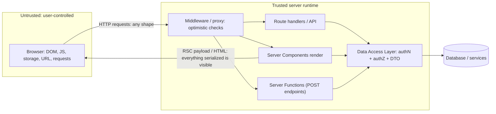
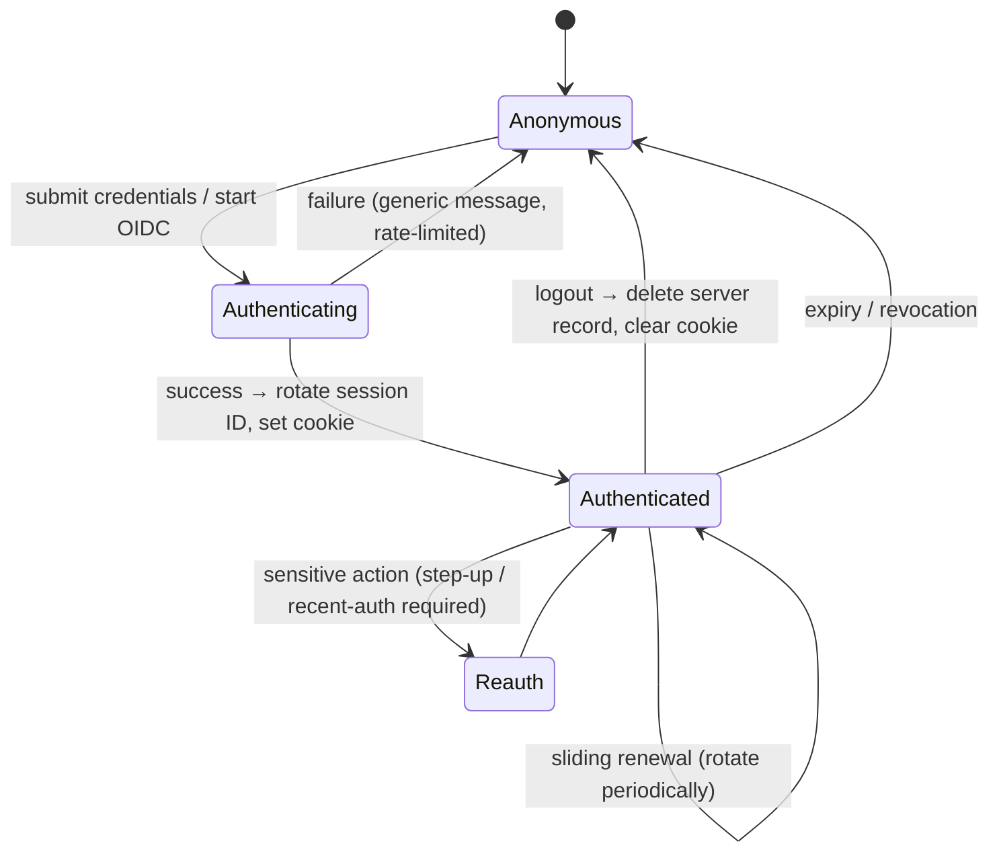
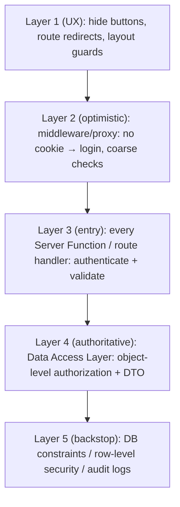
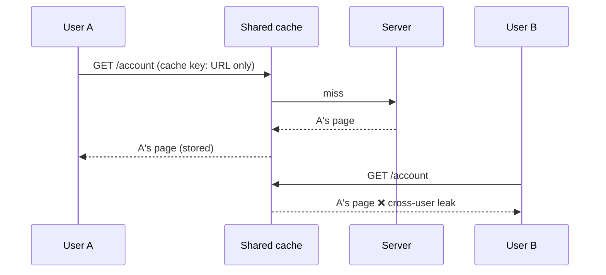

# 09 / 12 — Auth Boundaries: Authentication, Authorization and Trust in Server-Capable React

> **Scope note (verified 2026-10-22).** Security-relevant framework behavior (proxy/middleware semantics, Server Function protections, caching of authenticated responses) has changed and has had published vulnerabilities. This lesson teaches *design principles* that hold across frameworks; Next.js statements were checked against the Next.js 16.4 docs (authentication guide, data-security guide, `proxy`, `cookies`, `serverActions` config) and the GitHub advisory for CVE-2025-29927; React statements against react.dev and the December 2025 React security posts. Always re-check the advisories for the exact versions you run.

## 1. Lesson metadata

| | |
|---|---|
| **Level** | Advanced |
| **Study time** | 5 hours (reading 2 h, threat-modelling 1 h, exercises 2 h) |
| **Prerequisites** | [03 — Server Components in depth](./03-server-components-in-depth.md), [04 — Client/server boundaries and serialization](./04-client-server-boundaries-and-serialization.md), [09 — Framework architecture](./09-framework-architecture.md), [10 — Routing and nested layouts](./10-routing-and-nested-layouts.md), [11 — Progressive enhancement](./11-progressive-enhancement.md), [Phase 4/14 — API boundaries and data access](../04-react-architecture/14-api-boundaries-and-data-access.md) |
| **Next** | [13 — Forms, actions and mutations](./13-forms-actions-and-mutations.md) |
| **Related** | [Phase 10/06 — XSS, CSRF, CSP](../10-production-engineering/06-security-xss-csrf-csp.md) |

**Learning objectives.** After this lesson you can:
1. Distinguish **authentication**, **authorization**, **session management** and **UI gating**, and state which layer is a security control and which is only UX.
2. Draw the trust boundaries of a server-capable React application (browser, client components, server components, server functions, route handlers, data stores).
3. Design a Data Access Layer (DAL) that enforces authorization next to data, and explain why layout/middleware checks alone are insufficient.
4. Compare session cookies, JWTs, and delegated identity (OIDC) with their threat models, and configure cookies safely (HttpOnly, Secure, SameSite).
5. Treat Server Functions as public endpoints: authenticate, authorize, validate, rate-limit, and protect against CSRF.
6. Prevent data leakage across the RSC boundary (over-fetching, serialization of secrets, cache poisoning of personalized content).
7. Test and review authorization (IDOR/BOLA, role escalation, forced browsing).

**Concepts covered:** authentication vs authorization, identity vs session, RBAC/ABAC/ownership checks, IDOR/BOLA, defense in depth, Data Access Layer, DTOs, `server-only`, taint (experimental), middleware/proxy as optimistic check, session cookies, CSRF and SameSite, JWT pitfalls, OAuth2/OIDC at a conceptual level, token storage in browsers, cache and CDN safety for personalized responses, logout and session revocation, security headers, logging and audit.

---

## 2. Deep conceptual explanation

### 2.1 What problem is this lesson solving?

In a pure SPA, security reasoning is simple: *the browser is untrusted; the API is the trust boundary.* Everything React does is presentation; you secure the API.

Server-capable React moves server code into the *same module tree* as UI code. A component can call the database. A function in a file with `"use server"` becomes an HTTP endpoint. A layout runs on the server. The convenience hides the boundary: it is easy to write

```tsx
export default async function Page({ params }) {
  const invoice = await db.invoice.find(params.id);   // whose invoice?
  return <InvoiceView invoice={invoice} />;           // serialized to the browser
}
```

and ship an authorization hole (any logged-in user can read any invoice: IDOR) and a data leak (every column serialized to the client). The code *looks* like UI code, so reviewers read it as UI code.

This lesson is the discipline that restores the boundary: **identify every place where the server accepts input or emits data, and make the authorization decision there, explicitly, close to the data.**

### 2.2 Vocabulary that prevents design errors

| Term | Question it answers | Example |
|---|---|---|
| **Authentication (authN)** | Who are you? | Verifying a password, passkey, or OIDC login → establishing an identity |
| **Session** | Is this request part of an established authenticated interaction? | A cookie referencing a server-side record, or a signed token |
| **Authorization (authZ)** | Are you allowed to do *this* to *that*? | "Can user 17 read invoice 42?" |
| **Access control model** | How are permissions expressed? | RBAC (roles), ABAC (attributes), ReBAC (relationships), ownership checks |
| **UI gating** | What should we *show*? | Hiding the "Delete" button for viewers |
| **Trust boundary** | Where does data cross from less to more trusted? | Request → server code; DB → client payload |

> **Core rule:** *UI gating is UX; authorization is a server decision made per request, per resource, per action.* A hidden button is not a security control. A layout redirect is not a security control. A middleware matcher is not the only security control.

### 2.3 The trust boundaries of a server-capable React app



Three consequences:
1. **Every entry point is hostile.** Server Functions and route handlers accept arbitrary requests regardless of how your UI calls them. An attacker can call a Server Function with any arguments *without ever rendering your form*.
2. **Every output is public to that user.** Anything passed as a prop from server to client component (and everything rendered) is visible to the user in the payload. Treat props to client components as "will be sent to the browser".
3. **The data layer is the last line of defense.** If authorization lives in the DAL (not in pages), forgetting a check in a page cannot leak data.

### 2.4 Why layouts and middleware are not enough

*Middleware / proxy.* Runs before the request reaches routes; good for **cheap, optimistic** checks: "no session cookie → redirect to login", locale routing, bot filtering. Reasons it is not sufficient alone:
- It may not cover every path (matcher mistakes), internal routing (rewrites), or alternate entry points (server function posts, internal fetches).
- Historically it ran only in the Edge runtime (no DB), so it could verify a signature but not check revocation or fine-grained permissions. In Next.js 16 the file convention is renamed `proxy` (`proxy.ts`) and defaults to the **Node.js runtime** (the `runtime` option is not available in Proxy files), but the docs still recommend only *optimistic* cookie-based checks there, and "verify authentication and authorization inside each Server Function rather than relying on Proxy alone".
- **Bypasses have been published.** CVE-2025-29927 (GHSA-f82v-jwr5-mffw, CVSS 9.1, March 2025): an attacker could skip Next.js middleware, and any authorization check that lived only there, by sending a request with the internal `x-middleware-subrequest` header. Fixed in 15.2.3, 14.2.25, 13.5.9 and 12.3.5 (11.x: use the workaround of blocking external requests that carry that header); the advisory says deployments hosted on Vercel were automatically protected. The general lesson: infrastructure layers can have bugs; defense in depth means a bypass of one layer must not expose data.

*Layouts.* In nested routing frameworks, a layout persists across child navigation and may **not re-run** when only the child changes ([10](./10-routing-and-nested-layouts.md)). A layout-level `if (!user) redirect()` protects the first load but not necessarily subsequent child navigations or direct invocations of child-route data functions. The Next.js authentication guide warns about exactly this ("Due to Partial Rendering, be cautious when doing checks in Layouts as these don't re-render on navigation"); check what your framework says.

*Page-level checks.* Better, but pages are not the only code that reads data; the same query may be reachable from a Server Function, route handler, cron endpoint, or another page.

*Data Access Layer.* The only place that **all** paths share. Put authN/authZ here.

### 2.5 Sessions and tokens

| Approach | How it works | Strengths | Weaknesses / threats |
|---|---|---|---|
| **Opaque session ID cookie + server store** | Cookie contains random ID; server looks up session (DB/Redis) | Instant revocation; small cookie; server controls data | Needs a store; lookup on each request |
| **Signed/encrypted session cookie (stateless)** | Cookie contains the session data, signed (and ideally encrypted) | No store; scales trivially | Hard to revoke before expiry; size limit (~4 KB); key rotation needed |
| **JWT access token (e.g., in header)** | Signed token with claims | Cross-service verification without a lookup | Revocation difficulty; algorithm confusion/`none` bugs if misconfigured; leakage if stored in JS-accessible storage; claims go stale |
| **OIDC / OAuth 2 delegated login** | IdP authenticates; your app receives ID/access tokens via the authorization code flow with PKCE | Offloads credential handling; SSO | Misconfigured redirect URIs, state/nonce handling, token storage, scope design |
| **Passkeys (WebAuthn)** | Public-key credentials bound to origin | Phishing-resistant; no shared secret | UX/recovery flows; library/IdP support |

For browser apps with a server (frameworks), the commonly recommended default is a **server-side session in an HttpOnly, Secure, SameSite cookie** rather than tokens in `localStorage` (XSS can read `localStorage`; it cannot read HttpOnly cookies). *This is a widely adopted recommendation, not a universal law:* SPAs talking to third-party APIs may need bearer tokens; then use short-lived access tokens held in memory plus refresh via a secure mechanism ([Phase 10/06](../10-production-engineering/06-security-xss-csrf-csp.md)).

**Cookie attributes (public guarantee: HTTP cookie semantics, RFC 6265bis & browser behavior):**

| Attribute | Purpose |
|---|---|
| `HttpOnly` | Not readable via `document.cookie`; mitigates token theft via XSS (does not prevent XSS actions) |
| `Secure` | Only sent over HTTPS |
| `SameSite=Lax` (common default) / `Strict` / `None` | Controls cross-site sending; mitigates CSRF for most cases. `Lax` allows top-level GET navigations cross-site |
| `Path`, `Domain` | Scope; a broad `Domain` sends cookies to subdomains (risk) |
| `Max-Age`/`Expires` | Lifetime; prefer short sessions plus rolling renewal |
| `__Host-` prefix | Requires `Secure`, `Path=/`, no `Domain`: strongest scoping |

### 2.6 CSRF in the Server Function era

**Cross-site request forgery:** a malicious site causes the victim's browser to send an authenticated request to your origin. Defenses:
- `SameSite=Lax/Strict` cookies (blocks most cross-site POSTs).
- **Origin/Referer checks** on state-changing requests; Next.js Server Actions are POST-only and additionally compare the `Origin` header with the `Host` (or `X-Forwarded-Host`) header and abort on mismatch; extra safe hosts are configured with `serverActions.allowedOrigins` (under `experimental` in the documented config, with `*`/`**` host wildcards). The 16.4 config reference adds that a request with **no** `Origin` header is let through with a warning, and that the check runs in production too. Treat this as a defense-in-depth layer, not a replacement for SameSite cookies and authorization.
- CSRF tokens (double-submit or synchronizer) where cookies are used and SameSite isn't sufficient (legacy browsers, `SameSite=None` embeddings, subdomain risks).
- Use **POST** (never GET) for mutations; custom headers on `fetch` requiring CORS preflight.

Server Functions are POST endpoints; they inherit the CSRF problem. Do not assume it is solved unless you have read your framework's documented protections and configured the deployment (reverse proxies that rewrite `Host` can break origin checks).

### 2.7 Common misconceptions

| Misconception | Reality |
|---|---|
| "Server Components are secure because the code never reaches the browser." | The *code* doesn't; the *output and props* do. Overfetched or unauthorized data still leaks. |
| "Server Actions are internal functions." | They are public HTTP endpoints reachable by anyone who can craft the request. |
| "I hid the button for non-admins, so it's safe." | Anyone can invoke the endpoint directly. |
| "JWT = secure." | JWT is a format. Security depends on algorithm enforcement, key management, expiry, revocation, storage, and claims validation. |
| "`localStorage` is fine for tokens because we have CSP." | XSS defenses fail in practice; HttpOnly cookies reduce blast radius. Trade-offs exist but treat `localStorage` for long-lived credentials as a risk. |
| "My middleware matcher covers `/admin/*`, so admin is protected." | Matchers can miss routes; server functions/route handlers/data fetching paths exist outside page URLs. |
| "Auth is a frontend concern in React apps." | React is presentation. Auth is a server concern, with UI reflecting it. |

---

## 3. Internal mechanics

### 3.1 Request-scoped identity

On the server, every request needs an identity context: *who is making this call?* Frameworks provide request-scoped access to cookies/headers (e.g., `cookies()`/`headers()` in Next; `request` in loaders and actions). A DAL typically wraps this in a function:

```ts
// conceptually: getSession(): Promise<Session | null>   — reads cookie, validates, returns identity
```

React's `cache()` (server-only API) memoizes a function **for the duration of one server request** (react.dev: "React will invalidate the cache for all memoized functions for each server request"; "cache should only be used in Server Components"). Wrapping `getSession` in it prevents verifying the session N times per request while keeping per-request isolation. **Critical:** never memoize identity at module scope or in a long-lived cache keyed by something other than the session: that creates cross-user data leakage (request A's session returned to request B).

### 3.2 Authorization models, mechanically

| Model | Check shape | Good for | Risk |
|---|---|---|---|
| Role-based (RBAC) | `user.roles.includes("admin")` | Coarse capabilities | Role explosion; missing resource-level check ⇒ IDOR |
| Ownership | `resource.ownerId === user.id` | User-owned data | Forgotten for related/nested resources |
| Tenant scoping | `WHERE tenant_id = user.tenantId` on every query | Multi-tenant SaaS | One missed query leaks across tenants; enforce in the DAL or at the DB (row-level security) |
| Attribute-based (ABAC) | Policy over user/resource/environment attributes | Complex rules | Policy sprawl; hard to test |
| Relationship-based (ReBAC) | Graph query: "can user U view doc D via folder F?" | Sharing models (Google Docs-like) | Infra complexity |

**IDOR/BOLA** (Insecure Direct Object Reference / Broken Object Level Authorization): the leading API vulnerability class (it is API1:2023 in the OWASP API Security Top 10, the current edition I could find; "Broken Access Control" is A01 in the OWASP Top 10:2025 as well): the server accepts an object ID and returns/modifies the object without checking the caller's access. Typical in `GET /invoices/:id` and in Server Functions taking `invoiceId`.

### 3.3 What crosses the RSC boundary

Props from server components to client components are serialized into the RSC payload ([04](./04-client-server-boundaries-and-serialization.md)). Therefore:

- Passing a full DB row passes every column, including ones the client component never renders.
- Rendered server output (HTML) is visible, including hidden elements and `aria-hidden` content.
- Closed-over variables in **inline** Server Functions are captured and round-tripped through the client. The Next.js data-security guide says Next.js automatically encrypts them (a new private key per action per build, so actions only work for the build that created them; self-hosting across several servers needs `NEXT_SERVER_ACTIONS_ENCRYPTION_KEY`) and then adds: "We don't recommend relying on encryption alone to prevent sensitive values from being exposed on the client." Avoid closing over secrets at all.

Mitigations: **DTOs** (explicit projection types), `server-only` import guard (build error if a server module is imported into a client module), and React's experimental taint APIs (`experimental_taintObjectReference`, `experimental_taintUniqueValue`) as a *backstop*. They are still labelled experimental on react.dev ("available in the latest Experimental version of React"); in Next.js they need `experimental.taint: true`; and react.dev notes `taintObjectReference` "only protects against simple mistakes when the object is passed through to a Client Component unchanged", so never the primary control.

### 3.4 Caching and personalization hazards

Any cache that sits between your server and the user can leak personalized data if the cache key doesn't include identity:

- **CDN / shared cache:** respond to authenticated routes with `Cache-Control: private` or `no-store`; do not rely on `Vary: Cookie` alone (CDN behaviors differ).
- **Framework route/data cache:** a function that fetches `/me` and is cached with a key independent of the session returns user A's data to user B. Include identity in cache keys or mark routes dynamic. Defaults differ by framework version (Next.js changed its `fetch` caching defaults in 15 and moved to the opt-in `use cache`/Cache Components model in 16), so read the caching docs for the version you run.
- **React `cache()`:** per-request, safe by design (scope = one render).
- **Client router cache:** must be cleared on logout ([10 F1](./10-routing-and-nested-layouts.md)).
- **bfcache/back button:** after logout, Back may show a previously rendered authenticated page from memory; use `Cache-Control: no-store` on sensitive pages and re-verify on `pageshow` if the page is sensitive.

### 3.5 Session lifecycle



Key mechanics: **rotate** the session ID on login (prevents fixation); **invalidate server-side** on logout (clearing the cookie only is insufficient for stateless tokens); **step-up** for sensitive operations (password change, payout).

---

## 4. Step-by-step execution walkthrough

Scenario: **user 17 views invoice 42** in an App-Router-style framework, with a DAL; then an attacker tries user 17 → invoice 43 via a Server Function.

**A. Normal page load: `GET /invoices/42`**
1. Request hits the CDN: route is dynamic and marked private → miss → forwarded.
2. Middleware/proxy: finds a session cookie; optionally checks signature/expiry (cheap). No cookie ⇒ redirect to `/login?returnTo=/invoices/42` (validated). It does *not* load the invoice.
3. The root layout renders: may read the session to show the header. Layout does not authorize invoices.
4. `InvoicePage` (server component): `const inv = await getInvoiceForViewer(params.id)`.
5. DAL `getInvoiceForViewer`:
   a. `session = await verifySession()` (reads cookie, verifies against the store, throws/redirects if absent).
   b. `row = await db.invoice.findFirst({ where: { id, tenantId: session.tenantId } })` (tenant scoping in the query).
   c. If `!row` → `notFound()` (do not distinguish "exists but forbidden" from "missing" unless product needs it).
   d. `can(session.user, "invoice:read", row)` → else `notFound()`/403.
   e. Return a **DTO**: `{ id, number, totalCents, status, lines }`, no internal columns.
6. React renders; the DTO is passed to `<InvoiceView>` (a client component for printing/filters). Only DTO fields appear in the payload.
7. Response headers: `Cache-Control: private, no-store`.

**B. Attack: forged Server Function call.**
8. Attacker (user 17) opens DevTools, sees `POST /invoices/42` with a Server Function id for `markPaid(invoiceId)`; replays with `invoiceId=43` using their own cookie.
9. Server Function `markPaid`:
   a. `session = await verifySession()` ✔ (attacker is authenticated).
   b. `invoice = await getInvoiceForViewer("43")` → tenant scoping and `can(...)` fail ⇒ not found/forbidden ⇒ **request rejected**.
   c. Even if `markPaid` forgot step b, the DAL `markInvoicePaid(session, id)` re-checks `can(session.user, "invoice:pay", row)`.
10. Response: generic error; server logs an authorization failure event with user id, resource id, IP (for detection of enumeration).

**C. Logout.**
11. `logout()` Server Function: delete the server session record, clear cookie (`Max-Age=0`), call revalidation to purge cached personalized output, redirect to `/login`. Client clears query caches and router cache ([10](./10-routing-and-nested-layouts.md)).

---

## 5. Code examples

### 5.1 Minimal — session verification helper

```ts
// lib/auth/session.ts
import "server-only";
import { cookies } from "next/headers";           // async since Next 15 (`await cookies()`); sync access is gone in 16
import { cache } from "react";
import { redirect } from "next/navigation";
import { sessionStore } from "./store";

export type Session = { userId: string; tenantId: string; roles: readonly ("viewer" | "editor" | "admin")[] };

export const getSession = cache(async (): Promise<Session | null> => {
  const jar = await cookies();
  const id = jar.get("__Host-sid")?.value;
  if (!id) return null;
  return sessionStore.get(id);                     // server-side lookup; returns null if expired/revoked
});

export async function requireSession(): Promise<Session> {
  const s = await getSession();
  if (!s) redirect("/login");
  return s;
}
```

Line notes:
- `import "server-only"` makes the build fail if a client module imports this file (prevents shipping session logic to the browser).
- `cache` memoizes per request; `getSession()` can be called in layout, page and DAL with one lookup.
- `__Host-sid` cookie name enforces strict cookie scoping (must be set with `Secure; Path=/` and no `Domain`).
- The cookie value is an **opaque id**; the server looks up identity and roles, so revocation is immediate.
- `redirect` throws a control-flow signal; callers must not swallow it.

### 5.2 Practical — DAL with authorization and DTO

```ts
// lib/invoices/dal.ts
import "server-only";
import { notFound } from "next/navigation";
import { requireSession, type Session } from "@/lib/auth/session";
import { db } from "@/lib/db";

export type InvoiceDTO = {
  id: string;
  number: string;
  totalCents: number;
  status: "draft" | "open" | "paid";
  canPay: boolean;                      // computed server-side for UI gating only
};

function canRead(s: Session, inv: { tenantId: string; ownerId: string }): boolean {
  return inv.tenantId === s.tenantId && (s.roles.includes("admin") || inv.ownerId === s.userId);
}
function canPay(s: Session, inv: { status: string }): boolean {
  return (s.roles.includes("editor") || s.roles.includes("admin")) && inv.status === "open";
}

export async function getInvoice(id: string): Promise<InvoiceDTO> {
  const s = await requireSession();
  const row = await db.invoice.findFirst({ where: { id, tenantId: s.tenantId } }); // tenant scoped query
  if (!row || !canRead(s, row)) notFound();
  return { id: row.id, number: row.number, totalCents: row.totalCents, status: row.status, canPay: canPay(s, row) };
}

export async function payInvoice(id: string): Promise<void> {
  const s = await requireSession();
  const row = await db.invoice.findFirst({ where: { id, tenantId: s.tenantId } });
  if (!row || !canRead(s, row) || !canPay(s, row)) throw new Error("Forbidden");
  await db.invoice.update({ where: { id: row.id }, data: { status: "paid", paidBy: s.userId } });
}
```

Notes:
- **Tenant filter inside the query** (not "fetch then compare") reduces accidental cross-tenant reads; the explicit `canRead` adds object-level checks.
- `InvoiceDTO` is an explicit projection; row columns like `internalNotes` can't leak.
- `canPay` returned in the DTO drives UI gating **only**; `payInvoice` re-checks. Never trust flags that came from the client.
- `notFound()` for both missing and forbidden avoids revealing existence (policy choice; for same-tenant forbidden you may prefer 403 with logging).
- Possible optimization: database row-level security (e.g., PostgreSQL RLS) as a second layer: operationally heavier, but valuable in multi-tenant systems.

### 5.3 Practical — Server Function with auth, validation, CSRF-aware design

```ts
// app/invoices/[id]/actions.ts
"use server";

import { z } from "zod";
import { revalidatePath } from "next/cache";
import { payInvoice } from "@/lib/invoices/dal";
import { rateLimit } from "@/lib/rate-limit";
import { requireSession } from "@/lib/auth/session";

const input = z.object({ invoiceId: z.uuid() });          // Zod 4 (z.string().uuid() is deprecated)

export type PayState = { ok: boolean; message?: string };

export async function markPaid(_prev: PayState, formData: FormData): Promise<PayState> {
  const s = await requireSession();                       // 1. authenticate
  await rateLimit(`pay:${s.userId}`, { limit: 10, windowSec: 60 });   // 2. abuse control
  const parsed = input.safeParse({ invoiceId: formData.get("invoiceId") }); // 3. validate untrusted input
  if (!parsed.success) return { ok: false, message: "Invalid request." };
  try {
    await payInvoice(parsed.data.invoiceId);              // 4. authorize inside the DAL
  } catch {
    return { ok: false, message: "You can't perform this action." };  // generic message
  }
  revalidatePath(`/invoices/${parsed.data.invoiceId}`);   // 5. purge cached output
  return { ok: true, message: "Invoice marked paid." };
}
```

Line notes:
- Five steps are the recipe for *every* Server Function: authenticate → throttle → validate → authorize → mutate/revalidate.
- `invoiceId` comes from `FormData`: attacker-controlled. Validate shape (UUID) before use.
- Errors are generic to avoid leaking whether another tenant's invoice exists.
- The `catch` here wraps only `payInvoice`, **not** `redirect`/`notFound` calls (control-flow signals) — if you add a redirect, place it outside the `try`.
- CSRF: relies on POST-only invocation, the framework's Origin-vs-Host check and SameSite cookies; configure `serverActions.allowedOrigins` when the proxy forwards a different host (see §2.6).

### 5.4 Incorrect — authorization in the layout and trusting the client

```tsx
// app/admin/layout.tsx
export default async function AdminLayout({ children }: { children: React.ReactNode }) {
  const user = await getUser();
  if (user?.role !== "admin") redirect("/");        // protects the initial load only (a layout may not re-run on child navigation)
  return <>{children}</>;
}

// app/admin/users/actions.ts
"use server";
export async function deleteUser(userId: string, isAdmin: boolean) {   // ❌ client says it's admin
  if (!isAdmin) return;
  await db.user.delete({ where: { id: userId } });
}
```

```tsx
// app/admin/users/page.tsx
export default async function Page() {
  const users = await db.user.findMany();           // ❌ full rows incl. passwordHash
  return <UserTable users={users} />;               // client component: serializes everything
}
```

**Problems:** (1) `deleteUser` accepts `isAdmin` from the caller — trivial privilege escalation; (2) no authentication or authorization inside the function; (3) layout redirect doesn't protect the function (a public endpoint); (4) the page ships `passwordHash` etc. to the client; (5) no validation; (6) `findMany()` has no tenant scoping; (7) no audit trail.

### 5.5 Corrected

```ts
// lib/users/dal.ts
import "server-only";
export type UserRow = { id: string; name: string; email: string };

export async function listUsersForAdmin(): Promise<UserRow[]> {
  const s = await requireSession();
  if (!s.roles.includes("admin")) notFound();
  const rows = await db.user.findMany({
    where: { tenantId: s.tenantId },
    select: { id: true, name: true, email: true },       // allow-list columns
  });
  return rows;
}

export async function deleteUserAsAdmin(targetId: string): Promise<void> {
  const s = await requireSession();
  if (!s.roles.includes("admin")) throw new Error("Forbidden");
  if (targetId === s.userId) throw new Error("Cannot delete self");
  const res = await db.user.deleteMany({ where: { id: targetId, tenantId: s.tenantId } }); // scoped
  if (res.count === 0) throw new Error("Not found");
  await audit.log({ actor: s.userId, action: "user.delete", target: targetId });
}
```

```ts
// app/admin/users/actions.ts
"use server";
export async function deleteUser(formData: FormData) {
  const id = z.uuid().parse(formData.get("userId"));
  await deleteUserAsAdmin(id);
  revalidatePath("/admin/users");
}
```

The admin check lives in the DAL; the layout may still redirect for UX. The function derives permissions from the **session**, never from arguments.

### 5.6 Advanced — client-side auth state without trusting it

The client needs *some* auth awareness for UI (show the avatar, hide admin links). Provide it from the server as a **minimal, non-sensitive view model**:

```tsx
// app/layout.tsx (server)
export default async function RootLayout({ children }: { children: React.ReactNode }) {
  const s = await getSession();
  const viewer = s ? { name: await getDisplayName(s.userId), canAdmin: s.roles.includes("admin") } : null;
  return (
    <html lang="en"><body>
      <ViewerProvider value={viewer}>{children}</ViewerProvider>
    </body></html>
  );
}
```

```tsx
"use client";
const ViewerContext = createContext<{ name: string; canAdmin: boolean } | null>(null);
export function ViewerProvider({ value, children }: { value: { name: string; canAdmin: boolean } | null; children: React.ReactNode }) {
  return <ViewerContext value={value}>{children}</ViewerContext>;   // React 19: <Context> as provider
}
export const useViewer = () => useContext(ViewerContext);
```

Trade-off: this view model is stale until the next server render (permissions can change); it must never be used for security decisions. Client code that needs fresh permission state should call a server function or revalidate. Avoid putting tokens or full user objects in context.

---

## 6. Visual explanations

### 6.1 Defense in depth



*Reading:* a failure at layers 1–3 must not be exploitable because layer 4 decides. Layer 5 limits damage when layer 4 has a bug.

### 6.2 Who can see what

```text
Server Component code        : server only (not shipped)
Server Component OUTPUT      : visible to the requesting user (HTML + RSC payload)
Props to client components   : visible to the requesting user
Client component code        : visible to everyone (public bundle)
Server Function code         : server only; ENDPOINT callable by anyone with network access
Environment secrets (server) : server only, unless imported into client modules or serialized
NEXT_PUBLIC_* style vars     : inlined into client bundle: public by design (Next.js: NEXT_PUBLIC_; other frameworks use other prefixes)
```

### 6.3 Cache-key hazard



Fix: `Cache-Control: private, no-store` for personalized responses, or include identity in the key at a layer you control.

---

## 7. Alternative approaches and trade-offs

### 7.1 Where to enforce authorization

| Criterion | Middleware/proxy | Layout/page guards | Server Function entry checks | Data Access Layer | DB row-level security |
|---|---|---|---|---|---|
| Covers all entry points | No | No | Per function | **Yes (if all data goes through it)** | **Yes, even raw queries** |
| Granularity | Coarse (path) | Medium | Per action | Fine (object-level) | Fine (policy per table) |
| Performance | Cheap | Cheap | Moderate | One query per check | Within query |
| Risk of omission | Matcher gaps | Forgotten page | Forgotten function | Bypassed if code reads DB directly | Misconfigured policy/connection role |
| Testability | Medium | Medium | Medium | **High (unit-testable)** | Needs DB tests |
| Best for | UX redirects, bot filtering | UX | Input validation, rate limit | **Primary control** | Defense in depth in multi-tenant systems |

### 7.2 Session mechanisms

| Criterion | Server-side session (opaque cookie) | Stateless signed cookie | JWT bearer in memory + refresh | Third-party auth service (hosted) |
|---|---|---|---|---|
| Revocation | Immediate | Hard (blocklist or short TTL) | Hard (short TTL, refresh rotation) | Provider-managed |
| Scalability | Needs shared store | Excellent | Excellent | Excellent |
| XSS exposure | Cookie not readable | Cookie not readable | Token in JS memory: stolen by XSS during session | Depends |
| CSRF exposure | Needs CSRF defense | Needs CSRF defense | Not applicable if header-only (but XSS risk) | Depends |
| Operational effort | Store ops | Key rotation | Token endpoints, rotation | Vendor integration and cost |
| Best for | Typical full-stack frameworks | Simple apps with short sessions | SPA + separate APIs/microservices | Teams that don't want to run auth |

*Library landscape (checked 2026-10-22):* the Next.js authentication guide lists Auth0, Better Auth, Clerk, Descope, Kinde, Logto, NextAuth.js, Ory, Stack Auth, Supabase, Stytch and WorkOS as compatible, plus Iron Session and Jose for session handling. The Auth.js site now states "The Auth.js project is now part of Better Auth" (it still documents the `next-auth` package and a `proxy.ts` export), and the Better Auth blog has a July 2026 post announcing that Better Auth is joining Vercel; I did not verify migration guidance or long-term support terms, so check maintenance status before choosing a library for a new project. Whatever the library, the DAL still has to authorize per object; a library authenticates, it does not know your resources. On JWT vs session claims: a JWT's claims (roles, tenant) are a snapshot signed at issue time, so they go stale until expiry; for authorization that must reflect revocation or role changes, look up the session/user server-side (as `getSession` does) instead of trusting claims from an older token.

**When the recommended approach (DAL + server-side session cookie) is *not* best:** a SPA that must call multiple third-party APIs on behalf of the user (e.g., Graph APIs) needs bearer tokens; a BFF (backend-for-frontend) that holds tokens server-side and exposes a cookie session to the browser reconciles both. A tiny internal tool behind a company SSO proxy that injects identity headers may legitimately rely on the proxy for authN, but must still authorize per resource, and must ensure the app is unreachable except through that proxy.

---

## 8. Best practices and anti-patterns

**Do**
- Put authN + authZ in a DAL used by pages, server functions, route handlers and jobs.
- Derive identity from the session on the server; never from client-supplied flags, hidden fields, or JWT claims you haven't verified.
- Return DTOs; allow-list columns.
- Scope every multi-tenant query by tenant in the query.
- Validate all inputs (shape, length, enum) before use; parse IDs to proper types.
- Rotate session IDs on login; invalidate on logout; use short lifetimes plus step-up for sensitive operations.
- Set cookie attributes: `HttpOnly; Secure; SameSite=Lax` (or Strict); `__Host-` prefix where feasible.
- Mark personalized responses `private`/`no-store`.
- Log authorization failures; alert on enumeration patterns; keep audit trails for sensitive actions.
- Keep framework and React server packages up to date; subscribe to security advisories. Two examples: CVE-2025-55182 (unauthenticated remote code execution, CVSS 10.0, in how React decodes payloads sent to Server Function endpoints, reachable even if you define no Server Functions as long as you support Server Components) affected `react-server-dom-webpack`/`-parcel`/`-turbopack` 19.0, 19.1.0, 19.1.1 and 19.2.0 and was fixed in 19.0.1, 19.1.2 and 19.2.1; follow-up denial-of-service (CVE-2025-55184, CVE-2025-67779; a third DoS id, CVE-2026-23864, was supplied to me but I did not find it on react.dev) and source-code-exposure (CVE-2025-55183) issues were fixed in 19.0.4, 19.1.5 and 19.2.4 (the 11 December 2025 React post says 19.0.3, 19.1.4 and 19.2.3 were incomplete fixes), with further hardening in later patch releases up to 19.2.7 in the React CHANGELOG, and Next.js middleware had CVE-2025-29927. Treat dependency updates for server-rendering packages as security patches, and re-check the advisories for your exact versions.

**Beginner mistakes**
- Authorization only in the UI.
- `isAdmin` passed from the client.
- Putting tokens in `localStorage` for convenience.
- Returning full DB rows to components.

**Experienced-developer mistakes**
- Layout-only guards in nested routing.
- Middleware as the only check; matcher regex gaps.
- Cache keys without identity.
- Inline Server Functions closing over sensitive values.
- Assuming `notFound()`/`redirect()` inside `try/catch` still works.
- Authorization checks that depend on fetching then filtering in memory (over-fetch, N+1, timing leaks).

**Smells:** `// TODO: check permissions`; role strings scattered through components; `if (process.env.NODE_ENV === "development")` bypass flags; user IDs accepted from request bodies; admin pages protected only by obscure URLs.

**Justified exceptions:** public data (marketing pages, catalog) needs no auth and should be cacheable; internal prototypes behind a VPN may defer fine-grained authZ (document the debt, [Phase 10/15](../10-production-engineering/15-technical-debt.md)).

---

## 9. Real-world application

*Multi-tenant B2B SaaS.* Threat: tenant A reads tenant B's data via an ID guessed or leaked. Controls: tenant ID taken from the session, appended to every query in the DAL (enforced by a query helper that *requires* a tenant argument), row-level security as a backstop, UUIDs rather than sequential IDs (obscurity only; not a control), tests that run each endpoint as tenant A against tenant B's IDs.

*Banking/finance.* Step-up authentication for transfers; per-action authorization with limits; idempotency keys; signed audit logs; short session TTL; device binding; strict `no-store` on balances; CSP and Trusted Types considerations ([Phase 10/06](../10-production-engineering/06-security-xss-csrf-csp.md)).

*Marketplace with roles (buyer/seller/admin).* RBAC for capabilities plus ownership checks for resources (`order.sellerId === s.userId`). Admin impersonation implemented as a *separate* audited session with banners, never as client-side role flipping.

*Content site with paywall.* Authorization decides whether to render the full article on the server; do not render the full text then hide it with CSS or JS (the content is in the HTML/payload and crawlable). If SEO needs paywalled content indexed, use the documented structured-data approach for paywalled content (Google's guidelines: `isAccessibleForFree: false` on the `NewsArticle`/`Article` and a `hasPart` with the `cssSelector` of the gated section; serve the same content to the crawler that the markup describes) ([14](./14-accessibility-and-seo.md)).

*Multi-team:* a shared `@company/auth` package owned by a platform team supplies `requireSession`, policy helpers and test fixtures; feature teams write DALs against it ([Phase 4/23](../04-react-architecture/23-multi-team-ownership.md)).

---

## 10. Debugging and troubleshooting

**Symptom: "Users sometimes see someone else's data."** *Treat as a security incident.* Investigate: (1) a shared cache without identity in the key (CDN, framework data cache, module-level variable); (2) a module-scope singleton storing request data; (3) `cache()` misuse is unlikely (per-request) but a custom memoization may be global; (4) a CDN ignoring `Vary`. Reproduce with two browsers/sessions and inspect response headers (`Cache-Control`, `Age`, platform cache status). Fix: `private/no-store`, identity-aware keys, remove module-level state. Validate by automated two-user test.

**Symptom: "Direct call to the Server Function succeeds for non-admins."** Use DevTools → Network to copy the request (`Copy as cURL`), change the session cookie to a non-admin, and replay. If it succeeds, the function lacks authorization in DAL. Add a test replicating the replay.

**Symptom: "After logout, Back shows private page."** bfcache or HTTP cache. Add `Cache-Control: no-store` on authenticated pages; listen to `pageshow` with `event.persisted` to re-validate; clear client caches on logout.

**Symptom: "Redirect loop /login ↔ /dashboard."** Two sources of truth (middleware says unauthenticated, page says authenticated, or cookie set with wrong `Path`/`Domain`/`Secure` so it isn't sent). Inspect the `Set-Cookie` response and the `Cookie` request header in DevTools → Network → Cookies, and Application → Cookies.

**Symptom: "Session cookie not sent in production."** `Secure` cookies on HTTP; `SameSite=None` without `Secure`; proxies changing host/scheme (check `X-Forwarded-Proto` trust configuration); `__Host-` prefix constraints not met; third-party context blocking. 

**Symptom: "Server Function rejected with an origin error."** The framework's CSRF Origin check compares `Origin` to `Host` (or `X-Forwarded-Host`); proxies rewriting host break it; configure allowed origins as documented (Next.js: `serverActions.allowedOrigins`, matching the host plus port that the *browser* shows).

**Security review checklist for each endpoint:** authenticated? authorized per object? input validated? output DTO? rate-limited? CSRF-protected? cache-safe? audited?

---

## 11. Exercises

### Level A — Knowledge
A1. Distinguish authentication, authorization and UI gating with an example each.
A2. Why is a Server Function a public endpoint even though it is only called from your form?
A3. What does `HttpOnly` protect against, and what does it not protect against?
A4. What is IDOR/BOLA? Give a Server Function example.
A5. Why must `getSession` never be memoized at module scope?

### Level B — Code comprehension
B1. Find all security problems:
```ts
"use server";
export async function updateProfile(userId: string, data: { name: string; role?: string }) {
  await db.user.update({ where: { id: userId }, data });
}
```
B2. In §5.2, why is the tenant filter placed in the `where` clause and not checked after fetching?
B3. A page passes `user` (full row) to `<Avatar user={user} />`, a client component that only renders `user.name`. What leaks? Fix.
B4. A layout contains `if (!session) redirect("/login")`. A signed-in user navigates client-side from `/a` to `/b` after their session expired server-side. What might happen with respect to the layout check, and why is the DAL check still needed?

### Level C — Implementation
C1. Implement `requireRole(session, role)` and `can(session, action, resource)` as small, testable pure functions with TypeScript types for actions (`"invoice:read" | "invoice:pay"`).
C2. Write a Vitest test that verifies tenant isolation for `getInvoice`: user in tenant A requesting tenant B's invoice id must fail.
C3. Write a safe `returnTo` validator that accepts only same-origin relative paths and rejects `//evil.com`, `/\evil.com`, `https://evil.com`, and `javascript:` values.

### Level D — Debugging
D1. QA finds that a non-admin can delete users by replaying a request with a different `userId`. The UI hides the button for non-admins. Root cause and fix; write the regression test.
D2. Customers report seeing another customer's shopping cart count in the header intermittently. The header is rendered by a server component calling `getCart()` which uses `fetch("/api/cart")` with a framework data cache. Diagnose and fix.
D3. After deploying behind a new reverse proxy, all Server Functions fail with "invalid origin". Diagnose.

### Level E — Architecture decisions
E1. Choose a session strategy for (a) a Next.js e-commerce site with guest checkout, (b) an SPA calling five microservices, (c) a mobile-first PWA with offline mode. Justify with threat models.
E2. Design the authorization architecture for a multi-tenant SaaS with roles, resource ownership and sharing links. Specify where checks live, how to test, and how to avoid regressions as teams add endpoints.

### Level F — Expert challenge
F1. Perform a threat model (STRIDE or abuse-case style) of a Server Function-based "transfer funds" feature. Identify at least eight threats with mitigations including CSRF, replay, double-submit, IDOR, race conditions (TOCTOU), logging and session theft.

---

## 12. Detailed answers and explanations

> Attempt the exercises first.

**A1.** AuthN: verifying a password → know user is 17. AuthZ: checking user 17 may read invoice 42. UI gating: hiding the "Delete" button for viewers. Only authN/authZ are security controls.

**A2.** The framework exposes it over HTTP with an identifier. An attacker can craft the same POST without your UI, so the function body must enforce authN, authZ and validation. Wrong answer: "it's not in the route table so it's private".

**A3.** `HttpOnly` prevents JavaScript from reading the cookie (limits session theft through XSS). It doesn't prevent XSS from *using* the session (making requests as the user), nor CSRF, nor sniffing over HTTP (that's `Secure`).

**A4.** Accepting an object id and acting on it without verifying the caller's rights. Example: `deleteInvoice(id)` that deletes any invoice id supplied. Mitigation: authorize per object in DAL, scope by tenant/owner.

**A5.** Module scope is shared across all requests in a server process. Storing a session there would serve user A's identity to user B's concurrent request. Use request-scoped storage (`cache`, async local storage, per-request context).

**B1.** (1) No authentication. (2) `userId` from client (anyone can update anyone). (3) `data` includes `role?`: mass assignment/privilege escalation. (4) No validation (types erased at runtime). (5) No authorization or audit. (6) Passing the whole `data` object to ORM lets unknown fields through. Fix:
```ts
"use server";
const schema = z.object({ name: z.string().trim().min(1).max(100) }).strict();
export async function updateProfile(formData: FormData) {
  const s = await requireSession();
  const { name } = schema.parse({ name: formData.get("name") });
  await db.user.update({ where: { id: s.userId }, data: { name } });
}
```

**B2.** A post-fetch check still reads the foreign row into memory (leaks via timing/logging/errors/bugs), and any later code that forgets the check could use it. Filtering in the query makes the unauthorized row unreachable, and uses indexes. Still keep object-level checks for rules the query can't express.

**B3.** The entire row (email, phone, internal flags, password hash if selected) is serialized into the RSC payload/props visible in the browser, regardless of what `Avatar` renders. Fix: pass `{ name, imageUrl }` (DTO) or just `name`; define a `UserPublicDTO` type; add `server-only` to the module that loads rows.

**B4.** Layout may *not* re-run on client navigation between children, so no redirect occurs; `/b`'s page or its data calls may then run with an invalid session. The DAL check (`requireSession`) rejects the request and redirects, which is the actual guarantee. Without it, a stale layout would let the child render with stale or missing identity. Layout checks give UX only.

**C1. Reference.**
```ts
type Role = "viewer" | "editor" | "admin";
type Action = "invoice:read" | "invoice:pay";
type Session = { userId: string; tenantId: string; roles: readonly Role[] };
type InvoiceRes = { tenantId: string; ownerId: string; status: "draft" | "open" | "paid" };

export const requireRole = (s: Session, r: Role) => s.roles.includes(r);

export function can(s: Session, action: Action, res: InvoiceRes): boolean {
  if (res.tenantId !== s.tenantId) return false;
  switch (action) {
    case "invoice:read": return s.roles.includes("admin") || res.ownerId === s.userId;
    case "invoice:pay": return res.status === "open" && (s.roles.includes("editor") || s.roles.includes("admin"));
  }
}
```
Evaluation: exhaustive `switch`, tenant check first, pure and unit-testable, default-deny.

**C2. Reference.**
```ts
import { describe, it, expect, vi } from "vitest";
vi.mock("@/lib/auth/session", () => ({ requireSession: async () => ({ userId: "u1", tenantId: "A", roles: ["viewer"] }) }));
vi.mock("next/navigation", () => ({ notFound: () => { throw new Error("NEXT_NOT_FOUND"); } }));

describe("getInvoice tenant isolation", () => {
  it("rejects invoices from another tenant", async () => {
    await seed({ id: "inv-b", tenantId: "B", ownerId: "u9" });
    await expect(getInvoice("inv-b")).rejects.toThrow("NEXT_NOT_FOUND");
  });
  it("allows own tenant+owner", async () => {
    await seed({ id: "inv-a", tenantId: "A", ownerId: "u1" });
    await expect(getInvoice("inv-a")).resolves.toMatchObject({ id: "inv-a" });
  });
});
```
Notes: `seed` is test DB setup; `server-only` throws when imported outside a React Server Components build (its default export throws "This module cannot be imported from a Client Component module"), so Vitest needs it neutralised: we verified that `resolve.alias: { "server-only": "<path>/server-only/empty.js" }` in the Vitest config makes the import a no-op. Better to also run integration tests against a real DB.

**C3. Reference.**
```ts
export function safeReturnTo(raw: string | null, base = "https://app.example.com"): string {
  if (!raw) return "/";
  if (!raw.startsWith("/") || raw.startsWith("//") || raw.includes("\\")) return "/";
  try {
    const u = new URL(raw, base);
    if (u.origin !== new URL(base).origin) return "/";
    const out = u.pathname + u.search + u.hash;
    return out.startsWith("//") ? "/" : out;   // normalisation can turn "/..//evil.com" into "//evil.com"
  } catch { return "/"; }
}
```
Rejects `//evil.com`, `/\evil.com`, absolute URLs and `javascript:` (not starting with `/`). The final `startsWith("//")` guard matters: we ran the validator and without it `/..//evil.com` passed the first checks and came back as `//evil.com` (a protocol-relative URL, i.e. an open redirect) because `new URL()` collapses the `..` segment; with the guard it returns `/`. Edge: control characters/newlines (header injection) are stripped by the URL parser but avoid placing the value in a header unencoded.

**D1.** Root cause: authorization absent in the function; UI gating only. Fix: DAL `deleteUserAsAdmin` checks admin role and tenant scoping (see §5.5). Regression test: call the function as a non-admin session with another user's id; expect rejection; also assert no row deleted. Also review all other functions with the same pattern (grep `"use server"`).

**D2.** Framework data cache keyed by URL for `/api/cart`, without cookies in the key, serves one user's response to others. Fix: don't use the shared data cache for personalized fetches (opt out, e.g. `cache: "no-store"` or a dynamic API such as `cookies()`; the exact switches differ between Next.js versions and other frameworks), read the cart in the DAL by session id, and avoid fetching your own API over HTTP from server components (call the function directly). Validate with a two-session test and cache headers.

**D3.** Origin check compares `Origin` with the `Host`/forwarded host the app sees; the proxy changes/removes `X-Forwarded-Host` or rewrites `Host`, so they mismatch. Fix: configure the proxy to forward the original host and configure the framework's allowed origins (Next.js: `serverActions.allowedOrigins`; the entry is the host, plus port if any, that the browser sends in `Origin`). Don't disable the check.

**E1.** (a) Guest checkout: opaque server-side session cookie for guests (anonymous session id) upgraded on login; HttpOnly, SameSite=Lax; DAL with ownership by session or user; step-up for saved payment methods. (b) SPA + microservices: BFF holding tokens server-side or short-lived access token in memory + rotating refresh via HttpOnly cookie; each service verifies tokens and authorizes; CSRF defense for cookie-based refresh. (c) PWA offline: tokens must exist client-side; use short-lived tokens, secure storage with platform capabilities (WebAuthn/passkeys for re-auth), queue offline mutations with idempotency keys, and revalidate on reconnect; accept higher XSS risk and mitigate with CSP/Trusted Types. Evaluate: explicit threat reasoning, revocation, storage.

**E2.** Strong answer: session → `Principal` (user, tenant, roles); policy module with pure `can(principal, action, resource)`; DAL functions are the only DB access (lint rule/dependency-cruiser to forbid `db` imports elsewhere, [Phase 4/25](../04-react-architecture/25-architectural-fitness-and-enforcement.md)); sharing links as scoped capabilities (unguessable token mapping to resource+permission+expiry, stored hashed); row-level security backstop; a contract test suite iterating every registered endpoint with matrices of principals (anon, other tenant, viewer, editor, admin) expecting allow/deny; CI gate that fails if a Server Function lacks a registered policy; audit logging; security review checklist in PR template.

**F1. Example threats and mitigations.** (1) CSRF → SameSite + origin check + step-up confirmation. (2) IDOR on source account → derive account from session/ownership check. (3) Replay → one-time nonce/idempotency key per transfer. (4) Double-submit → idempotency + DB unique constraint. (5) TOCTOU on balance → transaction with row lock/`SELECT … FOR UPDATE` or atomic conditional update. (6) Session theft → short sessions, device binding, step-up with WebAuthn, HttpOnly cookies. (7) Tampering of amounts (negative, huge, fractional) → server-side validation using integer minor units, limits. (8) Enumeration of recipient accounts → uniform responses, rate limits. (9) Insufficient logging → structured audit with actor, IP, device, correlation id. (10) Race between approval and execution → state machine with transitions enforced in the DB. (11) Information leak via error messages → generic errors. Evaluation: breadth, specificity of mitigations, transactional reasoning.

---

## 13. Senior engineer interview questions

**Q1. "Where do you put authorization in a Next.js/RSC app and why?"**
*Strong answer:* In a Data Access Layer that every page, server function and route handler uses, because it is the only chokepoint all entry points share; layouts and middleware are for UX and optimistic checks. Layouts may not re-run per navigation; middleware can have gaps or bypass bugs. Return DTOs.

**Q2. "Are Server Actions CSRF-safe?"**
*Strong answer:* Frameworks add mitigations (Origin vs Host comparison, POST-only, SameSite cookies by default in many setups), but you must understand them and configure deployment correctly (proxies, allowed origins). Don't assume; for sensitive operations add step-up/re-auth and idempotency. Verify against the framework's docs and advisories.

**Q3. "JWT in localStorage vs HttpOnly session cookie?"**
*Strong answer:* localStorage tokens are readable by any XSS; HttpOnly cookies are not, but need CSRF defenses. Server-side sessions give instant revocation. JWTs are fine for service-to-service or when a BFF isn't feasible if short-lived with rotation. Choose by threat model, revocation requirements and architecture.

**Q4. "How do you prevent data leaking through Server Components?"**
*Strong answer:* Treat props to client components and rendered output as public to the user. Use DTOs with allow-listed fields, `server-only`, taint APIs as a backstop (experimental), and code review rules; never pass whole DB rows. Check caches' keys for identity.

**Q5. "How would you test authorization?"**
*Strong answer:* Unit-test policies as pure functions; integration tests with a principal matrix against every endpoint (including cross-tenant ID guesses); replay tests for server functions; contract tests that fail if a new endpoint lacks a policy; DB-level tests for RLS; monitor 403/404 spikes in production.

**Q6. "A user reports seeing someone else's data. What do you do?"**
*Strong answer:* Treat as an incident: contain (disable the cache/route, rotate secrets if needed), reproduce with two sessions, inspect cache headers and keys, search for module-level state, audit logs to scope exposure, notify per policy, fix with identity-aware caching or `no-store`, add regression tests, post-mortem ([Phase 10/19](../10-production-engineering/19-incident-debugging.md)).

---

## 14. Further learning resources

| Resource | URL | Covers / why | Level | Study |
|---|---|---|---|---|
| OWASP Top 10 | <https://owasp.org/www-project-top-ten/> | Web risk categories incl. broken access control | Beginner–Int. | Broken Access Control |
| OWASP API Security Project | <https://owasp.org/API-Security/> | BOLA/IDOR and related API risks | Intermediate | Object-level authorization |
| OWASP Cheat Sheet Series | <https://cheatsheetseries.owasp.org> | Session management, CSRF, authentication, authorization cheat sheets | Intermediate | Session Management; CSRF Prevention |
| MDN — HTTP cookies | <https://developer.mozilla.org/en-US/docs/Web/HTTP/Cookies> | Attributes, SameSite | Beginner | Restrict access to cookies |
| MDN — Content Security Policy | <https://developer.mozilla.org/en-US/docs/Web/HTTP/CSP> | XSS mitigation | Intermediate | Overview |
| React — `cache` | <https://react.dev/reference/react/cache> | Per-request memoization in Server Components | Intermediate | Reference + caveats |
| React — Server Functions / Server Components reference | <https://react.dev/reference/rsc/server-functions> | Security notes on `"use server"` | Intermediate | Whole page |
| Next.js — Authentication guide | <https://nextjs.org/docs/app/guides/authentication> (and the data-security guide, <https://nextjs.org/docs/app/guides/data-security>) | DAL, sessions, middleware guidance | Intermediate | Whole guide |
| OAuth 2.0 / OIDC specs and overviews | <https://oauth.net/2/> and <https://openid.net/developers/how-connect-works/> | Authorization code + PKCE concepts | Advanced | Flows |
| WebAuthn guide | <https://webauthn.guide> | Passkeys concepts | Intermediate | Overview |

All URLs above returned HTTP 200 on 2026-10-22.

---

## 15. Knowledge checkpoint

**You should now understand**
- The security-relevant boundaries in server-capable React, and why server code convenience hides them.
- Why authorization belongs in the DAL, with layouts/middleware as UX/optimistic layers.
- Sessions vs tokens, cookie attributes, CSRF, and cache hazards.
- That props to client components and rendered output are public to the user.

**You should be able to explain without notes**
- Why Server Functions are public endpoints and the five-step recipe.
- IDOR/BOLA and tenant scoping.
- Why layout guards can fail in nested routing.

**You should be able to implement**
- `getSession`/`requireSession`, a DAL with DTOs, a hardened Server Function, safe `returnTo`.

**You should be able to debug**
- Cross-user data leakage via caches, redirect loops, missing cookies, origin failures, and unauthorized direct calls.

**Before moving on:** read [13 — Forms, actions and mutations](./13-forms-actions-and-mutations.md), where the mutation side of these boundaries meets React 19's Action APIs.
