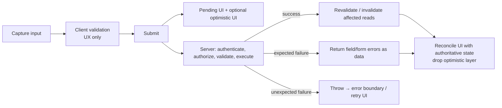
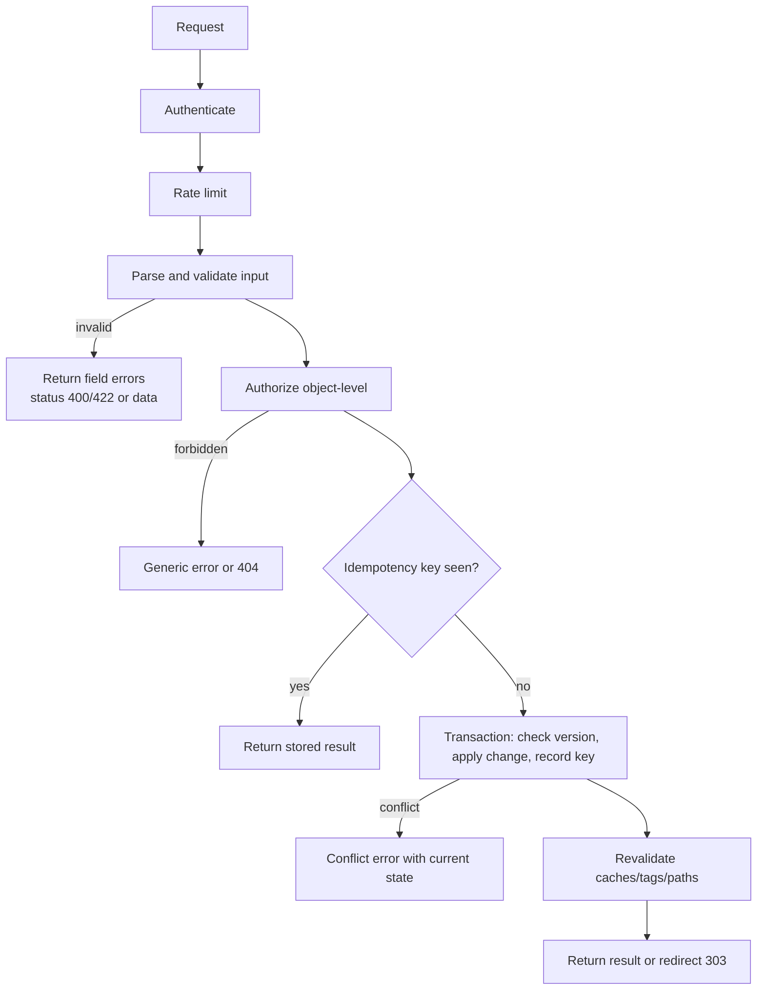
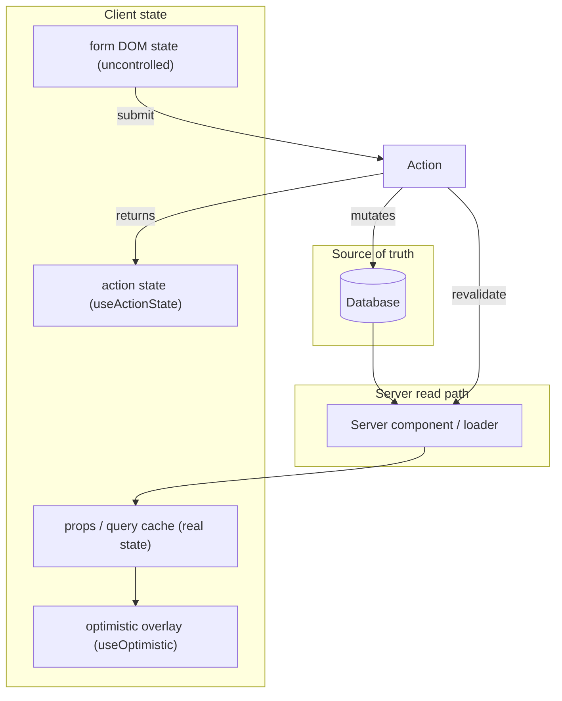
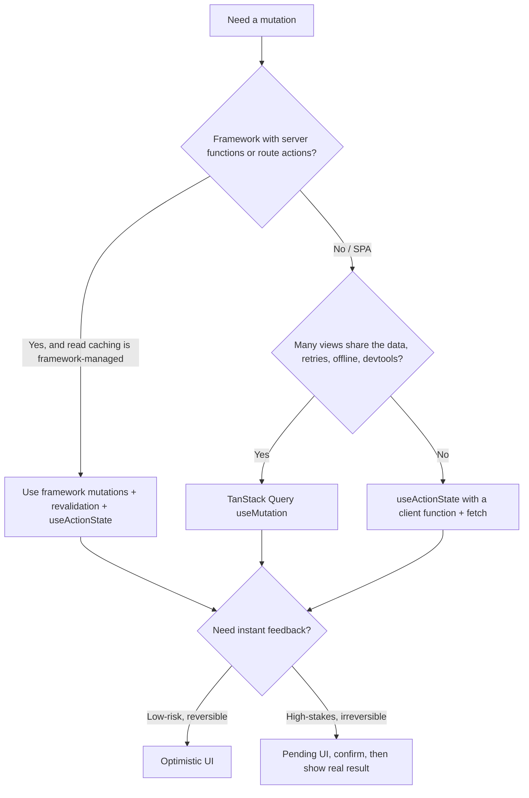

# 09 / 13 — Forms, Actions and Mutations

> **Scope note (verified 2026-10-22).** The React APIs in this lesson (`useActionState`, `useOptimistic`, `useFormStatus`, `useTransition` with async functions, `<form action>`, `requestFormReset`) were checked against react.dev (React 19.3) and by running them on `react`/`react-dom` 19.3.1 (Vitest + RTL + `react-dom/server`). Framework statements (Next.js 16.x cache functions, body-size limits, React Router, TanStack Query v5) were checked against their current docs; Zod snippets target Zod 4.

## 1. Lesson metadata

| | |
|---|---|
| **Level** | Advanced |
| **Study time** | 6 hours (reading 2.5 h, building the examples 2 h, exercises 1.5 h) |
| **Prerequisites** | [07 — Modern React APIs](./07-modern-react-apis.md), [09 — Framework architecture](./09-framework-architecture.md), [11 — Progressive enhancement](./11-progressive-enhancement.md), [12 — Auth boundaries](./12-auth-boundaries.md), [Phase 3/21 — Forms and complex state](../03-react-state-and-hooks/21-forms-and-complex-state.md), [Phase 3/22 — Modern hooks and APIs](../03-react-state-and-hooks/22-modern-hooks-and-apis.md), [Phase 6/05 — Optimistic updates](../06-data-fetching-and-state-ecosystems/05-optimistic-updates.md), [Phase 6/06 — Cache consistency and invalidation](../06-data-fetching-and-state-ecosystems/06-cache-consistency-and-invalidation.md) |
| **Next** | [14 — Accessibility and SEO](./14-accessibility-and-seo.md) |
| **Related** | [Phase 6/07 — Server-state management](../06-data-fetching-and-state-ecosystems/07-server-state-management.md), [Phase 6/08 — TanStack Query](../06-data-fetching-and-state-ecosystems/08-tanstack-query.md) |

**Learning objectives.** After this lesson you can:
1. Define a **mutation** and describe its full lifecycle: input capture, validation, submission, pending UI, server execution, result, cache/UI reconciliation, error recovery.
2. Explain React 19 **Actions**: functions passed to `<form action>` or run in `startTransition`, their pending/transition semantics, and how errors surface.
3. Use `useActionState`, `useFormStatus` and `useOptimistic` correctly, including their signatures and constraints.
4. Choose between React-native Actions, framework loader/action systems and client mutation libraries (TanStack Query) for a given problem.
5. Design the server side of a mutation: validation, authorization, idempotency, concurrency control, error taxonomy and revalidation.
6. Handle file uploads, multiple intents, and multi-step forms.
7. Debug stale UI after mutation, double submissions, lost input, and optimistic-state glitches.

**Concepts covered:** mutation lifecycle, Action, async transition, `<form action>`, `FormData`, uncontrolled vs controlled forms in the Actions model, form reset, `useActionState`, `useFormStatus`, `useOptimistic`, `useTransition` with async functions, validation layers, field errors vs form errors, idempotency, optimistic concurrency, revalidation/invalidation, multi-intent forms, file uploads, rollback, race conditions between actions.

---

## 2. Deep conceptual explanation

### 2.1 What problem is this lesson solving?

Reads and writes differ fundamentally. A read is idempotent and cacheable; a **mutation** changes state somewhere else (a database, another service) and is therefore:

- **Non-idempotent by default** (double submission → double effect).
- **Failable in many ways** (validation, authorization, conflict, network, server error).
- **Slow enough to need feedback** (pending UI).
- **Responsible for consistency** (after it succeeds, every view of the changed data must update: lists, detail pages, counters, caches).

Before React 19, every team re-implemented the same plumbing: `isLoading` state, `error` state, `try/catch`, `e.preventDefault()`, resetting inputs, manual cache invalidation, disabling the button, and optimistic rollback. React 19 standardizes the plumbing with **Actions**: React's name for *async functions used for state transitions caused by user interactions*. The framework or library supplies the transport and caching.

### 2.2 The mutation lifecycle (framework-independent)



Design every mutation by walking these boxes. The most common production bugs are in the arrows: missing revalidation (F), errors thrown instead of returned (G vs H), and optimistic state with no rollback story (I).

### 2.3 React 19 Actions

**Definition (React docs terminology):** an *Action* is a function (usually async) that React invokes inside a **transition**, so that the UI stays responsive, pending state is tracked automatically, and updates are batched. Actions can be:

1. **A function passed to `<form action={fn}>`** — React calls `fn(formData)` on submit (after `preventDefault`), in a transition.
2. **A function passed to `useActionState`** — React calls `fn(previousState, formData)` and stores the returned value as state.
3. **A function passed to `startTransition`** (including the one from `useTransition`) — an async function the transition tracks until its promise settles.
4. **`formAction`** on `<button>`/`<input type="submit">` — overrides the form's action for that submit button (multiple intents).

*Public guarantee (react.dev):* while an Action is pending, `isPending` from `useTransition` (or `pending` from `useFormStatus`) is true; UI updates scheduled inside the transition are not shown as "committed urgent updates"; React keeps the current UI visible rather than showing Suspense fallbacks for already-revealed content ([05](./05-suspense-architecture.md), [Phase 7/12](../07-performance/12-usetransition-in-practice.md)).

**An important limitation:** state updates that occur *after an `await`* inside an async transition are not marked as part of the transition unless you wrap them again in `startTransition`. react.dev (`useTransition`, `startTransition(action)`, 19.3) still says: "Any async calls that are awaited in the action will be included in the Transition, but currently require wrapping any set functions after the await in an additional startTransition". We observed the consequence: with `startTransition(async () => { await sleep(10); setV(1); })` the renders were `v=0 pending=true`, `v=1 pending=true`, `v=1 pending=false`, i.e. the update after the `await` committed as an urgent update while `isPending` was still true. (When you `await` an *Action prop* passed down from a parent, the docs say the extra wrapper is not needed.)

```tsx
const [isPending, startTransition] = useTransition();

function save(name: string) {
  startTransition(async () => {
    const result = await updateName(name);           // await
    startTransition(() => {                          // re-wrap updates after await
      setResult(result);
    });
  });
}
```

### 2.4 The Action hooks, precisely

| API | Signature (TypeScript-ish) | Purpose | Constraints |
|---|---|---|---|
| `useActionState` | `const [state, formAction, isPending] = useActionState(fn, initialState, permalink?)` where `fn: (prev: State, payload: Payload) => State \| Promise<State>` | State machine over an action's results; produces a `formAction` to pass to `<form action>` | `fn` receives previous state as **first** arg. Returned `formAction` can also be called from code inside a transition. Throwing propagates to the nearest error boundary. |
| `useFormStatus` | `const { pending, data, method, action } = useFormStatus()` (from `react-dom`) | Read the **parent form's** submission status in a child | Must be rendered *inside* a `<form>`; reports on that form only |
| `useOptimistic` | `const [optimistic, addOptimistic] = useOptimistic(value, reducer?)` | Show a temporary value while an async action runs; React reverts to the real `value` when the action completes | `addOptimistic` must be called inside an Action/transition (React warns: "An optimistic state update occurred outside a transition or action. To fix, move the update to an action, or wrap with startTransition."; outside, the value flashes and reverts) |
| `useTransition` | `const [isPending, startTransition] = useTransition()` | Run an Action imperatively and track pending | After-`await` updates need re-wrapping in `startTransition` (still documented in 19.3) |
| `<form action>` | `action: string \| ((formData: FormData) => void \| Promise<void>)` | Declarative submission | Function actions reset uncontrolled fields on success (below) |
| `requestFormReset` | from `react-dom`: `requestFormReset(form)` | Schedule a reset of an uncontrolled form (as the automatic reset does) when the surrounding transition/Action completes | Exported by `react-dom` 19.3.1 and introduced in the React 19 post; react.dev has no separate reference page (the URL returned 404 on 2026-10-22). In our run, calling it inside `startTransition` reset the field to its `defaultValue`; the React 19 post says to use it "if you need to reset the `<form>` manually" |

*Signatures checked on 2026-10-22 at:* <https://react.dev/reference/react/useActionState>, <https://react.dev/reference/react/useOptimistic>, <https://react.dev/reference/react-dom/hooks/useFormStatus>.

### 2.5 Form reset behavior

When a **function** `action` passed to `<form>` completes **successfully**, React resets the form's *uncontrolled* fields to their default values (like `form.reset()`). Controlled inputs (those with `value`) are driven by state, not reset by this. Implications:

- A "create comment" form clears itself after success: usually desired.
- After a *validation failure* you often want to **keep** the user's input: return the submitted values in the action state and use `defaultValue={state.values?.name}`. Because React resets uncontrolled fields after the action completes (even when it returned an error object, as it did not *throw*), the `defaultValue` must come from state to re-apply the value. Verified on 19.3.1: an uncontrolled field with no `defaultValue` was emptied after an action that returned `{ err: "bad" }`; with `defaultValue={state.v}` the typed text survived; a controlled `value={v}` input kept its text. React 19.3 also fires the form's `onReset` event when it performs this automatic reset (we saw `onReset` called once after a successful action).
- If you want to preserve fields without reset, make them controlled (state) or use `defaultValue` from returned state.

### 2.6 Where the mutation runs

| Where | Mechanism | Examples |
|---|---|---|
| **Server Function** (`"use server"`) | Form posts/RPC to server; runs in server environment | Next.js Server Actions; TanStack Start server functions (`createServerFn`) |
| **Route action** (loader/action frameworks) | Form posts to the route's `action`; framework revalidates loaders automatically | React Router/Remix |
| **Client function calling an API** | `fetch`/SDK to REST/GraphQL | Vite SPA |
| **Client mutation library** | TanStack Query `useMutation`, RTK Query | Rich cache control, retry, optimistic updates, devtools |

All four can sit behind React's `<form action>`/`useActionState` as the *UI-side protocol*. They differ in **who revalidates reads**, **who handles retries/offline**, and **whether progressive enhancement is possible** ([11](./11-progressive-enhancement.md)).

### 2.7 Validation layers

| Layer | Purpose | Trustworthy? |
|---|---|---|
| HTML constraint validation (`required`, `type`, `pattern`) | Immediate native feedback; works without JS | No (bypassable) |
| Client-side JS validation | Richer messages, inline-as-you-type | No |
| **Server-side validation** | Authoritative: shape, ranges, formats, referential integrity | **Yes** |
| Database constraints | Last line (unique, FK, check) | **Yes** |

Share a **schema** (e.g., Zod/Valibot) between client and server to avoid drift, but the server always re-parses. Return errors **as data** (`{ fieldErrors: { email: "…" } }`) not as thrown exceptions, because validation failure is *expected control flow*; throw for the unexpected (bugs, outages) so error boundaries and monitoring handle them.

### 2.8 Common misconceptions

| Misconception | Reality |
|---|---|
| "`useActionState` is just `useState` for forms." | It models *action result state over time*, queues action invocations, integrates with transitions and enables progressive enhancement with server functions. |
| "`useFormStatus` can live next to `<form>` in the same component." | It reads the **parent** form; it must be in a child component. |
| "`useOptimistic` stores state." | It *derives temporary state* that disappears when the action ends; the source of truth is still the real state/props. |
| "After a mutation the page updates automatically." | Only if something revalidates the reads. Frameworks/libraries do it differently; React itself does not. |
| "Disabling the button prevents double submit." | It reduces accidental double clicks in the client only; the server must be idempotent. |
| "Throw errors for invalid input." | Return validation errors as data; throw for unexpected failures. |
| "Optimistic UI is always better." | It trades correctness risk and complexity for perceived speed; inappropriate for irreversible or high-stakes actions (payments). |

---

## 3. Internal mechanics

### 3.1 How `<form action={fn}>` is processed (conceptual)

*Teaching model.* On submit, React (1) intercepts the event and prevents the browser default, (2) builds a `FormData` from the form (including the submitter's `name`/`value` when the submitter is a plain button; a button whose `formAction` is a function does not contribute them, see §5.7), (3) starts a **transition** and calls `fn(formData)`, (4) sets the form's pending status (visible via `useFormStatus` to descendants), (5) when the returned promise resolves, ends the transition and commits resulting state updates, and (6) resets the form (uncontrolled fields) if the action did not throw. *Implementation detail:* exact ordering of reset vs state commit is not something to depend on; use state for anything you need to keep.

### 3.2 `useActionState` queueing

*Documented behavior (react.dev `useActionState`, and verified):* when `formAction` is invoked multiple times before earlier invocations finish, React queues the calls and runs them **in order**, passing each the *previous result* — so state transitions are deterministic. In a run with three `submit` events fired while the first call was pending, the action ran three times with `prev` = 1, 2, 3 (never concurrently) and the component rendered just twice (`pending=true`, then `state=4 pending=false`). If a queued action *throws*, React cancels the rest of the queue and shows the nearest error boundary. This differs from `fetch`-in-`onClick` patterns where out-of-order responses can overwrite each other. If you need *parallel* mutations (e.g., independent "like" buttons), use separate action states or a mutation library that models concurrency per key.

### 3.3 `useOptimistic` mechanics

Conceptually: `useOptimistic(value)` returns the real `value` when no Action is pending. When `addOptimistic(x)` is called inside an Action, React renders with an *optimistic overlay* computed by applying the reducer (or replacing the value) for as long as that Action's transition is pending. When the Action finishes, the overlay is discarded and React renders with the **new real value**. If the Action failed and the real value never changed, the UI reverts, giving automatic rollback (verified: an action that returned an error left renders `a,x(tmp)|` then `a|rejected`). If it succeeded and the real value is updated **inside the same transition** (a framework revalidation/refresh, or `startTransition(() => setReal(...))`), the UI shows the real value with no flicker because both changes commit together (verified: renders `a,x(tmp)` then `a,x`). **Caveat:** if you update the real state with a plain `setState` *after an `await`* in the action (not re-wrapped in `startTransition`), that update commits urgently while the overlay is still applied, and you get one intermediate frame with a duplicate: we observed `a,x(tmp)`, `a,x,x(tmp)`, `a,x`.

```mermaid
sequenceDiagram
  participant U as User
  participant UI as React UI
  participant A as Action (async)
  participant S as Server
  U->>UI: submit "Buy milk"
  UI->>UI: addOptimistic("Buy milk") → list shows it (marked pending)
  UI->>A: start Action in transition
  A->>S: create todo
  alt success
    S-->>A: ok (new list via revalidation)
    A->>UI: real todos updated in same transition
    UI->>UI: overlay dropped; real item replaces optimistic one
  else failure
    S-->>A: error
    A->>UI: return error state (todos unchanged)
    UI->>UI: overlay dropped → item disappears; show error
  end
```

*Public guarantee:* optimistic values last only while the action is pending. *Teaching model:* "overlay on top of real state". *Implementation detail:* how React rebases overlays when multiple actions overlap.

### 3.4 Pending visibility

`isPending` (from `useActionState`/`useTransition`) is for the component that started the Action; `useFormStatus().pending` is for descendants of the form; `data` exposes the submitted `FormData` (useful for showing what's being submitted). Both clear when the Action's promise settles, not when you "finish" some part of it; long-running background work after returning is invisible to React.

### 3.5 Server-side lifecycle of a mutation

A robust server-side mutation (any framework):



### 3.6 Revalidation patterns by system

| System | After mutation… | You must… |
|---|---|---|
| React Router / Remix lineage | Matching `loader`s revalidate automatically after an `action` | Use route `action`s/`<Form>`/`useFetcher`; opt-out or customize via the route's `shouldRevalidate` (names differ per router) |
| Next App Router | Nothing automatic for cached output | Invalidate explicitly in the Server Function. Next 16 docs: `revalidatePath(path, type?)`; `revalidateTag(tag, profile)` (stale-while-revalidate; the one-argument form is deprecated and behaves like `{ expire: 0 }`, `profile="max"` is recommended); `updateTag(tag)` (Server Actions only; expires immediately for read-your-own-writes); `refresh()` (Server Actions only; refreshes the client router, uncached data). May `redirect` afterwards. Check your Next version: older 14/15 code uses `revalidateTag(tag)` |
| TanStack Query | Nothing automatic | `queryClient.invalidateQueries({ queryKey })` in `onSuccess`/`onSettled`, or update the cache directly |
| Plain `fetch` in SPA | Nothing | Refetch or update local state |

---

## 4. Step-by-step execution walkthrough

Scenario: **Todo list with optimistic add** in a framework with Server Functions. Network latency 800 ms; the server rejects titles containing "spam".

Components: `TodoList` (client) receives `todos` as props from the server component; owns `useOptimistic`; form with `useActionState`-less direct `action` to keep the example small.

1. **Initial render.** `todos = [A, B]`. `optimisticTodos = todos` (no pending action).
2. **User types "Buy milk" and presses Enter.** Browser fires `submit`.
3. **React intercepts.** `preventDefault`, builds `FormData{title:"Buy milk"}`, starts a transition, calls `addTodoAction(formData)`.
4. **Inside the action (synchronous part).** `addOptimistic({ id: tempId, title: "Buy milk", pending: true })`. React schedules a transition update: the overlay is `[A, B, Buy milk (pending)]`.
5. **Render + commit (transition lane).** The list shows the pending item greyed. `useFormStatus().pending` is true; the submit button is disabled. The input still contains "Buy milk" (reset hasn't happened).
6. **Action awaits server** (800 ms). The UI remains interactive: the user can scroll, type in other fields.
7a. **Success path.** Server inserts, revalidates the path/tag, returns. The framework delivers the new server-rendered `todos = [A, B, Buy milk (id 17)]`. Action's promise resolves. (The no-flicker result below relies on the new `todos` arriving in the same transition as the action, which is how framework revalidation behaves; a client-side `setState` after `await` needs `startTransition`, see §3.3.)
8a. **Commit.** In one commit: overlay dropped, `todos` prop updated, `pending` false, form reset (input cleared). The user sees the item flip from greyed to normal with the real id; no flicker because the list content is equal.
7b. **Failure path (title "spam").** Server returns `{ error: "Title not allowed" }`; no revalidation. Action stores error via state setter inside the transition.
8b. **Commit.** Overlay dropped (real `todos` unchanged) → the item **disappears**; error message appears. Form reset also happens if the action did not throw ⇒ the input is cleared, **losing the user's text**. To keep it, return `values` and re-apply with `defaultValue`, or avoid clearing by using controlled state.

**Rapid double submit.** If the user presses Enter twice quickly: with plain `<form action>` and no pending handling, every submit runs the action (React doesn't dedupe; we measured 3 invocations for 3 Enter presses in a form with no submit button). If the form's default submit button is `disabled` while pending (e.g., via `useFormStatus`), implicit submission by Enter is blocked as well: HTML's implicit-submission rule does nothing when the default button is disabled, and user-event in jsdom produced 1 invocation for 3 Enter presses. Gaps remain: the disabled state only exists after React has rendered it, a form without a submit button or with a different button type is not protected, and a second tab/device or retry bypasses it. The server must dedupe with an idempotency key.

---

## 5. Code examples

### 5.1 Minimal — a form with an async Action and pending UI

```tsx
"use client";
import { useActionState } from "react";

type State = { message: string | null };

async function rename(_prev: State, formData: FormData): Promise<State> {
  const name = String(formData.get("name") ?? "").trim();
  if (name.length < 2) return { message: "Name must be at least 2 characters." };
  await fetch("/api/profile", { method: "PATCH", headers: { "Content-Type": "application/json" }, body: JSON.stringify({ name }) });
  return { message: "Saved." };
}

export function RenameForm({ initialName }: { initialName: string }) {
  const [state, action, isPending] = useActionState(rename, { message: null });
  return (
    <form action={action}>
      <label htmlFor="name">Name</label>
      <input id="name" name="name" defaultValue={initialName} required minLength={2} />
      <button type="submit" disabled={isPending}>{isPending ? "Saving…" : "Save"}</button>
      {state.message && <p role="status">{state.message}</p>}
    </form>
  );
}
```

Line notes:
- `rename(_prev, formData)`: signature required by `useActionState`.
- `defaultValue` → uncontrolled input; the form data is read from the DOM, not state.
- `isPending` is the third tuple element; no `useState` for loading.
- `role="status"` announces the message politely to screen readers ([14](./14-accessibility-and-seo.md)).
- Weakness: no error handling for failed fetch; the response status isn't checked. See §5.3.

**Predict:** user submits a valid name and the network call fails with a rejected promise (offline). What does the user see? **Answer:** the action throws; React propagates the error to the nearest error boundary (the form is replaced by the boundary's fallback). Not ideal for expected failures: catch and return an error state (§5.3).

### 5.2 Practical — server-validated form with field errors (Server Function)

```ts
// actions.ts
"use server";
import { z } from "zod";
import { requireSession } from "@/lib/auth/session";
import { createProject } from "@/lib/projects/dal";
import { revalidatePath } from "next/cache";

const schema = z.object({
  name: z.string().trim().min(3, "At least 3 characters").max(80, "At most 80 characters"),
  visibility: z.enum(["private", "team", "public"]),
});

export type CreateProjectState =
  | { status: "idle" }
  | { status: "error"; formError?: string; fieldErrors?: Partial<Record<"name" | "visibility", string>>; values: { name: string; visibility: string } }
  | { status: "success"; id: string };

export async function createProjectAction(_prev: CreateProjectState, fd: FormData): Promise<CreateProjectState> {
  await requireSession();
  const values = { name: String(fd.get("name") ?? ""), visibility: String(fd.get("visibility") ?? "private") };
  const parsed = schema.safeParse(values);
  if (!parsed.success) {
    const f = z.flattenError(parsed.error).fieldErrors;   // Zod 4; error.flatten() still works but is deprecated
    return { status: "error", values, fieldErrors: { name: f.name?.[0], visibility: f.visibility?.[0] } };
  }
  try {
    const project = await createProject(parsed.data);      // DAL authorizes and enforces unique names
    revalidatePath("/projects");
    return { status: "success", id: project.id };
  } catch (e) {
    if (e instanceof DuplicateNameError) {
      return { status: "error", values, fieldErrors: { name: "A project with this name already exists." } };
    }
    throw e;                                               // unexpected → error boundary + monitoring
  }
}
```

```tsx
// project-form.tsx
"use client";
import { useActionState, useEffect, useRef } from "react";
import { createProjectAction, type CreateProjectState } from "./actions";
import { SubmitButton } from "./submit-button";

const initial: CreateProjectState = { status: "idle" };

export function ProjectForm() {
  const [state, action] = useActionState(createProjectAction, initial);
  const nameError = state.status === "error" ? state.fieldErrors?.name : undefined;
  const defaultName = state.status === "error" ? state.values.name : "";
  const errorRef = useRef<HTMLParagraphElement>(null);

  useEffect(() => {
    if (nameError) errorRef.current?.focus();           // move focus to error summary for AT users
  }, [nameError]);

  return (
    <form action={action} noValidate={false}>
      <label htmlFor="name">Project name</label>
      <input id="name" name="name" defaultValue={defaultName} aria-invalid={nameError ? true : undefined}
             aria-describedby={nameError ? "name-error" : undefined} required />
      {nameError && <p id="name-error" ref={errorRef} tabIndex={-1} role="alert">{nameError}</p>}

      <fieldset>
        <legend>Visibility</legend>
        <label><input type="radio" name="visibility" value="private" defaultChecked /> Private</label>
        <label><input type="radio" name="visibility" value="team" /> Team</label>
      </fieldset>

      <SubmitButton>Create project</SubmitButton>
      {state.status === "success" && <p role="status">Project created.</p>}
    </form>
  );
}
```

Notes:
- **Result as a discriminated union** (`idle | error | success`): the UI switches exhaustively, no ambiguous `{ error?: string; ok?: boolean }` combinations.
- Expected failures (validation, duplicate name) are **returned**; `throw e` for everything else.
- `values` echo back to repopulate the input because React resets the uncontrolled fields. Zod 4 error helpers: `z.flattenError(err)` (`{ formErrors, fieldErrors }`, verified), `z.treeifyError(err)` (nested `{ errors, properties }`), `err.issues` (raw list with `path`, `message`, `code`); `err.flatten()`/`err.format()` still run but are deprecated.
- The `useEffect` that focuses the error is a legitimate "synchronize with the DOM" effect; compare alternatives with [Phase 3/07](../03-react-state-and-hooks/07-you-might-not-need-an-effect.md). A radio group's `defaultChecked` is not re-applied from state here — a real project would repopulate it from `values.visibility` too.
- The server function derives identity from the session ([12](./12-auth-boundaries.md)); no `userId` argument.

### 5.3 Practical — robust client Action around a REST API with error mapping

```ts
type Result<T> = { ok: true; data: T } | { ok: false; code: "validation" | "conflict" | "network" | "server"; message: string; fieldErrors?: Record<string, string> };

export async function postJson<T>(url: string, body: unknown, idempotencyKey?: string): Promise<Result<T>> {
  try {
    const res = await fetch(url, {
      method: "POST",
      headers: { "Content-Type": "application/json", ...(idempotencyKey ? { "Idempotency-Key": idempotencyKey } : {}) },
      body: JSON.stringify(body),
    });
    if (res.ok) return { ok: true, data: (await res.json()) as T };
    if (res.status === 422) { const j = await res.json(); return { ok: false, code: "validation", message: "Please fix the errors.", fieldErrors: j.fieldErrors }; }
    if (res.status === 409) return { ok: false, code: "conflict", message: "This item changed. Reload and try again." };
    return { ok: false, code: "server", message: "Something went wrong. Please try again." };
  } catch {
    return { ok: false, code: "network", message: "Network error. Check your connection and retry." };
  }
}
```

Why: components switch on `code` rather than on `instanceof` or message strings. Only truly unexpected conditions throw. Idempotency key: generate once per *form instance/attempt* (e.g., `crypto.randomUUID()` stored in a hidden input or `useRef`) so retries reuse it; a **new** key for each new user intent.

### 5.4 Practical — `useOptimistic` list with rollback

```tsx
"use client";
import { useOptimistic, useRef } from "react";
import { addTodo } from "./actions";

type Todo = { id: string; title: string; pending?: boolean };

export function Todos({ todos }: { todos: Todo[] }) {
  const formRef = useRef<HTMLFormElement>(null);
  const [optimisticTodos, addOptimisticTodo] = useOptimistic(
    todos,
    (current: Todo[], title: string) => [...current, { id: `temp-${crypto.randomUUID()}`, title, pending: true }],
  );

  async function action(formData: FormData) {
    const title = String(formData.get("title") ?? "").trim();
    if (!title) return;
    addOptimisticTodo(title);            // synchronous part of the Action: allowed
    await addTodo(title);                // server function revalidates the list
  }

  return (
    <>
      <ul>
        {optimisticTodos.map((t) => (
          <li key={t.id} style={{ opacity: t.pending ? 0.5 : 1 }} aria-busy={t.pending || undefined}>{t.title}</li>
        ))}
      </ul>
      <form ref={formRef} action={action}>
        <input name="title" required aria-label="New todo" />
        <button type="submit">Add</button>
      </form>
    </>
  );
}
```

Line notes:
- `useOptimistic(todos, reducer)`: when no Action is pending it returns `todos`; during an Action it returns `reducer(todos, title)`.
- `addOptimisticTodo` is called **before** the first `await` inside the form action (an Action), as required.
- `key={t.id}`: the temp item and the real item have different ids, so on success React unmounts the temp `<li>` and mounts the real one (a brief remount; fine for text, but if the item has local state like an open editor, it is lost). To avoid this, use a client-generated stable id that the server accepts as the real id ([Phase 1/09](../01-react-fundamentals/09-lists-keys-and-identity.md)).
- Failure: `addTodo` throws → error boundary; or if it returns an error, the overlay disappears because `todos` didn't change; show the error through state (combine with `useActionState`).
- The input clears on success via the form-reset behavior.

### 5.5 Incorrect — hand-rolled mutation state with races

```tsx
function LikeButton({ postId, initial }: { postId: string; initial: number }) {
  const [likes, setLikes] = useState(initial);
  const [loading, setLoading] = useState(false);

  async function onClick() {
    setLoading(true);
    setLikes(likes + 1);                       // optimistic
    try {
      const res = await fetch(`/api/posts/${postId}/like`, { method: "POST" });
      const json = await res.json();
      setLikes(json.likes);
    } catch {
      setLikes(likes);                         // rollback with a stale closure
    }
    setLoading(false);
  }
  return <button onClick={onClick} disabled={loading}>♥ {likes}</button>;
}
```

**Problems:** (1) `setLikes(likes)` in `catch` captures the render-time `likes`; if two clicks overlap, rollback restores the wrong value; (2) non-OK responses are never checked: a 500 with an HTML body makes `res.json()` throw (caught, rolled back with the stale value), whereas a 400 with a JSON body lacking `likes` sets the count to `undefined`; (3) no cancellation or unmount safety; (4) no idempotency: liking twice might double count; (5) not an Action: rendering the optimistic state is urgent, and pending UI isn't coordinated; (6) not progressive-enhanced.

### 5.6 Corrected — `useOptimistic` + transition

```tsx
"use client";
import { useOptimistic, useTransition } from "react";
import { toggleLike } from "./actions";   // server function: (postId, desired: boolean) => { liked: boolean; count: number }

type LikeState = { liked: boolean; count: number };

export function LikeButton({ postId, state }: { postId: string; state: LikeState }) {
  const [isPending, startTransition] = useTransition();
  const [optimistic, setOptimistic] = useOptimistic(state, (cur: LikeState, desired: boolean): LikeState => ({
    liked: desired,
    count: cur.count + (desired ? 1 : -1) * (cur.liked === desired ? 0 : 1),
  }));

  function onClick() {
    const desired = !optimistic.liked;
    startTransition(async () => {
      setOptimistic(desired);               // overlay
      await toggleLike(postId, desired);    // idempotent: sets state, not "increment"
      // the server function revalidates; new `state` props arrive; overlay dropped
    });
  }

  return (
    <button type="button" onClick={onClick} aria-pressed={optimistic.liked} disabled={isPending}>
      ♥ {optimistic.count}
    </button>
  );
}
```

Why better: the mutation is **idempotent by design** (`desired` state, not increment), rollback is automatic (overlay disappears if the real state never changes), no stale-closure rollback, pending is handled by the transition, and `aria-pressed` communicates the toggle. Trade-off: `disabled={isPending}` blocks rapid toggling; for high-frequency interactions allow queueing with a debounce or a library-managed mutation queue.

### 5.7 Advanced — multi-intent forms, `formAction`, and file upload

```tsx
"use client";
export function DocumentForm({ doc }: { doc: { id: string; title: string } }) {
  return (
    <form action={saveDraft}>   {/* no encType: with a function action React sets method/encType itself and warns if you pass them */}
      <input type="hidden" name="id" value={doc.id} />
      <input name="title" defaultValue={doc.title} />
      <input type="file" name="attachment" accept="application/pdf" />
      <button type="submit">Save draft</button>
      <button type="submit" formAction={publish}>Publish</button>
      <button type="submit" formAction={remove} formNoValidate>Delete</button>
    </form>
  );
}
```

Server-side handling of the upload (framework-agnostic principles):

```ts
"use server";
const MAX = 5 * 1024 * 1024;
export async function saveDraft(fd: FormData) {
  const s = await requireSession();
  const file = fd.get("attachment");
  if (file instanceof File && file.size > 0) {
    if (file.size > MAX) throw new Error("File too large");          // better: return an error state
    if (file.type !== "application/pdf") throw new Error("Unsupported type");
    // Verify content by magic bytes, not only the client-declared type. Store with a generated name.
  }
  /* ... authorize doc ownership via DAL, update ... */
}
```

Notes: files arrive as `File` objects in `FormData`; `file.type` is **client-declared** and untrusted. Frameworks impose request size limits for Server Functions: the Next.js docs (16.4) say the default maximum request body for a Server Action is 1MB, configurable with `serverActions.bodySizeLimit` (bytes or strings like `'3mb'`, set under `experimental.serverActions` in the documented config); for large files use direct-to-storage uploads with presigned URLs and have the Server Function record metadata only. `formAction` per button gives separate intents with different handlers; alternatively one action reads `intent` from the submitter's `name`/`value`. These two styles do not mix on one button: React overrides `name` on a button whose `formAction` is a function (dev warning: "Cannot specify a \"name\" prop for a button that specifies a function as a formAction") and, in our run, a function-`formAction` handler received only the form's fields, not the submitter's name/value; a plain submitter (no function `formAction`) does contribute `intent=save` to the form action's `FormData`. `formNoValidate` lets Delete skip HTML validation. The delete button should confirm and be idempotent.

### 5.8 Advanced — TanStack Query mutation with optimistic cache update

```tsx
const qc = useQueryClient();
const mutation = useMutation({
  mutationFn: (title: string) => api.createTodo({ title }),
  onMutate: async (title) => {
    await qc.cancelQueries({ queryKey: ["todos"] });            // avoid refetch overwriting optimistic data
    const prev = qc.getQueryData<Todo[]>(["todos"]);
    qc.setQueryData<Todo[]>(["todos"], (old = []) => [...old, { id: `temp-${Date.now()}`, title, pending: true }]);
    return { prev };
  },
  onError: (_e, _title, ctx) => { if (ctx?.prev) qc.setQueryData(["todos"], ctx.prev); },
  onSettled: () => qc.invalidateQueries({ queryKey: ["todos"] }),
});
```

When to prefer this over `useOptimistic`: you need cross-component cache consistency (many views read `["todos"]`), retries, persistence/offline queues, or devtools. `useOptimistic` is local to the component tree that owns it. They can coexist, but avoid layering two optimistic mechanisms over the same data. (TanStack Query v5's optimistic-updates guide also documents a simpler "via the UI" variant that renders from the mutation's `variables` while it is pending, without touching the cache; return the `invalidateQueries` promise from `onSettled` so the mutation stays pending until the refetch finishes.)

---

## 6. Visual explanations

### 6.1 Who owns which state



### 6.2 Form event timeline

```text
t0  user submits ───────────────┐
    React: preventDefault        │ transition pending: useFormStatus.pending = true
    FormData captured            │
    action(formData) starts      │  (UI stays interactive; old UI remains)
    addOptimistic() overlay      │
t1  await server ................│
t2  server returns               │
    state setters + revalidation │
t3  transition commit  ──────────┘ single commit: real data + action state + overlay removed
    form reset (uncontrolled)
```

### 6.3 Decision flow: which mutation tool?



---

## 7. Alternative approaches and trade-offs

| Criterion | React Actions (`useActionState` + server function) | Route `action` + `<Form>` (loader frameworks) | TanStack Query `useMutation` | Hand-rolled `useState` + `fetch` |
|---|---|---|---|---|
| Progressive enhancement | Yes with server functions ([11](./11-progressive-enhancement.md)) | Yes (native form semantics) | No (JS required) | No |
| Pending handling | Built-in (`isPending`, `useFormStatus`) | `useNavigation`/`useFetcher` state | `isPending`, `variables` | Manual |
| Revalidation of reads | Manual (framework API) | **Automatic** loader revalidation | Manual `invalidateQueries` | Manual |
| Optimistic UI | `useOptimistic` (local overlay) | Optimistic UI via pending form data in `useFetcher` | Cache or variables-based | Manual |
| Cache sharing across views | Framework-level | Loader data per route | **Strong** (global query cache) | None |
| Retries/offline | None built-in | None built-in | Opt-in `retry` (mutations do not retry by default); mutations made while offline are paused and resumed in order on reconnect | None |
| Type safety across boundary | Shared types/schema | Typed route modules (React Router 7 type generation) | Typed hooks | Manual |
| Complexity | Low–Medium | Low–Medium | Medium | Low initially, high at scale |
| Best for | RSC apps, form-centric flows | Form-heavy apps with nested routes | Rich client apps, shared caches | Tiny demos |

**When the recommended approach (Actions with server functions) is *not* best:** an offline-first mobile PWA queuing edits, or an app with dozens of components reading the same entity and needing granular cache updates and background refetching, is better served by a client cache library with mutation queues, even in a framework. Likewise, a collaborative editor needs CRDT/OT sync, not form actions.

**Optimistic vs pessimistic updates:**

| Criterion | Optimistic | Pessimistic |
|---|---|---|
| Perceived latency | Instant | Wait for server |
| Failure UX | Rollback + explanation needed | Simple |
| Correctness risk | Server may reject/alter; ordering conflicts | Low |
| Complexity | Higher | Lower |
| Use for | Likes, reorder, toggles, drafts | Payments, destructive/irreversible, anything with server-computed results (totals, ids) |

---

## 8. Best practices and anti-patterns

**Do**
- Treat each mutation as a state machine: idle → pending → success | error | conflict.
- Return expected errors as data (discriminated unions); throw unexpected ones.
- Validate on the server always; share schemas for consistency.
- Make server mutations **idempotent** or protect with idempotency keys; prefer "set desired state" over "increment".
- Use optimistic UI only for reversible, low-stakes changes, and always define the rollback/error UX.
- Preserve user input on validation failure (return `values`; use `defaultValue`).
- Revalidate affected reads explicitly and test it.
- Disable or visually indicate pending submit controls *and* make the server safe against duplicates.
- Associate errors with fields (`aria-describedby`, `aria-invalid`) and manage focus ([14](./14-accessibility-and-seo.md)).
- Use a version/ETag/updatedAt for concurrent edits (optimistic locking).

**Beginner mistakes**
- Controlled inputs for everything, then `onSubmit` with `preventDefault` and manual `fetch` (works, but loses PE and Action integration).
- Calling `useFormStatus` in the same component as the `<form>`.
- Forgetting `name` attributes.
- Not handling the failure path of optimistic updates.

**Experienced-developer mistakes**
- Mixing three mutation systems (Actions + TanStack mutation + framework revalidation) over the same data.
- Optimistic updates that diverge from server computation (e.g., price totals).
- Throwing validation errors, producing error-boundary fallbacks for user mistakes.
- Using `useOptimistic` outside an Action.
- Relying on client-side `disabled` for duplicate protection.
- Performing the mutation in `useEffect` triggered by state (loses event semantics, double-fires under StrictMode).

**Smells:** `isLoading`/`isError`/`isSuccess` as three booleans; mutation logic in `onClick` handlers that also manipulate several unrelated states; "refresh the page" instructions in error messages; `window.location.reload()` after mutation; ad-hoc `setTimeout` to clear success messages.

**Justified exceptions:** controlled inputs where live formatting/validation of each keystroke is required (credit card number grouping, masked fields); local-only forms with no server involvement; destructive actions that deliberately avoid optimistic UI.

---

## 9. Real-world application

*E-commerce cart.* Add-to-cart is reversible and high-frequency: optimistic increments with server-computed totals shown as "calculating" until the real response arrives. Checkout submission is pessimistic with an idempotency key (a payment must not be charged twice). Stock conflicts return `conflict` with the current availability; the UI explains and updates quantity.

*Dashboard inline editing.* Cell edits: optimistic with per-cell pending marks; the server returns the canonical value (it may normalize "1,5" to "1.50"); conflicts use `updatedAt` precondition; failures flash the cell and revert.

*Finance transfer.* Pessimistic; step-up auth; idempotency key; confirmation page with PRG; no optimistic balance changes; reconciliation via server-sent state.

*Multi-step onboarding wizard.* Each step is a mutation persisted server-side (resumable); URL encodes the step ([10](./10-routing-and-nested-layouts.md)); native forms for PE; final step transitions to the app. State across steps lives on the server (drafts), not only in React state, so refresh or device switch doesn't lose progress.

*Realtime collaboration.* Form Actions for CRUD of metadata; separate realtime channel for live edits; optimistic changes reconciled against server events ([Phase 6/17](../06-data-fetching-and-state-ecosystems/17-real-time-websockets-subscriptions.md)).

---

## 10. Debugging and troubleshooting

**Symptom: "The list doesn't update after I submit."**
1. Network tab: did the mutation succeed (status, response)?
2. Which system owns the list read? Server component output (needs `revalidatePath/Tag`), loader (auto-revalidates after route actions, not after plain `fetch`), or query cache (needs `invalidateQueries`)?
3. Is the read cached by a CDN/browser/router cache ([09 §3.5](./09-framework-architecture.md))?
4. Fix at the right layer, then verify the refreshed payload appears in the Network tab.

**Symptom: "Input is cleared after a validation error."** Uncontrolled fields reset after the action completes. Return `values` and use `defaultValue`, or use controlled state ([Phase 1/11](../01-react-fundamentals/11-controlled-and-uncontrolled-inputs.md)).

**Symptom: "`useFormStatus` always says `pending: false`."** It is used in the same component that renders the `<form>`, not in a child. Move it into a child component.

**Symptom: "React warns 'An optimistic state update occurred outside a transition or action'."** `addOptimistic` was called outside an Action (e.g., in `setTimeout` or after a non-transition `await`). Move it into the synchronous start of the Action or wrap in `startTransition`. Exact text on 19.3.1: "An optimistic state update occurred outside a transition or action. To fix, move the update to an action, or wrap with startTransition."

**Symptom: "State update after await doesn't behave like part of the transition (pending flips early / fallback flashes)."** After-`await` updates need `startTransition` re-wrapping (see §2.3).

**Symptom: "Mutation runs twice in development."** StrictMode double-invokes effects, not event handlers/actions. If a mutation runs twice, it is probably in an effect ([Phase 2/28](../02-react-rendering-and-internals/28-strict-mode-behavior.md)). Move the mutation to the event.

**Symptom: "Duplicate records created."** Double submit or retry. Look for repeated requests with identical payload in Network; add idempotency key or unique constraint; confirm server handles replays.

**Symptom: "Optimistic item flickers or duplicates after success."** Real list already includes the item but overlay still applied (action not awaited properly, or revalidated data arrives after the action's promise resolved). Ensure the action awaits the revalidation (server function returns after `revalidate*`; in TanStack Query `return qc.invalidateQueries(...)` in `onSettled` so the mutation stays pending until refetch completes).

---

## 11. Exercises

### Level A — Knowledge
A1. What is an Action in React 19? List four ways to create/use one.
A2. What argument order does a function passed to `useActionState` receive?
A3. Why must `useFormStatus` be used in a child of the `<form>`?
A4. What happens to a `useOptimistic` overlay when the Action finishes?
A5. Why should validation errors be returned and not thrown?
A6. Name four failure categories a mutation must distinguish.

### Level B — Code comprehension
B1. Predict the behavior (including input value) for a form with `<input name="q" defaultValue="" />` whose Action returns `{ error: "bad" }` and does not repopulate. What changes if the input is `value={q}` controlled by state?
B2. In §5.4, what happens to the temp `<li>` DOM node on success, and why?
B3. In §5.6, what would break if `toggleLike` were implemented as "increment likes by one" on the server?
B4. Identify the bug:
```tsx
const [state, action] = useActionState(async (formData: FormData) => {
  return { ok: true };
}, { ok: false });
```

### Level C — Implementation
C1. Implement `useActionState`-based `LoginForm` that returns field errors for email and password, repopulates email, never repopulates password, and focuses the first error.
C2. Implement a reorder interaction (move item up/down) with `useOptimistic` where the server may reject; show a toast on rejection.
C3. Write the server function `updateTitle(prev, fd)` with optimistic concurrency: the form includes hidden `version`; on mismatch return `{ status: "conflict", current }`; the UI shows both versions and lets the user choose.

### Level D — Debugging
D1. A developer calls `addOptimistic(x)` inside `setTimeout(…, 0)` in a submit handler. The UI never shows the optimistic item and React logs a warning. Explain and fix.
D2. After saving, the detail page shows old data but the list page shows new. Both are server-rendered. Investigate.
D3. A "Place order" form creates two orders when users double-click on slow mobile networks. The button is disabled while `isPending`. Why does it still happen and how do you fix it end-to-end?

### Level E — Architecture decisions
E1. For each mutation choose optimistic or pessimistic and the tool: (a) toggling "favorite", (b) submitting a payment, (c) reordering a Kanban column, (d) editing a profile name, (e) bulk-deleting 200 rows.
E2. Your team uses TanStack Query for all server state in a Next.js app and wants to adopt Server Functions. Propose a coexistence policy.

### Level F — Expert challenge
F1. Design a generic `useMutationForm` abstraction for your company's design system built on Actions: API surface, error taxonomy, accessibility behavior (focus, announcements), idempotency, optimistic hooks, and testing strategy. Argue what you will *not* abstract.

---

## 12. Detailed answers and explanations

> Attempt the exercises first.

**A1.** An Action is an async function (or any function) that React runs inside a transition to represent a user-triggered state change, with automatic pending tracking and batched updates. Four ways: `<form action={fn}>`; `useActionState(fn, initial)`; `startTransition(async () => …)` (via `useTransition`); `formAction` on a submit button. (Also a function invoked through the `formAction` returned by `useActionState`.)

**A2.** `(previousState, payload)`: previous state first, then (for forms) the `FormData`. Using `(formData) =>` yields `formData` bound to previous state: a classic bug (see B4).

**A3.** The hook subscribes to the status of the nearest ancestor `<form>`. In the same component that creates the `<form>`, there is no ancestor form in that component's render context, so it would report not pending. Child components rendered inside the form read their parent form's status.

**A4.** It is discarded. React renders with the real `value` (which may have been updated in the same transition). If the real value did not change (failure), the UI reverts, giving automatic rollback.

**A5.** Validation failures are *expected outcomes* of user input, not exceptional. Throwing sends them to error boundaries designed for unexpected failures and replaces the form UI; returning keeps the form and lets you attach messages to fields. Throw for bugs/outages for monitoring and recovery UI.

**A6.** Validation (fixable by user), authorization (not allowed), conflict (stale version/uniqueness), transient/network (retry), server/unexpected (bug/outage). Also rate limit (back off).

**B1.** After the Action returns `{ error: "bad" }` without throwing, React resets the uncontrolled input to `defaultValue=""`, so the user's text disappears. Controlled (`value={q}`): the DOM value comes from state; the form reset doesn't clear it as long as `q` state remains the typed value (verified on 19.3.1: the controlled field kept its text).

**B2.** The temp item's key (`temp-…`) disappears from the list and a new item with the real id appears, so React unmounts the temp `<li>` and mounts a new `<li>` (keys determine identity: [Phase 2/07](../02-react-rendering-and-internals/07-identity-keys-and-reconciliation.md)). Visually seamless, but any local state in the temp item is lost. Fix by using a client-generated id accepted by the server.

**B3.** "Increment" is not idempotent: a retry or double click increments twice; the optimistic overlay (+1) and the real result may disagree after concurrent actions; rollback can't derive the correct value. "Set liked = desired" is idempotent and convergent.

**B4.** The function takes only `formData`, but React passes `(prevState, formData)`: the first parameter receives the *previous state* object `{ ok: false }`, not the `FormData`. If the function read `formData.get(...)` it would throw. Fix: `async (_prev: State, formData: FormData) => ...`. TypeScript would flag this if `State` and `FormData` types differ and the action type is inferred, which is a reason to type actions explicitly.

**C1. Reference sketch.**
```tsx
"use client";
type S = { fieldErrors?: { email?: string; password?: string }; values?: { email: string } };

export function LoginForm({ login }: { login: (p: S, fd: FormData) => Promise<S> }) {
  const [state, action] = useActionState(login, {} as S);
  const emailRef = useRef<HTMLInputElement>(null);
  const pwRef = useRef<HTMLInputElement>(null);
  useEffect(() => {
    if (state.fieldErrors?.email) emailRef.current?.focus();
    else if (state.fieldErrors?.password) pwRef.current?.focus();
  }, [state]);
  return (
    <form action={action}>
      <label htmlFor="email">Email</label>
      <input ref={emailRef} id="email" name="email" type="email" autoComplete="username" defaultValue={state.values?.email}
             aria-invalid={!!state.fieldErrors?.email} aria-describedby={state.fieldErrors?.email ? "email-err" : undefined} />
      {state.fieldErrors?.email && <p id="email-err" role="alert">{state.fieldErrors.email}</p>}
      <label htmlFor="pw">Password</label>
      <input ref={pwRef} id="pw" name="password" type="password" autoComplete="current-password"
             aria-invalid={!!state.fieldErrors?.password} aria-describedby={state.fieldErrors?.password ? "pw-err" : undefined} />
      {state.fieldErrors?.password && <p id="pw-err" role="alert">{state.fieldErrors.password}</p>}
      <button type="submit">Sign in</button>
    </form>
  );
}
```
Evaluation: password never in returned `values`; autocomplete attributes; focus management; server returns generic error for wrong credentials (avoid account enumeration); effect depends on `state` identity (new object per result) so it re-focuses on each failure.

**C2. Sketch.** Keep `items` as real state (props). `useOptimistic(items, (cur, {from, to}) => move(cur, from, to))`. In the action: `addOptimistic({from,to}); const r = await reorderAction(...)` where the server returns `{ ok:false }` on conflict; on failure, call `toast.error(...)`. Because real `items` didn't change, the overlay vanishes (rollback). Evaluation criteria: `addOptimistic` before the first await, rollback relies on unchanged real state, error communicated, keyboard operable (buttons not only drag), `aria-live` announcement of position change.

**C3. Reference.**
```ts
"use server";
type S = { status: "idle" } | { status: "ok" } | { status: "conflict"; current: { title: string; version: number } };
export async function updateTitle(_p: S, fd: FormData): Promise<S> {
  const s = await requireSession();
  const id = z.uuid().parse(fd.get("id"))   // Zod 4 (z.string().uuid() is deprecated);
  const version = z.coerce.number().int().parse(fd.get("version"));
  const title = z.string().trim().min(1).max(120).parse(fd.get("title"));
  const res = await db.doc.updateMany({ where: { id, tenantId: s.tenantId, version }, data: { title, version: { increment: 1 } } });
  if (res.count === 1) { revalidatePath(`/docs/${id}`); return { status: "ok" }; }
  const current = await db.doc.findFirst({ where: { id, tenantId: s.tenantId }, select: { title: true, version: true } });
  if (!current) throw new Error("Not found");
  return { status: "conflict", current };
}
```
The conditional `updateMany ... where version` is an atomic compare-and-set. `.parse` throwing for malformed hidden fields is acceptable (tampering = unexpected). UI: render both versions, a "Keep mine/Use theirs" choice that resubmits with the *current* version. Evaluation: atomic CAS, no read-then-write race, tenant scoping.

**D1.** `setTimeout` runs outside the Action's synchronous scope; React can't associate the optimistic update with a transition, warns, and the optimistic value briefly renders and then immediately reverts (react.dev, `useOptimistic`). Fix: call `addOptimistic` synchronously inside the Action/`startTransition` callback (before the first `await`), or wrap in `startTransition` after awaits.

**D2.** Two cached server outputs: the mutation revalidated only the list path/tag. Add revalidation for the detail path/tag (or tag both with a shared tag like `doc:${id}`), check client router cache staleness (navigation may show a prefetched payload), and verify via Network that the detail route's payload is refetched. In a loader framework, check that the detail route's loader was matched and not opted out of revalidation.

**D3.** `isPending` disables the button only in the client component instance, only after React renders the pending state; a fast double click, a second device, a retry after network drop, or Enter key in an input can still submit. Fix end-to-end: generate an idempotency key per order attempt (hidden input), server stores key → order id in a unique-constrained table and returns the existing order on replay; keep the button disabled for UX; show server-confirmed status page via PRG.

**E1.** (a) Favorite: optimistic + idempotent set; `useOptimistic` or query cache. (b) Payment: pessimistic, idempotency key, Server Function/route action, PRG. (c) Kanban reorder: optimistic with server reconciliation and fractional indexing; failure toast/rollback. (d) Profile name: either; pessimistic is simplest, optimistic fine; server may normalize value. (e) Bulk delete: pessimistic with progress and confirmation; handle partial failures; maybe background job and notify. Evaluation: reasoning by reversibility, server-computed values, cost of failure.

**E2.** Policy: reads that are shared across many client components stay in TanStack Query; Server Functions are the **mutation transport**; their `onSuccess` calls `invalidateQueries` (or the Server Function returns the changed entity to update the cache); route-level data that is server-rendered and not shared by client components uses framework revalidation; never both for the same data; document ownership per entity type. Migration: new forms use Actions with `useActionState`; legacy `useMutation` stays until touched. Risks: dual invalidation, inconsistent optimistic layers.

**F1. Outline.** API: `useMutationForm({ action, schema?, onSuccess? })` returns `{ formProps, state, fieldProps(name), pending, errorSummaryProps }`. Taxonomy: `validation | conflict | forbidden | network | server` with structured field errors. Accessibility: error summary with focus, `aria-describedby` wiring, `role=status` success; respect reduced motion in toasts. Idempotency: auto-generated key per attempt exposed as a hidden input. Optimistic: optional `optimistic(state, input)` hook that wraps `useOptimistic`, not implemented by default. Testing: contract tests for the abstraction plus RTL tests per form ([Phase 8/03](../08-testing-and-quality/03-react-testing-library.md)); no-JS E2E. Do **not** abstract: server authorization, cache invalidation policy (framework-specific), or field layout/UI. Evaluate on whether the abstraction stays thin and escape hatches exist ([Phase 5/22](../05-design-patterns/22-patterns-for-reusable-libraries.md)).

---

## 13. Senior engineer interview questions

**Q1. "What problem do React 19 Actions solve?"**
*Strong answer:* They standardize async mutation UX plumbing: running an async function in a transition with automatic pending state, batched updates, error propagation to boundaries, form integration via `action`, and result state via `useActionState`. They don't provide transport, caching or revalidation: those come from the framework or library.

**Q2. "How does `useOptimistic` roll back?"**
*Strong answer:* It never mutated real state. It renders an overlay while the Action's transition is pending and discards it when the Action ends; if real state didn't change (failure), the UI reverts; if it did (success), the new real state shows in the same commit. Pitfalls: calling it outside an Action; temp ids causing remounts; optimistic values diverging from server-computed ones.

**Q3. "How do you stop duplicate submissions?"**
*Strong answer:* Layers: UX (disable/pending), idempotency key stored server-side with a unique constraint, naturally idempotent operations ("set" over "increment"), PRG on success. Client-only prevention is insufficient (retries, multiple tabs, network resubmits).

**Q4. "Validation errors: throw or return?"**
*Strong answer:* Return as data to keep the form and bind messages to fields; throw unexpected failures for boundaries and monitoring. Use discriminated unions for results.

**Q5. "After a mutation, what updates the UI?"**
*Strong answer:* Whatever owns the read. Loader frameworks revalidate loaders after route actions; Next requires explicit `revalidatePath/Tag`; TanStack Query requires invalidation. Stale UI is nearly always a revalidation or cache-layer issue.

**Q6. "When would you not use Actions/`useOptimistic`?"**
*Strong answer:* Offline-first with queued mutations, many views sharing cache with fine-grained updates, high-stakes transactions where optimistic UI is inappropriate, and real-time collaborative editing. Choose libraries/protocols suited to those.

**Q7. "Why does my form's input clear after a validation error?"**
*Strong answer:* React resets uncontrolled form fields after the Action completes without throwing. Return submitted values and set `defaultValue`, or control the input; never repopulate secrets such as passwords.

---

## 14. Further learning resources

| Resource | URL | Covers / why | Level | Study |
|---|---|---|---|---|
| React — `useActionState` | <https://react.dev/reference/react/useActionState> | Signature, `permalink`, patterns | Intermediate | Reference + usage |
| React — `useOptimistic` | <https://react.dev/reference/react/useOptimistic> | Overlay semantics, caveats | Intermediate | Reference + usage |
| React — `useFormStatus` | <https://react.dev/reference/react-dom/hooks/useFormStatus> | Parent-form rule | Intermediate | Caveats |
| React — `<form>` | <https://react.dev/reference/react-dom/components/form> | Function actions, reset behavior | Intermediate | Whole page |
| React — `useTransition` | <https://react.dev/reference/react/useTransition> | Async transitions, limitations | Intermediate | Caveats; "Troubleshooting" |
| React 19 release post | <https://react.dev/blog/2024/12/05/react-19> | Actions overview (December 2024) | Intermediate | "Actions" section |
| React Router docs — actions/forms | <https://reactrouter.com> | Route actions, `useFetcher`, revalidation | Intermediate | Data mutations sections |
| TanStack Query — mutations | <https://tanstack.com/query/latest/docs/framework/react/guides/mutations>  | `useMutation`, optimistic updates | Intermediate | Mutations; Optimistic Updates |
| MDN — FormData | <https://developer.mozilla.org/en-US/docs/Web/API/FormData> | Browser API behind Actions | Beginner | Methods |
| MDN — Idempotent | <https://developer.mozilla.org/en-US/docs/Glossary/Idempotent> | HTTP semantics for safe retries | Beginner | Whole page |
| IETF draft — Idempotency-Key header | search "Idempotency-Key HTTP header IETF draft" (an IETF HTTPAPI working-group draft; I did not re-check its current status, so confirm before citing) | Standardizing idempotency keys | Advanced | Overview |

The React, MDN and TanStack Query links were fetched on 2026-10-22; the IETF draft was not re-checked.

---

## 15. Knowledge checkpoint

**You should now understand**
- Mutation lifecycle and the roles of validation, authorization, idempotency, revalidation and reconciliation.
- React 19 Actions and the signatures/constraints of `useActionState`, `useFormStatus`, `useOptimistic`, `useTransition`.
- Form reset semantics and how to preserve user input.
- When optimistic UI helps and when it harms, and how rollback works.

**You should be able to explain without notes**
- Why validation errors are returned and unexpected errors thrown.
- Why `useFormStatus` needs a child component.
- Why server-side idempotency is required even with disabled buttons.

**You should be able to implement**
- A server-validated form with field errors and repopulation; an optimistic list; a conflict-aware update; a multi-intent form; a safe upload handler.

**You should be able to debug**
- Stale UI after mutation, cleared inputs, duplicate submissions, optimistic flicker, outside-action optimistic warnings.

**Before moving on:** read [14 — Accessibility and SEO](./14-accessibility-and-seo.md), which covers how form errors, focus, announcements and metadata make these interactions usable and discoverable.
