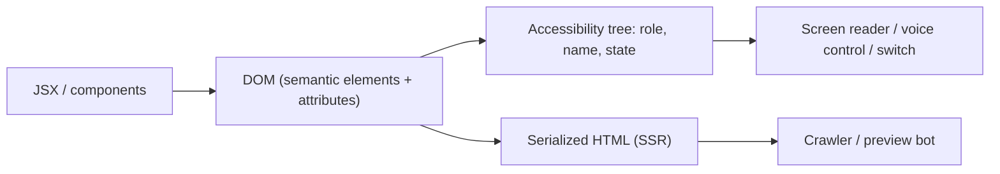
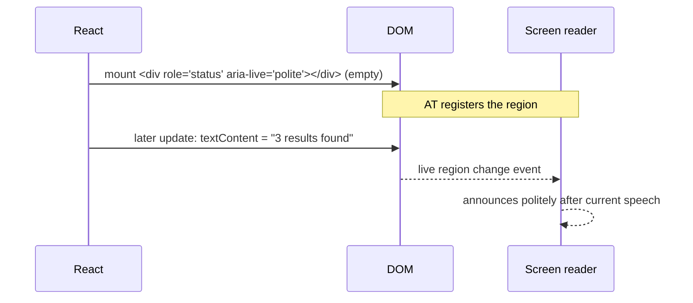
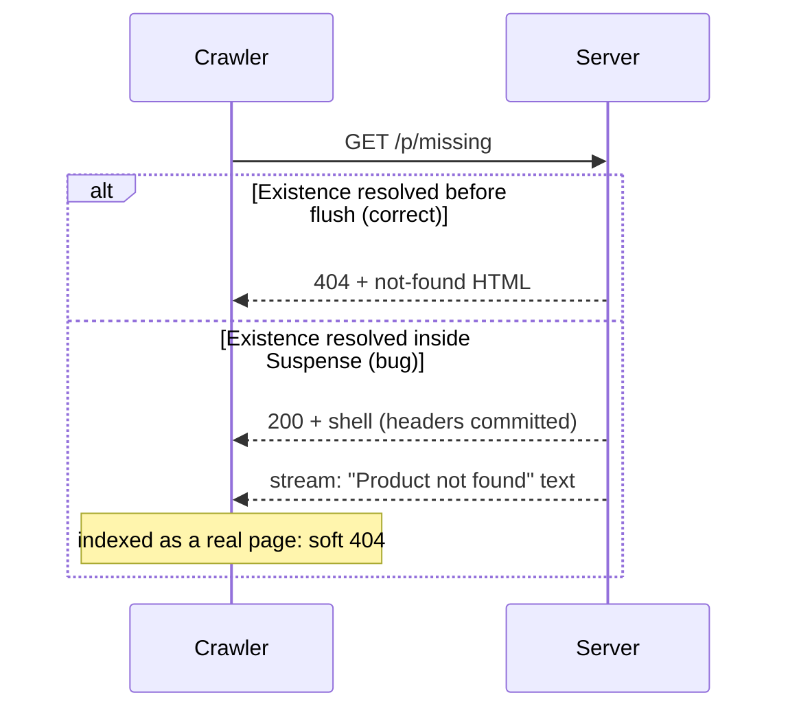

# 09 / 14 — Accessibility and SEO in Server-Rendered React

> **Scope note (verified 2026-10-22).** WCAG 2.2 criterion numbers, names and levels were checked against the W3C text (<https://www.w3.org/TR/WCAG22/>); React `<title>`/`<meta>`/`<link>` behavior against react.dev and `react-dom/server` 19.3.1 output; Next.js metadata, streaming and status-code behavior against the Next.js 16.4 docs; Google's JavaScript SEO behavior and the Core Web Vitals thresholds against developers.google.com and web.dev. Search-engine behavior (rendering, snippets, structured-data eligibility) still changes, so treat vendor docs as the authority.

## 1. Lesson metadata

| | |
|---|---|
| **Level** | Advanced |
| **Study time** | 5 hours (reading 2 h, audits with real tools 1.5 h, exercises 1.5 h) |
| **Prerequisites** | [01 — SPA, SSR, SSG, streaming](./01-spa-ssr-ssg-streaming.md), [05 — Suspense architecture](./05-suspense-architecture.md), [10 — Routing and nested layouts](./10-routing-and-nested-layouts.md), [11 — Progressive enhancement](./11-progressive-enhancement.md), [13 — Forms, actions and mutations](./13-forms-actions-and-mutations.md), [Phase 7/21 — Web Vitals and budgets](../07-performance/21-web-vitals-and-budgets.md), [Phase 8/10 — Accessibility testing](../08-testing-and-quality/10-accessibility-testing.md) |
| **Next** | [15 — React API changes across versions](./15-react-api-changes-across-versions.md) |
| **Related** | [Phase 10/08 — Accessibility as architecture](../10-production-engineering/08-accessibility-as-architecture.md), [Phase 11/11 — Designing for accessibility](../11-senior-and-architect-mastery/11-designing-for-accessibility.md) |

**Learning objectives.** After this lesson you can:
1. Explain how assistive technology (AT) and search crawlers consume your page, and why both depend on the **initial HTML and the accessibility tree**, not on your React component structure.
2. Build accessible SPA/SSR navigation: titles, landmarks, headings, focus management and route announcements.
3. Implement accessible forms, dialogs, live regions and loading states that work with Suspense, transitions and streaming.
4. Manage document metadata in React 19 and in frameworks (title, description, canonical, Open Graph, robots, JSON-LD) and handle HTTP status semantics for SEO (404 vs soft 404, redirects).
5. Explain how rendering strategy (CSR, SSR, SSG, streaming) affects crawlability and Core Web Vitals, and choose accordingly.
6. Audit with automated tools and manual checks, and know what automation cannot catch.

**Concepts covered:** accessibility tree, ARIA (and its first rule), semantic HTML, landmarks, headings, accessible name/description, focus order and management, keyboard operability, live regions, route-change announcements, skip links, reduced motion, color contrast and target size, WCAG 2.2 POUR principles, `useId`, `<title>`/`<meta>`/`<link>` in React 19, canonical URLs, status codes and streaming, sitemaps/robots, structured data, hreflang, Open Graph, rendering strategy vs indexing, INP/LCP/CLS, Lighthouse and axe.

---

## 2. Deep conceptual explanation

### 2.1 What problem is this lesson solving?

React lets you build a UI as a tree of components. Two consumers do not care about that tree:

1. **Assistive technology** (screen readers, switch devices, voice control, magnifiers) consumes the browser's **accessibility tree**, derived from the DOM: roles, names, states, relationships.
2. **Search crawlers and link-preview bots** consume the **HTML response** (and some render JavaScript, with limits), plus HTTP status codes and headers.

Both want *meaningful, semantic, stable HTML*. A `<div onClick>` styled as a button is invisible as a button to AT and unclickable by keyboard; a client-rendered shell with `<div id="root"></div>` is an empty page to a crawler that does not execute your bundle, and a delayed one to crawlers that do.

Server rendering ([01](./01-spa-ssr-ssg-streaming.md)) and progressive enhancement ([11](./11-progressive-enhancement.md)) provide meaningful HTML. This lesson adds the *semantics*, *navigation behavior* and *metadata* that make that HTML usable and discoverable. Accessibility and SEO overlap heavily (headings, link text, alt text, titles, language, performance) but are distinct goals; do not treat one as proof of the other.

### 2.2 The accessibility tree, from first principles

The browser builds the DOM, then computes for each node (if it is exposed): **role** (button, link, heading, textbox…), **accessible name** (what it's called), **description**, **state** (checked, expanded, disabled), and **relationships** (labelled by, controls). Platform accessibility APIs expose this tree to AT.



*Public guarantee:* native HTML elements carry implicit roles, names, keyboard behavior and states: `<button>` is focusable, activates on Enter/Space, exposed with role `button`. *Consequence:* **the cheapest, most robust accessibility is using the right element.** ARIA is a *repair kit*, not a starting point.

**The first rule of ARIA** (W3C "Using ARIA"): if you can use a native HTML element with the semantics and behavior you need, do that instead of repurposing another element and adding ARIA. ARIA changes only the accessibility tree; it adds no behavior (no keyboard handling, no focus). A `div role="button"` still needs `tabIndex`, Enter/Space handlers, and focus styles that `<button>` gives for free.

### 2.3 WCAG in one table

WCAG (Web Content Accessibility Guidelines) 2.x organizes requirements under **POUR**: Perceivable, Operable, Understandable, Robust, with conformance levels A, AA, AAA. Most legal and contractual targets name **AA**. Criteria numbers and levels below were checked against the WCAG 2.2 text.

| Principle | Examples relevant to React apps |
|---|---|
| **Perceivable** | Text alternatives (`alt`), captions, contrast (text ≥ 4.5:1 for normal text at AA), reflow at 320 CSS px / 400% zoom, don't rely on color alone |
| **Operable** | All functionality via keyboard, no keyboard traps, visible focus, focus not obscured (2.4.11 Focus Not Obscured (Minimum), AA, new in 2.2), sufficient target size (2.5.8 Target Size (Minimum), AA, new in 2.2: at least 24×24 CSS px, with exceptions), dragging alternatives (2.5.7 Dragging Movements, AA), no flashing, skip links/bypass blocks, page titled, meaningful focus order |
| **Understandable** | `lang` attribute, predictable navigation, consistent help, error identification and suggestions in forms, labels/instructions, 3.2.6 Consistent Help (A), 3.3.7 Redundant Entry (A) and 3.3.8 Accessible Authentication (Minimum) (AA), all new in 2.2 |
| **Robust** | Name/role/value exposed (4.1.2); status messages programmatically determinable via live regions (4.1.3, AA). Note that 4.1.1 Parsing is marked "Obsolete and removed" in WCAG 2.2, so duplicate IDs and malformed markup are no longer a failure of that criterion by themselves, though they still break `aria-labelledby`/`htmlFor` associations in practice |

### 2.4 Where React and SSR change the accessibility picture

| Situation | Risk | Remedy |
|---|---|---|
| **Client-side navigation** doesn't reload the page | The browser's usual page-load cues (focus reset, title announcement) don't happen; AT users may not know the page changed | Update `document.title`; move focus to the main heading or container; and/or announce via a polite live region ([§5.2](#52-practical--accessible-route-change-announcements)) |
| **Streaming/Suspense** replaces fallbacks with content | Screen readers may not announce the arrival; focus may be lost if the focused element is replaced | Use `aria-busy`, live regions for important updates; avoid replacing focused nodes; keep stable keys/identity |
| **Hydration** | Elements look interactive before they work; `autofocus`/focus can reset on hydration mismatch | Native elements work pre-hydration ([11](./11-progressive-enhancement.md)); avoid focus-stealing; fix mismatches ([02](./02-hydration-internals-deep-dive.md)) |
| **Conditional rendering** | Removing the focused element sends focus to `<body>` | Move focus deliberately (to a logical neighbor or container) |
| **Optimistic UI** | Visual change without announcement; rollback confusing | Announce outcomes (`role="status"`/`aria-live="polite"`), announce errors (`role="alert"`) |
| **Portals/modals** | DOM order differs from visual order; background still reachable | Use `<dialog>` with `showModal()` or a vetted library; trap and restore focus; mark background `inert` |
| **Component libraries** | Inconsistent labelling | Headless accessible primitives ([Phase 5/07](../05-design-patterns/07-headless-components.md)) |
| **IDs in SSR** | Generated IDs differ between server and client → broken `htmlFor`/`aria-describedby`, hydration mismatches | `useId` produces stable IDs consistent across server and client |

### 2.5 SEO from first principles

A search engine pipeline (simplified; vendor details differ, check vendor docs):

1. **Discovery:** follow links (`<a href>`), sitemaps, backlinks.
2. **Crawl:** fetch the URL, record **HTTP status**, headers, HTML.
3. **Render (optional, deferred):** some engines execute JavaScript in a headless browser in a *second wave* with resource limits, often delayed. Google's JavaScript SEO page describes three phases (crawling, rendering, indexing), says Googlebot "queues pages for both crawling and rendering" and renders with an evergreen Chromium, and that it won't render JavaScript from pages or files that robots.txt blocks. Content that exists only after JS runs is indexed later or less reliably, and other crawlers may not render at all. Google's "dynamic rendering as a workaround" page is marked deprecated, so do not build new bot-specific prerender setups.
4. **Index:** extract text, links, metadata (`title`, `meta description`, `canonical`, structured data), language, media.
5. **Rank:** relevance, quality, links, experience signals (including Core Web Vitals as one factor among many).

Hence the strategic points:

- Put **primary content, title, canonical and key metadata in the initial HTML**. SSR/SSG gives that; CSR depends on the render queue.
- **Real links**: client-rendered navigations using `onClick` without `href` are not discoverable.
- **HTTP semantics matter.** A missing page must return **404** (or 410), not 200 with a "not found" message (**soft 404**). Redirects use proper 301/302/307/308.
- **One canonical URL per content**, to avoid duplicate-content dilution from query-parameter variants.
- **Social previews** (Open Graph/Twitter cards) are consumed by bots that generally do **not** execute JS.

### 2.6 Streaming, status codes and metadata

Streaming SSR flushes a shell before all data resolves ([01](./01-spa-ssr-ssg-streaming.md), [05](./05-suspense-architecture.md)). Two consequences:

1. **HTTP status and headers are sent first.** Once the shell is flushed with `200`, a later discovery that the resource doesn't exist can't change the status. If the "not found" decision depends on data inside a Suspense boundary, the response is already `200`, producing a soft 404. **Fix:** resolve the data that determines existence/redirects *before* flushing the shell (outside the boundary or in the loader), and stream only secondary content.
2. **Metadata in `<head>`** is needed early. Frameworks differ. Next.js (16.4 docs) streams `generateMetadata` output: the initial UI is sent without waiting, the metadata tags are appended to `<body>` when they resolve, and it says this was verified with bots that execute JavaScript such as Googlebot; for "HTML-limited bots" that cannot (e.g., `facebookexternalhit`), detected by User-Agent and overridable with the `htmlLimitedBots` config option, metadata blocks rendering and lands in `<head>`. Rule: make title/description/canonical depend on fast, early data.

### 2.7 Document metadata in React 19

React 19 supports rendering `<title>`, `<meta>` and `<link>` tags **anywhere in the component tree**; React hoists them into `<head>`. For stylesheets, `<link rel="stylesheet" precedence="...">` lets React manage insertion order and Suspense-ready loading. Per react.dev, `<title>` and `<meta>` are always placed in the document `<head>` wherever they render (exceptions: `<title>` inside `<svg>`, and `<title>`/`<meta>` with an `itemProp`), and `<link>` goes to `<head>` "in most cases". We confirmed with `renderToString` that a `<title>`/`<meta>`/`<link rel="canonical">` rendered inside `<main>` is emitted in `<head>`.

```tsx
function ProductPage({ product }: { product: Product }) {
  return (
    <article>
      <title>{`${product.name} | Shop`}</title>
      <meta name="description" content={product.summary} />
      <link rel="canonical" href={`https://shop.example.com/p/${product.slug}`} />
      <h1>{product.name}</h1>
    </article>
  );
}
```

Caveats: react.dev says to render a single `<title>` at a time: if several components render one, React places **all** of them in `<head>` and "the behavior of browsers and search engines is undefined" (we saw both `<title>A</title><title>Page</title>` in the server output; there is no last-wins or closest-wins merge). Frameworks provide structured metadata APIs that merge layout and page metadata deterministically (Next `metadata`/`generateMetadata`, React Router route `meta`, TanStack Router `head`). Prefer the framework's mechanism for consistency with its streaming behavior; use native React tags for simple apps.

### 2.8 Common misconceptions

| Misconception | Reality |
|---|---|
| "Accessibility = adding ARIA." | Mostly semantic HTML and keyboard behavior; bad ARIA is worse than none. |
| "Automated tools catch accessibility issues." | Automated checks find a minority of issues (estimates vary widely by study and by how issues are counted, from roughly a third to over half; I did not re-fetch a specific study); manual keyboard and screen-reader testing is required. |
| "Google runs JavaScript, so CSR is fine for SEO." | Rendering is deferred, resource-limited and not guaranteed for every bot; critical content/metadata in HTML is more reliable. Other crawlers and social bots often don't render. |
| "SEO is meta tags." | Content quality, crawlability, links, status codes, performance and structure matter more. |
| "`aria-label` on everything." | Visible text labels are preferred (WCAG "label in name"); `aria-label` overrides content and isn't translated by some tooling. |
| "`display:none` content is read by screen readers." | `display:none`/`hidden` removes from the accessibility tree; use a visually-hidden class for AT-only text. |
| "SSR fixes accessibility." | SSR delivers HTML; it doesn't make it semantic or keyboard operable. |

---

## 3. Internal mechanics

### 3.1 Accessible name computation (simplified)

For an element, the browser computes its **accessible name** by precedence (per the Accessible Name and Description Computation spec): `aria-labelledby` → `aria-label` → native label mechanisms (`<label>` for inputs, `alt` for images, `<caption>`, `<legend>`) → content (for roles allowing name from content like button/link) → `title` attribute (last resort). Practical impact: a `<button><svg/></button>` without text has **no name** (announced as "button"); add visually hidden text or `aria-label`. An `<input>` with a placeholder only has a weak name; placeholders disappear and aren't labels.

### 3.2 Focus mechanics in a React tree

- Browser focus belongs to a **DOM element**. React re-renders keep DOM nodes when identity is preserved ([Phase 2/07](../02-react-rendering-and-internals/07-identity-keys-and-reconciliation.md)), so focus survives updates; if the element is *unmounted* (conditional render, key change), focus resets to `body`.
- Focus is imperative: use `ref.current?.focus()` in an event handler (preferred) or in an effect for "after render" cases (`useEffect` is acceptable here because focus is synchronization with an external system, the DOM focus state; use `useLayoutEffect` only if flicker matters; [Phase 3/08](../03-react-state-and-hooks/08-uselayouteffect.md)).
- `tabIndex={-1}` makes a non-interactive element programmatically focusable (headings, error summaries, containers) without adding it to the Tab order.
- `autoFocus` has hydration and a11y caveats (focus jumps, screen-reader surprise); use deliberately.
- The `inert` attribute removes subtrees from focus and the accessibility tree: useful for modal backgrounds. React 19 supports `inert` as a boolean attribute (verified: `renderToString(<div inert>)` gives `<div inert="">`, `inert={false}` omits it, and `<div inert>` typechecks with `@types/react` 19.3).

### 3.3 Live regions

An ARIA live region announces **changes** to its content. Mechanics: the region must exist in the DOM **before** its content changes; inserting a region already populated is often not announced. Roles: `role="status"` (polite), `role="alert"` (assertive, use sparingly), `aria-live="polite|assertive"`, `aria-atomic`, `aria-relevant`. In React: render a persistent container and change its text.



### 3.4 Route-change handling

On a full page load, browsers announce the new document title and reset focus to the document start. In an SPA, nothing happens unless you do it. Common strategies:

| Strategy | Mechanism | Trade-off |
|---|---|---|
| Focus the new page's `<h1>` (`tabIndex={-1}`) | Programmatic focus after navigation commit | Most reliable cue; visual focus ring on h1 may need styling/suppression |
| Focus a top-level container (`<main tabIndex={-1}>`) | Same | Announces the container name/landmark |
| Announce via live region ("Navigated to Billing") | Persistent `role="status"` updated with document title | Doesn't move focus; keyboard users stay at old position |
| Combine title update + focus management | Recommended baseline | Needs handling for back/forward and hash links |

Frameworks may include a **route announcer** (Next.js's accessibility docs: it "includes a route announcer by default" that looks first at `document.title`, then the `<h1>`, then the URL pathname), but focus management is generally the app's responsibility. Test with a screen reader.

### 3.5 Rendering strategy vs. crawlers and Core Web Vitals

| Strategy | HTML at first response | Crawlability | LCP tendency | INP concern |
|---|---|---|---|---|
| CSR SPA | Empty shell | Depends on deferred rendering; social bots see nothing | Late (JS + data) | Hydration not needed; but heavy client render |
| SSR | Full content | Strong | Good if server fast | Hydration cost |
| SSG/ISR | Full content, cacheable | Strong | Best (CDN) | Hydration cost |
| Streaming SSR | Shell early, rest streamed | Strong for shell; content in late chunks may be missed by simple bots (Google renders; HTML-only bots only see what is in the response they read) | Good | Selective hydration helps |
| RSC | Less client JS | Strong | Good | Lower JS → better INP |

Core Web Vitals (LCP, INP, CLS; INP is the successor to FID, which web.dev no longer treats as a Core Web Vital; good thresholds: LCP within 2.5 s, INP 200 ms or less, CLS 0.1 or less) are user-experience metrics that also feed ranking signals; accessibility intersects: layout shift hurts motor-impaired users misclicking; long tasks hurt everyone ([Phase 7/21](../07-performance/21-web-vitals-and-budgets.md)).

---

## 4. Step-by-step execution walkthrough

Scenario A: **Client-side navigation from "Orders" to "Billing" with a screen reader (SR) user**, in a framework SPA transition.

1. SR user focuses the "Billing" nav link (`<a href="/billing" aria-current="false">`). They press Enter.
2. Router intercepts, calls `navigate`, starts a transition; the old page remains. An `aria-busy="true"` is set on `<main>` and a visually hidden polite status says "Loading Billing…" (optional, and only if loading exceeds ~300–500 ms to avoid chatter).
3. Data arrives; React commits the new tree: `<main>` content swapped; `<title>Billing | Acme</title>` updated; `aria-current="page"` moves to the Billing link.
4. Post-commit hook (router `useEffect` on location change): `mainHeadingRef.current?.focus()` where `<h1 tabIndex={-1}>Billing</h1>`.
5. SR announces: "Billing, heading level 1" (and reads the title via the route announcer if present).
6. User presses Tab: next focusable inside `<main>` is the first control after the heading (focus order follows DOM order).
7. User presses Back: router restores previous route; the same focus handling focuses the **previous page's** h1 (or restores the previously focused element if you implement focus restoration).

Scenario B: **Crawler fetching `/p/shoe-123` that no longer exists, streaming enabled.**

1. Request arrives; the server begins rendering. Layout and page shell render. The product lookup is **outside any Suspense boundary** and awaited before flush.
2. Lookup returns `null`; the page calls `notFound()` *before any bytes are sent*. The framework responds `404` with the not-found UI. The crawler sees status 404 → drops it from the index.
3. **Anti-example:** if the lookup were inside `<Suspense>`, the shell would flush with 200; by the time `null` arrives the status is committed; the client shows "Not found" text: a **soft 404** that remains indexed. This is a classic streaming SEO bug.

---

## 5. Code examples

### 5.1 Minimal — semantic structure and accessible names

```tsx
export function AppShell({ children }: { children: React.ReactNode }) {
  return (
    <>
      <a href="#main" className="skip-link">Skip to main content</a>
      <header>
        <nav aria-label="Primary">
          <ul>
            <li><a href="/orders">Orders</a></li>
            <li><a href="/billing" aria-current="page">Billing</a></li>
          </ul>
        </nav>
      </header>
      <main id="main" tabIndex={-1}>{children}</main>
      <footer>© Acme</footer>
    </>
  );
}
```

Line notes:
- The **skip link** is the first focusable element, letting keyboard users bypass repeated navigation (WCAG "Bypass Blocks"). It must become visible on focus (CSS).
- Landmarks (`header`, `nav`, `main`, `footer`) give AT users navigation shortcuts. Only **one `main`**. Multiple `nav` landmarks need distinct labels (`aria-label`).
- `aria-current="page"` marks the current link; routers' `NavLink` often sets it automatically (React Router's `NavLink` adds `aria-current="page"` to the active link; check your router).
- `<main tabIndex={-1}>` can receive programmatic focus after route changes or skip-link activation.
- The `<html lang="en">` attribute must be set in the root document (frameworks provide it in the root layout).

### 5.2 Practical — accessible route-change announcements

```tsx
"use client";
import { useEffect, useRef } from "react";
import { usePathname } from "next/navigation";   // framework hook; React Router: useLocation()

export function RouteFocus({ children }: { children: React.ReactNode }) {
  const pathname = usePathname();
  const mainRef = useRef<HTMLDivElement>(null);
  const first = useRef(true);

  useEffect(() => {
    if (first.current) { first.current = false; return; }   // don't steal focus on initial load
    const h1 = mainRef.current?.querySelector<HTMLElement>("h1");
    (h1 ?? mainRef.current)?.focus({ preventScroll: false });
  }, [pathname]);

  return <div ref={mainRef} tabIndex={-1} style={{ outline: "none" }}>{children}</div>;
}
```

Notes and cautions:
- The effect keyed on the pathname runs *after* the new route's DOM commits, so `querySelector("h1")` finds the new heading. With streaming/Suspense the `h1` may not exist yet; place the `<h1>` outside of slow boundaries or focus the container.
- The `first` ref skips the initial load. Under StrictMode (dev), effects mount, unmount and re-mount: the `first` ref logic may misfire in development because the effect runs twice on mount ([Phase 2/28](../02-react-rendering-and-internals/28-strict-mode-behavior.md)). The `first.current` flag is set to false on the first run, so the dev re-run on mount would focus (we ran it under `<StrictMode>`: the initial mount logged a `focus@/a` call); acceptable to test with this in mind, or compare against a previous-pathname ref instead (a more robust pattern).
- `style={{ outline: "none" }}` on a programmatically focused *container* is acceptable because it is not an interactive control, but never remove outlines from interactive elements without replacement.
- Prefer the framework's route-announcer plus this focus handling; check for double announcements.
- Don't do this for hash-only changes (`#section`) or search-param-only refinements (typing in filters should not steal focus).

### 5.3 Practical — accessible form errors with an error summary

```tsx
"use client";
import { useId, useEffect, useRef } from "react";

type Errors = Partial<Record<"email" | "password", string>>;

export function SignupFields({ errors }: { errors: Errors }) {
  const emailId = useId();
  const pwId = useId();
  const summaryRef = useRef<HTMLDivElement>(null);
  const hasErrors = Object.keys(errors).length > 0;

  useEffect(() => { if (hasErrors) summaryRef.current?.focus(); }, [errors, hasErrors]);

  return (
    <>
      {hasErrors && (
        <div ref={summaryRef} tabIndex={-1} role="alert" aria-labelledby={`${emailId}-sum`}>
          <h2 id={`${emailId}-sum`}>There {Object.keys(errors).length === 1 ? "is a problem" : "are problems"}</h2>
          <ul>
            {errors.email && <li><a href={`#${emailId}`}>{errors.email}</a></li>}
            {errors.password && <li><a href={`#${pwId}`}>{errors.password}</a></li>}
          </ul>
        </div>
      )}
      <label htmlFor={emailId}>Email</label>
      <input id={emailId} name="email" type="email" autoComplete="email"
             aria-invalid={errors.email ? true : undefined}
             aria-describedby={errors.email ? `${emailId}-err` : undefined} />
      {errors.email && <p id={`${emailId}-err`}>{errors.email}</p>}

      <label htmlFor={pwId}>Password</label>
      <input id={pwId} name="password" type="password" autoComplete="new-password"
             aria-invalid={errors.password ? true : undefined}
             aria-describedby={errors.password ? `${pwId}-err` : undefined} />
      {errors.password && <p id={`${pwId}-err`}>{errors.password}</p>}
    </>
  );
}
```

Line notes:
- `useId` returns an ID stable between server and client rendering; **never** use `Math.random()` or a module counter in SSR (mismatch, broken associations). The ID format has changed: `:r1:` in 19.0, `«r1»` in 19.1, and `_r_1_` from 19.2 (react.dev 19.2 post; in our 19.3.1 server output the ids looked like `_R_0_`, with a different casing for server-generated ones). The 19.2 format avoids characters that were awkward in CSS selectors, but never hard-code or parse these strings: treat them as opaque, and use `document.getElementById` or `CSS.escape` if you must select by one.
- The error summary receives focus and lists links to fields (GOV.UK-style pattern); each message is also programmatically associated through `aria-describedby`.
- `aria-invalid` conveys state; the error text conveys the reason: both are needed.
- `role="alert"` on a container that is *inserted with content* can be announced in many AT but is inconsistent; focusing the summary is the reliable mechanism, `role="alert"` is secondary. Don't double-announce excessively.
- `autoComplete` helps users and password managers (WCAG "Identify Input Purpose").

### 5.4 Practical — a modal dialog using native `<dialog>`

```tsx
"use client";
import { useEffect, useRef } from "react";

export function ConfirmDialog({ open, title, onClose, children }: {
  open: boolean; title: string; onClose: () => void; children: React.ReactNode;
}) {
  const ref = useRef<HTMLDialogElement>(null);

  useEffect(() => {
    const d = ref.current;
    if (!d) return;
    if (open && !d.open) d.showModal();          // focus trap + inert background + Esc handled by the browser
    if (!open && d.open) d.close();
  }, [open]);

  return (
    <dialog ref={ref} aria-labelledby="dlg-title" onClose={onClose}>
      <h2 id="dlg-title">{title}</h2>
      {children}
      <form method="dialog"><button>Close</button></form>
    </dialog>
  );
}
```

Why: `showModal()` gives focus management, Escape handling, backdrop, top-layer rendering and inert background natively. React reflects state into the imperative API with an effect (synchronization with an external system). The `onClose` event fires when the dialog closes via Esc or the form; keep React state in sync. Focus returns to the previously focused element on close (HTML dialog behavior; confirm in your target browsers). Multiple dialogs and animation need extra care; a headless library may be preferable at scale ([Phase 5/07](../05-design-patterns/07-headless-components.md)).

### 5.5 Practical — metadata and structured data (framework example)

```tsx
// app/products/[slug]/page.tsx  (Next 15/16 App Router)
import type { Metadata } from "next";
import { notFound } from "next/navigation";

type Props = { params: Promise<{ slug: string }> };

export async function generateMetadata({ params }: Props): Promise<Metadata> {
  const { slug } = await params;
  const p = await getProduct(slug);           // same call as the page: Next memoizes `fetch` across generateMetadata and the page; wrap non-fetch data access in React `cache()`
  if (!p) return { title: "Not found", robots: { index: false } };
  return {
    title: `${p.name} | Shop`,
    description: p.summary.slice(0, 155),
    alternates: { canonical: `/products/${p.slug}` },
    openGraph: { title: p.name, description: p.summary, images: [{ url: p.imageUrl, width: 1200, height: 630 }] },
  };
}

export default async function Page({ params }: Props) {
  const { slug } = await params;
  const p = await getProduct(slug);
  if (!p) notFound();                          // must happen before streaming starts (outside Suspense)
  const jsonLd = {
    "@context": "https://schema.org", "@type": "Product", name: p.name, image: [p.imageUrl],
    offers: { "@type": "Offer", priceCurrency: "EUR", price: (p.priceCents / 100).toFixed(2), availability: "https://schema.org/InStock" },
  };
  return (
    <article>
      <script type="application/ld+json" dangerouslySetInnerHTML={{ __html: JSON.stringify(jsonLd).replace(/</g, "\\u003c") }} />
      <h1>{p.name}</h1>
    </article>
  );
}
```

Line notes:
- The `.replace(/</g, "\\u003c")` escapes `<` so that a product name containing `</script>` can't break out of the script element (XSS). Never inject unescaped JSON into `dangerouslySetInnerHTML` ([Phase 10/06](../10-production-engineering/06-security-xss-csrf-csp.md)).
- `robots: { index: false }` on not-found variants prevents indexing if the status code can't be 404; the right fix is the actual 404. Next.js documents this exact situation: before streaming starts `notFound()` yields a 404 status; after streaming starts the status stays 200 and the not-found UI renders in the response, and Next injects `<meta name="robots" content="noindex">` in both cases (not-found.js reference), which is the framework's mitigation for the soft-404 problem, not a substitute for resolving existence early.
- Other Next.js metadata conventions (16.4 docs): `viewport`, `themeColor` and `colorScheme` live in a separate `viewport` export / `generateViewport` (the `themeColor`/`colorScheme` metadata fields are deprecated since 14); a segment cannot export both `metadata` and `generateMetadata`; file conventions `sitemap.ts`, `robots.ts` and `opengraph-image` exist and take priority over the object/function.
- Descriptions around 150–160 characters are a convention; engines may rewrite snippets.
- Structured data must match visible content; Google's structured-data guidelines prohibit marking up content users can't see, and eligibility for rich results is not guaranteed (check the current guidelines and the Rich Results Test). Next.js's JSON-LD guide shows the same `.replace(/</g, '\\u003c')` escape used above and notes that `JSON.stringify` alone does not sanitize.

### 5.6 Incorrect — inaccessible and uncrawlable patterns

```tsx
function BadCard({ product }: { product: Product }) {
  return (
    <div className="card" onClick={() => router.push(`/p/${product.slug}`)}>
      
      <div className="title">{product.name}</div>
      <div className="icon-btn" onClick={(e) => { e.stopPropagation(); addToCart(product.id); }}>
        <svg>…</svg>
      </div>
    </div>
  );
}
```

**Problems:** (1) no link: not focusable, not discoverable by crawlers, no middle-click; (2) `img` without `alt`; (3) title is a `div`, not a heading; (4) icon "button" is a `div`: not focusable, no role, no name; (5) nested interactive handlers with `stopPropagation`; (6) no keyboard activation; (7) SVG has no accessible name; (8) cursor styling hides the lack of semantics from sighted mouse users, which is why such bugs ship.

### 5.7 Corrected

```tsx
function Card({ product }: { product: Product }) {
  return (
    <article className="card">
      
      <h3><a href={`/p/${product.slug}`}>{product.name}</a></h3>
      <form action={addToCartAction}>
        <input type="hidden" name="productId" value={product.id} />
        <button type="submit" aria-label={`Add ${product.name} to cart`}>
          <svg aria-hidden="true" focusable="false">…</svg>
        </button>
      </form>
    </article>
  );
}
```

Why: a real link for navigation; heading for outline; `alt` describing the image's purpose (decorative images get `alt=""`); explicit `width`/`height` prevent layout shift (CLS); a real `<button>` inside a form works pre-hydration ([11](./11-progressive-enhancement.md)); icon is hidden from AT while the button has a name that includes the product. The `aria-label` here supplements an icon-only button; prefer visible text when space allows (WCAG "Label in Name"). `loading="lazy"` should not be applied to the LCP image.

---

## 6. Visual explanations

### 6.1 Page outline and landmarks

```text
<body>
 ├─ skip link ───────────────► #main
 ├─ <header role=banner>
 │    └─ <nav aria-label="Primary">
 ├─ <main id="main">
 │    ├─ <h1>Billing</h1>            ← one h1; focus target after navigation
 │    ├─ <section aria-labelledby=…>
 │    │    └─ <h2> … </h2>
 │    └─ <form> … </form>
 └─ <footer role=contentinfo>
```

### 6.2 Streaming, status codes and SEO



### 6.3 What each consumer reads

```text
                   HTML text  JS-rendered text  Status  Head/meta  Structured data  Accessibility tree
Search crawler        ✔       ✔(deferred)       ✔        ✔           ✔                -
Social preview bot    ✔          ✘              ✔        ✔           OG tags         -
Screen reader         ✔(DOM)     ✔ (live DOM)   -        title       -                ✔ (primary)
Reader mode / AT      ✔          ✔              -        -           -                ✔
```

---

## 7. Alternative approaches and trade-offs

### 7.1 Custom widget vs native vs library

| Criterion | Native HTML (`button`, `details`, `dialog`, `select`) | Headless a11y library (e.g., Radix, React Aria, Headless UI) | Hand-rolled ARIA widget |
|---|---|---|---|
| Accessibility correctness | High by default | High (tested patterns) | Easy to get wrong |
| Styling flexibility | Limited for some controls (select, date) | High | Highest |
| Behavior coverage (typeahead, roving tabindex) | Basic | Rich | Whatever you implement |
| Bundle cost | None | Some | Whatever you write |
| Maintenance | Browser-maintained | Library-maintained | Yours |
| Best for | Default choice | Comboboxes, menus, date pickers, complex dialogs | Rare, with accessibility expertise and tests |

**When the recommended approach (native first) is not best:** a fully custom, brand-styled combobox with async options and multi-select cannot be built from native `<select>`; use a tested headless library rather than hand-rolled ARIA. A native `<select>` for 5 options remains better than any custom widget.

### 7.2 Metadata mechanism

| Criterion | React 19 `<title>/<meta>` in components | Framework metadata API | Manual `document.title` in effects |
|---|---|---|---|
| Works in SSR/streaming `<head>` | Yes (hoisted; verified with `renderToString`; streaming frameworks may place late-resolved tags differently) | Yes (designed for it) | **No** (client-only; invisible to crawlers/bots) |
| Merging layout + page values | Manual/last-wins | Deterministic merge | Manual |
| Type safety | Plain JSX | Typed | None |
| Best for | Simple apps, libraries | Production frameworks | Avoid |

### 7.3 Rendering strategy for SEO-critical pages

| Strategy | SEO reliability | Freshness | Cost |
|---|---|---|---|
| SSG | Highest | Rebuild/revalidate | Lowest |
| ISR / on-demand revalidation | High | Near real-time on events | Low–Medium |
| SSR per request | High | Real-time | Higher server cost |
| CSR + prerender service | Medium | Varies | Extra infra; avoid for new builds |
| CSR only | Lowest | Real-time | Lowest |

CSR-only is the *right* answer for authenticated pages that must not be indexed ([09](./09-framework-architecture.md)).

---

## 8. Best practices and anti-patterns

**Do**
- Use semantic elements first; ARIA only to fill genuine gaps.
- Ensure every interactive control has an accessible name, keyboard operability and a visible focus indicator.
- One `<h1>` per page (a common convention; HTML permits more, but a clear outline matters), logical heading levels, landmarks.
- Manage focus on route changes, dialogs, and when removing focused elements.
- Use `useId` for associations; set `lang`; associate labels, errors and descriptions.
- Provide skip links; support reduced motion (`prefers-reduced-motion`) and zoom/reflow.
- Return correct HTTP statuses; resolve existence/redirect before streaming flush.
- Use real links; canonical URLs; sitemaps; robots directives where appropriate; hreflang for localized versions.
- Escape JSON-LD; ensure structured data matches visible content.
- Reserve space for images/embeds (width/height, aspect-ratio) to avoid CLS.
- Add automated a11y checks in CI **and** manual keyboard/screen-reader passes before releases ([Phase 8/10](../08-testing-and-quality/10-accessibility-testing.md)).

**Beginner mistakes**
- `div`/`span` buttons and links; missing `alt`/labels; placeholders as labels.
- `outline: none` with no replacement focus style.
- Using `aria-label` to "fix" everything; wrong roles; `role="button"` without keyboard handling.
- Setting `document.title` only client-side.
- Color-only error indication.

**Experienced-developer mistakes**
- Soft 404s from streaming.
- Focus lost when replacing nodes (key churn) or when Suspense swaps content.
- Live-region spam (announcing every keystroke or each streamed chunk).
- Treating Lighthouse accessibility score of 100 as "accessible".
- Modals that don't trap/restore focus or that leave the background reachable.
- Hiding content with `aria-hidden="true"` on focusable ancestors (focusable elements inside hidden regions).
- Over-nesting landmarks; multiple unlabeled `nav`s.

**Smells:** `tabIndex` > 0; `onClick` on non-interactive elements; `href="#"` for actions; `dangerouslySetInnerHTML` for content without sanitation; `aria-*` attributes with static/never-updated values (e.g., `aria-expanded="false"` always).

**Justified exceptions:** decorative icons with `aria-hidden`; custom widgets where no native element exists, built per the ARIA Authoring Practices with tests; temporary `tabIndex={-1}` for programmatic focus.

---

## 9. Real-world application

*Public e-commerce site.* Constraints: legal accessibility requirements (e.g., the European Accessibility Act, Directive (EU) 2019/882, has applied since 28 June 2025 to many consumer e-commerce services; I did not re-fetch the EU text, so verify scope, exemptions such as microenterprises, and national transposition), SEO-driven acquisition, Core Web Vitals targets. Approach: SSG/ISR category and product pages, SSR for search results; semantic markup in a shared component library with a11y tests; canonical URLs with filter parameters normalized; structured data for products and breadcrumbs; accessible checkout with error summaries and PE; real 404s for removed products; performance budget on LCP images (`fetchpriority="high"` on the LCP image, preloading it, no `loading="lazy"` on it; targets from web.dev: LCP within 2.5 s, INP 200 ms or less, CLS 0.1 or less at the 75th percentile), CLS control via reserved image space.

*Authenticated dashboard (no SEO).* Focus on accessibility: data tables (`<table>` with `<th scope>`; virtualized tables need ARIA grid semantics and careful testing, [Phase 7/09](../07-performance/09-windowing-and-virtualization.md)), chart alternatives (data tables or text summaries), live updates announced judiciously (rate-limit announcements), keyboard shortcuts documented and non-conflicting with AT, `noindex` for the app shell.

*Content/news site.* SSG with streaming comments; article structure with headings; AMP no longer necessary for most; `article` structured data; `lang` per section with `lang` attributes for mixed-language content; accessible media with captions and transcripts.

*Multi-locale site.* `<html lang>` per locale, `hreflang` alternates (reciprocal, including self-reference), localized URLs, translated metadata ([Phase 10/09](../10-production-engineering/09-internationalization.md)).

---

## 10. Debugging and troubleshooting

**Symptom: "Screen reader doesn't announce page changes."** Check the title updated; focus moved to heading/container; presence of live-region announcer; test with VoiceOver (macOS/iOS), NVDA/JAWS (Windows) and TalkBack. Chrome DevTools → Accessibility panel shows the computed tree, name, role and states for the focused element.

**Symptom: "Keyboard users can't reach/operate a control."** Tab through the page; look for missing focus indicators or elements skipped. Use DevTools "Show focus" rendering emulation or inspect `tabindex`. Replace non-semantic elements with `<button>`/`<a>`; add keyboard handlers only when custom widgets are unavoidable.

**Symptom: "Lighthouse reports 'Buttons do not have an accessible name'."** Icon-only buttons. Add text content, visually hidden text, or `aria-label` (and `aria-hidden` on the SVG).

**Symptom: "Google Search Console shows 'Soft 404' or 'Crawled — currently not indexed'."** Check the status code with `curl -I`, check whether content was streamed after a 200, check that content exists in the initial HTML (`curl` the URL and grep), check canonical conflicts, thin or duplicate content, `noindex` leaks from staging configs. URL Inspection tool shows the rendered HTML as the engine saw it.

**Symptom: "Social share preview shows wrong title/image."** Preview bots don't execute JS: confirm tags exist in the raw HTML (`curl`), check caching of previews by the platform (use their debugger tools), ensure absolute image URLs and acceptable image dimensions.

**Symptom: "Hydration mismatch with ids / `aria-describedby` broken."** IDs generated with `Math.random()` or a counter differing between server and client → use `useId` ([02](./02-hydration-internals-deep-dive.md)).

**Symptom: "Focus jumps to the top after a state change."** The focused element was unmounted/remounted: check keys, conditional wrapper changes (changing the parent element type remounts children), `key` on lists. Verify in DevTools by watching `document.activeElement` (live expression).

**Tooling workflow:**
1. `eslint-plugin-jsx-a11y` in the editor/CI for static checks (npm: 6.10.2, last published October 2024, peer range ESLint 3 to 9, so check compatibility before moving to a newer ESLint; Next.js bundles it in its ESLint setup per its accessibility docs).
2. `axe-core` (4.14.0) via jest-axe (11.0.0) or vitest-axe (0.1.0, last published January 2025: pre-1.0 and quiet, so check it still fits your Vitest version) in component tests and `@axe-core/playwright` in E2E. jsdom cannot compute layout or real colors, so color-contrast rules do not run meaningfully in component tests; keep contrast checks for a real browser (Playwright/Lighthouse).
3. Lighthouse for a baseline (not an accessibility sign-off).
4. Manual keyboard-only run, 200–400% zoom, forced colors/high-contrast, reduced motion.
5. Screen-reader smoke test of key flows.

---

## 11. Exercises

### Level A — Knowledge
A1. State the first rule of ARIA and give an example where following it removes the need for any ARIA attribute.
A2. What is the accessible name of `<button><svg/></button>`, and how do you give it one?
A3. Why does a streamed response risk soft 404s?
A4. Which tag types are hoisted into `<head>` by React 19 when rendered inside components?
A5. Why does `document.title = …` in `useEffect` fail social-preview bots?
A6. What does `tabIndex={-1}` do, and when would you use it?

### Level B — Code comprehension
B1. Identify five accessibility problems in:
```tsx
<div className="modal" style={{ display: open ? "block" : "none" }}>
  <div className="close" onClick={close}>×</div>
  <input placeholder="Email" />
  <div className="btn" onClick={submit}>Send</div>
</div>
```
B2. In §5.2, why is `querySelector("h1")` run in an effect after `pathname` changes rather than during render?
B3. In §5.3, why use `useId` rather than a constant like `"email"` for the input id? What breaks if two instances of the component render on the page?
B4. A `role="status"` element is conditionally rendered only when there is a message: `{msg && <p role="status">{msg}</p>}`. Why might screen readers not announce it?

### Level C — Implementation
C1. Implement `useAnnounce()` that returns `announce(message: string, politeness?: "polite" | "assertive")`, backed by two persistent visually hidden live regions mounted once at the app root (context provider).
C2. Write a `<Breadcrumbs>` component with `nav aria-label="Breadcrumb"`, an ordered list, `aria-current="page"` on the last item, and matching JSON-LD `BreadcrumbList` (escaped).
C3. Write a Playwright test (with `@axe-core/playwright`) that visits `/checkout`, asserts no serious or critical violations, and then verifies keyboard-only completion of the shipping step using `Tab` and `Enter`.

### Level D — Debugging
D1. After deploying streaming SSR, Search Console reports thousands of "soft 404" URLs for deleted products. The page component wraps the product lookup in `<Suspense>` and renders "Product not found" if null. Diagnose and fix.
D2. NVDA users report that after submitting a form with errors, they hear nothing and focus appears at the page top. The component re-renders the entire form under a different parent element when errors exist. Explain and fix.
D3. A modal built with a portal lets keyboard users Tab into the page behind it. Diagnose and give two fixes.

### Level E — Architecture decisions
E1. Your design system team must ship an accessible `Select`, `Dialog`, `Tabs` and `Tooltip`. Decide build vs adopt (headless library), considering accessibility testing cost, theming, bundle size, and long-term maintenance.
E2. A marketing site with 50,000 SEO-critical product pages and a heavy interactive configurator. Decide rendering strategy per route and the metadata/canonical policy; justify.

### Level F — Expert challenge
F1. Design an accessibility quality gate for a 20-team organization: static checks, component tests, E2E, manual audit cadence, defect classification, ownership and metrics. State what automated testing cannot prove and how you compensate.

---

## 12. Detailed answers and explanations

> Attempt the exercises first.

**A1.** If a native element provides the needed semantics and behavior, use it rather than adding ARIA to another element. Example: `<button type="button" onClick>` instead of `<div role="button" tabIndex={0} onKeyDown…>`. The native version has the role, focusability, Enter/Space activation and disabled semantics without ARIA.

**A2.** It has **no accessible name** (announced as just "button"). Provide visible text, visually hidden text (`<span className="sr-only">Close</span>`), or `aria-label="Close"`, and mark the SVG `aria-hidden="true"` so it doesn't add noise.

**A3.** Streaming sends the status line and headers with the first flush. If existence is determined later (inside Suspense), the status is already 200, and the later "not found" UI is just content: engines treat it as a normal page (soft 404). Resolve existence before flushing or buffer for bots.

**A4.** `<title>`, `<meta>`, `<link>` (and React manages `<link rel="stylesheet">` with `precedence` and certain script/preload resources). Per the react.dev component pages, `<title>`, `<meta>` and (in most cases) `<link>` go to `<head>`; stylesheet links with `precedence` are de-duplicated by `href` and suspend while loading.

**A5.** Preview bots fetch HTML and typically don't run JavaScript; effects run only in browsers after hydration. The title/meta must be in the server-rendered HTML.

**A6.** Makes an element programmatically focusable (via `.focus()` or a link to its id) without placing it in the sequential Tab order. Use for headings, containers, error summaries, and skip-link targets.

**B1.** Problems: (1) `display: none` toggling doesn't manage focus or inert state while shown; no `role="dialog"`/`aria-modal`/label, background still reachable; (2) close control is a `div` (no role, focusability, name "×" is ambiguous); (3) the input has only a placeholder (no label); (4) the submit control is a `div` (not keyboard operable, no role); (5) no Escape handling, focus trap, or focus restoration; (6) no `type` on input; no form element so Enter doesn't submit. Fix with `<dialog>`/library, `<button>`, `<label>`, `<form>`.

**B2.** Render must be pure and the new route's DOM isn't committed during render; focus is an imperative side effect that needs the committed DOM. The effect runs after commit. Alternatively use a ref callback or a router-provided hook. (Focus in render would be a side effect in render and run for discarded renders: [Phase 2/12](../02-react-rendering-and-internals/12-why-rendering-must-be-pure.md).)

**B3.** IDs must be unique per document. Two instances with `id="email"` produce duplicates: labels point to the first, `aria-describedby` breaks, and SSR/CSR mismatches can occur if the ID is generated differently. `useId` yields unique, SSR-stable IDs per instance.

**B4.** Live regions must exist in the DOM *before* content changes; a region inserted with its content in one commit is often not announced. Render the container always and update its text.

**C1. Reference.**
```tsx
"use client";
import { createContext, useCallback, useContext, useMemo, useState } from "react";

type Announce = (msg: string, politeness?: "polite" | "assertive") => void;
const Ctx = createContext<Announce>(() => {});

export function AnnouncerProvider({ children }: { children: React.ReactNode }) {
  const [polite, setPolite] = useState("");
  const [assertive, setAssertive] = useState("");

  const announce = useCallback<Announce>((msg, p = "polite") => {
    const set = p === "assertive" ? setAssertive : setPolite;
    set("");                                          // clear so identical consecutive messages re-announce
    requestAnimationFrame(() => set(msg));
  }, []);

  const value = useMemo(() => announce, [announce]);
  return (
    <Ctx value={value}>
      {children}
      <div className="sr-only" role="status" aria-live="polite" aria-atomic="true">{polite}</div>
      <div className="sr-only" role="alert" aria-live="assertive" aria-atomic="true">{assertive}</div>
    </Ctx>
  );
}
export const useAnnounce = () => useContext(Ctx);
```
Evaluation: regions persistent and mounted once; clear-then-set trick for repeated messages; `aria-atomic`; `Ctx` as provider (React 19 syntax); stable `announce`; `.sr-only` visually hidden (not `display:none`). Caveat: don't overuse; test with real SRs.

**C2. Reference.**
```tsx
type Crumb = { name: string; href: string };
export function Breadcrumbs({ items, origin }: { items: Crumb[]; origin: string }) {
  const jsonLd = {
    "@context": "https://schema.org", "@type": "BreadcrumbList",
    itemListElement: items.map((c, i) => ({ "@type": "ListItem", position: i + 1, name: c.name, item: origin + c.href })),
  };
  return (
    <nav aria-label="Breadcrumb">
      <ol>
        {items.map((c, i) => (
          <li key={c.href}>
            {i === items.length - 1 ? <span aria-current="page">{c.name}</span> : <a href={c.href}>{c.name}</a>}
          </li>
        ))}
      </ol>
      <script type="application/ld+json" dangerouslySetInnerHTML={{ __html: JSON.stringify(jsonLd).replace(/</g, "\\u003c") }} />
    </nav>
  );
}
```
Notes: last item need not be a link; JSON-LD matches visible items; escape `<`.

**C3. Reference.**
```ts
import { test, expect } from "@playwright/test";
import AxeBuilder from "@axe-core/playwright";

test("checkout shipping step is accessible and keyboard operable", async ({ page }) => {
  await page.goto("/checkout");
  const results = await new AxeBuilder({ page }).analyze();
  const blocking = results.violations.filter((v) => v.impact === "serious" || v.impact === "critical");
  expect(blocking).toEqual([]);

  await page.getByLabel("Full name").focus();
  await page.keyboard.type("Ada Lovelace");
  await page.keyboard.press("Tab");
  await page.keyboard.type("1 Analytical Way");
  await page.keyboard.press("Enter");                  // submits form via native behavior
  await expect(page.getByRole("heading", { name: "Payment" })).toBeFocused();
});
```
Notes: asserting focus on the next step's heading verifies focus management. Axe cannot validate real keyboard order sensibility or screen-reader output; the keyboard test supplements it. `new AxeBuilder({ page }).analyze()` and `results.violations[].impact` are the documented API; `@axe-core/playwright` is at 4.14.0 on npm (published October 2026).

**D1.** The product lookup is within Suspense, so the status is 200 before the null result arrives. Fix: perform existence check before the shell (await the minimal lookup in the loader/page outside Suspense), call the framework's `notFound()`/throw a 404 response, and stream only secondary data inside Suspense. For already-indexed URLs, return **404 or 410**, remove from sitemap, and request re-crawl in Search Console. Validate with `curl -I` and URL Inspection.

**D2.** When errors exist the form is rendered under a different parent element type/position, so React unmounts and mounts a new subtree: the previously focused submit button's DOM node is destroyed and focus falls to `body`; no announcement occurs because nothing indicates the errors. Fix: keep the structure stable (same wrapper), add an error summary and move focus to it, associate errors with fields (`aria-describedby`), and use `role="alert"`/`status` thoughtfully.

**D3.** Portals change DOM location but not focus behavior; the background remains focusable. Fix 1: use `<dialog>` with `showModal()` (native inert background and trap). Fix 2: set `inert` on the app root while the modal is open and implement focus trap (Tab/Shift+Tab cycling) and restore focus; or adopt a library (React Aria, Radix). Also set `aria-modal="true"` and a label.

**E1.** Recommend adopting a headless library for complex widgets (Select/combobox, Tabs, Dialog, Tooltip) and using native elements where sufficient; build the styled layer in-house. Reasoning: accessibility behavior (roving tabindex, typeahead, focus management, AT quirks) is expensive to implement and test across AT/browser combos; headless libraries are widely exercised; theming is preserved. Costs: dependency risk, bundle size (tree-shakeable), upgrades. Mitigation: wrap library components behind the design system API so replacement is possible; run an a11y test suite on every component; manual SR testing for new components. Criteria evaluate: realistic cost estimate, wrapper boundary, testing plan.

**E2.** Product pages: SSG with ISR/on-demand revalidation (inventory/price changes by event); canonical URL policy ignoring tracking params; sitemap index split by 50k-URL files; structured data; real 404/410 for removed items. Configurator: separate route, SSR/SSG shell with client-only interactive island (lazy-loaded), `noindex` for configurator states created by URL params unless valuable; ensure primary content is in HTML and the configurator enhances it. Evaluate: crawl budget awareness, status codes, avoiding duplicate parameter pages, performance of the island, accessibility of the configurator.

**F1. Outline.** Layer 1: lint (`jsx-a11y`) and TypeScript props that require labels (e.g., IconButton requires `label`). Layer 2: component tests with RTL role-based queries + axe in design-system CI ([Phase 8/03](../08-testing-and-quality/03-react-testing-library.md)). Layer 3: E2E axe + keyboard flows on critical journeys. Layer 4: scheduled manual audits (keyboard, SR on top journeys, zoom, contrast, reduced motion) per release train; external audit annually. Governance: a11y champions per team, defect severity matrix tied to WCAG levels, SLAs, design-system ownership of core components, dashboards (axe violations trend, open issues). Automation can't prove: meaningful alt text, sensible focus order and reading order, clarity of error messages, cognitive load, SR output quality, correct ARIA semantics beyond rule checks. Compensate with manual testing, usability testing with disabled users, and acceptance criteria in stories.

---

## 13. Senior engineer interview questions

**Q1. "How do you make an SPA route change accessible?"**
*Strong answer:* Update the document title, move focus to the new page's main heading/container (or announce via live region), mark the current nav item with `aria-current`, avoid stealing focus on non-navigational updates, and test with screen readers. The reason: SPAs skip the browser's page-load cues.

**Q2. "Why can streaming SSR harm SEO, and how do you prevent it?"**
*Strong answer:* Status codes and headers are sent at first flush, so late-discovered not-found/redirect conditions produce soft 404s or lost redirects; head metadata may also arrive late. Resolve existence, redirects and critical metadata before flushing; stream only supplementary content; consider buffering for bot user agents if the framework supports it; verify with `curl -I` and Search Console.

**Q3. "When do you use ARIA?"**
*Strong answer:* When native HTML can't express the pattern (custom widgets, live regions, relationships like `aria-describedby`/`aria-controls`/`aria-expanded` on custom disclosure). Follow APG patterns, implement keyboard behavior, test with AT. Prefer native elements; avoid redundant or conflicting roles.

**Q4. "What can automated accessibility testing catch and miss?"**
*Strong answer:* Catches rule-based issues (missing names/alt, contrast on static colors, invalid ARIA, duplicate IDs). Misses meaningfulness (alt quality), focus order logic, keyboard traps in custom widgets partially, SR UX, cognitive/content issues, dynamic state behaviors. Combine with manual and user testing.

**Q5. "How does React's `useId` relate to accessibility and SSR?"**
*Strong answer:* It generates unique IDs stable across server and client, so label/description associations and ARIA references survive hydration without mismatches, and multiple instances don't collide. Not for list keys.

**Q6. "How do you decide between SSR, SSG and CSR for SEO?"**
*Strong answer:* Indexable, public, content-driven pages → SSG/ISR or SSR for freshness; authenticated, non-indexable app areas → CSR acceptable. Consider update frequency, personalization, crawl budget, performance, infrastructure. Always ensure real links, status codes and metadata in initial HTML for indexable pages.

---

## 14. Further learning resources

| Resource | URL | Covers / why | Level | Study |
|---|---|---|---|---|
| WCAG 2.2 | <https://www.w3.org/TR/WCAG22/> | Normative success criteria | Intermediate–Adv. | Perceivable/Operable/Understandable/Robust |
| W3C — WCAG overview and quick reference | <https://www.w3.org/WAI/standards-guidelines/wcag/> | Entry points and the "How to Meet" quick reference | Beginner | Overview |
| WAI-ARIA Authoring Practices Guide | <https://www.w3.org/WAI/ARIA/apg/> | Keyboard and ARIA patterns for widgets | Intermediate | Dialog, Tabs, Combobox patterns |
| W3C — Using ARIA | <https://www.w3.org/TR/using-aria/> | The five rules of ARIA | Beginner | Rules |
| MDN — Accessibility | <https://developer.mozilla.org/en-US/docs/Web/Accessibility> | Practical guidance and ARIA reference | Beginner–Int. | ARIA, keyboard-navigable widgets |
| React — Accessibility | <https://legacy.reactjs.org/docs/accessibility.html> *(legacy docs; `react.dev/learn/accessibility` returned 404 on 2026-10-22, so the legacy page is still the React team's dedicated a11y page)* | React-specific a11y notes (labels, focus, refs) | Beginner | Whole page |
| React — `useId` | <https://react.dev/reference/react/useId> | SSR-safe IDs | Intermediate | Reference |
| React — `<title>`, `<meta>`, `<link>` | <https://react.dev/reference/react-dom/components/title> (and `/meta`, `/link`) | Metadata hoisting | Intermediate | Each reference page |
| Google Search Central — JavaScript SEO basics | <https://developers.google.com/search/docs/crawling-indexing/javascript/javascript-seo-basics> | How Google processes JS | Intermediate | Whole page |
| Google Search Central — Structured data | <https://developers.google.com/search/docs/appearance/structured-data> | Rich result eligibility | Intermediate | Intro and general guidelines |
| schema.org | <https://schema.org> | Vocabulary for JSON-LD | Beginner | Product, BreadcrumbList |
| web.dev — Core Web Vitals | <https://web.dev/articles/vitals> | LCP, INP, CLS definitions and thresholds | Intermediate | Metrics |
| axe-core | <https://github.com/dequelabs/axe-core> | Rule engine used by many tools | Intermediate | Rules, API |
| eslint-plugin-jsx-a11y | <https://github.com/jsx-eslint/eslint-plugin-jsx-a11y> | Static JSX a11y linting | Beginner | Rules list |

All URLs in this table returned HTTP 200 on 2026-10-22 except where noted.

---

## 15. Knowledge checkpoint

**You should now understand**
- Assistive tech reads the accessibility tree, crawlers read initial HTML and status codes; semantic HTML serves both.
- What the SPA changes (no page-load cues) and what you must add (title, focus, announcements).
- How streaming interacts with status codes and metadata, and the soft-404 trap.
- How React 19 metadata and frameworks' metadata APIs fit together.

**You should be able to explain without notes**
- The first rule of ARIA; live-region mechanics; accessible name computation.
- Why `useId` matters for SSR and accessibility.
- Why automated tools aren't sufficient.

**You should be able to implement**
- Accessible navigation, forms with error summaries, dialogs, announcers, structured data with safe escaping, and real 404 handling in streaming.

**You should be able to debug**
- Lost focus, unannounced updates, missing names, soft 404s, wrong social previews, ID mismatches.

**Before moving on:** read [15 — React API changes across versions](./15-react-api-changes-across-versions.md) to consolidate which of the APIs from this phase appeared when, which are deprecated, and how to migrate older codebases.
