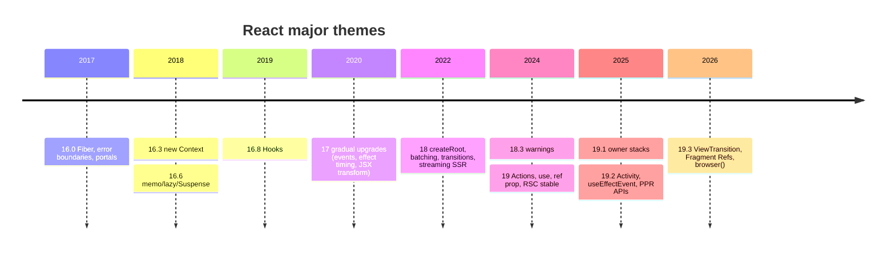
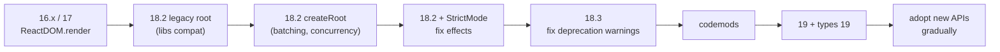

# 09 / 15 — React API Changes Across Versions: 16, 17, 18, 19 and 19.x

> **Verified against official sources (2026-10-22).** The 19.x entries, the removal table and the TypeScript notes below were checked against the React 19 post, the React 19 Upgrade Guide, the 19.2 and 19.3 release posts, the React CHANGELOG and <https://react.dev/versions> (latest release at the time of review: **19.3.0, September 9, 2026**). This lesson is still a *map*, not the territory: before planning a migration, read the official changelog (<https://github.com/facebook/react/blob/main/CHANGELOG.md>), the version index (<https://react.dev/versions>), and the relevant upgrade guides.

## 1. Lesson metadata

| | |
|---|---|
| **Level** | Advanced |
| **Study time** | 4–5 hours (reading 2 h, reading real legacy code 1 h, exercises 1.5 h) |
| **Prerequisites** | All of Phases 1–3; [Phase 2/25 — Hydration and selective hydration](../02-react-rendering-and-internals/25-hydration-and-selective-hydration.md), [Phase 2/28 — Strict Mode behavior](../02-react-rendering-and-internals/28-strict-mode-behavior.md), [07 — Modern React APIs](./07-modern-react-apis.md), [08 — React Compiler](./08-react-compiler.md), [13 — Forms, actions and mutations](./13-forms-actions-and-mutations.md) |
| **Next** | [16 — Phase assessment](./16-phase-assessment.md) |
| **Related** | [Phase 4/24 — Refactoring legacy React](../04-react-architecture/24-refactoring-legacy-react.md), [Phase 10/13 — Application migrations](../10-production-engineering/13-application-migrations.md), [Phase 10/12 — Backward compatibility](../10-production-engineering/12-backward-compatibility.md) |

**Learning objectives.** After this lesson you can:
1. State, for each major line (16.x, 17, 18, 19, 19.x), the *capability theme* it introduced and the API additions, deprecations and removals that matter in practice.
2. Recognize legacy patterns (class lifecycles, string refs, legacy context, `ReactDOM.render`, `defaultProps` on function components, `forwardRef` boilerplate) and translate them into modern equivalents.
3. Read an unfamiliar codebase and **date** it by its idioms, predicting which upgrade hazards it contains.
4. Plan and execute a staged upgrade (16/17 → 18 → 19) using intermediate releases, codemods, strict mode, tests and type updates.
5. Explain which behavioral changes are *silent* (no API removal, but different behavior) and therefore the most dangerous.
6. Decide when to adopt a new API versus keep an old one.

**Concepts covered:** React release model and semver in practice, Fiber, error boundaries, portals, context API, Hooks, gradual upgrades and event delegation, new JSX transform, root API, automatic batching, concurrent features, streaming SSR, StrictMode evolution, Actions, `use`, ref-as-prop, deprecations and removals, TypeScript type changes, codemods, upgrade strategy and risk management.

---

## 2. Deep conceptual explanation

### 2.1 What problem is this lesson solving?

React is old (public since 2013) and widely deployed. In a real career you will meet:

- a 2018 class-component codebase on React 16 with Redux and `componentWillReceiveProps`;
- a 2021 hooks-based app on 17 with `ReactDOM.render`;
- a 2023 app on 18 using `createRoot` and Suspense for code splitting;
- a 2025 app on 19 using Server Components and Actions;
- libraries whose peer dependencies lag one major behind.

Each era has different *idioms*, different *guarantees*, and different *traps*. Knowing the history lets you (a) read old code charitably (it was the best practice then), (b) estimate migration cost honestly, (c) answer interview questions about "what changed in 18/19", and (d) separate durable principles (purity, composition, one-way data flow) from era-specific mechanics.

### 2.2 How React versions: a practical model

*Public guarantee (React's versioning policy, documented at react.dev/versions and in React's repository):* React follows semantic versioning in spirit: breaking changes land in majors, minors add backward-compatible features, patches fix bugs. React's team has historically used **intermediate releases to ease upgrades**: e.g., 18.3 added warnings for APIs removed in 19; 16.9 warned about renamed lifecycles; 17 was a "no new features" release that enabled gradual upgrades. Several "stable" features begin in **Canary** channels before landing in a numbered release; frameworks (notably Next.js) have shipped features from Canary builds to users before they appeared in a stable React version. This means "the React version number" doesn't fully capture which React features your framework gives you; read the framework's React compatibility notes.

### 2.3 The six themes

| Era | Theme | One-sentence essence |
|---|---|---|
| **16.0–16.2 (2017)** | **A new engine** | Fiber rewrite, error boundaries, portals, fragments and string/array returns, laying groundwork for async rendering |
| **16.3–16.8 (2018–19)** | **Modern component model** | New Context, `memo`/`lazy`/`Suspense` for code splitting, and **Hooks** |
| **17 (2020)** | **Gradual upgrades** | No new features; event system and effect timing changes so that multiple React versions can coexist |
| **18 (2022)** | **Concurrency** | `createRoot`, automatic batching, transitions, streaming SSR with Suspense, new library-oriented hooks |
| **19 (2024)** | **Actions and the server** | Actions + form APIs, `use`, ref as a prop, Server Components/Functions stable, document metadata, cleanups of long-deprecated APIs |
| **19.x (2025→)** | **Refinement** | Debugging (owner stacks, performance tracks), `Activity`, `useEffectEvent`, partial pre-rendering and `resume` APIs (19.2); stable `<ViewTransition>`, Fragment Refs, `browser()` and Trusted Types (19.3) |

---

## 3. Internal mechanics: the version-by-version map

For each version: **Added**, **Changed (behavior)**, **Deprecated/Removed**, **Migration notes**. Items were checked against the official release notes (see the banner at the top).

### 3.1 React 16 (2017–2019)

**16.0 (Sept 2017) — Fiber.**
- *Added:* Fiber reconciler (a rewrite; the foundation for later concurrency: [Phase 2/08](../02-react-rendering-and-internals/08-why-fiber.md)); **error boundaries** (`componentDidCatch`, later `static getDerivedStateFromError`) ([Phase 4/19](../04-react-architecture/19-error-boundaries.md)); **portals** (`ReactDOM.createPortal`); components may return **arrays and strings** (and fragments `<React.Fragment>`; short syntax `<>` came in 16.2); custom DOM attributes passed through; improved SSR (`renderToNodeStream`, `hydrate`).
- *Changed:* unhandled errors in render now **unmount the whole tree** (when no boundary exists); `setState(null)` doesn't trigger updates; React depends on `Map`/`Set` (polyfills for old browsers).
- *Licensing:* moved to MIT in 16.0 (Sept 2017).

**16.3 (Mar 2018) — New Context API and lifecycles.**
- *Added:* `React.createContext` ([Phase 3/13](../03-react-state-and-hooks/13-usecontext-and-propagation.md)), `React.createRef`, `React.forwardRef`, `getDerivedStateFromProps`, `getSnapshotBeforeUpdate`, `StrictMode` component, `UNSAFE_` prefixed names for the unsafe lifecycles (`componentWillMount`, `componentWillReceiveProps`, `componentWillUpdate`).
- *Deprecated (gradually, warnings from 16.9, per the plan):* unprefixed `componentWillMount/ReceiveProps/Update`; **string refs** (`ref="foo"`); **legacy context** (`contextTypes`/`getChildContext`).

**16.6 (Oct 2018).** `React.memo`, `React.lazy` + `<Suspense>` for **code splitting only** (not data), `static contextType`, `getDerivedStateFromError`.

**16.8 (Feb 2019) — Hooks.** `useState`, `useEffect`, `useContext`, `useReducer`, `useCallback`, `useMemo`, `useRef`, `useImperativeHandle`, `useLayoutEffect`, `useDebugValue`, plus the Rules of Hooks and the ESLint plugin ([Phase 3/16](../03-react-state-and-hooks/16-rules-of-hooks-and-composition.md)). `react-test-renderer`/`act` async support came in 16.9.

**Idioms that date a codebase to 16.x:** classes with lifecycle methods; HOCs and render props as primary reuse mechanisms ([Phase 5/09](../05-design-patterns/09-higher-order-components.md), [10](../05-design-patterns/10-render-props.md)); Redux `connect`; `PropTypes`; `defaultProps`; `ReactDOM.render`; enzyme `shallow`.

### 3.2 React 17 (Oct 2020) — "no new features"

- *Purpose:* make it possible to upgrade **one part of an app at a time** (nested React trees of different versions) and to ease future upgrades.
- *Changed:*
  - **Event delegation attaches to the root container** instead of `document`. This enables multiple React versions on a page and avoids conflicts with other libraries calling `stopPropagation` at the document level.
  - `onScroll` no longer bubbles; `onFocus`/`onBlur` use the native `focusin`/`focusout` under the hood; `onClickCapture` etc. use native capture phase.
  - **Effect cleanup timing:** `useEffect` cleanup functions now run **asynchronously** (after paint) instead of synchronously during commit; additionally, all cleanups for an update run before any new effects run ([Phase 2/18](../02-react-rendering-and-internals/18-effects-and-their-timing.md), [Phase 3/06](../03-react-state-and-hooks/06-effect-cleanup.md)).
  - **No event pooling**: synthetic events are no longer reused, so `e.persist()` became a no-op and async access to `e.target` works.
  - Returning `undefined` from a component now errors (as it does for forwardRef/memo wrappers), to catch missing `return`s. *(Note: React 18 later relaxed this: components may return `undefined`.)*
  - Native component stacks in errors; removal of some private APIs used by React Native Web.
- *Added:* **new JSX transform** support (`react/jsx-runtime`): you no longer need `import React from "react"` for JSX; smaller output; codemods and tooling (Babel, TypeScript `jsx: "react-jsx"`) ([Phase 1/05](../01-react-fundamentals/05-jsx-explained.md)).
- *Migration notes:* the most common breakages were (1) code that relied on document-level handlers firing in a certain order relative to React's, (2) tests that dispatched native events on `document`, (3) effect cleanups that read refs after DOM detaches (the ESLint rule warns), (4) `e.persist()` calls (harmless).

### 3.3 React 18 (Mar 2022) — concurrency

**New root APIs**
- `createRoot` (from `react-dom/client`) replaces `ReactDOM.render`; `hydrateRoot` replaces `ReactDOM.hydrate`; `root.unmount()` replaces `unmountComponentAtNode`.
- Using the old APIs in 18 runs the app in **legacy mode** (React 17 behavior: no automatic batching outside events, no concurrent features) with a console warning. Opting in to `createRoot` is what enables 18's features ([Phase 2/22](../02-react-rendering-and-internals/22-automatic-batching.md)).

**Automatic batching.** State updates are batched in *all* contexts (promises, timeouts, native handlers), not just React event handlers. `flushSync` opts out for a specific update. This is a **silent behavior change** for code that relied on synchronous re-render after `setState` outside React handlers.

**Concurrent features (opt-in via use):** `startTransition`, `useTransition`, `useDeferredValue` ([Phase 2/23](../02-react-rendering-and-internals/23-transitions-and-deferred-rendering.md), [Phase 7/12–13](../07-performance/12-usetransition-in-practice.md)). Concurrent rendering is enabled by `createRoot` but only *used* when an update is a transition/deferred/Suspense-related.

**Suspense and SSR**
- Streaming SSR: `renderToPipeableStream` (Node) and `renderToReadableStream` (Web Streams/edge); `renderToString` continues to exist with limited Suspense support (fallback emitted; no streaming); `renderToNodeStream` deprecated.
- Selective hydration and Suspense on the server ([02](./02-hydration-internals-deep-dive.md), [Phase 2/25](../02-react-rendering-and-internals/25-hydration-and-selective-hydration.md)).
- Suspense semantics were made consistent: layout effects behavior with boundaries, fallbacks and "already revealed content" with transitions ([05](./05-suspense-architecture.md)).

**New hooks (for libraries):** `useId`, `useSyncExternalStore`, `useInsertionEffect` ([Phase 3/20](../03-react-state-and-hooks/20-usesyncexternalstore-and-external-stores.md), [Phase 3/09](../03-react-state-and-hooks/09-useinsertioneffect.md)).

**StrictMode (dev only):** React 18 simulates unmounting and remounting each component once on mount (double-invoking effects: setup → cleanup → setup) to surface missing cleanup ([Phase 2/28](../02-react-rendering-and-internals/28-strict-mode-behavior.md)). This is the most common "my effect runs twice!" report after upgrading.

**Other behavior changes**
- Components may return `undefined`.
- `useEffect` resulting from a discrete event (like click) is flushed synchronously before the next discrete event, giving a more predictable timing.
- Stricter hydration mismatch handling: React falls back to client rendering for the nearest Suspense boundary and logs errors ([02](./02-hydration-internals-deep-dive.md)).
- No longer supports Internet Explorer (use React 17 if IE support is required).
- Dropped the "setState on an unmounted component" warning (it was misleading).

**TypeScript (`@types/react` 18):** `React.FC` no longer includes implicit `children`; you must declare `children?: React.ReactNode` in props.

**React 18.3** (Apr 2024): identical to 18.2 plus **warnings** for APIs that 19 removes/changes (e.g., `defaultProps` on function components, `ReactDOM.render`, string refs, legacy context, `findDOMNode`, `react-dom/test-utils`, etc.): the recommended stepping stone to 19.

**Idioms that date a codebase to 18:** `createRoot`, `useTransition` for search, Suspense for `lazy`, React Query/RTK Query, `useSyncExternalStore` in stores; `forwardRef` in design systems; `useEffect` for data fetching still common; Next.js Pages Router or early App Router.

### 3.4 React 19 (Dec 2024) — Actions and the server

**Major additions** (see [07](./07-modern-react-apis.md) and [13](./13-forms-actions-and-mutations.md)):

| Feature | Summary |
|---|---|
| **Actions** | Async functions in transitions; automatic pending state, errors, optimistic updates, form handling |
| `useActionState` | Previously `ReactDOM.useFormState` in Canary; renamed. `[state, action, isPending]` |
| `useFormStatus` (react-dom) | Child-of-form pending/data status |
| `useOptimistic` | Temporary overlay state during Actions |
| `use` | Read a Promise or Context in render; can be called conditionally; integrates with Suspense ([Phase 3/22](../03-react-state-and-hooks/22-modern-hooks-and-apis.md)) |
| `<form action={fn}>`, `formAction` | Function actions for forms |
| **Server Components & Server Functions** | Stable *as a React feature* (requires framework/bundler integration; `"use client"` / `"use server"`) ([03](./03-server-components-in-depth.md)) |
| **`ref` as a prop** | Function components receive `ref` as an ordinary prop; `forwardRef` is no longer needed (and will be deprecated in a future version per the React team) |
| **Ref callback cleanup** | A ref callback may return a cleanup function (so TypeScript implicit-return arrow refs like `ref={el => (x = el)}` now error in types) |
| **`<Context>` as provider** | `<ThemeContext value={…}>` replaces `<ThemeContext.Provider>`; `.Provider` still works for now; deprecation planned |
| `useDeferredValue(value, initialValue)` | Optional initial value for first render |
| **Document metadata** | `<title>`, `<meta>`, `<link>` hoisted to `<head>` |
| **Stylesheets and async scripts** | `<link rel="stylesheet" precedence>`, `<script async>` deduplication and ordering support |
| **Resource preloading APIs** | `preload`, `preinit`, `preconnect`, `prefetchDNS` from `react-dom` |
| **Custom Elements** | Full support: props set as properties or attributes appropriately |
| **Error handling** | No duplicated error logs; `onCaughtError`, `onUncaughtError`, `onRecoverableError` root options; hydration mismatch errors show a diff |
| **Suspense behavior** | When a component suspends, React commits the nearest fallback sooner without first rendering siblings; siblings are "pre-warmed" afterward (a behavior change that can alter waterfall characteristics) (per the React 19 Upgrade Guide: the fallback is committed first, then the suspended siblings are rendered to pre-warm lazy requests) |
| **StrictMode** | `useMemo`/`useCallback` reuse the first render's memoized results during the double render ([Phase 2/28](../02-react-rendering-and-internals/28-strict-mode-behavior.md)) |

**Removals (breaking)** — the "cleanup" half of 19. Most were deprecated for years and 18.3 warns about them:

| Removed / changed | Replacement |
|---|---|
| `propTypes` checks (silently ignored) and `defaultProps` for **function** components (class components keep `defaultProps`) | TypeScript; default parameter values in destructuring |
| Legacy Context (`contextTypes`, `getChildContext`) | `createContext` / `use` |
| String refs (`ref="x"`) | Callback refs / `useRef` / `createRef` |
| Module pattern factories (function components returning an object with `render`) | Regular components |
| `React.createFactory` | JSX or `createElement` |
| `ReactDOM.render`, `ReactDOM.hydrate`, `unmountComponentAtNode` | `createRoot().render`, `hydrateRoot`, `root.unmount()` |
| `ReactDOM.findDOMNode` | Refs |
| `react-test-renderer/shallow` | Use `react-shallow-renderer` or, better, React Testing Library |
| `react-dom/test-utils` `act` export | `import { act } from "react"` (other test-utils largely removed; use RTL) |
| UMD builds | ESM/CDN module builds (e.g., via esm.sh) |
| New JSX transform now **required** (without it a warning/error) | Configure `jsx: "react-jsx"` (TS) / automatic runtime (Babel/SWC) |
| `element.ref` access (`ref` is a prop) | `props.ref`; accessing `element.ref` warns (deprecated, not yet removed) |
| `react-test-renderer` | Deprecated in 19 (logs a warning, switched to concurrent rendering); migrate to React Testing Library |
| Errors in render being re-thrown | Not re-thrown in 19: uncaught errors go to `window.reportError`, caught ones to `console.error`; use the `onUncaughtError` / `onCaughtError` root options |

**TypeScript (`@types/react` 19):** `useRef` requires an argument (`useRef<T>(null)`); `ReactElement["props"]` defaults to `unknown` (not `any`); the global `JSX` namespace is removed in favor of `React.JSX`; `ReactNode` and ref-callback return typing changes; there are **codemods** (`types-react-codemod`) for these. Official codemod: `npx types-react-codemod@latest preset-19 ./path-to-app`. Ref callbacks that return a value (e.g., `ref={el => (x = el)}`) are rejected because the return value is now interpreted as a cleanup function. `useReducer` type parameters changed too (prefer inferring from the reducer). Source: React 19 Upgrade Guide.

**Idioms that date a codebase to 19:** `useActionState`, `<form action>`, `use(promise)`, `ref` as prop, `<Context value>`, `<title>` in components, `"use client"`/`"use server"` directives, React Compiler (separate tool; [08](./08-react-compiler.md)).

### 3.5 React 19.x (2025 →)

*(Checked against the React CHANGELOG and the 19.2 / 19.3 release posts.)*

- **19.1 (Mar 2025):** *Owner Stacks* in DevTools and error output (a debugging aid showing which components *rendered* the failing element, not only the parent chain); Suspense-related fixes and improvements; changed the default `useId` format from `:r0:` to `«r0»` so generated IDs are valid CSS selectors (the 19.2 post and the CHANGELOG both record this; 19.2 changed it again, see below). 19.1 also removed support for HTML comments as a DOM container, added `unstable_prerender` for Server Components, and added the `react-server-dom-parcel` package.
- **19.2 (Oct 1, 2025):** **`<Activity>`** (hide/show subtrees while preserving state; two modes, `visible` and `hidden`; hidden unmounts effects and defers updates), **`useEffectEvent`** ([Phase 3/22](../03-react-state-and-hooks/22-modern-hooks-and-apis.md)), **`cacheSignal`** (Server Components only: know when the `cache()` lifetime ends), **React Performance Tracks** in Chrome DevTools profiles, **Partial Pre-rendering**: `prerender` now returns a `postponed` state that `resume` / `resumeToPipeableStream` (`react-dom/server`) and `resumeAndPrerender` / `resumeAndPrerenderToNodeStream` (`react-dom/static`) consume, **batching of server-rendered Suspense boundary reveals** (a heuristic that stops batching as total load time approaches 2.5 s, so LCP is not hurt), **Web Streams APIs in Node** (`renderToReadableStream`, `prerender`, `resume`, `resumeAndPrerender`; the post still recommends the Node Streams APIs in Node because they are faster and support compression), `eslint-plugin-react-hooks` v6 (flat config by default; `recommended-legacy` for the old config), and a third `useId` format: the default prefix went from `:r:` (19.0) to `«r»` (19.1) to `_r_` (19.2), so IDs are valid for `view-transition-name` and XML 1.0 names.
- **19.3 (Sept 9, 2026):** `<ViewTransition>` and `addTransitionType` are **stable** (experimental/Canary during 2025), **Fragment Refs** (`ref` on `<Fragment>` gives a `FragmentInstance`), **`browser()`** from `react-dom` (`use(browser())` opts a subtree out of server rendering and shows the nearest Suspense fallback in the HTML), **Trusted Types** integration (values are no longer coerced to strings), and Server Components can render a `Context` imported from a `'use client'` module without a wrapper Provider component. Notable behavior changes from the CHANGELOG: Transitions now render independently instead of being entangled into a single render; Strict Mode double-invokes Effects during hydration (matching client-rendered roots); a DEV warning when `use()` appears to be called conditionally in a way that unblocks a component.
- **Security patches (Dec 2025 onward):** CVE-2025-55182 ("React2Shell", CVSS 10.0, unauthenticated remote code execution via the Server Function payload decoder) affected `react-server-dom-webpack`, `-parcel` and `-turbopack` 19.0, 19.1.0, 19.1.1 and 19.2.0; first fixed in **19.0.1, 19.1.2, 19.2.1** (Dec 3, 2025). Follow-up disclosures (Dec 11, 2025: DoS CVE-2025-55184 / CVE-2025-67779 and source-code exposure CVE-2025-55183) showed those first fixes were incomplete, and a further DoS (CVE-2026-23864) was patched on Jan 26, 2026 in **19.0.4, 19.1.5, 19.2.4**; later patch releases (March to June 2026) continue to harden Server Functions. Lesson: server-side React packages are **security-sensitive dependencies**; track the latest patch of your release line ([12](./12-auth-boundaries.md)). Source: the react.dev security blog posts and the CHANGELOG.
- **React Compiler 1.0** (Oct 7, 2025) is a separate build-time tool, not a React version; it targets React 19 natively and supports React 17 and 18 through the `react-compiler-runtime` package and the `target` option ([08](./08-react-compiler.md)).
- **Canary/experimental channels** contain features that may become stable later (view transitions and Fragment refs spent over a year there before 19.3). Never rely on Canary-only APIs in libraries.

### 3.6 Cross-cutting: "silent" vs "loud" changes

| Kind | Examples | Danger |
|---|---|---|
| **Loud** (API removed, throws/warns) | `ReactDOM.render` removal (19), `defaultProps` on function components (19), string refs | Easy to find: build/test fails; codemods exist |
| **Silent behavior** | 17: effect cleanup timing & event delegation; 18: automatic batching, double-effects in StrictMode, effect flush timing; 19: Suspense sibling rendering order, StrictMode memo reuse, `ref` is a prop (a prop named `ref` passed to components now forwards) | Tests may pass while subtle bugs appear: stale reads after `setState`, race conditions, ordering of waterfalls |
| **Type-level** | 18: `children` removed from `FC`; 19: `useRef` arg required | Fails compile, easy; but wide blast radius in large codebases |
| **Ecosystem** | Libraries with `peerDependencies: react@^17` | Blocked upgrades; need forks/overrides |

---

## 4. Step-by-step execution walkthrough: upgrading a 2020 app (React 16.14 / 17) to 19

Scenario: an enterprise app, CRA (Create React App) based, React 17, class and function components, Redux `connect`, enzyme tests, `PropTypes`, 600 components, MUI v4, `react-router` v5. Goal: React 19 with minimal risk.

**Step 0 — Inventory and safety net.** Record: React/ReactDOM versions, `peerDependencies` of all React-using libraries (`npm ls react`), test coverage, E2E smoke tests, error monitoring. Without tests, add **characterization** E2E for the top 10 flows first ([Phase 8/09](../08-testing-and-quality/09-e2e-with-playwright.md)).

**Step 1 — Upgrade tooling and libraries compatible with both** (still on React 17). Replace unmaintained libs (enzyme has no official React 17+ adapter) with RTL gradually; upgrade router, UI kit to versions supporting 18/19; move to Vite or a supported CRA replacement (Create React App was deprecated for new apps in Feb 2025; the React team recommends a framework or a build tool such as Vite, Parcel or RSBuild).

**Step 2 — React 17 → 18.2 with legacy root.** Bump `react`/`react-dom` to 18, keep `ReactDOM.render` temporarily. Run tests. Behavior stays at 17 (legacy mode) with warnings; fix peer dependency conflicts. *Why a separate step:* isolates library incompatibilities from semantic changes.

**Step 3 — Switch to `createRoot`.** Replace `ReactDOM.render(<App/>, el)` with `createRoot(el).render(<App/>)`. **Now** automatic batching and concurrent features are available. Hazards: code reading DOM synchronously after `setState` outside event handlers; fix with `flushSync` (rare) or `useLayoutEffect`/refactor. Update TypeScript types (`@types/react@18`), add `children` to props. Run unit tests with `act` environment settings (`IS_REACT_ACT_ENVIRONMENT`) as RTL handles.

**Step 4 — Enable StrictMode and fix double-effects.** Wrap the app in `<StrictMode>` and fix effects lacking cleanup (subscriptions, timers, fetch races) ([Phase 3/06](../03-react-state-and-hooks/06-effect-cleanup.md)). Do it as its own PR: the failures are real bugs (previously latent).

**Step 5 — Move to 18.3 and clear warnings.** 18.3 logs deprecation warnings for APIs removed in 19. Fix them: string refs → callback refs; legacy context → `createContext`; `defaultProps` on function components → default parameters; `PropTypes` → TS types; `findDOMNode` → refs; `ReactDOM.unmountComponentAtNode` → `root.unmount()`.

**Step 6 — Run codemods.** Official React 19 migration recipe (via the `codemod` CLI) and `types-react-codemod` for TS changes (`npx codemod@latest react/19/migration-recipe` runs `replace-reactdom-render`, `replace-string-ref`, `replace-act-import`, `replace-use-form-state` and `prop-types-typescript`; the TypeScript changes need `types-react-codemod` separately). Review diffs; codemods are mechanical, not semantic.

**Step 7 — React 19 + types 19.** Upgrade `react`, `react-dom`, `@types/react`, `@types/react-dom`. Fix: `useRef()` without argument; implicit returns in ref callbacks; `JSX` namespace usage; tests importing `act` from `react-dom/test-utils`. Update test renderer usage.

**Step 8 — Adopt new APIs deliberately, not mechanically.** Replace `forwardRef` with ref-as-prop *in design system components* where consumers upgrade together; adopt `<Context value>`; use `useActionState`/`<form action>` for **new** forms; consider the Compiler later ([08](./08-react-compiler.md)). *Don't* mass-rewrite working code for novelty.

**Step 9 — Verify in production-like conditions.** Staging soak with monitoring, Web Vitals comparison (before/after), error rates by release, hydration error logs if SSR. Roll out gradually (feature flag/percentage) when possible.

---

## 5. Code examples

### 5.1 Minimal — the same component across eras

**React 16.x class style:**
```tsx
import React from "react";
import PropTypes from "prop-types";

class Greeting extends React.Component<{ name: string }, { clicks: number }> {
  static propTypes = { name: PropTypes.string.isRequired };
  static defaultProps = { name: "friend" };
  state = { clicks: 0 };

  componentDidUpdate(prev: { name: string }) {
    if (prev.name !== this.props.name) document.title = `Hi ${this.props.name}`;
  }
  render() {
    return <button onClick={() => this.setState((s) => ({ clicks: s.clicks + 1 }))}>
      Hi {this.props.name} ({this.state.clicks})
    </button>;
  }
}
```

**16.8+/17/18 hooks style:**
```tsx
import { useEffect, useState } from "react";

export function Greeting({ name = "friend" }: { name?: string }) {
  const [clicks, setClicks] = useState(0);
  useEffect(() => { document.title = `Hi ${name}`; }, [name]);
  return <button onClick={() => setClicks((c) => c + 1)}>Hi {name} ({clicks})</button>;
}
```

**19-era (same behavior; illustrates ref as prop and metadata):**
```tsx
import { useState, type Ref } from "react";

export function Greeting({ name = "friend", ref }: { name?: string; ref?: Ref<HTMLButtonElement> }) {
  const [clicks, setClicks] = useState(0);
  return (
    <>
      <title>{`Hi ${name}`}</title>
      <button ref={ref} onClick={() => setClicks((c) => c + 1)}>Hi {name} ({clicks})</button>
    </>
  );
}
```

Line notes:
- Class → hook: `defaultProps` becomes a default parameter (**required in 19** for function components). `PropTypes` runtime checking is removed in 19 (TS replaces it).
- `componentDidUpdate` comparing `prev` and current becomes an effect with a dependency array: but semantics differ subtly (effects also run on mount; StrictMode double-run in dev).
- `ref` is destructured as a normal prop in 19; in 16–18 a function component needed `forwardRef`.
- `<title>` inside the component: hoisted to `<head>` in 19; in 18 you'd use `document.title` in an effect or a library like react-helmet (client-only for bots without SSR support).

**Predict:** in the React 18 StrictMode dev build, how many times does the `useEffect` setup run on mount? **Answer:** twice (setup → cleanup → setup); the title is set twice, which is harmless here because the effect is idempotent. Production runs it once.

### 5.2 Practical — root API migration

```tsx
// React 16/17
import ReactDOM from "react-dom";
ReactDOM.render(<App />, document.getElementById("root"));
// …later
ReactDOM.unmountComponentAtNode(document.getElementById("root")!);

// React 18+ (required in 19)
import { createRoot } from "react-dom/client";
const root = createRoot(document.getElementById("root")!);
root.render(<App />);
// …later
root.unmount();

// SSR hydration: 16/17 → 18+
// ReactDOM.hydrate(<App />, container);
import { hydrateRoot } from "react-dom/client";
hydrateRoot(container, <App />, {
  onRecoverableError: (e) => reportError(e),   // 18+; in 19 also onCaughtError / onUncaughtError
});
```

Notes: `createRoot` returns an object you hold on to; multiple roots in one page are allowed (micro-frontends). In 19, `hydrateRoot` options give you the production error hooks to integrate monitoring ([Phase 10/05](../10-production-engineering/05-error-monitoring.md)).

### 5.3 Practical — automatic batching: a silent change

```tsx
function Counter() {
  const [a, setA] = useState(0);
  const [b, setB] = useState(0);
  console.log("render", a, b);

  function handleTimeout() {
    setTimeout(() => {
      setA((x) => x + 1);
      setB((x) => x + 1);
    }, 0);
  }
  return <button onClick={handleTimeout}>go</button>;
}
```

**Predict:** after clicking once, how many renders happen from the timeout (excluding the initial render)? **Answer:**
- React 17 (legacy `ReactDOM.render`): **2** renders (`render 1 0`, then `render 1 1`): updates outside React event handlers aren't batched.
- React 18/19 with `createRoot`: **1** render (`render 1 1`): automatic batching.

**Why it matters:** code that read derived DOM or called external code between the two `setState`s and *depended on the intermediate render* breaks. If you truly need synchronous flush: `flushSync(() => setA(...))` (use sparingly; it forces a synchronous render).

### 5.4 Incorrect — migrating by search-and-replace

```tsx
// "Modernization" PR: forwardRef → ref prop, applied to a *library* published for React 18 consumers
export function Input({ ref, ...props }: React.ComponentProps<"input">) {
  return <input ref={ref} {...props} />;
}
```

**Problem:** consumers on React 18 pass `ref` to a function component *without* `forwardRef`; in 18 the `ref` is stripped from props (it attaches to the element instance of the component, which doesn't exist for function components → warning, `ref` is `undefined` inside). The library silently breaks on 18 while working on 19. Also the types differ (`React.ComponentProps<"input">` includes `ref` only in 19 types).

### 5.5 Corrected — version-aware strategy

```tsx
// Library supporting React 18 and 19: keep forwardRef (still supported in 19)
import { forwardRef } from "react";
export const Input = forwardRef<HTMLInputElement, React.ComponentPropsWithoutRef<"input">>(
  function Input(props, ref) { return <input ref={ref} {...props} />; },
);
```

Notes: `forwardRef` still works in 19 (React has stated it will be deprecated in a future release: no deprecation had shipped as of 19.3, check the docs). Libraries declare `peerDependencies` ranges honestly and migrate when their minimum supported React is 19. Applications (which control their React version) can migrate freely.

### 5.6 Advanced — a compatibility shim for ref-as-prop

When maintaining a design system consumed by mixed 18/19 apps, expose the **same public API** while implementing per supported version, and use tests against both:

```json
// package.json (library)
{
  "peerDependencies": { "react": "^18.2.0 || ^19.0.0", "react-dom": "^18.2.0 || ^19.0.0" },
  "devDependencies": { "react": "19.x", "react-dom": "19.x" }
}
```

CI matrix: run the unit + type tests against React 18 and 19 (e.g., with `npm:react@18` aliasing or separate workspaces). Types: ship types compatible with both `@types/react` majors, or document a minimum. The cost of a dual-version matrix is the price of library reach ([Phase 5/22](../05-design-patterns/22-patterns-for-reusable-libraries.md)).

---

## 6. Visual explanations

### 6.1 Timeline



### 6.2 Upgrade staircase



### 6.3 Legacy → modern idiom map

```text
Class lifecycles ............ hooks (useState/useEffect/useReducer/custom hooks)
HOC / render props .......... custom hooks, composition, children, context
connect() (react-redux) ..... useSelector/useDispatch (RTK) ; or server state libs
PropTypes ................... TypeScript (or zod at runtime boundaries)
defaultProps ................ default parameters
String refs / findDOMNode ... useRef / callback refs
Legacy context .............. createContext + use / useContext
forwardRef .................. ref as prop (19)
<Ctx.Provider value> ........ <Ctx value> (19)
useEffect data fetching ..... Suspense + use / Query library / server components / loaders
ReactDOM.render / hydrate ... createRoot / hydrateRoot
document.title in effects ... <title> in components / framework metadata API
onSubmit + preventDefault ... <form action={fn}> + useActionState
Manual isPending state ...... useTransition / useActionState / useFormStatus
Manual optimistic updates ... useOptimistic / query cache optimistic updates
```

---

## 7. Alternative approaches and trade-offs

### 7.1 Upgrade strategies

| Criterion | Big-bang (jump 17 → 19) | Staged (via 18.2, 18.3) | Strangler (new app/route on 19, old on 17) | Don't upgrade |
|---|---|---|---|---|
| Risk concentration | High | Low per step | Low | Accumulating (security, ecosystem) |
| Elapsed time | Short if lucky | Medium | Long | None |
| Diagnosability | Poor (many changes at once) | Good | Good | N/A |
| Library compatibility effort | Concentrated | Spread | Per slice | Frozen libs |
| Best for | Small apps with good tests | Most production apps | Very large apps, micro-frontends | Short-lived internal tools |

**When the recommended approach (staged upgrade) is *not* best:** a 15-component internal tool with strong tests can jump straight to 19 in an afternoon; staging would waste time. Conversely, for a monolith with 2,000 components, even staged upgrades may need the strangler approach (mounting React 19 roots for new routes while 17 remains), which React 17's design enables for *event* isolation only, so test thoroughly (React 17's release post presents nested trees of different React versions as a gradual-upgrade aid, not a general micro-frontend strategy).

### 7.2 Adopting a new API vs keeping the old

| Criterion | Adopt `useActionState` | Keep `useState`+`onSubmit` | Adopt ref-as-prop | Keep `forwardRef` |
|---|---|---|---|---|
| Benefit | Less plumbing, PE, integrated pending | Familiar, works | Less boilerplate | Works on 18 and 19 |
| Risk | Learning curve; framework dependency | None | Breaks 18 consumers (libraries) | Slightly more verbose; deprecation later |
| Migrate when | New forms; framework supports server functions | Existing stable forms | App-owned components | Library supporting 18 |

---

## 8. Best practices and anti-patterns

**Do**
- Treat 18.3 as the official waypoint before 19; fix its warnings first.
- Upgrade **in small PRs**: root API; StrictMode; types; removals; adoption.
- Keep a changelog of *silent* behavioral risks and test them (batching, effect timing, Suspense ordering).
- Pin React and `@types/react` to matching majors; use `overrides`/`resolutions` for transitive peer conflicts only with understanding.
- Prefer TypeScript types over PropTypes; default params over `defaultProps`.
- Run codemods, then review. Run your tests and a real browser pass.
- Keep libraries honest about supported versions; test against each.
- Subscribe to React and framework security advisories; patch promptly.

**Beginner mistakes**
- Mixing class and hook paradigms in new code without reason.
- Copying old tutorials' `ReactDOM.render` into 19 projects.
- Assuming "StrictMode runs effects twice in production".

**Experienced-developer mistakes**
- Mass-migrating idioms (all `forwardRef`, all `Provider`) without checking consumers' versions.
- Upgrading React but not `@types/react`, `eslint-plugin-react-hooks`, testing libs.
- Adopting Canary features in production libraries.
- Treating the Compiler or `useMemo` removal as part of the React version upgrade (separate concerns).
- Disabling StrictMode to "fix" double effects rather than fixing cleanup.

**Smells:** `// eslint-disable react-hooks/exhaustive-deps` accumulating from 16.8 migration; `UNSAFE_` lifecycles still present; `as any` around refs; `legacy-peer-deps=true` forever.

**Justified exceptions:** staying on 17 for an IE-dependent, soon-to-be-retired app; keeping class components for error boundaries (still required: there is no hook equivalent in 19; libraries like `react-error-boundary` wrap it) ([Phase 4/19](../04-react-architecture/19-error-boundaries.md)); keeping `forwardRef` in libraries.

---

## 9. Real-world application

*Enterprise dashboard (React 17, 8 years old).* Constraint: 12 teams, shared component library on npm, quarterly release windows. Plan: library first (dual 17/18 peer support, then 18/19), then apps in waves; shared lint rules ban new class components and `defaultProps`; a "React upgrade guild" tracks silent-risk tests; a feature-flagged `createRoot` switch per app allows rollback (legacy root vs concurrent root during step 3).

*Design system library.* Support window: current and previous major. Publish with `peerDependencies` ranges; test matrix on both; avoid APIs that exist only in the newer major unless feature-detected; communicate deprecations in changelogs; provide codemods for consumers.

*E-commerce platform adopting Server Components.* Next.js App Router brings React Canary features before they ship in stable React; the app's "React version" in `package.json` may differ from the React the framework bundles (Next.js App Router has historically vendored a Canary React; check the framework's docs for the version it bundles). Constraint: don't depend on version-specific RSC internals; test with the framework's supported matrix.

*Fintech compliance.* Audit requires dependency currency and vulnerability management: React and framework upgrades are tracked as risk items with SLAs for security releases ([Phase 10/07](../10-production-engineering/07-dependency-security.md)).

---

## 10. Debugging and troubleshooting

**Symptom: "After upgrading to 18, my effect runs twice on mount."** Dev StrictMode simulation. Confirm by checking production build (once). Fix missing cleanup; do not remove StrictMode ([Phase 2/28](../02-react-rendering-and-internals/28-strict-mode-behavior.md)).

**Symptom: "Warning: ReactDOM.render is no longer supported in React 18" / "is not a function in 19".** Replace with `createRoot`. In 19, imports like `ReactDOM.render` are gone: `TypeError: ReactDOM.render is not a function`. Search for third-party libraries still calling it (React-Bootstrap legacy, old testing utils, some portal libs).

**Symptom: "`Cannot read properties of undefined (reading 'ReactCurrentOwner')`" or "Invalid hook call".** Two copies of React (a library bundling its own, mismatched `react` and `react-dom` versions, or a linked package resolving a different `node_modules`). Run `npm ls react react-dom`; dedupe; fix `peerDependencies`; for monorepos ensure single resolution ([Phase 10/01](../10-production-engineering/01-repository-organization.md)).

**Symptom: "State doesn't update immediately after `setState` in a timeout (worked on 17)."** Automatic batching. The state variable is a snapshot ([Phase 1/14](../01-react-fundamentals/14-state-as-a-snapshot.md)); use the functional updater, `flushSync` only if strictly necessary.

**Symptom: "TypeScript: 'Expected 1 arguments, but got 0' for `useRef()`."** 19 types require an initial argument: `useRef<HTMLDivElement>(null)` for DOM refs.

**Symptom: "Type 'void | (() => void)' error in ref callback" (19 types).** Ref callbacks can return cleanup functions; an implicit-return arrow like `ref={(el) => (inputEl = el)}` returns the element. Use braces: `ref={(el) => { inputEl = el; }}`.

**Symptom: "Library X: peer dependency conflict with React 19."** Check the library's release notes; try upgrading; if unmaintained, consider replacing or forking; `overrides` is a last resort with testing, because internal API reliance can break at runtime.

**Symptom: "Hydration errors appear after upgrade."** 18+ is stricter and 19 improves the diff output; read the diff, find non-deterministic output ([02](./02-hydration-internals-deep-dive.md)).

**Symptom: "Different `useId` values in CSS selectors fail after patch upgrade."** The ID format changed across 19.x (`:r0:` in 19.0, `«r0»` in 19.1, `_r_`-style in 19.2); don't hard-code or select by `useId` output format; use refs or `CSS.escape`.

---

## 11. Exercises

### Level A — Knowledge
A1. Match each to its first stable React version: Hooks, `createRoot`, error boundaries, `React.memo`, `use`, `useId`, `<Activity>`, new Context API.
A2. What is the single most important change in 17 for upgrade strategy?
A3. Name five APIs removed in 19 and their replacements.
A4. What does 18.3 contain, and why did the React team release it?
A5. Which change in 18 is a *silent* behavior change and why is it risky?
A6. In React 19, what replaced `ReactDOM.useFormState` (Canary)?

### Level B — Code comprehension
B1. Predict logged renders in 17 legacy vs 18 `createRoot` for:
```tsx
function C() {
  const [n, setN] = useState(0);
  console.log("render", n);
  return <button onClick={() => { fetch("/x").then(() => { setN(1); setN(2); }); }}>go</button>;
}
```
(Count renders caused by the promise callback.)
B2. What does each of these produce in TypeScript with `@types/react@19`, and how do you fix it?
```tsx
const r = useRef();
<div ref={(el) => (node = el)} />
type P = { children: React.ReactNode };
const X: JSX.Element = <div />;
```
B3. Given `<ThemeContext.Provider value={t}>`, what is its React 19 form, and is the old form removed?
B4. A function component `Card.defaultProps = { size: "m" }`. What happens in 18.3 and 19?

### Level C — Implementation
C1. Write a codemod-style regex-free plan (steps and checks) to migrate `forwardRef` components to ref-as-prop in an *application* (not a library), including TypeScript changes and tests.
C2. Write an ESLint-based or script-based **inventory** (pseudo-code acceptable) that lists usages of removed APIs: `ReactDOM.render`, `findDOMNode`, string refs, `defaultProps` on function components, legacy context.
C3. Convert this class component with `componentDidMount`/`componentWillUnmount` subscription to a hook with correct cleanup, and explain StrictMode behavior.
```tsx
class Clock extends React.Component {
  state = { now: Date.now() };
  timer?: number;
  componentDidMount() { this.timer = window.setInterval(() => this.setState({ now: Date.now() }), 1000); }
  componentWillUnmount() { clearInterval(this.timer); }
  render() { return <time>{new Date(this.state.now).toLocaleTimeString()}</time>; }
}
```

### Level D — Debugging
D1. After switching to `createRoot`, a legacy analytics wrapper that calls `setState` then immediately measures DOM height inside a `setTimeout` now reports stale heights. Diagnose and give two fixes.
D2. "Invalid hook call" appears only in the monorepo's `apps/web` after upgrading to React 19; `packages/ui` still lists `react@18` as a dependency (not peer). Diagnose.
D3. After upgrading to 19, a third-party `Modal` library that relies on `ReactDOM.findDOMNode` crashes. Provide options.

### Level E — Architecture decisions
E1. You own a design-system package used by 30 apps on React 17, 18 and 19. Propose a support policy, release strategy and testing matrix.
E2. Leadership asks, "Why upgrade React at all? It works." Write a risk/benefit assessment: security, ecosystem, performance, hiring, tooling (including features worth adopting and ones not).

### Level F — Expert challenge
F1. Design an automated "React upgrade readiness" report for a large monorepo: what static analysis, runtime checks (StrictMode-in-CI, warning capture), dependency analysis and metrics it produces, and how you'd use it to sequence work across teams.

---

## 12. Detailed answers and explanations

> Attempt the exercises first.

**A1.** Hooks: 16.8. `createRoot`: 18.0. Error boundaries: 16.0. `React.memo`: 16.6. `use`: 19.0. `useId`: 18.0. `<Activity>`: 19.2. New Context API: 16.3. Common wrong answers: Hooks in 17 (17 had no new features), `memo` in 16.8.

**A2.** React 17 enables gradual upgrades: event delegation moved to the root container and other changes made it feasible to run different React versions in separate subtrees and made later upgrades easier. 17 itself had no new features.

**A3.** Any five: function-component `defaultProps` → default parameters; `propTypes` → TypeScript; legacy context → `createContext`; string refs → callback/`useRef`; `ReactDOM.render` → `createRoot`; `ReactDOM.hydrate` → `hydrateRoot`; `unmountComponentAtNode` → `root.unmount()`; `findDOMNode` → refs; `createFactory` → JSX/`createElement`; `react-test-renderer/shallow` → RTL; `act` from `react-dom/test-utils` → `react`.

**A4.** 18.3 is 18.2 plus warnings for APIs removed/changed in 19, to help teams find issues before upgrading. It adds no new features.

**A5.** Automatic batching (with `createRoot`): updates outside React events are batched, so code that assumed immediate re-render after each `setState` (e.g., reading DOM right after) behaves differently. No API changed, so tests may not fail loudly; also double-invoked effects in StrictMode dev.

**A6.** `useActionState` (imported from `react`). The Canary name was `useFormState` in `react-dom`.

**B1.** React 17 legacy root: promise callback isn't batched → `setN(1)` renders ("render 1"), `setN(2)` renders ("render 2"): **2** renders. React 18/19 `createRoot`: batched → **1** render ("render 2"). Wrong answers: assuming `setN(1)` ever shows up on screen in 18.

**B2.** `useRef()` → error: requires an argument in 19 types → `useRef<HTMLDivElement>(null)`. `ref={(el) => (node = el)}` → type error because the callback returns a value (cleanup function expected) → use braces `{ node = el; }`. `JSX.Element` global namespace removed → use `React.JSX.Element` (or `ReactElement`). The `children: ReactNode` prop type is fine.

**B3.** `<ThemeContext value={t}>`. The old `.Provider` form still works in 19 (the React 19 post says it will be deprecated in a future version; still works as of 19.3). Not removed.

**B4.** In 18.3 a warning (support for `defaultProps` on function components will be removed). In 19, `defaultProps` on function components is **ignored**: `size` is `undefined`. Fix: `function Card({ size = "m" })`. (Class components keep `defaultProps`.) Edge: components wrapped in `memo`/`forwardRef` are also affected.

**C1. Plan.** (1) Confirm the app controls React 19 and no external consumer imports these components under 18. (2) Inventory: grep for `forwardRef(` and `ForwardRefExoticComponent`. (3) Per component: remove wrapper, add `ref?: Ref<T>` to props (or use `React.ComponentProps<"el">` which includes `ref` in 19 types), pass `ref` to the element; keep `displayName` if used. (4) Where `useImperativeHandle(ref, …)` is used, it still works with the `ref` prop. (5) Update tests; add a type test `ref` assignability. (6) Run the `types-react-codemod` / official recipe (`npx codemod@latest react/19/migration-recipe`) and review diff. (7) Smoke test focus management flows. Evaluation: noticing the library vs app distinction, `useImperativeHandle`, `displayName`, types.

**C2. Pseudo-code.**
```ts
// scripts/react19-inventory.ts using ts-morph
for (const sf of project.getSourceFiles("src/**/*.{ts,tsx}")) {
  report(sf, "ReactDOM.render|hydrate|unmountComponentAtNode", findPropertyAccess(sf, "ReactDOM", ["render","hydrate","unmountComponentAtNode"]));
  report(sf, "findDOMNode", findCalls(sf, "findDOMNode"));
  report(sf, "string refs", findJsxAttr(sf, "ref", (init) => init?.getKind() === SyntaxKind.StringLiteral));
  report(sf, "defaultProps on function components", findAssignments(sf, /\.defaultProps\s*=/, (target) => isFunctionComponent(target)));
  report(sf, "legacy context", findClassMembers(sf, ["contextTypes","childContextTypes","getChildContext"]));
}
```
Plus run the test suite on 18.3 and collect console warnings in CI as failures. Evaluation: AST (not regex) for accuracy; warning capture; per-team ownership output.

**C3. Reference.**
```tsx
function Clock() {
  const [now, setNow] = useState(() => Date.now());
  useEffect(() => {
    const id = window.setInterval(() => setNow(Date.now()), 1000);
    return () => window.clearInterval(id);
  }, []);
  return <time>{new Date(now).toLocaleTimeString()}</time>;
}
```
StrictMode dev: effect runs, cleans up, runs again: interval created, cleared, created; only one interval remains: correct because cleanup mirrors setup. `useState(() => Date.now())` lazy init avoids calling `Date.now()` on every render (not required but tidy); hydration: `toLocaleTimeString` can mismatch server/client time zones ([02](./02-hydration-internals-deep-dive.md)).

**D1.** With automatic batching, `setState` inside the timeout doesn't flush synchronously; DOM measurement right after sees the old DOM. Fixes: (1) measure in `useLayoutEffect` after commit; (2) wrap the update in `flushSync` before measuring (last resort, forces synchronous render); (3) restructure so measurement uses a ref callback/`ResizeObserver`. Prefer (1)/(3).

**D2.** Two React copies: `packages/ui` has `react` as a hard dependency (18) and resolves its own copy; hooks from different copies break the dispatcher. Fix: make `react`/`react-dom` **peerDependencies** in `ui`, dev-depend only for local tests, dedupe via workspace resolution (`npm ls react`), and confirm bundler aliasing if needed.

**D3.** Options: upgrade the library to a version without `findDOMNode`; replace it (headless dialog libraries or native `<dialog>`); fork/patch with `patch-package` replacing `findDOMNode` with a ref; as a last resort pin a compat shim (not recommended: `findDOMNode` is gone). Evaluate maintenance and a11y; prefer replacement.

**E1. Policy sketch.** Support current and previous React major (e.g., 18 and 19) with `peerDependencies: "^18 || ^19"`; semantic versioning with breaking changes only in majors; CI matrix on both; no Canary-only APIs; deprecation notices ≥ 1 minor ahead; provide codemods; publish a compatibility table; drop 17 on a published date with a long-term-support branch for critical fixes; type tests (`tsd`/`expect-type`) for both `@types/react` majors; visual and a11y regression tests ([Phase 8/12](../08-testing-and-quality/12-visual-regression.md)). Evaluate: explicit cost/benefit and communication plan.

**E2. Example.** Risks of not upgrading: security patches stop (especially for server-side React), library ecosystems drop old peers, hiring/tooling friction, no access to concurrent features/perf improvements (transitions, streaming), growing migration cost (debt compounding). Benefits worth adopting: 18 concurrency features where they solve measured responsiveness issues; 19 Actions for new forms; ref as prop (less boilerplate); better error reporting; DevTools improvements. Not worth chasing: rewriting stable code to new idioms; adopting RSC if the app is a behind-login SPA with no need; Compiler until profiling indicates benefit. Include cost: tests, regression risk, team time. A strong answer proposes a staged plan with metrics.

**F1. Outline.** Static: AST scan for removed APIs, legacy lifecycles, `UNSAFE_`, PropTypes density, class component count; `eslint-plugin-react-hooks` violations; dependency graph: peerDependency ranges for React-using packages (`npm ls`, license of replacement options); duplicate React copies. Runtime: run tests with StrictMode + 18.3 capturing `console.error`/`console.warn` for known React warnings; E2E runs on the legacy vs concurrent root; hydration error counters in staging. Metrics: warnings by team/package, % components converted, blocked libraries, test coverage in at-risk modules. Output: a prioritized backlog and a sequencing recommendation (shared libs first, leaf apps next). Evaluate: automation, ownership mapping, risk-based ordering, avoiding false precision.

---

## 13. Senior engineer interview questions

**Q1. "What changed in React 18 and why does it matter?"**
*Strong answer:* New root API (`createRoot`) enabling concurrent rendering; automatic batching; transitions and deferred values for prioritizing urgent vs non-urgent updates; Suspense on the server with streaming and selective hydration; new hooks for libraries (`useId`, `useSyncExternalStore`, `useInsertionEffect`); StrictMode double effects to expose missing cleanup. It matters because React can now interrupt/prioritize rendering and SSR doesn't need to be all-or-nothing.

**Q2. "What are the riskiest changes when upgrading to 19?"**
*Strong answer:* Removed APIs (loud) are easy to find; riskier are silent changes (Suspense sibling rendering behavior, StrictMode memo reuse, ref as prop semantics for libraries), TypeScript type changes with wide blast radius, and third-party peer constraints. Mitigation: stage through 18.3, codemods, E2E coverage, staged rollout.

**Q3. "Why did React 17 ship with no new features?"**
*Strong answer:* To enable gradual upgrades: changes to event delegation (attach to root, not document), effect cleanup timing and others so multiple versions can coexist and future majors are smaller steps. It was an investment in upgrade ergonomics.

**Q4. "Class components in 2026: dead?"**
*Strong answer:* Not removed; they're supported, but new code uses function components and hooks. Error boundaries still require a class (or a library wrapping one); legacy codebases contain classes; migrate opportunistically, not as a standalone rewrite. Know lifecycle-to-hook mappings and their semantic differences.

**Q5. "How would you decide whether to adopt Server Components in an existing 18 app?"**
*Strong answer:* RSC requires a supporting framework; adoption is a framework migration plus mental-model change. Evaluate need (SEO, bundle size, data colocation), team readiness, hosting constraints, and the security surface. Adopt route-by-route where benefits are clear; keep SPA areas as they are.

**Q6. "What is `use`, and how is it different from hooks like `useContext`?"**
*Strong answer:* `use(resource)` reads a Promise (suspending) or Context in render, and unlike hooks may be called conditionally/in loops (but only in render, in components/hooks). Promises passed should be stable (created outside render or cached), otherwise each render creates a new promise. See [07](./07-modern-react-apis.md).

---

## 14. Further learning resources

| Resource | URL | Covers / why | Level | Study |
|---|---|---|---|---|
| React versions page | <https://react.dev/versions> | Official list of releases and links to changelogs | All | Whole page |
| React CHANGELOG | <https://github.com/facebook/react/blob/main/CHANGELOG.md> | Authoritative per-release changes | Intermediate | 16.x → latest |
| React blog index | <https://react.dev/blog> | Release posts and upgrade guides (there is no separate 19.1 post; see the CHANGELOG) | All | React 18, 19, 19.2, 19.3 posts |
| React v18 release post | <https://react.dev/blog/2022/03/29/react-v18> | Concurrency, batching, SSR | Intermediate | Whole post |
| React 18 upgrade guide | <https://react.dev/blog/2022/03/08/react-18-upgrade-guide> | Root API and breaking changes | Intermediate | Whole post |
| React v19 release post | <https://react.dev/blog/2024/12/05/react-19> | Actions, `use`, ref prop, metadata | Intermediate | Whole post |
| React 19 upgrade guide | <https://react.dev/blog/2024/04/25/react-19-upgrade-guide> | Removals, codemods, TypeScript changes | Intermediate | Whole post |
| React v17 release post ("React v17.0") | <https://legacy.reactjs.org/blog/2020/10/20/react-v17.html> *(legacy docs site)* | Gradual upgrades, event delegation | Intermediate | Whole post |
| React 16.8 / Hooks announcement | <https://legacy.reactjs.org/blog/2019/02/06/react-v16.8.0.html> *(legacy docs site)* | Hooks introduction | Beginner–Int. | Whole post |
| React Working Group discussions | <https://github.com/reactwg> | Design discussions (e.g., React 18, 19) | Advanced | React 18/19 working group threads |
| types-react-codemod | <https://github.com/eps1lon/types-react-codemod> | TypeScript migration transforms | Intermediate | README |
| React Compiler docs | <https://react.dev/learn/react-compiler> | Separate tool; compatibility | Intermediate | Overview |

The react.dev and CHANGELOG links were fetched on 2026-10-22; the legacy.reactjs.org links were not re-fetched.

---

## 15. Knowledge checkpoint

**You should now understand**
- The theme and key APIs of each era (16: Fiber/boundaries/context/Hooks; 17: gradual upgrades; 18: concurrency; 19: Actions/server; 19.x: refinement).
- Which changes are loud removals and which are silent behavior shifts.
- How to stage an upgrade and where each risk concentrates.
- How to date a codebase by idioms and map legacy idioms to modern ones.

**You should be able to explain without notes**
- What `createRoot` changes and why.
- Why 18.3 exists.
- Why libraries and apps migrate differently (ref-as-prop example).

**You should be able to implement**
- A root API migration, class→hook conversions with cleanup, an upgrade inventory, and a dual-version library setup.

**You should be able to debug**
- Double effects, batching surprises, invalid hook calls from duplicate React, TypeScript 19 type errors, third-party incompatibilities.

**Before moving on:** complete [16 — Phase assessment](./16-phase-assessment.md), which tests lessons 01–15 together.
