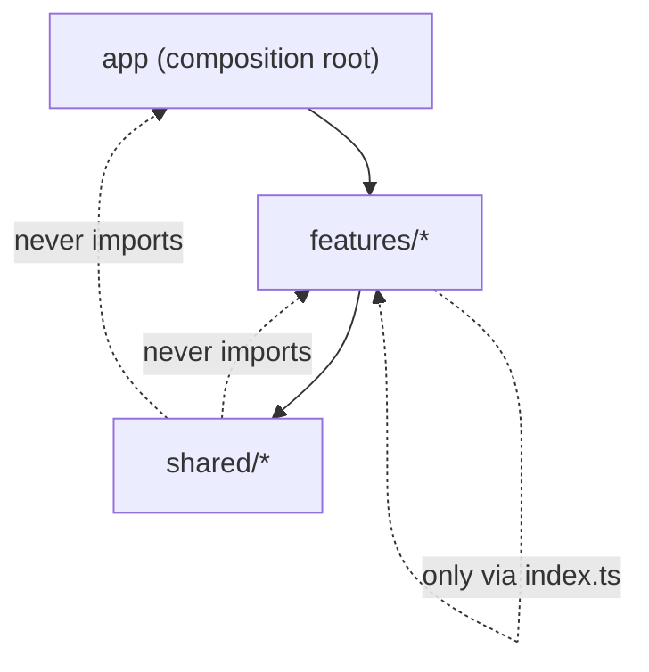
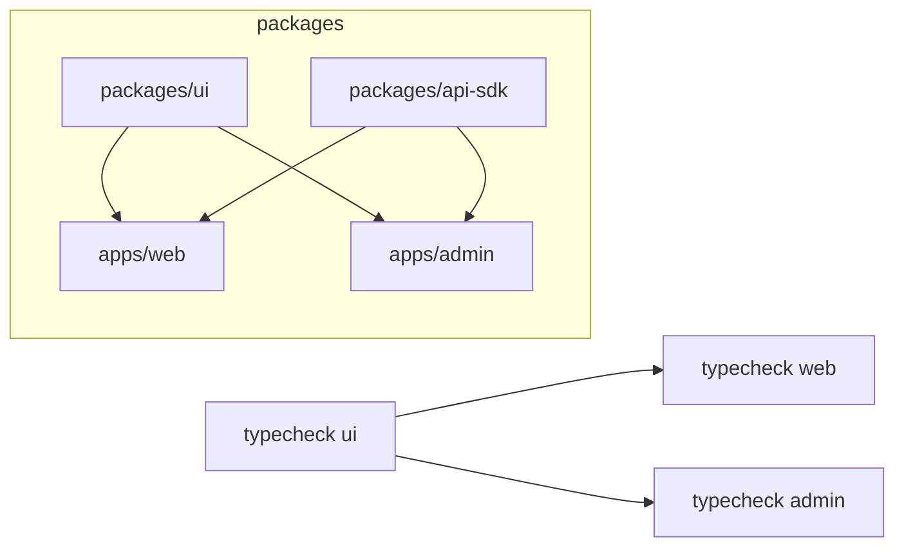
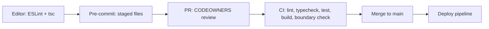
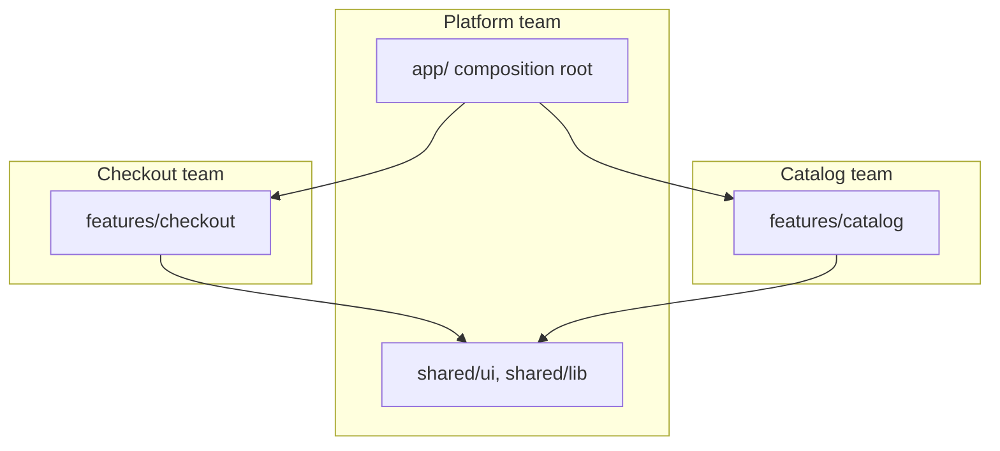

# 10 / 01 — Repository Organization: Structure, Boundaries, Ownership, and Tooling Contracts

## 1. Lesson metadata

| | |
|---|---|
| **Level** | Advanced |
| **Study time** | 4–5 hours (reading 2 h, experiments 1.5 h, exercises 1.5 h) |
| **Prerequisites** | [Phase 4 — Feature vs layer structure](../04-react-architecture/06-feature-vs-layer-structure.md); [Phase 4 — Monorepos and shared packages](../04-react-architecture/22-monorepos-and-shared-packages.md); [Phase 4 — Architectural fitness and enforcement](../04-react-architecture/25-architectural-fitness-and-enforcement.md); [Phase 0 — Modules and dependency graphs](../00-web-and-javascript-foundations/10-modules-and-dependency-graphs.md); [Phase 0 — Tooling, transpilation, bundling](../00-web-and-javascript-foundations/20-tooling-transpilation-and-bundling.md) |
| **Next** | [02 — Deployment workflows](./02-deployment-workflows.md) |
| **Related later** | [03 — Environment configuration](./03-environment-configuration.md), [07 — Dependency security](./07-dependency-security.md) |

**Learning objectives.** After this lesson you can:
1. Explain why repository organization is an architectural concern (it encodes ownership, dependency direction and the cost of change), not a cosmetic one.
2. Choose between a single-package app, a workspace monorepo, and multiple repositories using explicit criteria.
3. Make import boundaries *machine-enforced* (lint rules, TypeScript project references, package `exports`) instead of conventional.
4. Define ownership with `CODEOWNERS` and keep it aligned with module boundaries.
5. Pin the toolchain (Node version, package manager, lockfile) so builds are reproducible across laptops and CI.
6. Diagnose symptoms of a decaying repository: circular imports, "utils" gravity wells, barrel-file slowdowns, phantom dependencies.

**Concepts covered:** package vs folder boundary, feature-based layout, public API of a module, barrel files, `exports` field, workspaces, phantom dependencies, task graph and caching, `CODEOWNERS`, import-boundary linting, TypeScript project references, toolchain pinning, conventions as code.

---

## 2. Deep conceptual explanation

### 2.1 What problem is this lesson solving?

Phases 4 and 5 taught you how to *design* modules: feature slices, dependency inversion, adapters. A design that exists only in a diagram decays. Within months, someone imports a private helper from another feature "just this once", a shared `utils` folder accumulates domain logic, and two features import each other. Nobody decided this; the repository *allowed* it.

Repository organization is the mechanism by which an architecture is **made hard to violate** and **cheap to change**. It answers operational questions:

- Who must review a change to the checkout flow? (ownership)
- What can the `billing` feature import? (dependency direction)
- Which checks must run when `packages/ui` changes? (affected-graph builds)
- Can a new engineer clone, install and run the app in under 15 minutes with the same results as CI? (reproducibility)

### 2.2 The three levels of boundary

A boundary is only real if something **fails** when it is crossed.

| Level | Mechanism | Strength | Cost |
|---|---|---|---|
| **Convention** | "Don't import from other features' internals" in a wiki | Weakest; decays | Free |
| **Static check** | ESLint restrictions, dependency-graph checkers, TypeScript path restrictions | Fails in CI/editor | Config maintenance |
| **Package boundary** | Separate workspace package with `exports` map; consumers *cannot* resolve unexported files | Strongest; enforced by resolver | Build/versioning overhead |

The higher level you pick, the more it costs. Most teams should start at *static check* inside one package, and promote a module to a package when it has (a) multiple consumers, (b) a distinct owner, or (c) a different release/tooling need.

### 2.3 Feature-oriented layout

Recap from [Phase 4 lesson 06](../04-react-architecture/06-feature-vs-layer-structure.md): organize by *what changes together*. A practical production layout for a single application:

```text
my-app/
├─ .github/
│  ├─ CODEOWNERS
│  └─ workflows/
├─ src/
│  ├─ app/                 # composition root: providers, router, bootstrap
│  ├─ features/
│  │  ├─ checkout/
│  │  │  ├─ index.ts       # PUBLIC API of the feature (the only allowed entry)
│  │  │  ├─ components/
│  │  │  ├─ hooks/
│  │  │  ├─ api/
│  │  │  └─ model/         # domain logic, pure TS
│  │  └─ catalog/
│  ├─ shared/              # truly generic: ui primitives, http client, formatting
│  │  ├─ ui/
│  │  ├─ lib/
│  │  └─ config/
│  └─ main.tsx
├─ e2e/
├─ public/
├─ .nvmrc
├─ .editorconfig
├─ eslint.config.js
├─ package.json
├─ package-lock.json       # or pnpm-lock.yaml / yarn.lock: exactly one
└─ tsconfig.json
```

Dependency direction (enforced, not hoped for):



Rules this encodes:
1. `shared` imports nothing from `features` or `app`.
2. `features/x` imports `features/y` **only through `features/y/index.ts`** — and preferably not at all (communicate through the composition root or events/URL).
3. `app` is the only layer that knows every feature.

### 2.4 Single package, workspace monorepo, or polyrepo

| Dimension | Single package | Workspace monorepo | Multiple repos |
|---|---|---|---|
| Atomic cross-cutting change | Trivial | One PR across packages | Coordinated releases, version skew |
| Boundary enforcement | Lint only | Package `exports` + lint | Published API (strongest, slowest) |
| CI cost | One pipeline | Needs affected-graph/caching | Independent pipelines |
| Tooling uniformity | Automatic | Shared config packages needed | Drift without discipline |
| Ownership clarity | Folder + CODEOWNERS | Package + CODEOWNERS | Repository permissions |
| Onboarding | Easiest | Moderate | Many clones, many conventions |
| Best when | One team, one deployable | Several apps/libraries sharing code (design system, SDK, multiple apps) | Truly independent products/teams with separate release cadences |

*Vendor/tool detail — re-check against current docs:* workspace support (`workspaces` in `package.json` for npm/yarn, `pnpm-workspace.yaml` for pnpm) and task orchestrators (Turborepo, Nx, others) evolve quickly. The *concepts* (task graph, content-hash caching, affected detection) are stable; configuration syntax is not.

### 2.5 What a "module's public API" is in TypeScript/JavaScript

Phase 0 ([modules](../00-web-and-javascript-foundations/10-modules-and-dependency-graphs.md)) established that ES modules form a static graph. A *public API* is the subset of that graph you promise to keep stable. Two mechanisms define it:

- **Inside a package:** an `index.ts` re-exporting what is public. Enforced only by lint.
- **Across packages:** the `exports` field of `package.json`. When present, Node-style resolvers and modern bundlers will refuse to resolve subpaths not listed. This is a **documented public guarantee of Node's package resolution**; bundler and TypeScript behavior depends on their resolution mode (`moduleResolution: "bundler"` or `"node16"`/`"nodenext"` honor `exports`; legacy `"node"` resolution does not). Verified with `tsc` 5.9 in the sandbox: a deep import of an unexported subpath compiles under `moduleResolution: "node"` but fails with TS2307 under `"bundler"` and `"node16"`. TypeScript 7.0 (released; `latest` on npm is 7.0.2) removes `moduleResolution: node10` outright (`TS5108: Option 'moduleResolution=node10' has been removed`), so on TS 7 the legacy mode is no longer an option.

### 2.6 Barrel files: a real trade-off

A *barrel* is an `index.ts` that re-exports a folder. They create tidy import paths and define public APIs, but:

- They can defeat tree shaking when modules have side effects or the bundler cannot prove they are side-effect-free (the `sideEffects` field in `package.json` is the hint; see [Phase 0 lesson 10](../00-web-and-javascript-foundations/10-modules-and-dependency-graphs.md)).
- They can slow dev servers and test runners that must load every re-exported module to resolve one export (especially in large trees with many modules).
- They create circular-import traps: a file inside the feature imports from its own barrel, and the barrel imports that file.

Practical stance: **barrel at the feature/package boundary (public API); no barrels inside a feature's internals.** Inside the feature import the file directly.

### 2.7 Common misconceptions

| Misconception | Reality |
|---|---|
| "Monorepo = monolith." | A monorepo is a *source-control layout*; you can still ship many independent deployables from it. |
| "Monorepos need Nx/Turborepo." | Workspaces alone work; orchestrators matter when CI time/affected-detection becomes the bottleneck. |
| "`shared/` is for anything used twice." | `shared` is for *generic* things. Domain code used by two features usually belongs in a third feature or a domain package, or should be duplicated until the abstraction is clear ([DRY/KISS/YAGNI](../05-design-patterns/02-dry-kiss-yagni.md)). |
| "Absolute import aliases enforce architecture." | Aliases (`@/features/...`) only change spelling. They enforce nothing. |
| "The lockfile is noise in diffs." | The lockfile is part of the build input; it determines the exact dependency graph. |

---

## 3. Internal mechanics

### 3.1 Module resolution is what makes a boundary real

When you write `import { x } from "@acme/ui/internal/Button"`, three layers resolve it:

1. **TypeScript** (types) using `paths`, `moduleResolution`, and `exports`.
2. **The bundler/dev server** (runtime) using its own resolver, typically honoring `exports`.
3. **The test runner** (often a bundler-derived resolver or Node).

If these three disagree (e.g. TypeScript `paths` alias exists but the bundler lacks the matching alias), you get "works in the editor, fails in build". **Public guarantee:** the Node package `exports` semantics. **Teaching model:** "three resolvers must agree." **Implementation detail:** exactly how each tool caches resolution and handles conditions (`import`, `require`, `types`, `default`) — ⚠ version-sensitive; verify.

### 3.2 Hoisting and phantom dependencies

With npm/yarn classic-style hoisting, dependencies are placed in a flat `node_modules`. Your package can then `import "lodash"` even though only a *transitive* dependency declared it. This is a **phantom dependency**: it works until that transitive dependency upgrades or is removed, and then breaks mysteriously. Strict installers (pnpm's non-flat layout by default) make phantom imports fail immediately. ⚠ Verify the current default behavior of your package manager version.

Rule: **every import must be declared in the importing package's own `package.json`.** Enforce with a lint rule (e.g. `import/no-extraneous-dependencies` from eslint-plugin-import — check the plugin supports your ESLint version; ESLint is at v10 in the sandbox) or a dedicated checker.

### 3.3 The task graph and caching

In a workspace, each package defines tasks (`build`, `test`, `lint`, `typecheck`). Orchestrators build a **directed acyclic graph** from package dependencies, run tasks in topological order, and cache results keyed by a hash of inputs (source files, dependency outputs, env vars that matter, tool version). Consequence: **hidden inputs break caching**. If a build reads `process.env.API_URL` but that variable is not declared as an input, you can restore a cached build with the wrong URL. See [03 — Environment configuration](./03-environment-configuration.md).



Changing `packages/ui` invalidates `web` and `admin` but not `api-sdk`. Changing only `apps/admin` leaves `web` cached.

### 3.4 CODEOWNERS semantics

`CODEOWNERS` (GitHub and GitLab each support a variant; syntax details differ) maps path patterns to reviewers. On GitHub: the **last matching pattern** wins; with branch protection "Require review from Code Owners" enabled, a PR touching owned paths cannot merge without an owner's approval. ⚠ Verify exact syntax and behavior in your platform's documentation (GitHub: "About code owners").

---

## 4. Step-by-step execution walkthrough: a pull request in a well-organized repository

1. Developer branches, edits `src/features/checkout/hooks/useShippingQuote.ts` and, mistakenly, imports `../../catalog/components/ProductImage` (a private file of another feature).
2. **Editor**: ESLint reports `no-restricted-imports` immediately. If ignored:
3. **Pre-commit hook** (optional, fast subset): lint-staged lints only staged files; fails.
4. **CI `lint` job**: fails with the same rule — the PR cannot merge (branch protection requires it).
5. Developer instead imports `ProductImage` from `features/catalog` (public API) — or, better, realizes checkout should receive the image as a prop/slot from the composition root.
6. PR touches `features/checkout/**`; GitHub auto-requests review from `@acme/checkout-team` via CODEOWNERS.
7. CI computes the affected tasks (or runs all in a single package): `typecheck`, `lint`, `test`, `build`.
8. Merge triggers [deployment](./02-deployment-workflows.md).

Each step is an *enforcement point*. A repository with only step 8 has no architecture, only code.

---

## 5. Code examples

### 5.1 Minimal example — enforce feature public APIs (ESLint flat config)

```js
// eslint.config.js
import tseslint from "typescript-eslint";

export default tseslint.config(
  // ...recommended presets omitted
  {
    files: ["src/features/**/*.{ts,tsx}"],
    rules: {
      "no-restricted-imports": [
        "error",
        {
          patterns: [
            {
              // Disallow reaching into another feature's internals,
              // e.g. "@/features/catalog/components/ProductImage".
              group: ["@/features/*/*", "!@/features/*/index"],
              message: "Import other features only through their public index.ts.",
            },
          ],
        },
      ],
    },
  },
);
```

**Notes.**
- `no-restricted-imports` with `patterns` uses gitignore-style matching (`!` negation). The exact negation semantics are subtle. Verified with ESLint 10.13 in the sandbox: `@/features/catalog/components/ProductImage` is reported, `@/features/catalog` and `@/features/catalog/index` are allowed, and relative imports (`./internal/x`) are allowed — but a feature importing its **own** internals through the alias (`@/features/cart/internal/x`) is also reported, so use relative imports inside a feature or add a per-feature override. Also *test the rule with a deliberately bad import* (see Exercise C1). A rule that is never proven to fail is not a rule.
- This also blocks a feature importing its own internals through the alias; inside a feature use *relative* imports. That asymmetry is a feature: aliases mean "cross-boundary", relative paths mean "inside".

**Predict:** will `import { Cart } from "@/features/checkout"` be allowed? *Yes* — `@/features/checkout` has no second segment, so it matches neither `@/features/*/*`. And `@/features/checkout/index`? It is re-allowed by the negation.

### 5.2 Practical example — layered dependency rules with `overrides` per layer

```js
// eslint.config.js (excerpt)
const forbid = (message, ...group) => ({
  "no-restricted-imports": ["error", { patterns: [{ group, message }] }],
});

export default [
  {
    files: ["src/shared/**/*.{ts,tsx}"],
    rules: forbid(
      "shared must not depend on features or app.",
      "@/features/*", "@/app/*", "../features/*", "../../features/*"
    ),
  },
  {
    files: ["src/features/**/*.{ts,tsx}"],
    rules: forbid("features must not depend on app.", "@/app/*", "**/app/*"),
  },
];
```

Relative-path patterns are easy to evade (`../../../features/x`). For serious enforcement prefer a graph-aware tool (e.g. `dependency-cruiser`, `eslint-plugin-boundaries`, or Nx module-boundary rules — check each tool's current API) that resolves the *actual* target file rather than matching strings.

### 5.3 Package boundary: `exports` in a workspace package

```jsonc
// packages/ui/package.json
{
  "name": "@acme/ui",
  "version": "0.0.0",
  "private": true,
  "type": "module",
  "sideEffects": ["**/*.css"],
  "exports": {
    ".": {
      "types": "./src/index.ts",
      "default": "./src/index.ts"
    },
    "./tokens.css": "./src/tokens.css"
  },
  "peerDependencies": {
    "react": "^19.0.0",
    "react-dom": "^19.0.0"
  }
}
```

**Line notes.**
- `"private": true` prevents accidental publishing; the package is consumed through the workspace.
- `"sideEffects": ["**/*.css"]` tells bundlers that only CSS files have side effects, allowing aggressive tree shaking of everything else. Getting this wrong *removes* styles; verify with a production build.
- `exports` lists exactly two entry points. `import "@acme/ui/src/Button"` now fails to resolve — the boundary is real.
- Pointing `exports` at `src` (not a built `dist`) is the "internal package / just-in-time" style: consumers' bundlers compile it. Simpler, but consumers must be able to transpile TypeScript/JSX from that package. Building to `dist` is the alternative; trade-offs in §7.
- React is a **peer** dependency so the app and library share one React instance. Two React copies produce the classic "Invalid hook call" ([Phase 3 — Rules of hooks](../03-react-state-and-hooks/16-rules-of-hooks-and-composition.md)).

### 5.4 Incorrect example — the "utils gravity well"

```ts
// src/shared/utils/index.ts  (6,000 lines, imported by everything)
export * from "./date";
export * from "./money";
export * from "./cartTotals";        // domain logic in "shared"
export * from "./checkoutValidation"; // domain logic in "shared"
export * from "./featureFlags";
```

Problems: (1) `cartTotals` and `checkoutValidation` are domain rules owned by checkout, yet every feature can now depend on them; (2) importing `formatMoney` pulls the whole barrel into dev-server and test resolution; (3) the file has no owner, so every change needs everyone's attention; (4) circularity: `featureFlags` may import from features.

### 5.5 Corrected implementation

```text
src/
  shared/lib/money/format.ts        # generic, domain-free
  shared/lib/date/format.ts
  features/checkout/model/cartTotals.ts
  features/checkout/model/validation.ts
  features/checkout/index.ts        # exports only what other code needs
  app/featureFlags.ts               # composition-level; passed in via context/props
```

Rules of thumb: *generic nouns* (money formatting, date math) go to `shared`; *domain nouns* (cart, shipment, invoice) go to the feature that owns the rule. If two features need one domain rule, either one feature owns it and exposes it, or extract a **domain package** with an explicit owner — do not use `shared` as a dumping ground.

### 5.6 Advanced — CODEOWNERS aligned to boundaries, plus toolchain pinning

```text
# .github/CODEOWNERS  (GitHub syntax; last matching pattern wins)
*                               @acme/frontend-platform
/src/features/checkout/         @acme/checkout-team
/src/features/catalog/          @acme/catalog-team
/src/shared/ui/                 @acme/design-system
/.github/                       @acme/frontend-platform
/package.json                   @acme/frontend-platform
/package-lock.json              @acme/frontend-platform
```

```jsonc
// package.json (excerpt)
{
  "engines": { "node": ">=22.0.0 <23" },
  "packageManager": "npm@10.9.0",
  "scripts": {
    "typecheck": "tsc --noEmit",
    "lint": "eslint .",
    "test": "vitest run",
    "build": "vite build"
  }
}
```

```text
# .nvmrc
22
```

**Notes.** `engines` is advisory unless the package manager is configured to enforce it (npm warns by default; `engine-strict` makes it an error); the `packageManager` field is used by Corepack — Corepack's README says it is distributed with Node.js from 14.19.0 up to but not including 25.0.0, so on Node 25+ you install it yourself (`npm i -g corepack`) or use your package manager's own version-pinning support; check how your environment provisions the package manager. The Node major version should match your host runtime and CI image; check the Node release schedule rather than copying this example's number.

CI should install with the lockfile-respecting command (`npm ci` / `pnpm install --frozen-lockfile` / `yarn install --immutable`) so a drifting `package.json` fails the build rather than silently changing the dependency graph.

---

## 6. Visual explanations

### Enforcement points across a change's life



### Where ownership and dependency direction meet



Team boundaries should coincide with folder/package boundaries. When they do not (one folder owned by four teams), expect review bottlenecks or neglected code.

---

## 7. Alternative approaches and trade-offs

**How to share code between two apps in the same organization:**

| Approach | Boundary strength | Dev speed | Release independence | Operational cost | When to prefer |
|---|---|---|---|---|---|
| Copy code (duplicate) | None | Fastest at first | Total | Drift, double bug fixes | Tiny, unstable, not-yet-understood abstraction |
| Folder in one app, lint boundaries | Medium | Fast | None | Low | One app, one team |
| Workspace package (source-exported) | Strong | Fast (no build step for lib) | Shared (same commit) | Moderate | Several apps in one repo, one release train |
| Workspace package (built to `dist`) | Strong | Slower (build step/watch) | Shared | Moderate–High | Package also published externally or needs different compile target |
| Published versioned package (own repo) | Strongest | Slow feedback loop | Independent | High (versioning, changelog, deprecations) | Separate teams/cadences, external consumers ([backward compatibility](./12-backward-compatibility.md) planned) |

**When the recommended default (workspace + lint boundaries) is *not* best:** a five-person team with one deployable gains little from a multi-package monorepo; the added `exports` maps, per-package `tsconfig`s and orchestrator config cost more than the folder-level lint rule that gives 90% of the benefit. Conversely, a company with a public SDK and a separate legal/release process should not keep that SDK inside the application repo.

---

## 8. Best practices and anti-patterns

**Do**
- Make every rule fail in CI; treat warnings as backlog that never gets paid.
- Keep one source of truth per concern: one lockfile, one formatter config, one TypeScript base config extended by packages.
- Give every directory with an owner a `CODEOWNERS` entry; review the file when teams reorganize.
- Prefer deleting an abstraction over documenting why it is confusing.
- Co-locate tests, stories and styles with the code they describe.

**Beginner mistakes**
- Organizing by file *type* only (`components/`, `hooks/`, `utils/`) in a growing app, so every feature change touches five distant folders.
- Committing `node_modules` or build output; omitting the lockfile.
- Using `../../../..` chains instead of deliberate boundaries.

**Experienced-developer mistakes**
- Adopting a monorepo orchestrator before measuring CI time.
- Creating a package per component "for reuse" that never gets reused.
- Wide `shared` barrels and `export *` everywhere.
- Believing import aliases enforce layering.
- Splitting repos by *technical layer* (one repo for hooks, one for UI), making every feature a cross-repo change.

**Smells**
- A change to a "small" feature requires approvals from four teams.
- Circular dependency warnings that are silenced rather than resolved.
- CI takes longer each month with no one assigned to look.
- `package.json` `dependencies` contains testing/build tools (or the reverse) — affects security scanning and bundle assumptions.

**Justified exceptions**
- A flat `components/` folder is perfectly fine for a 20-component app. Do not impose Feature-Sliced Design ([Phase 4 lesson 09](../04-react-architecture/09-feature-sliced-design.md)) on a prototype.
- Barrels inside a feature are acceptable when the feature is small and measured to be fast.

---

## 9. Real-world application

**E-commerce (multi-team).** Checkout, catalog and account teams ship in the same web app. Layout: feature folders with CODEOWNERS, shared design system as a workspace package, `app/` composition root registering routes ([routing architecture](../04-react-architecture/18-routing-architecture.md)). Constraint: Black-Friday freezes — branch protection plus CODEOWNERS makes "who can merge to checkout" auditable.

**Finance/regulated.** Auditors ask "who approved this change and what exactly was built?" Requirements: required reviews, signed/immutable lockfile installs, reproducible builds (pinned toolchain), retention of CI logs. Organization choices (CODEOWNERS, protected branches, `npm ci`) become compliance evidence.

**Dashboard with a design system.** `packages/ui` (tokens + primitives), `apps/dashboard`, `apps/marketing`. Constraint: design-system changes must not break consumers — affected-graph CI runs consumers' typecheck and tests on every `ui` change.

**Multi-team platform.** A platform team owns tooling configs as packages (`@acme/eslint-config`, `@acme/tsconfig`). Constraint: changing a shared config is a breaking change for everyone; version and announce it like an API ([multi-team collaboration](./14-multi-team-collaboration.md) planned).

---

## 10. Debugging and troubleshooting

**Symptom: "Cannot find module '@acme/ui/...'" only in CI/build, but the editor is fine.**
Investigation: compare TypeScript `paths` and bundler `resolve.alias` / package `exports`. Run the bundler with a resolution trace if available; check `moduleResolution`. Root cause is usually a TypeScript-only alias. Fix: configure the same alias in the bundler (or remove aliases in favor of workspace packages). Validate: clean install + production build.

**Symptom: "Invalid hook call" or two React instances after adding a package.**
Investigation: `npm ls react` (or the equivalent) — more than one version/path appears; check that the library declares React as a peer dependency, not a dependency. Fix: dedupe, use peerDependencies, and (as a workaround) configure bundler dedupe for `react`. Validate: a single path in `npm ls react`.

**Symptom: dev server/test startup became slow after "cleanup".**
Investigation: look for new giant barrels (`export *`) pulling large subtrees; profile module graph (bundler's debug/inspect options — verify per tool). Fix: import directly inside features; barrels only at boundaries.

**Symptom: circular dependency warning/undefined import at runtime.**
Investigation: run a cycle detector; read the import chain; typical cause is a feature importing from its own barrel. Fix: import the file directly or extract the shared piece. Validate: the cycle report is empty and enforced in CI.

**Symptom: works on my machine, fails in CI.**
Investigation: compare Node/package-manager versions, lockfile state (`git status` after install), case-sensitive filesystem differences (macOS default is case-insensitive; Linux CI is not — `import "./button"` vs file `Button.tsx`). Fix: pin versions; enable `forceConsistentCasingInFileNames` in `tsconfig`.

---

## 11. Exercises

### Level A — Knowledge
**A1.** List the three levels of boundary strength and give one mechanism for each.
**A2.** What is a phantom dependency, and which installer behavior creates or prevents it?
**A3.** Why should React be a `peerDependency` of a shared UI package?
**A4.** What does `"sideEffects": false` promise to a bundler, and what breaks if it is wrong?

### Level B — Code comprehension
**B1.** Given the rule in §5.1, which of these imports error? (a) `@/features/cart` (b) `@/features/cart/hooks/useCart` (c) `./hooks/useCart` inside `features/cart` (d) `@/shared/ui/Button` from a feature.
**B2.** A package has `"exports": { ".": "./src/index.ts" }`. Another package imports `@acme/ui/src/Button`. Predict what happens under (a) `moduleResolution: "bundler"` and (b) legacy `"node"` resolution, and explain which one hides the violation.

### Level C — Implementation
**C1.** Add the feature-boundary rule to a repo, then write a *negative test*: a fixture file with a forbidden import and a script/CI step asserting that ESLint exits non-zero on it.
**C2.** Write a `CODEOWNERS` for a repo with three feature teams, a design system team and a platform team, including lockfile and workflow files.

### Level D — Debugging
**D1.** After adding `@acme/ui` to the web app, hooks throw "Invalid hook call." `npm ls react` shows `react@19.x` at two paths. Diagnose and fix.
**D2.** CI is green on Linux but a Windows/macOS teammate gets "Module not found: ./productCard". The file is `ProductCard.tsx`. Explain and prevent recurrence.

### Level E — Architecture decisions
**E1.** A 12-engineer company has one web app and plans a second (admin) app sharing 30 components and an API client. Choose structure and justify against criteria; state what evidence would make you change the decision.
**E2.** Two features both need `calculateTax`. Where does it live? Evaluate three options.

### Level F — Expert challenge
**F1.** CI for a workspace monorepo takes 38 minutes, mostly `build`+`test` for everything on every PR. Design the plan to reduce it below 10 minutes without lowering safety. Include cache correctness risks (hidden inputs) and how you would verify the cache is correct.

---

## 12. Detailed answers and explanations

> Attempt the exercises first.

**A1.** Convention (wiki, code review habit); static check (ESLint restrictions, dependency-graph checks, type-aware rules); package boundary (`exports` map in a workspace package). Strength increases in that order, and so does cost. Wrong answer "TypeScript paths": aliases change spelling only.

**A2.** A phantom dependency is an import of a package that the importer did not declare, resolving only because another package caused it to be hoisted into `node_modules`. Flat/hoisted layouts allow it; strict layouts (pnpm's default symlinked layout) surface it at install/run time. Edge case: peer dependencies and tooling that deliberately reaches into hoisted modules.

**A3.** The app and the library must share one React instance, because hooks rely on the dispatcher of the renderer that is rendering. A `dependency` can install a second copy under the library's `node_modules`; the library's hooks then run against a different React module than `react-dom` uses, causing invalid hook calls. A peer dependency delegates the choice to the consuming app.

**A4.** It promises that importing a module only for its exports does not need to execute it when no export is used, so the module can be dropped. If a module actually has side effects (registering a polyfill, injecting CSS, patching a prototype), those effects vanish in production while dev works — a classic "styles missing only in prod" bug. Use an array of paths for the files that do have effects.

**B1.** (a) allowed — one segment after `features/`. (b) **error** — matches `@/features/*/*` and is not the index. (c) allowed — relative path, not matched by an alias pattern (this is the intended internal style). (d) allowed — not under `features`. Edge: `@/features/cart/index` is re-allowed by negation; behavior of negation in `patterns` is something to test, not assume.

**B2.** (a) Under bundler/node16-style resolution that honors `exports`, TypeScript reports the subpath as not exported and the bundler fails to resolve: the violation surfaces. (b) Under legacy `"node"` resolution TypeScript ignores `exports`, resolving the file by path — the editor is happy; the bundler may still fail, producing "works in editor, fails in build". Legacy resolution hides the violation from the type checker. ⚠ verify exact behavior for your TypeScript version.

**C1.** Sample:

```ts
// tools/boundary-fixtures/bad-import.ts  (excluded from tsc and normal lint)
import { ProductImage } from "@/features/catalog/components/ProductImage";
export const x = ProductImage;
```

```bash
# CI step: the rule must FAIL on the fixture (exit code is inverted on purpose)
if npx eslint tools/boundary-fixtures/bad-import.ts; then
  echo "boundary rule is NOT firing" >&2
  exit 1
fi
echo "boundary rule fires as expected"
```

Evaluation criteria: the fixture is covered by the feature override's `files` glob (or a dedicated tiny config used only by this check), the CI step *inverts* the exit code, and the fixture is excluded from the regular `lint` job so it does not fail normal runs. Verify ESLint's ignore behavior for your version.

**C2.** Example answer:

```text
*                         @acme/frontend-platform
/src/features/catalog/    @acme/catalog-team
/src/features/checkout/   @acme/checkout-team
/src/features/account/    @acme/account-team
/src/shared/ui/           @acme/design-system
/.github/                 @acme/frontend-platform
/package-lock.json        @acme/frontend-platform
```
Criteria: default owner first (last match wins), specific paths later, build/CI/lockfile owned by platform, teams (not individuals) as owners, and a note that branch protection must enable code-owner review for it to bind.

**D1.** Cause: the UI package lists `react` under `dependencies` (or the workspace installed its own copy), so two copies exist; hooks from copy A are called while copy B's renderer is active. Fix: move `react`/`react-dom` to `peerDependencies` (and `devDependencies` in the library for its own tests), reinstall, verify `npm ls react` shows one path; temporary bundler `resolve.dedupe: ["react", "react-dom"]` is a workaround, not the fix. Wrong guess: "version mismatch only" — same version can still be two instances.

**D2.** The scenario as written is inverted relative to the usual case: case-insensitive filesystems (macOS/Windows defaults) *tolerate* `./productCard` for `ProductCard.tsx`, while Linux does not. So a failure on a teammate's macOS/Windows machine with green Linux CI suggests the repository state differs: Git may track the file under a different case than the working tree (a rename done with `core.ignorecase=true` is a common cause), so CI checks out one name and the laptop another. Investigate with `git ls-files` to see the tracked name; fix with `git mv` to the exact case. Prevent: `forceConsistentCasingInFileNames: true` in `tsconfig`, an import-case lint rule if available, and CI on Linux (so mismatches fail there). In the common direction (works locally, fails on Linux CI) the cause and fixes are the same.

**E1.** Evaluation criteria: team size, release cadence coupling, CI cost, boundary strength needed, onboarding. Strong answer: a workspace monorepo with `apps/web`, `apps/admin`, `packages/ui`, `packages/api-client`, source-exported packages, lint boundaries, CODEOWNERS; no orchestrator until CI time demonstrates need; a polyrepo is rejected because two apps share an API client and need atomic changes. Evidence to change: a second team with a separate release process (then publish packages), or CI exceeding an agreed budget (add an orchestrator/caching), or the shared components diverging per app (then stop sharing).

**E2.** Options: (1) `shared/lib/tax` — wrong if tax is a domain rule; it becomes a gravity well. (2) Owned by `features/pricing` (new/existing), exported via its `index.ts`; both features depend on pricing's public API — correct when one team owns the rule. (3) Duplicate — acceptable only if the rules are *expected to diverge*; otherwise it creates compliance risk in a finance-like domain. Pick (2); consider moving the rule server-side if the client must not be the source of truth.

**F1.** Example plan: (1) Measure: break down time per task and per package; identify the longest chain. (2) Introduce affected-graph execution + remote/shared cache keyed by input hash. (3) Declare all inputs: source, config files, lockfile, tool versions, and **environment variables that influence output**; declare outputs; mark non-deterministic tasks uncacheable. (4) Parallelize across the DAG; shard slow test suites. (5) Split the pipeline: typecheck/lint/unit in parallel; E2E only for affected apps or on merge queue. (6) Verify correctness: periodically run a cold full build on `main` and compare artifact hashes; run a canary job with cache disabled; alert on divergence. Risk: a stale cache with a hidden env input ships a wrong API URL ([03](./03-environment-configuration.md)). Rejected: "skip tests for docs-only changes" without path rules reviewed by CODEOWNERS.

---

## 13. Senior engineer interview questions

**Q1. "How do you stop engineers from importing across feature boundaries?"**
*Strong answer:* Conventions decay, so I move the rule into something that fails: restricted-import lint rules or a graph-aware boundary tool, backed by a public `index.ts` per feature; for stronger isolation promote the module to a workspace package with `exports`. I add a negative test to prove the rule fires, and pair it with CODEOWNERS so ownership matches the boundary. I also ask *why* the import was needed — often the right fix is dependency inversion or composition at the app layer, not a bigger public API.

**Q2. "Monorepo or multiple repositories?"**
*Strong answer:* It depends on coupling and release cadence. If changes frequently span packages, a monorepo gives atomic changes and shared tooling; the cost is CI scaling and needing boundary enforcement. Separate repos fit independent release cadences and external consumers, at the cost of versioning overhead and version skew. I would start with the cheapest structure that supports current coupling and set a measurable trigger for changing it.

**Q3. "Why do barrel files cause problems?"**
*Strong answer:* They hide the real dependency, can force loading of every re-exported module in tools that resolve eagerly, can defeat tree shaking when side effects are not provable, and invite cycles when internals import their own barrel. I keep barrels at public boundaries only.

**Q4. "A build is green on CI but the app is broken locally. What first?"**
*Strong answer:* Compare environments: Node/package manager versions, lockfile adherence (`npm ci` vs `npm install`), env variables, case sensitivity, and duplicate dependency instances. I would make the toolchain pinned and reproducible so this class of difference is eliminated, not debugged each time.

**Q5. "How do hidden inputs break build caching?"**
*Strong answer:* A cache key is a hash of declared inputs. If output depends on something undeclared (an env var, a file read at build time, the current date), a cache hit returns stale output. Declare inputs explicitly, avoid env-dependent builds ([build once, configure at runtime](./03-environment-configuration.md)), and periodically verify with a cold build.

---

## 14. Further learning resources

| Resource | URL | Covers / why | Level | Study |
|---|---|---|---|---|
| Node.js docs — Packages (`exports`, `imports`) | <https://nodejs.org/api/packages.html> | Normative description of package entry points and conditions | Advanced | "Package entry points", "Subpath exports" |
| TypeScript docs — Modules reference | <https://www.typescriptlang.org/docs/handbook/modules/reference.html> | `moduleResolution` modes and how `exports` is treated | Advanced | Resolution modes |
| TypeScript docs — Project references | <https://www.typescriptlang.org/docs/handbook/project-references.html> | Splitting a codebase into separately compiled projects | Advanced | Whole page |
| ESLint — `no-restricted-imports` | <https://eslint.org/docs/latest/rules/no-restricted-imports> | `paths` vs `patterns`, gitignore-style matching | Intermediate | Options |
| GitHub docs — About code owners | <https://docs.github.com/en/repositories/managing-your-repositorys-settings-and-features/customizing-your-repository/about-code-owners> | Syntax and enforcement | Intermediate | Syntax, precedence |
| npm docs — workspaces | <https://docs.npmjs.com/cli/using-npm/workspaces> | Workspace configuration | Intermediate | Defining workspaces |
| pnpm docs — Workspaces | <https://pnpm.io/workspaces> | pnpm workspace protocol and layout | Intermediate | Whole page |
| Turborepo docs | <https://turborepo.dev/docs> *(the old turbo.build/repo/docs URL redirected to https://turborepo.dev/docs when checked 2026-10-22)* | Task graph and caching concepts | Intermediate | Core concepts |
| Nx docs | <https://nx.dev/> | Affected graph, module boundary rules (vendor) | Intermediate | Concepts |
| Phase 4 — Architectural fitness and enforcement | [local lesson](../04-react-architecture/25-architectural-fitness-and-enforcement.md) | Fitness functions for architecture | Advanced | All |

URLs in this table were checked for HTTP 200 on 2026-10-22; any still marked *(unverified)* could not be checked automatically (blocked or unreachable). A 200 response does not guarantee the page content still matches the description; if a link has moved, search the site for the quoted title.

---

## 15. Knowledge checkpoint

**You should now understand**
- Why a boundary must fail something to exist, and the three strength levels.
- How `exports`, resolvers, hoisting and caching interact to make or break structure.
- Why ownership (CODEOWNERS) and dependency direction should coincide.

**You should be able to explain without notes**
- Barrel-file costs and where barrels belong.
- Phantom dependencies and the peer-dependency rule for React.
- When a monorepo is and is not the right choice.

**You should be able to implement**
- Boundary lint rules with a negative test; CODEOWNERS; a workspace package with an `exports` map; pinned toolchain and lockfile-respecting CI install.

**You should be able to debug**
- Resolver disagreement, duplicate React, case-sensitivity failures, accidental cycles.

**Prerequisite for next:** [02 — Deployment workflows](./02-deployment-workflows.md) assumes a reproducible build and a CI pipeline whose steps you can name and trust.
