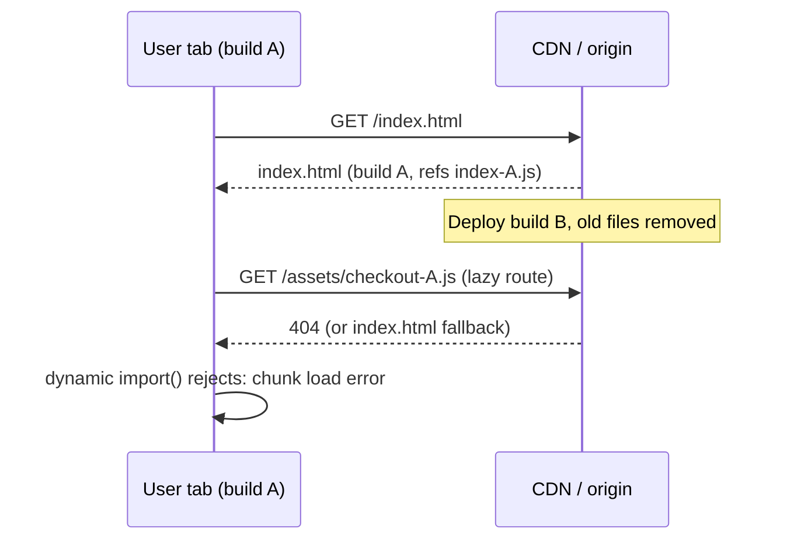
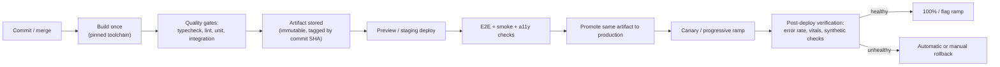
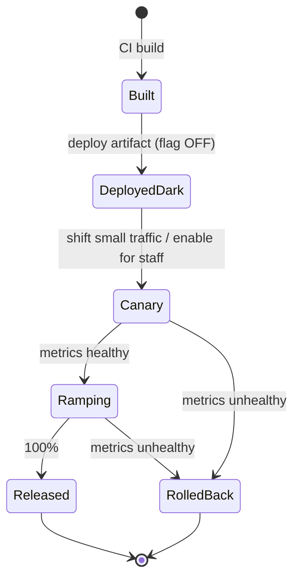
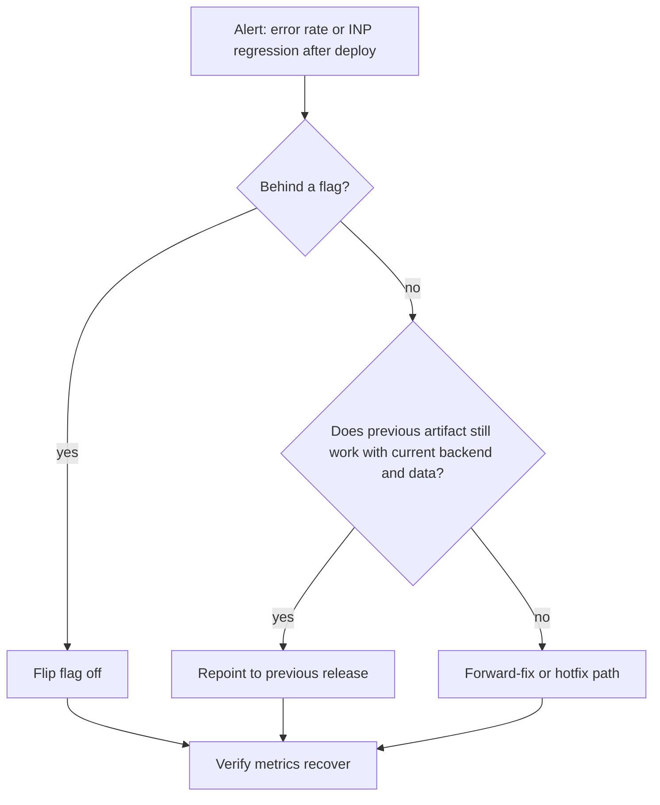

# 10 / 02 — Deployment Workflows: Pipelines, Immutable Assets, Rollout, and Rollback

## 1. Lesson metadata

| | |
|---|---|
| **Level** | Advanced |
| **Study time** | 4–5 hours (reading 2 h, experiments 1.5 h, exercises 1.5 h) |
| **Prerequisites** | [01 — Repository organization](./01-repository-organization.md); [Phase 0 — HTTP caching and navigation](../00-web-and-javascript-foundations/15-http-caching-and-navigation.md); [Phase 0 — Tooling, transpilation, bundling](../00-web-and-javascript-foundations/20-tooling-transpilation-and-bundling.md); [Phase 7 — Code splitting and lazy loading](../07-performance/15-code-splitting-and-lazy-loading.md) |
| **Next** | [03 — Environment configuration](./03-environment-configuration.md) |
| **Related later** | [18 — Continuous delivery](./18-continuous-delivery.md), [19 — Incident debugging](./19-incident-debugging.md) |

**Learning objectives.** After this lesson you can:
1. Describe a deployment pipeline as a sequence of gates that turn a commit into an immutable, verifiable artifact and then promote that artifact.
2. Configure caching correctly for a client-rendered React app: immutable hashed assets, revalidated entry document.
3. Explain *version skew* (an old tab and a new deployment) and implement mitigations for failed lazy chunk loads.
4. Compare rollout strategies (big-bang, blue/green, canary, progressive delivery with feature flags) and choose by risk.
5. Define rollback as a first-class, rehearsed operation and know what cannot be rolled back (data, third-party state).
6. Write a CI workflow that builds once, tests, uploads source maps privately, and deploys by promotion.

**Concepts covered:** artifact, build vs deploy vs release, immutable assets, content hashing, `Cache-Control`, atomic deploys, preview environments, blue/green, canary, feature flags, version skew, `vite:preloadError`-style handling, rollback, smoke tests, deployment frequency and change-failure metrics.

---

## 2. Deep conceptual explanation

### 2.1 What problem is this lesson solving?

Writing correct React code is necessary but not sufficient. Production incidents in front-end systems are disproportionately about **delivery**, not logic:

- Users see a blank page after a deploy because their cached `index.html` references JavaScript files that no longer exist.
- A bad release cannot be reverted for 40 minutes because the build takes 30 and nobody has practiced rollback.
- A change works in staging and fails in production because the artifact was rebuilt with a different configuration ([03](./03-environment-configuration.md)).

A deployment workflow turns "it works on my machine" into "this exact artifact, with this hash, passed these gates and is serving this percentage of traffic".

### 2.2 Build, deploy, release: three different verbs

| Verb | Meaning | Reversible by |
|---|---|---|
| **Build** | Produce an artifact (static files, container) from a commit | Rebuild |
| **Deploy** | Put an artifact on infrastructure so it *can* serve traffic | Redeploy a previous artifact |
| **Release** | Expose behavior to users (traffic shift, flag flip) | Shift traffic back, flip flag off |

Separating *deploy* from *release* is the central idea of modern delivery: you can deploy code dark (flag off), verify in production, then release gradually. This lowers the blast radius of every deploy.

### 2.3 The artifact must be immutable and built once

**Build once, promote many.** The artifact that passed tests in CI is the exact artifact that goes to staging and then production. If you rebuild for production, you are shipping something no test has seen. The enabling technique is runtime configuration ([lesson 03](./03-environment-configuration.md)): the artifact is environment-agnostic, configuration is injected at deploy or load time.

### 2.4 Caching strategy for a React SPA

Recall [Phase 0 lesson 15](../00-web-and-javascript-foundations/15-http-caching-and-navigation.md). A client-rendered build typically produces:

```text
dist/
  index.html                 # references hashed assets
  assets/
    index-3f9a1c2e.js        # content-hashed
    checkout-81b4d7aa.js     # lazy chunk
    index-77ce0a19.css
  favicon.ico
```

| Resource | Recommended `Cache-Control` | Reason |
|---|---|---|
| `index.html` (and other non-hashed entry documents) | `no-cache` (store but always revalidate with ETag/Last-Modified) — or short `max-age` plus `must-revalidate` | It is the pointer to the current build; must update immediately |
| `/assets/*-<hash>.*` | `public, max-age=31536000, immutable` | Content hash changes when content changes; safe to cache a year |
| Non-hashed static files (`favicon.ico`, `robots.txt`) | Moderate `max-age` or revalidation | Name stays the same while content may change |
| API responses | Per endpoint; usually `no-store` or `private` for user data | Security and correctness (see [06](./06-security-xss-csrf-csp.md)) |

`immutable` is a documented `Cache-Control` extension (MDN browser-compat data: Firefox 49 and Safari 11 honor it; Chromium has no support flag because it already avoids revalidating on reload); where unsupported, `max-age` alone still works. `no-cache` does **not** mean "do not cache"; it means "revalidate before reuse". `no-store` means do not store.

### 2.5 Version skew: the defining front-end deployment problem

An SPA is **software installed over time**: a user may keep a tab open for days. At time T0 the tab loads `index.html` (build A). At T1 you deploy build B and, in a naive pipeline, **delete** build A's assets. At T2 the user navigates to a route whose lazy chunk is `checkout-OLDHASH.js`. The request returns 404 (or the SPA fallback returns `index.html` with status 200 and a `text/html` body — worse, because the JS parser fails with a confusing error).



Mitigations, strongest first:
1. **Keep old assets for a retention window** (e.g. days) — do not delete previous builds immediately; deploy additively to an assets bucket/prefix.
2. **Handle chunk load failure** in the app: catch the failed dynamic import, reload the page once (guard against reload loops), or prompt the user.
3. **Version signalling:** the app periodically (or on focus) checks a small uncached `version.json`/build ID and offers "A new version is available — reload".
4. **API compatibility windows** ([12 — Backward compatibility](./12-backward-compatibility.md)): the old client must keep working against the new API for at least the skew window.

### 2.6 Rollout strategies

| Strategy | Mechanism | Blast radius | Rollback speed | Cost/complexity |
|---|---|---|---|---|
| Big-bang replace | Overwrite live files | 100% immediately | Redeploy | Lowest; riskiest |
| Atomic deploy + previous-version pointer | Upload to a new immutable directory; flip a pointer (symlink, alias, routing rule) | 100% at flip | Flip pointer back (seconds) | Low |
| Blue/green | Two full environments; switch traffic | 100% at switch | Switch back | Duplicate capacity |
| Canary | Route a small % (or an internal cohort) to the new version; watch metrics; ramp | Small, growing | Route 0% | Needs traffic-splitting and automated metrics comparison |
| Feature flags (progressive delivery) | Code deployed dark; behavior gated at runtime per user/cohort | Per flag | Flip flag (no deploy) | Flag hygiene, testing matrix |

⚠ Traffic-splitting and "instant rollback" features are vendor-specific (CDN, hosting platform, load balancer). The *concepts* above are stable; verify your platform's actual semantics (e.g. whether cached HTML is purged at pointer flip, how long CDN edge caches keep serving the old document).

### 2.7 Common misconceptions

| Misconception | Reality |
|---|---|
| "Static hosting means deploys are trivial." | The hard problems (skew, caching, rollback, config) are all present. |
| "We can always roll back." | Code rolls back; **data migrations, emitted events, sent emails, third-party state do not**. Design changes to be backward compatible (expand → migrate → contract). |
| "CDN caching is a performance setting." | It is a correctness setting: a wrongly cached `index.html` is an outage. |
| "Feature flags replace testing." | They decouple release from deploy; both flag states still need tests, and long-lived flags are debt ([15 — Technical debt](./15-technical-debt.md)). |
| "A green pipeline means a healthy release." | Only post-deploy verification and monitoring ([04](./04-observability-and-logging.md), [05](./05-error-monitoring.md)) tell you that. |

---

## 3. Internal mechanics

### 3.1 How bundlers produce hashed filenames

Build tools compute a hash from the content of each emitted chunk (and sometimes its dependencies' hashes) and embed it in the filename. If a module changes, the chunks that contain it change, and so do the chunks that *import them by filename* (because their content now references new filenames). **Teaching model:** a change ripples up the import graph, invalidating exactly those files whose content changed. **Implementation detail:** hashing algorithm, which inputs participate (including a runtime/manifest chunk), and chunk-splitting heuristics differ per bundler and version — ⚠ verify; do not assume a hash is stable across builds unless the tool documents deterministic output. This is why ["reproducible builds"](./01-repository-organization.md) (pinned toolchain, lockfile install) matter for cache efficiency, too: a nondeterministic build changes every filename on every deploy and destroys user caches.

### 3.2 How the browser decides to reuse a cached file

For a request with a stored response, the browser applies HTTP caching rules ([Phase 0 lesson 15](../00-web-and-javascript-foundations/15-http-caching-and-navigation.md)):

1. **Fresh** (age < `max-age`)? Reuse without contacting the network.
2. Stale and has validators (`ETag`, `Last-Modified`)? Send a conditional request; `304 Not Modified` means reuse.
3. `no-cache`: always validate. `immutable`: tells the browser not to revalidate even on a user reload (support varies).

For `index.html` with `no-cache` + an ETag, every navigation costs one conditional request (cheap) but guarantees correctness.

### 3.3 Atomic deploys

If you upload files one by one into the live directory, there is a window where `index.html` is new but assets are not yet uploaded (or vice versa). **Atomic deploy** means: upload all assets first (they are content-addressed, so they cannot collide), then update `index.html` last (or flip a pointer). Many hosting platforms implement this as "deploy = new immutable snapshot + atomic alias switch". ⚠ Verify the semantics of your host.

### 3.4 What the deploy pipeline computes



---

## 4. Step-by-step execution walkthrough: shipping a checkout change

1. **Merge to `main`.** CI starts. The commit SHA is the artifact ID.
2. **Install** with a lockfile-respecting command and the pinned Node version.
3. **Gates run in parallel:** typecheck, lint (including boundary rules from [01](./01-repository-organization.md)), unit tests, build. Any failure stops the pipeline.
4. **Build once** produces `dist/`; it is uploaded as a CI artifact and, optionally, pushed to an artifact store/bucket under `releases/<sha>/`.
5. **Source maps** are uploaded to the error-monitoring service *privately* with the release ID = SHA ([05](./05-error-monitoring.md)) and removed from the public artifact.
6. **Deploy to staging:** upload assets, then `index.html`. Runtime config for staging is injected ([03](./03-environment-configuration.md)).
7. **Post-deploy checks:** a smoke test loads the app, checks the build ID endpoint equals the SHA, and exercises login and the checkout happy path with a synthetic user. Accessibility smoke ([Phase 8 lesson 10](../08-testing-and-quality/10-accessibility-testing.md)) runs on key pages.
8. **Manual or automated approval** gate for production (policy dependent).
9. **Promote the same artifact:** upload assets to production (additive), flip `index.html`/alias. Canary 5% for 15 minutes; automated comparison of error rate and INP against baseline.
10. **Ramp** to 100%, or **roll back** by repointing to the previous release. Keep the previous release's assets for the retention window so already-open tabs still work.
11. **Flag ramp:** the new checkout behavior behind a flag moves 1% → 10% → 50% → 100% independent of deployment.

**Predict:** at step 9, a user with build-A `index.html` cached and open since yesterday clicks a lazy route. What happens? *If assets are additive: A's chunk still exists and the click works; they remain on build A until reload.* If assets were deleted: chunk load error → mitigation required (§5.4).

---

## 5. Code examples

### 5.1 Minimal example — cache headers (nginx)

```nginx
server {
  listen 8080;
  root /usr/share/nginx/html;

  # Hashed build output: cache for a year, never revalidate
  location /assets/ {
    add_header Cache-Control "public, max-age=31536000, immutable";
    try_files $uri =404;            # missing asset must be a real 404, not index.html
  }

  # Entry document and everything else: SPA fallback, always revalidate
  location / {
    add_header Cache-Control "no-cache";
    try_files $uri /index.html;
  }
}
```

**Line notes.**
- `try_files $uri =404` under `/assets/` is deliberate. If a missing chunk were served as `index.html` with HTTP 200, the browser would try to parse HTML as JavaScript ("Unexpected token '<'") — hard to diagnose and hard to detect by status-code monitoring.
- `add_header` has inheritance rules in nginx: headers defined in a `location` replace those from outer levels; verify against nginx docs when combining with security headers ([06](./06-security-xss-csrf-csp.md)).
- The `no-cache` on `/` applies to the SPA fallback `index.html`. nginx generates `ETag` for static files by default (`etag on`).
- Security headers also belong here or at the CDN (see lesson 06) — and they must be present on the **document** response, not just assets.

### 5.2 Practical example — CI workflow (GitHub Actions)

```yaml
name: ci-cd
on:
  push:
    branches: [main]
  pull_request:

permissions:
  contents: read            # least privilege by default

concurrency:
  group: ${{ github.workflow }}-${{ github.ref }}
  cancel-in-progress: ${{ github.ref != 'refs/heads/main' }}

jobs:
  verify:
    runs-on: ubuntu-latest
    steps:
      - uses: actions/checkout@v4
      - uses: actions/setup-node@v4
        with:
          node-version-file: .nvmrc
          cache: npm
      - run: npm ci
      - run: npm run typecheck
      - run: npm run lint
      - run: npm test
      - run: npm run build
      - uses: actions/upload-artifact@v4
        with:
          name: dist-${{ github.sha }}
          path: dist
          retention-days: 14

  deploy-production:
    if: github.ref == 'refs/heads/main'
    needs: verify
    runs-on: ubuntu-latest
    environment: production        # enables required reviewers / protected secrets
    permissions:
      contents: read
      id-token: write              # for OIDC federation to the cloud provider (no long-lived keys)
    steps:
      - uses: actions/download-artifact@v4
        with:
          name: dist-${{ github.sha }}
          path: dist
      # Provider-specific steps (verify against your provider's docs):
      #  1. authenticate via OIDC
      #  2. upload dist/assets/** (additive; do NOT delete old assets)
      #  3. upload dist/index.html last with Cache-Control: no-cache
      #  4. run smoke test against the production URL
```

**Notes.** Action versions (`@v4`) and syntax are version-sensitive (as of 2026-10 `actions/checkout` and `actions/setup-node` are at v7); pin to current major versions (or full commit SHAs for supply-chain safety, see [07](./07-dependency-security.md)) and verify in each action's README. `permissions` default-deny and OIDC-based cloud auth avoid storing long-lived credentials in repository secrets. `environment: production` is how GitHub gates secrets and approvals. `needs: verify` plus `download-artifact` implements **build once, deploy the same artifact**.

### 5.3 Build identity: expose what is running

```ts
// vite.config.ts (excerpt)
import { defineConfig } from "vite";
import react from "@vitejs/plugin-react";

const buildId = process.env.GIT_SHA ?? "dev";

export default defineConfig({
  plugins: [react()],
  define: { __BUILD_ID__: JSON.stringify(buildId) },
  build: { sourcemap: "hidden" },   // emit maps, don't reference them from the bundle
});
```

```ts
// src/shared/config/build.ts
declare const __BUILD_ID__: string;
export const BUILD_ID: string = __BUILD_ID__;
```

Also publish `/version.json` (uncached) at deploy time containing the same ID. Now every error report, log line and trace can be tagged with the build ([04](./04-observability-and-logging.md), [05](./05-error-monitoring.md)). ⚠ Note: `define` here uses a *build-time* constant — that is a build input, so it must be declared as such in any build cache (see [01](./01-repository-organization.md), hidden inputs). `sourcemap: "hidden"` is a documented Vite option (Vite 8 is current; it bundles with Rolldown, and `build.rollupOptions` was renamed `build.rolldownOptions`, but `build.sourcemap` and `define` are unchanged). Verified by building with `vite@8` in the sandbox.

### 5.4 Incorrect example — lazy routes with no failure handling

```tsx
const Checkout = lazy(() => import("./features/checkout/CheckoutPage"));

export function Routes() {
  return (
    <Suspense fallback={<Spinner />}>
      <Checkout />
    </Suspense>
  );
}
```

If the chunk 404s after a deploy, `import()` rejects; `lazy` rethrows during render; with no error boundary the entire tree unmounts (blank screen). Even *with* a generic boundary the user sees "Something went wrong" with no path forward ([Phase 4 — Error boundaries](../04-react-architecture/19-error-boundaries.md)).

### 5.5 Corrected implementation — retry once, then reload once, then show UI

```tsx
import { lazy, type ComponentType } from "react";

const RELOAD_KEY = "chunk-reload-at";

function isChunkLoadError(err: unknown): boolean {
  // Messages differ per browser/bundler: verify against the browsers you support.
  const msg = err instanceof Error ? err.message : String(err);
  return (
    /Failed to fetch dynamically imported module/i.test(msg) || // Chromium, Safari variants
    /error loading dynamically imported module/i.test(msg) ||    // Firefox
    /Importing a module script failed/i.test(msg) ||             // Safari
    /Loading chunk [\w-]+ failed/i.test(msg)                     // webpack
  );
}

export function lazyWithRecovery<T extends ComponentType<any>>(
  load: () => Promise<{ default: T }>,
) {
  return lazy(async () => {
    try {
      return await load();
    } catch (err) {
      if (!isChunkLoadError(err)) throw err;

      // At most one automatic reload per 30 seconds to avoid reload loops.
      let last = 0;
      try { last = Number(sessionStorage.getItem(RELOAD_KEY) ?? 0); } catch { /* storage may throw */ }
      if (Date.now() - last > 30_000) {
        try { sessionStorage.setItem(RELOAD_KEY, String(Date.now())); } catch { /* ignore */ }
        window.location.reload();
        return new Promise<never>(() => {});  // never resolves; the page is going away
      }
      throw err;   // second failure: let an error boundary show a "reload" UI
    }
  });
}
```

**Line notes and trade-offs.**
- Matching on error message text is brittle and browser-specific — that is why the list is explicit and flagged. Some bundlers expose a dedicated preload-error event (Vite emits a `vite:preloadError` event on `window` for failed dynamic-import preloads; `event.payload` holds the original error and `event.preventDefault()` stops it being thrown — confirmed in the Vite build guide). Prefer the documented hook where it exists.
- An automatic reload **discards unsaved user state** (form input). For routes where the user may have unsaved work, prefer showing a "Reload to continue" banner instead of auto-reloading.
- `sessionStorage` access is wrapped in try/catch because it can throw (privacy modes, blocked storage).
- Returning a never-resolving promise keeps `Suspense` showing the fallback while the reload occurs.
- The error boundary at the app shell must offer a **Reload** action for the second failure.

### 5.6 Advanced — "new version available" signal

```tsx
import { useEffect, useState } from "react";
import { BUILD_ID } from "@/shared/config/build";

export function useNewVersionAvailable(intervalMs = 5 * 60_000) {
  const [stale, setStale] = useState(false);

  useEffect(() => {
    let cancelled = false;
    async function check() {
      try {
        const res = await fetch("/version.json", { cache: "no-store" });
        if (!res.ok) return;
        const { buildId } = (await res.json()) as { buildId: string };
        if (!cancelled && buildId !== BUILD_ID) setStale(true);
      } catch { /* offline or transient: ignore */ }
    }
    const id = window.setInterval(check, intervalMs);
    const onVisible = () => document.visibilityState === "visible" && check();
    document.addEventListener("visibilitychange", onVisible);
    return () => {
      cancelled = true;
      window.clearInterval(id);
      document.removeEventListener("visibilitychange", onVisible);
    };
  }, [intervalMs]);

  return stale;
}
```

**Why this works / design notes.** The effect synchronizes with an external system (timer, document visibility) and cleans up both ([Phase 3 — Effect cleanup](../03-react-state-and-hooks/06-effect-cleanup.md)). `cache: "no-store"` avoids reading a stale `version.json`. It *informs* and lets the user choose when to reload; forced reloads are reserved for incompatible API changes. Trade-off: polling costs requests; with many users, prefer a long interval plus focus-triggered checks, and serve `version.json` from the CDN edge.

---

## 6. Visual explanations

### Release lifecycle with decoupled deploy and release



### Rollback decision tree



---

## 7. Alternative approaches and trade-offs

**How to host and release a React front end:**

| Approach | Rollback | Skew handling | Operational control | Cost | When to prefer |
|---|---|---|---|---|---|
| Managed static host with immutable deploys + aliases | Instant alias switch | Often retains old assets (verify) | Low–medium | Low | Most SPAs and marketing/app hybrids |
| Object storage + CDN, custom pipeline | Scripted pointer flip | You implement retention | High | Low–medium | Compliance, existing cloud standards |
| Container image behind a load balancer (nginx/Node SSR) | Redeploy previous image | Need asset retention across versions explicitly | High | Medium | SSR/streaming apps ([Phase 9](../09-advanced-rendering-and-ecosystem/01-spa-ssr-ssg-streaming.md)), custom headers/auth |
| Edge/serverless platform for framework apps | Platform-provided | Platform-provided "skew protection" in some products (verify) | Medium | Variable | Framework-centric teams |

**When the recommended default (immutable artifact + additive assets + pointer flip) is not best:** an internal tool with 20 users and a maintenance window does not justify canaries; a simple replace and "reload to update" banner suffices. Conversely, a payments front end behind regulation may *require* staged approvals and audit evidence beyond the default.

---

## 8. Best practices and anti-patterns

**Do**
- Build once; promote the same artifact.
- Make asset deploys additive with a retention window; delete by age, not by deploy.
- Attach a build ID to every error, log and trace.
- Make rollback a documented, rehearsed command with a time budget.
- Verify after deploy: smoke tests + automated metric comparison.
- Use environment-protected credentials via short-lived federation where available.

**Beginner mistakes**
- Caching `index.html` for a long time ("it's faster").
- Serving SPA fallback for missing JS files.
- Rebuilding per environment with different `.env` files.

**Experienced-developer mistakes**
- Rolling back front-end code while the back end has already migrated incompatibly.
- Canary without a defined success metric (no one knows what "healthy" means).
- Automatic reload loops on chunk failure.
- Never deleting feature flags.

**Smells**
- Deploys happen only at fixed times because they are scary.
- "Hotfix by SSH/manual upload".
- Staging differs from production in ways no one can list.

**Justified exceptions**
- Short-lived marketing pages: skip skew handling. Kiosk apps: forced reload on version change may be *desirable*.

---

## 9. Real-world application

**E-commerce.** Deploy freezes before sales peaks; canary on checkout with automatic rollback on conversion/error thresholds; feature flags allow turning off a new payment widget without redeploy. Constraint: carts live for days — version skew is the norm, so old clients must survive.

**Finance.** Change approval and audit trail: protected environments, required reviewers, immutable artifact hash recorded with approver identity. Constraint: regulated change windows; feature flags must themselves be audited.

**Dashboards used all day.** Tabs open for days: `version.json` polling and "reload" banner are essential; avoid forced reload during editing.

**Multi-team.** Independent deploys of micro-frontends multiply skew combinations ([Phase 11 — Microfrontends](../11-senior-and-architect-mastery/12-microfrontends.md)); contract tests and versioned shared dependencies become part of the pipeline.

**Realtime.** WebSocket protocol changes require negotiation (client sends version; server supports N and N-1).

---

## 10. Debugging and troubleshooting

**Symptom: Users report a blank page minutes after a deploy; error reports show `Failed to fetch dynamically imported module` or `Unexpected token '<'`.**
Reproduce: open the app, deploy a new build with old assets removed, navigate to a lazy route. Investigate: Network panel — the failing chunk request status and `Content-Type` (HTML means SPA fallback served it). Root cause: asset deletion or fallback misconfiguration. Fix: additive deploys, `=404` for `/assets/`, chunk recovery (§5.5). Validate: repeat the repro; confirm error-rate alert returns to baseline.

**Symptom: Users keep seeing the old UI after deploy.**
Investigate: response headers for `index.html` (`Cache-Control`, `Age`, CDN cache status header), service worker presence (a registered service worker may serve a stale shell — Application panel ▸ Service Workers). Root cause: long-cached HTML or CDN not purged or stale service worker. Fix: `no-cache` on HTML, purge/alias flip semantic, versioned service worker update flow. Validate: hard reload vs normal reload behavior identical.

**Symptom: Production behaves differently from staging with the same commit.**
Investigate: compare artifact hashes (must be identical), runtime config, flags, backend versions. Root cause usually config or flag drift. Fix: single artifact + explicit config ([03](./03-environment-configuration.md)).

**Symptom: Rollback "didn't fix it".**
Investigate: was the regression in front-end code, a backend change, a flag, a third-party script, data? Check deploy timeline across all systems. Fix: rollback is only as good as your hypothesis; keep a change log across systems ([19 — Incident debugging](./19-incident-debugging.md)).

**Symptom: Cache hit ratio crashes after each deploy.**
Investigate: asset filenames changing even when code didn't (nondeterministic builds, timestamps in bundles, unstable chunk ids). Fix: deterministic builds; stable vendor chunking ⚠ (bundler-specific).

---

## 11. Exercises

### Level A — Knowledge
**A1.** Distinguish build, deploy and release; give one mechanism that makes each reversible.
**A2.** What should `Cache-Control` be for `/assets/index-3f9a1c2e.js` and for `/index.html`? Why do they differ?
**A3.** Does `Cache-Control: no-cache` forbid storing a response? Explain.
**A4.** Define "version skew" in a SPA and give two mitigations.

### Level B — Code comprehension
**B1.** In §5.1, what happens if `try_files $uri =404` under `/assets/` is replaced with `try_files $uri /index.html`? Predict the browser-side error for a missing chunk.
**B2.** In §5.5, what happens on the *second* chunk failure within 30 seconds? On the first failure when `sessionStorage` throws?

### Level C — Implementation
**C1.** Write a GitHub Actions job (or pseudo-pipeline) that builds once, uploads an artifact named by commit SHA, and deploys *that artifact* to staging and then production with approval on production.
**C2.** Add a `version.json` generator to your build and a smoke test script that asserts the deployed `version.json` equals the commit SHA.

### Level D — Debugging
**D1.** After a deploy, 3% of sessions show "Unexpected token '<'" in the console only on routes that were lazy-loaded. Investigate and fix.
**D2.** Users on one corporate network always see the old app for hours after deploys; others update immediately. Hypothesize and test.

### Level E — Architecture decisions
**E1.** Decide between canary and feature-flag ramp for a new checkout UI and for a build-tool upgrade. Justify each.
**E2.** Your front end deploys independently from your API. Define the compatibility contract and the order of deploys for (a) adding a field, (b) removing a field.

### Level F — Expert challenge
**F1.** Design an automated canary analysis for the front end: which signals, what comparison, what thresholds logic, how to avoid false positives from low traffic, and what to do about client-side-only regressions (INP).

---

## 12. Detailed answers and explanations

> Attempt the exercises first.

**A1.** Build: produce artifact from commit — reversible by rebuilding/using previous artifact. Deploy: put artifact on infrastructure — reversible by redeploying/repointing to previous artifact. Release: expose to users — reversible by traffic shift or flag flip. The separation lets you deploy dark and release gradually.

**A2.** Hashed asset: `public, max-age=31536000, immutable` — filename changes when content changes so staleness is impossible. `index.html`: `no-cache` (revalidate) because its URL is constant and its content points at the current build. Wrong: long `max-age` on HTML pins users to a build whose assets may be gone.

**A3.** No. `no-cache` allows storing but requires revalidation before reuse. `no-store` forbids storing. Confusing them leads either to unneeded network or to unintended sensitive caching.

**A4.** Version skew: a client running build A talks to servers/assets of build B. Mitigations: retain old assets; chunk-failure recovery; version-check banner; API compatibility windows; (also for service-worker apps) controlled update flows.

**B1.** The missing chunk request returns `200 text/html` (index.html). Module scripts require a JavaScript MIME type; the dynamic import fails with a module/MIME error (browser-specific wording; or a syntax error if parsed). It is worse than 404: monitors show 200 and the message is cryptic.

**B2.** Second failure within 30 s: the function rethrows, `lazy` throws during render, the nearest error boundary catches it — which must display a reload action. If `sessionStorage.getItem` throws, `last` stays 0 so it attempts a reload; `setItem` fails silently; a reload loop is *possible* if the chunk is permanently missing and storage always throws (each load starts at last=0). A stronger design uses a URL parameter or in-memory/Cookie guard when storage is unavailable — a real edge case; note the limitation.

**C1.** Criteria: one `verify` job producing artifact keyed by SHA; deployment jobs `needs:` it, download the artifact (not rebuild); production `environment` with required reviewers; `permissions` minimal; smoke test after each deploy; concurrency to prevent overlapping production deploys. Example skeleton: see §5.2 plus a `deploy-staging` job preceding `deploy-production` with `needs: deploy-staging`.

**C2.** Example:

```js
// scripts/write-version.mjs
import { writeFileSync } from "node:fs";
writeFileSync("dist/version.json", JSON.stringify({ buildId: process.env.GIT_SHA }) + "\n");
```
```bash
# scripts/smoke.sh
set -euo pipefail
actual=$(curl -fsS "$BASE_URL/version.json" | node -e 'process.stdin.on("data",d=>console.log(JSON.parse(d).buildId))')
[ "$actual" = "$GIT_SHA" ] || { echo "deployed $actual != expected $GIT_SHA"; exit 1; }
```
Edge cases: CDN may serve a cached older version.json — ensure `no-cache`; retry with backoff to allow propagation.

**D1.** Investigation: DevTools Network, filter JS, find chunk requests returning `200` with `text/html`. Correlate with deploy time and with users on older builds (build ID tag in error reports, [05](./05-error-monitoring.md)). Root cause: SPA fallback + removed assets. Fix: additive asset retention, 404 for missing assets, §5.5 recovery. Validate by reproducing locally with an old tab and a new deploy.

**D2.** Hypotheses: a corporate proxy/cache ignoring `no-cache` or caching HTML; a service worker; a CDN POP stale. Test: compare response headers (`Via`, `Age`, cache status) from that network vs. elsewhere using curl/DevTools; check `ETag` revalidation; bypass the proxy. Mitigation: `Cache-Control: no-cache, must-revalidate`, ETags, a version-check banner as defense in depth, and engage network admins. A hypothesis is not a fact until a header proves it.

**E1.** Feature-flag ramp for the new checkout UI — it is user-visible behavior, per-user bucketing gives clean experiment/metrics, rollback needs no deploy. Canary (traffic split by build) for the build-tool upgrade — it is not a behavior you can flag; you compare the whole artifact's error/performance profile on a slice of traffic. Reject flags for the toolchain; reject canary for UI A/B because build-level splits blur user cohorts. Edge: both can be combined.

**E2.** Contract: API must tolerate the previous front-end version(s) for the skew window, and the front end must tolerate unknown fields. (a) Adding a field: deploy API first (additive), then front end. (b) Removing a field: **expand/contract** — deploy front end that no longer reads it, wait until old front-end builds are retired (skew window + cache), then remove from API. Reverse ordering breaks old tabs.

**F1.** Example answer: signals — JS error rate per session, unhandled rejections, failed chunk loads, HTTP error rate from client, Core Web Vitals p75 (INP/LCP), synthetic check pass rate, business funnel steps. Compare canary vs baseline *concurrently* (not vs. last week) to cancel diurnal effects; require a minimum sample size and use a statistical test or confidence interval, or thresholds with a "wait for N sessions" rule to avoid false positives at low traffic. Segment by browser to avoid skew from cohort composition. INP is field-only and slow to accumulate — treat it as a longer-horizon gate (ramp pauses until enough samples) while lab/synthetic checks guard the early stages. Actions: pause ramp, alert, auto-rollback only for high-confidence signals (error spikes), human decision for ambiguous ones. Document what *not* to automate.

---

## 13. Senior engineer interview questions

**Q1. "Why shouldn't `index.html` be cached for a year?"**
*Strong answer:* It is the mutable pointer to immutable hashed assets. If it is cached long, clients keep requesting old assets (which may be deleted) and never see updates. Hashed assets can be cached forever *because* the pointer is always fresh; the two policies are a pair. Use `no-cache` with validators so the cost is a cheap conditional request.

**Q2. "A deploy breaks only users who had the site open. Why, and what do you do?"**
*Strong answer:* Version skew: old HTML references chunks that no longer exist or API shapes that changed. Keep old assets for a retention window, return real 404s for missing assets, recover from chunk failures, surface a "new version" prompt, and keep the API backward compatible across the skew window.

**Q3. "Canary vs blue/green vs feature flag?"**
*Strong answer:* Blue/green is an environment-level switch with fast rollback but full-blast exposure at switch; canary exposes a slice by traffic and relies on automated comparison; flags decouple release from deploy at the behavior level and enable per-user cohorts. Choose by what you must be able to reverse and how to measure it. Flags add combinatorial testing and debt; canary needs good metrics and enough traffic.

**Q4. "Can you always roll back a front-end deploy?"**
*Strong answer:* Code, yes, if the previous artifact is intact and compatible. But rollback fails when the back end or data moved forward incompatibly, when caches/service workers hold the new version, or when flags/config diverged. Use expand/contract changes and test the rollback path regularly.

**Q5. "How do you make sure the thing you tested is the thing you shipped?"**
*Strong answer:* Build once, identify the artifact by commit SHA/hash, promote it unchanged across environments with runtime config, verify the deployed build ID post-deploy, and avoid environment-specific build-time inputs.

---

## 14. Further learning resources

| Resource | URL | Covers / why | Level | Study |
|---|---|---|---|---|
| MDN — HTTP caching | <https://developer.mozilla.org/en-US/docs/Web/HTTP/Caching> | `Cache-Control`, validation, freshness, `immutable` | Intermediate | Whole page |
| MDN — `Cache-Control` header | <https://developer.mozilla.org/en-US/docs/Web/HTTP/Headers/Cache-Control> | Directive reference | Intermediate | `no-cache` vs `no-store`, `immutable` |
| RFC 9111 — HTTP Caching | <https://www.rfc-editor.org/rfc/rfc9111> | Normative caching semantics | Advanced | Freshness and validation |
| Vite docs — Building for production | <https://vite.dev/guide/build.html> | Build output, hashing, chunking | Intermediate | Build options, preload errors |
| GitHub Actions docs | <https://docs.github.com/en/actions> | Workflows, environments, OIDC | Intermediate | Security hardening guides |
| Google SRE Book — Release engineering | <https://sre.google/sre-book/release-engineering/> | Hermetic builds, promotion | Advanced | Whole chapter |
| Martin Fowler — Feature toggles | <https://martinfowler.com/articles/feature-toggles.html> | Toggle categories and lifecycle | Intermediate | Categories |
| web.dev — HTTP cache | <https://web.dev/articles/http-cache> | Practical caching guidance | Intermediate | Whole page |

URLs in this table were checked for HTTP 200 on 2026-10-22; any still marked *(unverified)* could not be checked automatically (blocked or unreachable). A 200 response does not guarantee the page content still matches the description; if a link has moved, search the site for the quoted title.

---

## 15. Knowledge checkpoint

**You should now understand**
- Build vs deploy vs release; why artifacts are built once and promoted.
- Why hashed assets are immutable while the entry document revalidates.
- Version skew and the layered mitigations.
- Rollout strategies and what rollback cannot undo.

**You should be able to explain without notes**
- `no-cache` vs `no-store`; why fallback-to-index for missing assets is harmful.
- Expand/contract ordering of front-end and API deploys.

**You should be able to implement**
- Cache headers, a CI pipeline promoting one artifact, build ID exposure, chunk-failure recovery, a new-version banner.

**You should be able to debug**
- Blank page after deploy, stale UI behind caches, staging/production drift, ineffective rollback.

**Prerequisite for next:** [03 — Environment configuration](./03-environment-configuration.md) builds on "one artifact, many environments."
