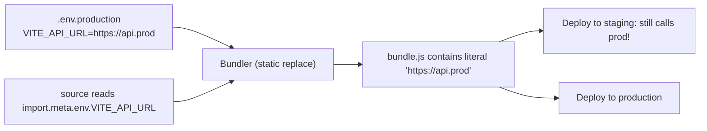
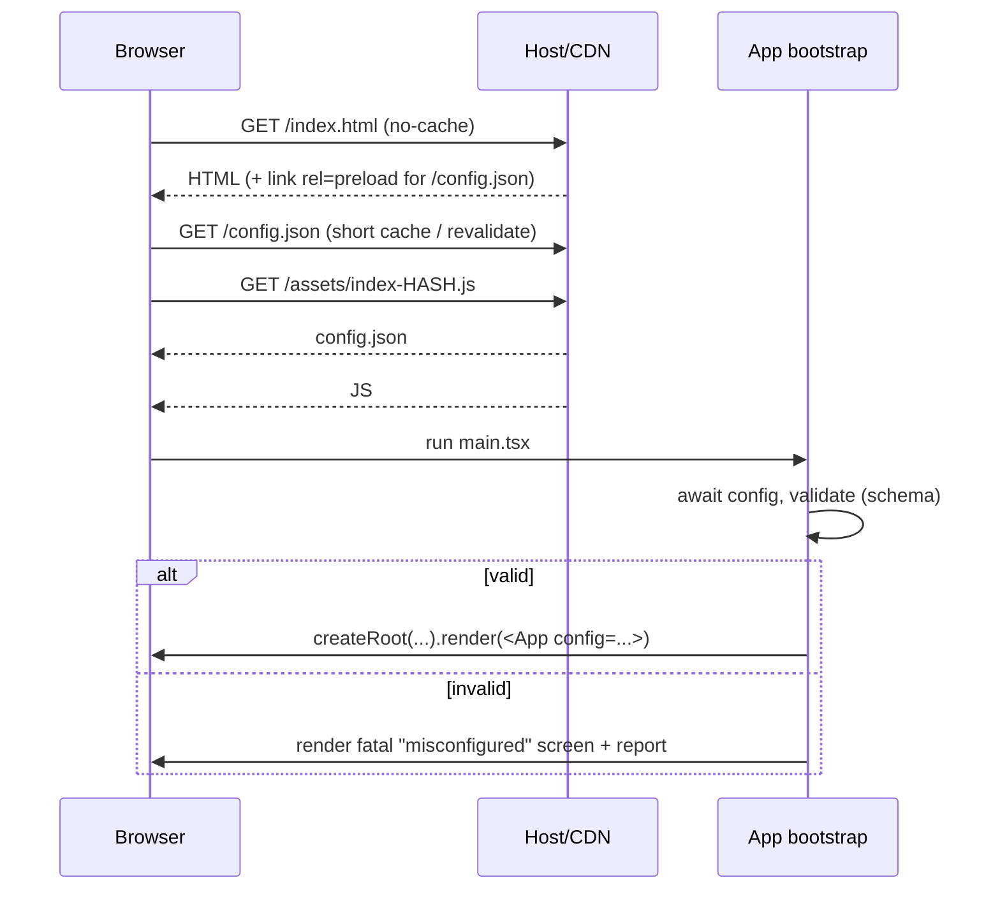
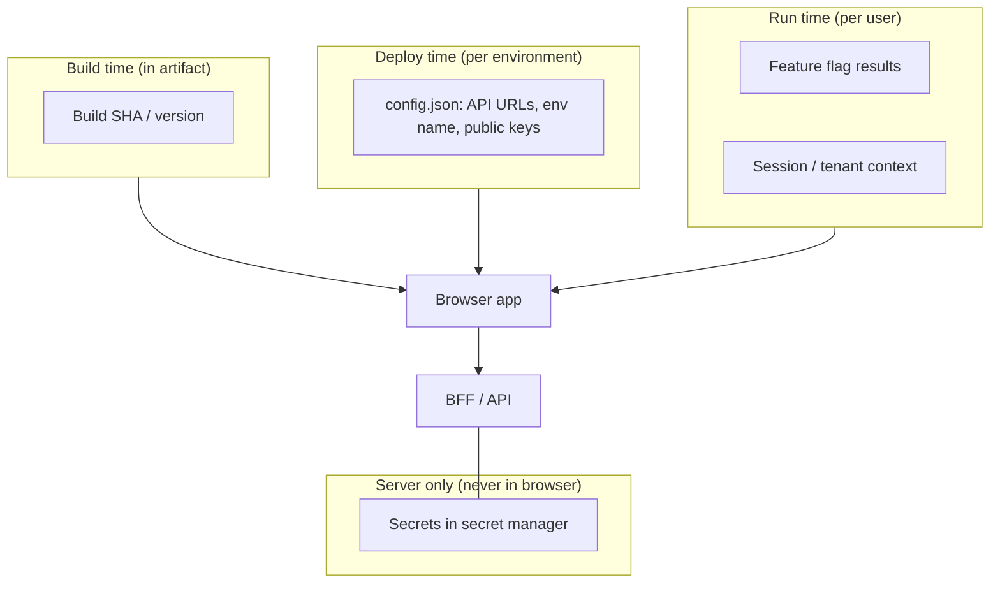
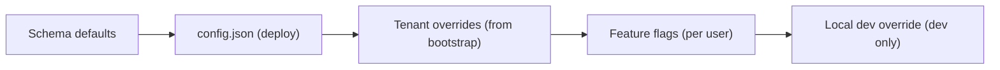

# 10 / 03 — Environment Configuration: Build-Time vs Runtime Config, Secrets, and Feature Flags

## 1. Lesson metadata

| | |
|---|---|
| **Level** | Advanced |
| **Study time** | 3.5–4.5 hours (reading 1.5 h, experiments 1.5 h, exercises 1.5 h) |
| **Prerequisites** | [02 — Deployment workflows](./02-deployment-workflows.md); [01 — Repository organization](./01-repository-organization.md); [Phase 0 — Tooling, transpilation, bundling](../00-web-and-javascript-foundations/20-tooling-transpilation-and-bundling.md); [Phase 1 — Project setup with Vite and TypeScript](../01-react-fundamentals/19-project-setup-vite-typescript.md) |
| **Next** | [04 — Observability and logging](./04-observability-and-logging.md) |
| **Related later** | [06 — Security: XSS, CSRF, CSP](./06-security-xss-csrf-csp.md), [18 — Continuous delivery](./18-continuous-delivery.md) |

**Learning objectives.** After this lesson you can:
1. State the invariant: *anything shipped to a browser is public*; therefore a front-end "environment variable" can never be a secret.
2. Explain how bundler env substitution works (static replacement at build time) and why it prevents "build once, deploy many".
3. Implement runtime configuration with validation, typing, and safe failure modes.
4. Separate **configuration**, **secrets**, **feature flags**, and **build metadata** and give each its proper home.
5. Design configuration for multiple tenants/regions/environments without rebuilding.
6. Debug "works in staging, wrong API URL in production" and cache-poisoned configuration.

**Concepts covered:** build-time substitution, `import.meta.env`, public prefix, runtime config document, schema validation, configuration vs secret vs flag, backend-for-frontend (BFF), config caching, fail-fast vs fail-safe, precedence, per-tenant config.

---

## 2. Deep conceptual explanation

### 2.1 What problem is this lesson solving?

Every application needs values that differ between environments: API base URLs, analytics keys, feature availability, tenant branding, Sentry DSN. Naïve approaches create three recurring failures:

1. **Leaked secrets.** A developer puts `VITE_PAYMENT_SECRET=...` in `.env`; it is compiled into public JavaScript.
2. **Rebuild-per-environment.** Different `.env` files yield different bundles per environment, so production runs an artifact no test has seen ([02](./02-deployment-workflows.md)).
3. **Configuration drift.** No one can list what differs between staging and production.

### 2.2 The invariant: the client is public

Anything delivered to the browser — JavaScript, JSON, HTML, source maps, even "obfuscated" values — can be read by any user with DevTools. Therefore:

| Value | Safe in browser? | Why |
|---|---|---|
| API base URL | Yes | Public by nature (visible in Network tab) |
| Public analytics/monitoring key (e.g. a DSN designed to be public) | Yes, *if the vendor designs it as public* — verify | Intended for client use; restrict by origin/rate limits on the vendor side |
| Publishable payment key (e.g. a "publishable" key) | Yes | Designed for browsers; cannot move money alone |
| **Secret** payment key, DB password, signing key, private API token | **Never** | Anyone can extract it |
| OAuth client secret (confidential client) | **Never** | SPAs are *public clients*; use PKCE/authorization-code flow without secret or a BFF |
| Feature flag evaluation results for this user | Yes | They are outputs, not secrets, unless they reveal confidential business info |
| Flag *rules*, targeting lists, customer lists | Usually no | Evaluate server-side and send only results |

The correct fix for "the front end needs to call a secret-protected third-party API" is **a server you control** (a BFF or API proxy) that holds the secret and exposes a narrow, authenticated endpoint ([Phase 9 — Auth boundaries](../09-advanced-rendering-and-ecosystem/12-auth-boundaries.md)).

### 2.3 Four kinds of "configuration"

| Kind | Examples | Lifetime | Where it belongs |
|---|---|---|---|
| **Build metadata** | Git SHA, build time, version | Fixed at build | Build-time constants |
| **Environment configuration** | API URL, CDN base, auth issuer URL, monitoring DSN, environment name | Fixed per deployment | **Runtime config** injected at deploy/load |
| **Feature flags** | `newCheckout`, kill switches | Changes while running | Flag service/endpoint, evaluated per user |
| **Secrets** | Signing keys, private tokens | Server only | Secret manager on the server/BFF — *not in the front-end at all* |

### 2.4 Build-time substitution: how bundler env vars really work

In Vite, `import.meta.env.VITE_API_URL` is **statically replaced** with a string literal at build time (Vite docs: constants are "statically replaced at build time"; checked against Vite 8.3 docs, 2026-10-22). Only variables with the configured public prefix (default `VITE_`) are exposed; the prefix exists precisely to prevent accidentally exposing server env variables. Webpack-era tools used `process.env.REACT_APP_*` or `DefinePlugin` with the same static-replacement idea; other frameworks use their own prefixes (⚠ verify per framework).



Consequences:
- The value is **baked into the JavaScript**. Promoting the same artifact to staging does not change it.
- Dead-code elimination uses these constants: `if (import.meta.env.DEV) {...}` is removed from production bundles. Good for dev-only code, bad if you intended to toggle at runtime.
- The build cache must treat these variables as inputs ([01 — hidden inputs](./01-repository-organization.md)).

### 2.5 Runtime configuration

Idea: ship one artifact; at startup the app obtains a small configuration document that is **not part of the bundle**.

Delivery options:

| Mechanism | How | Pros | Cons |
|---|---|---|---|
| `/config.json` fetched before render | Static file generated per environment at deploy time | Simple; cache-controllable; works with static hosting | Extra request before first render (mitigate with preload); needs validation |
| Inline script in `index.html` (`window.__CONFIG__ = {...}`) | Server/edge templating or container entrypoint rewrites HTML | No extra request | Needs templating step; CSP implications (inline script needs nonce/hash — [06](./06-security-xss-csrf-csp.md)); HTML caching must be per-environment |
| Server-rendered/bootstrap data | SSR injects config in HTML | Natural for SSR | Must serialize safely (XSS: `</script>` escaping) |
| BFF endpoint `/api/bootstrap` | Returns config + session + flags in one call | Can personalize; no secrets leak because server decides | Requires a server |

### 2.6 Configuration is an interface: validate it

Config arrives as untyped JSON from outside your type system. Treat it like any boundary input ([Phase 4 — API boundaries](../04-react-architecture/14-api-boundaries-and-data-access.md)): parse, validate, normalize, then expose a typed, frozen object. Fail fast with a clear error when required values are missing — a half-configured app that silently calls `undefined/api` is worse than a clear "misconfigured deployment" screen.

### 2.7 Common misconceptions

| Misconception | Reality |
|---|---|
| "`.env` files keep values private." | In a front-end build they only keep values out of *git*; prefixed variables go into the public bundle. |
| "Obfuscation/minification hides keys." | Minification is not secrecy. |
| "Use `process.env` in React at runtime." | In the browser there is no `process.env`; bundlers substitute at build time (or polyfill). |
| "Feature flags are configuration." | Flags change *while the app runs* and vary per user; they need evaluation, caching and lifecycle management. |
| "We'll hide the API key by loading it from our server." | If the browser receives it, users can read it. Move the *call* server-side. |

---

## 3. Internal mechanics

### 3.1 What exactly the bundler does with env variables

**Public guarantee (Vite docs, checked against Vite 8):** variables prefixed with `VITE_` are exposed on `import.meta.env`; modes (`development`, `production`, custom `--mode staging`) select which `.env.*` files load; `.env.local` files are conventionally git-ignored.
**Teaching model:** a compile-time macro replacing an expression with a literal.
**Implementation detail:** the replacement uses static text replacement of `import.meta.env.X` occurrences; **dynamic access** such as `import.meta.env[name]` or destructuring/spreading `import.meta.env` is not replaced per key; the build instead inlines the whole `import.meta.env` object. Verified with `vite@8` in the sandbox: with `.env` containing `VITE_A`, `VITE_B` and `SECRET`, code reading `import.meta.env[name]` bundled the values of **both** `VITE_` variables but not `SECRET`. So the prefix still protects unprefixed variables, but every `VITE_` value ends up in the bundle. This matters for security: avoid patterns that make it unclear which variables entered the bundle; **audit the built output** (grep) for strings that should not be there.

### 3.2 Mode vs environment

"Mode" (`development`/`production`) is a *build* concept controlling optimizations and which `.env` file loads; "environment" (`dev`/`staging`/`prod`) is a *deployment* concept. Conflating them leads to `--mode staging` producing a different (unoptimized or differently optimized) bundle than production. Prefer: **one production-mode build; environment identity supplied at runtime**.

### 3.3 Timeline of runtime config on page load



Because config and JS load in parallel (preload), the cost is small. Caching: `config.json` must **not** be cached for long — otherwise a config change (for example failover to another API region) takes hours to reach users. Use revalidation (`no-cache` + ETag) or a short `max-age` (⚠ choose based on how fast you need to change it).

---

## 4. Step-by-step execution walkthrough: promoting one artifact through three environments

1. CI builds `dist/` once. It contains **no environment-specific values** except build metadata (SHA).
2. Deploy-to-staging step writes `config.json` next to `index.html`: `{"env":"staging","apiBaseUrl":"https://api.stg.example.com", ...}`.
3. Browser loads HTML; preloads `config.json`; downloads JS.
4. `main.tsx` fetches (or reads preloaded) config, validates with a schema, builds an `AppConfig` object, creates the API client with `apiBaseUrl`.
5. Smoke tests on staging pass. The **same** `dist/` is deployed to production; the production `config.json` has production values.
6. Incident: API region A fails. Operations edit production `config.json` to point at region B — no rebuild, no redeploy of JS. With `no-cache` + ETag users pick it up on next navigation; open tabs keep the old values until reload (another skew case).

**Predict:** an open tab fetched config at 10:00; the API URL changes at 10:30. Does the tab switch? *No — config is read at startup; to apply changes to open tabs you'd need polling or a push message, with attention to consistency.*

---

## 5. Code examples

### 5.1 Minimal example — build-time variable (and its limits)

```ts
// src/vite-env.d.ts
/// <reference types="vite/client" />
interface ImportMetaEnv {
  readonly VITE_APP_VERSION: string;
}
interface ImportMeta { readonly env: ImportMetaEnv }
```

```ts
const version = import.meta.env.VITE_APP_VERSION; // replaced by a literal at build time
```

Fine for **build metadata**. Wrong for `API_URL` if you intend to promote one artifact across environments.

### 5.2 Practical example — typed, validated runtime config with Zod

```ts
// src/shared/config/schema.ts
import { z } from "zod";

export const ConfigSchema = z.object({
  env: z.enum(["development", "staging", "production"]),
  apiBaseUrl: z.string().url(),
  authIssuerUrl: z.string().url(),
  monitoring: z
    .object({
      dsn: z.string().url().optional(),   // public DSN-style identifier, if used
      sampleRate: z.number().min(0).max(1).default(0.1),
    })
    .default({ sampleRate: 0.1 }),
  features: z.record(z.string(), z.boolean()).default({}), // static defaults; flags may override
});

export type AppConfig = Readonly<z.infer<typeof ConfigSchema>>;
```

```ts
// src/shared/config/load.ts
import { ConfigSchema, type AppConfig } from "./schema";

export class ConfigError extends Error {
  constructor(message: string, readonly cause?: unknown) {
    super(message);
    this.name = "ConfigError";
  }
}

export async function loadConfig(url = "/config.json"): Promise<AppConfig> {
  let raw: unknown;
  try {
    const res = await fetch(url, { cache: "no-cache" });
    if (!res.ok) throw new ConfigError(`config.json responded ${res.status}`);
    const contentType = res.headers.get("content-type") ?? "";
    if (!contentType.includes("json")) {
      // SPA fallback returned index.html: a classic misdeploy
      throw new ConfigError(`config.json has unexpected content-type: ${contentType}`);
    }
    raw = await res.json();
  } catch (err) {
    if (err instanceof ConfigError) throw err;
    throw new ConfigError("Could not load config.json", err);
  }

  const parsed = ConfigSchema.safeParse(raw);
  if (!parsed.success) {
    throw new ConfigError(`Invalid config: ${parsed.error.message}`);
  }
  return Object.freeze(parsed.data);
}
```

**Line notes.**
- Zod is used as an example; any schema validator works (the schema above was run against `zod@4.6` in the sandbox: `safeParse` and the defaults behave as written; in Zod 4 the top-level `z.url()` is the documented form and `z.string().url()` is a deprecated alias that still works, and `error.message` is a JSON-formatted string of issues).
- Checking `content-type` catches the SPA-fallback misconfiguration where a missing `config.json` returns HTML with status 200 (see [02 §5.1](./02-deployment-workflows.md)).
- `Object.freeze` is shallow; it prevents accidental mutation at the top level. For deep immutability use `readonly` types and treat config as read-only.
- `cache: "no-cache"` asks the browser to revalidate, aligning with the header policy.

```tsx
// src/main.tsx
import { createRoot } from "react-dom/client";
import { loadConfig, ConfigError } from "@/shared/config/load";
import { App } from "./app/App";
import { ConfigProvider } from "@/shared/config/ConfigContext";
import { FatalError } from "./app/FatalError";

const container = document.getElementById("root")!;
const root = createRoot(container);

loadConfig()
  .then((config) => {
    root.render(
      <ConfigProvider value={config}>
        <App />
      </ConfigProvider>,
    );
  })
  .catch((err: unknown) => {
    // Report if monitoring is reachable without config (see lesson 05), then show a safe UI.
    root.render(<FatalError error={err instanceof ConfigError ? err : new ConfigError("Startup failed", err)} />);
  });
```

```tsx
// src/shared/config/ConfigContext.tsx
import { createContext, use, type ReactNode } from "react";
import type { AppConfig } from "./schema";

const ConfigContext = createContext<AppConfig | null>(null);

export function ConfigProvider({ value, children }: { value: AppConfig; children: ReactNode }) {
  return <ConfigContext value={value}>{children}</ConfigContext>;   // React 19: context as provider
}

export function useConfig(): AppConfig {
  const ctx = use(ConfigContext);
  if (!ctx) throw new Error("useConfig must be used inside <ConfigProvider>");
  return ctx;
}
```

Notes: React 19 allows rendering `<Context>` directly as a provider ([Phase 3 — Modern hooks and APIs](../03-react-state-and-hooks/22-modern-hooks-and-apis.md)); `<Context.Provider>` is still supported. Fetching *outside* React before first render keeps configuration out of the component lifecycle: no loading states sprinkled through the app, no effect race conditions ([Phase 6 — Fetch lifecycle](../06-data-fetching-and-state-ecosystems/01-fetch-lifecycle.md)). Trade-off: the user sees a blank page until config resolves; mitigate with a static HTML skeleton in `index.html` and `<link rel="preload" href="/config.json" as="fetch" crossorigin>` (⚠ verify preload attributes for fetch).

### 5.3 Incorrect example — secrets and conditionals baked into the bundle

```ts
// .env.production
VITE_STRIPE_SECRET_KEY=sk_live_...        // ❌ secret exposed publicly
VITE_API_URL=https://api.example.com

// src/api.ts
export const api = import.meta.env.VITE_API_URL;   // baked in
if (import.meta.env.VITE_ENV === "staging") {      // staging bundle != production bundle
  enableDebugPanel();
}
```

Problems: secret in public JS; per-environment bundles; the `if` becomes a build-time branch so production *never contains* the staging code path you tested.

### 5.4 Corrected implementation

- Move the secret to a server; the browser calls `POST /api/payments/intent` on your BFF, which uses the secret.
- Use only the **publishable** key client-side if the provider offers one (check the provider's key model in its documentation).
- Replace environment conditionals with runtime config (`config.env`) or flags.

### 5.5 Advanced — container entrypoint generating config at deploy time

```dockerfile
FROM nginx:alpine
COPY dist/ /usr/share/nginx/html/
COPY nginx.conf /etc/nginx/conf.d/default.conf
COPY docker-entrypoint.d/40-write-config.sh /docker-entrypoint.d/40-write-config.sh
```

```sh
#!/bin/sh
# docker-entrypoint.d/40-write-config.sh — runs at container start (nginx image convention; verify for your image version)
set -eu
cat > /usr/share/nginx/html/config.json <<EOF
{
  "env": "${APP_ENV:?APP_ENV is required}",
  "apiBaseUrl": "${API_BASE_URL:?API_BASE_URL is required}",
  "authIssuerUrl": "${AUTH_ISSUER_URL:?AUTH_ISSUER_URL is required}"
}
EOF
```

**Notes.** `${VAR:?msg}` makes the container fail fast on a missing variable — **fail at deploy time, not at user time**. Never interpolate untrusted values into JSON without escaping; these come from deployment tooling you control, but if values may contain quotes, generate JSON with a tool (`jq -n --arg`). Do **not** place secrets in these env vars: whatever is written into `config.json` is public. The `/docker-entrypoint.d/` convention belongs to the official nginx image ⚠ verify.

### 5.6 Feature flags: evaluate, don't expose rules

```ts
// src/shared/flags/useFlag.ts
import { use, createContext } from "react";

export type Flags = Readonly<Record<string, boolean>>;
export const FlagsContext = createContext<Flags>({});

export function useFlag(name: string, fallback = false): boolean {
  const flags = use(FlagsContext);
  return flags[name] ?? fallback;   // explicit fallback = behavior when flag service is down
}
```

Design decisions: **the fallback is a product decision** ("if we cannot reach the flag service, is the new feature on or off?"); default new/risky features to *off*, kill switches to *whatever is safe*. Flags must have an owner and an expiry date, or they become permanent branches ([15 — Technical debt](./15-technical-debt.md)). Vendor SDK specifics vary — ⚠ verify against your provider.

---

## 6. Visual explanations

### Where each kind of value lives



### Precedence (lowest to highest)



State the precedence explicitly in code and docs; most "why is this value X?" incidents are undocumented precedence.

---

## 7. Alternative approaches and trade-offs

**Where to get environment-specific values:**

| Approach | Promote one artifact? | Extra request | Secret-safe? | Change without deploy | When to prefer |
|---|---|---|---|---|---|
| Build-time `VITE_*` | No | None | Only if value is public | No (rebuild) | Truly static public values; single-environment apps; build metadata |
| `/config.json` runtime | Yes | One (parallelizable) | Public values only | Yes (edit file) | Static hosting SPAs |
| Inline `window.__CONFIG__` (templated HTML) | Yes | None | Public only | Yes (re-render HTML) | When you control the HTML server; SSR |
| BFF `/bootstrap` | Yes | One | Server decides what to expose | Yes | Auth-heavy apps; per-tenant config; need to hide logic |
| Separate build per environment | No | None | Same | No | Hard compliance mandating physically separate artifacts (rare; accept the testing gap) |

**When runtime config is *not* best:** a small public marketing site with one environment gains nothing from the extra request and complexity — build-time constants are simpler and faster. Likewise a value used for code branching that you want tree-shaken (`import.meta.env.DEV`) is appropriately build-time.

---

## 8. Best practices and anti-patterns

**Do**
- Treat the browser as hostile and public: *no secrets*, ever.
- Validate config at startup; fail loudly and early (and report it).
- Give flags owners, expiry, and explicit fallbacks.
- Keep a documented list of every config key: purpose, owner, default, who may change it.
- Grep the built bundle in CI for known-secret patterns (see [07](./07-dependency-security.md) for secret scanning).

**Beginner mistakes**
- Committing `.env` with secrets; using `VITE_` for private values "because it didn't work otherwise".
- Using `process.env.X` in browser code and being surprised at `undefined`.

**Experienced-developer mistakes**
- Dynamic `import.meta.env[...]` access that leaks more than intended.
- Caching `config.json` for a year with the hashed assets' policy.
- Flag sprawl: hundreds of flags nobody can reason about.
- Client-side authorization decided by a flag ("hide the admin button" is UX, not security — [06](./06-security-xss-csrf-csp.md)).

**Smells**
- `if (env === "production")` scattered through components.
- Different Docker images/bundles per environment "for safety".
- Config values spread across `.env`, JSON, build args, and CI variables with no single index.

**Justified exceptions**
- Build-time inclusion of a public analytics ID for a static site; per-environment builds where a regulator demands separate artifacts (document the testing gap and mitigate by identical build steps and hash comparison of non-config files).

---

## 9. Real-world application

**E-commerce multi-region.** Region-specific API endpoints, currency, tax display: per-region config documents or bootstrap by geography ([09 — i18n](./09-internationalization.md)). Constraint: failover by editing config; hence short cache.

**Finance.** Separate staging/UAT/prod with identical artifacts; audit shows artifact hash + config version separately. Constraint: configuration changes require approval, as they alter behavior without code review — treat config as code (versioned, reviewed).

**Multi-tenant SaaS.** Tenant branding and enabled modules arrive via bootstrap after auth; design token overrides applied via CSS variables ([Phase 4 — Design systems](../04-react-architecture/20-design-systems.md)). Constraint: never trust tenant-supplied config values as HTML/CSS without validation (XSS/CSS injection — [06](./06-security-xss-csrf-csp.md)).

**Realtime dashboards.** WebSocket URL from config; reconnection logic must handle URL change by refreshing config on reconnect.

---

## 10. Debugging and troubleshooting

**Symptom: Staging calls the production API.**
Reproduce: open Network panel on staging. Investigate: search the bundle for the production URL; check whether it is a literal. Root cause: build-time substitution + promoted artifact. Fix: runtime config. Validate: staging bundle hash equals production's and requests go to the staging URL.

**Symptom: `Cannot read properties of undefined` right after deploy in one environment.**
Investigate: Network tab for `config.json` (status, content-type, body); a missing file produces HTML via SPA fallback. Fix: fail-fast validation (§5.2), deploy check that asserts `config.json` exists and validates against the schema (run the schema in CI against each environment's config file).

**Symptom: Config changes take hours to appear.**
Investigate: response headers on `config.json`, CDN cache status, service worker. Root cause: long cache. Fix: revalidation headers; purge on config deploy.

**Symptom: Secret discovered in production bundle.**
Investigate: `grep` built assets; git history; source maps. Response: **rotate the secret immediately** (assume compromised), remove it, move the call server-side, add CI scanning. Rewriting git history does not un-leak a key.

**Symptom: Flag-gated feature visible to the wrong users.**
Investigate: where evaluation happens; targeting rules; fallback behavior when the flag service times out; caching of flag results across user switches (logout/login in same tab). Fix: evaluate per session; reset flag state on identity change.

---

## 11. Exercises

### Level A — Knowledge
**A1.** Why is a front-end environment variable never a secret?
**A2.** What does `VITE_` prefixing do, and what does it *not* do?
**A3.** Name four kinds of configuration and a home for each.
**A4.** Why must `config.json` have a different cache policy from hashed JS files?

### Level B — Code comprehension
**B1.** Given `const url = import.meta.env.VITE_API_URL;` in a production build, then the artifact is copied to a different environment. Which URL does it call and why?
**B2.** In `loadConfig`, what failure does the `content-type` check catch, and what would happen without it?

### Level C — Implementation
**C1.** Implement `loadConfig` retry: one retry after 500 ms for network errors, none for validation errors. Explain why validation errors are not retried.
**C2.** Write a CI script that validates each environment's `config.*.json` against the schema.

### Level D — Debugging
**D1.** After a deploy, the app renders a blank page; Console shows `Unexpected token '<' in JSON at position 0`. Diagnose.
**D2.** Security review finds the string `sk_live_` in `assets/index-*.js`. Walk through the response.

### Level E — Architecture decisions
**E1.** You need to call a third-party geocoding API that requires a secret key. Options: embed key; restrict key by HTTP referrer; proxy via your backend. Decide.
**E2.** Design configuration delivery for a SaaS app with 200 tenants that each have a different logo, color theme, and enabled modules.

### Level F — Expert challenge
**F1.** Design a configuration system with: one artifact for all environments, config versioning and approval, instant rollback of config, safe handling when config is invalid, and protection against stale config in open tabs. Discuss failure modes.

---

## 12. Detailed answers and explanations

> Attempt the exercises first.

**A1.** Because the browser must receive the value to use it, and anything delivered to the browser is readable by the user (DevTools, network inspection, bundle download). Minification and obfuscation do not change this. A value is only "secret" if it never leaves a server you control.

**A2.** It controls *which* env variables the bundler exposes to client code (default `VITE_`), preventing accidental exposure of unprefixed server variables. It does **not** make exposed variables private, nor does it allow runtime changes — it only gates build-time substitution. ⚠ Verify the prefix option in current docs.

**A3.** Build metadata → build-time constants; environment configuration → runtime config document (or bootstrap); feature flags → flag service evaluated per user; secrets → server-side secret manager used by a BFF/API, never the browser. (Also acceptable: per-tenant config from a bootstrap endpoint.)

**A4.** Hashed JS is immutable because its name changes with content; config keeps the same URL while content changes, so it needs revalidation or a short lifetime. A long-lived config makes failover and corrections slow.

**B1.** It calls the URL that was present at build time, because the bundler replaced the expression with a string literal. Copying the artifact does not rebuild. Edge: if the code were reading a runtime-injected `window.__CONFIG__`, it would reflect the deployment.

**B2.** It detects that the response is not JSON — typically SPA fallback serving `index.html` with status 200 when `config.json` is missing. Without it, `res.json()` throws a `SyntaxError: Unexpected token '<'`, producing a cryptic failure rather than "config.json missing/misrouted". It improves diagnosability.

**C1.** Sketch:

```ts
async function fetchRaw(url: string): Promise<unknown> { /* as in loadConfig, throws ConfigError(kind) */ }

export async function loadConfigWithRetry(url = "/config.json") {
  let raw: unknown;
  try {
    raw = await fetchRaw(url);
  } catch (err) {
    if (!(err instanceof TypeError)) throw err;          // fetch network failures are TypeError
    await new Promise((r) => setTimeout(r, 500));
    raw = await fetchRaw(url);
  }
  const parsed = ConfigSchema.safeParse(raw);
  if (!parsed.success) throw new ConfigError(parsed.error.message); // never retried
  return Object.freeze(parsed.data);
}
```
Validation errors are deterministic: the same bytes will fail again, so a retry only delays the visible error. Network errors are transient. Edge: HTTP 5xx may deserve a retry; 404 should not.

**C2.** Criteria: loads each file, applies the same `ConfigSchema` (import from the app's source via a Node script), exits non-zero with file name and path of invalid keys, runs on PRs touching config, and runs again post-deploy against the *deployed* config URL.

**D1.** `config.json` returned HTML (index.html fallback) — the file is missing or the path is wrong, or a proxy returned a login page. Check Network ▸ `config.json` response body. Fix the deploy step; keep the content-type validation and a CI/post-deploy check.

**D2.** (1) Treat as compromised: **rotate/revoke** the key at the provider immediately. (2) Find how it got in (`VITE_*`, committed `.env`, build arg). (3) Check provider logs for misuse. (4) Move the operation to the server. (5) Add secret scanning in CI and a bundle grep gate. (6) Remove old assets/source maps still containing it (CDN purge) — but do not rely on this. Wrong answer: "just delete the variable and redeploy."

**E1.** Embedding exposes the key. Referrer restriction raises the bar but referrers are spoofable by non-browser clients and the key remains extractable — acceptable only for keys the vendor *designs* as browser keys with quota/abuse protections. A backend proxy keeps the secret server-side, lets you add authentication, rate limiting and caching, at the cost of latency and operating a service. Choose the proxy unless the vendor offers a documented browser-safe key with domain restrictions and the abuse risk is acceptable.

**E2.** Good answer: tenant config returned by a bootstrap endpoint after authentication/identification (subdomain), validated, applied as CSS custom properties for theme; logos referenced by URLs on a controlled CDN (not arbitrary user URLs — SSRF/XSS considerations); enabled modules as flags; cache per tenant with short TTL; loading strategy that avoids flash of default theme (inline critical theme from server or skeleton); no build per tenant (200 builds is untestable). Evaluate against criteria: personalization latency, caching efficiency, security of tenant-controlled values, testability.

**F1.** Example design: config stored as versioned files in a repo (reviewed, approved by CODEOWNERS), published to a bucket as immutable `config/<version>.json` plus a small pointer `config.json` that names the active version (rollback = move pointer); schema-validated in CI before publish; the client validates again and, on invalid *new* config, falls back to the last known-good (cached in memory/`localStorage` with try/catch) and reports; open tabs re-check pointer on focus/interval and show reload prompt or apply safe values. Failure modes: pointer cached too long; schema drift between config publisher and client versions (version the schema; support N and N-1); fallback hiding a broken deploy (alert on fallback use); config change that is incompatible with old client builds (skew).

---

## 13. Senior engineer interview questions

**Q1. "Where do you put an API key in a React app?"**
*Strong answer:* First ask what kind of key. If it is designed for browsers (publishable, origin-restricted), it can be in runtime config. If it is a secret, it must never be in the client — the call moves to a server we control (BFF/proxy), which authenticates the user and applies the secret. Anything in a bundle or JSON the browser loads is public, regardless of obfuscation.

**Q2. "Why not use `.env` files per environment in CI?"**
*Strong answer:* Bundlers substitute env vars at build time, so each environment gets a different artifact; the one tested isn't the one shipped, builds multiply, and promotion/rollback gets harder. Prefer building once and injecting configuration at deploy/load time, with schema validation.

**Q3. "How do you roll out a configuration change safely?"**
*Strong answer:* Treat config as code: reviewed, versioned, validated against a schema in CI, deployed through a controlled pointer, observable, and quickly revertible. Consider cache TTLs and open tabs. Alert on fallback or validation failures.

**Q4. "Feature flags vs config?"**
*Strong answer:* Config is per deployment and mostly static; flags vary per user/cohort and change at runtime, needing evaluation, a defined fallback when unreachable, and lifecycle management. Flags are not an authorization mechanism.

---

## 14. Further learning resources

| Resource | URL | Covers / why | Level | Study |
|---|---|---|---|---|
| Vite — Env variables and modes | <https://vite.dev/guide/env-and-mode.html> | `import.meta.env`, `VITE_` prefix, modes | Intermediate | Whole page, security note |
| The Twelve-Factor App — Config | <https://12factor.net/config> | Config separated from code (server-centric but foundational) | Intermediate | Section III |
| MDN — `Cache-Control` | <https://developer.mozilla.org/en-US/docs/Web/HTTP/Headers/Cache-Control> | Cache policy for config documents | Intermediate | `no-cache`, `max-age` |
| OWASP Cheat Sheet — Secrets Management | <https://cheatsheetseries.owasp.org/cheatsheets/Secrets_Management_Cheat_Sheet.html> | Handling and rotation of secrets | Intermediate | Rotation, storage |
| OAuth 2.0 for Browser-Based Apps (IETF draft/RFC) | <https://datatracker.ietf.org/doc/draft-ietf-oauth-browser-based-apps/> *(still an Internet-Draft, rev 27, when checked 2026-10-22)* | Public client guidance, BFF pattern | Advanced | Architecture patterns |
| Zod docs | <https://zod.dev/> | Schema validation | Intermediate | Parsing, `safeParse` |
| Martin Fowler — Feature toggles | <https://martinfowler.com/articles/feature-toggles.html> | Flag types, lifecycle | Intermediate | Toggle categories |

URLs in this table were checked for HTTP 200 on 2026-10-22; any still marked *(unverified)* could not be checked automatically (blocked or unreachable). A 200 response does not guarantee the page content still matches the description; if a link has moved, search the site for the quoted title.

---

## 15. Knowledge checkpoint

**You should now understand**
- The client-is-public invariant and what it implies for secrets.
- Static substitution of env vars and why it breaks artifact promotion.
- The difference between config, flags, secrets and build metadata.

**You should be able to explain without notes**
- How to deliver runtime config and why validation and cache policy matter.
- Why client-side flags are not authorization.

**You should be able to implement**
- Typed, validated runtime config with fail-fast errors; a container/deploy step that writes config; flag access with explicit fallbacks.

**You should be able to debug**
- Wrong-environment calls, config served as HTML, stale config, leaked secrets.

**Prerequisite for next:** [04 — Observability and logging](./04-observability-and-logging.md) uses the build ID and environment config to tag telemetry.
