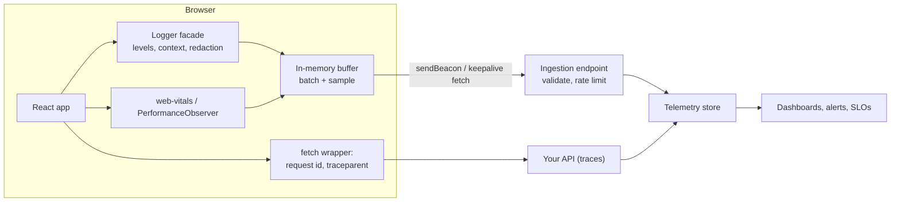
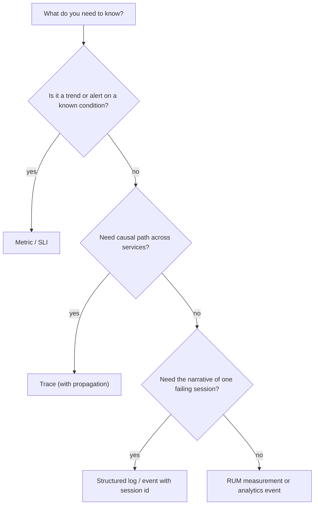
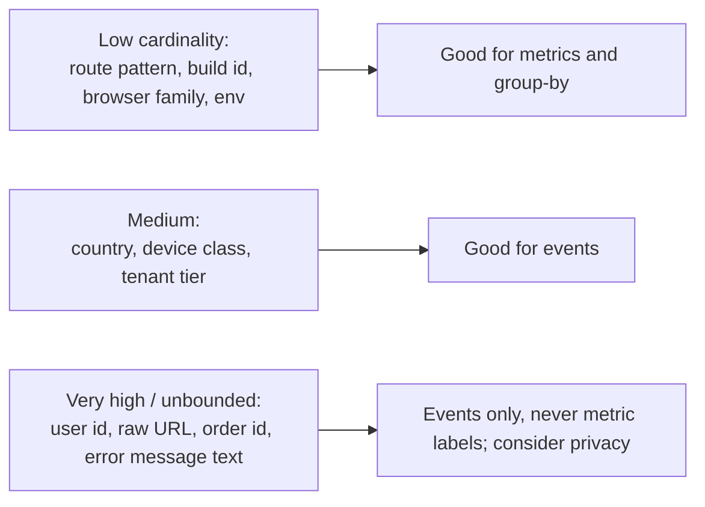

# 10 / 04 — Observability and Logging: Seeing a Front-End Application in Production

## 1. Lesson metadata

| | |
|---|---|
| **Level** | Advanced |
| **Study time** | 4–5 hours (reading 2 h, experiments 1.5 h, exercises 1.5 h) |
| **Prerequisites** | [03 — Environment configuration](./03-environment-configuration.md); [02 — Deployment workflows](./02-deployment-workflows.md); [Phase 7 — Web vitals and budgets](../07-performance/21-web-vitals-and-budgets.md); [Phase 0 — Web APIs and network requests](../00-web-and-javascript-foundations/14-web-apis-and-network-requests.md) |
| **Next** | [05 — Error monitoring](./05-error-monitoring.md) |
| **Related later** | [19 — Incident debugging](./19-incident-debugging.md), [Phase 7 — Production performance investigations](../07-performance/22-production-performance-investigations.md) |

**Learning objectives.** After this lesson you can:
1. Define observability as the ability to answer *new* questions about system behavior from its telemetry, and distinguish it from monitoring.
2. Distinguish logs, metrics, traces, events and real-user monitoring (RUM), and say what each is good and bad at in a browser.
3. Design a structured, privacy-aware client logger with levels, context enrichment, redaction, batching and sampling.
4. Propagate correlation between browser and back end (request IDs, W3C Trace Context).
5. Collect Core Web Vitals and custom performance measurements from real users, and reason about percentiles and segmentation.
6. Control telemetry cost and risk: volume, PII, consent, and performance impact on the page itself.

**Concepts covered:** monitoring vs observability, the three pillars and their limits, high-cardinality attributes, structured logging, log levels, sampling, redaction, `sendBeacon`/`keepalive`, `PerformanceObserver`, web-vitals metrics, W3C `traceparent`, OpenTelemetry (browser support caveats), RUM vs synthetic, SLI/SLO, privacy and consent.

---

## 2. Deep conceptual explanation

### 2.1 What problem is this lesson solving?

On your laptop you can open DevTools. In production, **your code runs on millions of devices you cannot inspect**: old Android phones with throttled CPUs, corporate proxies that strip headers, browser extensions that inject scripts, flaky networks. When a user says "checkout is slow", your only evidence is the telemetry you decided to collect *before* the problem happened.

A team without telemetry debugs by guessing; a team with unstructured `console.log` noise debugs by grepping. Observability is the engineering of **evidence** — designed deliberately, with cost and privacy in mind.

### 2.2 Monitoring vs observability

| | Monitoring | Observability |
|---|---|---|
| Question type | Known: "Is error rate above 2%?" | Novel: "Why are Safari users on 4G in Brazil failing at step 3 only after the 14:10 deploy?" |
| Mechanism | Predefined dashboards and alerts | Rich, high-cardinality, queryable events you can slice arbitrarily |
| Failure mode | Unknown-unknowns are invisible | Cost and noise if collected without questions in mind |

You need both: alerts for known failure signatures, rich data for exploration.

### 2.3 The signal types

| Signal | What it is | Strength | Weakness in the browser |
|---|---|---|---|
| **Logs** | Discrete, timestamped records | Narrative detail for a specific incident | Volume; no guarantee of delivery (tab closes); privacy |
| **Metrics** | Aggregated numbers over time (counts, histograms) | Cheap, great for alerting and trends | Lose individual context; cardinality limits |
| **Traces** | Causally linked spans for one operation across services | Shows where time went across front end → API → DB | Browser instrumentation is less mature; sampling needed |
| **Events** | Structured business/technical occurrences ("checkout_submitted") | Funnels, product analytics, debugging flows | Schema discipline required |
| **RUM** | Performance/behavior measurements from real sessions | Ground truth of user experience (p75 INP, LCP) | Sampling bias, consent, device variation |
| **Synthetic** | Scripted probes from controlled environments | Consistent baseline; detects outages when no users are online | Does not represent real devices/networks |

The "three pillars" (logs, metrics, traces) is a common teaching model; modern practice emphasizes *wide structured events with high-cardinality attributes* (user segment, build ID, route, device class) that can derive all three. ⚠ Terminology and tooling vary by vendor.

### 2.4 What is different about the front end

1. **You do not control the runtime.** Telemetry code runs beside arbitrary extensions, in memory-constrained tabs.
2. **Delivery is unreliable.** Pages unload; requests are cancelled. Use `navigator.sendBeacon()` or `fetch(..., { keepalive: true })` for last-gasp sends ([Phase 0 — Web APIs](../00-web-and-javascript-foundations/14-web-apis-and-network-requests.md)); be aware of payload size limits (⚠ keepalive/beacon body limits are browser-defined, commonly around 64 KB — verify).
3. **Telemetry competes with your app.** It uses the main thread, network and battery. A logger that blocks rendering is a bug.
4. **Privacy and legal exposure.** URLs contain IDs; form fields contain personal data; consent regimes (e.g. GDPR/ePrivacy) can require consent for non-essential telemetry — consult legal counsel; this lesson is not legal advice.
5. **Everything is untrusted input.** Telemetry endpoints receive data from arbitrary clients; attackers can spam or forge it. Never base security decisions on client telemetry; rate-limit and validate on ingestion.

### 2.5 Percentiles, not averages

Latency distributions are skewed. The mean hides pain. Use p50 (typical), p75 (the Core Web Vitals assessment percentile), p95/p99 (tail). **Never average percentiles across segments**; aggregate underlying histograms or raw events. With low traffic in a segment, percentiles are noisy — report sample sizes.

### 2.6 SLIs and SLOs for a front end

A **Service Level Indicator** is a measured ratio of good events to valid events; a **Service Level Objective** is the target over a window.

| SLI | Definition (example) | SLO (example) |
|---|---|---|
| Page-load availability | % of page loads where the app bootstrapped without a fatal error | 99.5% over 28 days |
| Interaction latency | % of page views with INP ≤ 200 ms (the "good" threshold: the web-vitals README lists `INPThresholds = [200, 500]` ms, `LCPThresholds = [2500, 4000]` ms and `CLSThresholds = [0.1, 0.25]`) | 75% of views |
| Checkout success | % of checkout attempts completing without client error | 98% |

Error budgets (1 − SLO) turn debates about "is it stable enough to ship?" into arithmetic. Pick SLIs that match user-visible outcomes, not internal conveniences.

### 2.7 Common misconceptions

| Misconception | Reality |
|---|---|
| "More logs = more observability." | Unstructured volume without schema or queries is noise and cost. |
| "Console logs in production are harmless." | They can leak data, are visible to users, and cost CPU when logging large objects. |
| "Lab Lighthouse scores equal user experience." | Lab data is one controlled run; RUM shows the distribution on real devices ([Phase 7 lesson 21](../07-performance/21-web-vitals-and-budgets.md)). |
| "Sampling loses the interesting data." | Smart sampling (keep all errors, sample successes; tail-based on the server) preserves signal. |
| "Telemetry IDs make data anonymous." | Pseudonymous IDs are often still personal data under privacy law. |

---

## 3. Internal mechanics

### 3.1 How the browser exposes performance data

**Public guarantees (W3C/WHATWG specs; verify support per browser):**
- `PerformanceObserver` subscribes to entry types: `navigation`, `resource`, `paint`, `largest-contentful-paint`, `layout-shift`, `longtask` (Long Tasks API), `event` (Event Timing, basis of INP), `long-animation-frame` (newer; MDN browser-compat data: Chromium 123+ only, not Firefox or Safari), `measure`/`mark` (User Timing).
- `performance.mark()` / `performance.measure()` let you create **custom timings** on the same timeline as browser entries and show up in DevTools Performance panel.
- Navigation Timing gives phases of page load (redirect, DNS, TCP/TLS, request, response, DOM processing).

**Teaching model:** the browser maintains a timeline buffer; observers receive entries asynchronously.
**Implementation detail:** buffer sizes, entry availability and attribution detail (e.g. which element caused LCP/INP) differ across browsers; Chromium exposes the most. Safari and Firefox support fewer metrics (for example no Long Animation Frames) — check the compatibility tables when you read this; expect missing data for some cohorts and design dashboards accordingly.

### 3.2 Core Web Vitals reporting: use the library or the specs?

Computing LCP/CLS/INP correctly is subtle (back/forward cache restores, prerender, soft navigations, visibility changes, when to finalize). Google's open-source `web-vitals` library encapsulates this (`onLCP`, `onINP`, `onCLS`, `onFCP`, `onTTFB`). Names and attribution builds have evolved across major versions (e.g. `onFID` is gone now that INP replaced FID). The snippet in §5.5 type-checks against `web-vitals@6.2.3` (current in the sandbox on 2026-10-22); the README documents `Metric.rating` as `'good' | 'needs-improvement' | 'poor'`. Report on `visibilitychange`/`pagehide` since final values are known only at the end of the page lifecycle.

### 3.3 Trace context propagation

W3C **Trace Context** defines the `traceparent` request header:

```text
traceparent: 00-<32 hex trace-id>-<16 hex parent-span-id>-<2 hex flags>
```

If the browser generates a trace ID and sends `traceparent` on API calls, the back end's traces and the browser's events share an ID — "this slow request" can be followed from click to database. Constraints:
- **CORS:** custom request headers trigger a preflight for cross-origin calls; the API must allow the header in `Access-Control-Allow-Headers` ([Phase 0 lesson 14](../00-web-and-javascript-foundations/14-web-apis-and-network-requests.md)). Propagate only to your own origins, never to third parties (leaks and breaks).
- **Sampling flag:** the `flags` field says whether the trace is sampled; decide consistently.
- **Privacy:** trace IDs are random, not user data, but linking them to user IDs in your backend makes them personal data-adjacent.

### 3.4 Pipeline



---

## 4. Step-by-step execution walkthrough: one slow checkout, traced end to end

1. App boots; `BUILD_ID` ([02 §5.3](./02-deployment-workflows.md)) and `env` from config ([03](./03-environment-configuration.md)) are attached to every telemetry event as **global context**.
2. User clicks "Place order". The click handler calls `telemetry.mark("checkout_submit_start")` and starts a span-like timer.
3. The `fetch` wrapper creates a **request ID** and `traceparent`, sends `POST /orders`.
4. The server responds in 2.4 s; the wrapper logs a structured event: `{event:"http_request", route:"/orders", status:200, durationMs:2400, requestId, traceId}` (no body, no PII).
5. React renders the confirmation; INP for the click is measured by the browser's Event Timing (processing + presentation delay).
6. On `pagehide`, the buffer flushes via `sendBeacon`, including the final INP/CLS values.
7. Later, an engineer queries: p95 `durationMs` for route `/orders` grouped by `buildId`, `deviceClass`, `country`. A regression after build `a1b2c3` for `deviceClass=low` is visible; the trace ID leads to a slow DB query in the API's traces.

**Predict:** if the logger sends one request per log call on every keystroke, what happens? *Network and main-thread overhead degrade the very interaction you are measuring.* Batching/sampling is not optimization theater, it is correctness of the measurement.

---

## 5. Code examples

### 5.1 Minimal example — a structured logger facade

```ts
// src/shared/telemetry/logger.ts
export type LogLevel = "debug" | "info" | "warn" | "error";

export interface LogEvent {
  level: LogLevel;
  message: string;                 // stable, low-cardinality string: "checkout_failed", not "Order 123 failed"
  ts: number;                      // epoch ms
  context: Record<string, unknown>;
}

export interface Transport {
  send(events: LogEvent[]): void;
}

const ORDER: Record<LogLevel, number> = { debug: 10, info: 20, warn: 30, error: 40 };

export function createLogger(opts: {
  minLevel: LogLevel;
  base: Record<string, unknown>;     // buildId, env, appVersion...
  transport: Transport;
  redact?: (ctx: Record<string, unknown>) => Record<string, unknown>;
}) {
  const redact = opts.redact ?? defaultRedact;
  function log(level: LogLevel, message: string, ctx: Record<string, unknown> = {}) {
    if (ORDER[level] < ORDER[opts.minLevel]) return;
    opts.transport.send([
      { level, message, ts: Date.now(), context: redact({ ...opts.base, ...ctx }) },
    ]);
  }
  return {
    debug: (m: string, c?: Record<string, unknown>) => log("debug", m, c),
    info: (m: string, c?: Record<string, unknown>) => log("info", m, c),
    warn: (m: string, c?: Record<string, unknown>) => log("warn", m, c),
    error: (m: string, c?: Record<string, unknown>) => log("error", m, c),
    child: (extra: Record<string, unknown>) =>
      createLogger({ ...opts, base: { ...opts.base, ...extra } }),
  };
}

const SENSITIVE_KEY = /pass(word)?|token|secret|authorization|cookie|card|cvv|ssn|email|phone|iban/i;

export function defaultRedact(ctx: Record<string, unknown>): Record<string, unknown> {
  const out: Record<string, unknown> = {};
  for (const [k, v] of Object.entries(ctx)) {
    if (SENSITIVE_KEY.test(k)) out[k] = "[redacted]";
    else if (v && typeof v === "object" && !Array.isArray(v)) out[k] = defaultRedact(v as Record<string, unknown>);
    else out[k] = v;
  }
  return out;
}
```

**Line notes.**
- `message` is a **stable event name**; variable data goes in `context`. This keeps messages groupable and aggregate-friendly.
- Redaction by key name is a *safety net*, not a privacy design. Patterns miss `{ "x": "john@example.com" }`. The real defense is **not logging user content** (never log request bodies, form values, or full URLs with query strings by default).
- `child()` creates a logger with inherited context — e.g. per feature or per request.
- This logger holds no state and does no I/O itself; the `Transport` decides (testable: pass an in-memory transport in tests — [Phase 8](../08-testing-and-quality/01-test-strategy-and-pyramid.md)).

### 5.2 Practical example — a batching, sampling transport using `sendBeacon`

```ts
// src/shared/telemetry/beaconTransport.ts
import type { LogEvent, Transport } from "./logger";

export function createBeaconTransport(opts: {
  endpoint: string;
  maxBatch?: number;          // events per request
  flushMs?: number;
  sampleRate: number;         // 0..1 for non-error events
  maxBytes?: number;          // stay under browser limits for keepalive/beacon (64 KiB limit for `sendBeacon` payloads per MDN; `fetch` `keepalive` has a similar in-flight body quota)
}): Transport {
  const maxBatch = opts.maxBatch ?? 20;
  const flushMs = opts.flushMs ?? 5000;
  const maxBytes = opts.maxBytes ?? 60_000;
  // Decide once per session so a session's logs are complete or absent (not random holes).
  const sessionSampled = Math.random() < opts.sampleRate;
  let buffer: LogEvent[] = [];
  let timer: number | undefined;

  function flush() {
    if (timer !== undefined) { clearTimeout(timer); timer = undefined; }
    if (buffer.length === 0) return;
    const batch = buffer; buffer = [];
    const body = JSON.stringify({ events: batch });
    if (body.length > maxBytes) {            // too big: drop oldest half rather than fail silently
      const half = batch.slice(Math.floor(batch.length / 2));
      buffer = []; send(JSON.stringify({ events: half }));
      return;
    }
    send(body);
  }

  function send(body: string) {
    try {
      const blob = new Blob([body], { type: "application/json" });
      if (!navigator.sendBeacon?.(opts.endpoint, blob)) {
        void fetch(opts.endpoint, { method: "POST", body, keepalive: true,
          headers: { "content-type": "application/json" } }).catch(() => {});
      }
    } catch { /* telemetry must never throw into app code */ }
  }

  // Flush when the page is hidden: the last reliable moment on mobile and desktop.
  addEventListener("visibilitychange", () => {
    if (document.visibilityState === "hidden") flush();
  });
  addEventListener("pagehide", flush);

  return {
    send(events) {
      for (const e of events) {
        const keep = e.level === "error" || e.level === "warn" || sessionSampled;
        if (!keep) continue;
        buffer.push(e);
      }
      if (buffer.length >= maxBatch) flush();
      else if (timer === undefined) timer = window.setTimeout(flush, flushMs);
    },
  };
}
```

**Design notes and trade-offs.**
- **Sampling by session** (not per event) keeps a sampled session coherent; errors/warnings bypass sampling because their volume is naturally bounded *unless* a loop floods them — add a rate limit in production (see Exercise C2).
- `sendBeacon` is fire-and-forget, queued by the browser even as the page unloads. It cannot read the response; for custom headers use `fetch` with `keepalive` (subject to CORS). Content-type handling for beacons has historically varied by browser — verify behavior, particularly with cross-origin JSON blobs (a `Blob` with a non-CORS-safelisted type may trigger a preflight).
- `catch {}` is intentional: telemetry failures must never break the app (but do count your own drops via a metric if you can).
- `visibilitychange` → hidden is more reliable than `unload`/`beforeunload`, which are unreliable on mobile and can disable the back/forward cache ([Phase 0 lesson 15](../00-web-and-javascript-foundations/15-http-caching-and-navigation.md)). Verify current guidance on page lifecycle events.

### 5.3 Incorrect example

```tsx
function CheckoutForm({ order, user }: Props) {
  console.log("rendering checkout", order, user);              // ❌ every render, PII, large objects
  const submit = async () => {
    try {
      await api.post("/orders", order);
    } catch (e) {
      console.error("failed " + JSON.stringify(order) + " " + user.email, e);   // ❌ PII; unstructured
      fetch("/log", { method: "POST", body: JSON.stringify({ e: String(e) }) }); // ❌ no batching/keepalive; unhandled promise
    }
  };
  // ...
}
```

Problems: logging during render (a side effect in render — impure, runs twice in StrictMode dev — [Phase 2 — Why rendering must be pure](../02-react-rendering-and-internals/12-why-rendering-must-be-pure.md)); PII; concatenated message impossible to group; telemetry call can itself throw/reject; no correlation; invisible to users and to the team in practice (the console is not centrally collected).

### 5.4 Corrected implementation

```tsx
import { useCallback } from "react";
import { useLogger } from "@/shared/telemetry/LoggerContext";

function CheckoutForm({ order }: { order: Order }) {
  const log = useLogger().child({ feature: "checkout" });

  const submit = useCallback(async () => {
    const started = performance.now();
    try {
      const res = await api.post("/orders", order);
      log.info("order_submitted", { durationMs: Math.round(performance.now() - started), itemCount: order.items.length });
      return res;
    } catch (err) {
      log.error("order_submit_failed", {
        durationMs: Math.round(performance.now() - started),
        errorName: err instanceof Error ? err.name : "unknown",
        status: err instanceof HttpError ? err.status : undefined,
      });
      throw err;                       // let UI/boundary handle it; logging is not handling
    }
  }, [log, order]);
  // ...
}
```

Key points: log in the **event handler** (where side effects belong), use stable event names, log **shapes and counts** instead of contents, rethrow so logging does not swallow the error. The `useLogger` context follows the provider pattern ([Phase 5 — Provider pattern](../05-design-patterns/08-provider-pattern.md)); in tests you inject an in-memory logger.

### 5.5 Advanced — correlation in the HTTP client and web-vitals reporting

```ts
// src/shared/http/tracedFetch.ts
function randomHex(bytes: number): string {
  const a = new Uint8Array(bytes);
  crypto.getRandomValues(a);
  return Array.from(a, (b) => b.toString(16).padStart(2, "0")).join("");
}

export function createTracedFetch(opts: { apiOrigin: string; log: { info: (m: string, c?: Record<string, unknown>) => void } }) {
  return async function tracedFetch(input: string, init: RequestInit = {}): Promise<Response> {
    const url = new URL(input, opts.apiOrigin);
    const sameApi = url.origin === opts.apiOrigin;            // never attach to third parties
    const traceId = randomHex(16);
    const headers = new Headers(init.headers);
    if (sameApi) {
      headers.set("traceparent", `00-${traceId}-${randomHex(8)}-01`);
      headers.set("x-request-id", traceId.slice(0, 16));
    }
    const started = performance.now();
    try {
      const res = await fetch(url, { ...init, headers });
      opts.log.info("http_request", {
        route: url.pathname.replace(/\d+/g, ":id"),            // low-cardinality route template, not raw IDs
        method: init.method ?? "GET",
        status: res.status,
        durationMs: Math.round(performance.now() - started),
        traceId,
      });
      return res;
    } catch (err) {
      opts.log.info("http_network_error", { route: url.pathname.replace(/\d+/g, ":id"), traceId,
        durationMs: Math.round(performance.now() - started) });
      throw err;
    }
  };
}
```

```ts
// src/shared/telemetry/vitals.ts
import { onCLS, onINP, onLCP, type Metric } from "web-vitals";

export function reportWebVitals(send: (m: Record<string, unknown>) => void) {
  const handler = (m: Metric) =>
    send({ name: m.name, value: m.value, rating: m.rating, id: m.id, navigationType: m.navigationType });
  onLCP(handler);
  onINP(handler);
  onCLS(handler);
}
```

**Notes.** The `web-vitals` snippet above was type-checked with `tsc --strict` against `web-vitals@6.2.3`; `Metric` fields (`rating`, `navigationType`, `id`) and function names are documented in its README, so re-check them if you pin a different major. The `traceparent` attached here uses a fresh random parent span ID and the `01` (sampled) flag; a real tracing SDK manages span hierarchy and sampling decisions — this is a teaching sketch. `replace(/\d+/g, ":id")` is a crude route normalizer; real apps should log the **route pattern** from the router (e.g. `/orders/:id`) to avoid cardinality explosion and ID leaks ([Phase 4 — Routing architecture](../04-react-architecture/18-routing-architecture.md)). OpenTelemetry has JavaScript/web SDKs, but browser support has historically been less stable than server SDKs; the OpenTelemetry JS docs carry a status page for browser instrumentation, so check it before committing.

### 5.6 Custom performance marks around React work

```ts
performance.mark("search_results_start");
// ... after commit, in an effect or ref callback
performance.mark("search_results_visible");
performance.measure("search_results", "search_results_start", "search_results_visible");
```

Marks appear in the DevTools Performance panel timings track and are retrievable via `PerformanceObserver({ type: "measure" })` for RUM. Place the second mark where the user *sees* the result (after commit/paint), not where state was set ([Phase 2 — Browser paint vs React updates](../02-react-rendering-and-internals/21-browser-paint-and-react-updates.md)). Measure sparingly: each mark is overhead and each metric must answer a question.

---

## 6. Visual explanations

### Signal selection



### Cardinality: what is safe as an attribute



---

## 7. Alternative approaches and trade-offs

**How to collect front-end telemetry:**

| Approach | Control | Cost | Privacy risk | Effort | When to prefer |
|---|---|---|---|---|---|
| Vendor RUM/APM SDK (commercial or open-source platform) | Medium | Per-event/seat pricing | Vendor processes data (DPA needed) | Low | Small/medium teams; fast time-to-value |
| OpenTelemetry web SDK + collector | High, vendor-neutral | Infra + engineering | You own it | High; browser SDK maturity varies — check the OTel status page | Orgs already invested in OTel; need unified traces |
| Custom lightweight logger + first-party endpoint (this lesson) | Highest | Low runtime, you build backend | You own it | Medium | Strict privacy/compliance; narrow needs |
| Analytics tool (product analytics) only | Low for engineering | Moderate | Higher (user-level tracking) | Low | Funnels, not diagnostics; do not substitute for errors/perf |
| Synthetic monitoring only | High, controlled | Moderate | None | Low | Availability checks; complement, not replacement |

**When the recommended approach (structured, sampled, first-party-aware telemetry) is not best:** a small internal tool with 30 users does not need sampling pipelines; a vendor SDK default plus error monitoring ([05](./05-error-monitoring.md)) is enough. A tightly regulated app might ban third-party telemetry entirely, forcing first-party collection.

---

## 8. Best practices and anti-patterns

**Do**
- Define the questions first (SLIs, top user journeys), then instrument.
- Tag everything with build ID, environment, route pattern, and a session ID (not user identity unless justified).
- Use stable event names and bounded attributes.
- Redact by default; prefer *not collecting* over scrubbing later.
- Sample intelligently; always keep errors; log your own sampling rate with the data so analysis can re-weight.
- Make telemetry failure-proof and non-blocking.
- Test the logger (unit tests with in-memory transport).

**Beginner mistakes**
- `console.log` as the production strategy; logging inside render.
- Logging whole objects/responses.

**Experienced-developer mistakes**
- Unbounded metric labels (user IDs) causing cost explosions.
- Telemetry that doubles main-thread work on low-end devices.
- Dashboards nobody owns; alerts without runbooks; alerting on averages.
- Sending telemetry before consent where consent is required.

**Smells**
- Every incident starts with "we have no data for that."
- Alert fatigue: pages that fire daily and are ignored.
- Telemetry keys changing meaning between releases with no versioning.

**Justified exceptions**
- Verbose `debug` logging enabled temporarily for one user/session via a signed flag when investigating — time-boxed and audited.

---

## 9. Real-world application

**E-commerce.** Funnel events (view → add → checkout → pay) with RUM at each step; SLI on "payment page interactive within X"; segment by device class and payment method. Constraint: peak traffic means sampling and ingestion rate limits are essential; never log card data (PCI scope — [06](./06-security-xss-csrf-csp.md)).

**Finance.** Strict PII rules; telemetry endpoint on first-party domain; audit logs are a *separate* server-side system (client logs are not evidence — they are forgeable). Constraint: retention limits and access control to telemetry.

**Dashboards.** Long sessions: sample per session, record memory trends and long-animation-frame/long-task counts per view to find leaks ([Phase 7 — Memory leaks](../07-performance/19-memory-leaks.md)).

**Realtime.** Track connection state transitions, reconnect counts, message lag (server timestamp vs client receipt) as metrics.

**Multi-team.** A shared telemetry package owned by the platform team defines event schema and PII rules; feature teams add events through a typed API; CODEOWNERS on the schema ([01](./01-repository-organization.md)).

---

## 10. Debugging and troubleshooting

**Symptom: INP p75 regressed 40% for Android after release.**
Investigate: segment by build ID, route, device class; examine attribution fields (target element, input delay/processing/presentation) if collected; reproduce with CPU throttling; use the Performance panel ([Phase 7 — Profiler workflows](../07-performance/02-profiler-workflows.md)). Root cause candidates: new heavy render on input, third-party script. Validate: p75 for the same segment after the fix.

**Symptom: Telemetry volume/cost doubled overnight.**
Investigate: group events by name and by build; look for an error loop or a log inside an effect/render firing repeatedly (StrictMode doesn't affect production, but dependency changes can). Fix: rate limiting per session per event name; fix the loop; add an ingestion-side guard.

**Symptom: Logs missing for sessions that ended in a crash.**
Investigate: delivery on unload; buffer flush logic; ad-blockers blocking third-party telemetry domains (a measurable gap — compare server-side request counts to client-side session counts). Fix: flush on `visibilitychange`; first-party endpoint; accept a known loss rate.

**Symptom: Cannot connect a user's report to server traces.**
Investigate: is `traceparent`/request ID attached and echoed in the support UI ("Reference: abc123") — give users the ID to quote. Preflight failures (CORS) when adding the header; proxies stripping headers.

**Symptom: Dashboard shows great LCP, users complain.**
Investigate: sample bias (only fast users load the telemetry script; users who bounce before it loads are invisible — **survivorship bias**), metric choice (LCP is not the problem; INP or error rate is), segmentation.

---

## 11. Exercises

### Level A — Knowledge
**A1.** Differences between monitoring and observability; one example question of each.
**A2.** Why report web vitals on `visibilitychange`/`pagehide` rather than at a fixed time?
**A3.** Why is p75 used for Core Web Vitals assessment and why do we avoid averaging percentiles?
**A4.** Name three PII leak paths in front-end telemetry that are *not* in an obvious "email" field.

### Level B — Code comprehension
**B1.** In §5.2, a session is not sampled. An `error`-level event occurs. Is it sent? A `warn`? An `info`? Why?
**B2.** In §5.5, what could go wrong if `traceparent` is attached to every `fetch`, including calls to a third-party maps API?

### Level C — Implementation
**C1.** Implement an in-memory `Transport` and write a unit test asserting `defaultRedact` redacts nested `{ user: { email } }`.
**C2.** Add a per-session rate limiter to the logger: at most 5 events per `message` per minute, dropping extras and emitting one summary event with the dropped count.

### Level D — Debugging
**D1.** Telemetry ingestion shows 100× normal `ui_render_error` events from one build. Describe your investigation and containment.
**D2.** RUM shows LCP improved 30% after you lazy-loaded the hero image's JS, but conversion dropped. Hypothesize and design a check.

### Level E — Architecture decisions
**E1.** Choose between a vendor RUM SDK and a first-party pipeline for a bank's retail web app. Define criteria and decide.
**E2.** Design the event taxonomy for a checkout flow: naming rules, required attributes, forbidden attributes.

### Level F — Expert challenge
**F1.** Define SLIs/SLOs and alerts (burn-rate style) for a front-end application's "page load success" and "INP", including how to handle low-traffic segments, bot traffic, and browsers that don't report INP.

---

## 12. Detailed answers and explanations

> Attempt the exercises first.

**A1.** Monitoring tracks known conditions with predefined checks ("error rate > 2%?"). Observability lets you ask new questions of rich data ("why do only iOS 16 users on route /pay fail after build X?"). Monitoring tells you *that* something is wrong; observability helps find *why*. Wrong answer: "observability = more dashboards."

**A2.** Several metrics (CLS, INP, LCP finalization) are only final when the page lifecycle ends or becomes hidden; reporting early yields incomplete values. `visibilitychange`→hidden is the most reliable last chance to send, especially on mobile where `unload` often does not fire.

**A3.** The assessment uses p75 so that a quarter of the slowest visits do not hide behind the median but extreme outliers do not dominate either. Averaging percentiles is mathematically invalid: the average of two p75s is not the p75 of the combined data. Aggregate raw values/histograms, then compute the percentile.

**A4.** (1) URLs with path/query IDs or tokens (`/reset?token=…`). (2) Error messages containing user input (validation messages echoing values). (3) Stack traces/breadcrumbs capturing DOM text, form values, or request bodies; also `Referer` headers, local-storage dumps, session replay of form fields.

**B1.** `error` and `warn` bypass sampling and are sent; `info` is dropped because the session is unsampled. Reason: failures are rare and valuable; routine events are sampled to control volume. Caveat: error floods need rate limiting (C2).

**B2.** (a) Triggers CORS preflights to the third party that may fail (headers not allowed) → broken maps. (b) Leaks internal trace IDs/correlation to a third party. (c) Possible privacy/security issue. The code checks `sameApi` to avoid this; keep an allowlist of origins.

**C1.** Sketch:

```ts
import { describe, it, expect } from "vitest";
import { defaultRedact } from "./logger";

describe("defaultRedact", () => {
  it("redacts nested sensitive keys", () => {
    expect(defaultRedact({ user: { email: "a@b.c", id: 1 }, ok: true }))
      .toEqual({ user: { email: "[redacted]", id: 1 }, ok: true });
  });
});
```
Also test that arrays are passed through (and note the limitation: sensitive keys inside arrays of objects are *not* redacted — a real gap to document or fix by recursing into arrays).

**C2.** Approach: `Map<string, {count, windowStart}>` keyed by `message`; if the window (60 s) expired reset and, if `dropped > 0`, emit `log_rate_limited` with `{message, dropped}`; increment otherwise and drop beyond 5. Edge cases: memory growth for unbounded message names (cap the map; messages must be low-cardinality); `error` events should be limited too (loops), but the summary event itself must be exempt from limiting.

**D1.** Steps: group by build, route, browser, stack/error fingerprint ([05](./05-error-monitoring.md)); check whether one session produces many events (loop) — sessions-per-event ratio; check deploy timeline; containment — rate limit at ingestion, flip the offending feature flag or rollback, and sampling-up of dedupe. Root cause often a re-render loop where the boundary resets and re-throws, or an effect calling `log.error` on every render. Validate: event volume returns to baseline, and a regression test or alert on events per session exists.

**D2.** Hypotheses: lazy-loaded interactivity delays the buy button hydration/readiness (interaction not available though image painted); layout shift; error in lazy chunk. Check: RUM funnel by build; INP and "time to first successful interaction" custom metric; error rate for chunk loads; session replay (with privacy rules) or targeted experiments via flag A/B. Lesson: a metric can improve while user outcomes worsen — track outcome metrics too.

**E1.** Criteria: data residency/regulatory constraints, PII control, cost at traffic scale, engineering capacity, vendor lock-in, time-to-value, ad-blocker loss, auditability. A reasoned answer: for a bank, prefer a first-party collection endpoint (or a vendor with a contractual DPA, data residency options and proxying through your domain) with strict PII rules, because telemetry is a data-flow requiring risk assessment; avoid session replay of forms. If the team is small, start with a vendor SDK under strict scrubbing config and a proxy, revisit when volumes/compliance demand. State what evidence would change the decision.

**E2.** Rules: `noun_verb` snake_case names (`checkout_step_viewed`, `payment_submit_failed`); required attributes: build ID, env, route pattern, session ID, step index, feature flag variants; optional: duration, error class, HTTP status; **forbidden**: card data, addresses, names, emails, free-text input, raw URLs with query strings; version the schema; owner team; review via CODEOWNERS.

**F1.** Example: SLI "bootstrap success" = sessions where `app_ready` event fires / sessions where HTML loaded (denominator from server logs/synthetics to avoid survivorship bias). SLO 99.5% / 28 days. Multi-window burn-rate alerts (e.g. fast burn: 14.4× over 1 h and 5 min → page; slow burn: 6× over 6 h → ticket) — ⚠ thresholds from SRE workbook guidance, adapt and verify. INP SLI: % views with INP ≤ 200 ms among views where INP is reported (document the exclusion of non-reporting browsers; add a separate coverage metric). Low-traffic segments: alert on aggregate, dashboards per segment with confidence intervals; minimum sample thresholds. Bots: filter by user-agent/known patterns and by behavior signals; maintain a bot-excluded SLI. Revisit SLOs quarterly.

---

## 13. Senior engineer interview questions

**Q1. "How would you debug a performance regression reported by users that you cannot reproduce?"**
*Strong answer:* Use RUM segmented by build, route, device and network; check whether the regression correlates with a deploy; identify the phase (input delay, processing, presentation for INP); reproduce with matching throttling; inspect traces to see whether the backend contributed; verify with the same segment after the fix. Without prior instrumentation I would add targeted, low-cost measurement first.

**Q2. "What should and shouldn't go into front-end logs?"**
*Strong answer:* Stable event names, build/env/route-pattern, durations, status codes, error classes, counts. Not: user content, credentials, tokens, full URLs with query strings, full request/response bodies. Redaction is a net, minimization is the defense. Consider consent and retention.

**Q3. "Why is sampling by session better than sampling by event?"**
*Strong answer:* A sampled session is complete, so causal narratives and funnels remain valid; random event drops produce unreadable sessions and biased statistics. Always keep errors, record the sampling rate for re-weighting.

**Q4. "How do you link a browser error to a backend trace?"**
*Strong answer:* Propagate W3C `traceparent`/request ID on same-origin API calls (with CORS configured), log the IDs with errors, expose a reference ID to users for support, and ensure the backend logs/spans carry the same trace ID. Never propagate to third parties.

**Q5. "What are the risks of RUM data?"**
*Strong answer:* Survivorship bias (users who never loaded your script), sampling bias, browser support gaps (e.g. missing INP/attribution), bots, and Simpson's-paradox-style mix shifts when traffic composition changes. Combine RUM with synthetic and server-side denominators.

---

## 14. Further learning resources

| Resource | URL | Covers / why | Level | Study |
|---|---|---|---|---|
| web.dev — Web Vitals | <https://web.dev/articles/vitals> | Definitions, thresholds, field vs lab | Intermediate | Whole page |
| GitHub — GoogleChrome/web-vitals | <https://github.com/GoogleChrome/web-vitals> | Library for RUM measurement; README documents current API | Intermediate | README, "Attribution build" |
| W3C Trace Context | <https://www.w3.org/TR/trace-context/> | `traceparent` / `tracestate` specification | Advanced | Header format, mutating rules |
| MDN — PerformanceObserver | <https://developer.mozilla.org/en-US/docs/Web/API/PerformanceObserver> | Subscribing to performance entries | Intermediate | `observe()`, entry types |
| MDN — Navigator.sendBeacon() | <https://developer.mozilla.org/en-US/docs/Web/API/Navigator/sendBeacon> | Reliable fire-and-forget on unload | Intermediate | Usage notes |
| MDN — Performance API / User Timing | <https://developer.mozilla.org/en-US/docs/Web/API/Performance_API> | `mark`/`measure` | Intermediate | User Timing |
| OpenTelemetry — JavaScript | <https://opentelemetry.io/docs/languages/js/> | Instrumentation concepts; check browser status page | Advanced | Browser section |
| Google SRE Workbook — Alerting on SLOs | <https://sre.google/workbook/alerting-on-slos/> | Burn-rate alerting | Advanced | Multi-window, multi-burn-rate |
| OWASP — Logging Cheat Sheet | <https://cheatsheetseries.owasp.org/cheatsheets/Logging_Cheat_Sheet.html> | What to log/not log | Intermediate | Data to exclude |

URLs in this table were checked for HTTP 200 on 2026-10-22; any still marked *(unverified)* could not be checked automatically (blocked or unreachable). A 200 response does not guarantee the page content still matches the description; if a link has moved, search the site for the quoted title.

---

## 15. Knowledge checkpoint

**You should now understand**
- Observability as designed evidence; the signal types and their limits.
- Why front-end telemetry has special constraints: delivery, privacy, performance, untrusted ingestion.
- Percentiles, SLIs/SLOs, sampling and cardinality.

**You should be able to explain without notes**
- Why not to log in render, why not to log PII, and why session-level sampling is preferred.
- How `traceparent` links browser and server, and why it must not go to third parties.

**You should be able to implement**
- A structured, redacting logger; a batching beacon transport; a traced fetch wrapper; web-vitals reporting; custom performance measures.

**You should be able to debug**
- Regressions via segmentation; telemetry cost spikes; missing sessions; mismatches between lab and field.

**Prerequisite for next:** [05 — Error monitoring](./05-error-monitoring.md) specializes these ideas for failures: capture, grouping, source maps, and triage.
