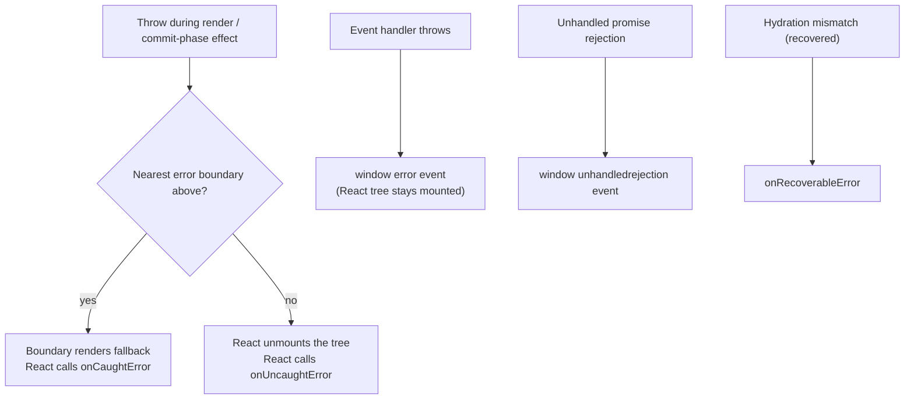
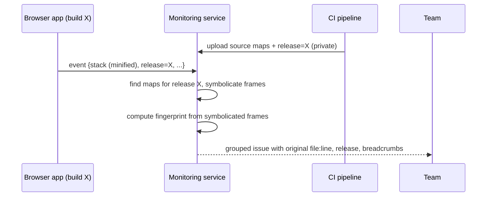
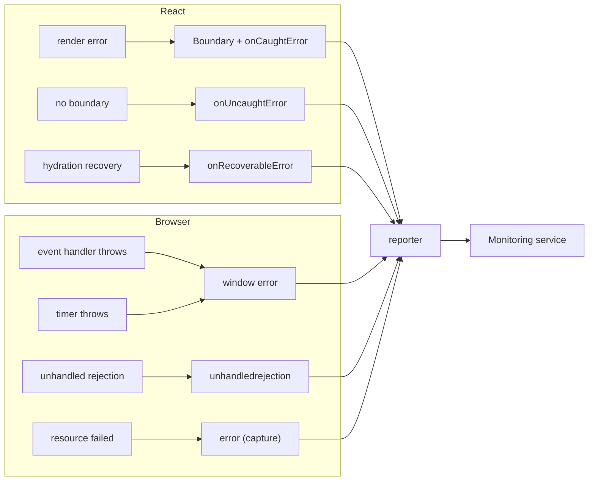
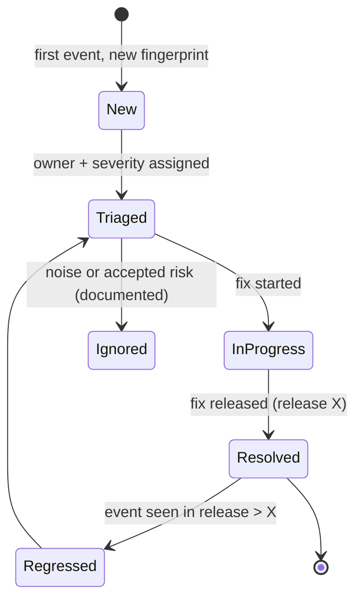

# 10 / 05 — Error Monitoring: Capture, Context, Source Maps, Grouping, and Triage

## 1. Lesson metadata

| | |
|---|---|
| **Level** | Advanced |
| **Study time** | 4–5 hours (reading 2 h, experiments 1.5 h, exercises 1.5 h) |
| **Prerequisites** | [04 — Observability and logging](./04-observability-and-logging.md); [Phase 4 — Error boundaries](../04-react-architecture/19-error-boundaries.md); [Phase 5 — Error handling patterns](../05-design-patterns/21-error-handling-patterns.md); [Phase 6 — Error recovery and retries](../06-data-fetching-and-state-ecosystems/15-error-recovery-and-retries.md); [Phase 0 — Promises and async/await](../00-web-and-javascript-foundations/12-promises-and-async-await.md) |
| **Next** | [06 — Security: XSS, CSRF, CSP](./06-security-xss-csrf-csp.md) |
| **Related later** | [10 — Resilience and degradation](./10-resilience-and-degradation.md), [19 — Incident debugging](./19-incident-debugging.md) |

**Learning objectives.** After this lesson you can:
1. Enumerate every channel through which a JavaScript error can occur in a React app and say which mechanism observes each.
2. Wire React 19's root-level error callbacks (`onCaughtError`, `onUncaughtError`, `onRecoverableError`) and global handlers into one reporting pipeline.
3. Explain how source maps make minified stack traces readable, and operate them safely (hidden maps, private upload, release matching).
4. Add useful context (release, route, breadcrumbs, user *identifier policy*) while avoiding PII.
5. Design grouping/fingerprinting, noise filtering, rate limiting and alert policy so that the team sees actionable signal.
6. Run a triage workflow from alert to fix to verification.

**Concepts covered:** error vs rejection vs resource failure, `window.onerror`, `unhandledrejection`, `reportError`, React error boundaries and root callbacks, cross-origin "Script error.", `crossorigin` attribute, source maps (`hidden`, debug IDs/releases), breadcrumbs, fingerprinting, issue lifecycle, noise sources, alert fatigue, privacy.

---

## 2. Deep conceptual explanation

### 2.1 What problem is this lesson solving?

Users do not file bug reports; they leave. Most front-end failures are *silent* to your servers: a thrown exception in an event handler never touches the network. Without monitoring you learn about a broken checkout from revenue graphs or social media. With monitoring you learn within minutes, with a stack trace pointing at the original source line, the release that introduced it, and the sequence of user actions that led to it.

Error monitoring is the specialized slice of observability ([04](./04-observability-and-logging.md)) concerned with **failures**: capture them reliably, enrich them, group them into issues, and drive triage.

### 2.2 The channels errors travel through

| Failure | Example | Observed by |
|---|---|---|
| Error thrown during **render** (including `lazy` load rejection, `use(promise)` rejection) | `items.map` on `undefined` | Nearest **error boundary**; then React root callbacks |
| Error in **event handler** | `onClick` throws | **Not** caught by boundaries; surfaces as an uncaught error → `window.onerror` / `error` event |
| Error in **effect** | `useEffect(() => { throw ... })` | Treated like a render-phase failure for boundary purposes (caught by boundary; confirmed in the sandbox with react-dom 19.3.1; see [Phase 4 lesson 19](../04-react-architecture/19-error-boundaries.md)); errors in effect *callbacks you schedule asynchronously* (timers, promises) are not |
| **Async code outside React** | `setTimeout(() => { throw ... })` | `window` `error` event |
| **Unhandled promise rejection** | `fetch(...)` without `catch` | `unhandledrejection` event on `window` |
| **Resource load failure** | `<script>`/`` 404 | `error` event on the element (does not bubble; capture on `window` with `{capture: true}`) |
| **Cross-origin script errors** | Script from CDN without CORS | `window.onerror` reports opaque "Script error." with no stack |
| **Network/HTTP failures** | 500 from API | Not exceptions by default: `fetch` resolves; you must check `res.ok` |
| **CSP violations** | Blocked inline script | `securitypolicyviolation` event / report endpoint ([06](./06-security-xss-csrf-csp.md)) |
| **Hydration mismatches** (SSR) | Server HTML differs from client | React reports via `onRecoverableError` ([Phase 2 — Hydration](../02-react-rendering-and-internals/25-hydration-and-selective-hydration.md)) |
| **Silent logic errors** | Wrong total shown | Nothing — needs tests, assertions, invariant events |

Key insight: **no single hook sees everything.** Reliable monitoring unions several channels and deduplicates.

### 2.3 What React 19 provides at the root

In React 19 the root creation APIs accept error-reporting callbacks (option names and the descriptions below match the react.dev `createRoot` / `hydrateRoot` reference pages, and the behavior was run against react-dom 19.3.1 in the sandbox):

| Option | Called when |
|---|---|
| `onCaughtError(error, errorInfo)` | An error was caught by an error boundary. In the sandbox `errorInfo` had `componentStack` and `errorBoundary` (the boundary instance). It runs before the boundary's own `componentDidCatch` |
| `onUncaughtError(error, errorInfo)` | An error was thrown and **not** caught by any boundary; the root unmounts (sandbox: container emptied). `errorInfo` had `componentStack` only |
| `onRecoverableError(error, errorInfo)` | React recovered automatically (for example hydration mismatches, where it falls back to client rendering; sandbox: "Hydration failed because the server rendered text didn't match…", `errorInfo.componentStack`) |

These replace the pre-19 pattern where React logged caught errors to `console.error` and re-threw uncaught ones (in React 19 with the defaults, caught errors are logged via `console.error` and uncaught ones are reported through `reportError`, i.e. the `window` `error` event; providing a callback replaces that default for that category). Before React 19, you reported from `componentDidCatch` in boundaries and global handlers. Errors thrown in **event handlers** are not routed through any of these callbacks: in the sandbox only the `window` `error` event fired and the tree stayed mounted. Errors thrown in an effect under a boundary reach `onCaughtError`.

Conceptually: boundaries *contain and display*; root callbacks *report*. Separate those concerns: the boundary UI should not be responsible for reaching your monitoring service.

### 2.4 Error boundaries: placement is a product decision

Recap ([Phase 4 lesson 19](../04-react-architecture/19-error-boundaries.md)): boundaries catch render-phase errors in descendants and render a fallback; they must be class components (or via library wrappers such as `react-error-boundary`; the `react-error-boundary` package exists on npm) because there is no hook equivalent for catching. Placement strategy:

| Level | Fallback | Purpose |
|---|---|---|
| Root/app shell | Full-page "Something went wrong — reload" | Last resort; prevents blank screen |
| Route | Route-level error with navigation intact | One page failing must not take down navigation |
| Feature/widget | Inline "This panel failed — retry" | Failure isolation ([10](./10-resilience-and-degradation.md)) |
| Data boundary | Retry with query reset | Pair with query error reset ([Phase 6](../06-data-fetching-and-state-ecosystems/03-loading-and-error-states.md)) |

### 2.5 Source maps

Production code is minified and bundled: `at t.render (index-3f9a1c2e.js:1:48217)`. A **source map** is a JSON file mapping positions in generated code back to original files/lines/names. Browsers can use them in DevTools; monitoring services use them server-side to symbolicate stack traces.

Operating rules:
1. **Generate** maps in the production build (Vite: `build.sourcemap`; `"hidden"` emits maps without the `//# sourceMappingURL` comment so browsers will not fetch them — Vite docs: "`hidden` works like `true` except that the corresponding sourcemap comments in the bundled files are suppressed"; confirmed by a `vite@8` build in the sandbox, where the `.map` file was written and the bundle had no comment). Note that hidden maps are still files in `dist/`; if you deploy `dist/` as-is they remain publicly fetchable by URL, hence the strip step in §5.
2. **Upload** maps to the monitoring vendor (or your own symbolication service) during CI, keyed by **release/build ID** or a **debug ID** embedded in the bundle (⚠ vendor-specific — verify).
3. **Do not serve them publicly** unless you accept that your original source is readable. Source maps contain the original source text (usually via `sourcesContent`).
4. **Release matching is everything.** A map from build A is useless for a trace from build B. Tag every event with the same build ID used when uploading ([02 §5.3](./02-deployment-workflows.md)).
5. **Retention:** keep maps as long as you keep events that might reference them, and at least through the version-skew window ([02](./02-deployment-workflows.md)).

### 2.6 Grouping: turning events into issues

A single bug can produce 100,000 events. Monitoring tools **group** events into *issues* using a fingerprint: usually derived from the stack trace (function names + file paths after symbolication), error type, and message (normalized). Pitfalls:
- **Over-splitting:** messages containing IDs ("User 123 not found") create a new issue per user. Fix: stable messages; custom fingerprints.
- **Over-merging:** generic `Error("Network error")` from many distinct causes become one issue. Fix: custom error classes and richer fingerprints; include a stable code.
- **Minification drift:** if names are mangled differently per build, symbolication restores stable names; without maps, every release creates new issues.

### 2.7 Common misconceptions

| Misconception | Reality |
|---|---|
| "An error boundary catches all errors." | Not event handlers, async callbacks, SSR errors on the server, or errors in the boundary itself. |
| "If we catch it, we're fine." | Catching and swallowing hides bugs; catch to *handle* (retry/fallback) or report-and-rethrow. |
| "`try/catch` around `fetch` catches HTTP 500." | `fetch` rejects only on network failure; 500 is a resolved response. |
| "Source maps are a security feature to hide." | They are a *debugging* feature; hiding them is a confidentiality choice, not security through obscurity of secrets (never put secrets in code). |
| "More errors captured is better." | Unfiltered capture (extensions, bots, `ResizeObserver` noise) buries real signal and costs money. |

---

## 3. Internal mechanics

### 3.1 What browsers report

**Public guarantees (HTML standard; verify browser behavior):**
- Uncaught synchronous exceptions fire an `ErrorEvent` on `window` (`window.addEventListener("error", ...)`), with `message`, `filename`, `lineno`, `colno`, `error`.
- Unhandled promise rejections fire a `PromiseRejectionEvent` (`unhandledrejection`) with `reason`. Calling `preventDefault()` suppresses the console error.
- `reportError(e)` (a global function) dispatches the same pathway as an uncaught exception without throwing; React uses it conceptually for uncaught errors, so, with default root options, your `window` `error` handler sees uncaught render errors as well (sandbox: `window.error` fired for an uncaught render error when no `onUncaughtError` was given).
- For cross-origin scripts lacking CORS permission, details are masked as "Script error." with line 0 — to see stacks, serve scripts with CORS headers and load them with `crossorigin="anonymous"` ([Phase 0 — Web APIs](../00-web-and-javascript-foundations/14-web-apis-and-network-requests.md)).

### 3.2 React's error flow (teaching model)



*Teaching model.* React may also retry a render synchronously before declaring an error (to recover from concurrent-rendering races) — this is an implementation detail; do not depend on how many times a component function runs before the callback fires.

Notice what **does not** unmount the tree: an error in an event handler. The UI may be in a half-updated state while a user keeps clicking. Capture it, and decide explicitly whether to show feedback.

### 3.3 How a stack trace becomes readable



---

## 4. Step-by-step execution walkthrough: a production error, from throw to fix

1. **Release `a1b2c3`** deploys. CI has uploaded source maps tagged `a1b2c3`; the bundle exposes `BUILD_ID = "a1b2c3"`.
2. A user opens an order whose `shippingAddress` is `null` (a back-end edge case). `OrderSummary` does `order.shippingAddress.city` → `TypeError` during render.
3. The nearest boundary (route level) catches; shows "This page failed to load — Retry". React calls `onCaughtError(error, { componentStack })`.
4. Our callback builds an event: error, release, route pattern, component stack, **breadcrumbs** (last 20 actions: navigation, clicks, fetch statuses), feature flag variants, anonymous session ID.
5. The event is sent (beacon/fetch keepalive) to the monitoring endpoint; the service symbolicates, groups with prior occurrences by fingerprint, creates issue `TypeError: Cannot read properties of null (reading 'city')` in `OrderSummary.tsx:42`.
6. Alert rule: "new issue in production affecting > N users in 10 minutes" → on-call is notified in chat with a link.
7. Triage: severity? Count by release shows the issue appeared only in `a1b2c3`? Or old (just newly visible)? Component stack shows the failure is isolated to the page; checkout is unaffected. Decide: fix forward in next release, or rollback/flag-off ([02](./02-deployment-workflows.md)).
8. Fix: model `shippingAddress` as `Address | null` in types, handle absence in UI; add a regression test using the problematic payload ([Phase 8 — Test strategy](../08-testing-and-quality/01-test-strategy-and-pyramid.md)).
9. Deploy; mark the issue "resolved in release `d4e5f6`". If it recurs in that release or later, the tool reopens it (regression detection).
10. Postmortem item: why did TypeScript not catch it? (API response typed too optimistically; consider runtime validation at the boundary — [Phase 4 — API boundaries](../04-react-architecture/14-api-boundaries-and-data-access.md).)

**Predict:** if `OrderSummary` had instead thrown inside an `onClick`, would the boundary fallback appear? *No. The tree stays mounted; `window` `error` event fires; you need the global handler to see it.*

---

## 5. Code examples

### 5.1 Minimal example — root callbacks and global handlers wired to one reporter

```tsx
// src/main.tsx
import { createRoot } from "react-dom/client";
import { App } from "./app/App";
import { reporter } from "@/shared/monitoring/reporter";

const root = createRoot(document.getElementById("root")!, {
  onCaughtError(error, info) {
    reporter.capture(error, { source: "react.caught", componentStack: info.componentStack });
  },
  onUncaughtError(error, info) {
    reporter.capture(error, { source: "react.uncaught", componentStack: info.componentStack, fatal: true });
  },
  onRecoverableError(error, info) {
    reporter.capture(error, { source: "react.recoverable", componentStack: info.componentStack, level: "warning" });
  },
});

root.render(<App />);
```

```ts
// src/shared/monitoring/globalHandlers.ts
import { reporter } from "./reporter";

export function installGlobalHandlers() {
  window.addEventListener("error", (event) => {
    // Resource load errors (img/script/link) arrive here only because we listen in the capture phase.
    if (event.target && event.target !== window && event.target instanceof HTMLElement) {
      const el = event.target as HTMLElement & { src?: string; href?: string };
      reporter.capture(new Error(`Resource failed: <${el.tagName.toLowerCase()}>`), {
        source: "resource",
        level: "warning",
        resource: sanitizeUrl(el.src ?? el.href ?? ""),
      });
      return;
    }
    reporter.capture(event.error ?? new Error(event.message || "Unknown error"), {
      source: "window.onerror",
      filename: event.filename ? sanitizeUrl(event.filename) : undefined,
    });
  }, { capture: true });

  window.addEventListener("unhandledrejection", (event) => {
    const reason = event.reason;
    reporter.capture(reason instanceof Error ? reason : new Error(`Unhandled rejection: ${safeStringify(reason)}`), {
      source: "unhandledrejection",
    });
  });
}

function sanitizeUrl(raw: string): string {
  try { const u = new URL(raw, location.href); return u.origin + u.pathname; }   // drop query/hash: may hold tokens/PII
  catch { return "[invalid-url]"; }
}
function safeStringify(v: unknown): string {
  try { return typeof v === "string" ? v : JSON.stringify(v)?.slice(0, 200) ?? String(v); }
  catch { return "[unserializable]"; }
}
```

**Line notes.**
- `{ capture: true }` is required to observe resource errors, because the `error` event for elements does not bubble.
- Rejections with non-`Error` reasons (`Promise.reject("nope")`, or a plain object) have **no stack**; wrapping them preserves a report. Prefer throwing `Error` subclasses in your own code.
- `sanitizeUrl` strips query/hash, which often contain tokens/IDs ([04 — privacy](./04-observability-and-logging.md)).
- The root-callback `info` shape was checked in the sandbox (`componentStack`, plus `errorBoundary` for caught errors); treat additional fields as version-specific.

### 5.2 Practical example — a reporter with context, breadcrumbs, dedupe and rate limit

```ts
// src/shared/monitoring/reporter.ts
import { BUILD_ID } from "@/shared/config/build";

type Level = "fatal" | "error" | "warning";
interface Extra { source: string; level?: Level; fatal?: boolean; [k: string]: unknown }

interface Breadcrumb { ts: number; category: "nav" | "click" | "http" | "log"; message: string }
const crumbs: Breadcrumb[] = [];
export function addBreadcrumb(b: Omit<Breadcrumb, "ts">) {
  crumbs.push({ ts: Date.now(), ...b });
  if (crumbs.length > 30) crumbs.shift();          // ring buffer: bounded memory
}

const seen = new Map<string, { count: number; first: number }>();
const WINDOW_MS = 60_000, MAX_PER_FINGERPRINT = 3, MAX_TOTAL = 30;
let total = 0;
setInterval(() => { seen.clear(); total = 0; }, WINDOW_MS);   // per-session client-side throttle

let context: { route?: string; sessionId: string } = { sessionId: crypto.randomUUID() };
export function setRouteContext(route: string) { context = { ...context, route }; }

export const reporter = {
  capture(error: unknown, extra: Extra) {
    try {
      const err = error instanceof Error ? error : new Error(String(error));
      if (isNoise(err)) return;

      const key = `${err.name}:${err.message}:${(err.stack ?? "").split("\n")[1] ?? ""}`;
      const entry = seen.get(key) ?? { count: 0, first: Date.now() };
      entry.count += 1; seen.set(key, entry);
      if (entry.count > MAX_PER_FINGERPRINT || ++total > MAX_TOTAL) return;

      const payload = {
        name: err.name,
        message: err.message.slice(0, 500),
        stack: err.stack?.slice(0, 8000),
        release: BUILD_ID,
        level: extra.level ?? (extra.fatal ? "fatal" : "error"),
        tags: { source: extra.source, route: context.route },
        session: context.sessionId,                         // random per-tab ID, not a user identity
        breadcrumbs: crumbs.slice(-20),
        extra: { ...extra, source: undefined, level: undefined },
      };
      const body = JSON.stringify(payload);
      if (!navigator.sendBeacon?.("/telemetry/errors", new Blob([body], { type: "application/json" }))) {
        void fetch("/telemetry/errors", { method: "POST", body, keepalive: true,
          headers: { "content-type": "application/json" } }).catch(() => {});
      }
    } catch { /* the reporter must never throw */ }
  },
};

const NOISE: RegExp[] = [
  /ResizeObserver loop (limit exceeded|completed with undelivered notifications)/i, // benign browser notification
  /^Script error\.?$/i,                                                             // opaque cross-origin; no actionable data
  /chrome-extension:\/\/|moz-extension:\/\/|safari-extension:\/\//i,                // extension code
];
function isNoise(err: Error): boolean {
  const hay = `${err.message}\n${err.stack ?? ""}`;
  return NOISE.some((re) => re.test(hay));
}
```

**Design notes and trade-offs.**
- **Client-side throttle** protects against error loops (a boundary that resets and re-throws can emit thousands of events per minute). Server-side rate limiting is still required (clients are untrusted — [04](./04-observability-and-logging.md)).
- **Noise filtering is a judgment call.** Dropping `ResizeObserver` loop errors is widely done because they are benign notifications in most apps, but filtering by regex can also hide real problems; review filtered counts periodically (count what you drop).
- `session` is a random per-tab identifier. Attaching a real user ID is a **policy decision**: it helps support ("which user hit this?") but increases PII exposure and may require consent; if you do, prefer an internal opaque ID, never email/name.
- Breadcrumb messages must be assembled from safe data (route patterns, element roles/test IDs), not typed text. Many vendor SDKs capture DOM text/inputs by default; configure them to mask.
- Vendors (e.g. Sentry, Bugsnag, Rollbar, Datadog RUM, others) provide most of this out of the box. Using a vendor SDK is usually better than this hand-rolled reporter; the point is to understand what the SDK does and which defaults to configure — ⚠ SDK option names change; verify in the vendor docs.

### 5.3 Incorrect example — swallow and log

```tsx
async function save(values: FormValues) {
  try {
    await api.post("/profile", values);
  } catch (e) {
    console.log(e);                 // ❌ invisible in production; user sees success state
  }
  setSaved(true);                    // ❌ runs even after failure
}

class Boundary extends React.Component<{ children: React.ReactNode }, { hasError: boolean }> {
  state = { hasError: false };
  static getDerivedStateFromError() { return { hasError: true }; }
  render() { return this.state.hasError ? null : this.props.children; }   // ❌ blank fallback, no reporting, no recovery
}
```

Failure modes: the user believes the save succeeded; the team never learns; the blank boundary hides the broken region silently. Also note `fetch` wrappers that do not reject on non-2xx need an explicit `res.ok` check (typically inside your HTTP client).

### 5.4 Corrected implementation

```tsx
import { Component, type ErrorInfo, type ReactNode } from "react";

interface Props {
  children: ReactNode;
  fallback: (args: { error: Error; reset: () => void }) => ReactNode;
  resetKeys?: unknown[];                     // when these change, try again
}
interface State { error: Error | null }

export class ErrorBoundary extends Component<Props, State> {
  state: State = { error: null };
  static getDerivedStateFromError(error: Error): State { return { error }; }
  componentDidUpdate(prev: Props) {
    if (this.state.error && !shallowEqualArrays(prev.resetKeys, this.props.resetKeys)) {
      this.setState({ error: null });
    }
  }
  reset = () => this.setState({ error: null });
  render() {
    return this.state.error
      ? this.props.fallback({ error: this.state.error, reset: this.reset })
      : this.props.children;
  }
}
function shallowEqualArrays(a: unknown[] = [], b: unknown[] = []) {
  return a.length === b.length && a.every((v, i) => Object.is(v, b[i]));
}
```

```tsx
function ProfileForm() {
  const [status, setStatus] = useState<"idle" | "saving" | "saved" | "error">("idle");

  async function save(values: FormValues) {
    setStatus("saving");
    try {
      await api.post("/profile", values);       // client throws HttpError on non-2xx
      setStatus("saved");
    } catch (err) {
      reporter.capture(err, { source: "profile.save", level: "warning" });  // handled, but worth knowing about
      setStatus("error");                          // UI shows an actionable message with retry
    }
  }
  // ...
}
```

Notes: this boundary does **not** report; reporting happens in the root callbacks (§5.1), keeping a single reporting path with no duplicate events. If you use boundaries inside a library or a React version lacking root callbacks, report in `componentDidCatch`. The handled-error case reports with lower severity — *handled errors still carry signal* (rate of save failures), but they should not page anyone.

### 5.5 Advanced — releases, hidden source maps and a CI upload step

```ts
// vite.config.ts (excerpt)
build: {
  sourcemap: "hidden",   // emit .map files; do not reference them from the bundle
}
```

```yaml
# CI excerpt: after build, before deploying public assets
- name: Upload source maps to monitoring (private)
  run: |
    ./scripts/upload-sourcemaps.sh --release "$GITHUB_SHA" --dir dist/assets
  env:
    MONITORING_AUTH_TOKEN: ${{ secrets.MONITORING_AUTH_TOKEN }}   # scoped, write-only, rotated
- name: Strip source maps from the public artifact
  run: find dist -name '*.map' -delete
```

Order matters: **upload first, then strip, then deploy** — and make upload failure fail the pipeline (otherwise production runs unreadable). Keep the upload token scoped to source-map upload only ([07 — dependency security / secrets](./07-dependency-security.md)). The upload script/CLI is vendor-specific — ⚠ verify against your vendor's docs. A hidden-map approach is not a security control for secrets, only for confidentiality of source structure.

### 5.6 Advanced — user feedback and "reference ID" in the fallback

```tsx
function RouteErrorFallback({ error, reset }: { error: Error; reset: () => void }) {
  const referenceId = useMemo(() => crypto.randomUUID().slice(0, 8), []);
  useEffect(() => {
    reporter.capture(error, { source: "route.fallback.shown", level: "warning", referenceId });
  }, [error, referenceId]);

  return (
    <div role="alert">
      <h2>This page could not be displayed</h2>
      <p>You can try again. If the problem continues, contact support and quote <code>{referenceId}</code>.</p>
      <button onClick={reset}>Try again</button>
      <a href="/">Go to the home page</a>
    </div>
  );
}
```

A *reference ID* ties the user's report to the event without exposing details. `role="alert"` announces the failure to assistive technology ([08 — Accessibility as architecture](./08-accessibility-as-architecture.md)). Do not render `error.message` to users: messages may contain internals and are not localized ([09](./09-internationalization.md)). Caveat: this effect would double-report with the root `onCaughtError`; use a distinct source tag (as shown) or skip to avoid duplicates — decide one policy.

---

## 6. Visual explanations

### Capture channel coverage



### Issue lifecycle



---

## 7. Alternative approaches and trade-offs

**How to capture and analyze front-end errors:**

| Approach | Setup effort | Quality of grouping/triage | Privacy control | Cost | When to prefer |
|---|---|---|---|---|---|
| Hosted error-monitoring SaaS SDK | Low | High (mature grouping, releases, alerts) | Configurable; data leaves your perimeter | Per-event pricing | Most teams |
| Self-hosted open-source monitoring | Medium–High | High | Full control | Infra + ops | Data residency or strict compliance |
| Custom endpoint + log store (this lesson's reporter) | Medium | Low–Medium (you build grouping) | Full | Low | Very small apps or special constraints |
| APM/RUM suite (error tracking as one feature) | Low | Medium | Vendor-dependent | Bundled | Already adopted for performance |
| Only server logs | None | None for client errors | n/a | n/a | Not acceptable for user-facing apps |

**When "capture everything with a vendor SDK" is not best:** an app handling highly sensitive data where stack traces, breadcrumbs or session replay could capture PII (health, banking). There, use heavily-scrubbed first-party capture, disable DOM/text breadcrumbs and replay, and review payloads before launch.

---

## 8. Best practices and anti-patterns

**Do**
- Tag every event with release/build ID; keep source maps private but available to the tool.
- Use boundaries at several levels with meaningful fallbacks and recovery actions.
- Treat handled-but-unexpected errors as telemetry (warning level).
- Create custom `Error` subclasses with stable `name`/`code` for expected failure modes (e.g. `PaymentDeclinedError`) — they group well and drive UI decisions.
- Define severity policy and owners; route alerts to the owning team via CODEOWNERS-like mapping ([01](./01-repository-organization.md)).
- Test error paths: fallback UI, reset behavior, and that reporting is called ([Phase 8](../08-testing-and-quality/03-react-testing-library.md)).

**Beginner mistakes**
- Empty `catch {}` blocks; `console.error` as the only handling.
- Throwing strings or plain objects.
- Assuming a boundary protects event handlers.

**Experienced-developer mistakes**
- Boundary resets that immediately re-throw, causing loops that flood the reporter.
- Reporting in many places so each failure produces 3–4 duplicate events.
- Alerting on raw error counts rather than affected-user rate/new issues — alert fatigue.
- Losing release correlation (maps from a different build).
- Leaving session replay or DOM capture on by default for sensitive screens.

**Smells**
- "Ignore all" rules growing without review.
- Issues with no owner for weeks.
- Top issue is always an extension or bot.

**Justified exceptions**
- Dropping known-noise errors by rule *with* a counter of how many were dropped and a review cadence.
- No boundary in a tiny internal tool where a full reload is an acceptable recovery.

---

## 9. Real-world application

**E-commerce.** Checkout step errors are separated from browse errors: different owners and severity. `PaymentDeclinedError` is an expected business outcome, not an incident; it is logged as an event, not an error issue. Constraint: promotions amplify error counts — alert on *rate* per session.

**Finance.** Strict scrubbing: no DOM text capture; error messages from server never displayed raw; monitoring endpoint on first-party domain; access to the monitoring tool audited. Constraint: stack traces may include data in messages — enforce "no PII in messages" via lint and code review.

**Dashboards.** Many widgets: per-widget boundaries so one failing chart doesn't blank the page; report widget ID as a tag; track "widget failure rate" SLI.

**Auth flows.** Token refresh failures should produce a specific, handled path (re-login), not generic errors; do not capture tokens in breadcrumbs/headers ([06](./06-security-xss-csrf-csp.md)).

**Multi-team.** Tags like `team:checkout` derived from route or feature ownership route issues to the right queue.

---

## 10. Debugging and troubleshooting

**Symptom: Stack traces are minified in the tool.**
Investigate: Does the event's `release` equal the release for which maps were uploaded? Were maps uploaded before the first event? Did the build step that emits maps change the hash (maps generated in a different build than the deployed one)? Does the bundle have a debug ID/comment the vendor expects? Fix: single build → upload → deploy; fail the pipeline on upload errors. Validate: trigger a test error in staging and verify it symbolicates.

**Symptom: Huge numbers of "Script error." events.**
Investigate: third-party scripts loaded without `crossorigin`/CORS; browser extensions. Fix: add `crossorigin="anonymous"` to your own CDN scripts and ensure `Access-Control-Allow-Origin`; filter extension noise; for third-party scripts accept the limitation.

**Symptom: The same error appears as 4 events per occurrence.**
Investigate: reporting at root callback + componentDidCatch + global handler + fallback effect. Fix: single path; React-handled errors should not also fire `window.onerror` (but uncaught ones may — check by logging event sources in staging).

**Symptom: Error spike right after deploy, then it fades.**
Investigate: version skew ([02](./02-deployment-workflows.md)) — chunk load failures from old tabs; `dynamic import` errors; segment by release and error class. Fix: asset retention, chunk recovery; classify as expected noise with a threshold alert.

**Symptom: Issue count is massive but users aren't complaining.**
Investigate: affected-users count vs events; extensions/bots; one user in a loop. Fix: prioritize by users affected and release correlation; add client throttling.

**Symptom: Error only on one browser.**
Investigate: browser/OS tags; polyfills/unsupported APIs; Safari-specific behaviors; check `browserslist` and feature detection. Reproduce in BrowserStack-like cloud or real device; fix with detection/polyfill; validate on same cohort.

---

## 11. Exercises

### Level A — Knowledge
**A1.** List five failure channels and the mechanism that observes each.
**A2.** Which React 19 root callback fires for an error caught by a boundary, and which for an error with no boundary?
**A3.** Why is `window.onerror` insufficient on its own for a React app?
**A4.** What is a "hidden" source map and what does it *not* protect?

### Level B — Code comprehension
**B1.** In §5.1, why does the `error` listener use `{ capture: true }`? What would be missed otherwise?
**B2.** In §5.2, what happens when the same error occurs 10 times within a minute? What is the intent and what is the weakness?

### Level C — Implementation
**C1.** Add `fingerprint` support to `reporter.capture`: custom errors may provide `fingerprint: string[]` which is sent so the server groups by it.
**C2.** Write a test for `ErrorBoundary` verifying fallback rendering, `reset`, and `resetKeys` change recovery.

### Level D — Debugging
**D1.** A new issue shows `TypeError: e is undefined` at `index-3f9a1c2e.js:1:48217` unsymbolicated, only for events from release `a1b2c3`. Diagnose.
**D2.** The error rate quintupled after you added an error boundary reset button. Hypothesize.

### Level E — Architecture decisions
**E1.** Define the boundary placement and fallback UX for a dashboard with a header, left nav, and eight independent widgets, plus a route-level data load.
**E2.** Decide an alerting policy: when to page, ticket, or ignore. Include new-issue, regression, rate-based and release-based triggers.

### Level F — Expert challenge
**F1.** Design the privacy model for error monitoring in a healthcare web app: what is captured, what is excluded, how scrubbing is enforced and verified, and how you validate it continuously.

---

## 12. Detailed answers and explanations

> Attempt the exercises first.

**A1.** Render errors → error boundary + `onCaughtError`/`onUncaughtError`; event-handler/timer errors → `window` `error` event; unhandled rejections → `unhandledrejection`; resource failures → capture-phase `error` listener; hydration mismatches → `onRecoverableError`; CSP violations → `securitypolicyviolation`/report-to; HTTP 5xx → explicit status check in the HTTP client.

**A2.** `onCaughtError` for boundary-caught errors; `onUncaughtError` for errors no boundary catches (the root unmounts). Plus `onRecoverableError` for auto-recovered errors. (Names verified against react.dev and the sandbox.)

**A3.** It does not see errors React catches in boundaries (they are handled), it provides no component stack, and it sees nothing of rejections or recoverable hydration errors. Conversely React callbacks do not see handler/async errors. Both are needed.

**A4.** A hidden source map is generated but not referenced by a `sourceMappingURL` comment in the bundle, so browsers won't fetch it automatically. It does not protect anything if you deploy the `.map` files to a public path (anyone can guess the URL), nor does it protect secrets in the code — secrets don't belong there. Treat it as a confidentiality *default*, with maps uploaded privately and removed from public artifacts.

**B1.** Resource-loading errors on ``/`<script>` don't bubble; they can only be observed in the capture phase on an ancestor (here `window`). Without `capture`, you'd miss broken scripts/images/stylesheets (e.g. a failed chunk `<link rel="modulepreload">`).

**B2.** After 3 events with the same key in the 60 s window, the rest are dropped (`MAX_PER_FINGERPRINT = 3`), limiting loops. Weaknesses: the key uses the message and the second stack line, so different errors with the same message & top frame merge; messages with variable data split keys; the counters reset on a fixed interval (burst at boundary); you lose the *count* — better to send a summary with the dropped count. Also server-side limits remain necessary.

**C1.** Add `fingerprint?: string[]` to `Extra`, include in payload (`fingerprint`), and, in custom error classes, expose `readonly fingerprint = ["PaymentDeclined", code]`. In `capture`, read `(err as { fingerprint?: string[] }).fingerprint`. Vendor SDKs accept a fingerprint array per event (⚠ verify). Evaluation: do not include PII in fingerprints; keep them low-cardinality.

**C2.** Sample (Vitest + Testing Library):

```tsx
function Bomb({ explode }: { explode: boolean }) {
  if (explode) throw new Error("boom");
  return <p>ok</p>;
}
it("shows fallback and recovers when resetKeys change", () => {
  vi.spyOn(console, "error").mockImplementation(() => {});   // React logs caught errors
  const fallback = ({ reset }: { error: Error; reset: () => void }) => <button onClick={reset}>retry</button>;
  const { rerender } = render(<ErrorBoundary fallback={fallback} resetKeys={[1]}><Bomb explode /></ErrorBoundary>);
  expect(screen.getByRole("button", { name: "retry" })).toBeInTheDocument();
  rerender(<ErrorBoundary fallback={fallback} resetKeys={[2]}><Bomb explode={false} /></ErrorBoundary>);
  expect(screen.getByText("ok")).toBeInTheDocument();
});
```
Edge cases: testing that `reset` without changing the cause re-throws; ensure console noise is mocked and restored.

**D1.** Source maps for release `a1b2c3` are missing, not uploaded, uploaded to another release name, or the deployed bundle differs from the one mapped (rebuild between upload and deploy). Check release tag on the event, check the vendor's artifact list for that release, compare bundle filename hash to the uploaded maps. Fix: single-build pipeline; upload step fails loudly; validate with a staging test error.

**D2.** The reset re-renders the same failing subtree immediately, throws again, and the user (or auto-retry) repeats; or the reset triggers refetch storms. Each cycle creates a report. Fix: reset only when the cause could have changed (resetKeys, retry after a backoff), cap retries, and count unique users rather than events. Also check that you didn't introduce double-reporting.

**E1.** Root boundary (full-page recovery) wrapping everything; route boundary around the page content so header/nav stay; each widget in its own boundary with inline "retry" fallback and consistent height to prevent layout shift; data-load errors handled by the data layer (error state per query) — not thrown to the root unless unrecoverable ([Phase 6](../06-data-fetching-and-state-ecosystems/03-loading-and-error-states.md)). Evaluate: blast radius, recovery path, a11y announcements, reporting tags with widget ID. Trade-off: eight boundaries add boilerplate; mitigate with a `<Widget>` wrapper component.

**E2.** Example: page on-call only for (a) fatal/uncaught errors affecting > X% of sessions in 10 min post-release, or (b) checkout-critical issue regression; ticket (business hours) for new issues with > N users/day; weekly review for low-frequency issues; ignore with documentation for extension/bot noise, with periodic audit. Release-based trigger: compare error rate of the new release vs previous at 5/15/60 minutes. Avoid paging on raw counts; consider user-impact rate. Explain on-call load as a constraint.

**F1.** Example answer: default-deny capture: no request/response bodies, no DOM text or input values, replay disabled on sensitive routes or entirely; URL sanitization; custom scrubbers on messages/stack/breadcrumbs; server-side scrubbing at the first-party proxy before forwarding to a vendor; no user identifiers except a salted opaque ID; data residency and DPA; short retention; access control and audit logs. Enforcement: shared reporter package with a typed schema; lint rule banning `console.*` and raw `error.message` rendering; CI test sending synthetic PII strings through the reporter and asserting they're absent at the proxy output; periodic sampling audits by a privacy reviewer; alert on schema violations. Validate continuously by canary "tripwire" strings injected in test accounts and searching the monitoring store for them.

---

## 13. Senior engineer interview questions

**Q1. "What errors do React error boundaries not catch?"**
*Strong answer:* Errors in event handlers, in asynchronous callbacks (timers, promises), in the boundary itself, and during server rendering (handled by the server framework). They catch render-phase errors (and lifecycle/effect errors) in descendants. So you need global handlers and explicit try/catch for handlers, and root callbacks for reporting.

**Q2. "How do source maps work with production monitoring and what are the pitfalls?"**
*Strong answer:* The build emits maps; CI uploads them privately to the monitoring tool keyed by release/debug ID; events include that release; the service symbolicates frames server-side. Pitfalls: release mismatch, uploading after deploy, public `.map` files exposing source, short retention vs skew window, upload failures silently ignored.

**Q3. "How do you keep error monitoring actionable?"**
*Strong answer:* Group with stable fingerprints, filter known noise while counting it, alert on new/regressed issues and affected-user rate, route to owners, throttle clients, tag with release/route/feature, and review the backlog regularly. Handled expected failures (declined payment) are events, not incidents.

**Q4. "What do you do about PII in error reports?"**
*Strong answer:* Minimize by design: no PII in messages, URLs sanitized, DOM/text breadcrumbs and replay disabled or masked, scrubbers server-side too, opaque IDs, retention limits, access control, and automated tests that attempt to leak known strings. Redaction is a net; minimization is the control.

**Q5. "A spike of errors appears only in the first minutes after every deploy. Why?"**
*Strong answer:* Likely version skew: open tabs requesting chunks or APIs of the previous release. Confirm via release tags and error class (chunk load/`import()` failure). Fix with asset retention, recovery logic, and API compatibility.

---

## 14. Further learning resources

| Resource | URL | Covers / why | Level | Study |
|---|---|---|---|---|
| React docs — `createRoot` reference | <https://react.dev/reference/react-dom/client/createRoot> | Root options incl. error callbacks (verify current signatures) | Intermediate | Parameters section |
| React docs — Error boundaries (in `Component` reference) | <https://react.dev/reference/react/Component#catching-rendering-errors-with-an-error-boundary> | Boundary semantics and limitations | Intermediate | "Catching rendering errors" |
| MDN — `Window: error` event | <https://developer.mozilla.org/en-US/docs/Web/API/Window/error_event> | Global error event, "Script error." | Intermediate | Whole page |
| MDN — `unhandledrejection` | <https://developer.mozilla.org/en-US/docs/Web/API/Window/unhandledrejection_event> | Promise rejection events | Intermediate | Whole page |
| MDN — `reportError()` | <https://developer.mozilla.org/en-US/docs/Web/API/Window/reportError> | Programmatic reporting through the global handler | Intermediate | Whole page |
| Source Map specification (ECMA-426 / Source Map Revision 3) | <https://tc39.es/ecma426/> | Format definition | Advanced | Overview |
| Vite — `build.sourcemap` | <https://vite.dev/config/build-options.html#build-sourcemap> | Source map options incl. `hidden` | Intermediate | Option description |
| Sentry docs — JavaScript / React | <https://docs.sentry.io/platforms/javascript/guides/react/> | An example vendor SDK integration, source maps, releases | Intermediate | Setup, source maps |
| `react-error-boundary` | <https://github.com/bvaughn/react-error-boundary> | Popular boundary component with reset keys | Intermediate | README |

URLs in this table were checked for HTTP 200 on 2026-10-22; any still marked *(unverified)* could not be checked automatically (blocked or unreachable). A 200 response does not guarantee the page content still matches the description; if a link has moved, search the site for the quoted title.

---

## 15. Knowledge checkpoint

**You should now understand**
- That no single mechanism captures every failure, and which channel covers which.
- How React 19 root callbacks separate containment from reporting.
- Source maps, release matching, grouping and why noise control is part of the design.

**You should be able to explain without notes**
- What boundaries do and do not catch.
- Why unhandled rejections and handler errors need global handlers.
- How alerting policy prevents fatigue.

**You should be able to implement**
- A root-callback + global-handler reporting setup, a boundary with reset keys, throttling/dedupe, hidden maps with private upload, safe fallback UI with reference IDs.

**You should be able to debug**
- Unsymbolicated traces, duplicate events, loops, version-skew spikes, extension noise.

**Prerequisite for next:** [06 — Security: XSS, CSRF, CSP](./06-security-xss-csrf-csp.md) — CSP violation reports and secure handling of untrusted data are the next layer of production defense.
