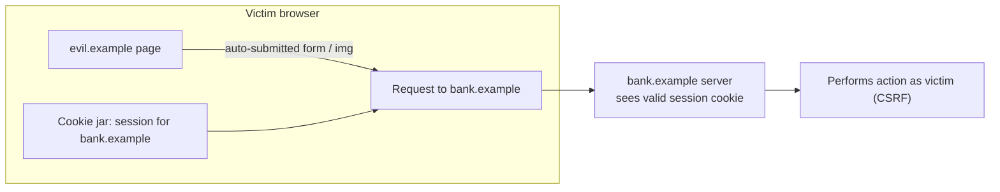
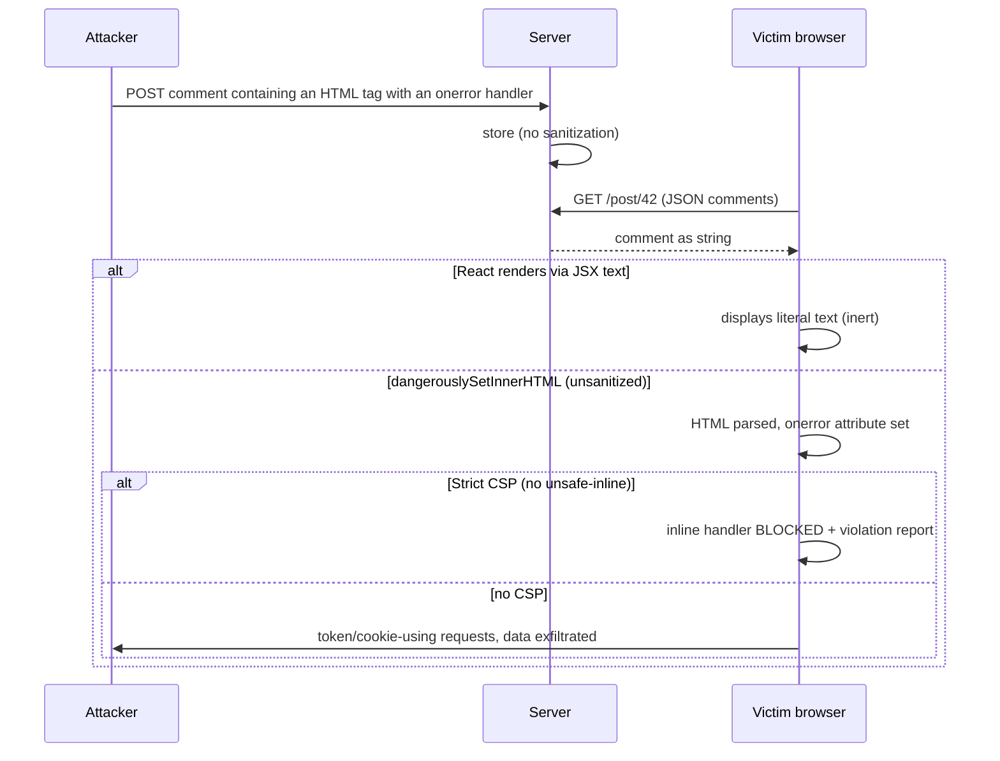
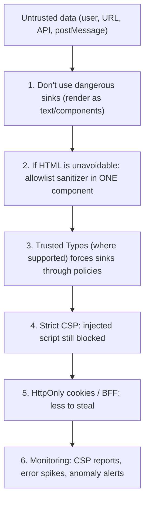
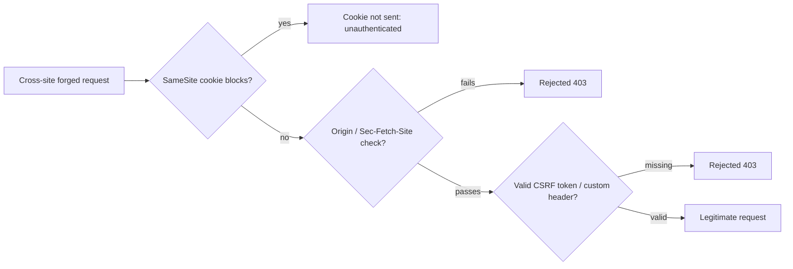

# 10 / 06 — Front-End Security: XSS, CSRF, and Content Security Policy

## 1. Lesson metadata

| | |
|---|---|
| **Level** | Advanced |
| **Study time** | 5–6 hours (reading 2.5 h, experiments 1.5 h, exercises 2 h) |
| **Prerequisites** | [03 — Environment configuration](./03-environment-configuration.md); [05 — Error monitoring](./05-error-monitoring.md); [Phase 0 — Browser events and propagation](../00-web-and-javascript-foundations/13-browser-events-and-propagation.md); [Phase 0 — Web APIs and network requests](../00-web-and-javascript-foundations/14-web-apis-and-network-requests.md); [Phase 0 — HTTP caching and navigation](../00-web-and-javascript-foundations/15-http-caching-and-navigation.md); [Phase 1 — JSX explained](../01-react-fundamentals/05-jsx-explained.md) |
| **Next** | [07 — Dependency security](./07-dependency-security.md) |
| **Related later** | [Phase 9 — Auth boundaries](../09-advanced-rendering-and-ecosystem/12-auth-boundaries.md), [Phase 9 — SPA, SSR, SSG, streaming](../09-advanced-rendering-and-ecosystem/01-spa-ssr-ssg-streaming.md) |

> **Scope and honesty note.** This lesson teaches defensive front-end engineering. Security is a specialist field; the guidance below is deliberately conservative, and in several places it says "verify against current docs" because browser behavior and best-practice recommendations evolve. It is not a substitute for a security review, penetration testing, or your organization's security team. When in doubt, choose the more restrictive option and ask a security engineer.

**Learning objectives.** After this lesson you can:
1. Explain the browser security model that makes XSS and CSRF possible: same-origin policy, ambient authority (cookies), and the difference between *origin* and *site*.
2. Identify every place a React app can still be vulnerable to XSS despite JSX escaping.
3. Choose and defend a session/token strategy and understand its XSS and CSRF consequences.
4. Defend against CSRF with layered controls (SameSite cookies, CSRF tokens or custom headers, Origin verification) and explain why CORS is not a CSRF defense.
5. Design a Content Security Policy (CSP) for a React SPA, deploy it safely using Report-Only, and understand nonces, hashes, `strict-dynamic`, and Trusted Types.
6. Apply supporting controls: security headers, third-party script hygiene, Subresource Integrity, safe link/redirect handling, safe `postMessage`, and safe SSR state serialization.

**Concepts covered:** same-origin policy, origin vs site, ambient authority, reflected/stored/DOM XSS, output encoding contexts, `dangerouslySetInnerHTML`, HTML sanitization, URL-scheme injection, token storage trade-offs, `HttpOnly`/`Secure`/`SameSite`, CSRF tokens, `Origin`/`Sec-Fetch-Site`, CORS, CSP directives, nonces/hashes, `strict-dynamic`, Report-Only, Trusted Types, SRI, clickjacking (`frame-ancestors`), open redirects, `postMessage` origin checks.

---

## 2. Deep conceptual explanation

### 2.1 What problem is this lesson solving?

A front-end application is **code that an attacker is allowed to run against** (they can call your APIs directly, tamper with requests, read your bundle) and **code that runs with the user's authority** (cookies, tokens, access to the DOM). Two classic attack families exploit this:

- **XSS (cross-site scripting):** attacker-controlled data is interpreted as *code* in your origin. The attacker's script then has everything your own code has: it can read the DOM, call APIs as the user, read non-HttpOnly storage, and rewrite the page.
- **CSRF (cross-site request forgery):** a different site causes the victim's browser to send an authenticated request to your site, abusing cookies that the browser attaches automatically.

React reduces some risk (JSX escapes by default) but does not eliminate either. Security is a **layered** discipline: prevent injection, limit the damage if injection happens (CSP, HttpOnly cookies), and detect it (CSP reports, monitoring).

### 2.2 The security model you are working within

**Same-origin policy (SOP).** An *origin* is scheme + host + port. Script from `https://a.example` cannot read responses from `https://b.example` unless `b` opts in via CORS. SOP restricts **reading**; it does **not** prevent a page from *sending* requests to other origins (form posts, image loads, simple `fetch`). That gap is why CSRF exists.

**Origin vs site.** A *site* is the registrable domain (eTLD+1, e.g. `example.com`) plus scheme in modern definitions. `app.example.com` and `api.example.com` are **different origins** but the **same site**. `SameSite` cookie attributes are defined in terms of *site*, not origin ⚠ (verify the current definition: "schemeful same-site" is in the spec but enforcement varies).

**Ambient authority.** Cookies are attached by the browser automatically based on the destination, regardless of which page initiated the request. A bearer token that your JavaScript explicitly adds to a header is *not* ambient — it requires your code to run. This distinction drives both CSRF and token-storage decisions.



### 2.3 XSS in a React application

#### Where React protects you

JSX text children and attribute values are **escaped** when rendered through React DOM: `<div>{userInput}</div>` creates a text node; it cannot create elements. This is the documented default behavior and handles the most common reflected/stored XSS vectors **for text and most attribute positions**.

#### Where React does not protect you

| Sink | Why dangerous | Safer approach |
|---|---|---|
| `dangerouslySetInnerHTML={{ __html: s }}` | Parses `s` as HTML; script-bearing attributes (`onerror`) and URLs execute | Avoid; or sanitize with a maintained sanitizer **at render time** with a strict allowlist, ideally plus Trusted Types/CSP |
| URL-valued attributes: `href`, `src`, `action`, `formAction`, `srcDoc` | `javascript:` / `data:` URLs can execute code on click/navigation | Validate scheme against an allowlist (`https:`, `http:`, `mailto:`, `tel:`); never rely solely on the framework ⚠ |
| Direct DOM APIs: `innerHTML`, `outerHTML`, `insertAdjacentHTML`, `document.write` | Same as above | Use `textContent`/React rendering |
| `eval`, `new Function`, string-form `setTimeout/ setInterval` | Executes strings | Don't; CSP without `'unsafe-eval'` blocks them |
| Server-side rendering state injection (`<script>window.__STATE__ = ${JSON.stringify(state)}</script>`) | `</script>` or `<!--` inside data closes/alters the script context | Serialize with an escaping serializer (escape `<`, `>`, `&`, `U+2028/2029`) or use a non-executed JSON script tag |
| Third-party scripts and tags | They *are* your origin's code | Minimize, vet, SRI, CSP, sandbox in iframes |
| Markdown renderers, rich-text editors, SVG upload | Produce HTML | Sanitize; treat user SVG as active content |
| `ref`/effects writing HTML (`el.innerHTML = ...`) | Bypasses React escaping | Same as DOM APIs |
| Component libraries rendering HTML from props | Inherits risk | Audit usage |
| Template/CSS injection (`style` strings, `<style>` from user input) | CSS can exfiltrate data/UI-redress | Avoid user-controlled CSS; if tenant theming, accept only validated tokens |

React 19 blocks `javascript:` URLs in URL-valued props (`href`, `src`, `action`, `formAction`, `data` and similar): the 19.0.0 changelog lists "Javascript URLs are replaced with functions that throw errors". Verified in the sandbox with react-dom 19.3.1 (SSR and client): `<a href="javascript:alert(1)">` is emitted as `href="javascript:throw new Error('React has blocked a javascript: URL as a security precaution.')"`, including for case/whitespace/tab-obfuscated variants. `data:` URLs are **not** blocked by React, and neither is `//evil.example`. The check applies only to props React sets; direct DOM writes, `dangerouslySetInnerHTML`, and URLs inside sanitized/Markdown HTML are not covered. Do not build your security on this: validate URLs yourself, and rely on CSP as a second layer.

#### Three XSS types

- **Stored:** payload saved on the server (comment, profile name) and served to others.
- **Reflected:** payload in the request (query param) echoed in the response.
- **DOM-based:** payload flows from a client-side *source* (`location.hash`, `postMessage`, `localStorage`, API data) into a client-side *sink* (`innerHTML`) without the server being involved. Single-page apps are particularly exposed to DOM XSS because they handle routing/data on the client.

#### Output encoding depends on context

HTML-escaping is correct for text nodes; **not** for JavaScript, URL, CSS, or attribute contexts. A value placed inside a JS string needs JS-string escaping; inside a URL needs URL encoding **and** scheme validation. Frameworks handle HTML text and most attributes, leaving the rest to you. This is why "I escape everything" is not a security argument — you must name the context.

### 2.4 Authentication tokens and sessions: trade-offs, not absolutes

| Strategy | XSS exposure | CSRF exposure | Notes |
|---|---|---|---|
| **Session cookie, `HttpOnly; Secure; SameSite=Lax/Strict`** | Script cannot *read* the cookie, but XSS can still *use* it (make authenticated requests from the victim's browser) | Cookies are ambient → need CSRF controls (SameSite + token/Origin checks) | Common, robust default for first-party apps; pairs well with a BFF |
| **Access token in `localStorage`/`sessionStorage`** | Any XSS can **read and exfiltrate** the token (usable elsewhere, long after) | Not ambient → not CSRF-prone by itself | Persistent storage worsens exposure; many security guides advise against for sensitive apps |
| **Access token in JS memory only (+ refresh via HttpOnly cookie)** | XSS can still use the token while the page is open, and may call the refresh endpoint | Refresh endpoint needs CSRF protection | Reduces persistence, adds complexity; reload requires refresh |
| **BFF (backend-for-frontend) holding tokens server-side; browser has only a session cookie** | Same as session cookie | Same as session cookie | Current IETF guidance for browser-based apps leans toward this for high-security needs — ⚠ verify the current state of the OAuth 2.0 browser-based apps BCP |

**Key point.** `HttpOnly` limits *token theft*, not *session riding by XSS*. If attacker code runs in your origin, it can act as the user for as long as the page is open. Therefore XSS prevention and CSP remain mandatory even with HttpOnly cookies. No storage location makes XSS harmless.

### 2.5 CSRF

**Conditions required:** (1) a state-changing request, (2) the browser attaches credentials automatically (cookies, HTTP auth, client certs), (3) the attacker can cause the victim's browser to make the request, (4) no unpredictable value the attacker must know.

**Defenses, layered (OWASP's guidance; verify current cheat sheet):**
1. **Do not change state with GET.** (Safe methods must be safe.)
2. **`SameSite` cookies.** `Lax` (MDN: a cookie with no `SameSite` attribute is treated as `Lax` by default; Chromium-based browsers have done this since Chrome 80, with a temporary "Lax+POST" two-minute exception for newly set cookies, while other engines' defaults and third-party-cookie handling differ — always set the attribute explicitly rather than relying on the default) blocks cross-site cookies on most subrequests and non-top-level-navigation POSTs. `Strict` blocks on all cross-site navigations too (usability impact: links from email arrive logged-out). `None; Secure` allows cross-site (needed for embedded cross-site use) and requires CSRF protection. **Treat SameSite as defense in depth, not the only control**: it covers cross-*site*, not cross-*origin same-site* (a compromised `evil.example.com` subdomain is same-site as `app.example.com`), and browser defaults differ.
3. **Anti-CSRF token** (synchronizer token, or signed double-submit cookie) validated on every state-changing request.
4. **Custom request header** (e.g. `X-Requested-With`, or a bearer header) on `fetch`/XHR: cross-origin custom headers trigger a CORS preflight; if the server does not approve, the browser blocks the request. This works for JS-initiated requests but **not** for plain HTML form posts.
5. **Verify `Origin` (and fall back to `Referer`)** on state-changing requests; reject mismatches. Also `Sec-Fetch-Site` (a Fetch Metadata request header sent by all current major browsers; OWASP lists it as a CSRF defense) lets servers reject `cross-site` requests to non-navigation endpoints.
6. **Re-authentication/step-up** for sensitive actions.

**CORS is not CSRF protection.** CORS governs whether a *response may be read* cross-origin. A cross-origin form POST or "simple request" is still *sent* and may already have caused its side effect. CORS misconfiguration (reflecting arbitrary `Origin` together with `Access-Control-Allow-Credentials: true`) turns SOP's protection off, enabling cross-origin **reads** of authenticated data.

**CSRF and JSON APIs.** A common myth: "we use JSON, so we're safe." JSON `Content-Type` triggers preflight in cross-origin `fetch`, but servers that parse bodies regardless of `Content-Type`, or accept `text/plain` / `application/x-www-form-urlencoded` that the browser can send without preflight, may still be vulnerable. Enforce content type and tokens.

### 2.6 Content Security Policy (CSP)

CSP is an HTTP response header (or `<meta>` with limitations) that tells the browser which sources of content the page may load and execute. It is **defense in depth** against XSS: a correct strict CSP can stop injected inline script from running even when an injection bug exists.

Key directives (verify against MDN/CSP spec for current syntax):

| Directive | Controls | Typical |
|---|---|---|
| `default-src` | Fallback for unspecified fetch directives | `'self'` |
| `script-src` | JavaScript sources | nonce/hash-based, `'strict-dynamic'` |
| `style-src` | CSS sources | `'self'` + nonce/hash; `'unsafe-inline'` is a known trade-off for styles |
| `connect-src` | `fetch`, XHR, WebSocket, EventSource | your API/WS origins |
| `img-src`, `font-src`, `media-src` | Resources | `'self' data:` as needed |
| `frame-src` / `child-src` | What *you* may embed | allowlist or `'none'` |
| `frame-ancestors` | Who may embed *you* (clickjacking) | `'none'` or `'self'` (**not** supported via `<meta>`) |
| `base-uri` | `<base>` hijacking | `'self'` or `'none'` |
| `form-action` | Form submission targets | `'self'` |
| `object-src` | Plugins | `'none'` |
| `upgrade-insecure-requests` | Upgrades http subresources | include if appropriate |
| `report-to` / `report-uri` | Violation reporting | `report-uri` is deprecated (MDN) but still the most widely supported; `report-to` names an endpoint defined in the `Reporting-Endpoints` response header (Chrome 70+, Safari 16.4+, Firefox 149+ per MDN BCD). Common practice: send both |
| `require-trusted-types-for 'script'`, `trusted-types` | DOM XSS sink enforcement | see §2.7 |

**The big idea: *strict CSP*.** Allowlisting hostnames (`script-src https://cdn.example.com`) is fragile — many allowed hosts host JSONP endpoints or script gadgets that bypass the policy. Google's research and the web.dev guidance recommend **nonce-based or hash-based CSP, optionally with `'strict-dynamic'`**:

```text
Content-Security-Policy:
  script-src 'nonce-{RANDOM}' 'strict-dynamic';
  object-src 'none';
  base-uri 'none';
```

- **Nonce:** an unguessable random value, **freshly generated per response**, placed in the header and on each trusted `<script nonce="…">`. Scripts without a matching nonce are blocked. Requires the HTML to be generated per request (SSR, edge function, or server-side templating). A *static* `index.html` with a hard-coded nonce is **not secure** — the attacker can read it.
- **Hash:** `'sha256-<base64>'` of an inline script's content. Works for static HTML with a fixed inline script, but any change to the script requires an updated hash.
- **`'strict-dynamic'`:** scripts loaded by a *trusted* script (one with a valid nonce/hash) are trusted transitively, which makes bundlers that insert more `<script>` tags workable; in browsers supporting it, host allowlists/`'self'`/`'unsafe-inline'` are ignored (MDN, `script-src`). It is supported by all current major browsers; for older ones, list `'unsafe-inline' https:` as ignored-when-modern fallbacks (MDN's backwards-compatible pattern).
- **Avoid `'unsafe-inline'` and `'unsafe-eval'` in `script-src`.** `'unsafe-inline'` negates most XSS protection (unless a nonce/hash is present in a supporting browser, which makes browsers ignore it — a documented fallback technique).

**Static SPAs and CSP.** A typical Vite SPA served as static files has an `index.html` containing `<script type="module" src="/assets/index-HASH.js">`. With external scripts only and `script-src 'self'`, no inline scripts are needed, so you can have a solid (not "strict-dynamic"-level) policy without nonces. Pitfalls: injected inline config (`window.__CONFIG__`, [03](./03-environment-configuration.md)) needs a hash/nonce, or use `/config.json` instead; dev servers inject inline scripts (HMR) so use different policies in dev; some libraries inject `<style>` at runtime (CSS-in-JS) requiring nonce support or `'unsafe-inline'` for styles — a conscious, narrower risk than for scripts.

**Rollout discipline: Report-Only first.** `Content-Security-Policy-Report-Only` evaluates and reports violations without blocking. Run for days/weeks, triage reports (many come from extensions — filter), fix legitimate violations, then enforce. Keep a reporting endpoint after enforcement.

### 2.7 Trusted Types

Trusted Types is a browser API/CSP feature that makes DOM XSS sinks (`innerHTML`, `eval`, script `src`, ...) accept only typed objects produced by *policies* you define, rather than raw strings. With `Content-Security-Policy: require-trusted-types-for 'script'`, assigning a string to `innerHTML` throws. Your sanitization code lives in one auditable policy. MDN marks the Trusted Types API as Baseline "newly available" since February 2026 (`require-trusted-types-for`: Chrome 83, Firefox 148, Safari 26); older browser versions in your matrix may still lack it, so treat it as additional hardening, not a sole control. Sanitizers such as DOMPurify can produce Trusted HTML (check the library's docs).

### 2.8 Supporting controls

| Control | Purpose | Notes |
|---|---|---|
| `Strict-Transport-Security` (HSTS) | Force HTTPS | Start with short `max-age`; `includeSubDomains`/`preload` have irreversible-ish consequences — plan carefully |
| `X-Content-Type-Options: nosniff` | Prevent MIME sniffing (e.g. treating text as script) | Pair with correct `Content-Type` |
| `Referrer-Policy` | Limit URL leakage | `strict-origin-when-cross-origin` is a common sensible default |
| `Permissions-Policy` | Disable unused powerful features (camera, geolocation) | Syntax evolved; verify |
| `frame-ancestors` (CSP) / legacy `X-Frame-Options` | Clickjacking defense | Prefer CSP `frame-ancestors` |
| Cross-origin isolation headers (`COOP`, `COEP`, `CORP`) | Isolation for sensitive features (`SharedArrayBuffer`) | Can break third-party embeds; verify before enabling |
| Subresource Integrity (SRI) `integrity="sha384-…"` | Detect tampering of third-party files | Requires `crossorigin`; breaks when vendor updates the file silently — which is the point; prefer self-hosting |
| `rel="noopener"` on `target="_blank"` | Prevent `window.opener` abuse | Current browsers treat `target="_blank"` links as `noopener` by default; keep it explicit for older browsers |
| `sandbox` on iframes | Restrict embedded content | Do not combine `allow-scripts allow-same-origin` for untrusted content (it can remove its own sandbox) |
| `postMessage` | Cross-window messaging | Always specify `targetOrigin` when sending; **verify `event.origin`** against an allowlist when receiving; never `"*"` for sensitive data |
| Open redirect hygiene | `?next=` parameters can send users to phishing/`javascript:` | Allow relative paths on your own origin or allowlisted hosts only |

### 2.9 Common misconceptions

| Misconception | Reality |
|---|---|
| "React is XSS-safe." | Safe for escaped text/attributes; unsafe via `dangerouslySetInnerHTML`, URL attributes, DOM APIs, SSR serialization, third-party scripts. |
| "HttpOnly cookies protect us from XSS." | They stop *theft* of the cookie, not *use* of the session by injected code. |
| "We validate on the client, so input is safe." | Client validation is UX; attackers bypass the client entirely. Server validation/encoding is authoritative. |
| "CORS stops CSRF." | CORS controls reading responses; requests are still sent. |
| "SameSite=Lax means no CSRF tokens needed." | It is a strong layer, not a complete one (same-site attackers, older browsers, GET-with-side-effects, method override). Many orgs still require tokens for sensitive endpoints. |
| "CSP with `'unsafe-inline'` is fine." | It disables the primary XSS mitigation for scripts. |
| "Hiding the admin button secures admin features." | Authorization must be enforced server-side; UI hiding is UX. |
| "Obfuscation/minification hides secrets." | Never ship secrets ([03](./03-environment-configuration.md)). |

---

## 3. Internal mechanics

### 3.1 What React DOM does with strings

**Public guarantee:** React DOM treats text children and attribute values as data, setting `textContent` or attributes via DOM APIs rather than concatenating HTML — so `<` in a string is displayed literally. The `dangerouslySetInnerHTML` prop is the documented escape hatch that assigns HTML directly; its deliberately alarming name signals that sanitization is the developer's responsibility.

**Teaching model:** *Data in JSX positions that map to text nodes or attribute values is inert; data in positions that the browser interprets (URLs that navigate, HTML that parses, code that evaluates) is live.*

**Implementation detail:** how React validates props like `href` for dangerous protocols, and precisely which versions warn or block, changed over time (React 19+ blocks `javascript:`; earlier versions only warned) — **test with a payload** in your own app rather than assuming.

### 3.2 How the browser enforces CSP (conceptual)

When the browser is about to execute a script (inline `<script>`, external `<script src>`, event-handler attribute, `javascript:` URL, `eval`), it asks the policy: is this source permitted? For inline scripts: does the element carry a valid nonce or does its content hash match? For external scripts: does `src` match an allowed source, or was the script created by an already-trusted script under `'strict-dynamic'`? If not permitted, the browser blocks the execution and fires a `securitypolicyviolation` event / sends a report. Event-handler attributes (`onclick="..."`) and `javascript:` URLs count as inline script and are blocked unless `'unsafe-inline'` (or hashes with `'unsafe-hashes'`) permits them.

### 3.3 Timeline: stored XSS with and without defenses



---

## 4. Step-by-step walkthrough: hardening a React SPA before launch

1. **Threat-model the app** (STRIDE-lite): assets (accounts, payments), actors (anonymous, users, admins, malicious tenants), entry points (inputs, URL, postMessage, third-party scripts).
2. **Inventory dangerous sinks:** grep for `dangerouslySetInnerHTML`, `innerHTML`, `insertAdjacentHTML`, `eval`, `new Function`, `target="_blank"`, dynamic `href`/`src`, `postMessage`, `window.open`, `location.href =`, `document.cookie`. Add lint rules (`react/no-danger`, eslint-plugin-security / no-unsanitized — ⚠ verify plugin availability and rules).
3. **Fix or justify each sink.** Replace HTML rendering with components; where HTML is unavoidable, centralize in one `SafeHtml` component (§5.3).
4. **Decide session strategy** (§2.4); configure cookies `HttpOnly; Secure; SameSite=Lax` (or `Strict`); implement CSRF defenses on state-changing endpoints.
5. **Add security headers** at the CDN/server (§5.1), including a CSP in **Report-Only**.
6. **Review third-party scripts:** remove unneeded; load async; self-host if possible; SRI; sandbox in iframes; tag-manager governance.
7. **Run Report-Only for a defined period;** triage violation reports (extensions/ads injected by users' software are common noise); fix legit ones.
8. **Switch to enforcing CSP** with a reporting endpoint kept on; alert on new violations post-deploy.
9. **Add automated checks:** dependency audit ([07](./07-dependency-security.md)), lint for sinks, header tests in CI/smoke test, E2E tests that attempt known payloads (XSS test vectors) and assert inertness.
10. **Plan incident response:** how to rotate secrets, invalidate sessions, patch fast ([19 — Incident debugging](./19-incident-debugging.md)).

---

## 5. Code examples

### 5.1 Minimal example — a conservative header set (nginx)

```nginx
# Applied to the HTML document responses (and sensibly to all responses)
add_header Content-Security-Policy-Report-Only "default-src 'self'; script-src 'self'; style-src 'self'; img-src 'self' data:; connect-src 'self' https://api.example.com; object-src 'none'; base-uri 'self'; form-action 'self'; frame-ancestors 'none'; report-uri /csp-report" always;
add_header X-Content-Type-Options "nosniff" always;
add_header Referrer-Policy "strict-origin-when-cross-origin" always;
add_header Strict-Transport-Security "max-age=300" always;     # start small; raise only after validating HTTPS everywhere
add_header Permissions-Policy "camera=(), microphone=(), geolocation=()" always;
```

**Notes.**
- This is a *starting point for a static SPA with no inline scripts and no third parties.* Real apps need additions (fonts, analytics endpoints, WebSockets). Start in Report-Only, then enforce.
- `style-src 'self'` will break libraries injecting `<style>` tags at runtime; the pragmatic fallbacks are nonces for styles (if supported by your tooling) or `'unsafe-inline'` limited to `style-src` — a knowingly weaker choice than for scripts. Verify what your CSS approach requires ([Phase 4 — Styling architecture](../04-react-architecture/27-styling-architecture.md)).
- `report-uri` is marked deprecated on MDN in favor of `report-to` + the `Reporting-Endpoints` header (`Reporting-Endpoints: csp-endpoint="https://example.com/csp"` then `report-to csp-endpoint`). `report-to` support in Firefox is recent (149), so keep `report-uri` alongside it during the transition.
- HSTS: begin with a short `max-age`; `preload` and `includeSubDomains` are hard to undo — consult your platform/security team.
- nginx `add_header ... always` and inheritance rules: headers set in a `location` block replace inherited ones; test responses with `curl -I`.

### 5.2 Practical example — nonce-based CSP for an SSR/edge-rendered React app

```ts
// server.ts (conceptual; framework APIs differ — verify for yours)
import { randomBytes } from "node:crypto";

export function handleRequest(req: Request): Response {
  const nonce = randomBytes(16).toString("base64");          // fresh per response, unguessable

  const csp = [
    `script-src 'nonce-${nonce}' 'strict-dynamic'`,
    `object-src 'none'`,
    `base-uri 'none'`,
    `frame-ancestors 'none'`,
    `form-action 'self'`,
  ].join("; ");

  const html = renderToHtml({ nonce });   // your SSR render: pass nonce to <script nonce={nonce}> tags
  return new Response(html, {
    headers: { "content-type": "text/html; charset=utf-8", "content-security-policy": csp },
  });
}
```

**Line notes and caveats.**
- `randomBytes(16)` gives 128 bits of entropy; never reuse a nonce across responses and **never cache the HTML response across users** with a nonce embedded (CDN caching of nonce-bearing HTML breaks the security model: the nonce becomes known and reused). If the HTML is cacheable, use hash-based CSP or exclude it from caching.
- React DOM server APIs accept a `nonce` option for the scripts they emit (the `nonce` option of `renderToPipeableStream` / `renderToReadableStream` / `resume*`; react.dev says you may pass an object with `script` and `style` properties to use different nonces), so inline bootstrap/streaming scripts carry the nonce.
- Frameworks (Next.js, Remix/React Router, etc.) have documented nonce support via middleware; use theirs rather than hand-rolling (check the docs for your framework version).
- This policy deliberately has no `default-src`; add `connect-src`, `img-src`, `style-src` etc. as your app requires, or start with `default-src 'self'` and relax.

### 5.3 Incorrect example — rendering user HTML and URLs

```tsx
function Comment({ comment }: { comment: { html: string; authorUrl: string } }) {
  return (
    <article>
      <div dangerouslySetInnerHTML={{ __html: comment.html }} />        {/* ❌ stored XSS */}
      <a href={comment.authorUrl}>Author site</a>                        {/* ❌ javascript: URL */}
    </article>
  );
}
```

Payloads: `comment.html = ''`; `authorUrl = 'javascript:alert(1)'`.

### 5.4 Corrected implementation

```tsx
import DOMPurify from "dompurify";   // ALLOWED_TAGS / ALLOWED_ATTR / ALLOWED_URI_REGEXP are DOMPurify config options; check the README for your version

const ALLOWED_PROTOCOLS = new Set(["https:", "http:", "mailto:"]);

export function safeUrl(raw: string, base = window.location.origin): string | null {
  try {
    const u = new URL(raw, base);
    return ALLOWED_PROTOCOLS.has(u.protocol) ? u.toString() : null;
  } catch {
    return null;
  }
}

export function SafeHtml({ html }: { html: string }) {
  // Sanitize at render time using an allowlist; keep the policy centralized and reviewed.
  const clean = useMemo(
    () => DOMPurify.sanitize(html, {
      ALLOWED_TAGS: ["b", "i", "em", "strong", "a", "p", "ul", "ol", "li", "br", "code", "pre"],
      ALLOWED_ATTR: ["href", "title"],
      ALLOWED_URI_REGEXP: /^(?:https?:|mailto:)/i,
    }),
    [html],
  );
  return <div dangerouslySetInnerHTML={{ __html: clean }} />;
}

export function Comment({ comment }: { comment: { html: string; authorUrl: string } }) {
  const href = safeUrl(comment.authorUrl);
  return (
    <article>
      <SafeHtml html={comment.html} />
      {href && <a href={href} rel="noopener noreferrer ugc">Author site</a>}
    </article>
  );
}
```

**Explanation and limits.**
- **Prefer not rendering HTML at all.** If the content is Markdown or rich text, render it into React elements via a parser that produces elements (no raw HTML) where possible.
- The sanitizer is configured as an **allowlist** (what is permitted), not a denylist. The exact configuration option names are library-specific — verify with the library's docs and **write tests with known bypass payload corpora** (OWASP XSS cheat sheet, library test vectors) against *your* config.
- Sanitize at the **point of use** (or on the server on write *and* on render): sanitizing only on write leaves old data and other consumers exposed; sanitizing only on the client leaves non-React consumers exposed. Defense in depth means both where practical.
- Keep sanitizer libraries up to date — sanitizer bypasses are discovered periodically (dependency hygiene: [07](./07-dependency-security.md)).
- `rel="ugc"` hints that links come from user-generated content (SEO signal), `noopener noreferrer` limits opener/referrer leakage.
- `useMemo` here is for avoiding repeated sanitizing; the result is still HTML you place with the escape hatch — which is exactly why the component is centralized and why a CSP/Trusted Types layer is valuable behind it.

### 5.5 CSRF: tokens and header checks in the HTTP client

```ts
// src/shared/http/client.ts
let csrfToken: string | null = null;

export async function ensureCsrfToken(): Promise<string> {
  if (csrfToken) return csrfToken;
  const res = await fetch("/api/csrf", { credentials: "include" });   // server sets a token bound to the session
  if (!res.ok) throw new Error("CSRF token fetch failed");
  csrfToken = (await res.json() as { token: string }).token;
  return csrfToken;
}

export async function apiFetch(path: string, init: RequestInit = {}): Promise<Response> {
  const method = (init.method ?? "GET").toUpperCase();
  const headers = new Headers(init.headers);
  headers.set("Accept", "application/json");
  if (method !== "GET" && method !== "HEAD") {
    headers.set("X-CSRF-Token", await ensureCsrfToken());      // custom header => preflight for cross-origin
    if (init.body && !headers.has("Content-Type")) headers.set("Content-Type", "application/json");
  }
  const res = await fetch(`/api${path}`, { ...init, headers, credentials: "same-origin" });
  if (res.status === 403) csrfToken = null;                    // token may have rotated: refetch once on next call
  return res;
}
```

**Notes.** The **server** is the enforcement point: it must validate the token (bound to the session), check `Origin`/`Sec-Fetch-Site`, enforce `Content-Type: application/json`, and set cookies `HttpOnly; Secure; SameSite=Lax` (or stricter). A client sketch cannot create security alone. If cookies are same-site but cross-origin (SPA at `app.example.com`, API at `api.example.com`), you need CORS with an explicit origin allowlist (no wildcard with credentials), `credentials: "include"`, and `SameSite` considerations — a reason many teams serve the API under the same origin via reverse proxy (also simplifies CSP `connect-src`). Framework-provided CSRF protection (Remix/React Router actions, Next.js Server Actions have their own origin checks — ⚠ verify per framework/version) should be used instead of custom code where available.

### 5.6 Advanced — safe `postMessage`, open redirects, safe SSR state serialization

```ts
// Receiving messages: verify origin and shape
const ALLOWED_ORIGINS = new Set(["https://widgets.example.com"]);

window.addEventListener("message", (event: MessageEvent) => {
  if (!ALLOWED_ORIGINS.has(event.origin)) return;      // never "*" and never skip this
  const data = event.data as unknown;
  if (!isWidgetMessage(data)) return;                    // validate schema, don't trust shape
  handle(data);
});

// Sending: always name the target origin
iframe.contentWindow?.postMessage({ type: "init", locale }, "https://widgets.example.com");
```

```ts
// Post-login redirect: only same-origin relative paths
export function safeRedirectTarget(next: string | null): string {
  if (!next) return "/";
  try {
    const u = new URL(next, window.location.origin);
    if (u.origin !== window.location.origin) return "/";
    return u.pathname + u.search + u.hash;               // normalized, same-origin only
  } catch { return "/"; }
}
```

```ts
// SSR: if you must inline JSON in a script tag, escape characters that can break out of the script context
export function serializeForScript(value: unknown): string {
  return JSON.stringify(value)
    .replace(/</g, "\\u003c")
    .replace(/>/g, "\\u003e")
    .replace(/&/g, "\\u0026")
    .replace(/\u2028/g, "\\u2028")
    .replace(/\u2029/g, "\\u2029");
}
// Prefer: <script type="application/json" id="__data" nonce="…">…escaped json…</script>, parsed with JSON.parse (not executed as JS)
```

**Notes.** `new URL(next, origin)` normalizes tricks like `//evil.example` (protocol-relative) and backslashes — parse, then compare origins instead of string-prefix checks like `startsWith("/")` (which `//evil.example` satisfies). Use well-reviewed serializers from your framework instead of writing your own when possible.

---

## 6. Visual explanations

### Defense in depth against XSS



### CSRF defense layers



---

## 7. Alternative approaches and trade-offs

**Where to keep the credential that authenticates API calls from a SPA:**

| Approach | XSS: token theft | XSS: session abuse | CSRF | Complexity | Cross-origin API | When to prefer |
|---|---|---|---|---|---|---|
| HttpOnly session cookie (same-site API/BFF) | Prevented | Possible while page is open | Must defend | Low–Medium | Needs CORS/proxy care | Default for first-party apps |
| BFF with server-held OAuth tokens | Prevented | Possible while page is open | Must defend | Medium–High | Same-origin by design | High-security, OAuth/OIDC, multiple back ends |
| Token in memory + HttpOnly refresh cookie | Reduced | Possible | Refresh endpoint must defend | Medium | Works across origins | Third-party API across origins, no BFF available |
| Token in `localStorage` | **Possible (persistent)** | Possible | Not ambient | Low | Works | Low-sensitivity apps with strong XSS posture and short-lived tokens; generally the weakest for sensitive data |

**HTML rendering of user content:**

| Approach | Safety | Fidelity | Effort | When |
|---|---|---|---|---|
| Render as text | Highest | Plain | Lowest | Default |
| Markdown → React elements (no raw HTML) | High | Rich-ish | Low–Medium | Comments, docs |
| Sanitized HTML (allowlist) + CSP | Medium–High | High | Medium | User-authored rich text |
| Raw HTML | Lowest | Full | Low | **Never for untrusted input** |
| Sandboxed iframe (`sandbox`, separate origin) | High | High | Higher | Embedding untrusted rich content (e.g. email viewers) |

**When the recommended approach (strict, nonce-based CSP) is not best:** a fully static, CDN-cached SPA without a server render step cannot mint per-response nonces; a hash-based or `'self'`-only CSP (no inline scripts) is the realistic, still-valuable policy. Also, for a low-risk static marketing site, aggressive CSP engineering can cost more than it protects — a basic CSP and good headers suffice.

---

## 8. Best practices and anti-patterns

**Do**
- Treat all external data as untrusted: user input, URL parts, API data, `postMessage`, storage, third-party scripts.
- Enforce authorization and validation on the server; the client is UX.
- Centralize dangerous operations (HTML, URL, redirect) in small, tested, reviewed utilities with lint rules banning the raw versions.
- Deploy CSP via Report-Only → enforce; keep reports flowing.
- Keep dependencies and sanitizers patched ([07](./07-dependency-security.md)).
- Prefer well-maintained framework or library security features over hand-rolled code.
- Log security-relevant events server-side; do not rely on client logs.

**Beginner mistakes**
- `dangerouslySetInnerHTML` with API data "because the API is ours" (stored XSS comes from *our* API, passing through).
- Putting tokens/secrets in `localStorage` and bundle env vars.
- Assuming HTTPS alone protects the app.

**Experienced-developer mistakes**
- Allowlisting CDNs in `script-src` and believing it is strong (bypassable via JSONP/gadgets).
- `Access-Control-Allow-Origin` reflecting the request origin with credentials.
- A static HTML file with a "nonce".
- Sanitizing once on write and trusting forever.
- Disabling CSP "temporarily" for a vendor script and never re-enabling.
- Assuming SameSite makes CSRF tokens obsolete everywhere.
- Hand-written regexes to "strip script tags".

**Smells**
- Multiple copies of ad-hoc `sanitize()` functions.
- Security headers configured differently in each environment, undocumented.
- `eval`-style code in build output forcing `'unsafe-eval'`.
- Tag manager with unreviewed marketing tags running with full origin privileges.

**Justified exceptions**
- Style-only `'unsafe-inline'` when a CSS approach requires it and risk is assessed.
- `localStorage` for non-sensitive UI preferences (wrap storage access in try/catch).
- Rich-text editors that produce HTML: acceptable with allowlist sanitization, CSP, and tests.

---

## 9. Real-world application

**E-commerce.** Payment pages are the highest-value XSS targets (skimming scripts). Use hosted fields/iframes from the payment provider so card data never touches your DOM (reduces PCI scope — ⚠ confirm with your QSA/provider), strict CSP on checkout, third-party script minimization, SRI/self-hosting, change monitoring for script inventory (PCI DSS 4.0 includes script-management requirements — ⚠ verify the requirement numbers/wording with your compliance team).

**Finance/banking.** Defense in depth: BFF sessions, short idle timeouts, step-up authentication, strict CSP + Trusted Types, anti-clickjacking, device binding, comprehensive server-side audit logs. Constraint: regulatory audits, penetration tests and secure SDLC evidence.

**Dashboards/multi-tenant SaaS.** Tenant isolation is a server concern; client concerns are tenant-supplied HTML/CSS/URLs (branding, custom widgets). Allow only validated tokens; sandbox tenant-supplied code in iframes on a separate origin.

**Auth flows.** Open redirects after login, OAuth `state`/PKCE usage, `postMessage` from IdP popups with origin checks ([Phase 9 — Auth boundaries](../09-advanced-rendering-and-ecosystem/12-auth-boundaries.md)).

**Realtime.** WebSocket handshake authenticates via cookie (CSWSH — cross-site WebSocket hijacking: verify `Origin` on upgrade) or short-lived ticket; `connect-src` must list `wss:` endpoints.

**Multi-team platforms.** Micro-frontends share an origin and therefore share all privileges: one team's XSS compromises all ([Phase 11 — Microfrontends](../11-senior-and-architect-mastery/12-microfrontends.md)). Governance of third-party scripts and shared CSP is a platform responsibility.

---

## 10. Debugging and troubleshooting

**Symptom: Console shows "Refused to execute inline script because it violates the following Content Security Policy directive".**
Reproduce: load the page with the policy. Investigate: which script? (DevTools shows blocked source), is it your code (inline config), a library, an extension, or a third-party tag? Check Report-Only data for volume. Root cause: inline script without nonce/hash. Fix: externalize, add nonce/hash, remove the dependency. **Do not** "fix" by adding `'unsafe-inline'` to `script-src`. Validate: no violations in Report-Only across representative flows and browsers.

**Symptom: App works with CSP Report-Only but breaks when enforced.**
Investigate: violations you ignored; dynamic features that only occur later (lazy chunks, workers `worker-src`, `blob:` URLs, fonts, WebSocket `connect-src`). Fix: complete the policy; extend monitoring window; test flows via E2E with CSP enforced in staging.

**Symptom: CSRF test shows state-changing request succeeds from another site.**
Investigate: cookie attributes (`SameSite=None`?), server token validation present?, `Origin` checks, method override, accepted content types (form-encoded), GET handlers with side effects. Fix: add layered controls; add automated test using a cross-origin form.

**Symptom: Login redirects land on an external site after login.**
Investigate: `next`/`returnTo` parameter handling; protocol-relative URLs. Fix: parse and compare origins (§5.6).

**Symptom: `dangerouslySetInnerHTML` content shows no styles/images after sanitization.**
Investigate: allowlist too strict (class/style/img). Fix: extend allowlist consciously with review (never `style` attributes from untrusted sources without thought; `img src` allows tracking/exfil via URL — consider `img-src` CSP).

**Symptom: Third-party script update broke the site (SRI failure).**
Investigate: console "Failed to find a valid digest"; vendor changed file at the same URL. Fix: pin versions; self-host; update the hash after review.

**Symptom: Security scanner flags missing headers on API responses and static assets.**
Investigate: which responses actually matter (HTML documents for CSP/frame-ancestors; all for `nosniff`). Fix: apply per resource type, avoid cargo-cult.

---

## 11. Exercises

### Level A — Knowledge
**A1.** Define origin and site; give two URLs that are same-site but cross-origin.
**A2.** Explain stored, reflected and DOM XSS with one React-relevant example each.
**A3.** What does `HttpOnly` protect against, and what does it not?
**A4.** Why is CORS not a CSRF defense?
**A5.** What is a nonce in CSP and why must it be unique per response?

### Level B — Code comprehension
**B1.** For each snippet, state if it is exploitable and why: (a) `<div>{userBio}</div>` (b) `<a href={profile.website}>` (c) `<div dangerouslySetInnerHTML={{__html: DOMPurify.sanitize(bio)}} />` (d) `el.innerHTML = location.hash.slice(1)` in an effect.
**B2.** A policy: `script-src 'self' https://cdn.example.com 'unsafe-inline'`. List the weaknesses.
**B3.** `next.startsWith("/")` is used to validate a redirect. Give a payload that bypasses it.

### Level C — Implementation
**C1.** Write `safeUrl` and unit tests including `javascript:`, `JaVaScRiPt:`, `data:`, relative URLs, protocol-relative URLs, and URLs with whitespace/control characters.
**C2.** Write an ESLint configuration (or describe rules) banning `dangerouslySetInnerHTML` except inside `SafeHtml.tsx`.
**C3.** Write a Playwright test that stores a payload via the API and asserts that it does not execute and that no CSP violation fires for your page.

### Level D — Debugging
**D1.** After enabling an enforcing CSP, the app shows a blank page; the console shows blocked inline script from the SSR output. Diagnose and fix.
**D2.** A pentest report: "Reflected XSS on `/search?q=`". Your React page renders `{q}` as text. Where could it still be?
**D3.** After switching cookies to `SameSite=Strict`, users arriving from email links appear logged out. Explain and propose a fix.

### Level E — Architecture decisions
**E1.** A SPA at `app.example.com` calls an API at `api.example.com`. Choose between cookies (cross-origin) and tokens, or moving the API under the app origin. Evaluate XSS/CSRF/CSP/CORS implications.
**E2.** Marketing wants a tag manager on the checkout page. Respond with a risk analysis and alternatives.

### Level F — Expert challenge
**F1.** Design a security architecture for a customer-support portal that renders rich-text HTML submitted by customers to support agents who have high privileges. Include rendering isolation, CSP, sanitization, session design, monitoring, and incident response.

---

## 12. Detailed answers and explanations

> Attempt the exercises first.

**A1.** Origin = scheme + host + port. Site = scheme + registrable domain (eTLD+1). `https://app.example.com` and `https://api.example.com` are same-site, cross-origin; so are `https://example.com:443` and `https://example.com:8443`. Why it matters: `SameSite` cookies and some fetch-metadata decisions use *site*, while SOP/CORS use *origin*; a vulnerable sibling subdomain is same-site.

**A2.** Stored: a comment containing HTML saved server-side and rendered via `dangerouslySetInnerHTML`. Reflected: a server-rendered page echoing `?q=` unescaped (or a React app that injects `q` into HTML via a non-React template). DOM-based: client reads `location.hash` and writes it to `innerHTML`, or follows a `javascript:` URL from query data. JSX text rendering is inert in all three.

**A3.** `HttpOnly` prevents JavaScript (including injected script) from reading the cookie via `document.cookie`, defeating *cookie theft* and exfiltration. It does not prevent the injected script from making authenticated requests (the browser attaches the cookie), nor CSRF, nor session fixation. So it reduces — but doesn't remove — XSS impact.

**A4.** CORS is enforced by the browser on *reading cross-origin responses* (and triggers preflight for non-simple requests). A forged form POST is a simple request that is sent with cookies; the side effect occurs server-side even if the browser then refuses to expose the response. CSRF defense must live in the server's validation of the request's authenticity (token/Origin/SameSite), not in response-reading rules.

**A5.** A nonce is a random, single-use value included in the CSP header and the `nonce` attribute of allowed script tags; the browser executes only inline/external scripts with a matching nonce. It must be unpredictable and unique per response: if the attacker can learn or predict the nonce (static HTML, cached response, reuse), they can attach it to their injected script and bypass the policy.

**B1.** (a) Not exploitable via XSS: text node (but could mislead via content spoofing — different issue). (b) Exploitable if `website` can be `javascript:` (user-triggered; React 19 blocks it by replacing the URL with a throwing stub, but that is not a control to rely on, and `data:` URLs are not blocked) — fix with `safeUrl`. (c) Generally safe *if* the sanitizer is up to date and configured with an allowlist; residual risk from sanitizer bypass → keep CSP/Trusted Types. (d) Exploitable (DOM XSS): `location.hash` is attacker-controlled via a crafted link; use `textContent` or render in JSX.

**B2.** `'unsafe-inline'` allows inline scripts/handlers → defeats XSS protection (unless nonce/hash present in a supporting browser); host allowlisting `cdn.example.com` allows any script hosted there (including JSONP or user-uploaded content, or old library versions with gadgets); `'self'` can be abused if the origin hosts attacker-controllable files (uploads) or JSONP endpoints; no `object-src`/`base-uri` restriction; no `frame-ancestors`. Fix: nonce/hash + `strict-dynamic`, `object-src 'none'`, `base-uri 'none'`.

**B3.** `//evil.example/path` (protocol-relative) starts with `/` and resolves to another origin; also `/\evil.example` (browsers normalize backslashes) and some encoded variants. Correct approach: parse with `new URL(next, location.origin)` and compare `origin`.

**C1.** Sketch (using §5.4 `safeUrl`):

```ts
import { describe, it, expect } from "vitest";
const cases: Array<[string, boolean]> = [
  ["https://example.com/a", true],
  ["/relative/path", true],
  ["javascript:alert(1)", false],
  ["JaVaScRiPt:alert(1)", false],
  [" javascript:alert(1)", false],
  ["java\tscript:alert(1)", false],     // URL parser strips tabs/newlines — run in Node: still rejected
  ["data:text/html;base64,PHNjcmlwdD4=", false],
  ["//evil.example/x", true],           // resolves to http(s) on another host: allowed by scheme check!
];
```
Notice the last case: `safeUrl` only validates the **scheme**; a protocol-relative URL is still a valid external https URL. Whether that's acceptable depends on the use (external links okay; redirects must also check origin). A good answer calls out that scheme validation and origin validation are different checks and tests both. Edge: the WHATWG URL parser strips leading/trailing C0 control/space and removes tab/newline, so these inputs normalize to `javascript:` and are rejected (confirmed in Node 24 for every case in the table above; the `//evil.example/x` and `/\evil.example` inputs both resolve to `https://evil.example` and pass the scheme check).

**C2.** Example flat config:

```js
{
  files: ["src/**/*.{ts,tsx}"],
  rules: { "react/no-danger": "error" },
},
{
  files: ["src/shared/security/SafeHtml.tsx"],
  rules: { "react/no-danger": "off" },
},
```
Evaluate: rule name from `eslint-plugin-react` (`react/no-danger` exists in its docs; `react/jsx-no-script-url` is a related rule), exception limited to one reviewed file, CODEOWNERS on that file to the security group ([01](./01-repository-organization.md)), plus a negative-test fixture proving the rule fires. Add a second rule banning `innerHTML` assignments (e.g. `no-restricted-syntax` selectors or a security plugin).

**C3.** Outline: seed comment `""` via API; open the page; `await expect(page.evaluate(() => (window as any).__xss)).resolves.toBeUndefined()`; register `page.on("console")`/`page.evaluate` listener for `securitypolicyviolation` events (`document.addEventListener("securitypolicyviolation", e => window.__violations.push(e.violatedDirective))` via `addInitScript`) and assert that your *normal* flow has zero violations; also run a variant where SafeHtml is bypassed in a test-only build to prove that CSP blocks the inline handler (defense-in-depth test). Edge: tests must run with the production CSP header (via the preview server) or they prove nothing.

**D1.** SSR emitted inline bootstrap/hydration scripts without nonce (or nonce mismatch/caching). Check that the framework/React `nonce` option is passed to server rendering APIs, that middleware injects the same nonce into the header and tags, and that HTML is not cached with an old nonce. Wrong fix: adding `'unsafe-inline'`. Validate with Report-Only first, then enforce.

**D2.** Candidates: (1) server-side template/HTML shell that echoes `q` (e.g. `<title>` or meta tags injected by the server/edge/SSR) without escaping; (2) client code using `innerHTML`/`document.write`/analytics snippets that read `location.search`; (3) a third-party script that reads the query string into the DOM; (4) `q` inserted into a `href`/script context; (5) `dangerouslySetInnerHTML` highlighting search terms — a classic ("highlight matches" using `replace` + raw HTML). Investigate by viewing the raw response HTML (`curl`) and searching the bundle for sinks, then reproduce with the pentest payload and DOM breakpoints on `innerHTML`.

**D3.** `Strict` withholds cookies on any cross-site navigation, including top-level link clicks from email, so the first request arrives without the session and looks logged out (the page then makes same-site requests that include the cookie, which can cause confusing behavior). Fix options: use `Lax` (cookies on top-level GET navigations) plus CSRF tokens; or keep `Strict` and add a lightweight redirect/landing step that re-requests the page same-site; or `Strict` cookie for sensitive actions only with a separate lax session cookie. Trade-off: `Strict` safer vs usability.

**E1.** Options: (a) same-origin API via reverse proxy (`app.example.com/api`) — simplest CSP (`connect-src 'self'`), no CORS, SameSite cookies work, CSRF defenses applicable; best default. (b) Cross-origin cookies: same-site so `SameSite=Lax/Strict` cookies still sent for same-site subrequests; requires CORS with explicit origin and credentials, preflight cost, CSRF defenses; subdomain takeover risk. (c) Bearer tokens (in memory): works across any origin; XSS risk as discussed; refresh complexity. Choose (a) unless organizational constraints prevent it; justify with criteria (security posture, ops, latency, team ownership). Evidence to change: need for third-party API consumption or independent scaling/ownership of the API domain.

**E2.** Analysis: tag managers execute arbitrary third-party JS in the checkout origin; compromised or misconfigured tags can skim payment data (documented real-world incidents exist); any marketer with tag access effectively has code-deployment rights. Options: don't run on checkout; server-side tagging; a restricted container with allowlisted tags and review workflow; load tags only after the payment step within a sandboxed iframe; CSP report monitoring and script inventory; separate subdomain for marketing pages. Decision: exclude from payment pages (or hosted fields isolate card data), allow on non-sensitive pages under governance. Document accepted risk and owner.

**F1.** Example architecture: render customer HTML only inside a **sandboxed iframe served from a separate origin** (`sandbox` without `allow-same-origin`/`allow-scripts`, or a very restricted set), with a strict CSP on that origin (`default-src 'none'; img-src ...` with images proxied or blocked to prevent tracking/exfil), HTML sanitized server-side with an allowlist before storage *and* before render; links rewritten to open safely with `noopener noreferrer` and an interstitial for external domains; the agent app itself has strict nonce-based CSP + Trusted Types; HttpOnly session via BFF with short idle timeouts and step-up for high-risk actions; agent privileges minimized (scoped tokens); monitoring for CSP violations and anomalous actions (mass exports); incident response runbook including session invalidation and customer-content quarantine. Rejected: "just sanitize" as the sole control (bypass → privileged compromise); rendering in the main origin.

---

## 13. Senior engineer interview questions

**Q1. "React escapes by default. Where can an XSS still occur?"**
*Strong answer:* `dangerouslySetInnerHTML`, direct DOM sinks (`innerHTML`), URL attributes with `javascript:`/`data:` schemes, SSR state injection that breaks out of a `<script>`, third-party scripts/tags, unsanitized markdown/SVG, and `eval`-like APIs. Mitigate by avoiding those sinks, centralizing and linting them, sanitizing with allowlists, and adding CSP/Trusted Types as a second layer.

**Q2. "Cookie or localStorage for the auth token?"**
*Strong answer:* It's a trade-off between XSS and CSRF exposure. localStorage tokens are readable by any injected script and persistent, so theft is easy; HttpOnly cookies prevent theft but are ambient, requiring CSRF defenses (SameSite, tokens, Origin checks). Neither survives a full XSS in terms of session abuse. For sensitive first-party apps, I prefer HttpOnly `Secure` `SameSite` cookies, ideally with a BFF, combined with strict CSP and CSRF protections.

**Q3. "Explain CSRF and why CORS doesn't prevent it."**
*Strong answer:* CSRF abuses ambient credentials to make the victim's browser send authenticated, state-changing requests initiated from another site. CORS restricts reading responses, not sending requests; simple requests are sent anyway. Defenses: SameSite, tokens/custom headers with server validation, Origin/Fetch-Metadata checks, no state changes on GET.

**Q4. "How would you roll out a CSP on a large existing app?"**
*Strong answer:* Inventory scripts/styles/connections, implement Report-Only with reporting, triage reports (extension noise), refactor inline scripts to nonces/hashes or external files, prefer strict nonce/hash-based `script-src` with `strict-dynamic` where server-rendered, enforce gradually (maybe per route), keep monitoring, and make new violations alert after deploy. Never "fix" with `unsafe-inline` in scripts.

**Q5. "What does Trusted Types give you?"**
*Strong answer:* It forces DOM XSS sinks to accept only vetted typed values from named policies, shrinking the audit surface to the policy code; enforced through CSP. Support is not universal across browsers, so it's hardening, not the only defense.

**Q6. "A new dependency needs `'unsafe-eval'`. What do you do?"**
*Strong answer:* Treat as a red flag. Check if a build option avoids eval (e.g. source map settings, template compilers), replace the library, or isolate it in a sandboxed iframe on another origin. Allowing `'unsafe-eval'` in the main origin weakens the whole policy.

---

## 14. Further learning resources

| Resource | URL | Covers / why | Level | Study |
|---|---|---|---|---|
| OWASP Cheat Sheet — Cross Site Scripting Prevention | <https://cheatsheetseries.owasp.org/cheatsheets/Cross_Site_Scripting_Prevention_Cheat_Sheet.html> | Context-specific encoding rules | Intermediate | Rules 0–6 |
| OWASP Cheat Sheet — CSRF Prevention | <https://cheatsheetseries.owasp.org/cheatsheets/Cross-Site_Request_Forgery_Prevention_Cheat_Sheet.html> | Token, SameSite, Origin-verification patterns | Intermediate | Whole page |
| OWASP Cheat Sheet — Content Security Policy | <https://cheatsheetseries.owasp.org/cheatsheets/Content_Security_Policy_Cheat_Sheet.html> | CSP strategy and rollout | Intermediate | Whole page |
| MDN — Content Security Policy (CSP) | <https://developer.mozilla.org/en-US/docs/Web/HTTP/CSP> | Directive reference and examples | Intermediate | Directives; nonce/hash |
| web.dev — Mitigate XSS with a strict CSP | <https://web.dev/articles/strict-csp> | Nonce/hash + `strict-dynamic` guidance | Advanced | Whole page |
| MDN — Same-origin policy | <https://developer.mozilla.org/en-US/docs/Web/Security/Same-origin_policy> | SOP basics | Beginner–Int. | Whole page |
| MDN — Set-Cookie (SameSite, HttpOnly, Secure) | <https://developer.mozilla.org/en-US/docs/Web/HTTP/Headers/Set-Cookie> | Cookie attributes | Intermediate | Attributes |
| MDN — Trusted Types API | <https://developer.mozilla.org/en-US/docs/Web/API/Trusted_Types_API> | Trusted Types concept and support | Advanced | Overview |
| React docs — `dangerouslySetInnerHTML` (in DOM components reference) | <https://react.dev/reference/react-dom/components/common#dangerously-setting-the-inner-html> | Official warning and usage | Beginner | Section |
| OWASP Top 10 | <https://owasp.org/www-project-top-ten/> | Awareness of common web risk categories | Beginner | Injection, Broken access control |
| IETF — OAuth 2.0 for Browser-Based Applications | <https://datatracker.ietf.org/doc/draft-ietf-oauth-browser-based-apps/> *(still an Internet-Draft, rev 27, when checked on 2026-10-22; the companion BCP is RFC 9700 "Best Current Practice for OAuth 2.0 Security")* | Architecture patterns (BFF, token handling) | Advanced | Architecture patterns |
| DOMPurify | <https://github.com/cure53/DOMPurify> | Maintained HTML sanitizer; read README and security notes | Intermediate | Config, security policy |
| OWASP ASVS | <https://owasp.org/www-project-application-security-verification-standard/> | Verification checklist | Advanced | V5 (validation/encoding), V13/V14 as applicable (verify numbering) |

URLs in this table were checked for HTTP 200 on 2026-10-22; any still marked *(unverified)* could not be checked automatically (blocked or unreachable). A 200 response does not guarantee the page content still matches the description; if a link has moved, search the site for the quoted title.

---

## 15. Knowledge checkpoint

**You should now understand**
- SOP, origin vs site, ambient authority — the root causes behind XSS/CSRF classes.
- Where JSX protects and where it does not.
- Token storage trade-offs and why HttpOnly is not a cure for XSS.
- CSRF defenses as layers; CORS ≠ CSRF protection.
- How CSP, nonces/hashes, `strict-dynamic`, Report-Only and Trusted Types work together.

**You should be able to explain without notes**
- Why a static HTML file with a hard-coded nonce is insecure.
- Why scheme validation and origin validation are separate checks.
- Why a sanitizer alone is not a complete XSS strategy.

**You should be able to implement**
- Centralized `SafeHtml`/`safeUrl`/`safeRedirectTarget` utilities with tests; a conservative header set; a CSP rollout via Report-Only; CSRF-aware HTTP client + server checks list; safe `postMessage` handling.

**You should be able to debug**
- CSP violations and rollout breakage, missing CSRF protection, redirect issues, sanitizer over/under-filtering, SameSite side effects.

**Prerequisite for next:** [07 — Dependency security](./07-dependency-security.md) — most real-world front-end compromises arrive through the supply chain, not through your own code.
