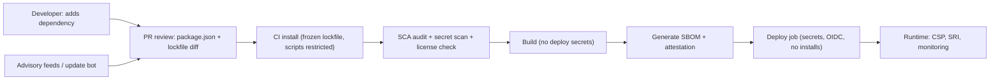
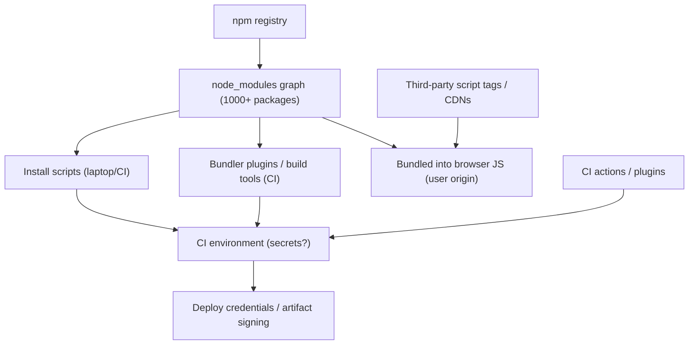
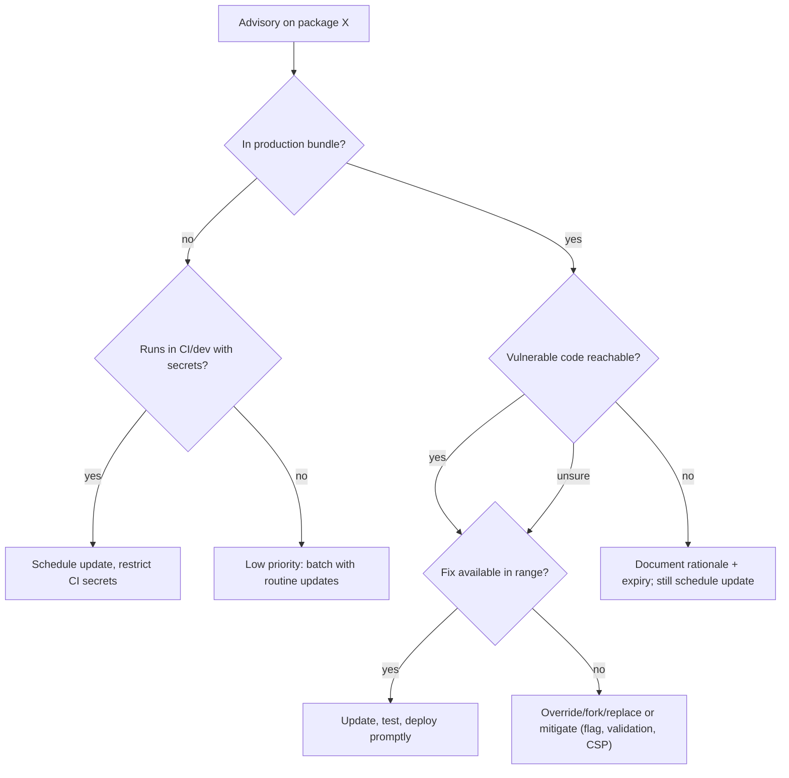

# 10 / 07 — Dependency Security: Supply Chain, Audits, Lockfiles, and Update Policy

## 1. Lesson metadata

| | |
|---|---|
| **Level** | Advanced |
| **Study time** | 4–5 hours (reading 2 h, experiments 1 h, exercises 1.5 h) |
| **Prerequisites** | [06 — Security: XSS, CSRF, CSP](./06-security-xss-csrf-csp.md); [01 — Repository organization](./01-repository-organization.md); [02 — Deployment workflows](./02-deployment-workflows.md); [Phase 0 — Modules and dependency graphs](../00-web-and-javascript-foundations/10-modules-and-dependency-graphs.md); [Phase 0 — Tooling, transpilation, bundling](../00-web-and-javascript-foundations/20-tooling-transpilation-and-bundling.md) |
| **Next** | [08 — Accessibility as architecture](./08-accessibility-as-architecture.md) |
| **Related later** | [12 — Backward compatibility](./12-backward-compatibility.md), [15 — Technical debt](./15-technical-debt.md), [18 — Continuous delivery](./18-continuous-delivery.md) |

> **Scope note.** Package managers, registries and scanners change quickly. Concepts here are stable; specific flags, config keys and product names are marked "verify against current docs." Security guidance is deliberately conservative.

**Learning objectives.** After this lesson you can:
1. Describe how a typical React project's dependency graph (hundreds to thousands of transitive packages) creates an attack surface, and name the principal attack classes.
2. Explain what a lockfile guarantees, and configure CI so the lockfile is authoritative (`npm ci` / frozen installs).
3. Interpret `npm audit`-style output without panic or complacency: reachability, severity, dev vs production, false positives.
4. Design an update policy (automation, cadence, grouping, review) that balances security patching against churn and breakage.
5. Reduce install-time and build-time code execution risk (lifecycle scripts, CI secrets, tokens, provenance).
6. Treat third-party scripts loaded in the browser (analytics, tag managers, widgets) as dependencies with the same risk, and control them (SRI, CSP, isolation).

**Concepts covered:** direct vs transitive dependencies, semver ranges, lockfiles, integrity hashes, typosquatting, dependency confusion, account takeover/malicious maintainers, install scripts, vulnerability databases (advisories, CVEs), SCA (software composition analysis), SBOM, provenance/attestations, update bots, `overrides`/`resolutions`, license compliance, secret scanning, least-privilege CI, third-party browser scripts.

---

## 2. Deep conceptual explanation

### 2.1 What problem is this lesson solving?

Most of the code in a production React application was written by someone you have never met. A new Vite + React + TypeScript project can install hundreds of packages; an enterprise app commonly has a thousand or more transitive packages. Each one is code that runs:

- **on developers' laptops and in CI** (install scripts, build plugins, test runners) — with access to source code, environment variables, tokens, and network;
- **in the user's browser** (bundled into your JavaScript) — with full access to your origin (see [06](./06-security-xss-csrf-csp.md): third-party code *is* your origin's code).

Your own diligence on application code is irrelevant if a dependency is compromised. Supply-chain attacks target exactly this asymmetry: one malicious publish reaches many consumers automatically.

### 2.2 Threat classes

| Threat | Mechanism | Example shape (generic) | Primary defenses |
|---|---|---|---|
| **Known vulnerability** in a legitimate package | A bug (prototype pollution, ReDoS, XSS in a sanitizer) discovered and published as an advisory | Old version pinned for years | Audit + timely updates + reachability triage |
| **Malicious update by a compromised maintainer account** | Attacker takes over maintainer credentials/tokens and publishes a trojaned version | Widely used package gets a new patch version containing credential-stealing code | Lockfile pinning, delayed adoption of brand-new versions, provenance, 2FA (maintainer side), monitoring |
| **Malicious maintainer / protestware / abandoned-and-sold package** | Owner intentionally ships harmful code or hands the package to a bad actor | Ownership transfer followed by malicious release | Review of critical dependencies, minimize count, vendoring/forks for critical pieces |
| **Typosquatting** | Package with a name close to a popular one | `reacct-dom` instead of `react-dom` | Careful install review, allowlists, internal registry proxy |
| **Dependency confusion** | Public package with the same name as an internal package at a higher version gets installed instead | Internal `@acme/utils` name unclaimed on the public registry | Scoped registries/`.npmrc` scope mapping, claim your scope, private registry rules |
| **Install-time code execution** | `preinstall`/`install`/`postinstall` scripts run arbitrary code | Script exfiltrates env vars | Disable/limit lifecycle scripts, run installs with least privilege, no secrets in install environment |
| **Build-tool/plugin compromise** | Bundler plugins, ESLint plugins, test reporters execute in CI | Plugin reads `process.env` | Pin and review, restrict CI secrets scope |
| **CDN/third-party script compromise** | A script loaded at runtime from another origin is changed | Analytics/tag script modified | Self-host, SRI, CSP, sandboxed iframes, minimize |
| **Compromised CI action/pipeline step** | Third-party GitHub Action or CI plugin altered | Mutable tag `@v1` re-pointed | Pin actions by commit SHA, least-privilege tokens |

Real incidents of nearly every class have occurred in the npm ecosystem; this lesson does not enumerate specific incidents, to avoid stating details that may be outdated — read current post-incident write-ups from the registry operator and security vendors as part of your continuing education.

### 2.3 Lockfiles: what they guarantee

A **lockfile** (`package-lock.json`, `pnpm-lock.yaml`, `yarn.lock`) records the *exact* resolved version and the **integrity hash** (a cryptographic digest) of every package in the graph. Properties:

- **Reproducibility:** the same lockfile yields the same dependency tree on every machine.
- **Tamper detection:** if the registry later serves different bytes for the same version, the integrity check fails. (It does **not** protect you if the malicious version was already what you locked.)
- **Reviewability:** a lockfile diff shows precisely what changed, including transitive changes — the most important artifact to review in a dependency-update PR.

What a lockfile does *not* do: it does not make dependencies safe; it makes them **deterministic**. A deterministic malicious package is still malicious.

**CI must install from the lockfile only:** `npm ci` (fails if `package.json` and lockfile disagree), `pnpm install --frozen-lockfile`, `yarn install --immutable` (verify flags for your version). `npm install` can silently rewrite the lockfile and pull newer versions within ranges.

### 2.4 Semver ranges and what they allow

`"react": "^19.0.0"` allows any compatible `19.x.y`. Ranges are why a fresh install without a lockfile is nondeterministic. For **applications** (not libraries), the lockfile pins; ranges in `package.json` express *intent* for updates. For **libraries**, ranges express compatibility for consumers. Semver is a social contract; patch releases *can* break and *can* be malicious. Do not equate "patch" with "safe."

### 2.5 Advisories, CVEs, severity, and reachability

Vulnerability databases (the GitHub Advisory Database, OSV, the npm advisory feed, NVD) map package versions to advisories. Scanners (`npm audit`, `pnpm audit`, `yarn npm audit`, GitHub Dependabot alerts, Snyk/others — verify tooling) compare your lockfile to these.

Reading an audit report requires judgement:

| Question | Why it matters |
|---|---|
| Is the package in **production** dependencies, or only dev/build tooling? | A ReDoS in a dev-only tool is not user-facing risk, but may be CI risk. |
| Is the vulnerable **function reachable** in your use? | Many advisories concern specific APIs/options you do not use. |
| What is the **exploit precondition**? | Requires attacker-controlled input to that function? Server-side only? |
| Is there a **fix version** within your range? Is it a major bump? | Determines effort and risk. |
| Is there a **known exploit** (e.g. listed as actively exploited)? | Raises priority regardless of CVSS. |

CVSS scores are *inputs*, not decisions. A "critical" with no reachable path may rank below a "moderate" in your auth flow. But **do not dismiss by default**: unexamined "not reachable" claims become the vulnerabilities of tomorrow when code changes. Record triage decisions (e.g. an allowlist/ignore with expiry and rationale) so they are reviewed, not forgotten.

### 2.6 Update policy: the tension

| Policy | Security | Stability | Effort |
|---|---|---|---|
| Never update | Worst: known vulnerabilities accumulate | Stable until forced upgrade | Low now, huge later |
| Update everything immediately | Fast patching, but fast exposure to a malicious new release | Churn, breakage | High, risky |
| **Scheduled automated PRs + review + cooldown** | Good | Good | Moderate (bot noise) |
| Security-only updates, others quarterly | Good for known CVEs | Good | Low–moderate |

A pragmatic default: automated update PRs (Dependabot/Renovate), **grouped** by ecosystem (e.g. all `@types/*`, all lint tooling), CI must pass including tests and build, with an optional **minimum release age** (a "cooldown") of a few days before adopting brand-new versions, because many malicious publishes are detected and removed within hours or days. Security-advisory PRs bypass the cooldown. Cooldowns are now native in several tools: Renovate `minimumReleaseAge`, Dependabot `cooldown`, pnpm `minimumReleaseAge` (minutes) and npm `min-release-age` (days). Option names and units differ, so check the docs for the exact version you run.

### 2.7 Common misconceptions

| Misconception | Reality |
|---|---|
| "`npm audit` clean means secure." | It only reports *known, published* advisories for the versions in the lockfile; it cannot detect new malicious packages or zero-days. |
| "Pinning exact versions in `package.json` is enough." | Transitive dependencies are still resolved by the lockfile or ranges; the lockfile (plus CI enforcement) is what pins the graph. |
| "Dev dependencies don't matter." | They execute on your machines/CI and can access secrets and write build output. |
| "Popular packages are safe." | Popularity makes them valuable targets; maintainers are phish-able. |
| "We can fix by running `npm audit fix --force`." | `--force` can apply breaking major upgrades and mask problems; review diffs and test. |
| "It's just a front-end app; nothing sensitive." | Build pipelines hold deploy credentials; browser code holds user sessions. |

---

## 3. Internal mechanics

### 3.1 How npm-style resolution produces the graph

`package.json` declares *direct* dependencies with ranges. The installer resolves each range to a version (picking the highest satisfying version, subject to the existing lockfile), recursively resolves each package's own dependencies, deduplicates where ranges overlap, and writes the lockfile with `resolved` URL, `version` and `integrity` (SHA-512 SRI digest) per package. **Public guarantee:** the lockfile format and integrity checks are documented per package manager. **Teaching model:** a deterministic tree/DAG snapshot. **Implementation detail:** hoisting and dedupe layouts (flat vs symlinked store) differ between npm, Yarn and pnpm and affect *what code can accidentally import* ([01 — phantom dependencies](./01-repository-organization.md)).

### 3.2 Lifecycle scripts

Packages may declare `preinstall`, `install`, `postinstall` (and `prepare` for local/git packages) in their `package.json`. The installer executes them with the user's privileges, with access to the environment and filesystem. Native modules (e.g. `esbuild`, `sharp`, `node-sass`-style) historically legitimately use install scripts to fetch or build binaries. Mitigations:

- `--ignore-scripts` (npm/yarn flag; or config) disables them — but may break packages that need them (then you explicitly allow specific ones).
- Some package managers support **allowlisting build scripts per package** (pnpm docs, "Mitigating supply chain attacks": since pnpm v10 dependency `postinstall` scripts do not run automatically; you list trusted packages with the `allowBuilds` setting in `pnpm-workspace.yaml` (`dangerouslyAllowAllBuilds` re-enables all; `strictDepBuilds` makes unreviewed builds fail the install). Older v10 docs and tutorials call the allowlist `onlyBuiltDependencies`; check the setting name for the pnpm version you pin). pnpm also offers `minimumReleaseAge` (minutes; default 1440 = one day in current docs), `trustPolicy: no-downgrade` (refuse a version whose publish trust level is lower than earlier releases, e.g. lost trusted-publisher/provenance), and `blockExoticSubdeps` (refuse git/tarball transitive dependencies).
- Current npm docs also list `npm approve-scripts` / `npm deny-scripts` commands for managing which dependency scripts may run (not tested here; check `npm help approve-scripts` for your npm version).
- Run installs in environments that **do not hold deploy secrets**: separate "install & build" job (no secrets) from "deploy" job (secrets, no arbitrary install).

### 3.3 Provenance and attestations

**Provenance** is a signed statement about *how* an artifact was built: which source repository, commit and CI workflow produced it. The npm registry supports publishing with provenance from supported CI providers (npm docs: provenance requires a supported cloud CI provider, currently GitHub Actions and GitLab CI/CD on cloud-hosted runners, and attestations are signed via Sigstore and logged publicly; `npm audit signatures` verifies registry signatures and provenance attestations of installed packages). npm also supports **trusted publishing** (OIDC between your CI and the registry, so no long-lived publish token is stored). Consumers can add a cooldown natively too: npm has a `min-release-age` config (days, with `min-release-age-exclude`) in current npm CLI source. Provenance does not prove the code is *good*, only that it came from the claimed pipeline — it narrows the "stolen token published from an attacker's laptop" class. Similarly, **SLSA** (Supply-chain Levels for Software Artifacts) is a framework describing increasing levels of build integrity; **SBOM** (Software Bill of Materials; formats CycloneDX and SPDX) is an inventory enabling rapid "are we affected?" answers when a new advisory drops.

### 3.4 Where defenses sit in the pipeline



---

## 4. Step-by-step execution walkthrough: responding to a new advisory

1. **Alert arrives** (update bot security PR, scanner notification, or industry news): "Package `X@<4.2.1` has a high-severity advisory."
2. **Scope it.** `npm ls X` (or `pnpm why X`) shows how it enters the tree — direct or transitive through `Y`? Which versions? Does the production bundle include it? (Check the bundle analyzer — [Phase 7 — Bundle analysis](../07-performance/16-bundle-analysis.md).)
3. **Read the advisory**: affected function, preconditions, patched version, workarounds. Decide reachability with evidence (code search for the API, tests).
4. **Choose action:**
   - Direct dependency with patch available → update, run tests, PR.
   - Transitive → update parent if it has released a fix; otherwise use `overrides` (npm) / `resolutions` (Yarn) / `pnpm.overrides` to force the patched version (⚠ syntax per manager), then **remove the override** when the parent updates, tracking it with an expiry.
   - No fix → mitigate (feature flag, input validation, WAF, CSP), or replace/fork the package; document decision.
5. **Review the lockfile diff** for unexpected transitive changes.
6. **CI gates:** typecheck, tests, build, audit, bundle-size check.
7. **Deploy with canary** ([02](./02-deployment-workflows.md)); watch error rates ([05](./05-error-monitoring.md)).
8. **Record** the decision (issue/ADR — [16 — Architecture decision records](./16-architecture-decision-records.md)).
9. **If it was exploitable and you were exposed:** treat as an incident ([19](./19-incident-debugging.md)): rotate secrets that were available to the vulnerable code, review logs.

**Predict:** `npm audit` shows 14 vulnerabilities, 13 in a dev-only test-runner chain, 1 in a production sanitizer. Which first? *The production sanitizer, because it directly sits on the XSS defense path ([06](./06-security-xss-csrf-csp.md)); the dev-chain items still need scheduled attention because they run in CI.*

---

## 5. Code examples

### 5.1 Minimal example — CI that treats the lockfile as authoritative

```yaml
# .github/workflows/ci.yml (excerpt) — action majors below are illustrative: as of 2026-10 the latest releases are actions/checkout v7 and actions/setup-node v7 (v4 still works); pin to a SHA either way
jobs:
  verify:
    runs-on: ubuntu-latest
    permissions:
      contents: read
    steps:
      - uses: actions/checkout@v4          # prefer pinning to a full commit SHA (see 5.4)
      - uses: actions/setup-node@v4
        with:
          node-version-file: .nvmrc
          cache: npm
      - run: npm ci --ignore-scripts       # fail on lockfile drift; do not run dependency lifecycle scripts
      - run: npm rebuild esbuild           # explicitly allow only known-needed build scripts (verify per tool)
      - run: npm audit --omit=dev --audit-level=high
      - run: npm run typecheck && npm run lint && npm test && npm run build
```

**Line notes.**
- `npm ci` deletes `node_modules` and installs exactly the lockfile; it errors if `package.json` and the lockfile are out of sync — which is the point.
- `--ignore-scripts` blocks all dependency lifecycle scripts, then you re-run specific rebuilds for packages that legitimately need them. Some projects find this laborious; evaluate trade-offs (see §7). Note that `--ignore-scripts` also skips *your own* project's `prepare`/lifecycle scripts for `npm ci`; run those explicitly if needed.
- `npm audit --omit=dev --audit-level=high` fails the build only for production dependencies with high+ severity. Policy choice: failing builds on newly published advisories can block unrelated PRs; many teams instead make audit a **scheduled job + dashboard** plus a blocking gate only for *newly introduced* issues. (`--omit=dev` replaced `--production` in modern npm; `--audit-level` accepts `info|low|moderate|high|critical|none`.)
- Keep deploy credentials out of this job (it has `contents: read` only).

### 5.2 Practical example — update bot configuration (Renovate-style) with grouping and cooldown

```jsonc
// renovate.json — illustrative; `minimumReleaseAge`, `packageRules`, `dependencyDashboardApproval` and `helpers:pinGitHubActionDigests` are documented Renovate names (newer Renovate also has `minimumReleaseAgeBehaviour`)
{
  "$schema": "https://docs.renovatebot.com/renovate-schema.json",
  "extends": ["config:recommended", "helpers:pinGitHubActionDigests"],
  "schedule": ["before 6am on monday"],
  "minimumReleaseAge": "3 days",
  "packageRules": [
    { "matchPackageNames": ["react", "react-dom", "@types/react", "@types/react-dom"],
      "groupName": "react" },
    { "matchDepTypes": ["devDependencies"], "matchUpdateTypes": ["minor", "patch"],
      "groupName": "dev tooling (minor/patch)" },
    { "matchUpdateTypes": ["major"], "dependencyDashboardApproval": true },
    { "isVulnerabilityAlert": true, "minimumReleaseAge": null, "schedule": ["at any time"],
      "labels": ["security"] }
  ]
}
```

**Notes.** Equivalent behavior exists in GitHub Dependabot (`.github/dependabot.yml` with `groups`, `schedule`, and `cooldown` options — `cooldown` with `default-days` is the documented Dependabot key; check the options reference for semver-specific variants). Key policy ideas that transfer across tools: (1) **group** low-risk updates to reduce PR noise; (2) **gate majors** behind explicit approval and a migration plan; (3) **cooldown** for ordinary updates, **none** for security fixes; (4) **pin GitHub Actions by digest** (§5.4); (5) every update PR runs the full CI; (6) assign owners via CODEOWNERS ([01](./01-repository-organization.md)).

### 5.3 Incorrect example — risky install and publish practices

```jsonc
// package.json
{
  "dependencies": {
    "react": "*",                                // ❌ any version, any time
    "internal-utils": "^1.0.0",                  // ❌ unscoped internal name: dependency-confusion risk
    "some-package": "github:someuser/some-package"   // ❌ mutable branch ref, unreviewed
  },
  "scripts": {
    "postinstall": "curl -s https://example.com/setup.sh | sh"   // ❌ remote script execution
  }
}
```

```bash
# In CI
npm install            # ❌ rewrites lockfile, resolves newer versions
npm audit fix --force  # ❌ blind major upgrades committed straight to main
```

Plus: a long-lived `NPM_TOKEN` with publish rights stored as a plain repo secret exposed to *every* job, including PR builds from forks.

### 5.4 Corrected implementation

```jsonc
// package.json
{
  "dependencies": {
    "react": "^19.0.0",
    "@acme/utils": "^1.0.0"                      // scoped; scope registry mapped in .npmrc
  },
  "overrides": {
    "vulnerable-transitive": "^2.3.4"            // temporary: remove when parent releases a fix (tracked in issue #123)
  }
}
```

```ini
# .npmrc
@acme:registry=https://npm.internal.example.com/   # internal scope only resolves from internal registry
```

```yaml
# Pin third-party actions by full commit SHA (the comment keeps humans oriented)
- uses: actions/checkout@<full-40-char-commit-sha>   # v4.x.y
```

```yaml
permissions:
  contents: read
# Publish workflow, if you publish packages: separate job, OIDC/trusted publishing with provenance
# (npm docs: trusted publishing uses OIDC and needs `id-token: write` on the publish job; provenance is added automatically for trusted publishing from supported providers), no long-lived tokens.
```

**Explanation.** Scoped internal packages + registry mapping prevent confusion attacks (and claim the same scope on the public registry as a defensive measure — verify process). Overrides are explicit, temporary, tracked. Actions pinned to SHAs prevent a moved tag from silently changing your CI. Tokens are least-privilege, short-lived (OIDC) and absent from jobs that don't need them. Fork PRs run without secrets (the default for `pull_request` events from forks; be extremely careful with `pull_request_target` — ⚠ read the GitHub security docs before using it).

### 5.5 Advanced — dependency review as code: policy checks in CI

```ts
// scripts/check-new-deps.ts  — a lightweight guard run on PRs (conceptual)
import { execSync } from "node:child_process";
import { readFileSync } from "node:fs";

type Pkg = { dependencies?: Record<string, string>; devDependencies?: Record<string, string> };

const base = JSON.parse(execSync("git show origin/main:package.json", { encoding: "utf8" })) as Pkg;
const head = JSON.parse(readFileSync("package.json", "utf8")) as Pkg;

const names = (p: Pkg) => new Set([...Object.keys(p.dependencies ?? {}), ...Object.keys(p.devDependencies ?? {})]);
const added = [...names(head)].filter((n) => !names(base).has(n));

const violations: string[] = [];
for (const name of added) {
  const spec = { ...head.dependencies, ...head.devDependencies }[name]!;
  if (/^(\*|latest|x)$/.test(spec)) violations.push(`${name}: unbounded range "${spec}"`);
  if (/^(git|github:|https?:)/.test(spec)) violations.push(`${name}: non-registry source "${spec}"`);
}
if (added.length) console.log("New dependencies requiring review:", added.join(", "));
if (violations.length) { console.error(violations.join("\n")); process.exit(1); }
```

**Notes.** This does *not* decide whether a dependency is trustworthy — it forces **visibility** (new deps listed in PR output for the CODEOWNERS reviewers) and blocks obviously risky specs. Review checklist for a *new* dependency: Is it necessary (could 20 lines or a platform API do the job)? Maintenance status, bus factor, release cadence, open advisories, download trends vs name-lookalikes, install scripts, transitive count, bundle size ([Phase 7](../07-performance/16-bundle-analysis.md)), license compatibility, and whether it has a maintained alternative. Tools like GitHub's dependency-review action can automate parts; verify availability.

### 5.6 Advanced — third-party scripts in the browser

```html
<!-- Self-hosted preferred. If you must load from a CDN, pin a version and add SRI -->
<script
  src="https://cdn.example.com/lib@1.2.3/lib.min.js"
  integrity="sha384-REPLACE_WITH_HASH_COMPUTED_FROM_REVIEWED_FILE"
  crossorigin="anonymous"
  defer></script>
```

```tsx
// Load a non-essential third-party widget lazily, isolated, with timeout and fallback ([10])
function ChatWidgetFrame() {
  return (
    <iframe
      title="Support chat"
      src="https://chat.vendor.example/embed"
      sandbox="allow-scripts allow-forms allow-popups"   // no allow-same-origin: isolates vendor from our origin
      referrerPolicy="no-referrer"
      loading="lazy"
    />
  );
}
```

**Notes.** SRI protects against *the file changing* at a pinned URL; it does not protect against a vendor script that is *dynamic by design* (tag managers, analytics snippets that load further scripts) — those can't be hash-pinned. For them: minimize, isolate (iframe `sandbox`), CSP `connect-src` allowlists, and governance over who can add tags. `sandbox` flag semantics have subtle combinations — consult MDN; do not add `allow-same-origin` together with `allow-scripts` for untrusted content because the framed document can remove its own sandbox. Cross-reference: [10 — Resilience and degradation](./10-resilience-and-degradation.md) for timeouts and failure isolation of third-party widgets.

---

## 6. Visual explanations

### Where untrusted code enters



### Decision: how to handle an advisory



---

## 7. Alternative approaches and trade-offs

**How to control dependency risk:**

| Approach | Risk reduction | Effort / friction | Cost | When to prefer |
|---|---|---|---|---|
| Lockfile + frozen CI install + audit | Baseline | Low | Free | Always |
| Update bot with grouping + cooldown | Good (timely patches, fewer instant-compromise adoptions) | Moderate (PR review) | Free–low | Most teams |
| `--ignore-scripts` / script allowlisting | High vs install-time malware | Moderate (breakages, maintaining allowlist) | Free | Teams with secrets-bearing CI or high-value targets |
| Internal registry proxy/mirror with policy (age, license, malware scanning) | High | High (infra) | Medium–high | Large orgs, regulated industries |
| Vendoring critical dependencies | High for those deps | High (you own updates/patches) | Engineering time | Small, critical, stable libraries |
| Commercial SCA/malware scanners | Good for detection | Low–moderate | Subscription | Compliance needs; larger graphs |
| Minimizing dependencies (use platform APIs) | Reduces surface structurally | Ongoing discipline | Dev time | Always worth considering ([Phase 5 — DRY/KISS/YAGNI](../05-design-patterns/02-dry-kiss-yagni.md)) |

**When the recommended approach (frequent automated updates) is not best:** a very stable, low-change internal tool with a tiny dependency set and no secrets in CI may prefer quarterly, manually reviewed updates (plus immediate security-advisory handling) over weekly bot PRs it will ignore. Conversely, in high-value targets (payments, auth libraries), pairing cooldown with provenance verification and internal mirror policy may be justified even at significant cost.

**Dependency vs implement-it-yourself.** Rolling your own date-parsing or crypto is usually worse than a vetted library. For *tiny utilities* (left-pad-style) an in-repo implementation avoids a transitive risk surface. Rule of thumb: never write your own crypto/sanitizer; consider writing trivial utilities; evaluate everything in between with the checklist in §5.5.

---

## 8. Best practices and anti-patterns

**Do**
- Commit the lockfile; install with frozen-lockfile commands in CI; review lockfile diffs.
- Run audits on a schedule and on PRs; triage with context; track exceptions with expiry.
- Keep deploy credentials out of install/build jobs; use short-lived OIDC credentials.
- Pin CI actions by commit digest; restrict workflow `permissions`.
- Enable 2FA/passkeys on registry and source-hosting accounts; scope tokens; rotate.
- Maintain an SBOM (generate in CI) so "are we affected?" takes minutes.
- Remove unused dependencies (e.g. `depcheck`-style tooling — ⚠ verify) and duplicate packages.
- Use secret scanning (push protection) to prevent committing tokens.

**Beginner mistakes**
- Installing packages from blog snippets without checking the name/publisher.
- Deleting the lockfile to "fix" an install error.
- Ignoring audit output entirely or blindly `--force`-fixing it.

**Experienced-developer mistakes**
- Assuming internal package names are safe without scope mapping.
- Allowing a bot to auto-merge dependency updates to production without tests or cooldown.
- Treating `devDependencies` as harmless.
- Leaving overrides in place forever (hidden divergence from upstream).
- Over-trusting `provenance` as a quality seal.

**Smells**
- Thousands of dependencies for a small app; many unused.
- Multiple major versions of the same library in the graph (bundle bloat and risk).
- PRs updating 200 lockfile lines with no reviewer reading them.
- "We'll upgrade after the release" for two years.

**Justified exceptions**
- Pinning (and not updating) a dependency whose newer versions are known-bad, with a documented, time-limited exception.
- Keeping install scripts enabled in a locked-down, secrets-free CI where blocking them costs more than it protects — a risk decision to document.

---

## 9. Real-world application

**E-commerce.** Payment-page JavaScript is a prime target (script skimming). Minimize dependencies on checkout, produce an SBOM and a script inventory, restrict third-party tags, and monitor for unexpected script changes (CSP reports, SRI failures). Constraint: marketing teams want tags; governance workflow needed ([06](./06-security-xss-csrf-csp.md)).

**Finance.** Regulated change control: an internal registry mirror with allowlisted packages, license policy, and malware scanning; provenance verification; documented exception process. Constraint: audit evidence — keep SBOMs and approval records per release.

**Multi-team platform.** A platform team owns shared lint/TS/tooling packages ([01](./01-repository-organization.md)); updating them is itself a supply-chain event for all teams. Constraint: coordinated upgrades, version ranges, deprecation windows ([12](./12-backward-compatibility.md)).

**Open-source consumers / design systems.** If you publish packages, *you* are someone's supply chain: protect publish tokens, use 2FA and trusted publishing/provenance, minimize your own dependencies, and document security contacts.

**Dashboards/SaaS.** Long-lived apps accumulate stale dependencies; schedule "dependency health" work ([15 — Technical debt](./15-technical-debt.md)).

---

## 10. Debugging and troubleshooting

**Symptom: `npm ci` fails with "package.json and package-lock.json are not in sync."**
Investigate: someone edited `package.json` without updating the lockfile, or used a different npm major. Fix: run `npm install` locally with the project's pinned npm/Node, review and commit the lockfile diff. Prevent: pre-commit/CI check, `packageManager` pinning ([01](./01-repository-organization.md)).

**Symptom: Audit flags a vulnerability in a transitive dependency with no fix.**
Investigate: `npm ls <pkg>`; check whether a newer parent version exists, whether the vulnerable code path is used; read advisory workaround. Options: override, replace parent, mitigate. Validate: rerun audit, check lockfile diff, run tests.

**Symptom: After updating, the app breaks only in production build.**
Investigate: compare dependency versions between lockfile commits; check `sideEffects` and ESM/CJS changes ([Phase 0 — Modules](../00-web-and-javascript-foundations/10-modules-and-dependency-graphs.md)); bundle analyzer; error monitoring release tags ([05](./05-error-monitoring.md)). Fix: pin/rollback via lockfile revert; open upstream issue.

**Symptom: A suspicious new package appeared in the lockfile diff.**
Investigate: `npm ls` to see who requires it; check publish date/maintainer/homepage on the registry; inspect `package.json` scripts and tarball contents (`npm pack <pkg>@<version> --dry-run` or inspect download — in a sandbox). Contain: do not install on machines with secrets; escalate to security. If already installed anywhere with secrets: rotate those secrets. ⚠ Have a documented incident procedure *before* you need it.

**Symptom: Bot PRs pile up unreviewed.**
Investigate: noise level, grouping, ownership. Fix: group, tune schedule, set limits (`prConcurrentLimit`-style options — verify), assign owners, and decide that unreviewed PRs older than N days are reported on a dashboard.

**Symptom: SRI failure for a CDN script.**
Investigate: the vendor changed bytes at the same URL, or a proxy altered content (some corporate proxies modify content). Fix: pin versioned URL; self-host; update the hash after reviewing the new file.

---

## 11. Exercises

### Level A — Knowledge
**A1.** What does a lockfile's integrity hash protect against, and what does it not?
**A2.** Define typosquatting and dependency confusion. How do scoped packages help?
**A3.** Why is "the vulnerability is in a dev dependency" not automatically "ignore"?
**A4.** What does `npm ci` do differently from `npm install`, and why does it matter in CI?
**A5.** Name three data points you would check before adding a new dependency.

### Level B — Code comprehension
**B1.** In §5.2, what is the purpose of `minimumReleaseAge` and why is it nulled for vulnerability alerts?
**B2.** In §5.5, what kinds of risky additions does the script catch and not catch?
**B3.** Why is `sandbox="allow-scripts allow-same-origin"` on an iframe with untrusted content a problem?

### Level C — Implementation
**C1.** Write a CI job that installs with a frozen lockfile, runs audit for production deps with a high-severity gate, generates an SBOM (tool of your choice — verify its CLI), uploads it as an artifact, and has no deploy secrets.
**C2.** Create a `.npmrc` and package naming plan that prevents dependency confusion for internal packages.
**C3.** Write a script that fails CI if the lockfile contains packages resolved from non-registry URLs (git/http) not on an allowlist.

### Level D — Debugging
**D1.** `npm audit` reports a high-severity issue in `foo@1.2.0`, required by `bar@3.0.0`, which you depend on. `bar@3.1.0` requires `foo@1.2.5` (fixed). Walk through the fix and validation.
**D2.** A teammate's laptop got a different dependency tree than CI and a test fails only locally. Diagnose.
**D3.** A routine dependency bump PR modified 400 lines of lockfile including a new package `colors-utils-extra` with an install script. What do you do?

### Level E — Architecture decisions
**E1.** Choose an update policy for (a) a bank's retail web app, (b) a hackathon prototype, (c) an internal admin tool. Justify with criteria.
**E2.** Decide whether to adopt an internal registry proxy for a 40-engineer front-end org. Evaluate costs and benefits.

### Level F — Expert challenge
**F1.** A widely used package your app depends on (transitively, through three levels) publishes a malicious patch release that is discovered 6 hours later. Describe how your org determines exposure, what you do for CI, developer machines and production, how you communicate, and what structural controls would have reduced impact.

---

## 12. Detailed answers and explanations

> Attempt the exercises first.

**A1.** It protects against *tampering after the fact*: if registry bytes for a locked version change (or a mirror is poisoned), installation fails the integrity check. It does not protect against a malicious version you already locked, nor against a compromised publisher releasing a *new* version that you then adopt through an update.

**A2.** Typosquatting: a malicious package named like a popular one, hoping for a typo. Dependency confusion: an attacker publishes a public package using the *same name as your private package* with a higher version; a misconfigured client prefers the public one. Scoped packages (`@acme/…`) plus a registry mapping for the scope (and claiming the scope publicly) ensure the scope can only resolve from the intended registry.

**A3.** Dev dependencies run on developer machines and in CI where tokens/deploy credentials may exist, and build plugins can modify output (injecting code into the production bundle). A vulnerability in a dev tool can be a path to compromise even if it never ships. Priority may be lower than a production-reachable issue, but it is not zero.

**A4.** `npm ci` installs exactly what the lockfile specifies, removes existing `node_modules`, and errors if `package.json` and lockfile disagree; it never writes the lockfile. `npm install` may update the lockfile and resolve newer versions within ranges. In CI, determinism and detecting drift matter more than convenience.

**A5.** Examples: maintainer count and activity; release history and open security issues; weekly downloads (and verify it's the *right* name); install scripts; transitive dependency count; license; bundle size; whether platform APIs make it unnecessary; provenance/signing status; whether it is a duplicate of something already used.

**B1.** It delays adopting versions younger than 3 days, giving the ecosystem time to detect and pull malicious or broken releases. For vulnerability fixes the cost of waiting is exposure to a *known* flaw, so the delay is removed and the schedule is "any time." It is a risk trade: a malicious "fix" release is conceivable, so security PRs still require review and tests.

**B2.** Catches: new direct deps with unbounded ranges (`*`, `latest`) or non-registry sources (git/http). Doesn't catch: malicious packages with normal ranges, typosquats (name similarity), transitive additions, malicious *updates* to existing deps (it only inspects *added* names), or install scripts. It's a visibility/hygiene tool, not a detector.

**B3.** With both flags the framed page, if same-origin, can reach into the parent and remove the iframe's own `sandbox` attribute (or script the parent), voiding isolation. (If the content is cross-origin, `allow-same-origin` lets it keep its own origin's storage/cookies, which is also often undesirable.) Use `allow-scripts` without `allow-same-origin` for untrusted content so it runs in an opaque origin.

**C1.** Example outline:

```yaml
jobs:
  build:
    runs-on: ubuntu-latest
    permissions: { contents: read }
    steps:
      - uses: actions/checkout@<sha>
      - uses: actions/setup-node@<sha>
        with: { node-version-file: .nvmrc, cache: npm }
      - run: npm ci --ignore-scripts
      - run: npm audit --omit=dev --audit-level=high
      - run: npx @cyclonedx/cyclonedx-npm --output-file sbom.cdx.json   # ⚠ verify tool name and flags
      - uses: actions/upload-artifact@<sha>
        with: { name: sbom, path: sbom.cdx.json }
      - run: npm run build
```
Criteria: frozen install, gate scoped to production deps, SBOM artifact retained per release, no secrets, permissions minimal, actions pinned. Note the trade-off on failing every PR for newly published advisories.

**C2.** Plan: all internal packages named `@acme/<name>`; register/own the `@acme` scope on the public registry; `.npmrc` with `@acme:registry=<internal>`; consume only through that scope; forbid unscoped internal names via a lint/CI check on `package.json`; configure the internal registry to proxy public packages *only* for non-`@acme` names (and never fall through for `@acme`).

**C3.** Parse `package-lock.json` (`packages[*].resolved`), flag entries whose `resolved` is not an `https://registry.npmjs.org/` (or internal registry) URL and not in an allowlist file; exit non-zero with the offending names. Edge cases: workspace links (`link: true`, no `resolved`), git dependencies using `git+ssh`, `file:` specs. ⚠ lockfile formats differ between managers; adapt for pnpm/yarn.

**D1.** `npm ls foo` to confirm path; update `bar` to `3.1.0` (check changelog/diff for breaking changes), reinstall, confirm `npm ls foo` shows `1.2.5`, review lockfile diff, run tests/build, rerun audit, deploy canary. If `bar@3.1.0` isn't acceptable: temporary `overrides` for `foo` to `^1.2.5` after verifying `foo`'s patch is semver-compatible with `bar`'s use, with a tracked removal. Validate with tests exercising `bar`'s use of `foo`.

**D2.** Likely different Node/npm versions, local `npm install` rewrote lockfile or used a different registry/config (`.npmrc` overrides), stale `node_modules`, or platform-specific optional dependencies. Check `git status` for lockfile changes, `npm ls`, compare `node -v`/`npm -v` to pinned versions, delete `node_modules` and run `npm ci`. Prevent with `engines`, `packageManager`, and a CI check.

**D3.** Do not merge. Inspect: why was a new package introduced (who depends on it), its publish history/maintainer, repo link, install script content (read it in a sandbox, don't run it on a real machine), and whether the name resembles a legit package (`colors`-lookalike). Check whether CI already ran the PR's install (secrets exposure risk — if the CI job had secrets, rotate them). Block the package, report it to the registry (security reporting channel), and notify security. Bot PRs *can* introduce malicious transitive packages, so the lockfile diff review is mandatory.

**E1.** (a) Bank: weekly automated PRs with cooldown (except security), internal registry/mirror policy, provenance verification, `--ignore-scripts` with allowlist, SBOM per release, mandatory review by owners, change-management evidence. (b) Hackathon: lockfile + occasional updates; don't over-engineer. (c) Internal admin tool: monthly grouped updates, audit gating on production deps, auto-merge patch dev tooling only if CI strong. Criteria: asset value, exposure, team capacity, regulatory evidence, blast radius.

**E2.** Benefits: central policy (block packages younger than N days, malware scanning, license rules), caching/availability, single egress point, audit trail. Costs: infra and ops (availability becomes critical), policy maintenance, developer friction (waiting for approvals), vendor/product cost. For 40 engineers, a managed proxy (from your artifact repository vendor) may be proportionate; building bespoke is not. Decision evidence: past incidents, compliance requirements, CI install flakiness, and whether lockfile + cooldown + scoped tokens already achieve the risk target.

**F1.** Example answer. *Exposure*: use SBOMs/lockfile search across all repos for the package@version; check lockfile history for the affected range, CI logs for installs during the window, and artifact registries for builds produced then. *CI*: assume secrets available during installs in the window may be compromised — rotate deploy tokens, cloud creds, registry tokens; review CI audit logs for anomalous network calls. *Developer machines*: identify installs in the window (shell history/endpoint tooling), isolate and rotate local credentials (SSH keys, cloud CLI creds, npm tokens). *Production*: if the code shipped in the browser bundle, determine which releases included it; ship a fixed build, purge caches, consider forced reload (version-skew handling — [02](./02-deployment-workflows.md)); review CSP/network logs for exfil endpoints; notify affected users/regulators per law/policy. *Communication*: incident channel with roles, status page if user data was possibly exposed ([19](./19-incident-debugging.md)). *Structural controls*: cooldown period (adopting only versions older than the 6 h window would have avoided it), frozen installs with no secrets in install steps, install scripts disabled, minimal and segmented CI credentials, provenance checks, internal mirror policy, SBOM for rapid triage, and egress restrictions in CI. Evaluate honestly which controls would have mattered and which are cost-ineffective.

---

## 13. Senior engineer interview questions

**Q1. "How do you decide whether to fix an audit finding now?"**
*Strong answer:* I look at where the package lives (production bundle vs dev/CI), whether the vulnerable code path is reachable with attacker-controlled input, exploit maturity, and available fix/risk of the upgrade. I record the decision with an expiry if I defer. I don't dismiss by default because code changes can make an unreachable path reachable, and I still schedule dev-tool fixes because CI is a high-value target.

**Q2. "What protects us from a malicious new version of a popular package?"**
*Strong answer:* Lockfile pinning prevents *automatic* adoption; update PRs with a cooldown delay adoption until the community detects bad releases; frozen CI installs; no secrets in install/build jobs; install scripts disabled/allowlisted; provenance and signature checks where available; egress restrictions in CI; review of lockfile diffs; and SBOMs to find exposure quickly if it happens.

**Q3. "Explain dependency confusion and its fix."**
*Strong answer:* If internal package names are unscoped and not reserved publicly, a resolver configured with both registries may take an attacker's higher-versioned public package. Fix: scoped names mapped to the internal registry, owning the scope publicly, and registry policies preventing fall-through for internal scopes.

**Q4. "Would you auto-merge dependency updates?"**
*Strong answer:* Only a narrow slice: patch/minor updates for low-risk dev tooling with strong test coverage, a cooldown, and a branch protected by required checks. Never for runtime-critical or security-sensitive packages, majors, or anything touching build/deploy. The decision depends on test confidence and blast radius.

**Q5. "Why treat third-party scripts as dependencies?"**
*Strong answer:* They run in your origin with the same privileges as your code, can change without your review, and often load further scripts. Governance includes minimizing, self-hosting/SRI where possible, CSP, iframe sandboxing for widgets, and a process for who can add tags.

---

## 14. Further learning resources

| Resource | URL | Covers / why | Level | Study |
|---|---|---|---|---|
| npm Docs — `npm ci` | <https://docs.npmjs.com/cli/commands/npm-ci> | Frozen installs | Intermediate | Description, differences from `install` |
| npm Docs — `npm audit` | <https://docs.npmjs.com/cli/commands/npm-audit> | Audit behavior, flags | Intermediate | Options, exit codes |
| npm Docs — package-lock.json | <https://docs.npmjs.com/cli/configuring-npm/package-lock-json> | Lockfile semantics | Intermediate | Whole page |
| npm Docs — Generating provenance statements | <https://docs.npmjs.com/generating-provenance-statements> | Provenance for publishers | Advanced | Whole page |
| GitHub Docs — Dependabot | <https://docs.github.com/en/code-security/dependabot> | Alerts and version updates | Intermediate | Configuration options |
| Renovate docs | <https://docs.renovatebot.com/> | Update automation configuration | Intermediate | Presets, `packageRules` |
| OSV — Open Source Vulnerabilities | <https://osv.dev/> | Vulnerability database and API | Intermediate | Search |
| OpenSSF Scorecard | <https://github.com/ossf/scorecard> | Automated security checks for OSS repos | Advanced | Checks list |
| SLSA | <https://slsa.dev/> | Build integrity levels framework | Advanced | Levels, spec |
| OWASP Cheat Sheet — Software Supply Chain Security / NPM Security | <https://cheatsheetseries.owasp.org/cheatsheets/NPM_Security_Cheat_Sheet.html> | npm-specific hardening | Intermediate | Whole page |
| MDN — Subresource Integrity | <https://developer.mozilla.org/en-US/docs/Web/Security/Subresource_Integrity> | SRI usage and caveats | Intermediate | Whole page |
| MDN — `<iframe>` `sandbox` | <https://developer.mozilla.org/en-US/docs/Web/HTML/Element/iframe#sandbox> | Sandbox flags | Intermediate | Attribute section |

URLs in this table were checked for HTTP 200 on 2026-10-22; any still marked *(unverified)* could not be checked automatically (blocked or unreachable). A 200 response does not guarantee the page content still matches the description; if a link has moved, search the site for the quoted title.

---

## 15. Knowledge checkpoint

**You should now understand**
- The principal supply-chain threat classes and which controls address each.
- What a lockfile guarantees (determinism, tamper detection) and does not (safety).
- How to read audit output with reachability and context, and how update policy trades security against churn.
- Why browser-delivered third-party scripts are dependencies too.

**You should be able to explain without notes**
- Dependency confusion and its fix; why install scripts are risky; why dev dependencies matter.
- Why cooldowns help and why security fixes bypass them.

**You should be able to implement**
- Frozen-lockfile CI with restricted scripts and audit gating; update-bot config with grouping/cooldown/security exceptions; overrides with tracked expiry; pinned CI actions; SRI/sandbox for third-party content.

**You should be able to debug**
- Lockfile drift, transitive vulnerabilities without fixes, suspicious lockfile diffs, SRI failures.

**Prerequisite for next:** [08 — Accessibility as architecture](./08-accessibility-as-architecture.md) shifts from protecting the app from attackers to ensuring it works for every user.
