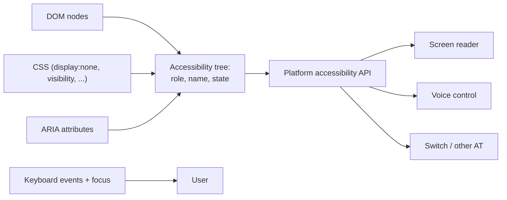
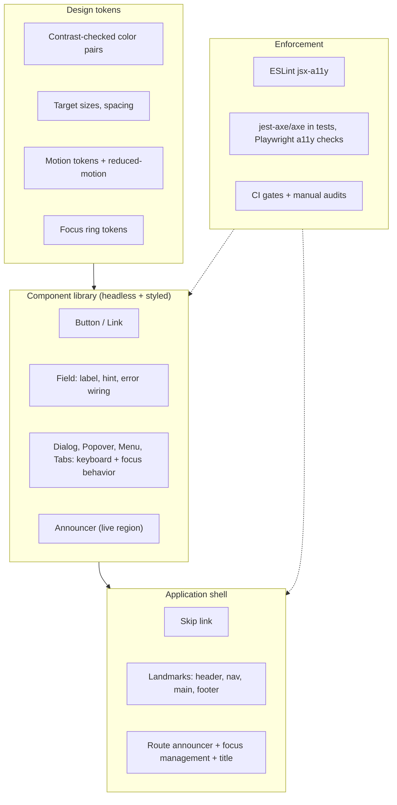
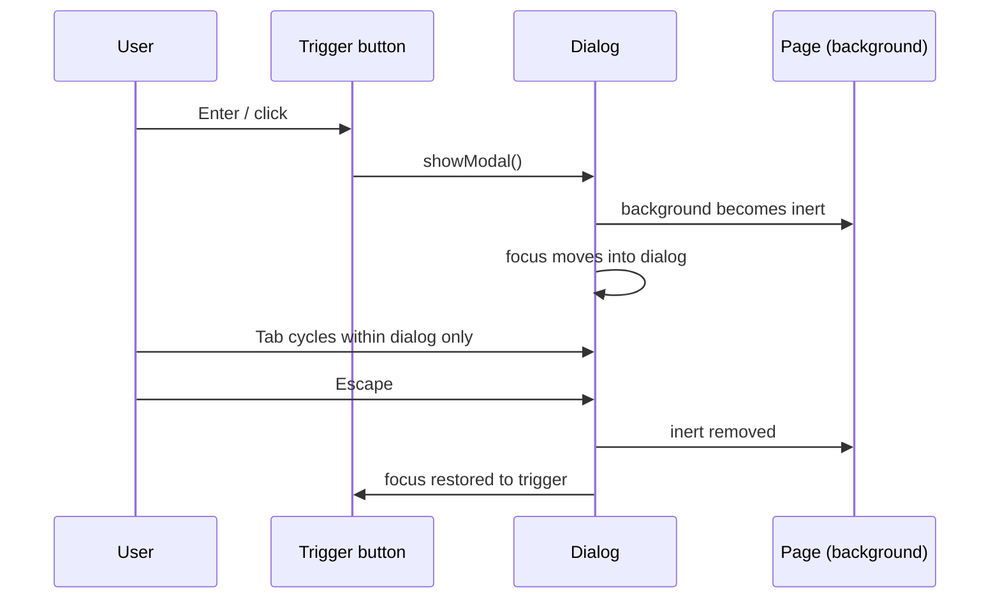
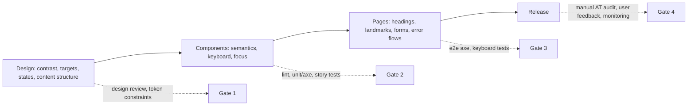

# 10 / 08 — Accessibility as Architecture: Making It the Default, Not a Retrofit

## 1. Lesson metadata

| | |
|---|---|
| **Level** | Advanced |
| **Study time** | 5 hours (reading 2 h, experiments 1.5 h, exercises 1.5 h) |
| **Prerequisites** | [Phase 1 — Event handling](../01-react-fundamentals/10-event-handling.md); [Phase 3 — useRef and mutable references](../03-react-state-and-hooks/10-useref-and-mutable-references.md); [Phase 3 — Modern hooks and APIs (`useId`)](../03-react-state-and-hooks/22-modern-hooks-and-apis.md); [Phase 4 — Design systems](../04-react-architecture/20-design-systems.md); [Phase 4 — Routing architecture](../04-react-architecture/18-routing-architecture.md); [Phase 0 — HTML parsing, DOM, CSSOM, render tree](../00-web-and-javascript-foundations/02-html-parsing-dom-cssom-render-tree.md) |
| **Next** | [09 — Internationalization](./09-internationalization.md) |
| **Related later** | [Phase 8 — Accessibility testing](../08-testing-and-quality/10-accessibility-testing.md), [Phase 9 — Accessibility and SEO](../09-advanced-rendering-and-ecosystem/14-accessibility-and-seo.md), [Phase 11 — Designing for accessibility](../11-senior-and-architect-mastery/11-designing-for-accessibility.md) |

> **Scope note.** This lesson concerns engineering structure for accessibility (a11y). It is not legal advice; regulations (e.g. the European Accessibility Act, ADA-related case law, Section 508, EN 301 549) differ by jurisdiction and change. Standards references (WCAG 2.x) should be verified against the current W3C publications. Automated tools find only a subset of problems; manual and assistive-technology testing remain necessary.

**Learning objectives.** After this lesson you can:
1. Explain accessibility as a *system property* produced by semantics, focus management, keyboard operability, announcements and perceivable design — and why bolting it on late is expensive.
2. Describe how the browser builds the **accessibility tree** from the DOM, and how ARIA modifies it (and when it should not be used).
3. Architect a component library and application shell so that accessible behavior is the default: labelled form fields, accessible dialogs/menus, focus restoration, route-change announcements, skip links, live regions.
4. Manage focus correctly in a single-page application, including on client-side navigation, modals, and dynamic content.
5. Establish enforcement points: lint rules, unit/integration/e2e checks, design-token contrast constraints, CI gates, and manual test protocols.
6. Make informed trade-offs when custom widgets, animations, and performance optimizations (virtualization) conflict with accessibility.

**Concepts covered:** WCAG principles (POUR), accessibility tree, roles/names/states, native-first HTML, ARIA (first rule of ARIA), keyboard operability, focus order, focus traps and `inert`, `<dialog>`, live regions, `useId`, form labelling and error association, route announcements, reduced motion, contrast and tokens, target size, accessible names for icon buttons, testing layers.

---

## 2. Deep conceptual explanation

### 2.1 What problem is this lesson solving?

Roughly speaking, a meaningful fraction of your users rely on assistive technology (screen readers, switch devices, voice control), keyboard-only navigation, zoom, high contrast, captions or reduced motion — permanently, temporarily (a broken arm) or situationally (glare, a noisy train). Beyond ethics and legal exposure, accessible products are measurably more usable for everyone.

The engineering problem: accessibility defects are **cross-cutting** — they are created in design (low contrast, color-only meaning), in component code (a clickable `<div>`), in application structure (focus lost after navigation), and in content (missing alt text). If each feature team must remember every rule, defects will appear. If the **architecture** makes the accessible way the easy way, defects become the exception.

### 2.2 The principles: POUR

WCAG (Web Content Accessibility Guidelines) organizes success criteria under four principles: **Perceivable** (information can be perceived — alt text, contrast, captions, resize), **Operable** (keyboard, enough time, no seizure triggers, navigable, input modalities), **Understandable** (readable, predictable, input assistance), **Robust** (compatible with current and future assistive technologies — correct semantics). Conformance levels A, AA, AAA; **AA** is the usual legal/contractual target. WCAG 2.2 (a W3C Recommendation, October 2023; W3C's WCAG overview page, checked 2026-10-22, still lists 2.2 as the latest WCAG 2 version, with WCAG 3 only as a separate draft) added nine success criteria: 2.4.11 Focus Not Obscured (Minimum) AA, 2.4.12 Focus Not Obscured (Enhanced) AAA, 2.4.13 Focus Appearance AAA, 2.5.7 Dragging Movements AA, 2.5.8 Target Size (Minimum) AA (24 by 24 CSS px, with exceptions), 3.2.6 Consistent Help A, 3.3.7 Redundant Entry A, 3.3.8 Accessible Authentication (Minimum) AA, and 3.3.9 Accessible Authentication (Enhanced) AAA. It also removed 4.1.1 Parsing. Content that meets 2.2 also meets 2.1 and 2.0.

### 2.3 The accessibility tree

The browser builds, alongside the DOM and CSSOM ([Phase 0 lesson 02](../00-web-and-javascript-foundations/02-html-parsing-dom-cssom-render-tree.md)), an **accessibility tree**: a pruned/semantic view of the page, exposed to platform accessibility APIs. Each node has:

- **Role** — what it is (button, link, heading, checkbox, dialog…).
- **Accessible name** — what it is called (computed from content, `aria-label`, `aria-labelledby`, `<label>`, `alt`, `title`…).
- **Accessible description** — extra help (`aria-describedby`).
- **State/properties** — expanded, checked, disabled, invalid, required, current, selected, pressed…
- **Relationships** — labelled-by, controls, owns.

Native HTML elements come with role, name computation, keyboard behavior and focusability built in. A `<button>` gives you: focusable, Enter/Space activation, role `button`, name from its content, disabled semantics. A `<div onClick>` gives you none of that; you must reconstruct it, and often incompletely.



### 2.4 The rules that give the best return

1. **Use native elements first.** `button`, `a href`, `input` with `label`, `select`, `details/summary`, `dialog`, `nav`, `main`, headings in order, lists, tables with headers. The *first rule of ARIA*: do not use ARIA if a native element or attribute provides the semantics. ARIA changes *semantics only*, **not behavior**: `role="button"` on a div adds no keyboard handling.
2. **Everything interactive must be keyboard operable**, in a logical order, with **visible focus**.
3. **Every control has an accessible name**; every image has a text alternative (or is explicitly decorative); every form field has a programmatic label and its errors are associated.
4. **State changes must be perceivable** by non-visual users: announcements via live regions, focus movement, or semantic state attributes.
5. **Don't rely on color, hover, or motion alone**; respect reduced-motion and contrast preferences.
6. **Test with a keyboard and a screen reader** in addition to tools.

### 2.5 Why the SPA changes the problem

On a traditional multi-page site, each navigation loads a new document: the browser resets focus to the top, the screen reader announces the new page title, and "back" works. In an SPA, **client-side routing replaces content without a page load**. Unless you intervene:

- Focus stays on the (now possibly removed) link that was clicked; for keyboard users focus may fall back to `<body>`, losing their place.
- Screen readers announce nothing; the user doesn't know the page changed.
- `document.title` may not update.
- Scroll position may persist inappropriately.

So **routing infrastructure must manage focus and announcements** ([Phase 4 — Routing architecture](../04-react-architecture/18-routing-architecture.md)). Some routers/frameworks provide partial support; verify what yours does — do not assume.

### 2.6 React-specific considerations

- **JSX attribute names:** `htmlFor` (not `for`), `aria-*` stay hyphenated, `tabIndex` camelCase, `role`. `className` etc.
- **`useId`** ([Phase 3 lesson 22](../03-react-state-and-hooks/22-modern-hooks-and-apis.md)) generates stable, SSR-safe unique IDs for linking labels, descriptions and error messages — avoids hand-rolled counters and hydration mismatches. Do not use it for list keys.
- **Refs and focus:** moving focus is an imperative DOM action: `ref.current?.focus()` inside an event handler or effect after the target exists ([Phase 3 lesson 10](../03-react-state-and-hooks/10-useref-and-mutable-references.md)). Focus management is a legitimate use of effects (synchronizing with an external system: the browser's focus state).
- **Conditional rendering vs `hidden`/`inert`:** removing nodes removes them from the accessibility tree; `display:none` and `hidden` also remove them; `visibility:hidden` too; `aria-hidden="true"` removes from the tree but leaves focusable elements focusable (a classic trap: **never put `aria-hidden` on or around focusable elements**). The `inert` attribute makes a subtree non-interactive and hidden from AT — React 19 supports `inert` as a boolean prop (verified in the sandbox with react-dom 19.3.1: `inert={true}` renders `inert=""`, `inert={false}` omits it; React 18 needed `inert=""` workarounds and its types lacked the prop). `inert` is Baseline in current browsers.
- **Component libraries and "headless" patterns** ([Phase 5 — Headless components](../05-design-patterns/07-headless-components.md)) encapsulate complicated a11y behavior (focus trapping, roving tabindex, typeahead). Reusing a mature, tested headless library is usually safer than writing your own — verify each library's compliance claims and test with your assistive tech matrix.

### 2.7 Common misconceptions

| Misconception | Reality |
|---|---|
| "Accessibility is for blind users." | It covers vision, hearing, motor, cognitive, speech, and situational needs; keyboard operability and contrast affect many. |
| "ARIA makes things accessible." | Bad ARIA is worse than none ("no ARIA is better than bad ARIA"). ARIA adds semantics, not behavior. |
| "An automated scan passing means accessible." | Automated tools detect a subset of WCAG issues (commonly estimated at a minority-to-half of issues; the percentage is disputed, so don't quote a figure); they can't judge whether alt text is meaningful or focus order logical. |
| "We'll do an accessibility pass before launch." | Retrofitting structural issues (custom widgets, focus, headings, color tokens) is costly; the cheap time is design and component creation. |
| "`outline: none` is fine because we have hover styles." | Keyboard users need a visible focus indicator; removing it fails WCAG. |
| "Placeholder text is a label." | Placeholders disappear, have contrast issues, and are not reliably announced as labels. |
| "Accessibility hurts design." | Constraints (contrast, targets, focus) can be encoded in design tokens and components so designers work inside them. |

---

## 3. Internal mechanics

### 3.1 Accessible name computation (simplified)

The W3C *Accessible Name and Description Computation* algorithm picks a name from sources in priority order. Simplified teaching model for a form control: (1) `aria-labelledby` (referenced elements' text), else (2) `aria-label`, else (3) native label: `<label for>`/wrapping `<label>`, else (4) `title` / `placeholder` (fallback, unreliable). For buttons and links, content text is used; for images, `alt`. **Public guarantee:** the algorithm is specified (Accname spec); **implementation detail:** browsers differ in edge cases and fallbacks — ⚠ test with real AT. Practical consequence: an icon-only button `<button><svg/></button>` has *no name* unless you add `aria-label` or visually-hidden text.

### 3.2 Focus mechanics

- **Focusable elements:** natively interactive elements (links with `href`, buttons, inputs, `summary`, elements with `contenteditable`) and any element with `tabindex`.
- `tabindex="0"`: in the tab order at its DOM position. `tabindex="-1"`: focusable by script (`el.focus()`), not by Tab — the standard way to make a heading/container a **focus target** after navigation. `tabindex` > 0: reorders tab order; **avoid** — it creates unmaintainable order.
- **Focus order should follow DOM order**, which should follow visual/reading order. CSS reordering (`order`, grid placement) can desynchronize visual and DOM order — a WCAG "meaningful sequence/focus order" risk.
- `:focus-visible` shows focus rings for keyboard-initiated focus without cluttering mouse interactions (broadly supported; verify for your browser matrix).
- **Focus is lost** when the focused element is removed from the DOM: the browser moves focus to `<body>` (browser-specific details). Components that remove their own trigger (closing menus, deleting list items) must move focus deliberately.

### 3.3 Dialogs: what "modal" requires

A modal dialog must: (1) move focus into the dialog on open; (2) contain focus (Tab/Shift+Tab cycle within; background not reachable); (3) make background content inert to AT and pointer; (4) close on Escape; (5) **restore focus** to the invoking element on close; (6) have an accessible name (`aria-labelledby`/`aria-label`) and role `dialog` (or `alertdialog`), with `aria-modal="true"` where appropriate.

The native `<dialog>` element opened with `showModal()` provides much of this natively: top-layer rendering, backdrop, focus move, Escape to close, background inertness (browser-implemented) — test current cross-browser behavior and edge cases (focus restoration details have differed historically). Note that jsdom does not implement `HTMLDialogElement.showModal` (checked in the sandbox with jsdom 30: `"showModal" in dialog` is `false`), so unit tests must stub it or run in a real browser (Playwright/Vitest browser mode). Many design systems still use library components; evaluate by testing, not by claims.

### 3.4 Live regions

An element with `aria-live="polite"` (or `role="status"`) announces *changes to its content* after the user's current speech; `assertive` / `role="alert"` interrupts. Gotchas: the live region must **exist in the DOM before** content changes (inserting a new live region together with its text is unreliable across screen readers); announce *concise* messages; don't announce every keystroke or progress tick; avoid duplicate announcements from both focus movement and live regions. ⚠ Screen reader/browser combinations behave differently — test your matrix (e.g. NVDA+Firefox/Chrome, JAWS+Chrome/Edge, VoiceOver+Safari on macOS/iOS, TalkBack+Chrome).

### 3.5 Architecture view



---

## 4. Step-by-step execution walkthrough: keyboard user navigates from a product list to a product page and adds to cart

1. **Page load.** The skip link ("Skip to main content") is the first focusable element. Tab reveals it (visible on focus). Activating it moves focus to `<main id="main" tabIndex={-1}>`.
2. **List.** Tab moves through filter controls, then product cards. Each card is a link containing the product name (accessible name). Focus ring visible.
3. **Activate link (Enter).** The router changes the URL and renders the product page; the clicked link unmounts. **Without intervention**, focus falls to `<body>`.
4. **Route announcer** (shell): after the new route commits, the app (a) sets `document.title` ("Blue Kettle — Shop"), (b) moves focus to the page's `<h1 tabIndex={-1}>` (or main container), (c) lets the screen reader read the heading, and (d) restores/resets scroll.
5. **Product options.** A size selector is a native `<fieldset><legend>Size</legend>` with radio inputs — arrow keys operate it natively.
6. **Add to cart.** The button toggles to a loading state: `aria-disabled`/`disabled` considerations (disabled buttons drop out of the tab order and may lose focus — prefer `aria-disabled` with guarded handler while pending to keep focus); on success, a polite live region announces "Added Blue Kettle to cart. Cart has 3 items." The mini-cart count updates visually, and focus remains on the button (not stolen).
7. **Open cart drawer.** Modal dialog opens: focus moves in (to the dialog heading or first control), background is inert, Escape closes, focus returns to the cart button.
8. **Error.** If the stock check fails, the error is shown inline, associated with the field (`aria-describedby`), `aria-invalid="true"`, and on form submission focus moves to the first invalid field or an error summary with links.

**Predict:** at step 3, a screen-reader user on a SPA with no focus management hears nothing and does not know the page changed. The fix is the shell's responsibility, not each page's — which is exactly why this is architecture.

---

## 5. Code examples

### 5.1 Minimal example — native semantics vs a fake button

```tsx
// ❌ Incorrect: no role, name, focus, or keyboard support
<div className="btn" onClick={save}>Save</div>

// ✅ Corrected
<button type="button" className="btn" onClick={save}>Save</button>
```

Why: `<button>` supplies role, focusability, Enter/Space activation, and disabled semantics. The `type="button"` prevents accidental form submission when inside a `<form>` (default type is `submit`). If you truly must make a non-native element interactive, you need `role`, `tabIndex={0}`, key handlers (Enter and Space), focus styles, and states — i.e., you are reimplementing the button.

Icon-only buttons need names:

```tsx
<button type="button" onClick={onClose} aria-label="Close dialog">
  <CloseIcon aria-hidden="true" focusable="false" />
</button>
```

The icon is hidden from AT (decorative), and the button's name comes from `aria-label`. For localization ([09](./09-internationalization.md)), the label string must come from the i18n layer. Visible text labels are preferable where space allows (they help voice-control users say what they see — WCAG "Label in Name").

### 5.2 Practical example — a Field component that wires label, hint, and error

```tsx
// src/shared/ui/Field.tsx
import { useId, type ReactNode, type Ref, type InputHTMLAttributes } from "react";

interface FieldProps extends Omit<InputHTMLAttributes<HTMLInputElement>, "id"> {
  label: string;
  hint?: string;
  error?: string;
  ref?: Ref<HTMLInputElement>;   // React 19: ref is a regular prop for function components
}

export function Field({ label, hint, error, required, ref, ...inputProps }: FieldProps): ReactNode {
  const id = useId();
  const hintId = hint ? `${id}-hint` : undefined;
  const errorId = error ? `${id}-error` : undefined;
  const describedBy = [hintId, errorId].filter(Boolean).join(" ") || undefined;

  return (
    <div className="field">
      <label htmlFor={id}>
        {label}
        {required && <span aria-hidden="true"> *</span>}
      </label>
      {hint && <p id={hintId} className="field__hint">{hint}</p>}
      <input
        {...inputProps}
        ref={ref}
        id={id}
        required={required}
        aria-invalid={error ? true : undefined}
        aria-describedby={describedBy}
      />
      {error && <p id={errorId} className="field__error">{error}</p>}
    </div>
  );
}
```

**Line notes.**
- `useId()` yields a unique, stable (SSR-safe) ID so `htmlFor` ↔ `id` and `aria-describedby` references work without collisions even with many fields.
- The `required` attribute communicates requiredness natively; the visual asterisk is hidden from AT to avoid "star" announcements; the requirement must also be explained somewhere visible ("* required").
- `aria-invalid` + `aria-describedby` makes screen readers announce the error when the field is focused. Whether the error text is *also* announced at the time it appears depends on your strategy (error summary with focus, or a live region) — a field-level error that appears silently is a common failure.
- Error text should be conveyed by more than color (icon/text) and contrast-checked.
- `ref` as a prop (React 19) means no `forwardRef` wrapper is needed; on React 18 you'd use `forwardRef` (legacy for 19 — [Phase 1](../01-react-fundamentals/06-props-and-one-way-data-flow.md)).
- Using a library for form state ([Phase 3 — Forms](../03-react-state-and-hooks/21-forms-and-complex-state.md)) doesn't change this contract: the Field primitive owns the a11y wiring so forms cannot forget it.

### 5.3 Route changes: announce and move focus (application shell)

```tsx
// src/app/RouteAccessibility.tsx
import { useEffect, useRef, useState } from "react";
import { useLocation } from "react-router";   // React Router v7 exports hooks from "react-router"; v6 used "react-router-dom"

export function RouteAccessibility({ titleFor }: { titleFor: (pathname: string) => string }) {
  const location = useLocation();
  const [announcement, setAnnouncement] = useState("");
  const isFirstRender = useRef(true);

  useEffect(() => {
    const title = titleFor(location.pathname);
    document.title = title;

    if (isFirstRender.current) {            // do not steal focus on the initial page load
      isFirstRender.current = false;
      return;
    }

    // Move focus to the main heading (or main region) of the new page.
    const target =
      document.querySelector<HTMLElement>("main h1") ??
      document.querySelector<HTMLElement>("main");
    if (target) {
      if (!target.hasAttribute("tabindex")) target.setAttribute("tabindex", "-1");
      target.focus({ preventScroll: false });
    }
    setAnnouncement(`Navigated to ${title}`);   // belt-and-braces; see notes (localize in real apps)
  }, [location.pathname, titleFor]);

  return (
    <div role="status" aria-live="polite" className="visually-hidden">
      {announcement}
    </div>
  );
}
```

**Design notes and trade-offs.**
- **Choose one primary mechanism.** Moving focus to the heading causes most screen readers to read it; adding a live-region announcement as well can cause *double announcements*. Many teams choose focus-to-heading *or* a route announcer, not both; the correct choice depends on your router and testing with real AT. The sample includes both to show the pieces — evaluate and remove the redundant one for your stack.
- Effects are appropriate here: synchronizing with the browser's focus and document title (external systems) ([Phase 3 — useEffect synchronization](../03-react-state-and-hooks/04-useeffect-synchronization.md)). `titleFor` should be stable (memoized or module-level) to avoid re-running.
- StrictMode runs effects twice in development ([Phase 2 lesson 28](../02-react-rendering-and-internals/28-strict-mode-behavior.md)); the `isFirstRender` ref pattern behaves differently under StrictMode's simulated remount (the ref persists, so the second run would proceed to move focus). Verified in the sandbox (react 19.3.1): under `<StrictMode>` the effect logs `skip` then `focus` on initial mount, without StrictMode only `skip`. An alternative is keying on a navigation counter supplied by the router, or only acting after the location actually changes (compare previous pathname stored in a ref).
- The live region (`role="status"`) is rendered permanently in the shell so it exists before content changes. `visually-hidden` is a CSS utility that hides visually but keeps content in the accessibility tree (don't use `display:none`).
- `target.focus()` on a heading with `tabindex="-1"` shows a focus ring on a non-interactive element on some browsers; style `:focus-visible` carefully for these programmatic targets (a mild outline or none *for the programmatic heading only*, consciously).
- Also handle scroll restoration and the title for async-loaded routes (set after data arrives for accurate titles).

### 5.4 Incorrect example — a hand-rolled modal

```tsx
function Modal({ open, onClose, children }: { open: boolean; onClose: () => void; children: React.ReactNode }) {
  if (!open) return null;
  return (
    <div className="overlay" onClick={onClose}>
      <div className="modal">
        <span className="x" onClick={onClose}>×</span>
        {children}
      </div>
    </div>
  );
}
```

Failures: no role/name/`aria-modal`; focus stays behind the overlay (keyboard users can tab to hidden page content); no Escape handling; the close control is not focusable or named; clicking inside the modal bubbles to overlay and closes ([Phase 0 — Event propagation](../00-web-and-javascript-foundations/13-browser-events-and-propagation.md)); no focus restoration; background still readable by screen readers; body scroll not locked.

### 5.5 Corrected implementation — native `<dialog>` wrapper

```tsx
import { useEffect, useId, useRef, type ReactNode } from "react";

interface DialogProps {
  open: boolean;
  onClose: () => void;
  title: string;
  children: ReactNode;
}

export function Dialog({ open, onClose, title, children }: DialogProps) {
  const ref = useRef<HTMLDialogElement>(null);
  const titleId = useId();

  useEffect(() => {
    const dialog = ref.current;
    if (!dialog) return;
    if (open && !dialog.open) dialog.showModal();     // top layer, inert background, focus moves in
    if (!open && dialog.open) dialog.close();         // browser restores focus to the previously focused element*
  }, [open]);

  return (
    <dialog
      ref={ref}
      aria-labelledby={titleId}
      onClose={onClose}                 // fires when dialog closes via Esc or form method=dialog
      onCancel={() => { /* Esc pressed: allow default close; hook for "unsaved changes?" guards */ }}
    >
      <h2 id={titleId}>{title}</h2>
      {children}
      <form method="dialog">
        <button type="submit">Close</button>
      </form>
    </dialog>
  );
}
```

**Notes.**
- `showModal()` makes the rest of the document inert, renders in the top layer, and handles Escape. `*` Focus restoration on close is implemented by browsers per the HTML spec, but historical inconsistencies and cases (e.g. the trigger was removed while open) exist — **test your supported browsers**, and if needed, store the trigger in a ref and call `.focus()` in `onClose`.
- Rendering the dialog children only while open (conditional) vs always: if you keep them mounted, closed dialogs are `display:none` (not in the accessibility tree). For heavy content, conditionally render children when `open`.
- Closing on backdrop click is optional UX; implement carefully (clicking inside content must not close).
- Adopt a tested library dialog if you need animations, nested dialogs, or stacking behavior beyond native support — then verify it handles focus, inert background and screen reader behavior in your matrix.
- Cross-reference: lock scrolling via CSS rather than JS where possible; announce critical alerts via `role="alertdialog"` when appropriate.

### 5.6 Advanced — announcer service and reduced motion

```tsx
// src/shared/a11y/Announcer.tsx
import { createContext, use, useCallback, useMemo, useRef, useState, type ReactNode } from "react";

type Politeness = "polite" | "assertive";
const AnnouncerContext = createContext<(msg: string, p?: Politeness) => void>(() => {});

export function AnnouncerProvider({ children }: { children: ReactNode }) {
  const [polite, setPolite] = useState("");
  const [assertive, setAssertive] = useState("");
  const toggle = useRef(false);

  const announce = useCallback((message: string, p: Politeness = "polite") => {
    // Alternate a zero-width suffix so identical consecutive messages are still re-announced.
    toggle.current = !toggle.current;
    const text = message + (toggle.current ? "​" : "");
    (p === "assertive" ? setAssertive : setPolite)(text);
  }, []);

  const value = useMemo(() => announce, [announce]);
  return (
    <AnnouncerContext value={value}>
      {children}
      <div className="visually-hidden" role="status" aria-live="polite" aria-atomic="true">{polite}</div>
      <div className="visually-hidden" role="alert" aria-live="assertive" aria-atomic="true">{assertive}</div>
    </AnnouncerContext>
  );
}

export const useAnnounce = () => use(AnnouncerContext);
```

```css
/* Respect user preference for reduced motion */
@media (prefers-reduced-motion: reduce) {
  *, *::before, *::after {
    animation-duration: 0.01ms !important;
    animation-iteration-count: 1 !important;
    transition-duration: 0.01ms !important;
    scroll-behavior: auto !important;
  }
}
```

**Notes and trade-offs.** The announcer is centralized so features call `announce("Added to cart")` and no feature creates ad-hoc live regions. The zero-width-space toggle trick is a pragmatic workaround for identical repeated messages; its behavior across screen readers is not guaranteed — test. Keep announcements rare and short. The blunt `*` reduced-motion reset is a commonly circulated pattern; a more careful approach defines motion tokens that components consult so essential animations (e.g., progress indicators) can remain in a non-motion form. `prefers-reduced-motion` is a **user preference** query, honored by modern browsers.

---

## 6. Visual explanations

### Modal dialog lifecycle and focus



### Where a11y defects are introduced vs. caught



The cost of fixing a defect rises sharply from left to right, which is the economic argument for accessibility as architecture.

---

## 7. Alternative approaches and trade-offs

**How to get accessible interactive components:**

| Approach | A11y quality | Effort | Customization | Maintenance | When to prefer |
|---|---|---|---|---|---|
| Native HTML elements (`button`, `dialog`, `details`, `select`) | High for what they cover | Lowest | Limited styling for some (e.g. `select`) | Lowest | Default choice |
| Headless component library (behavior + a11y, you style) | Generally high; verify per component | Medium | High | Dependency updates | Design-system-driven apps needing custom looks |
| Styled component library | Varies widely by library | Low | Medium | Dependency + theming | Fast delivery; verify a11y claims with your own tests |
| Build your own custom widgets from scratch | Depends entirely on expertise | Highest | Total | Highest | Only when no library fits; follow WAI-ARIA Authoring Practices and test with AT |
| Overlay/"accessibility widgets" that claim auto-fix | Generally does not address root issues; widely criticized by accessibility practitioners and users | Low | n/a | n/a | **Not recommended** as a substitute for fixing the product |

**When the recommended default (native-first, headless library for complex widgets) is not best:** a data grid with virtualization, cell navigation, and editing is a complex composite widget where native elements don't suffice. You might use a specialized grid library and verify its keyboard model against the ARIA Authoring Practices "grid" pattern, accepting that perfect screen reader behavior with virtualization (rows not in DOM) requires `aria-rowcount`/`aria-rowindex` and careful testing — and sometimes offering a simpler accessible alternative view.

---

## 8. Best practices and anti-patterns

**Do**
- Start with semantic HTML: landmarks, headings (one `h1`, logical nesting), lists, buttons vs links (`button` = action, `a` = navigation).
- Encode accessibility in primitives (Field, Button, Dialog, Menu) so product code can't forget.
- Provide a skip link; maintain a visible, high-contrast focus indicator.
- Manage focus on route changes, dialogs, deletions, and async content insertion.
- Associate errors with fields and provide an error summary on submit.
- Test with keyboard only; test with at least one screen reader per platform you support.
- Make accessibility part of the Definition of Done and code review checklist.
- Include accessibility requirements in design tokens and review (contrast ratios, minimum target sizes, spacing).

**Beginner mistakes**
- Clickable `div`/`span`; missing labels; images without `alt`; color-only status.
- `outline: none` with no replacement; disabling zoom (`user-scalable=no`).
- Using `placeholder` as label; using `title` as the only name.

**Experienced-developer mistakes**
- Over-using ARIA (`role="button"` on `div`, `aria-label` that contradicts visible text, `aria-hidden` on focusable elements).
- Building focus traps by hand without handling edge cases (dynamic content, iframes, Shadow DOM) — prefer `<dialog>`/`inert`/vetted libraries.
- Virtualizing lists without exposing set size/position to AT.
- Treating the accessibility test suite's green status as full compliance.
- Announcing everything (verbosity fatigue) or nothing.

**Smells**
- A project where accessibility bugs are tracked as "nice to have".
- Custom widgets without keyboard test coverage.
- Different focus styles per feature.
- Alt text like "image" or file names.

**Justified exceptions**
- Decorative imagery with empty `alt=""` (intentionally).
- Temporary lack of captions for an internal prototype *with a tracked plan* — not for public production.
- A deliberate departure from a library pattern when user research with AT users shows a better experience (document it).

---

## 9. Real-world application

**E-commerce.** Checkout is a legal and revenue-critical flow: labelled form fields, error summaries, accessible payment widgets (hosted fields must expose accessible names — verify with provider), focus management through steps, status announcements for cart updates, sufficient target sizes on mobile. Constraint: third-party widgets (payment, chat) may be inaccessible; select vendors with a published accessibility conformance report (ACR/VPAT) and test.

**Finance.** Data-dense tables and charts: proper table semantics (`<th scope>`, captions), alternative text summaries and data tables for charts, no color-only red/green, accessible authentication (WCAG 2.2: avoid cognitive tests that block login without alternatives), timeouts with warnings and extension options (session expiry).

**Dashboards.** Many widgets and live updates: avoid noisy live regions; provide controls to pause auto-refresh; keyboard shortcuts must be discoverable, remappable/disable-able to avoid conflicts with AT.

**Auth flows.** Password managers and paste must work (don't block paste); error messaging precise; CAPTCHA alternatives; MFA code inputs with `autocomplete="one-time-code"` and a single labelled input rather than six unlabelled boxes ([Phase 9 — Auth boundaries](../09-advanced-rendering-and-ecosystem/12-auth-boundaries.md)).

**Realtime/chat.** `role="log"` for message lists; announce new messages sparingly; preserve scroll and focus; provide notification preferences.

**Multi-team platforms.** A design-system team owns primitives and an accessibility conformance statement; product teams own page-level semantics; a central audit schedule and a defect SLA ([11 — Design system governance](./11-design-system-governance.md)).

---

## 10. Debugging and troubleshooting

**Symptom: Keyboard users "lose their place" after clicking something.**
Reproduce: Tab to a control, activate it, press Tab again — where does focus go? Investigate: DevTools Console `document.activeElement` (or the Elements panel focus tracker; in Chrome use the "Show focus" via Rendering/Emulate focused page, and live expression of `document.activeElement`). Root cause: the focused element was removed or replaced. Fix: move focus to a sensible target (next item, container heading) or avoid unmounting the trigger (use `key` and stable structure — [Phase 1 — Keys](../01-react-fundamentals/09-lists-keys-and-identity.md)). Validate with keyboard-only walkthrough.

**Symptom: Screen reader says "button" with no name / "link" with no name.**
Investigate: DevTools Accessibility pane (Elements ▸ Accessibility) shows the computed name; check icon-only controls, `aria-labelledby` referencing missing IDs (e.g. `useId` mismatch), duplicate IDs. Fix: provide names via visible text or `aria-label`; ensure IDs exist in the same document/shadow root.

**Symptom: Screen reader announces error twice or not at all.**
Investigate: both live region and focus movement trigger announcements; or the live region was inserted simultaneously with content. Fix: pick one mechanism per case; render live regions persistently; test with NVDA/VoiceOver.

**Symptom: Modal opens but Tab goes to the page behind.**
Investigate: background not inert; `aria-modal` alone does not trap focus in all AT/browsers. Fix: native `showModal()`, `inert` on siblings, or a vetted library.

**Symptom: axe reports "Elements must have sufficient color contrast" only in dark mode.**
Investigate: token pairs per theme; computed styles and opacity; disabled states. Fix: verify contrast for every token pair in every theme via an automated token test.

**Symptom: Voice-control users can't activate "Search".**
Investigate: visible label text differs from accessible name (e.g. visible "Search", `aria-label="Find products"`). Fix: ensure the accessible name *contains* the visible label text.

**Symptom: Virtualized list is unusable with a screen reader (only 20 items "exist").**
Investigate: `aria-setsize`/`aria-posinset` or table `aria-rowcount`/`aria-rowindex`; keyboard navigation for off-DOM items. Fix: expose total counts, support keyboard-driven scrolling that renders the target row, or provide pagination fallback ([Phase 7 — Virtualization](../07-performance/09-windowing-and-virtualization.md)).

---

## 11. Exercises

### Level A — Knowledge
**A1.** State WCAG's four principles and give one example of a violation of each.
**A2.** What is the first rule of ARIA? Why does `role="button"` on a `div` not make it accessible?
**A3.** Difference between `tabindex="0"`, `"-1"`, and positive values.
**A4.** Why must a live region exist before its content changes?
**A5.** Why can `aria-hidden="true"` on a container with focusable children be harmful?

### Level B — Code comprehension
**B1.** In §5.2, what does a screen reader announce when focus lands on an input with a hint and an error? Which attributes contribute?
**B2.** Given `<label>Email <input /></label>` vs `<label htmlFor="e">Email</label><input id="e" />`: both fine? Differences?
**B3.** In §5.3 under StrictMode, trace what happens in dev with the `isFirstRender` ref and how it could differ from production.

### Level C — Implementation
**C1.** Build a `SkipLink` + `<main>` structure and a test that Tab reveals the link and Enter moves focus to main.
**C2.** Implement a `Tabs` component following the WAI-ARIA tabs pattern with roving `tabindex`, arrow-key navigation, and `aria-selected`; list the keyboard behaviors it must support.
**C3.** Write tests with Testing Library + axe (e.g. `jest-axe`/`vitest-axe` — verify package names) for the `Field` component: label association, error association, and no axe violations.

### Level D — Debugging
**D1.** After deleting an item from a list, keyboard focus jumps to the top of the page. Fix it.
**D2.** A custom dropdown works with a mouse; keyboard users can open it but not select items; screen reader says nothing useful. Diagnose and propose replacement options.
**D3.** The "Pay" button is disabled while submitting; keyboard focus is lost and NVDA says nothing. Why, and what is an alternative?

### Level E — Architecture decisions
**E1.** Your company has 6 product teams and a design system. Propose how to guarantee baseline accessibility: roles, tooling, gates, audits, defect policy.
**E2.** Decide between building a custom accessible combobox or adopting a headless library. Define evaluation criteria and a test plan.

### Level F — Expert challenge
**F1.** Design the accessibility strategy for a virtualized, editable data grid with 100k rows, column resizing, and inline editing. Address semantics, keyboard model, focus management, announcements, performance trade-offs, and testing. State what you would not promise.

---

## 12. Detailed answers and explanations

> Attempt the exercises first.

**A1.** Perceivable (image with no alt; low contrast text), Operable (action only on hover or only mouse-clickable; keyboard trap), Understandable (error says "Invalid" with no explanation; unpredictable context change on focus), Robust (custom control without role/name/state so AT can't interpret it; invalid ARIA references). Verify the WCAG version/criteria with W3C.

**A2.** Use native HTML semantics when available instead of ARIA. ARIA changes only the accessibility tree's semantics; it provides no behavior. A `div role="button"` lacks focusability, Enter/Space activation, and disabled behavior; you'd still need `tabIndex`, key handlers and styles. Native `<button>` supplies all.

**A3.** `0`: focusable and in natural DOM order. `-1`: focusable programmatically but not via Tab (used for focus targets and roving tabindex's inactive items). Positive: forces an earlier tab order in the document — avoid; it breaks logical order and is hard to maintain.

**A4.** AT registers live regions when the page/DOM is processed; a region inserted *with* its content in one DOM operation is often not observed as a change, so nothing is announced. A persistent empty region whose text later changes is announced reliably. Behavior varies by AT, so test.

**A5.** `aria-hidden` removes the subtree from the accessibility tree but doesn't stop focus. Keyboard users can then focus an element AT can't see — "ghost focus": the screen reader says nothing or announces the wrong thing. Use `inert`, `hidden`, or remove the nodes instead.

**B1.** Focus on the input announces: name from label ("Email"), role (edit text/textbox), required state if set, invalid state ("invalid entry"), and description(s) from `aria-describedby` (the hint then the error, in that order). Order and phrasing vary by AT. Attributes: `<label htmlFor>`/`id`, `required`, `aria-invalid`, `aria-describedby`.

**B2.** Both associate the label programmatically. Wrapping labels work without IDs, but some AT/voice-control tools historically handled `for`/`id` more reliably and styling/layout can be harder with wrapping; also nested interactive content in labels can cause double-activation. Using explicit `htmlFor` + `id` (via `useId`) is robust and separable from layout. Both are valid HTML.

**B3.** In dev StrictMode, React mounts, runs effects, simulates unmount (runs cleanup), and re-runs effects. Refs persist across the simulated remount. Sequence: mount: first effect run sets `isFirstRender=false`, returns early; simulated cleanup (none defined); second run: `isFirstRender` is false → proceeds to move focus and announce on initial load — behavior differs from production, where the focus move wouldn't occur. Fix: track the previous pathname in a ref and act only when it differs, or only after a router-provided navigation event; verify in StrictMode.

**C1.** Structure: `<a className="skip-link" href="#main">Skip to main content</a>` as the first body element; `<main id="main" tabIndex={-1}>`. CSS: visually hidden until `:focus` (position off-screen, then onscreen on focus with high contrast). Test with user-event: `await user.tab(); expect(link).toHaveFocus(); await user.keyboard("{Enter}"); expect(main).toHaveFocus()`. Note: in jsdom the default anchor-fragment navigation may not move focus; the sample may need an `onClick` handler that calls `main.focus()` (also helpful in browsers where fragment navigation fails with client-side routers using `<base>` or hash routing).

**C2.** Required behaviors per APG tabs pattern (verify the current pattern text): `role="tablist"` containing `role="tab"` buttons with `aria-selected`, `aria-controls`; panels `role="tabpanel"` with `aria-labelledby`; roving tabindex (selected tab `tabIndex=0`, others `-1`); Left/Right arrows move between tabs (wrap); Home/End to first/last; automatic vs manual activation (document choice); Tab moves from the tab list into the panel. Test each key; ensure panels are hidden (`hidden`) when inactive. Edge: RTL languages reverse arrow direction ([09](./09-internationalization.md)); dynamic tabs.

**C3.** Sketch:

```tsx
import { render, screen } from "@testing-library/react";
import { axe } from "vitest-axe";           // or jest-axe; vitest-axe needs `import * as matchers from "vitest-axe/matchers"; expect.extend(matchers)` in setup for toHaveNoViolations
import { Field } from "./Field";

it("associates label, hint and error", async () => {
  const { container } = render(<Field label="Email" hint="We never share it" error="Enter a valid email" />);
  const input = screen.getByLabelText("Email");
  expect(input).toHaveAccessibleDescription("We never share it Enter a valid email");
  expect(input).toBeInvalid();
  expect(await axe(container)).toHaveNoViolations();
});
```
Edge: `toHaveAccessibleDescription` from jest-dom (confirmed in the sandbox: multiple `aria-describedby` ids are joined with a space); axe in jsdom cannot evaluate color contrast or layout-dependent rules — run those in a real browser (Playwright + axe) ([Phase 8 lesson 10](../08-testing-and-quality/10-accessibility-testing.md)).

**D1.** The focused delete button was removed, so focus dropped to body. Fix: on deletion, compute the next focus target (the next item's primary control, or previous, or the list heading/"empty state" message) and focus it after the DOM updates (in an effect keyed on the list change or via a `ref` callback). Announce "Item removed" via the announcer. Validate keyboard-only: after deleting, pressing Tab continues from a logical spot. Edge: last item deleted → focus the container heading or the "Add item" button.

**D2.** Likely a `div`-based dropdown lacking `role="listbox"`/`option`, keyboard handlers (Arrow keys, Enter, Escape, typeahead), `aria-expanded`, `aria-activedescendant` or roving focus. Options: replace with native `<select>` if suitable; use a vetted headless Select/Combobox library; or implement per the APG listbox/combobox patterns (significant effort and testing). Prefer native/library; if custom, write keyboard tests and AT manual tests.

**D3.** The `disabled` attribute removes the button from the focus order; if it had focus, focus is typically lost to body, and screen readers may not announce the state change. Alternative: keep the button focusable with `aria-disabled="true"` and ignore clicks while pending, plus a polite live announcement ("Processing payment…") or a progress indicator with `role="status"`; restore enabled state on completion and announce the result. Trade-off: `aria-disabled` buttons still look/behave focusable; ensure styling communicates state and the handler guards double-submit. (Some guidance recommends not disabling submit buttons at all and handling validation messages instead — decide by flow.)

**E1.** Example answer: (1) Design system team owns accessible primitives with documented keyboard/AT behavior, a conformance statement, and tests; (2) Tokens enforce contrast & target sizes, tested in CI per theme; (3) Lint (`eslint-plugin-jsx-a11y`) + unit/axe tests as required checks; Playwright keyboard and axe checks on key flows; (4) Definition of Done includes keyboard + screen-reader smoke check for new interactive patterns; (5) Quarterly manual audit by specialists/users with disabilities on top journeys; (6) Defect SLA by severity (blockers on critical flows fixed within X); (7) Procurement requires vendor ACRs; (8) Training and an "accessibility champion" per team; (9) metrics: open a11y defects, audit pass rates, regressions caught pre-merge. Criteria: coverage, cost, speed, sustainability.

**E2.** Criteria: conformance to ARIA APG patterns, keyboard model completeness, screen-reader support across target AT, mobile support, i18n/RTL, performance with large lists, styling flexibility, bundle size, maintenance activity, license, test evidence. Test plan: keyboard script (open/close, arrows, typeahead, Home/End, Escape, selection, clearing), NVDA/JAWS/VoiceOver/TalkBack walkthrough, voice control, zoom 200–400%, high contrast, automated axe, regression tests. Decision: adopt a mature headless library unless unique requirements justify the cost; building a combobox from scratch is among the hardest widgets to get right across AT.

**F1.** Example answer. *Semantics:* use ARIA grid pattern (`role="grid"`, `row`, `gridcell`, `columnheader`) with `aria-rowcount`/`aria-colcount` and per-row `aria-rowindex`/`aria-colindex` because virtualized rows aren't all in the DOM; or consider `<table>` semantics when editing/cell navigation isn't needed. *Keyboard model:* APG grid navigation (arrow keys between cells, Home/End, Ctrl+Home/End, PageUp/Down, Enter/F2 to edit, Escape to cancel), one tab stop for the grid (roving tabindex or `aria-activedescendant`). *Focus:* when the focused row scrolls out of the rendered window the DOM node unmounts — maintain a logical focus position in state and re-focus after rendering the target row; ensure scroll-into-view precedes focusing. *Editing:* announce edit mode, validation errors via live region and `aria-describedby`; keep focus within cell editor; commit/cancel semantics. *Announcements:* sort/filter results ("Sorted by price ascending, 1,204 rows") concise and polite. *Performance:* windowing is required for 100k rows; document that screen reader "read all/browse mode" only sees rendered rows; provide alternative access (export, paginated view, search/jump-to-row) rather than promising full browse-mode fidelity. *Resize:* keyboard-operable column resizing (e.g. a menu or shortcut). *Testing:* automated axe on a fixed render, keyboard scripts, manual AT passes with documented support matrix. *What not to promise:* identical experience in all screen readers' browse modes with virtualized content; documented limitations plus alternatives. Reduced motion, contrast and zoom reflow also apply.

---

## 13. Senior engineer interview questions

**Q1. "How would you make accessibility a default in a large React codebase rather than a periodic cleanup?"**
*Strong answer:* Encode behavior in shared primitives (Field, Dialog, Menu, Button) so product code gets semantics, focus handling and ARIA wiring for free; constrain the design tokens (contrast, target size, focus ring); automate checks at each level (lint, component/unit axe tests, e2e keyboard checks, token tests); add accessibility to the Definition of Done and reviews; schedule manual AT audits and track defects with SLAs. The goal is to make the accessible way the lowest-effort way.

**Q2. "What does ARIA do and not do?"**
*Strong answer:* It adds roles/states/properties to the accessibility tree so AT can interpret custom widgets. It doesn't add behavior (focus, keyboard), and wrong ARIA can make things worse. First rule: use native elements. I use ARIA when semantic HTML can't express a pattern (e.g. tabs, combobox) and I implement the keyboard model that pattern requires.

**Q3. "How do you handle focus after client-side navigation?"**
*Strong answer:* The browser won't reset focus or announce a new page in an SPA, so the shell must: update the document title, move focus to a consistent target (page heading or main with `tabindex=-1`), and/or announce via a live region — choosing one primary mechanism to avoid double announcements — and test with real screen readers. Not on initial load; handle StrictMode and async titles.

**Q4. "Can automated testing prove an app is accessible?"**
*Strong answer:* No. Automation catches a subset (missing names, some ARIA misuse, many contrast issues), and can't judge meaningfulness of alt text, logical order, or task usability. Combine automated checks with keyboard testing, screen reader testing, and ideally testing with disabled users. Use automation to prevent regressions of known classes.

**Q5. "A designer wants removal of focus outlines because they look ugly. Response?"**
*Strong answer:* Focus visibility is required for keyboard users (WCAG 2.4.7 Focus Visible, Level AA; 2.2 adds 2.4.11 Focus Not Obscured (Minimum), Level AA, so sticky headers must not completely hide the focused element, and 2.4.13 Focus Appearance, which is only Level AAA). Offer a designed focus style (token-based, contrasting, `:focus-visible` so mouse users aren't bothered) rather than removal; make it part of the design system so it's consistent.

**Q6. "How does virtualization interact with accessibility?"**
*Strong answer:* Off-screen items aren't in the DOM, so the accessibility tree is incomplete; you must expose total counts and positions (`aria-setsize`/`posinset`, `aria-rowcount`/`rowindex`), support keyboard navigation to unrendered items, preserve focus when nodes unmount, and sometimes offer alternative navigation (pagination, search). Measure whether virtualization is necessary at all.

---

## 14. Further learning resources

| Resource | URL | Covers / why | Level | Study |
|---|---|---|---|---|
| W3C WAI — WCAG 2 overview | <https://www.w3.org/WAI/standards-guidelines/wcag/> | Current WCAG versions, quick reference, understanding docs | Intermediate | Overview; "How to Meet WCAG (Quick Reference)" |
| WAI-ARIA Authoring Practices Guide (APG) | <https://www.w3.org/WAI/ARIA/apg/> | Keyboard and ARIA patterns (tabs, dialog, combobox, grid) | Advanced | Patterns relevant to your widgets |
| MDN — Accessibility | <https://developer.mozilla.org/en-US/docs/Web/Accessibility> | Practical guides, ARIA reference | Beginner–Int. | ARIA, keyboard navigable widgets |
| React docs — Accessibility | <https://legacy.reactjs.org/docs/accessibility.html> *(legacy docs site; verify whether react.dev has a current equivalent)* | React-specific a11y notes (`htmlFor`, focus, refs) | Beginner | Whole page |
| React docs — `useId` | <https://react.dev/reference/react/useId> | IDs for accessibility attributes | Intermediate | Usage |
| MDN — `<dialog>` | <https://developer.mozilla.org/en-US/docs/Web/HTML/Element/dialog> | Native modal behavior and caveats | Intermediate | `showModal()`, accessibility notes |
| MDN — `inert` | <https://developer.mozilla.org/en-US/docs/Web/HTML/Global_attributes/inert> | Making subtrees non-interactive | Intermediate | Whole page |
| web.dev — Learn Accessibility | <https://web.dev/learn/accessibility> | Structured course | Beginner–Int. | Focus, ARIA, forms |
| Deque axe-core | <https://github.com/dequelabs/axe-core> | Rules engine behind many testing integrations | Intermediate | README, rules list |
| `eslint-plugin-jsx-a11y` | <https://github.com/jsx-eslint/eslint-plugin-jsx-a11y> | Static checks for JSX | Beginner | Rule list |
| WebAIM — Screen reader survey / articles | <https://webaim.org/> | Practitioner resources, contrast checker | Beginner–Int. | Articles; screen reader user survey |
| Adrian Roselli's blog | <https://adrianroselli.com/> | Deep-dive practitioner articles on ARIA patterns | Advanced | Search by pattern |

URLs in this table were checked for HTTP 200 on 2026-10-22; any still marked *(unverified)* could not be checked automatically (blocked or unreachable). A 200 response does not guarantee the page content still matches the description; if a link has moved, search the site for the quoted title.

---

## 15. Knowledge checkpoint

**You should now understand**
- The accessibility tree, accessible names, and why native HTML first.
- Why SPAs need explicit focus and announcement management.
- Focus mechanics, dialogs, live regions, and their pitfalls.
- How architecture (tokens, primitives, shell, enforcement) turns accessibility into a default.

**You should be able to explain without notes**
- Why ARIA doesn't add behavior; why `aria-hidden` on focusable elements is harmful.
- The limits of automated accessibility testing.

**You should be able to implement**
- A labelled Field with hint/error wiring; a route announcer/focus manager; a `<dialog>`-based modal; an announcer service; keyboard-operable patterns following the APG.

**You should be able to debug**
- Lost focus, unnamed controls, double or missing announcements, inert/trap failures, virtualized list issues.

**Prerequisite for next:** [09 — Internationalization](./09-internationalization.md) — accessible names, announcements and error text all flow through the i18n layer, and RTL/locale choices affect keyboard behavior.
