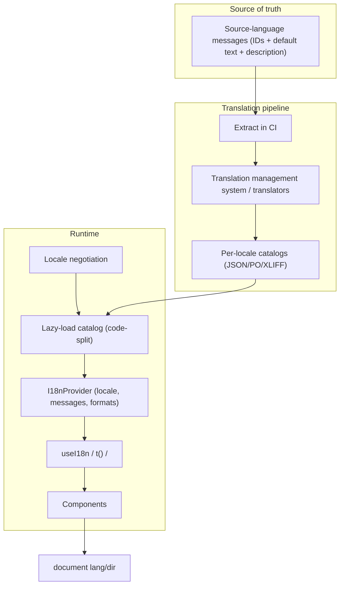
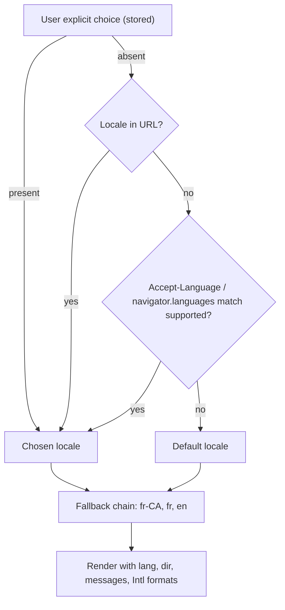
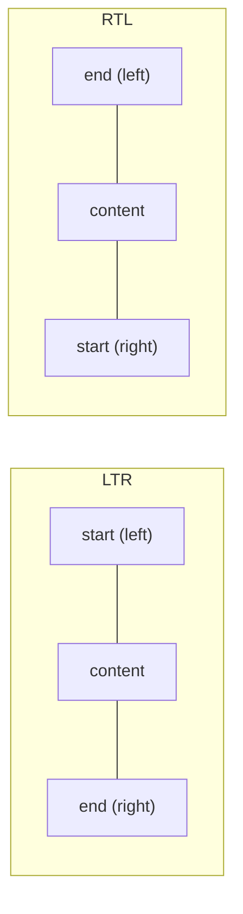

# 10 / 09 — Internationalization: Locales, Messages, Formatting, and Layout for the World

## 1. Lesson metadata

| | |
|---|---|
| **Level** | Advanced |
| **Study time** | 4–5 hours (reading 2 h, experiments 1.5 h, exercises 1.5 h) |
| **Prerequisites** | [08 — Accessibility as architecture](./08-accessibility-as-architecture.md); [03 — Environment configuration](./03-environment-configuration.md); [Phase 3 — useContext and propagation](../03-react-state-and-hooks/13-usecontext-and-propagation.md); [Phase 7 — Code splitting and lazy loading](../07-performance/15-code-splitting-and-lazy-loading.md); [Phase 0 — Modules and dependency graphs](../00-web-and-javascript-foundations/10-modules-and-dependency-graphs.md) |
| **Next** | [10 — Resilience and degradation](./10-resilience-and-degradation.md) |
| **Related later** | [Phase 9 — Accessibility and SEO](../09-advanced-rendering-and-ecosystem/14-accessibility-and-seo.md), [13 — Application migrations](./13-application-migrations.md) |

> **Scope note.** i18n library APIs (react-intl/FormatJS, i18next/react-i18next, Lingui, Paraglide, next-intl, others) change across versions; this lesson teaches the underlying model and shows library-agnostic code with a small hand-rolled provider. Library-specific details are marked "verify against current docs." Language and locale facts (plural categories, CLDR data) should be verified against Unicode CLDR / ECMA-402 where it matters.

**Learning objectives.** After this lesson you can:
1. Distinguish internationalization (i18n: engineering to *support* many locales), localization (l10n: adapting to a *specific* locale), and globalization/translation, and explain what belongs in code vs content.
2. Explain a *locale* (language + script + region + extensions) and why `"en"` is not a country and "language" is not "region".
3. Use the platform's `Intl` APIs (NumberFormat, DateTimeFormat, PluralRules, RelativeTimeFormat, ListFormat, Collator, Segmenter, DisplayNames) instead of hand-written formatting.
4. Design message catalogs using ICU MessageFormat-style syntax: placeholders, plurals, select, rich text — and avoid string concatenation.
5. Build a type-safe, lazily loaded i18n architecture in React: provider, hook, namespaces, fallback chains, SSR/hydration consistency.
6. Handle right-to-left (RTL) layouts with CSS logical properties and `dir`, time zones and calendars, text expansion, and a translation workflow with pseudo-localization and CI checks.

**Concepts covered:** BCP 47 language tags, locale negotiation, CLDR, `Intl.*`, ICU MessageFormat, plural categories, gender/select, interpolation safety, catalog loading and caching, fallback chains, `lang`/`dir` attributes, logical CSS properties, bidi text, time zones and `Temporal` (verify status), currency vs locale, pseudo-localization, translation management pipeline, SEO (`hreflang`) overview.

---

## 2. Deep conceptual explanation

### 2.1 What problem is this lesson solving?

Software built for one language and one country bakes in assumptions: "1,234.56" is how numbers look; dates are month/day/year; plural means adding an "s"; names have first and last names; text flows left to right; a button label fits in 80 px. Each assumption fails somewhere:

- Germany writes `1.234,56`; India groups digits as `12,34,567.89` in many contexts; some locales use non-Latin digits.
- English has two plural forms (one, other); Russian has several (one, few, many, other); Arabic has six categories (zero, one, two, few, many, other); Japanese has none.
- `"You have " + n + " messages"` cannot be translated correctly into many languages because word order, plural forms, and grammatical agreement vary.
- Arabic and Hebrew are RTL; a layout built with `margin-left` and `float: left` breaks.
- German strings are often substantially longer than English; some scripts need more vertical space.
- A "date" is a *moment in time* displayed in a *time zone* using a *calendar*; confusing these produces off-by-one-day bugs.

Retrofitting these concerns after launch means touching every string and every layout. Doing the architecture early means translators and designers can add a locale without developer involvement.

### 2.2 Vocabulary

| Term | Meaning |
|---|---|
| **i18n** | Making the product *capable* of supporting multiple languages/regions: externalized strings, locale-aware formatting, flexible layout. (The "18" = letters between i and n.) |
| **l10n** | Producing the locale-specific adaptation: translations, formats, images, legal text. |
| **Locale** | A set of cultural conventions identified by a **BCP 47 tag**: `en`, `en-GB`, `pt-BR`, `zh-Hant-TW`, `sr-Latn`, `ar-EG-u-nu-latn` (Arabic Egypt with Latin digits). |
| **Language ≠ region ≠ currency** | `en-US` (language+region) doesn't decide currency; a US customer may pay in EUR. Keep **locale** (formatting/language), **currency** (money), **time zone** (time) as separate settings. |
| **CLDR** | Unicode Common Locale Data Repository: the data behind most platform `Intl` implementations and ICU. |
| **ICU MessageFormat** | A message syntax for plural/select/placeholders, widely used by FormatJS, Lingui, and others (ICU's own syntax; MessageFormat 2 is a newer Unicode standardization effort; check its current status and library support before adopting). |
| **RTL** | Right-to-left scripts (Arabic, Hebrew, Persian, Urdu). Layout, icons (arrows), and text direction mirror. |
| **Bidi** | Bidirectional text: mixed LTR and RTL content within one paragraph needs correct isolation. |
| **Pseudo-localization** | A test locale that transforms English into accented, lengthened, bracketed text to find hard-coded strings and layout breakage without real translations. |

### 2.3 Locale ≠ language preference ≠ URL

Where does the active locale come from? Common sources, in typical priority order:

1. **Explicit user choice** persisted (account setting, cookie, or URL segment `/de/…`).
2. **URL** (best for SEO and shareability: `/fr/produits`).
3. **`Accept-Language`** request header (server) or `navigator.languages` (client) — negotiated against supported locales.
4. **Default locale** (fallback).

Do not select locale by IP geolocation alone: travelers, VPNs and multilingual countries (Switzerland, Belgium, India, Canada) make it unreliable. Always offer a visible switcher. Locale selection is an **architecture decision** because it affects routing, SSR, caching (CDN `Vary: Accept-Language` or separate URLs), and SEO ([Phase 9 — Accessibility and SEO](../09-advanced-rendering-and-ecosystem/14-accessibility-and-seo.md)).

### 2.4 The platform already knows: `Intl`

ECMA-402 (the Internationalization API) provides locale-aware formatting in all modern browsers and Node. Prefer it over libraries for basic formatting (smaller bundles, current CLDR data):

| API | Purpose | Example |
|---|---|---|
| `Intl.NumberFormat` | Numbers, percent, currency, units, compact notation | `new Intl.NumberFormat("de-DE", { style: "currency", currency: "EUR" }).format(1234.5)` → "1.234,50 €" |
| `Intl.DateTimeFormat` | Dates and times with time zone and calendar | `new Intl.DateTimeFormat("en-GB", { dateStyle: "medium", timeZone: "Europe/London" })` |
| `Intl.RelativeTimeFormat` | "3 days ago" / "in 2 hours" | `rtf.format(-3, "day")` |
| `Intl.PluralRules` | Plural category selection | `new Intl.PluralRules("ru").select(3)` → `"few"` |
| `Intl.ListFormat` | "A, B, and C" | locale-aware conjunctions |
| `Intl.Collator` | Locale-aware sorting/search | German ä, Swedish å ordering |
| `Intl.DisplayNames` | Names of languages/regions/currencies | "Deutsch", "Germany" |
| `Intl.Segmenter` | Grapheme/word/sentence boundaries | Counting characters correctly; splitting Thai/Japanese |

⚠ Exact output strings vary between engines and CLDR versions (e.g. narrow no-break spaces in French formats, `"de-AT"` nuances). **Never compare or parse formatted output; never use it as data.** Test with ranges/assertions that tolerate differences, or pin Node ICU versions in tests.

### 2.5 Messages: why concatenation fails and what replaces it

```ts
// ❌ cannot be translated correctly
"You have " + count + " new " + (count === 1 ? "message" : "messages")
```

Issues: word order, plural categories beyond English's two, grammatical case/gender agreement, spacing/punctuation differences. The fix: **one complete message per user-facing sentence, with placeholders and plural/select logic *inside* the message**, so translators control the entire sentence:

```text
en: "{count, plural, one {You have # new message} other {You have # new messages}}"
ru: "{count, plural, one {У вас # новое сообщение} few {У вас # новых сообщения} many {У вас # новых сообщений} other {У вас # новых сообщений}}"
```

Translators see the *whole sentence* with its variables, which is why catalogs hold messages, not fragments. Rich text (links/bold inside a sentence) uses tags or component placeholders in the message (`"Read our <link>privacy policy</link>"`) mapped to React elements — never split sentences around a `<a>`.

### 2.6 Architecture in React



Key design principles:
1. **Keys are stable identifiers** (semantic: `checkout.pay.button`) *or* the source text itself (ICU-style with auto-generated IDs). Trade-offs in §7.
2. **Catalogs are code-split per locale (and optionally per namespace/route)** so users load only their language ([Phase 7 — Code splitting](../07-performance/15-code-splitting-and-lazy-loading.md)).
3. **Formatting uses the active locale** from context; components never hard-code `"en-US"`.
4. **Fallback chain:** `fr-CA → fr → default (en)`; a missing key shows the fallback (and logs a telemetry event — [04](./04-observability-and-logging.md)), never a raw key in production if avoidable.
5. **SSR/hydration consistency:** server and client must render the same locale, messages, **and time zone/`now`**, or hydration mismatches occur ([Phase 2 — Hydration](../02-react-rendering-and-internals/25-hydration-and-selective-hydration.md)). Formatting a date with the *client's* time zone on the client and the *server's* zone on the server is a classic mismatch source.
6. **Context performance:** locale changes are rare; the context value should be memoized; per-string subscriptions aren't needed ([Phase 3 — Context performance](../03-react-state-and-hooks/14-context-performance.md)).

### 2.7 Right-to-left and layout

- Set `<html lang="ar" dir="rtl">` (and `lang` on inline foreign-language fragments, which also helps screen readers choose pronunciation — [08](./08-accessibility-as-architecture.md)).
- Use **CSS logical properties** instead of physical ones: `margin-inline-start` rather than `margin-left`, `padding-inline`, `inset-inline-end`, `text-align: start`, `border-start-start-radius`. Flexbox/grid mirror automatically with `dir`.
- **Icons that imply direction** (back arrows, chevrons, progress) must flip in RTL; icons representing real-world objects (clock, play for video media controls — convention-dependent) usually don't. Decide per icon in the design system.
- Numbers and Latin fragments embedded in RTL text need **bidi isolation**: `<bdi>` or `unicode-bidi: isolate`, or the `dir="auto"` attribute for user-generated content.
- Keyboard patterns flip: ArrowRight/Left in tabs, sliders and carousels follow visual direction ([08 — Tabs](./08-accessibility-as-architecture.md)).
- Test in a real RTL locale, not just by mirroring screenshots.

### 2.8 Dates, times, time zones, and calendars

- Store and transmit **instants in UTC** (ISO 8601 / epoch) and format at the edge in the user's time zone.
- Distinguish: an **instant** (when something happened), a **zoned date-time** ("9:00 in Europe/Paris" — a meeting), a **plain date** (a birthday, no time zone), and a **duration**. JavaScript's legacy `Date` conflates instants and local fields and has well-known pitfalls (month index 0-based, DST arithmetic, parsing inconsistencies). The `Temporal` API is the modern replacement; MDN browser-compat data (2026-10-22) shows Firefox 139 and Chrome 144 shipping it with Safari still in preview, and it is absent from Node 24 (`typeof Temporal` is `undefined` in the sandbox), so use a polyfill (e.g. `@js-temporal/polyfill`) or a library for now.
- "Add one day" is not "add 24 hours" across DST changes.
- Time zone for display comes from user settings or `Intl.DateTimeFormat().resolvedOptions().timeZone`; always allow override (travelers, scheduling for others).
- Calendars: some locales default to non-Gregorian calendars (e.g. Buddhist in Thai locales); `Intl.DateTimeFormat` handles display; avoid assuming Gregorian in business logic unless domain-specific.

### 2.9 Common misconceptions

| Misconception | Reality |
|---|---|
| "i18n = translating strings." | Translation is one part; formatting, layout, directionality, data models (names, addresses), and workflows are the rest. |
| "Country = language." | Many countries are multilingual; many languages span countries. |
| "Use the country flag for the language switcher." | Flags represent countries, not languages; label languages in their own names ("Deutsch", "Español"). |
| "Text expansion is 30% so I'll leave 30% room." | Expansion varies by language and string length (short strings expand more); design for flexible layout, test with pseudo-locales. |
| "Libraries have to format dates for us." | The platform `Intl` does it; libraries add message syntax and tooling. |
| "We can translate at the end." | Retrofitting concatenated strings, fixed widths, `margin-left` and locale-bound data models is the expensive part. |
| "Machine translation means no translators." | MT can draft; product copy, legal text, and ambiguous short strings need human review and context. |

---

## 3. Internal mechanics

### 3.1 BCP 47 tags and locale negotiation

A tag has subtags: language (`pt`), optional script (`Latn`), region (`BR`), variants, and extensions (`-u-ca-gregory-nu-latn` Unicode extension for calendar/numbering system). Matching a user preference list (`navigator.languages = ["fr-CH", "fr", "en"]`) to the locales you support is **negotiation**: find the best available match with fallback (e.g. `fr-CH` → `fr` if you only ship `fr`). `Intl.NumberFormat.supportedLocalesOf([...])` helps check platform support; for *your* supported locale list use a negotiation helper (e.g. `@formatjs/intl-localematcher` — ⚠ verify) or a documented algorithm (BCP 47 "lookup" truncation) rather than string equality.

```ts
export function negotiateLocale(requested: readonly string[], supported: readonly string[], fallback: string): string {
  const lower = new Map(supported.map((s) => [s.toLowerCase(), s]));
  for (const tag of requested) {
    let candidate = tag.toLowerCase();
    while (candidate) {
      const hit = lower.get(candidate);
      if (hit) return hit;
      const i = candidate.lastIndexOf("-");
      if (i === -1) break;
      candidate = candidate.slice(0, i);          // truncate: fr-ch -> fr
    }
  }
  return fallback;
}
```

(A simple RFC 4647 "lookup"-style truncation. It does not handle script/region likely-subtag expansion such as `zh-TW` ↔ `zh-Hant`; use a real matcher when you ship Chinese variants.)

### 3.2 Plural categories

CLDR defines up to six plural categories per language: `zero, one, two, few, many, other`. `Intl.PluralRules(locale).select(n)` returns the category (cardinal by default; `{ type: "ordinal" }` gives "1st/2nd/3rd" categories in English). **`other` is always required** in messages. Do not assume `one` means exactly 1 (in French, `one` includes 0 and 1; in Russian `one` is 1, 21, 31… excluding 11).

### 3.3 Message compilation

ICU messages are parsed into an AST and formatted with `Intl` under the hood. Parsing at runtime costs CPU and bundle size; mature libraries precompile messages at build time (to functions or minimal AST) to avoid shipping the parser — ⚠ verify per library. Performance consideration for large catalogs: lazy-load per route/namespace; avoid formatting thousands of messages in a render loop without memoization ([Phase 7 — Rendering large collections](../07-performance/08-rendering-large-collections.md)); cache `Intl.*` instances because constructing `Intl.NumberFormat` is relatively expensive compared to calling `.format`.

### 3.4 Where locale leaks into non-UI code

Locale-sensitive operations beyond display: **sorting** (`localeCompare`/`Collator`), **case conversion** (`toLocaleUpperCase("tr")` — the Turkish dotted/dotless i), **search/filter** (accent-insensitive matching with `Collator` or normalization `normalize("NFD")`), **string length** (UTF-16 code units vs graphemes: "👨‍👩‍👧".length === 8 in JS; use `Intl.Segmenter` for grapheme-aware limits), **input parsing** (a user typing `1,5` in a German locale means 1.5), **validation** (names/addresses/phone formats vary — be permissive; validate with locale-aware libraries only when necessary), **file/URL encoding** (always UTF-8, percent-encode non-ASCII paths).

---

## 4. Step-by-step execution walkthrough: loading a German user's checkout

1. **Request** `GET /checkout` with `Accept-Language: de-DE,de;q=0.9,en;q=0.8`. (Alternatively URL `/de/checkout`.)
2. **Negotiation (server or edge):** supported = `["en","de","fr","ar"]`; result `de`. A user setting cookie, if present, wins.
3. **HTML shell** includes `<html lang="de" dir="ltr">` and preloads the `de` catalog chunk; response varies by locale (URL-based locales avoid cache `Vary` complexity).
4. **Bundle** loads; `main.tsx` awaits the `de` catalog (dynamic import; ~tens of KB) before first render, or renders with a skeleton ([03 — bootstrap pattern](./03-environment-configuration.md)).
5. `<I18nProvider locale="de" messages={deMessages} timeZone={userTz} currency="EUR">` wraps the app.
6. Components call `t("checkout.total", { amount })` → ICU-format with `Intl.NumberFormat("de", { style: "currency", currency })` → "Gesamt: 1.234,50 €".
7. **Date:** delivery estimate `Intl.DateTimeFormat("de", { dateStyle: "full", timeZone })` → "Freitag, 24. Oktober 2025" (example format).
8. **Layout:** buttons with longer German labels wrap or grow — the design system uses `min-inline-size` with padding rather than fixed widths.
9. **User switches to Arabic:** the app sets `lang="ar" dir="rtl"`, loads `ar` catalog, formats with Arabic plural rules; logical CSS mirrors layout; directional icons flip.
10. **Telemetry** records locale, missing-key events, and catalog load time ([04](./04-observability-and-logging.md)).

**Predict:** if the server renders dates in UTC and the client hydrates using the browser's time zone, what happens? *Text differs → hydration mismatch warning/recovery; solve by passing the time zone (and `now`) from the server in the bootstrap, or render the date on the client only.*

---

## 5. Code examples

### 5.1 Minimal example — `Intl` formatting helpers with caching

```ts
// src/shared/i18n/format.ts
const cache = new Map<string, Intl.NumberFormat | Intl.DateTimeFormat>();

function key(kind: string, locale: string, opts: object) {
  return `${kind}|${locale}|${JSON.stringify(opts)}`;
}

export function numberFormat(locale: string, opts: Intl.NumberFormatOptions = {}): Intl.NumberFormat {
  const k = key("n", locale, opts);
  let f = cache.get(k) as Intl.NumberFormat | undefined;
  if (!f) { f = new Intl.NumberFormat(locale, opts); cache.set(k, f); }
  return f;
}

export function dateFormat(locale: string, opts: Intl.DateTimeFormatOptions = {}): Intl.DateTimeFormat {
  const k = key("d", locale, opts);
  let f = cache.get(k) as Intl.DateTimeFormat | undefined;
  if (!f) { f = new Intl.DateTimeFormat(locale, opts); cache.set(k, f); }
  return f;
}

export const formatCurrency = (locale: string, amount: number, currency: string) =>
  numberFormat(locale, { style: "currency", currency }).format(amount);
```

**Notes.**
- `Intl.*` constructors do real work (locale data resolution); calling `.format` is cheap. Caching by `(locale, options)` avoids reconstructing in loops and renders. `JSON.stringify` key ordering depends on insertion order — acceptable here, but be consistent in option objects.
- Currency is a **parameter**, not derived from locale. A German user viewing a USD price sees "1.234,50 $".
- **Money as floating-point numbers** is itself an i18n/finance bug source; represent amounts as integer minor units (cents) or decimal strings from the server and convert at the formatting boundary; note that `Intl.NumberFormat.format` accepts numbers (and BigInt/decimal strings in newer engines — confirmed in the sandbox: Node 24 formats the string `"12345678901234567890.123"` exactly, without float rounding) and that minor-unit exponents differ per currency (JPY has 0, KWD has 3 — confirmed: `Intl.NumberFormat("en",{style:"currency",currency:"KWD"}).format(1)` gives `KWD 1.000`; `Intl` knows this for formatting but your conversion code must too).

### 5.2 Practical example — a small typed i18n provider with ICU-like plurals

This is a teaching implementation (production apps should use a maintained library for full ICU parsing).

```tsx
// src/shared/i18n/I18nProvider.tsx
import { createContext, use, useMemo, type ReactNode } from "react";
import { numberFormat, dateFormat } from "./format";

export type Messages = Record<string, string | PluralMessage>;
export interface PluralMessage { one?: string; few?: string; many?: string; two?: string; zero?: string; other: string }

export interface I18n {
  locale: string;
  dir: "ltr" | "rtl";
  t: (id: string, values?: Record<string, string | number>) => string;
  n: (value: number, opts?: Intl.NumberFormatOptions) => string;
  d: (value: Date | number, opts?: Intl.DateTimeFormatOptions) => string;
}

const I18nContext = createContext<I18n | null>(null);
export const RTL = new Set(["ar", "he", "fa", "ur"]);

export function I18nProvider(props: {
  locale: string;
  messages: Messages;
  fallback?: Messages;                // e.g. default-locale messages
  timeZone: string;                   // explicit, so SSR and client agree
  children: ReactNode;
}) {
  const { locale, messages, fallback, timeZone, children } = props;

  const value = useMemo<I18n>(() => {
    const plural = new Intl.PluralRules(locale);
    const lang = locale.split("-")[0]!;

    function t(id: string, values: Record<string, string | number> = {}): string {
      const entry = messages[id] ?? fallback?.[id];
      if (entry === undefined) {
        reportMissing(locale, id);                       // telemetry hook; see lesson 04
        return id;                                       // visible in dev; consider a safe default in prod
      }
      let template: string;
      if (typeof entry === "string") template = entry;
      else {
        const count = Number(values.count ?? 0);
        template = entry[plural.select(count) as keyof PluralMessage] ?? entry.other;
      }
      return template.replace(/\{(\w+)\}/g, (_, name: string) => {
        const v = values[name];
        if (v === undefined) return `{${name}}`;
        return typeof v === "number" ? numberFormat(locale).format(v) : v;
      });
    }

    return {
      locale,
      dir: RTL.has(lang) ? "rtl" : "ltr",
      t,
      n: (v, o) => numberFormat(locale, o).format(v),
      d: (v, o) => dateFormat(locale, { timeZone, ...o }).format(v),
    };
  }, [locale, messages, fallback, timeZone]);

  return <I18nContext value={value}>{children}</I18nContext>;
}

export function useI18n(): I18n {
  const ctx = use(I18nContext);
  if (!ctx) throw new Error("useI18n must be used within <I18nProvider>");
  return ctx;
}

function reportMissing(locale: string, id: string) { /* send a low-cardinality telemetry event */ }
```

```json
// catalogs/en.json
{
  "inbox.title": "Inbox",
  "inbox.unread": { "one": "You have {count} new message", "other": "You have {count} new messages" }
}
```

```tsx
function Inbox({ unread }: { unread: number }) {
  const { t, d } = useI18n();
  return (
    <section aria-labelledby="inbox-title">
      <h1 id="inbox-title">{t("inbox.title")}</h1>
      <p>{t("inbox.unread", { count: unread })}</p>
      <p>{d(Date.now(), { dateStyle: "medium" })}</p>
    </section>
  );
}
```

**Line notes and honest limits.**
- `useMemo` keeps the context value stable so consumers don't re-render unless locale/messages/time zone change ([Phase 3 — Context performance](../03-react-state-and-hooks/14-context-performance.md)).
- Plural selection uses `Intl.PluralRules`, so Russian `few/many` work *if* the catalog supplies those keys. Translators need the plural categories required for their language: tooling (extraction/lint) should verify completeness.
- This mini-engine **does not escape** values — `t` returns strings rendered through React JSX text, so injection into HTML is not a concern; but never feed `t()` output to `dangerouslySetInnerHTML` ([06](./06-security-xss-csrf-csp.md)).
- It lacks: nested ICU (`select` inside `plural`), `#` shorthand, rich text, date/number inline formatting in messages, gender selects. Those are exactly why teams adopt FormatJS/Lingui/i18next-ICU — ⚠ verify the library features you need.
- `timeZone` is a required explicit prop so server and client agree ([§2.6 SSR consistency](#26-architecture-in-react)).
- `Date.now()` in render is impure and can differ between server and client; pass "now" from a stable source or format on the client after hydration ([Phase 2 — Why rendering must be pure](../02-react-rendering-and-internals/12-why-rendering-must-be-pure.md)). The example uses it only for brevity — flag as a smell in review.

### 5.3 Rich text without splitting sentences

```tsx
// Message: "Read our <link>privacy policy</link> before continuing."
function RichText({ id, tags }: { id: string; tags: Record<string, (children: ReactNode) => ReactNode> }) {
  const { t } = useI18n();
  const raw = t(id);
  const parts = raw.split(/(<\w+>.*?<\/\w+>)/g);       // simple, non-nested tag support (teaching only)
  return <>{parts.map((part, i) => {
    const m = /^<(\w+)>(.*)<\/\1>$/.exec(part);
    return m && tags[m[1]!] ? <Fragment key={i}>{tags[m[1]!]!(m[2])}</Fragment> : part;
  })}</>;
}

<RichText id="consent.text" tags={{ link: (c) => <a href="/privacy">{c}</a> }} />
```

**Why.** The translator receives the *entire sentence* and positions the link naturally in their language; the code supplies only element factories. The accessible name of the link is its translated text. This sample supports a tiny non-nested subset and uses `Fragment` (import from React); production libraries parse tags robustly and validate that translators did not drop or rename tags (a CI check — §10). Never allow translator-provided HTML to be injected as raw markup.

### 5.4 Incorrect example

```tsx
function CartSummary({ items, total }: { items: Item[]; total: number }) {
  return (
    <div style={{ width: 200, marginLeft: 16, float: "left" }}>
      <p>You have {items.length} item{items.length !== 1 ? "s" : ""} in your cart.</p>
      <p>Total: ${total.toFixed(2)}</p>
      <p>Delivery: {new Date(order.deliverBy).toLocaleDateString()}</p>
      <button style={{ width: 80 }}>Checkout →</button>
    </div>
  );
}
```

Problems: hard-coded English; manual plural; hard-coded `$` and `toFixed` (wrong decimal separator, wrong currency symbol position, floating-point); `toLocaleDateString()` with no locale/time zone (uses the *runtime's* defaults: SSR/hydration mismatch, inconsistent between users and servers); fixed widths; physical `margin-left`/`float`; a directional arrow glyph in text; no `lang`/`dir`.

### 5.5 Corrected implementation

```tsx
function CartSummary({ itemCount, totalMinor, currency, deliverBy }: {
  itemCount: number; totalMinor: number; currency: string; deliverBy: string;
}) {
  const { t, n, d } = useI18n();
  const total = n(totalMinor / minorUnitDivisor(currency), { style: "currency", currency });
  return (
    <div className="cart-summary">
      <p>{t("cart.itemCount", { count: itemCount })}</p>
      <p>{t("cart.total", { amount: total })}</p>
      <p>{t("cart.delivery", { date: d(new Date(deliverBy), { dateStyle: "long" }) })}</p>
      <button type="button" className="btn">
        {t("cart.checkout")}
        <ArrowIcon className="icon-directional" aria-hidden="true" />
      </button>
    </div>
  );
}
```

```css
.cart-summary { padding-inline: 1rem; margin-inline-start: 1rem; max-inline-size: 28rem; }
.btn { min-inline-size: 5rem; padding-inline: 1rem; display: inline-flex; gap: 0.5rem; align-items: center; }
[dir="rtl"] .icon-directional { transform: scaleX(-1); }   /* flip only direction-implying icons */
```

```ts
// minor units differ per currency; derive instead of hard-coding 100
export function minorUnitDivisor(currency: string): number {
  const digits = new Intl.NumberFormat("en", { style: "currency", currency }).resolvedOptions().maximumFractionDigits ?? 2;
  return 10 ** digits;
}
```

**Explanation.** Messages carry full sentences; plurals through catalogs; amounts converted from integer minor units and formatted by `Intl` with explicit currency; dates with locale and explicit time zone from the provider; layout uses logical properties and flexible sizes; the directional icon flips in RTL via CSS while remaining hidden from AT (the visible text is the name). (`resolvedOptions().maximumFractionDigits` gives the currency's default fraction digits in current engines; checked for JPY and KWD in Node 24 only, so test any other currency you handle.)

### 5.6 Advanced — lazy-loaded catalogs, document attributes, and SSR-safe bootstrap

```tsx
// src/shared/i18n/loadCatalog.ts
const loaders: Record<string, () => Promise<{ default: Messages }>> = {
  en: () => import("../../../catalogs/en.json"),
  de: () => import("../../../catalogs/de.json"),
  ar: () => import("../../../catalogs/ar.json"),
};

export async function loadCatalog(locale: string): Promise<Messages> {
  const load = loaders[locale] ?? loaders.en!;
  return (await load()).default;
}
```

```tsx
// src/app/LocaleRoot.tsx
import { useEffect, useState, startTransition, type ReactNode } from "react";

export function LocaleRoot({ initialLocale, initialMessages, timeZone, children }: {
  initialLocale: string; initialMessages: Messages; timeZone: string; children: ReactNode;
}) {
  const [state, setState] = useState({ locale: initialLocale, messages: initialMessages });

  async function changeLocale(next: string) {
    const messages = await loadCatalog(next);          // load BEFORE switching: avoid a flash of missing keys
    startTransition(() => setState({ locale: next, messages }));
  }

  useEffect(() => {
    document.documentElement.lang = state.locale;
    document.documentElement.dir = RTL.has(state.locale.split("-")[0]!) ? "rtl" : "ltr";
  }, [state.locale]);

  return (
    <I18nProvider locale={state.locale} messages={state.messages} timeZone={timeZone}>
      <LocaleSwitcher current={state.locale} onChange={changeLocale} />
      {children}
    </I18nProvider>
  );
}
```

**Notes.** The catalog is loaded before the state switch, with `startTransition` marking the swap non-urgent so the current UI remains interactive ([Phase 7 — `useTransition` in practice](../07-performance/12-usetransition-in-practice.md)). Updating `document.documentElement` is a legitimate effect (external system); with SSR, set `lang`/`dir` in the server-rendered `<html>` tag so the first paint is correct and screen readers choose the right voice immediately. Persist the choice (cookie/account setting) and announce the language change politely ([08 — Announcer](./08-accessibility-as-architecture.md)). Failure handling: if the catalog import rejects (offline, chunk missing after deploy — [02](./02-deployment-workflows.md)), keep the current locale and show an error rather than breaking the UI ([10](./10-resilience-and-degradation.md)). JSON imports require bundler/TS configuration (`resolveJsonModule`; verify).

### 5.7 Pseudo-localization

```ts
const MAP: Record<string, string> = { a: "à", e: "é", i: "ï", o: "ö", u: "ü", A: "Å", E: "É", I: "Ï", O: "Ö", U: "Ü" };
export function pseudoLocalize(msg: string): string {
  // Preserve placeholders {name} and tags <x>…</x>; expand ~35%; wrap to reveal truncation.
  const protectedRe = /(\{[^}]+\}|<\/?\w+>)/g;
  const out = msg.split(protectedRe).map((part, i) => i % 2 === 1 ? part : [...part].map((c) => MAP[c] ?? c).join("")).join("");
  const pad = "~".repeat(Math.ceil(msg.length * 0.35));
  return `[!! ${out}${pad} !!]`;
}
```

Use it to generate a dev-only locale ("en-XA"-style). Any string *not* decorated is hard-coded; any clipped brackets reveal truncation; any broken placeholders reveal bad concatenation. Run e2e screenshots in the pseudo-locale and an RTL pseudo-locale in CI.

---

## 6. Visual explanations

### Locale resolution



### Mirroring in RTL (logical vs physical)



Logical properties (`inline-start`/`inline-end`) always refer to "start/end of the reading direction", so one stylesheet serves both.

---

## 7. Alternative approaches and trade-offs

**How to manage message identity and syntax:**

| Approach | Strengths | Weaknesses | When to prefer |
|---|---|---|---|
| Semantic keys (`checkout.pay.button`) with JSON catalogs | Stable under copy edits; translators see keys + descriptions | Key governance, drift, unused keys, naming debates | Large products with a design/content team |
| Source-text-as-ID with ICU messages (auto-extracted) | Low friction for developers; fewer keys to invent | Changing English copy changes the ID (re-translation); need context fields | Fast-moving apps using Lingui/FormatJS-style extraction |
| Runtime library with ICU parsing (FormatJS/react-intl, i18next + ICU plugin, Lingui) | Full plural/select/rich text | Bundle/CPU cost unless precompiled | Most production apps |
| Hand-rolled mini-engine (§5.2) | Tiny, understood | Easy to get wrong; no tooling | Prototypes, extremely limited needs |
| Server-side translation (render translated HTML on server / RSC) | No catalog shipped to client; SEO | Client interactions still need messages; caching per locale | Content-heavy sites; RSC apps ([Phase 9](../09-advanced-rendering-and-ecosystem/03-server-components-in-depth.md)) — verify framework support |
| Separate deployments per locale | Smallest bundles, simple runtime | Build/deploy multiplication, runtime switching impossible | Few locales, strong CDN routing |

**Where translations come from:** in-house translators (quality control, cost), agency/TMS integration (process, context), community (OSS), machine translation + review (speed, risk). Always provide **context** (screenshots, descriptions, max length) — the same English word ("Order") means different things.

**When the recommended approach (ICU messages + lazy catalogs) is not best:** an app with two locales and a handful of strings may be better with a plain object per locale and `Intl` for formatting; the added tooling may exceed its value. An app whose content is mostly CMS-managed and localized upstream should localize at the content layer and keep UI-chrome messages minimal.

---

## 8. Best practices and anti-patterns

**Do**
- Externalize all user-facing strings from day one, including `aria-label`s, `alt` text, placeholder text, `<title>`, validation errors, and email templates.
- Use full-sentence messages with placeholders; give translators descriptions/context.
- Use `Intl` for numbers, dates, lists, plurals, sorting; cache instances.
- Use logical CSS properties; design with flexible containers; test RTL and a long-text pseudo-locale.
- Keep locale, currency, and time zone as separate settings; store instants in UTC.
- Set `lang`/`dir` on `<html>` (and `lang` on foreign fragments).
- Treat missing translations as telemetry events; fall back gracefully.
- Version and review catalogs like code; lint for missing keys, unused keys, placeholder mismatches, and plural-category completeness.

**Beginner mistakes**
- String concatenation and manual pluralization.
- Hard-coded `en-US` in `toLocaleString`.
- `float`/`margin-left` layouts; fixed pixel widths on buttons.
- Using flags for language switchers.

**Experienced-developer mistakes**
- Assuming `Intl` output strings are stable and snapshot-testing them across Node versions.
- Time-zone-naive server/client rendering → hydration mismatches.
- Splitting sentences around links/formatting.
- Over-fetching every catalog; or re-creating `Intl` objects in render loops.
- Forgetting non-UI locale sensitivity: sort, case-conversion, search, input parsing.
- Truncating strings by `.length` (breaks emoji/combining sequences).

**Smells**
- `if (locale === "de")` branches in feature code (should be data/config).
- Catalog keys describing English text (`"click_here"`) that mean different things in context.
- Translators emailing spreadsheets; no context screenshots.
- Currency inferred from locale.

**Justified exceptions**
- Developer-only/internal tools in a single language; legal text provided per jurisdiction by counsel (store as separate localized documents, not concatenated messages); brand names and product terms intentionally untranslated (glossary).

---

## 9. Real-world application

**E-commerce.** Multi-region storefronts: locale (language) separate from market (catalog, prices, tax, currency). URL-based locales (`/de-at/…`) for SEO with `hreflang` annotations ([Phase 9 — Accessibility and SEO](../09-advanced-rendering-and-ecosystem/14-accessibility-and-seo.md)); price display rules and legal requirements (tax-inclusive/exclusive) are market rules, not translation. Address forms vary by country (field order, required fields, postal code formats): drive forms from per-country schemas, not one US-shaped form. Constraint: payment provider localization and error codes.

**Finance.** Number/currency formatting must be unambiguous (statement dates, decimal separators); regulatory text per jurisdiction; rounding rules; right-to-left support for Arabic/Hebrew-speaking markets with mixed-direction account numbers (`<bdi>`/`dir="ltr"` for numerals/IBANs). Never parse localized strings for calculations — parse user input into canonical decimal at the input boundary.

**Dashboards.** Chart axis labels, tooltips, and legends use `Intl` formatters; week start day, calendars and time zones differ; compact notation for large numbers (`notation: "compact"`); sorting by `Intl.Collator`.

**Forms and auth.** Names: don't assume first/last; allow long, non-Latin, single-name values; avoid over-validation (rejecting apostrophes/hyphens/accents); phone numbers with country selectors and E.164 storage; date inputs: prefer native `<input type="date">` which localizes presentation (value always ISO `YYYY-MM-DD`); error messages localized and associated to fields ([08](./08-accessibility-as-architecture.md)).

**Realtime/chat.** User-generated text: `dir="auto"` per message, bidi isolation for mixed content, emoji and grapheme-aware truncation; relative timestamps via `Intl.RelativeTimeFormat` that update on a timer without per-item timers (shared ticker).

**Multi-team platforms.** A shared i18n package defines message extraction, lint rules, formatter helpers, and glossary; each team owns its namespaces; CI fails on missing source-message descriptions or placeholder mismatches ([01](./01-repository-organization.md), [14 — Multi-team collaboration](./14-multi-team-collaboration.md)).

---

## 10. Debugging and troubleshooting

**Symptom: Text shows raw keys (`checkout.pay.button`) in production for one locale.**
Investigate: catalog for that locale missing/failed to load (Network tab, chunk 404 after deploy — [02](./02-deployment-workflows.md)); key missing in catalog; wrong namespace; fallback chain not configured. Fix: add fallback to default locale, CI check for missing keys per locale, handle load failure by keeping the previous locale. Validate in a staged deploy with a throttled network.

**Symptom: Hydration mismatch warning on dates/numbers.**
Investigate: server/client differ in locale, time zone, or `Date.now()`; ICU data differences between Node and browser (e.g. Node built with small-ICU in older versions — modern Node ships full ICU but verify). Fix: pass `locale` and `timeZone` explicitly from server to client; avoid rendering "now"-dependent text during SSR or render it after mount; pin Intl-sensitive output in tests ([Phase 2 lesson 37](../02-react-rendering-and-internals/37-scenario-f-hydration-mismatch.md)).

**Symptom: Layout breaks in German/Finnish (long words) or Thai (no spaces).**
Investigate: use the pseudo-locale with expansion; check fixed widths, `overflow: hidden`, `white-space: nowrap`. Fix: flexible containers, `overflow-wrap: anywhere`/`hyphens: auto` with correct `lang`, allow wrapping, avoid truncating without tooltips/accessibility alternatives.

**Symptom: RTL page has some elements mirrored, others not.**
Investigate: physical CSS properties (`left`, `margin-right`, `border-left`, `text-align: left`), absolute positioning, third-party widgets lacking RTL support, background images, transforms with `translateX`. Fix: logical properties, `[dir="rtl"]` overrides only where needed, replace non-RTL widgets. Validate with a real Arabic/Hebrew locale and native-speaker review.

**Symptom: Plural text wrong in Polish/Russian ("5 сообщения").**
Investigate: catalog lacks `few/many` entries (translator only provided `one/other`), or code uses a manual English plural. Fix: require all CLDR categories for the locale in extraction/lint; test with counts 0, 1, 2, 5, 11, 21, 22, 25, 100, 101.

**Symptom: Sorting names in Swedish/German puts "Ö"/"Ä" in the wrong place or search misses accented matches.**
Investigate: `a.localeCompare(b)` without locale or default sort via `<`. Fix: `Intl.Collator(locale, { sensitivity: "base" })` for search comparisons and sorting; normalize input.

**Symptom: Typing `1,5` in a German input yields NaN or 15.**
Investigate: `parseFloat` assumes dot decimal; `type="number"` behavior differs by browser/locale. Fix: parse with a locale-aware parser at the input boundary or use a masked input component; store canonical decimals; consider `inputMode="decimal"`.

**Symptom: Screen reader reads Arabic text with English pronunciation.**
Investigate: missing `lang` attribute on the document/fragment. Fix: set `lang` on `<html>` and on inline foreign phrases.

---

## 11. Exercises

### Level A — Knowledge
**A1.** Define i18n, l10n, locale, and BCP 47 tag; decompose `zh-Hant-TW` and `ar-EG-u-nu-latn`.
**A2.** Why can't `"You have " + n + " messages"` be translated correctly into Russian or Arabic?
**A3.** What are CLDR plural categories? Which is required in every message?
**A4.** Why should locale, currency, and time zone be separate settings?
**A5.** What does `margin-inline-start` do in LTR vs RTL?

### Level B — Code comprehension
**B1.** Predict: `new Intl.PluralRules("ru").select(n)` for n = 1, 2, 5, 11, 21, 22, 25, 1.5.
**B2.** In §5.2, what happens if the Russian catalog supplies only `one` and `other` for `inbox.unread` and `count = 3`? What would the user see and how do you detect it in CI?
**B3.** §5.6 loads the catalog before switching state. What goes wrong if you call `setState` first and load afterward?

### Level C — Implementation
**C1.** Extend §5.2's `t` to support `#` as the formatted count inside plural messages and unit-test it.
**C2.** Write a CI script that compares source and target catalogs: missing keys, extra keys, placeholder mismatches (`{name}` sets), and required plural categories per locale (use `Intl.PluralRules(locale).resolvedOptions().pluralCategories` — verify availability).
**C3.** Convert a component using `margin-left`, `padding-right`, `text-align: left`, `float: left` into logical properties and verify in a `dir="rtl"` container.

### Level D — Debugging
**D1.** After deploying, Spanish users see English strings for new features. Investigate.
**D2.** The server-rendered order date shows "Oct 24" while the client hydrates with "Oct 25" for users in Tokyo. Explain and fix.
**D3.** An Arabic user reports that an IBAN inside an Arabic sentence appears with groups in the wrong order. Diagnose and fix.

### Level E — Architecture decisions
**E1.** Choose a locale strategy (URL prefix vs subdomain vs cookie) for an e-commerce site targeting 12 markets, considering SEO, caching, SSR, user switching, and sharing links.
**E2.** Decide how to localize server-driven content (CMS articles) vs UI chrome, including workflows and failure fallbacks.

### Level F — Expert challenge
**F1.** Design the end-to-end translation pipeline for a React app with 8 teams: extraction, context, review, CI gates, release cadence for translations independent of code releases, rollback, and measurement of translation quality/coverage.

---

## 12. Detailed answers and explanations

> Attempt the exercises first.

**A1.** i18n: engineering the app so locales can be supported (externalized text, locale-aware formatting, flexible layout). l10n: adapting to a particular locale (translation, formats, cultural content). Locale: a set of conventions identified by a BCP 47 tag. `zh-Hant-TW`: language Chinese, script Traditional Han, region Taiwan. `ar-EG-u-nu-latn`: Arabic as used in Egypt, with the Unicode extension (`-u-`) setting numbering system (`nu`) to Latin digits.

**A2.** Word order and plural forms differ. Russian has `one/few/many/other` with rules by number ranges (e.g., 2–4 vs 5–20), Arabic six categories; the noun/adjective forms agree with number; a concatenated fragment forces a single English structure. Translators need the whole sentence with plural logic inside it.

**A3.** Categories: `zero, one, two, few, many, other` — each language uses a subset. `other` is required (it's the universal fallback and used for languages with no distinctions).

**A4.** They vary independently: a German-speaking user in Switzerland paying in EUR scheduling a meeting in New York. Deriving currency or time zone from locale produces wrong prices and times. Locale controls language and format conventions; currency is a business attribute of the transaction/market; time zone is a user/event attribute.

**A5.** It sets the margin on the inline-start side: left in LTR, right in RTL, automatically mirroring layout without separate styles.

**B1.** Russian cardinal categories: n=1 → `one`; 2 → `few`; 5 → `many`; 11 → `many`; 21 → `one`; 22 → `few`; 25 → `many`; 1.5 → `other`. (Verify by running; CLDR rules: one = integers ending in 1 but not 11; few = ending 2–4 but not 12–14; many = other integers; other = fractions.) Edge: 0 → `many`.

**B2.** `plural.select(3)` returns `"few"`; the entry has no `few` key, so the code falls back to `entry.other`, rendering the `other` text — grammatically wrong for 3 in Russian (should use the "few" form). It fails silently. CI detection: validate that each plural message includes all categories from `Intl.PluralRules(locale).resolvedOptions().pluralCategories`, and that placeholders match the source.

**B3.** The UI would render with the new locale and `dir` but old/missing messages: flashes of raw keys or the previous language, mismatched plural rules and layout direction, and if the import fails the app is stuck in a broken state. Loading first (with `startTransition` for the switch) keeps the UI consistent and recoverable.

**C1.** Approach: when selecting the plural template, replace `#` with `numberFormat(locale).format(count)` before placeholder substitution; ensure `#` inside nested braces isn't double-processed. Tests: `t("inbox.unread", {count: 1})` → "You have 1 new message"; `count=1234` → uses grouping separators for the locale; `count=0` in English → `other`; escape `'#'`? (ICU uses apostrophes for quoting; decide and document limitations.) Edge: `#` appearing in non-plural messages remains literal.

**C2.** Sketch:

```ts
import fs from "node:fs";
const source = JSON.parse(fs.readFileSync("catalogs/en.json", "utf8"));
const placeholders = (s: string) => new Set([...s.matchAll(/\{(\w+)\}/g)].map((m) => m[1]));
for (const locale of process.argv.slice(2)) {
  const cat = JSON.parse(fs.readFileSync(`catalogs/${locale}.json`, "utf8"));
  const cats = new Intl.PluralRules(locale).resolvedOptions().pluralCategories;   // verify availability
  for (const [id, src] of Object.entries(source)) {
    const tgt = cat[id];
    if (tgt === undefined) { console.error(`${locale}: missing ${id}`); process.exitCode = 1; continue; }
    const srcStrings = typeof src === "string" ? [src] : Object.values(src as object) as string[];
    const tgtStrings = typeof tgt === "string" ? [tgt] : Object.values(tgt as object) as string[];
    // compare placeholder sets; check plural categories for plural messages
    if (typeof tgt === "object") for (const c of cats) if (!(c in tgt)) { console.error(`${locale}: ${id} lacks plural "${c}"`); process.exitCode = 1; }
  }
  for (const id of Object.keys(cat)) if (!(id in source)) console.error(`${locale}: extra ${id}`);
}
```
Evaluation: placeholder comparison implemented per entry, plural completeness enforced, extra keys reported, non-zero exit code on errors. Production tools (library CLIs) implement this; verify before writing your own.

**C3.** `margin-left` → `margin-inline-start`; `padding-right` → `padding-inline-end`; `text-align: left` → `text-align: start`; `float: left` → `float: inline-start` (browser support has varied — verify) or use flex/grid with `dir`. Test by wrapping in `<div dir="rtl">` and visually/automatically asserting positions (e.g. Playwright `boundingBox()` comparisons).

**D1.** Likely the Spanish catalog wasn't updated (translations lag releases) and the fallback shows English by design — verify via telemetry on missing keys per locale/release; or the catalog chunk is stale in caches/service worker; or keys differ in case/namespace. Fix: pipeline gate — define policy (block release vs ship with fallback); update translations; ensure catalogs are versioned with the build and cached immutably ([02](./02-deployment-workflows.md)); add missing-key telemetry dashboards.

**D2.** The server formatted the instant in UTC (or the server's zone); the Tokyo client formatted in its local zone (UTC+9) — a different calendar day. Fix: pass an explicit `timeZone` to both server and client (from user settings or a cookie set after first visit); or render date text only on the client after hydration using `useSyncExternalStore`/effect (accepting a flash), or send pre-formatted strings from the server together with the zone. Validate by testing with `TZ` overrides.

**D3.** IBAN is LTR content inside an RTL paragraph; the Unicode bidi algorithm reorders neutral characters (spaces, punctuation) around it, producing visually scrambled grouping. Fix: wrap in `<bdi dir="ltr">` or `<span dir="ltr">` (or `unicode-bidi: isolate`) so it's isolated; for user-generated content use `dir="auto"`. Validate with native-speaker review.

**E1.** Evaluate: **URL path prefix** (`/de/…`): best SEO simplicity, one domain authority, easy CDN caching and link sharing, straightforward SSR; **subdomains/ccTLDs**: stronger geo signals and legal separation, more operational overhead (certs, cookies, CORS); **cookie/header-only**: URLs identical for all locales → poor SEO/shareability and cache fragmentation (`Vary`). For 12 markets recommend path prefix with `hreflang`, a visible language/market switcher, remembered preference (cookie) used for *suggestion* not forced redirects, and canonical URLs. Consider legal/market separation need that might justify ccTLDs. Evidence to change: market-specific domains required by legal/brand; independent platforms per region.

**E2.** UI chrome in catalogs shipped with the app; CMS content localized in the CMS with locale fields and translation workflow, delivered via API with fallback rules (content-level fallback vs "not available in your language" with alternatives); define per-content fallback policy (SEO: don't serve duplicate English under `/fr/`; prefer 404 or redirect with notice); preview workflows for translators; cache keys per locale; telemetry for missing content translations. Trade-off: velocity vs completeness; legal content must not silently fall back.

**F1.** Example design: (1) Extraction in CI from source (`defaultMessage` + `description` + max length metadata) producing a source catalog. (2) Sync with a TMS (translation management system) via API; translators see context (screenshots, component names, glossary, translation memory). (3) PRs with translations auto-opened by a bot; CI validates placeholders, plural categories, tag integrity, length budgets, forbidden terms, and builds pseudo-locale e2e. (4) Release: translations decoupled by publishing catalogs as versioned artifacts to a CDN with immutable names and a manifest pointer ([03](./03-environment-configuration.md) pattern), allowing translation hot-fixes without code deploys, constrained by schema compatibility (key set must match what the deployed bundle expects; additive changes only; removal after skew window). (5) Rollback: pointer revert. (6) Metrics: coverage % per locale, missing-key telemetry rate, translation QA defect rate, time-to-translate, user-reported language issues. (7) Governance: glossary owners, native reviewers for high-risk locales/legal copy, MT with human post-edit policy. Trade-offs: coupling vs agility; risk of runtime catalogs diverging from code.

---

## 13. Senior engineer interview questions

**Q1. "Why not use string concatenation for translated messages?"**
*Strong answer:* Languages differ in word order, plural forms, grammatical agreement and punctuation. Fragments strip translators of context and make correct output impossible in many languages. Use complete messages with placeholders and plural/select inside, so the translator controls the full sentence; use rich-text placeholders for links/bold.

**Q2. "How do you avoid hydration mismatches with localized dates and numbers?"**
*Strong answer:* Make locale, time zone and the reference time explicit inputs shared by server and client; don't rely on runtime defaults (`toLocaleString()` with no args). Either serialize those values in bootstrap data or defer time-dependent formatting to the client after mount. Also ensure the server and browser ICU data don't produce different strings for the same input in your supported range, or avoid asserting equality.

**Q3. "Describe your approach to RTL support."**
*Strong answer:* Set `dir`/`lang` on `<html>`; write CSS with logical properties and flex/grid; flip direction-implying icons selectively; isolate mixed-direction text (`bdi`, `dir=auto`); adapt keyboard arrow semantics; test with a real RTL locale and review by native speakers; treat third-party widgets as risk items.

**Q4. "Where would you keep locale-specific business logic?"**
*Strong answer:* In data/config keyed by market or locale (address formats, tax display rules, start of week), not scattered `if (locale === …)` branches. Distinguish language/format (locale) from market rules (jurisdiction) and keep them separate in the model.

**Q5. "How do you load translations efficiently?"**
*Strong answer:* Code-split catalogs per locale and (for large apps) per route/namespace, preload the negotiated locale in the HTML, cache immutable catalog files, precompile messages if the library supports it, fall back safely when loading fails, and keep `Intl` objects cached. Monitor catalog size and load time as part of the performance budget ([Phase 7 — Web vitals and budgets](../07-performance/21-web-vitals-and-budgets.md)).

**Q6. "What can go wrong with `Date` and time zones in a global app?"**
*Strong answer:* Treating instants as local fields, DST arithmetic ("+24h" vs "+1 day"), parsing non-ISO strings inconsistently, zero-based months, server/client time zone mismatches, and showing dates for events in the *viewer's* zone when the *event's* zone matters. Store instants in UTC, keep zone IDs for zoned events, format with explicit zones, and prefer `Temporal` (with verified support or polyfill) or a vetted library for date math.

---

## 14. Further learning resources

| Resource | URL | Covers / why | Level | Study |
|---|---|---|---|---|
| MDN — `Intl` | <https://developer.mozilla.org/en-US/docs/Web/JavaScript/Reference/Global_Objects/Intl> | Overview of ECMA-402 APIs with examples | Beginner–Int. | Each constructor page |
| ECMA-402 specification | <https://tc39.es/ecma402/> | Normative definition of Intl | Advanced | NumberFormat, PluralRules sections |
| Unicode CLDR — Plural rules | <https://cldr.unicode.org/index/cldr-spec/plural-rules> | Plural category definitions per language | Advanced | Categories and rules |
| ICU User Guide — MessageFormat | <https://unicode-org.github.io/icu/userguide/format_parse/messages/> | ICU message syntax | Intermediate | Plural/select |
| FormatJS (react-intl) docs | <https://formatjs.github.io/> | ICU messages in React, extraction tooling | Intermediate | React Intl, CLI |
| i18next / react-i18next | <https://www.i18next.com/> *(verify current docs site structure)* | Popular runtime and React bindings | Intermediate | React section |
| Lingui | <https://lingui.dev/> | Extraction-first ICU workflow | Intermediate | Tutorial |
| W3C Internationalization (i18n) Activity — articles & questions | <https://www.w3.org/International/> | Authoritative guidance (bidi, language tags, text) | Intermediate | "Quick tips", "Articles" |
| MDN — CSS logical properties | <https://developer.mozilla.org/en-US/docs/Web/CSS/CSS_logical_properties_and_values> | Logical properties and values | Intermediate | Whole page |
| MDN — `Intl.Segmenter` | <https://developer.mozilla.org/en-US/docs/Web/JavaScript/Reference/Global_Objects/Intl/Segmenter> | Grapheme/word segmentation | Intermediate | Examples |
| MDN — Temporal | <https://developer.mozilla.org/en-US/docs/Web/JavaScript/Reference/Global_Objects/Temporal> | Modern date/time API status | Intermediate | Browser compat |
| IETF BCP 47 | <https://www.rfc-editor.org/info/bcp47> | Language tag syntax | Advanced | Overview |

URLs in this table were checked for HTTP 200 on 2026-10-22; any still marked *(unverified)* could not be checked automatically (blocked or unreachable). A 200 response does not guarantee the page content still matches the description; if a link has moved, search the site for the quoted title.

---

## 15. Knowledge checkpoint

**You should now understand**
- i18n vs l10n; locale as BCP 47 tag; language/currency/time zone as independent settings.
- Why messages, not fragments, are the unit of translation; how plural categories work.
- The platform `Intl` toolkit and its caveats.
- RTL and layout principles (logical properties, bidi isolation).
- SSR consistency requirements for locale, time zone and time.

**You should be able to explain without notes**
- Why manual pluralization and concatenation fail.
- How locale negotiation and fallback chains work.
- Why a date is an instant + zone + calendar.

**You should be able to implement**
- Cached `Intl` helpers, a provider/hook with plural-aware messages, lazy catalog loading with consistent state switching, pseudo-localization, catalog validation in CI.

**You should be able to debug**
- Missing keys, wrong plurals, hydration mismatches from time zones, RTL breakage, sorting and parsing issues.

**Prerequisite for next:** [10 — Resilience and degradation](./10-resilience-and-degradation.md) — catalog load failures, missing translations and third-party failures are all cases for graceful degradation.
