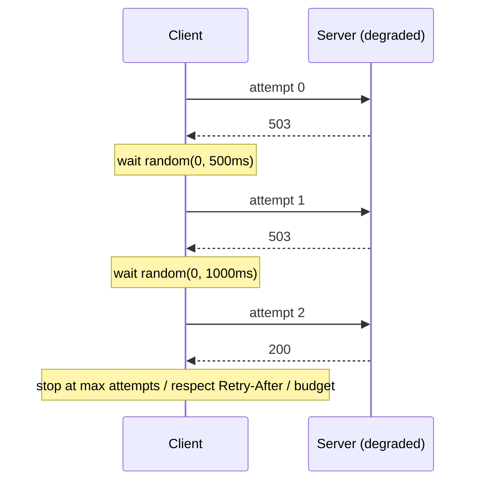
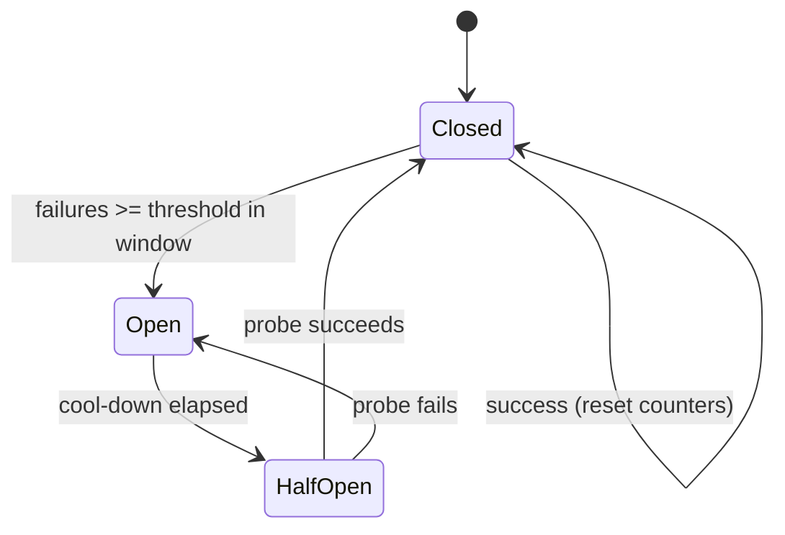
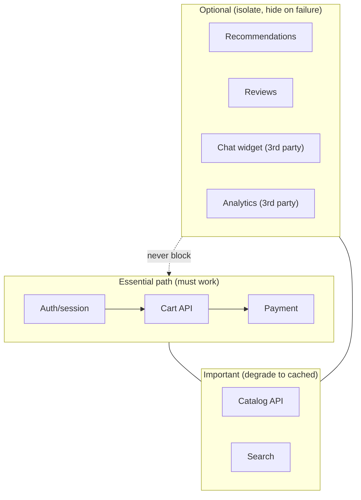
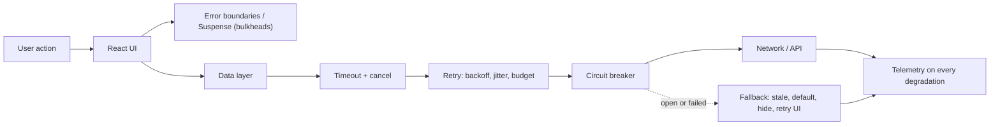
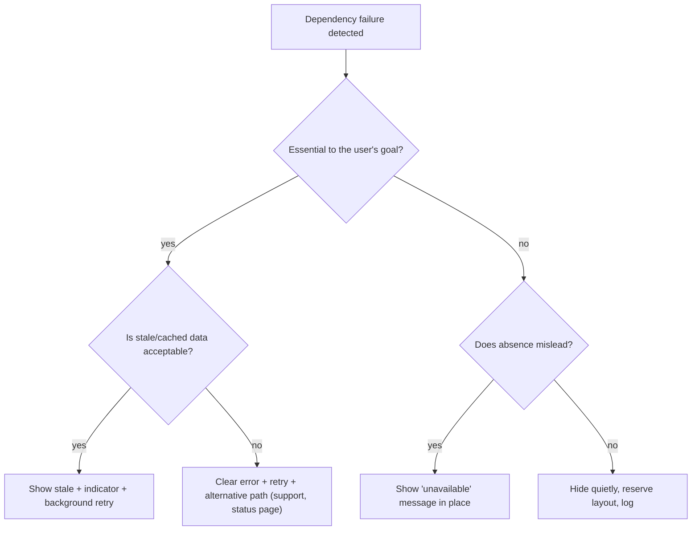

# 10 / 10 — Resilience and Graceful Degradation: Designing Front Ends That Survive Partial Failure

## 1. Lesson metadata

| | |
|---|---|
| **Level** | Professional |
| **Study time** | 5 hours (reading 2 h, experiments 1.5 h, exercises 1.5 h) |
| **Prerequisites** | [05 — Error monitoring](./05-error-monitoring.md); [04 — Observability and logging](./04-observability-and-logging.md); [02 — Deployment workflows](./02-deployment-workflows.md); [Phase 4 — Error boundaries](../04-react-architecture/19-error-boundaries.md); [Phase 5 — Error handling patterns](../05-design-patterns/21-error-handling-patterns.md); [Phase 6 — Loading and error states](../06-data-fetching-and-state-ecosystems/03-loading-and-error-states.md); [Phase 6 — Error recovery and retries](../06-data-fetching-and-state-ecosystems/15-error-recovery-and-retries.md); [Phase 6 — Offline considerations](../06-data-fetching-and-state-ecosystems/16-offline-considerations.md); [Phase 6 — Cancellation and race conditions](../06-data-fetching-and-state-ecosystems/02-cancellation-and-race-conditions.md) |
| **Next** | [11 — Design system governance](./11-design-system-governance.md) |
| **Related later** | [18 — Continuous delivery](./18-continuous-delivery.md), [19 — Incident debugging](./19-incident-debugging.md) |

**Learning objectives.** After this lesson you can:
1. Define resilience for front-end systems: continuing to deliver *useful* behavior under partial failure, and recovering without user heroics.
2. Enumerate failure modes of a React app in production — network, back end, third parties, deploy skew, device limits, data quality — and classify each by blast radius.
3. Apply resilience patterns: timeouts, bounded retries with exponential backoff and jitter, idempotency, circuit breakers, bulkheads (failure isolation), stale-while-revalidate, fallbacks, kill switches, and load shedding.
4. Design degradation tiers (full → reduced → read-only → static/offline) and choose which features are *essential* vs *optional*.
5. Isolate failure in the UI tree with layered error boundaries and independent data dependencies.
6. Test resilience deliberately (fault injection, chaos in staging, game days) and express it as SLOs and error budgets.

**Concepts covered:** failure modes, blast radius, fail-fast vs fail-safe, timeouts and `AbortSignal`, retry budgets, backoff + jitter, idempotency keys, circuit breaker, bulkhead, graceful degradation vs progressive enhancement, stale data policies, kill switches, third-party isolation, offline/degraded modes, service worker caveats, thundering herd, fault injection, resilience testing, observability of degradation.

---

## 2. Deep conceptual explanation

### 2.1 What problem is this lesson solving?

At scale, "everything works" is a rare state. APIs time out, a recommendation service is down while checkout is healthy, a CDN edge serves a stale file, a user's laptop sleeps mid-request, a third-party chat widget blocks the main thread, a deploy removes a chunk an open tab needs. Whether these become *incidents* or *non-events* depends on design decisions made long before.

Resilience is not "no errors"; it is **bounded impact and fast recovery**. A resilient front end:

- Keeps **core user journeys** working when non-core dependencies fail.
- Fails **visibly and recoverably**, not silently or catastrophically (no blank screens; no infinite spinners).
- **Protects the back end** from the front end's own retry behavior (a retry storm turns a blip into an outage).
- Is **observable** so degradation is detected, not discovered by users ([04](./04-observability-and-logging.md), [05](./05-error-monitoring.md)).

### 2.2 Vocabulary

| Term | Meaning |
|---|---|
| **Failure mode** | A specific way something can break (timeout, 5xx, malformed payload, slow response, partial response, stale data). |
| **Blast radius** | How much of the user experience a failure affects. |
| **Fail-fast** | Detect and surface failure quickly (don't hang); enables fallbacks. |
| **Fail-safe / fail-soft** | When failing, default to the least harmful behavior (e.g. hide the optional widget; for a security control, deny). |
| **Graceful degradation** | Reduce functionality in a controlled way while core remains usable. |
| **Progressive enhancement** | Start from a working baseline and add capabilities where supported ([Phase 9 — Progressive enhancement](../09-advanced-rendering-and-ecosystem/11-progressive-enhancement.md)). Complementary: degradation is about *runtime failures*, enhancement about *capability variance*. |
| **Idempotent** | Repeating the operation has the same effect as doing it once (safe to retry). |
| **Bulkhead** | Isolation so one failing component can't exhaust shared resources (like ship compartments). |
| **Circuit breaker** | Stop calling a failing dependency for a cooling-off period to let it recover and to fail fast. |
| **Retry budget** | A cap on total retry traffic (per request, per session, or per time window). |
| **Jitter** | Randomization added to backoff delays to avoid synchronized retries (thundering herd). |
| **Kill switch** | A remotely controlled flag to disable a feature quickly ([03](./03-environment-configuration.md)). |
| **Load shedding** | Intentionally dropping or deferring low-priority work under stress. |

### 2.3 Failure taxonomy for a React application

| Domain | Examples | Typical blast radius | Primary defenses |
|---|---|---|---|
| **Network** | Offline, high latency, packet loss, captive portal, proxy rewriting | All remote functionality | Timeouts, retries, offline UX, caching |
| **Back end API** | 5xx, 429 rate limits, slow responses, partial outages, schema drift | Feature or entire app | Backoff, circuit breakers, stale data, contract validation |
| **Data quality** | Null where non-null expected, unexpected enum, huge payloads | Component → page | Runtime validation at boundary ([Phase 4 — API boundaries](../04-react-architecture/14-api-boundaries-and-data-access.md)), defensive rendering, boundaries |
| **Deployment** | Version skew, missing chunks, config drift | Open sessions | Asset retention, chunk recovery, compatibility windows ([02](./02-deployment-workflows.md)) |
| **Third-party scripts/SDKs** | Analytics/chat/payment script slow or blocked by ad blockers, CDN down | Page performance or feature | Async loading, timeouts, isolation, feature detection, never block render ([07](./07-dependency-security.md)) |
| **Browser/device** | Old browsers, storage disabled, low memory, background tab throttling | Subset of users | Feature detection, try/catch around storage, budgets |
| **Client logic** | Bugs, race conditions, infinite loops | Variable | Tests, boundaries, kill switches, throttled reporting |
| **Dependencies in the pipeline** | Registry/CDN outages during deploy | Delivery | Mirrors, retries, caching in CI |

### 2.4 The core patterns

#### Timeouts and cancellation
`fetch` has **no default timeout** in browsers beyond very long network-level limits. A hung request means a forever-spinner and an occupied connection (browsers limit concurrent connections per host for HTTP/1.1; HTTP/2 multiplexes but server-side resources are still held). Always bound waiting with `AbortSignal.timeout(ms)` (MDN browser-compat data: Chrome 124, Firefox 100, Safari 16; a polyfill via `AbortController` + `setTimeout` is trivial for older targets) combined with user/lifecycle cancellation (`AbortSignal.any([...])` — Chrome 116, Firefox 124, Safari 17.4 per MDN BCD) ([Phase 6 — Cancellation](../06-data-fetching-and-state-ecosystems/02-cancellation-and-race-conditions.md)). Choose timeouts by **user-perceived value**: a search-as-you-type call may deserve 3 s; a file upload far longer. Timeout ≠ failure on the server: the operation may still complete — hence idempotency.

#### Retries — carefully
Retry only when **(a) the failure is transient** (network error, 502/503/504, 429 with `Retry-After`, sometimes 408) **and (b) the operation is safe to repeat** (GET/HEAD/PUT/DELETE idempotent by HTTP semantics, or POST with an **idempotency key**). Never blindly retry non-idempotent POSTs (double payment). Use **exponential backoff with jitter**: delay = random(0, min(cap, base × 2^attempt)) ("full jitter") — spreads load. Limit attempts (2–3 for user-facing calls) and enforce a **retry budget** so retries can't amplify an outage (if 10% of recent requests are retries, stop retrying). Honor `Retry-After` when present. Data-fetching libraries implement retries (e.g. TanStack Query defaults — ⚠ verify defaults and per-query options in current docs) — understand them before layering your own so retries don't multiply (3 × 3 = 9 attempts).

#### Idempotency keys
For writes, generate a unique key client-side per *user intent* (not per HTTP attempt) and send it (commonly in an `Idempotency-Key` header — a convention; the IETF HTTP API working group's `Idempotency-Key` header draft was listed as an expired Internet-Draft on datatracker when checked 2026-10-22, so treat it as a convention rather than a standard) so the server can de-duplicate. Persist the key with the pending action so a retry after reload reuses it.

#### Circuit breakers (client-side)
States: **closed** (normal), **open** (after N failures within a window: fail immediately without calling for a cool-down), **half-open** (let a probe through; success → closed, failure → open). Front-end use: stop hammering an optional dependency (recommendations, analytics) and render a fallback immediately. Per-dependency, per-tab state is usually enough; note that each tab has its own breaker (no shared state unless using BroadcastChannel/shared storage — usually not worth it).

#### Bulkheads
Isolate so failure doesn't cascade: separate error boundaries per widget; independent data queries (don't gather all data in one `Promise.all` where any rejection discards everything — use `Promise.allSettled` or per-component queries); separate concurrency pools (don't let 50 prefetches starve the critical request); iframes/workers for untrusted/flaky code.

#### Fallbacks and stale data
Options when fresh data is unavailable: (1) show **stale cached data** with an "as of 10:42" indicator (stale-while-revalidate, [Phase 6 — Cache consistency](../06-data-fetching-and-state-ecosystems/06-cache-consistency-and-invalidation.md)); (2) show **default/static content**; (3) **hide** the optional feature; (4) **degrade** to a simpler representation (text list instead of map); (5) explain and offer **retry**. The right choice is a product decision — for a bank balance, stale money data may be *worse* than an error; for a product recommendation, stale is fine.

#### Kill switches and feature flags
A remotely controllable switch lets you disable a failing feature in seconds without a deploy ([03](./03-environment-configuration.md), [02](./02-deployment-workflows.md)). The flag service itself is a dependency: define a safe default when it's unreachable and cache last-known values.

#### Load shedding and backpressure
Under stress (API 429/503), defer non-critical calls (analytics, prefetch, background refresh), reduce polling frequency, pause real-time subscriptions, and surface "high traffic" messaging. Client behavior should *reduce* load, not add to it.

### 2.5 Degradation tiers

Define explicit service tiers per journey. Example for e-commerce:

| Tier | State | UX |
|---|---|---|
| **T0 Full** | All dependencies healthy | Personalized, live inventory, recommendations |
| **T1 Reduced** | Optional services down | No recommendations/reviews; page otherwise normal |
| **T2 Core-only** | Catalog/search degraded | Cached catalog, search falls back to category browse; checkout works |
| **T3 Read-only** | Write path down | Browse and view; "ordering temporarily unavailable" with notify-me |
| **T4 Static/maintenance** | Back end down | Static page, status link, cached pages if service worker exists |

The point of tiers is that behavior under failure is **designed and reviewed**, not emergent. Tie tier transitions to explicit signals (circuit state, health endpoint, flag) and to telemetry ([04](./04-observability-and-logging.md)).

### 2.6 Resilience in the React tree

- **Error boundaries** at multiple levels ([05 §2.4](./05-error-monitoring.md)): root, route, feature/widget. Fallbacks should be *useful* (retry, navigation) and layout-stable.
- **Suspense** boundaries separate loading states; pair each with an error boundary ([Phase 5 — Error handling patterns](../05-design-patterns/21-error-handling-patterns.md), [Phase 6 — Suspense data loading](../06-data-fetching-and-state-ecosystems/13-suspense-data-loading.md)): `ErrorBoundary > Suspense > Component`.
- **Independent data dependencies per widget** so failure of one query doesn't block siblings; avoid "waterfall of all-or-nothing" loaders at route level for non-essential data.
- **Defensive rendering**: treat optional data as optional in types (`T | undefined`) and render sensible empties; validate at boundaries rather than sprinkling optional chaining everywhere.
- **Reset and recovery**: boundaries with `resetKeys` and retry buttons; data libraries' reset integration; avoid reset loops ([05 §10 D2](./05-error-monitoring.md)).
- **Optimistic UI and rollback**: when a mutation fails, revert and explain ([Phase 6 — Optimistic updates](../06-data-fetching-and-state-ecosystems/05-optimistic-updates.md)).
- **Avoid single points of failure in the shell**: the app shell (navigation, auth) should not depend on non-essential API calls to render.

### 2.7 Service workers and offline: powerful, dangerous

A service worker can serve cached shells and data offline, enabling T4 tiers. But a buggy or stale service worker can **brick** an app (serving a broken cached shell indefinitely). If you adopt one: version it, implement a safe update flow, provide a kill path (a no-op replacement worker or "unregister" route), and test the upgrade matrix ([Phase 6 — Offline considerations](../06-data-fetching-and-state-ecosystems/16-offline-considerations.md); [02](./02-deployment-workflows.md)). ⚠ Libraries like Workbox encapsulate strategies; verify current APIs.

### 2.8 Common misconceptions

| Misconception | Reality |
|---|---|
| "Retries make things more reliable." | Unbounded or synchronized retries *cause* outages (retry storms). Retries are for transient faults on idempotent operations, with backoff, jitter and budgets. |
| "A timeout means the request failed." | The server may have processed it. Without idempotency, retrying duplicates side effects. |
| "Add try/catch everywhere." | Catch where you can *do something useful* (fallback, retry, report); elsewhere let errors reach boundaries. |
| "Error boundaries solve resilience." | They contain render errors; they don't handle slow networks, retries, stale data, or third-party blocking. |
| "Optional features can be loaded synchronously — they're small." | A hung optional script/request can block critical rendering or the main thread. Optional means isolatable. |
| "Resilience is the back end's job." | The client decides what the user sees during failure and can amplify or dampen load. |
| "100% uptime is the goal." | Availability targets (SLOs) and error budgets are chosen deliberately; chasing perfect resilience has diminishing returns. |

---

## 3. Internal mechanics

### 3.1 What the browser gives you

- **`fetch` + `AbortController`/`AbortSignal`**: cancellation aborts the *client's* waiting and may close the connection; it does not guarantee the server stops processing.
- **`AbortSignal.timeout(ms)`**: creates a signal that aborts with a `TimeoutError` DOMException after `ms`. **`AbortSignal.any(signals)`** combines signals. MDN BCD minimum versions: `timeout` Chrome 124 / Firefox 100 / Safari 16; `any` Chrome 116 / Firefox 124 / Safari 17.4 (also present in the sandbox's Node 24).
- **Connection limits and queuing**: browsers queue requests per origin (HTTP/1.1: ~6 connections per host; HTTP/2: multiplexed). Many concurrent low-priority requests can delay critical ones (**head-of-line pressure**); `fetch` `priority` hints (`priority: "low"` — check MDN `Request.priority` compatibility for your matrix) and `fetchpriority` attributes help.
- **Page lifecycle**: background tabs throttle timers; pages may be frozen/discarded; the back/forward cache restores pages with stale state (listen for `pageshow` with `persisted` to refresh).
- **`navigator.onLine` is unreliable**: `true` only means a network interface exists; `false` is reliable-ish. Treat online/offline events as hints and rely on request outcomes.
- **Storage failures**: `localStorage`/`IndexedDB` can throw (quota, private modes, blocked cookies) — wrap and degrade ([02 §5.5](./02-deployment-workflows.md) example).

### 3.2 Backoff math

Full jitter: `delay = random(0, min(cap, base * 2^attempt))`. Expected load on a recovering server decreases geometrically *and* is de-synchronized across clients. Without jitter, 10,000 clients that failed at the same moment retry at t+1s, t+2s, t+4s in lockstep waves.



### 3.3 Circuit breaker state machine



### 3.4 Dependency map and tiers



---

## 4. Step-by-step execution walkthrough: product page while the recommendations service degrades

1. **T0:** The page loads: the shell and product details come from the catalog API; the recommendations widget requests `/recs?product=…` lazily when scrolled near the viewport (IntersectionObserver).
2. **Degradation begins:** Recommendations API latency climbs to 8 s then returns 503.
3. **Timeout:** the widget's fetch is bounded at 3 s via `AbortSignal.timeout(3000)`; the request fails fast with a `TimeoutError`.
4. **Retry policy:** GET is idempotent; retry once after jitter (0–400 ms). Fails again.
5. **Circuit breaker** for `recs` counts failures; after 3 within 30 s it **opens**: further calls from any recs widget fail instantly for 30 s (no network).
6. **Widget fallback:** the widget's error boundary/state shows nothing (optional) or a compact "Recommendations unavailable" for transparency; layout space is reserved to avoid layout shift. The rest of the page (price, add to cart) is unaffected — **bulkhead** by independent query + boundary.
7. **Telemetry:** a metric `dependency_degraded{name="recs"}` and an error-monitoring issue with low severity ([05](./05-error-monitoring.md)); an alert fires if recs availability SLI breaches its budget.
8. **Recovery:** after 30 s the breaker goes half-open; one probe succeeds; the breaker closes; the widget retries on next visibility/refetch and hydrates.
9. **Throughout**, checkout remained fully functional: the optional tier failed, the essential tier didn't.

**Predict:** if the recommendations call had been awaited in the route loader with `Promise.all([product, recs])`, what happens? *The 8 s recs delay (or rejection) would block or fail the whole page — a missing bulkhead.*

---

## 5. Code examples

### 5.1 Minimal example — timeout + cancellation + status handling

```ts
// src/shared/http/fetchJson.ts
export class HttpError extends Error {
  constructor(readonly status: number, readonly retryAfterMs?: number) {
    super(`HTTP ${status}`);
    this.name = "HttpError";
  }
}

export async function fetchJson<T>(
  url: string,
  opts: { signal?: AbortSignal; timeoutMs?: number; init?: RequestInit } = {},
): Promise<T> {
  const timeout = AbortSignal.timeout(opts.timeoutMs ?? 5000);
  const signal = opts.signal ? AbortSignal.any([opts.signal, timeout]) : timeout;   // AbortSignal.any: Chrome 116+, Firefox 124+, Safari 17.4+; polyfill for older targets

  const res = await fetch(url, { ...opts.init, signal });
  if (!res.ok) {
    const ra = res.headers.get("retry-after");
    const retryAfterMs = ra && /^\d+$/.test(ra) ? Number(ra) * 1000 : undefined;    // seconds form only; HTTP-date form omitted
    throw new HttpError(res.status, retryAfterMs);
  }
  return (await res.json()) as T;     // validate with a schema at the boundary in real code (lesson 03 / Phase 4)
}
```

**Line notes.**
- `fetch` resolves on HTTP errors; the explicit `res.ok` check turns them into exceptions the retry logic can classify.
- The caller's `signal` (component unmount, route change) is combined with a timeout signal so either ends the wait.
- `TimeoutError` (DOMException) vs `AbortError` can be distinguished by `error.name` — useful to avoid reporting user-initiated aborts as failures.
- `as T` is an unchecked assertion; this is exactly where runtime validation belongs ([03 — config validation example](./03-environment-configuration.md)).

### 5.2 Practical example — retry with exponential backoff, full jitter, and a budget

```ts
// src/shared/http/retry.ts
import { HttpError } from "./fetchJson";

const RETRYABLE_STATUS = new Set([408, 429, 500, 502, 503, 504]);

function isTransient(err: unknown): boolean {
  if (err instanceof HttpError) return RETRYABLE_STATUS.has(err.status);
  if (err instanceof DOMException && err.name === "AbortError") return false;      // caller cancelled
  if (err instanceof DOMException && err.name === "TimeoutError") return true;
  return err instanceof TypeError;     // fetch network failure surfaces as TypeError in browsers
}

// A shared retry budget: allow retries only if they are a small fraction of recent traffic.
class RetryBudget {
  private requests = 0; private retries = 0; private windowStart = Date.now();
  constructor(private ratio = 0.1, private windowMs = 10_000, private minRetries = 3) {}
  private roll() { if (Date.now() - this.windowStart > this.windowMs) { this.requests = 0; this.retries = 0; this.windowStart = Date.now(); } }
  recordRequest() { this.roll(); this.requests++; }
  tryRetry(): boolean {
    this.roll();
    if (this.retries < this.minRetries || this.retries < this.requests * this.ratio) { this.retries++; return true; }
    return false;
  }
}
export const defaultBudget = new RetryBudget();

export async function withRetry<T>(
  op: (attempt: number) => Promise<T>,
  opts: { retries?: number; baseMs?: number; capMs?: number; signal?: AbortSignal; budget?: RetryBudget } = {},
): Promise<T> {
  const { retries = 2, baseMs = 300, capMs = 5000, signal, budget = defaultBudget } = opts;
  budget.recordRequest();
  for (let attempt = 0; ; attempt++) {
    try {
      return await op(attempt);
    } catch (err) {
      if (signal?.aborted || attempt >= retries || !isTransient(err) || !budget.tryRetry()) throw err;
      const serverHint = err instanceof HttpError ? err.retryAfterMs : undefined;
      const backoff = Math.random() * Math.min(capMs, baseMs * 2 ** attempt);    // full jitter
      await sleep(Math.max(serverHint ?? 0, backoff), signal);
    }
  }
}

function sleep(ms: number, signal?: AbortSignal): Promise<void> {
  return new Promise((resolve, reject) => {
    const id = setTimeout(resolve, ms);
    signal?.addEventListener("abort", () => { clearTimeout(id); reject(signal.reason ?? new DOMException("Aborted", "AbortError")); }, { once: true });
  });
}
```

**Design notes and trade-offs.**
- Only **idempotent** operations should be wrapped by default. For POSTs, require an idempotency key (§5.3) or do not retry automatically.
- The budget is deliberately simple (per-tab, sliding window); server-side rate limiting remains the real protection.
- `Math.max(serverHint, backoff)` respects `Retry-After`. If the hint is huge (minutes), a UI should fail and tell the user rather than silently waiting — add a cap.
- Libraries like TanStack Query provide retry with backoff; if you use one, configure *it* rather than layering `withRetry` on top (otherwise retries multiply). Query libraries' defaults (e.g. retry count and backoff function) are version-specific — verify ([Phase 6 lesson 08](../06-data-fetching-and-state-ecosystems/08-tanstack-query.md)).
- Test with fake timers and injected `Math.random` for determinism.

### 5.3 Idempotent mutations

```ts
// src/features/checkout/api/placeOrder.ts
import { fetchJson } from "@/shared/http/fetchJson";
import { withRetry } from "@/shared/http/retry";

export function createIntent() {
  // One key per user intent; persist alongside the pending action so reloads reuse it.
  return { idempotencyKey: crypto.randomUUID() };
}

export function placeOrder(cart: Cart, intent: { idempotencyKey: string }, signal?: AbortSignal) {
  return withRetry(
    () => fetchJson<OrderConfirmation>("/api/orders", {
      signal,
      timeoutMs: 15_000,
      init: {
        method: "POST",
        headers: { "content-type": "application/json", "idempotency-key": intent.idempotencyKey },
        body: JSON.stringify(cart),
      },
    }),
    { retries: 2, signal },
  );
}
```

**Why this is safe only with server cooperation.** The server must store the key with the result and return the *original* result for repeats within a retention window; the client alone cannot make a POST idempotent. If the back end doesn't support it, **don't retry** the POST; instead on timeout show "We couldn't confirm your order — check your orders before retrying" and offer a status lookup. (The header name is a convention; verify your API's contract.)

### 5.4 Incorrect example — all-or-nothing loader and unbounded retry

```tsx
// Route loader: any failure kills the page; optional data blocks critical data
export async function loader({ params }: LoaderArgs) {
  const [product, recs, reviews, inventory] = await Promise.all([
    getProduct(params.id),
    getRecommendations(params.id),     // optional
    getReviews(params.id),             // optional
    getInventory(params.id),
  ]);
  return { product, recs, reviews, inventory };
}

// Component: retry forever, no backoff
function useThing() {
  const [data, setData] = useState<Thing | null>(null);
  useEffect(() => {
    let alive = true;
    (async function go() {
      try { setData(await getThing()); }
      catch { if (alive) setTimeout(go, 1000); }       // ❌ constant interval, forever, synchronized across clients
    })();
    return () => { alive = false };                     // ❌ timer not cleared; request not aborted
  }, []);
  return data;
}
```

Problems: one slow optional call delays everything; one rejection fails the whole route; the hook retries every second indefinitely (retry storm), ignores cancellation, and leaks timers ([Phase 3 — Effect cleanup](../03-react-state-and-hooks/06-effect-cleanup.md)).

### 5.5 Corrected implementation — critical path vs optional widgets

```tsx
// Route-level: only the essentials are awaited
export async function loader({ params }: LoaderArgs) {
  const [product, inventory] = await Promise.all([getProduct(params.id), getInventory(params.id)]);
  return { product, inventory };
}

// Page: optional widgets own their data and failure
function ProductPage({ id }: { id: string }) {
  return (
    <>
      <ProductDetails id={id} />
      <ErrorBoundary fallback={() => <Reserved height={240} />}>
        <Suspense fallback={<Skeleton height={240} />}>
          <Recommendations productId={id} />
        </Suspense>
      </ErrorBoundary>
      <ErrorBoundary fallback={({ reset }) => <ReviewsUnavailable onRetry={reset} />}>
        <Suspense fallback={<Skeleton height={320} />}>
          <Reviews productId={id} />
        </Suspense>
      </ErrorBoundary>
    </>
  );
}
```

```tsx
function Recommendations({ productId }: { productId: string }) {
  const recs = useRecommendations(productId);   // e.g. a query hook with timeout, bounded retry, breaker, stale-while-revalidate
  if (recs.items.length === 0) return null;     // empty is a valid state
  return <RecsCarousel items={recs.items} />;
}
```

Explanation: **bulkheads** (boundary + Suspense + independent data per widget); essentials remain in the route; optional failures render `<Reserved>` (blank space preserved to avoid layout shift — [Phase 7](../07-performance/21-web-vitals-and-budgets.md)) or a retry affordance. Which widgets need visible failure messaging is a product decision: hiding recommendations silently is fine; hiding *reviews* silently may mislead users into thinking there are none — show "Reviews unavailable". Trade-off: more boundaries = more fallback UI to design and test.

### 5.6 Advanced — a client-side circuit breaker and stale-on-error cache

```ts
// src/shared/resilience/circuitBreaker.ts
type State = "closed" | "open" | "half-open";

export class CircuitBreaker {
  private state: State = "closed";
  private failures: number[] = [];       // timestamps in window
  private openedAt = 0;
  constructor(private opts: { failureThreshold: number; windowMs: number; coolDownMs: number }) {}

  async exec<T>(op: () => Promise<T>): Promise<T> {
    const now = Date.now();
    if (this.state === "open") {
      if (now - this.openedAt < this.opts.coolDownMs) throw new CircuitOpenError();
      this.state = "half-open";
    }
    try {
      const result = await op();
      this.onSuccess();
      return result;
    } catch (err) {
      this.onFailure(err);
      throw err;
    }
  }

  private onSuccess() { this.failures = []; this.state = "closed"; }
  private onFailure(err: unknown) {
    if (err instanceof DOMException && err.name === "AbortError") return;   // user-initiated cancels are not failures
    const now = Date.now();
    this.failures = [...this.failures.filter((t) => now - t < this.opts.windowMs), now];
    if (this.state === "half-open" || this.failures.length >= this.opts.failureThreshold) {
      this.state = "open"; this.openedAt = now;
    }
  }
  get current(): State { return this.state; }
}
export class CircuitOpenError extends Error { constructor() { super("Circuit open"); this.name = "CircuitOpenError"; } }
```

```ts
// Stale-on-error: fall back to the last good value when the dependency fails
const lastGood = new Map<string, { value: unknown; at: number }>();
const recsBreaker = new CircuitBreaker({ failureThreshold: 3, windowMs: 30_000, coolDownMs: 30_000 });

export async function getRecommendations(productId: string, signal?: AbortSignal) {
  const key = `recs:${productId}`;
  try {
    const value = await recsBreaker.exec(() =>
      withRetry(() => fetchJson<RecItem[]>(`/api/recs?product=${encodeURIComponent(productId)}`, { signal, timeoutMs: 3000 }), { retries: 1, signal }));
    lastGood.set(key, { value, at: Date.now() });
    return { items: value, stale: false as const };
  } catch (err) {
    const cached = lastGood.get(key);
    if (cached && Date.now() - cached.at < 10 * 60_000) return { items: cached.value as RecItem[], stale: true as const };
    throw err;                                      // let the widget's boundary handle it
  }
}
```

**Notes.** This is a teaching sketch: per-tab, in-memory, no half-open concurrency limit (multiple simultaneous probes can pass in half-open), no metrics. Production implementations (or libraries) add those. A **max staleness** policy (10 minutes here) is a product rule. Do **not** use stale-on-error for data where staleness is dangerous (balances, inventory at checkout, permissions). Emit telemetry on every fallback ([04](./04-observability-and-logging.md)) so that "stale mode" is visible to engineers — silent degradation can hide an outage for days.

### 5.7 Third-party script isolation: load late, time-box, never block

```ts
export function loadScript(src: string, opts: { timeoutMs: number; integrity?: string }): Promise<void> {
  return new Promise((resolve, reject) => {
    const s = document.createElement("script");
    s.src = src; s.async = true;
    if (opts.integrity) { s.integrity = opts.integrity; s.crossOrigin = "anonymous"; }
    const timer = setTimeout(() => { cleanup(); reject(new Error("script timeout")); }, opts.timeoutMs);
    const cleanup = () => { clearTimeout(timer); s.onload = s.onerror = null; };
    s.onload = () => { cleanup(); resolve(); };
    s.onerror = () => { cleanup(); reject(new Error("script failed")); };   // ad blockers produce this too
    document.head.appendChild(s);
  });
}
```

```tsx
function ChatLauncher() {
  const [state, setState] = useState<"idle" | "loading" | "ready" | "unavailable">("idle");
  async function open() {
    setState("loading");
    try { await loadScript("https://chat.vendor.example/widget.js", { timeoutMs: 8000 }); setState("ready"); }
    catch { setState("unavailable"); }              // fallback: show email/phone support link
  }
  if (state === "unavailable") return <a href="/support">Contact support</a>;
  return <button type="button" onClick={open} aria-busy={state === "loading"}>Chat with us</button>;
}
```

Principles: load on demand (interaction) rather than at startup; time-box; treat blocked-by-adblock as a normal state, offering an alternate channel; never put third-party scripts in the critical rendering path; CSP/SRI as in [06](./06-security-xss-csrf-csp.md)/[07](./07-dependency-security.md). Note the script's global side effects can't be undone — isolate in an iframe if you need real containment.

---

## 6. Visual explanations

### Where each pattern sits



### Degradation as a decision



---

## 7. Alternative approaches and trade-offs

**How to handle a flaky dependency:**

| Approach | User experience | Back-end load | Complexity | Risk | When to prefer |
|---|---|---|---|---|---|
| Fail immediately, show error | Honest, simple | Lowest | Lowest | User frustration | Rare, non-critical, user-triggered actions |
| Bounded retry with backoff + jitter | Hides transient blips | Slightly higher | Low–Medium | Duplicate side effects if not idempotent | Idempotent reads and keyed writes |
| Stale-while-revalidate / cache fallback | Fast, resilient | Lower | Medium | Showing wrong data | Content/catalog/read-heavy views |
| Circuit breaker | Fast failure + recovery | Lowest during outage | Medium | Misconfigured thresholds → false opens | Optional or non-critical dependencies; high-volume clients |
| Queue and sync later (offline outbox) | Seamless offline | Smooths load | High (conflict resolution, ordering, idempotency) | Data conflicts, user confusion | Field apps, unreliable connectivity ([Phase 6 lesson 16](../06-data-fetching-and-state-ecosystems/16-offline-considerations.md)) |
| Redundant endpoints/regions (client failover) | Seamless | Distributes | High (config, consistency, CORS/auth per region) | Split-brain data | Critical global services with multi-region back ends ([03](./03-environment-configuration.md) runtime config) |
| Server-side orchestration (BFF aggregates, degrades server-side) | Simple client | Shifts complexity | High (operate BFF) | BFF becomes SPOF | Many dependencies per screen |

**When the recommended defaults (timeouts, boundaries, bounded retries) are not best:** for *security-sensitive or financial confirmation* flows, failing closed with a clear error is better than clever retries or stale data (e.g. money transfer confirmation — show "pending, verifying status" and poll a status endpoint rather than re-submitting). For tiny internal tools, heavy resilience machinery costs more than occasional "refresh the page".

---

## 8. Best practices and anti-patterns

**Do**
- Classify features as essential/important/optional and encode that in architecture (routes, boundaries, data loading).
- Put **timeouts on everything remote**; combine with cancellation on navigation/unmount.
- Retry only transient errors on idempotent operations, with backoff, jitter, caps and budgets; honor `Retry-After`.
- Use idempotency keys for writes that may be retried; persist them with the pending action.
- Isolate third-party code; load on demand; provide alternative channels when blocked.
- Reserve layout for fallbacks to avoid layout shift; make fallback UIs accessible (`role="status"`/alert, focus management — [08](./08-accessibility-as-architecture.md)).
- Instrument degradation (breaker state, stale-served counts, fallback rates) and alert on sustained degradation.
- Provide kill switches for risky features and rehearse using them ([02](./02-deployment-workflows.md)).
- Test failure paths deliberately (fault injection; see Exercise F1).

**Beginner mistakes**
- Infinite spinners (no timeout); blank screens on error; swallowing errors.
- `Promise.all` for unrelated data.
- Showing raw error messages/stack traces.

**Experienced-developer mistakes**
- Layering retries at several levels (HTTP client × query library × UI button) → multiplicative load.
- Retrying non-idempotent POSTs.
- Circuit breakers with thresholds tuned for lab traffic; breakers shared incorrectly across unrelated endpoints (one flaky endpoint opens the circuit for all).
- Treating stale data as universally acceptable.
- Silent fallbacks that mask long outages.
- Service worker caches without an escape hatch.

**Smells**
- "It works unless the API is slow" as an accepted condition.
- The shell (navigation/header) blocking on non-essential API calls.
- Unlimited polling with fixed short intervals; reconnect loops without backoff.
- No way to disable a feature without a deploy.

**Justified exceptions**
- Fail-fast without retries for human-initiated actions where immediate feedback beats automation.
- Disabling automatic retries on payment confirmation endpoints without idempotency support.
- Accepting a blank space (rather than an "unavailable" message) for purely decorative optional widgets.

---

## 9. Real-world application

**E-commerce.** Peak events (sales) stress every dependency. Tiers per §2.5; recommendations/reviews optional; search degrades to cached category browsing; checkout protected by idempotency keys, strict timeouts, "order status lookup" fallback, and kill switches for risky promos. Constraint: conversion loss from long spinners; abandoned carts when errors are unclear. Load shedding: reduce polling, defer analytics, pause prefetch when the API signals 429/503.

**Finance.** Prefer correctness over availability for money movement: no stale balances in transfer flows; show "last updated" with timestamps on read-only views; explicit pending states; idempotency + server-side reconciliation; step-up flows must not retry silently. Constraint: audit trails; user trust.

**Dashboards.** Many independent widgets: per-widget boundaries and queries, staggered refresh with jitter (avoid synchronized refresh bursts), pause refresh in background tabs (`visibilitychange`), "data as of" labels, degrade charts to tables when rendering fails. Constraint: operators rely on dashboards *during incidents* — the monitoring UI must be the most resilient app you ship (static fallback, minimal dependencies).

**Auth flows.** Token refresh failures should lead to a clean re-login path, not loops; avoid refresh storms across tabs (single-flight refresh with a lock — `navigator.locks` (Web Locks API: Chrome 69, Firefox 96, Safari 15.4 per MDN BCD) — or BroadcastChannel); fail closed for authorization decisions.

**Realtime.** WebSocket reconnect with exponential backoff + jitter, resume tokens, fallback to polling (long-poll/SSE) when WebSockets are blocked by proxies, backpressure on bursts ([Phase 6 lesson 17](../06-data-fetching-and-state-ecosystems/17-real-time-websockets-subscriptions.md)); show connection status unobtrusively; after reconnect, reconcile missed events.

**Multi-team platforms.** Each team owns the degradation behavior of its widgets and documents its dependency tier; the platform provides shared primitives (HTTP client with timeouts/retry policy, boundary components, breaker utility) so behavior is consistent and tunable centrally ([14 — Multi-team collaboration](./14-multi-team-collaboration.md)). Micro-frontends need per-fragment isolation and timeouts for remote entry loading ([Phase 11 — Microfrontends](../11-senior-and-architect-mastery/12-microfrontends.md)).

---

## 10. Debugging and troubleshooting

**Symptom: Page hangs on a spinner indefinitely.**
Reproduce: DevTools Network ▸ throttling "Offline" or block the URL pattern, or use "Slow 3G". Investigate: is there a timeout? Is the promise ever settled? Are loading and error states both handled ([Phase 6 lesson 03](../06-data-fetching-and-state-ecosystems/03-loading-and-error-states.md))? Root cause usually: missing timeout or a Suspense boundary without an error boundary. Fix: timeouts + boundaries + visible retry. Validate by repeating the block and observing the fallback within the timeout.

**Symptom: Outage gets worse after the API starts returning 503s; request volume to the API multiplies.**
Investigate: client retry layers (HTTP client, query library, custom loops), absence of jitter, polling intervals, WebSocket reconnect without backoff. Look at request counts per client per minute in server logs vs client telemetry. Fix: unify retry policy; add jitter and budgets; honor `Retry-After`; pause polling when failing. Validate with a load test against a fault-injected back end.

**Symptom: Duplicate orders after a timeout.**
Investigate: was the POST retried by the client? Did the server process the first? Check idempotency key presence in logs. Fix: idempotency keys and server de-duplication; UI offering status checks instead of resubmits. Validate by simulating response loss (server processes but client times out).

**Symptom: A single failing widget takes down the whole page.**
Investigate: boundary placement (stack trace shows which boundary handled it — `onCaughtError` info, [05](./05-error-monitoring.md)); route-level `Promise.all`; shared context throwing. Fix: add boundaries and independent data loading; move optional data out of loaders.

**Symptom: "Works offline" demo, but production users are stuck on an old broken version.**
Investigate: service worker lifecycle (Application panel ▸ Service Workers): waiting worker not activated; cached `index.html` serving old assets that no longer exist. Fix: update flow with `skipWaiting` policies carefully, versioned caches, kill-switch worker; test upgrade from N-1 and N-2 ([02](./02-deployment-workflows.md)).

**Symptom: Circuit breaker never closes / opens spuriously.**
Investigate: are user-cancelled requests counted as failures? Is half-open allowing more than one probe? Is one breaker shared by endpoints with different health? Fix: classify errors; per-dependency breakers; metrics for state transitions.

**Symptom: Users on corporate networks see third-party widget failures only.**
Investigate: proxies/ad blockers blocking domains; CSP violations; script timeouts. Fix: treat as a normal state with alternative support channels; consider first-party proxying where licensing/security permit; monitor "widget unavailable" rate by segment.

---

## 11. Exercises

### Level A — Knowledge
**A1.** Distinguish fail-fast, fail-safe, and graceful degradation with one front-end example each.
**A2.** What conditions must hold before an operation is automatically retried?
**A3.** What does jitter prevent, and how does full jitter compute a delay?
**A4.** Describe circuit breaker states and when each transition occurs.
**A5.** Why can `navigator.onLine` not be trusted as a connectivity check?

### Level B — Code comprehension
**B1.** In §5.2, trace attempts and delays for a GET that fails with 503, 503, then 200, with `retries = 2`, `baseMs = 300`, `capMs = 5000`. State possible delay ranges.
**B2.** In §5.2, what happens if the caller's signal aborts during the backoff sleep? During `op`?
**B3.** In §5.5, why does the Recommendations failure not affect the product details? What if `ProductDetails` shared a context provider that throws when recs fail?

### Level C — Implementation
**C1.** Write a `usePolling` hook with visibility-aware pausing, exponential backoff on failure, jitter, and cleanup on unmount.
**C2.** Implement single-flight token refresh across concurrent requests (and describe how to coordinate across tabs).
**C3.** Write tests for `withRetry` using fake timers and a deterministic `Math.random`, covering: success first try, transient then success, non-transient immediate throw, budget exhaustion, abort during backoff.

### Level D — Debugging
**D1.** Users report duplicate charges after "network error" screens. Diagnose and propose a fix across client and server.
**D2.** After a deploy, every client that loaded during a 90-second back-end blip began polling every second for hours. Why, and what do you change?
**D3.** The app shows a blank page when the recommendations API returns `null` instead of an array. Where should the fix live (boundary, component, API layer)?

### Level E — Architecture decisions
**E1.** Classify the dependencies of a banking dashboard (accounts, transactions, offers, chat, analytics, notifications) into tiers and define degradation behavior per tier.
**E2.** Decide whether to implement a service worker for offline support in a field-service app and in an e-commerce site. Evaluate risks and mitigations.

### Level F — Expert challenge
**F1.** Design a resilience test program: fault injection at the network layer, dependency stubs, chaos in staging, game days, SLOs/error budgets, and success criteria. Include how you would avoid harming real users while testing in production.

---

## 12. Detailed answers and explanations

> Attempt the exercises first.

**A1.** Fail-fast: a 3 s timeout aborts a hung search request so the UI can show an error/retry promptly. Fail-safe: if the feature-flag service is unreachable, default risky new features to *off* (and security checks to *deny*). Graceful degradation: when the map SDK fails, show a text address and directions link instead of a blank area.

**A2.** The failure is transient (network error/timeout/502/503/504/429 with backoff/ sometimes 408), the operation is idempotent or protected by an idempotency key, attempts are bounded, delays use backoff with jitter (and respect `Retry-After`), the caller hasn't cancelled, and a retry budget allows it. Otherwise fail and surface.

**A3.** Jitter prevents synchronized retry waves (thundering herd) after a shared failure. Full jitter: `delay = random(0, min(cap, base × 2^attempt))`. It spreads clients across the interval and reduces peak load on a recovering service.

**A4.** Closed: calls pass; failures counted in a window. Open: after failures ≥ threshold within the window, calls fail immediately for the cool-down. Half-open: after cool-down, allow a probe; success → closed (reset counters); failure → open again (restart cool-down).

**A5.** `navigator.onLine === true` only indicates a network interface exists (could be a captive portal, a disconnected LAN, or a blocked internet); `false` is more reliable. Real connectivity is determined by request outcomes. Use events as hints (to pause or resume work) while verifying with actual calls/health checks.

**B1.** Attempt 0 fails (503, transient, budget allows) → delay = random(0, min(5000, 300×1)) = [0, 300) ms (or the `Retry-After` hint if larger). Attempt 1 fails → delay = random(0, min(5000, 300×2)) = [0, 600) ms. Attempt 2 succeeds → returned. Total attempts 3 (initial + 2 retries). If attempt 2 had failed, `attempt >= retries` (2 ≥ 2) → throw.

**B2.** During `sleep`: the abort listener rejects with the signal's reason, the timer is cleared, and the `withRetry` promise rejects (the `catch` in the loop isn't involved — the rejection occurs in the `await sleep(...)` which sits inside the catch block, so it propagates). During `op`: the request itself rejects with `AbortError` (if the signal is wired into `fetch`); `isTransient` returns false and `signal.aborted` is true → rethrow immediately, no retries. Caveat: listener leak (`{ once: true }` only removes after firing; if the timer resolves first the abort listener remains attached to the signal — minor, but production code should remove it).

**B3.** Each widget has its own boundary and data; the boundary catches the recs component's error and renders the fallback; siblings are unaffected. If `ProductDetails` consumed a context provider that threw when recs failed (e.g. a page-level data provider combining queries), the throw would propagate to the nearest boundary above *both* — likely the route boundary — taking down the details. Shared providers must not couple optional and essential data.

**C1.** Outline: `useEffect` with `AbortController`; loop with `setTimeout` scheduling next run after each completion (not `setInterval`, to avoid overlapping requests); interval = base on success; on failure interval = min(max, base × 2^failures) with jitter; pause when `document.visibilityState === "hidden"` and resume on `visibilitychange` (perform an immediate refresh when becoming visible if stale); cleanup clears timers, aborts in-flight, removes listeners; guard against setState after unmount; make `fetcher` stable via ref ([Phase 3 — stale closures](../03-react-state-and-hooks/05-effect-dependencies-and-stale-closures.md)). Edge cases: StrictMode double-invoked effects (cleanup must fully reset), back/forward cache restore (`pageshow`).

**C2.** Single-flight: keep a module-level `refreshPromise: Promise<Token> | null`; on 401, if null start refresh and store the promise, `finally` set null; all concurrent callers await the same promise, then retry their request once with the new token (never loop). Across tabs: use `navigator.locks.request("token-refresh", ...)` (verify support) or BroadcastChannel/storage events so one tab refreshes and others receive the result; with HttpOnly cookie sessions, the browser's shared cookie jar already shares the refreshed session, but concurrent refresh calls can still invalidate each other on servers that rotate refresh tokens — hence the lock. Fail closed: if refresh fails, log out cleanly.

**C3.** Sketch:

```ts
vi.useFakeTimers();
vi.spyOn(Math, "random").mockReturnValue(0.5);

it("retries transient errors then succeeds", async () => {
  const op = vi.fn()
    .mockRejectedValueOnce(new HttpError(503))
    .mockResolvedValueOnce("ok");
  const p = withRetry(op, { retries: 2, baseMs: 100, budget: new RetryBudget(1, 10_000, 5) });  // export class for tests
  await vi.advanceTimersByTimeAsync(100);        // random 0.5 * min(cap, 100 * 2^0) = 50ms
  await expect(p).resolves.toBe("ok");
  expect(op).toHaveBeenCalledTimes(2);
});
```
Other cases: non-transient (`HttpError(400)`) → rejects after 1 call; budget exhausted (ratio 0, minRetries 0) → throws original error; abort during backoff → rejects with abort reason and timers cleared (`vi.getTimerCount()` is 0). Note `RetryBudget` must be exported or injectable to test.

**D1.** Likely the client timed out (or the response was lost) after the server processed the charge, and the user (or an automatic retry) resubmitted; no idempotency. Fix: client generates an idempotency key per checkout intent and reuses it on retry/resubmit; server stores key → result for a retention window (return original result on repeat); UI on ambiguous failure shows "We're checking your payment status" and polls an order-status endpoint rather than offering a blind retry; add reconciliation reports for detection. Validate with fault injection that drops responses after server processing.

**D2.** Fixed-interval polling with retries but no backoff/jitter/pause: when the back end recovered, all clients that had started a fast retry loop continued at 1 s (and perhaps interpreted errors as "try faster"); maybe an effect re-created the timer on each render (leak) multiplying loops. Changes: exponential backoff with jitter on failures, reset to normal interval after success, pause in background tabs, cap concurrent timers via cleanup, server-provided `Retry-After`/poll interval hints, and a remotely adjustable polling interval (config/kill switch).

**D3.** Primarily at the **API layer boundary**: validate the response against the schema; normalize `null` to `[]` or treat it as an error with a typed fallback, so components can rely on the contract ([Phase 4 lesson 14](../04-react-architecture/14-api-boundaries-and-data-access.md)). Components may still render defensively for empties. The boundary is the safety net that prevents a blank page but shouldn't be the primary handling for known data issues. Also report the contract violation to monitoring so the back-end team sees it.

**E1.** Example: accounts & balances — essential: strongest consistency; on failure show an error with retry and last-updated time if cached view is allowed *read-only labelled stale*; never stale in transfer flows. Transactions — important: cached recent transactions with "as of" label; fall back to pagination fetch. Offers/personalization — optional: hide silently, reserve space. Chat — optional third party: on-demand load, alternative contact methods when unavailable. Analytics — optional: queue/drop; never block; respect consent. Notifications — optional/important depending on regulation (e.g. security alerts essential): provide polling fallback. Criteria: regulatory obligations, user harm from stale data, recovery behavior, observability.

**E2.** Field-service app: offline is a core requirement → service worker + local database + outbox with idempotent sync and conflict resolution; invest in update flow, kill path, storage quota management, testing across upgrades. E-commerce site: offline value is lower; the risk of stale shells and cache bugs may outweigh benefits; consider a minimal worker for offline fallback page and asset caching with conservative strategies, or none. Mitigations: versioned caches, "kill worker" endpoint, staged rollout, telemetry on worker version distribution, E2E tests for upgrade paths.

**F1.** Example program: (1) Define SLOs and key journeys. (2) Local/CI: network fault injection with mock service worker or proxy tools (latency, 5xx, drops, slow bodies), unit tests for retry/breaker, component tests of fallbacks, Playwright tests blocking third-party domains and throttling. (3) Staging: dependency stubs returning failures; chaos experiments (kill a dependency, inject latency at the gateway) with observable hypotheses ("checkout success stays ≥ 99% when recs are down"). (4) Game days with on-call practicing runbooks, kill switches, and rollbacks. (5) Production experiments: limit blast radius via flags to internal users/small percentage, automatic abort conditions based on SLO burn, run during staffed windows, communicate in advance, avoid destructive actions on real money/data, use synthetic accounts. (6) Review findings, track action items, update degradation tiers, and re-test. Success criteria: documented, verified behavior per failure; time-to-detect and time-to-recover targets; no customer-visible harm beyond the declared budget.

---

## 13. Senior engineer interview questions

**Q1. "How do you design retries safely on the client?"**
*Strong answer:* Only for transient failures on idempotent operations (or keyed writes), with timeouts, capped exponential backoff plus jitter, honoring `Retry-After`, bounded attempts, and a retry budget; avoid stacking retry layers; cancel on navigation; and instrument retry rates since they amplify load during outages.

**Q2. "A third-party script is slow and hurts the page. What do you do?"**
*Strong answer:* Remove it from the critical path (load on demand/after idle, async/defer), time-box loading, provide fallbacks when blocked, isolate in an iframe if possible, add CSP/SRI, measure its main-thread cost (long tasks), and agree an SLO with the vendor. Optional means non-blocking; if it can't be made non-blocking it isn't optional.

**Q3. "Where do error boundaries stop helping?"**
*Strong answer:* They only catch render/lifecycle errors; they don't fix slow or hung requests, partial/stale data, retries, event-handler errors, or third-party failures. Resilience also needs timeouts, data-layer policies, fallbacks, isolation and telemetry; boundaries are the last containment layer.

**Q4. "How do you decide whether stale data is acceptable?"**
*Strong answer:* By harm and decision context: stale catalog info is harmless; stale balances/inventory/permissions during transactions can cause wrong actions. Make staleness explicit (timestamp), bound it (max age), and disable actions that depend on freshness. It's a product decision informed by risk.

**Q5. "What would you test to claim a page is resilient?"**
*Strong answer:* Each dependency failing independently (timeout, 5xx, malformed payload, slow body, blocked domain), offline mode, partial deploy skew (missing chunk), storage disabled, high-latency, retry storms against a stubbed server, and the UX of each fallback including accessibility and layout shift — with assertions on telemetry as well as UI.

**Q6. "What is a retry budget and why do you need one?"**
*Strong answer:* A cap on retries as a fraction of overall traffic (or total per window) so that when failures are widespread, retries don't multiply load. Without it, per-request retry limits (3 each) can triple traffic during an outage, preventing recovery.

---

## 14. Further learning resources

| Resource | URL | Covers / why | Level | Study |
|---|---|---|---|---|
| AWS Architecture Blog — Exponential Backoff and Jitter | <https://aws.amazon.com/blogs/architecture/exponential-backoff-and-jitter/> | Analysis of backoff/jitter strategies | Intermediate | Full jitter section |
| Google SRE Book — Handling Overload / Addressing Cascading Failures | <https://sre.google/sre-book/handling-overload/> and <https://sre.google/sre-book/addressing-cascading-failures/> | Load shedding, retries, cascading failures | Advanced | Retry guidance, load shedding |
| Microsoft Azure Architecture Center — Circuit Breaker pattern | <https://learn.microsoft.com/en-us/azure/architecture/patterns/circuit-breaker> | Pattern description and states | Intermediate | Whole page |
| MDN — `AbortSignal` | <https://developer.mozilla.org/en-US/docs/Web/API/AbortSignal> | `timeout()`, `any()`, `abort()` and browser support tables | Intermediate | Static methods |
| MDN — Using Fetch | <https://developer.mozilla.org/en-US/docs/Web/API/Fetch_API/Using_Fetch> | Error handling semantics of `fetch` | Beginner–Int. | Checking success |
| MDN — Service Worker API | <https://developer.mozilla.org/en-US/docs/Web/API/Service_Worker_API> | Lifecycle, caching strategies, update pitfalls | Advanced | Lifecycle |
| Workbox docs | <https://developer.chrome.com/docs/workbox> | Service worker strategies library | Intermediate | Strategies |
| IETF — Idempotency-Key HTTP Header Field (draft) | <https://datatracker.ietf.org/doc/draft-ietf-httpapi-idempotency-key-header/> | Convention for idempotent POST | Advanced | Whole document |
| Principles of Chaos Engineering | <https://principlesofchaos.org/> | Hypothesis-driven fault injection | Intermediate | Whole page |
| TanStack Query — Query Retries | <https://tanstack.com/query/latest/docs/framework/react/guides/query-retries> | Retry configuration in a common data library | Intermediate | Retries; verify defaults |
| React docs — `Component` (error boundaries) | <https://react.dev/reference/react/Component#catching-rendering-errors-with-an-error-boundary> | Boundary semantics and limits | Intermediate | Catching rendering errors |
| web.dev — Reliable web apps / offline | <https://web.dev/learn/pwa> | PWA and offline strategies | Intermediate | Service workers, caching |

URLs in this table were checked for HTTP 200 on 2026-10-22; any still marked *(unverified)* could not be checked automatically (blocked or unreachable). A 200 response does not guarantee the page content still matches the description; if a link has moved, search the site for the quoted title.

---

## 15. Knowledge checkpoint

**You should now understand**
- Resilience as bounded impact and fast recovery, not absence of failure.
- The failure taxonomy, blast radius, and why tiers of degradation are designed up front.
- Timeouts, retries (idempotency, backoff, jitter, budgets), circuit breakers, bulkheads, stale-on-error, kill switches, load shedding.
- Why optional dependencies must never sit on the critical path.

**You should be able to explain without notes**
- Why retries can cause outages and how to prevent that.
- How idempotency keys prevent duplicate writes, and what the server must do.
- When stale data is acceptable and when it is dangerous.

**You should be able to implement**
- A fetch wrapper with timeouts/cancellation; retry with backoff+jitter+budget; a circuit breaker; boundaries + Suspense bulkheads; time-boxed third-party loaders; resilient polling.

**You should be able to debug**
- Hanging spinners, retry storms, duplicate submissions, cascading widget failures, service-worker lockouts, breaker misbehavior.

**Prerequisite for next:** [11 — Design system governance](./11-design-system-governance.md) — shared components are where resilience, accessibility, i18n and security defaults are encoded for every team.
