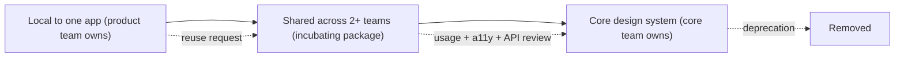
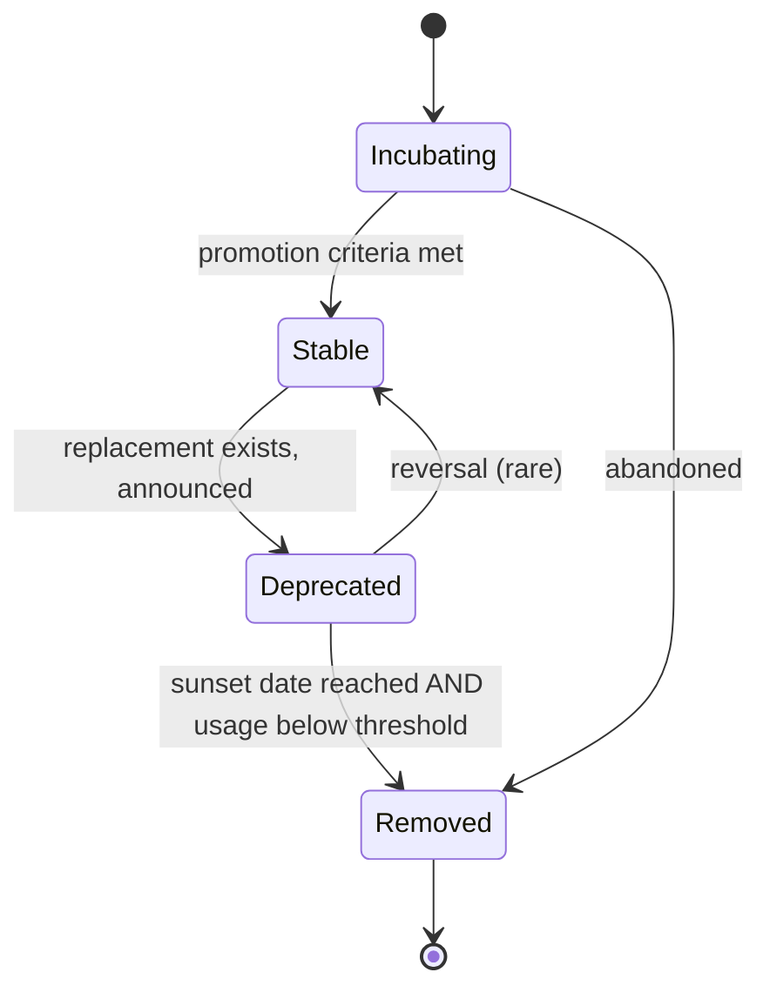
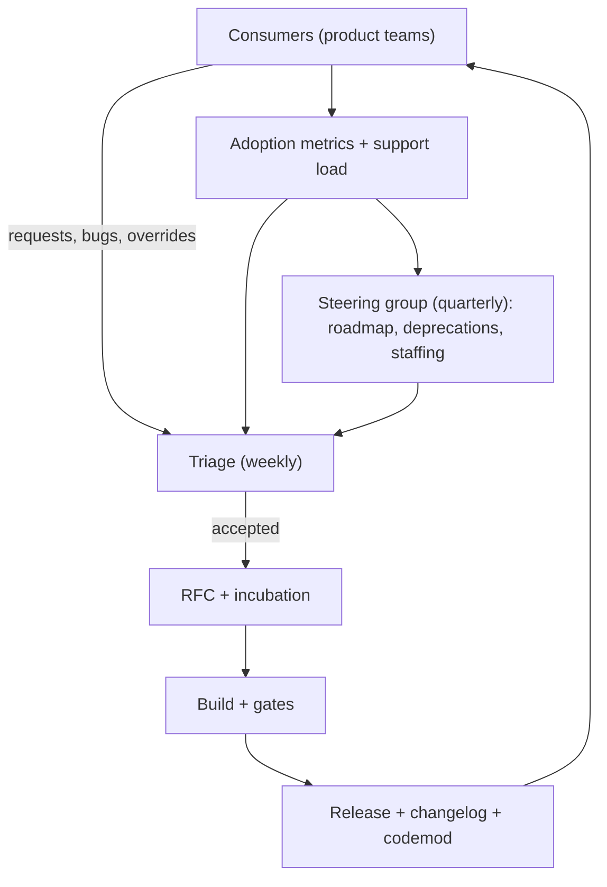

# 10 / 11 — Design System Governance: Ownership, Contribution, Versioning, and Adoption

## 1. Lesson metadata

| | |
|---|---|
| **Level** | Professional |
| **Study time** | 4–5 hours (reading 2 h, hands-on 1.5 h, exercises 1.5 h) |
| **Prerequisites** | [04 / 20 — Design systems](../04-react-architecture/20-design-systems.md), [04 / 21 — Component libraries](../04-react-architecture/21-component-libraries.md), [05 / 22 — Patterns for reusable libraries](../05-design-patterns/22-patterns-for-reusable-libraries.md), [08 / 11 — Component contract testing](../08-testing-and-quality/11-component-contract-testing.md), [08 / 12 — Visual regression](../08-testing-and-quality/12-visual-regression.md), [10 / 08 — Accessibility as architecture](./08-accessibility-as-architecture.md) |
| **Next** | [12 — Backward compatibility](./12-backward-compatibility.md) |
| **Related** | [04 / 23 — Multi-team ownership](../04-react-architecture/23-multi-team-ownership.md), [14 — Multi-team collaboration](./14-multi-team-collaboration.md), [15 — Technical debt](./15-technical-debt.md) |

**Learning objectives.** After this lesson you can:
1. Distinguish building a design system (a technical artifact) from governing one (a socio-technical process).
2. Choose an operating model (centralized, federated, hybrid) for a given organization and justify it.
3. Design a contribution workflow with explicit intake criteria, a promotion path, and service levels.
4. Define what is "public API" of a component library and version it accordingly.
5. Design a deprecation policy and measure adoption with data instead of anecdote.
6. Recognize governance failure modes: the bottleneck team, the zombie library, the fork-and-diverge pattern.

**Concepts covered:** operating models, ownership, contribution model, promotion path (local → shared → core), intake criteria, API surface, design tokens as contract, versioning policy, deprecation lifecycle, adoption metrics, escape hatches, governance cadence, RFC process, decision rights.

---

## 2. Deep conceptual explanation

### 2.1 What problem is this lesson solving?

Phase 4 taught you how to *build* a design system: tokens, primitives, composition, and packaging. Most design systems that fail do not fail because the Button is badly implemented. They fail because:

- A product team needs a variant the system does not offer, waits three weeks, and copies the component into their app instead.
- The system team ships a breaking change in a minor version and breaks forty applications on a Friday.
- Nobody knows whether anyone uses `LegacyDropdown`, so it can never be deleted.
- The library has seven date pickers, because each team that needed one contributed their own and nobody could say no.

All four are **governance** problems: who decides what enters the system, how change is communicated, how breakage is bounded, and how the system's value is demonstrated. Governance is the set of explicit decision rights, processes, and feedback loops that keep a shared component surface coherent as more teams depend on it.

### 2.2 A design system is a product with internal customers

A useful framing: the design system is an **internal product**. Its customers are product engineers and designers. Its "market" is voluntary, because teams can always write their own `<button>`. Therefore:

- **Adoption is earned**, not mandated. Mandates produce compliance (wrapping the component, then overriding everything), not value.
- **The roadmap is driven by customer problems**, but the product team has the final say on what is *coherent*.
- **Support is part of the job.** A system team that never talks to consumers builds the wrong things.

### 2.3 What exactly is governed?

| Layer | Examples | Typical change cost | Governance weight |
|---|---|---|---|
| **Design tokens** | color, spacing, typography, radius, motion scales | Very high: every consumer is affected | Heavy: design + engineering review, migration plan |
| **Primitives** | Box, Stack, Text, Icon, VisuallyHidden | High: used everywhere | Heavy |
| **Components** | Button, TextField, Dialog, Menu, DataTable | Medium to high | Medium: API review, a11y review, tests |
| **Patterns / templates** | Form layouts, empty states, page shells | Medium | Lighter, often documentation + recipes |
| **Guidelines** | Content style, a11y rules, motion principles | Low (docs) but high *behavioral* effect | Light process, but needs owner |
| **Tooling** | ESLint plugin, codemods, Figma kit, CLI | Variable | Same as code |

Tokens and primitives are the "constitutional" layer. Changing `space-4` from 16 px to 12 px is a visual refactor of every screen. The higher the layer's fan-out, the stronger the review.

### 2.4 Operating models

| Model | Description | Strengths | Weaknesses | Fits when |
|---|---|---|---|---|
| **Centralized (solitary)** | A dedicated team owns and builds everything. | Consistency, quality, clear accountability | Bottleneck; disconnected from product needs; scales poorly with number of teams | Few product teams (≲ 5–8), strong brand control needs |
| **Federated (distributed)** | Representatives from product teams contribute and co-own; there is a small steering group. | Scales; contributors understand real needs; shared ownership | Inconsistency risk; contributors have competing priorities; slow decisions | Many teams, mature engineering culture |
| **Hybrid (core + contributors)** | A small core team owns tokens, primitives, tooling, and review; product teams contribute components via an inner-source process. | Balance; the core protects coherence, contributors add capacity | Needs explicit contribution rules and review capacity | Most mid-to-large organizations |

These names are common industry vocabulary rather than a formal standard; the point is the *decision rights*, not the label. The key questions for any model:

1. Who can **merge** to the shared library?
2. Who **decides** that a new component belongs in the system?
3. Who **pays** for the maintenance of contributed components?
4. Who **responds** when a consumer reports a bug, and within what time?

If those four have no answer, you do not have a model; you have a repository.

### 2.5 The promotion path

A powerful pattern for avoiding both "the system never ships what we need" and "the system contains everything": a **promotion path**.



- **Stage 1: Local.** A product team builds what it needs in its own repo. No approval required. This keeps teams unblocked.
- **Stage 2: Incubating.** When a second team needs it, it moves to a clearly labelled shared location (an `@org/labs` or `experimental` entry point). Weaker guarantees: API may change in minor versions, and documentation says so.
- **Stage 3: Core.** After the component meets promotion criteria (API reviewed, accessibility verified, tokens-based styling, tests, docs, at least *N* consumers), it becomes a supported part of the stable API, and the core team owns its maintenance.

The "N consumers" rule is protective: the second use proves the abstraction is not accidental ([the rule of three](../05-design-patterns/02-dry-kiss-yagni.md) applied at organization scale).

### 2.6 Public API of a design system

What counts as public API determines what you can change without a major version. For a React component library, the following are all part of the observable contract whether you meant them to be or not:

- Component names and export paths.
- Props: names, types, defaults, and the **behavior** each one produces.
- Ref targets (what element does the ref point at?). In React 19 (sandbox-confirmed), `ref` is a regular prop for function components; the contract is still "which element or handle is exposed".
- The DOM structure and **accessibility semantics** (roles, labels, keyboard behavior) that consumers or tests depend on.
- CSS custom property names and token names, if they are documented or used for theming.
- Class names or `data-*` attributes if you advertise them as styling hooks.
- Peer dependency ranges (React version, TypeScript version).
- Side-effectful behavior: focus management, scroll lock, portal targets.

[Lesson 12](./12-backward-compatibility.md) treats compatibility in depth. For governance, the rule is: **write down the public surface**, and treat everything outside it as private (for example by using an `exports` map in `package.json` so deep imports are impossible, or by a documented `internal/` convention enforced with a lint rule).

### 2.7 Decision rights and the RFC

Larger changes (new component, token rename, breaking prop change) should go through a lightweight written proposal. An RFC (request for comments) is not bureaucracy for its own sake; it is how a distributed set of stakeholders gets to object *before* code is written. A pragmatic template:

1. **Problem and evidence** (screenshots, existing duplicates, support tickets).
2. **Proposed API** (TypeScript signature plus 2–3 usage examples).
3. **Alternatives considered** (including "do not add it to the system").
4. **Accessibility behavior** (keyboard map, ARIA pattern reference).
5. **Migration impact** (who changes what).
6. **Decision and date** (feeds into an [ADR](./16-architecture-decision-records.md)).

### 2.8 Common misconceptions

| Misconception | Reality |
|---|---|
| "A design system is a component library." | The library is one artifact. The system also includes tokens, guidelines, design assets, tooling, process, and people. |
| "Mandating adoption creates consistency." | It creates wrappers and overrides. Consistency comes from components that are *easier to use than to rebuild*. |
| "More components means a better system." | Surface area is liability: each component needs docs, tests, a11y, and maintenance forever. |
| "Breaking changes are bad, so never make them." | Never breaking means never improving. The goal is *predictable, tooled, communicated* breakage. |
| "Governance means a gatekeeping committee." | Good governance minimizes the situations where permission is required, and makes the remaining ones fast and transparent. |
| "Visual consistency is the goal." | The goal is productivity, accessibility, and coherence; consistency is a means. |

---

## 3. Internal mechanics

"Internal mechanics" here means the mechanics of the *distribution and enforcement machinery*, not React's internals.

### 3.1 Distribution

**Public guarantee (of the tooling you will likely use):**
- npm packages are versioned with [semantic versioning](https://semver.org/): MAJOR for incompatible API changes, MINOR for backward-compatible additions, PATCH for backward-compatible fixes. Semver is a *convention* that consumers rely on; the registry does not enforce it.
- `package.json` `exports` can restrict which subpaths consumers may import. Node and modern bundlers honor it; check your toolchain's documented support.
- `peerDependencies` declare the host React version; package managers warn (or error, depending on settings) on mismatch.

**Teaching model:** A change flows: *contributor PR → review gates → changeset (a recorded intent to release) → CI release → registry → consumers' automated update PRs → consumers' CI.* Every arrow is a place a governance policy can be implemented or fail.

**Implementation detail / tool-specific:** Tools such as Changesets ([github.com/changesets/changesets](https://github.com/changesets/changesets)) record per-PR release intent as Markdown files and compute version bumps and changelogs for monorepo packages. Other tools (semantic-release, release-please, Lerna, Nx release) take different approaches (commit-message driven vs file-driven). Evaluate against your needs; this lesson uses Changesets for illustration.

### 3.2 Automated gates as encoded policy

Policies that exist only in a wiki are not enforced. Encode them:

| Policy | Gate |
|---|---|
| Every component has accessible name handling | Automated a11y checks in stories/tests ([08 / 10](../08-testing-and-quality/10-accessibility-testing.md)) |
| Public API changes are intentional | API report diff (e.g., API Extractor-style report committed to the repo) fails CI when the exported surface changes without an acknowledged update |
| Visual changes are intentional | Visual regression snapshots require explicit approval ([08 / 12](../08-testing-and-quality/12-visual-regression.md)) |
| Breaking changes ship with migration support | Review checklist + changeset must declare "major" and link a codemod or guide |
| No deep imports | ESLint `no-restricted-imports` and package `exports` |
| Styling uses tokens | Stylelint/ESLint rule against raw hex colors in component CSS |
| Consumers do not use deprecated APIs | Lint rule in the shared ESLint plugin that flags deprecated imports |

⚠ Specific tool behavior (flag names, config keys) changes between versions; verify against each tool's current documentation.

### 3.3 Deprecation lifecycle as a state machine



A deprecation without a **replacement**, a **migration path** (ideally a codemod), a **date**, and a **usage metric** is a wish, not a policy.

### 3.4 Measuring adoption

You can only govern what you can see. Common data sources:

- **Static analysis over consumer repos**: scan imports of `@org/design-system` (AST-based, e.g., with a script using the TypeScript compiler API or jscodeshift in analysis mode). Output: component → usage count per repo.
- **Runtime telemetry (opt-in, careful)**: tag DOM nodes with a `data-ds-component` attribute (dev/staging or sampled) or report component mount counts. Privacy and performance costs apply; never include user data.
- **Package manager data**: which versions each app depends on (via lockfiles) shows version lag.
- **Design tool data**: library usage analytics in your design tool (availability depends on the tool and plan).

Beware of **vanity metrics**. "Number of imports" does not capture "how many one-off overrides sit on top of each component". A better health signal is the ratio of *consumers that override the component's styles with raw CSS* or *use escape hatches*.

---

## 4. Step-by-step execution walkthrough: a contribution from need to release

Scenario: the Payments team needs a `CurrencyInput`.

1. **Need identified.** The team searches the docs and component catalog; none exists. They check the "Open proposals" list to avoid duplication.
2. **Build locally** in their app (Stage 1). No approval needed; they ship their feature.
3. **Second consumer appears.** The Billing team has a similar need. Both teams file a **reuse request**: issue template links both implementations.
4. **Triage (core team, weekly).** The core team applies *intake criteria* (section 5.6): Is it generic? Does a primitive already cover it (e.g., `TextField` + `NumberFormat` composition)? Is there a design spec? Verdict: accepted into **incubating**.
5. **RFC.** A short proposal with the API:
   ```ts
   interface CurrencyInputProps {
     value: number | null;              // minor units (cents)
     onValueChange: (next: number | null) => void;
     currency: 'EUR' | 'USD' | 'GBP';
     locale?: string;
     // ...TextField label/description/error props via composition
   }
   ```
   Reviewers object to `number` for money (floating-point risk) and to `locale` defaulting to the browser's locale rather than the user's account locale. The RFC is amended: minor units as integer; locale required or taken from a provider. This is the cheapest moment to catch it.
6. **Implement in the incubating package** by contributors, with a core-team pairing session for a11y behavior (labelling, `inputMode`, announcing errors).
7. **Gates in CI**: unit and contract tests, a11y checks, visual snapshots, API report diff, bundle size check.
8. **Changeset** (`minor` for `@org/labs`), PR approved by one core reviewer and one contributor peer.
9. **Release.** CI publishes. A bot opens update PRs in consumer repos (e.g., Renovate or Dependabot configured for the scope).
10. **Promotion review** after N consumers and a stable API for M releases: moves to the core package, changelog notes the import path change with an alias re-export from the old path for one major cycle.
11. **Maintenance**: owner field in component metadata (a `CODEOWNERS` entry) keeps accountability after the original contributors move on.

---

## 5. Code examples

### 5.1 Minimal example: restricting the public surface

```jsonc
// packages/ds/package.json
{
  "name": "@acme/ds",
  "version": "4.2.0",
  "type": "module",
  "exports": {
    ".":            { "types": "./dist/index.d.ts",  "import": "./dist/index.js" },
    "./labs":       { "types": "./dist/labs.d.ts",   "import": "./dist/labs.js" },
    "./tokens.css": "./dist/tokens.css",
    "./package.json": "./package.json"
  },
  "peerDependencies": {
    "react": "^18.3.0 || ^19.0.0",
    "react-dom": "^18.3.0 || ^19.0.0"
  },
  "sideEffects": ["./dist/tokens.css"]
}
```

Notes:
- Consumers can import `@acme/ds`, `@acme/ds/labs`, and the tokens CSS. They *cannot* import `@acme/ds/dist/internal/focus-trap.js`. Whether a given bundler/tooling honors `exports` fully is worth verifying in your stack.
- `./labs` is the *incubating* entry point: its README states "no semver guarantees for minor releases".
- `peerDependencies` supports both React 18.3 and 19: the governance decision of "which React versions do we support?" is expressed here (see [12](./12-backward-compatibility.md)).

### 5.2 Practical example: a deprecation helper

```tsx
// packages/ds/src/internal/deprecate.ts
const warned = new Set<string>();

export function deprecated(
  id: string,
  message: string,
  { removeIn }: { removeIn: string }
): void {
  if (process.env.NODE_ENV === 'production') return;
  if (warned.has(id)) return;
  warned.add(id);
  console.warn(`[@acme/ds] ${id} is deprecated and will be removed in ${removeIn}. ${message}`);
}
```

```tsx
// packages/ds/src/Button.tsx
import type { ComponentPropsWithRef } from 'react';
import { deprecated } from './internal/deprecate';

type ButtonProps = ComponentPropsWithRef<'button'> & {
  variant?: 'primary' | 'secondary' | 'ghost';
  /** @deprecated Use `variant="ghost"`. Removed in v5. */
  link?: boolean;
};

export function Button({ variant = 'primary', link, ref, className, ...rest }: ButtonProps) {
  if (link) {
    deprecated('Button.link', 'Use variant="ghost" instead.', { removeIn: 'v5' });
  }
  const resolved = link ? 'ghost' : variant;
  return <button ref={ref} className={`ds-btn ds-btn--${resolved} ${className ?? ''}`} {...rest} />;
}
```

**Line notes.**
- `ComponentPropsWithRef<'button'>` includes `ref` as a prop. React 19 passes `ref` as a normal prop to function components, so no `forwardRef` is needed; in React 18 this typing pattern alone would not make `ref` reach the component, which is why a library supporting both ranges must decide how to expose refs (see [12](./12-backward-compatibility.md)).
- The JSDoc `@deprecated` tag surfaces a strikethrough in editors and enables lint rules (for example `@typescript-eslint/no-deprecated` in recent versions of typescript-eslint; verify the rule name in your version).
- The runtime warning is deduplicated and development-only to avoid log spam and production cost.
- Behavior is preserved: the old prop keeps working until the removal version.

**Predict:** If a page renders 500 `<Button link />` elements in development, how many warnings are logged? *One*, because of the `warned` set. (In React Strict Mode the double render does not matter for the same reason.)

### 5.3 Practical example: an adoption scanner

```ts
// tools/scan-usage.ts — run with tsx or ts-node against checked-out consumer repos
import { Project, SyntaxKind } from 'ts-morph';

const project = new Project({ tsConfigFilePath: process.argv[2] });
const counts = new Map<string, number>();

for (const file of project.getSourceFiles('src/**/*.{ts,tsx}')) {
  for (const imp of file.getImportDeclarations()) {
    const spec = imp.getModuleSpecifierValue();
    if (!spec.startsWith('@acme/ds')) continue;
    for (const named of imp.getNamedImports()) {
      const key = `${spec}#${named.getName()}`;
      counts.set(key, (counts.get(key) ?? 0) + 1);
    }
  }
}

const rows = [...counts.entries()].sort((a, b) => b[1] - a[1]);
console.table(rows.map(([name, uses]) => ({ name, uses })));
```

This counts **imports**, not JSX usages; counting `JsxOpeningElement`s whose tag resolves to the imported symbol is more precise (`file.getDescendantsOfKind(SyntaxKind.JsxOpeningElement)`), at the cost of more code. ts-morph is a popular wrapper around the TypeScript compiler API; any AST tool works. Run it in CI across consumer repos and publish a dashboard to drive deprecation decisions.

### 5.4 Incorrect example: governance by wiki

```md
## Contributing (wiki page, last edited 14 months ago)
- Talk to the design system team before adding components.
- Make sure it is accessible.
- Follow the style guide.
```

Why it fails: no intake criteria, no response SLA ("talk to us" has no queue), "accessible" is unverifiable, and nothing is enforced. Result: teams skip the step, and the system accumulates unvetted components or is bypassed.

### 5.5 Corrected: contribution policy as code + template

```md
<!-- .github/PULL_REQUEST_TEMPLATE/new-component.md -->
## Proposal
- RFC link: <required for new components>
- Existing consumers (min. 2 for promotion to core): <links>

## Checklist (CI enforces items marked [auto])
- [auto] Unit + contract tests pass
- [auto] No axe violations in all stories
- [auto] API report is up to date (`pnpm api:update` and commit)
- [auto] Visual snapshots reviewed
- [ ] Keyboard behavior documented against a reference pattern
- [ ] Uses tokens only (no raw colors/spacing)
- [ ] Docs page with do/don't and accessibility notes
- [ ] Changeset added (`patch` / `minor` / `major`) with migration notes if `major`
- [ ] Owner added to CODEOWNERS
```

```text
# CODEOWNERS (GitHub syntax)
/packages/ds/src/tokens/        @acme/ds-core
/packages/ds/src/primitives/    @acme/ds-core
/packages/ds/src/components/DataTable/   @acme/ds-core @acme/team-reporting
/packages/ds/src/labs/CurrencyInput/     @acme/team-payments
```

Trade-off: a heavier template slows trivial fixes. Provide a *second*, lighter template for bug fixes and docs. Governance should be proportional to blast radius.

### 5.6 Advanced: intake criteria as a scoring rubric

```ts
// docs/intake-rubric.ts (documented policy; also used by a triage script)
export interface Proposal {
  distinctConsumers: number;       // teams with a real need today
  hasDesignSpec: boolean;
  composableFromExisting: boolean; // can primitives + a recipe solve it?
  a11yPatternKnown: boolean;       // reference pattern exists (e.g., APG)
  maintenanceOwner: string | null;
}

export function triage(p: Proposal): 'reject' | 'recipe' | 'incubate' | 'defer' {
  if (p.composableFromExisting) return 'recipe';          // document a pattern, add no API
  if (!p.maintenanceOwner) return 'defer';                // no owner, no merge
  if (p.distinctConsumers < 2) return 'defer';            // wait for the second use
  if (!p.hasDesignSpec || !p.a11yPatternKnown) return 'defer';
  return 'incubate';
}
```

The point is not the code; it is that the questions are asked in the same order every time, which makes decisions explainable and less personal. `'reject'` exists in the type but is deliberately reached through human judgment, not the script.

---

## 6. Visual explanations

### 6.1 Governance feedback loop



### 6.2 Who decides what

```text
Decision                          | Core team | Contributor | Steering | Consumers
----------------------------------+-----------+-------------+----------+----------
Fix bug in existing component     |  decides  |  proposes   |    -     | reports
New component to incubating       |  decides  |  proposes   |  informed|   input
Promote incubating -> core        |  decides  |  proposes   |  informed|   input
Rename/remove a token             |  proposes |     -       |  decides |   input
Breaking change (major release)   |  proposes |     -       |  decides |   input
Staffing / roadmap priorities     |     input |     -       |  decides |   input
```

### 6.3 Model comparison (qualitative)

```text
                 consistency   throughput   coupling to product needs   bottleneck risk
centralized         high          low             low                        high
federated           medium        high            high                       low
hybrid              high          medium+         medium+                    medium
```

These are tendencies, not measurements. Your organization's culture and staffing may invert them.

---

## 7. Alternative approaches and trade-offs

| Criterion | Own design system (hybrid) | Adopt an open-source system (e.g., a headless library + your tokens) | Buy/adopt a full commercial/OSS themed library | No shared system (copy-paste/shadcn-style ownership) |
|---|---|---|---|---|
| Brand fit | High | High (you own styling) | Medium: theming limits | High |
| Time to first value | Slow | Medium | Fast | Fast |
| Maintenance cost | High (you own all) | Medium (a11y behavior outsourced) | Low-medium | Distributed; drift risk |
| Accessibility baseline | Your responsibility | Often strong in headless libs | Varies | Your responsibility per copy |
| Upgrade path | You control | Upstream cadence | Upstream cadence; possible breaking migrations | Manual per copy |
| Governance required | Full | Reduced (wrapper layer) | Minimal (version policy) | Conventions only |
| Consistency over time | High if governed | High | High | Low unless codified |

**Scenario where a full governed internal system is NOT best.** A twelve-person startup with one product team and a fast-changing brand. A shared system adds process overhead that exceeds its benefit. A single `components/` folder plus a few tokens, with the discipline to promote to a package only when a second app appears, is the better choice. Equally, a company with two apps built on different frameworks gains little from a React-only governance structure; framework-agnostic tokens and guidelines may be the right shared layer.

⚠ Open-source library capabilities and licensing change; evaluate current versions rather than relying on this table's generalities. See also [04 / 21](../04-react-architecture/21-component-libraries.md) and the later [build vs buy lesson](../11-senior-and-architect-mastery/14-build-vs-buy.md).

---

## 8. Best practices and anti-patterns

### 8.1 Best practices

- **Name an owner for every component** (a team, not a person). Unowned components rot.
- **Make the stable path the easiest path**: good docs, copy-pasteable examples, TypeScript autocompletion, codemods.
- **Publish a compatibility and support policy**: supported React versions, browsers, how long deprecated APIs live.
- **Version tokens explicitly** and ship a deprecation alias for renamed tokens for at least one major cycle.
- **Prefer composition over configuration**: a `Dialog` plus `Dialog.Title` and `Dialog.Footer` scales better than a `Dialog` with 25 props (see [05 / 05](../05-design-patterns/05-compound-components.md)).
- **Provide escape hatches deliberately**: `className`, `style`, `as`/polymorphic props, or headless primitives, with documented limits. A system without escape hatches gets forked.
- **Track support load** (questions per week) as a signal of API/documentation quality.
- **Run office hours and a public changelog**, and announce breaking changes in the channels consumers actually read.

### 8.2 Beginner mistakes

- Contributing a one-off, app-specific component "to the system" because it is convenient.
- Adding a prop for each new use case (boolean explosion: `primary`, `secondary`, `large`, `compact`, `withIcon`).
- Skipping the accessibility behavior ("we'll do keyboard support later").

### 8.3 Experienced-developer mistakes

- **Governance theater**: elaborate committees with no capacity to review quickly. Review latency above a few days drives teams around the system.
- **Premature abstraction**: promoting a component after one consumer; later consumers need different behavior and the API accumulates flags.
- **Breaking changes without codemods** for widely used APIs: the migration cost lands on every consumer.
- **Measuring success by adoption percentage alone**: 100% adoption of a poor system is not success.
- **Mixing product logic into the system** (fetching, business rules). The system should stay presentational plus interaction behavior ([04 / 04](../04-react-architecture/04-presentational-vs-container.md)).

### 8.4 Smells

- A component with more than ~15 props, many boolean.
- Consumers consistently wrap the same component the same way (the wrapper wants to be a variant).
- Multiple "v2" components living beside "v1" indefinitely.
- Support questions answered only in chat history, never in docs.
- A `!important`-heavy codebase overriding the system.

### 8.5 Justified exceptions

- **Fast-track path for urgent fixes**: security and critical a11y fixes bypass the weekly triage and go through an expedited review.
- **Strict centralization for tokens and primitives** even in a federated model, because their fan-out justifies it.
- **Forking a component deliberately** when a product has a legitimately unique interaction (a trading terminal grid). Document it, tag it with a debt marker ([15](./15-technical-debt.md)), and review it yearly.

---

## 9. Real-world application

**E-commerce (multi-brand).** One engineering team ships a storefront for three brands. Tokens are split into *primitive tokens* (raw scale) and *semantic tokens* (`color.action.primary`); each brand supplies a theme mapping. Governance question: who may add a semantic token? Answer: core team, via RFC, because a semantic token is a *contract* across brands.

**Finance dashboards.** Dense data tables, number formatting, and locale rules matter. The system includes `DataTable`, `Money`, and `Percent` components with formatting behavior owned by the design system, so there is one rule for negative numbers and currency symbols. Constraint: regulatory and auditing teams may require that numeric display is consistent across screens; governance must include a *content/format* owner, not just a UI owner.

**Multi-team enterprise.** Eight product teams, one hybrid system, a monorepo ([04 / 22](../04-react-architecture/22-monorepos-and-shared-packages.md)). Core team of four. A rotating "embedded contributor" from a product team spends one sprint per quarter on the core team, which builds empathy and distributes knowledge. A quarterly steering review decides deprecations using the adoption scanner's output.

**Forms and auth flows.** Shared `Form`, `Field`, and error-summary components encode accessibility behavior (focus on first error, `aria-describedby` linking). Constraint: any change to focus behavior is a *behavioral breaking change* even if no prop changes (see [12](./12-backward-compatibility.md)).

**Realtime/ops UIs.** Components for live-updating data (status badges, toast/announcement regions) need documented `aria-live` behavior, since consumers' integration choices (frequency of updates) can make an otherwise accessible component noisy. Guidance belongs in the system docs, not only in the code.

---

## 10. Debugging and troubleshooting

Treat governance failures like production bugs: observe symptoms, gather data, find the root cause, and validate the fix.

| Symptom | Likely root cause | Investigation | Fix | Validation |
|---|---|---|---|---|
| Teams keep forking Button | Missing variant or slow intake | Diff forks against the system version; check median time-to-response on requests | Add the variant or a documented composition recipe; cut triage latency | Fork count decreases; request latency metric |
| Major upgrade stalls in 15 apps | No codemod, large manual change | Survey blockers; look at the number of manual edits per app | Provide codemod + compat shim; pair with the three largest consumers | Version lag histogram shrinks |
| Visual regressions after "patch" release | Token/CSS change treated as non-breaking | Review changeset and snapshot diffs | Classify visual changes in the versioning policy; require snapshot approval | Fewer regressions per release |
| Nobody can delete `LegacyTable` | No usage data | Run the scanner across all repos | Deprecate with date; add lint rule; measure | Usage → 0, then removal |
| Contribution PRs sit for weeks | Review capacity < inflow | Review queue age distribution | Add reviewers, rotate duty, tighten intake, fast-track small fixes | Median PR age |
| Inconsistent focus behavior in modals | Several dialog implementations | Search consumer repos for `role="dialog"` | Migrate to the system `Dialog`, add lint rule | Zero custom dialogs |

**A concrete repro workflow for "the Button changed and broke us":**
1. Check which version the consumer resolved (`pnpm why @acme/ds` or lockfile).
2. Diff the published package versions (`npm pack` both and compare, or read the changelog).
3. Reproduce in Storybook with the old and new version side by side.
4. Decide: was the change correctly classified? If a documented behavior changed, the release was mis-versioned; publish a corrective release and tighten gates.

---

## 11. Exercises

### Level A — Knowledge
**A1.** List the four questions every operating model must answer.
**A2.** Why are tokens and primitives governed more strictly than patterns?
**A3.** What is a promotion path and what problem does it solve?
**A4.** Name five things beyond props that can be part of a component library's public contract.
**A5.** What must accompany a deprecation for it to be a policy and not a wish?

### Level B — Code comprehension
**B1.** In §5.2, what happens in production when `<Button link />` renders? Does the deprecation helper run?
**B2.** Given the `exports` map in §5.1, will `import x from '@acme/ds/dist/index.js'` work in a bundler that fully honors `exports`? Explain.
**B3.** The adoption scanner counts imports. Describe two ways its numbers can mislead.

### Level C — Implementation
**C1.** Write an ESLint-style `no-restricted-imports` configuration that forbids deep imports from `@acme/ds` except the documented entry points.
**C2.** Write a codemod (jscodeshift or ts-morph) that replaces `<Button link>` with `<Button variant="ghost">`, handling the case where `variant` is already present.

### Level D — Debugging
**D1.** After a minor release, a consumer's snapshot tests fail because `Dialog` now renders an extra wrapper `div`. The core team says "no props changed". Diagnose the governance gap and propose process changes.
**D2.** Adoption of the system is 95% by import count, yet designers say products look inconsistent. Give three hypotheses and how you would test each.

### Level E — Architecture decisions
**E1.** You are the first design system engineer at a 60-engineer company with 6 product teams, a mono-repo, and one designer per team. Choose an operating model and staffing. Justify and name what would make you change it.
**E2.** A product team insists on a custom date range picker with unusual behavior for their trading UI. Decide: accept into the system, incubate, or let them keep it local. Provide the decision criteria.

### Level F — Expert challenge
**F1.** Design a versioning and rollout strategy for renaming the token `color.text.default` → `color.text.primary` across 40 consuming apps with a 12-week window, including tooling, communication, measurement, and rollback.

---

## 12. Detailed answers and explanations

> Attempt the exercises first.

**A1.** (1) Who can merge to the shared library? (2) Who decides what belongs in the system? (3) Who pays for maintenance of contributed components? (4) Who responds to consumer issues and in what time frame? Common wrong answer: "tooling and repository layout". Those are implementation, not decision rights.

**A2.** Fan-out. A change to a token or primitive propagates to every component and consumer, so the blast radius and the migration cost are largest. Patterns/recipes are documentation and have low coupling; consumers can adopt or ignore them. A wrong plausible answer is "tokens are more important to designers"; importance is not the criterion, blast radius is.

**A3.** A staged route (local → incubating shared → core) with criteria for each step. It solves two opposite failure modes: the system being a bottleneck (teams can build locally without asking) and the system accumulating unvetted components (promotion requires a second consumer, API and a11y review, and an owner).

**A4.** Any five: DOM structure/semantics; keyboard and focus behavior; ref target; CSS custom property/token names; class names/`data-*` hooks if documented; peer dependency ranges; export paths; default values; event ordering; portal targets; SSR behavior (hydration-safe IDs).

**A5.** A replacement, a migration path (codemod/guide), a sunset date or version, and usage data showing the impact (plus ideally a lint warning). Without these, consumers cannot act and the maintainers cannot delete.

**B1.** In production, `deprecated()` returns immediately (`NODE_ENV === 'production'`), so no warning. The component still resolves `link` to `'ghost'` and renders normally. Edge: bundlers replace `process.env.NODE_ENV` statically, so the dev-only branch is removable by dead-code elimination; in libraries distributed as ESM, document how consumers' bundlers must handle `process.env.NODE_ENV`. ⚠ Some environments do not define it; check your tooling.

**B2.** No. `exports` defines allowed subpaths: `.`, `./labs`, `./tokens.css`, `./package.json`. `@acme/ds/dist/index.js` is not listed, so resolvers that honor `exports` will throw (for example Node reports a "not exported" error). Edge: tools that do not support `exports` (older bundlers, some type-checking `moduleResolution` modes) may still resolve it, which is why a lint rule is a useful second layer. TypeScript honors `exports` under `moduleResolution: "node16"`, `"nodenext"`, or `"bundler"`, but not under the legacy `"node"`/`"node10"` mode, so verify your consumers' settings.

**B3.** (1) Import count ≠ usage: one import used in 200 JSX elements counts as one; conversely, an imported but unused symbol counts. (2) It cannot show *how* the component is used (overrides, wrappers, `style` overrides), nor distinguish a deprecated prop within an imported component. Also: re-exports through app-local barrel files hide usage, and dynamic imports or `import * as DS` forms may be missed by naive scanners.

**C1.** Reference solution:
```jsonc
// .eslintrc (legacy format) — in flat config use the same rule with equivalent options
{
  "rules": {
    "no-restricted-imports": ["error", {
      "patterns": [{
        "group": ["@acme/ds/*", "!@acme/ds/labs", "!@acme/ds/tokens.css"],
        "message": "Import only from '@acme/ds' or '@acme/ds/labs'."
      }]
    }]
  }
}
```
The `group` option uses gitignore-style patterns including negation. Edge cases: `@acme/ds/dist/...` is caught by `@acme/ds/*` (the pattern matches nested paths in gitignore semantics, but verify against your ESLint version); CSS imports are not always visited by the rule depending on parser/config. Evaluation criteria: forbids deep imports, allows documented entries, provides a message.

**C2.** Reference with jscodeshift:
```ts
import type { API, FileInfo } from 'jscodeshift';

export default function transform(file: FileInfo, api: API) {
  const j = api.jscodeshift;
  const root = j(file.source);
  let changed = false;

  root.find(j.JSXOpeningElement, { name: { type: 'JSXIdentifier', name: 'Button' } })
    .forEach((path) => {
      const attrs = path.node.attributes ?? [];
      const linkIdx = attrs.findIndex(
        (a) => a.type === 'JSXAttribute' && a.name.name === 'link'
      );
      if (linkIdx === -1) return;
      const hasVariant = attrs.some(
        (a) => a.type === 'JSXAttribute' && a.name.name === 'variant'
      );
      attrs.splice(linkIdx, 1);
      if (!hasVariant) {
        attrs.push(j.jsxAttribute(j.jsxIdentifier('variant'), j.stringLiteral('ghost')));
      }
      changed = true;
    });

  return changed ? root.toSource() : undefined;
}
```
Edge cases: `link={cond}` (dynamic) should not be silently transformed (flag for manual review); spread props (`{...props}`) may carry `link`; the local name may be aliased (`import { Button as DsButton }`); a codemod should verify the import comes from `@acme/ds`. Evaluation: handles existing `variant`, preserves other attributes, skips unrelated `Button`s.

**D1.** Governance gap: DOM structure is part of the observable contract (snapshots, CSS selectors, tests using `container.firstChild`), but the release policy only considers props. Process changes: (1) define public contract to include semantics and documented DOM hooks, and explicitly exclude undocumented DOM structure; (2) add visual and DOM-structure snapshots in the library's own CI to surface changes; (3) tell consumers to test via roles and accessible names ([08 / 03](../08-testing-and-quality/03-react-testing-library.md)) instead of structure; (4) classify changes with a decision tree in the release checklist. Wrong answer: "consumer's tests are brittle, so no fault", which is partly true but ignores that a policy gap permits repeated incidents.

**D2.** Hypotheses: (a) consumers import the system but override styles heavily (test: count `className`/`style` overrides on system components, or compare computed styles against tokens); (b) hard-coded values outside the system (test: lint for raw hex/px values in app code); (c) multiple versions of the system in production (test: lockfile survey and runtime version tag); (d) designers' Figma kit drifted from code. Each one is verified with data, not opinions.

**E1.** Example well-reasoned answer: hybrid model. Core team of 2 engineers + 1 designer (or fractional), because a full centralized team of that size would be a bottleneck for six teams. Core owns tokens, primitives, tooling, release; product teams contribute via the incubating path with a 5-day review SLA. Quarterly steering of 1 lead per team. Revisit (change to federated) if the team count exceeds ~15 and review latency exceeds target; revisit (change to centralized) if contributions repeatedly fail quality gates. Evaluation criteria: ties staffing to scale; defines SLAs; names triggers for change; avoids both "build everything" and "no process".

**E2.** Criteria: number of distinct consumers (1 so far), generality of behavior, existence of a known accessible pattern, maintenance owner, and whether primitives can compose it. Recommended: keep local (Stage 1) with advice from the core team on accessibility and use of tokens; revisit when a second consumer appears. Justification: promoting a one-consumer, unusual-behavior component expands surface area for a single use. NOT best when: the date range pattern is a company-wide compliance need, in which case a core-led build is warranted.

**F1.** Reference outline: (1) Add `color.text.primary` as an alias to the same value, release as a **minor**; keep `color.text.default` as a deprecated alias (CSS custom property: `--color-text-default: var(--color-text-primary)`). (2) Ship a codemod/regex-safe script for CSS, TS theme objects, and Figma token sync. (3) Add a lint/stylelint rule warning on the old name; configure it as warning in week 1, error in week 8. (4) Communicate: announcement, migration guide, office hours, and a burn-down dashboard produced by scanning all 40 repos weekly. (5) Open automated PRs for repos that do not respond by week 4. (6) Removal in the next **major**, only when usage = 0 or the exceptions are signed off; extend the date if the metric is not met. (7) Rollback: because the old name remains an alias until removal, rollback is reverting a version, not rewriting consumers. Evaluation criteria: alias-first, tooling, metrics, explicit removal gate, no big-bang.

---

## 13. Senior engineer interview questions

1. **"How would you decide whether a request belongs in the design system?"** *Strong answer:* I ask whether it has at least two real consumers, whether it can be composed from existing primitives (then it becomes a documented recipe), whether a known accessible interaction pattern exists, and whether someone will own it. The causal reason: every component is a permanent maintenance and a11y commitment, so the cost of adding is paid for the system's life, while the cost of waiting for the second consumer is small.

2. **"Your system team gets 100 requests a quarter and has three engineers. What now?"** *Strong answer:* Triage by blast radius and number of consumers; move to a hybrid model with contribution paths; automate gates so reviews focus on API and design; publish recipes to turn components into documentation; track response time as an SLA. Mandating nothing, because bottleneck-driven teams fork.

3. **"What is a breaking change in a component library?"** Anything a consumer could reasonably depend on under the documented contract: props, behavior, accessibility semantics, token names, peer ranges, and in practice any change that fails consumer CI. The causal reasoning: semver is about *consumer breakage*, not code diff size. Discuss visual changes as a gray area requiring policy.

4. **"How do you retire a component used in 30 apps?"** Replacement, codemod, lint warning, sunset date, usage data, communicate, automated PRs, remove only when usage reaches the threshold, major version for the removal. Explain that dates without data create pressure without progress.

5. **"How do you prove the design system is worth its cost?"** Mix: adoption of key components, time-to-build for common screens (before/after), a11y defect rates, support load, and reduced duplicate implementations; qualitative feedback from teams. Acknowledge that attributing productivity is hard; use proxies and be explicit about them.

6. **"A team says the system's `Select` is too limited for them. Respond."** Investigate whether the limitation is a missing capability, documentation, or a legitimately different component (e.g., combobox with async search). Offer composition via headless primitives; escalate to RFC if general. Causal reasoning: overloading `Select` to handle all cases creates a prop-heavy, untestable component; sometimes the correct fix is a *different* component.

---

## 14. Further learning resources

| Resource | URL | Covers / why | Level | Study |
|---|---|---|---|---|
| Semantic Versioning 2.0.0 | <https://semver.org/> | The versioning convention consumers rely on | Beginner | Whole spec |
| Changesets | <https://github.com/changesets/changesets> | File-based release intent and changelogs in monorepos | Intermediate | README, "intro-to-using-changesets" |
| jscodeshift | <https://github.com/facebook/jscodeshift> | Codemod toolkit for migrations | Intermediate | README |
| GitHub Docs — About code owners | <https://docs.github.com/en/repositories/managing-your-repositorys-settings-and-features/customizing-your-repository/about-code-owners> | CODEOWNERS syntax and review enforcement | Beginner | Whole page |
| W3C WAI-ARIA Authoring Practices Guide | <https://www.w3.org/WAI/ARIA/apg/> | Reference keyboard/ARIA patterns for components | Intermediate | Patterns relevant to your components |
| Storybook docs | <https://storybook.js.org/docs> | Component workshop, docs, interaction and a11y testing | Beginner–Int. | Writing stories, testing |
| TypeScript — `@deprecated` JSDoc | <https://www.typescriptlang.org/docs/> *(search "deprecated" in the handbook/release notes; unverified)* | Editor support for deprecation | Intermediate | JSDoc reference |
| Node.js — package `exports` | <https://nodejs.org/api/packages.html> | Normative description of `exports`/conditions | Intermediate | "Package entry points" |

URLs in this table were checked for HTTP 200 on 2026-10-22; any still marked *(unverified)* could not be checked automatically (blocked or unreachable). A 200 response does not guarantee the page content still matches the description; if a link has moved, search the site for the quoted title.

---

## 15. Knowledge checkpoint

**You should now understand**
- That governance is decision rights + process + measurement, not tooling.
- The trade-offs among centralized, federated, and hybrid operating models.
- Why public API includes behavior, semantics, and tokens, not just props.
- The promotion path and deprecation lifecycle as explicit state machines.

**You should be able to explain without notes**
- How a contribution travels from local code to the core system.
- Why a deprecation requires replacement, tooling, date, and data.
- Why "adoption percentage" can be a misleading success metric.

**You should be able to implement**
- An `exports` map, a deprecation helper, a codemod, an import-restriction lint rule, and a usage scanner.

**You should be able to debug**
- Fork proliferation, stalled migrations, mis-versioned releases, and unremovable legacy components.

**Before moving on:** read [12 — Backward compatibility](./12-backward-compatibility.md), which formalizes the compatibility rules used throughout this lesson.
