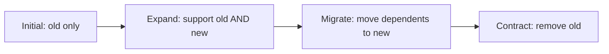
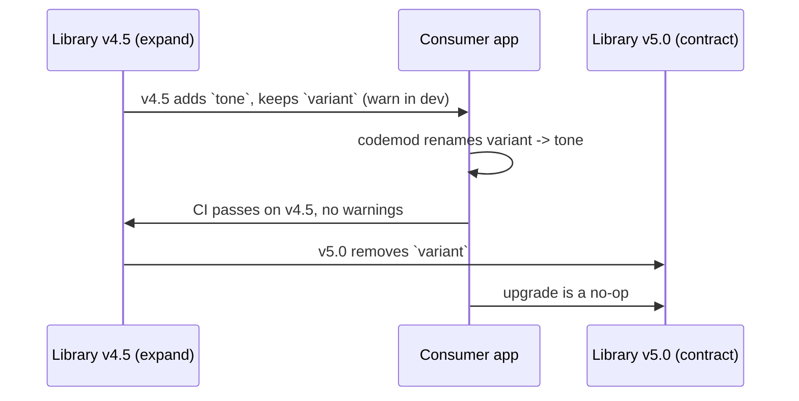
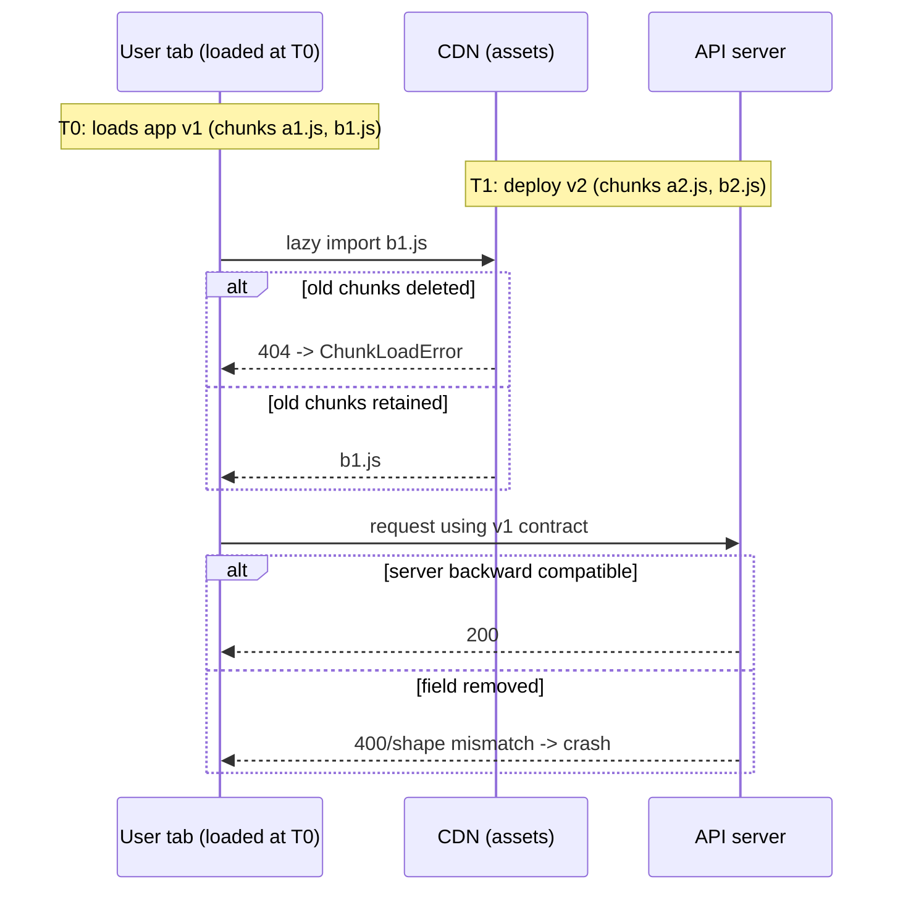

# 10 / 12 — Backward Compatibility: Evolving APIs, Packages, and Data Without Breaking Consumers

## 1. Lesson metadata

| | |
|---|---|
| **Level** | Professional |
| **Study time** | 4–5 hours (reading 2 h, hands-on 1.5 h, exercises 1.5 h) |
| **Prerequisites** | [11 — Design system governance](./11-design-system-governance.md), [05 / 22 — Patterns for reusable libraries](../05-design-patterns/22-patterns-for-reusable-libraries.md), [00 / 18 — TypeScript fundamentals](../00-web-and-javascript-foundations/18-typescript-fundamentals-and-narrowing.md), [00 / 10 — Modules and dependency graphs](../00-web-and-javascript-foundations/10-modules-and-dependency-graphs.md), [09 / 15 — React API changes across versions](../09-advanced-rendering-and-ecosystem/15-react-api-changes-across-versions.md) |
| **Next** | [13 — Application migrations](./13-application-migrations.md) |
| **Related** | [08 / 11 — Component contract testing](../08-testing-and-quality/11-component-contract-testing.md), [08 / 13 — TypeScript correctness](../08-testing-and-quality/13-typescript-correctness.md), [18 — Continuous delivery](./18-continuous-delivery.md) |

**Learning objectives.** After this lesson you can:
1. Define "breaking change" from the consumer's perspective, including type-level, behavioral, and semantic breakage.
2. Apply the *expand → migrate → contract* pattern to props, hooks, endpoints, storage formats, and URLs.
3. Design a library so it supports a range of React versions, and know where that stops being feasible.
4. Introduce deprecations with warnings, types, and codemods.
5. Evolve persisted client data (localStorage, IndexedDB, URL state) and API contracts without bricking returning users.
6. Handle deployment skew: users running old client code against a new server and vice versa.

**Concepts covered:** semantic versioning, API surface, source vs binary vs behavioral compatibility, type-level breaking changes, expand/contract, adapters and shims, deprecation, codemods, peer dependency ranges, feature detection, schema versioning and migrations of persisted state, deployment skew, tolerant reader, Hyrum's law.

---

## 2. Deep conceptual explanation

### 2.1 What problem is this lesson solving?

You will ship code that other code depends on. That "other code" might be another team's app, a plugin, a stored JSON blob in a user's browser from eight months ago, a mobile app version you cannot force-update, or a tab a user has had open since yesterday. **Backward compatibility is the discipline of changing a system so that existing dependents continue to work** (or break only in ways that are announced, tooled, and bounded).

In frontend engineering, compatibility appears in at least six places:

| Where | Dependent | Example breakage |
|---|---|---|
| Component/library API | Other teams' React code | A prop is renamed; a default changes |
| Hook/utility API | Other teams' code | `useCart()` now returns an object instead of a tuple |
| Network API | Your own client, other clients | Response field removed; enum gains a new value |
| Persisted client data | The same app, later | New code reads an old localStorage shape and crashes |
| URLs and deep links | Users, bookmarks, emails, other sites | A route is renamed and bookmarks 404 |
| Deployments | Old tabs vs new assets/server | Old tab requests a chunk hash that no longer exists |

### 2.2 What counts as "breaking"? Hyrum's law and consumer perspective

**Hyrum's law** (an observation by Hyrum Wright): with enough users of an API, it does not matter what you promise in the contract; all observable behaviors of your system will be depended on by somebody. In practice: define the *documented* contract, but know that undocumented behavior will leak into consumers, and decide per case whether to protect it.

Breaking changes come in layers:

| Kind | Meaning | Example (React library) | Detected by |
|---|---|---|---|
| **Source-incompatible (type-level)** | Consumer code no longer compiles | Prop type narrowed: `size: string` → `size: 'sm' \| 'md'` | `tsc` in consumer CI |
| **Runtime-incompatible** | Consumer code compiles but throws | Required context now missing; removed export that JS consumers import | Tests, runtime errors |
| **Behavioral** | Same inputs, different observable output | `onChange` now fires on blur instead of on each keystroke | Tests, QA, users |
| **Semantic / accessibility** | Meaning changes | Role or label changes; focus order changes | A11y tests, assistive tech users |
| **Visual** | Pixels change | Default padding changes | Visual regression |
| **Performance** | Cost changes | Component now renders twice as much | Profiling |
| **Operational** | Requirements change | Now requires React ≥ 19 or a new build config | Install failures |

Notice type-level changes can be *narrowing* (inputs) or *widening* (outputs). A useful rule: **widening what you accept is safe; narrowing what you accept is breaking. Narrowing what you return is safe; widening what you return is breaking** (because callers' code assumed the narrower type). The same rule applies to props (inputs, safe to widen), callbacks' parameters (outputs from the component to consumers; widening is breaking) and server responses.

```ts
// Safe (widens input):
function format(x: number): string          // v1
function format(x: number | bigint): string // v2

// Breaking (widens output): callers assumed string
function getLabel(): string                  // v1
function getLabel(): string | undefined      // v2

// Callback props: the library CALLS the consumer's function.
interface Props { onSelect: (id: string) => void }              // v1
interface Props { onSelect: (id: string, meta: Meta) => void }  // v2
// A consumer's `(id: string) => void` is still assignable to v2's type,
// because a function that accepts fewer parameters can stand in for one that
// is called with more. So adding a trailing argument to a callback you invoke
// is source-compatible. Removing an argument the consumer reads is breaking.
```

### 2.3 Semantic versioning as a communication protocol

[Semantic Versioning](https://semver.org/) says: increment MAJOR for incompatible API changes, MINOR for backward-compatible functionality, PATCH for backward-compatible bug fixes. Three practical caveats:

1. **Semver is a promise by the publisher, not a guarantee.** A tool cannot fully verify it. Type-level API diffing tools and contract tests help.
2. **Bug fixes can break consumers** relying on the buggy behavior (Hyrum's law). Decide whether to treat that as a patch (and accept some breakage) or hold it for a major.
3. **0.x versions** carry no stability guarantee under the spec: "anything MAY change at any time". Many packages still use a convention; read the project's policy.

### 2.4 The expand → migrate → contract pattern

Also called *parallel change*. The only safe way to change something with unknown dependents.



1. **Expand.** Add the new form alongside the old. Both work. Ship.
2. **Migrate.** Move all dependents to the new form (codemods, PRs, deprecation warnings, metrics).
3. **Contract.** Remove the old form once usage is zero or the support window ended. Ship (a MAJOR for a library).

The pattern applies identically to: a prop rename, a database column rename (server), an API field rename, a localStorage key change, a route rename, a CSS token rename ([11](./11-design-system-governance.md)), and a feature flag cleanup ([15](./15-technical-debt.md)).

### 2.5 React-specific compatibility surfaces

**Supporting multiple React versions.** A library declares `peerDependencies` for `react` and `react-dom`. Choices:

| Strategy | Meaning | Trade-off |
|---|---|---|
| **Support latest only** | Peer `^19.0.0` | Simplest code; excludes consumers still on 18 |
| **Support N and N-1** | Peer `^18.3.0 \|\| ^19.0.0` | Code must work in both; limits use of new APIs |
| **Dual builds / conditional exports** | Different entry for different versions | Maintenance doubles |
| **Feature detection** | Runtime check for API availability | Fragile if overused |

Concrete API differences (checked against react-dom 19.3.1 in the sandbox and react.dev; see [09 / 15](../09-advanced-rendering-and-ecosystem/15-react-api-changes-across-versions.md)):
- In React 19, **`ref` can be passed as a regular prop** to function components, and `forwardRef` is no longer necessary (it still works for now, with react.dev's `forwardRef` page says "`forwardRef` will be deprecated in a future release"). In React 18, function components do not receive `ref` as a prop; a library supporting both must keep `forwardRef` (which works in both) or ship version-specific builds.
- `use`, `useActionState`, `useOptimistic`, `useFormStatus` are available in React 19 (and in canary channels before). A library that imports them breaks on React 18 at import or call time. Feature-detect by `typeof React.use === 'function'` only at module boundaries and with a documented fallback, or keep these in clearly marked 19-only entry points.
- `defaultProps` on function components is removed in React 19 (class components keep it); use default parameter values. Sandbox check: with the JSX runtime (`jsx()` from `react/jsx-runtime`) a function component's `defaultProps` is ignored (`<i>undefined</i>`), while the same component created via `React.createElement` still received the default, so mixed old/new JSX transforms can behave differently; class `defaultProps` still works. Prop-types checks were also removed in 19 in favor of TypeScript.
- Legacy APIs: `ReactDOM.render` and `ReactDOM.hydrate` were removed in 19 in favor of `createRoot`/`hydrateRoot`. A library calling them directly (testing helpers, portals, embedded widgets) breaks.
- Types: `@types/react` versions change types (for example, how `ref` and `children` are typed, `JSX` namespace location). Pin and test with the oldest and newest supported type versions.

A good practice is a **compatibility matrix in CI**: test the library against the minimum and maximum supported React and TypeScript versions (and a canary if you wish).

### 2.6 Persisted data is an API with a very long tail

Anything persisted outlives the code that wrote it: `localStorage`, `IndexedDB`, cookies, service worker caches, URL parameters, serialized form drafts, offline queues ([06 / 16](../06-data-fetching-and-state-ecosystems/16-offline-considerations.md)). Your new code must be prepared to read **every shape any previous version wrote** (or detect and discard it safely).

Rules:
1. **Version the schema** in the payload (`{ v: 2, data: ... }`).
2. **Validate on read** with a runtime schema (never trust `JSON.parse` output; TypeScript types are erased).
3. **Migrate forward** step by step (v1→v2→v3), idempotently.
4. **Failing is not crashing**: on invalid or future-version data, fall back to defaults and (optionally) report telemetry. A user must never be locked out by corrupt local state.
5. **Be careful with downgrades**: a rollback of your deployment means old code may read data written by new code ([18](./18-continuous-delivery.md)). Prefer expand/contract for storage too: write both formats for a window, or keep the new format readable by old code.

### 2.7 Network contracts and the tolerant reader

For client↔server contracts you often control both ends, but not their *deployment times*. The robust-client rule, the **tolerant reader**: ignore unknown fields, treat unknown enum values as a defined "unknown" case, make new fields optional until all servers send them.

```ts
type OrderStatus = 'pending' | 'paid' | 'shipped' | 'cancelled';

function statusLabel(s: string): string {
  switch (s as OrderStatus) {
    case 'pending': return 'Pending';
    case 'paid': return 'Paid';
    case 'shipped': return 'Shipped';
    case 'cancelled': return 'Cancelled';
    default: return 'Processing'; // server added 'refunded' last week — do not crash
  }
}
```

Servers, for their part: **adding fields is safe; removing/renaming or changing types is not; adding a new enum value is only safe if clients are tolerant**. Document this as part of your API policy. Consider versioned endpoints or additive-only evolution (the GraphQL community popularized "never remove, deprecate" fields via the `@deprecated` directive; REST APIs often use URL or header versioning).

### 2.8 Deployment skew

When you deploy, three things differ in time:
- The **HTML** a user already loaded (may be cached or a long-lived tab).
- The **JS/CSS assets** the old HTML references (content-hashed filenames).
- The **server/API** now running new code.

Failure modes: (1) old tab requests a lazy chunk that no longer exists (404 on `import()`), (2) old client calls a removed endpoint, (3) new client reads an API field the old server cluster node does not yet return (during rolling deploys). Mitigations: keep old assets for a retention window, handle chunk-load errors with a reload prompt ([10 / 10 — Resilience](./10-resilience-and-degradation.md)), keep APIs backward compatible for at least the maximum client lifetime, include a client version header to let the server detect very old clients, and make deployment ordering explicit (typically: server first with additive changes, then client, then cleanup).

### 2.9 Common misconceptions

| Misconception | Reality |
|---|---|
| "If TypeScript compiles, it's compatible." | Behavioral, runtime, accessibility, and persisted-data compatibility are invisible to the compiler. |
| "Patch releases are always safe." | A fix changes behavior; someone depended on it. Treat risky fixes with care. |
| "We control all consumers, so we can break freely." | You control them at *different times*. In monorepos, atomic changes help, but deployments still skew. |
| "Deprecated means it will go away soon." | Deprecated means "do not use in new code"; removal needs a plan and a date. |
| "Versioning the API means we never need to think about compatibility." | Versioned APIs just move the cost: you now support multiple versions. |
| "Adding an enum value is non-breaking." | It breaks exhaustive switches and consumers that assume a closed set. |

---

## 3. Internal mechanics

### 3.1 How TypeScript decides assignability (the type-level model)

**Public guarantee:** TypeScript is *structurally* typed: type `A` is assignable to `B` if `A` has at least the members `B` requires with compatible types. Function parameter types are compared according to the `strictFunctionTypes` flag (contravariantly for function-type properties declared with property syntax, bivariantly for method syntax). **Consequence for library design:** declaring callback props as *properties* (`onChange: (v: string) => void`) vs *methods* (`onChange(v: string): void`) changes how strictly consumers' handlers are checked. Choose deliberately, and note that changing between them can be breaking.

**Teaching model for API evolution in types:**

| Change | Input position (props you receive) | Output position (values you return / callback arguments you pass) |
|---|---|---|
| Add optional member | Safe | Safe (consumers ignore it) except for exhaustive/spread handling of the object |
| Add required member | **Breaking** | Safe |
| Remove member | Safe (consumers pass extra: but excess property checks on object literals may error) | **Breaking** |
| Widen type | Safe | **Breaking** |
| Narrow type | **Breaking** | Safe |
| Make optional → required | **Breaking** | n/a |
| Rename | **Breaking** both | **Breaking** both |

**Implementation detail:** excess property checks apply only to fresh object literals; a consumer that passes a variable with extra props is unaffected, while a literal with the removed prop errors. So "removing an optional prop" can produce compile errors in some call sites and not others.

### 3.2 How a bundler/package manager resolves a library's React

When a library lists `react` in `peerDependencies`, the package manager tries to use the *consumer's* single copy. If a library bundles or installs its own React in `dependencies`, the app can end up with **two copies of React**, causing "Invalid hook call" errors because hooks rely on a dispatcher set by the renderer instance that is rendering ([Phase 3 — rules of hooks](../03-react-state-and-hooks/16-rules-of-hooks-and-composition.md)). Peer dependencies, externalization in the library's build, and deduplication in the consumer are the compatibility mechanics here. ⚠ The hook-dispatcher explanation is conceptual; React's internal naming has changed across versions, so verify in the source if you need specifics ([02 / 31](../02-react-rendering-and-internals/31-reading-react-source.md)).

### 3.3 The compatibility timeline for a prop rename



### 3.4 Deprecation signals, ordered by strength

1. Documentation and changelog entry.
2. TypeScript `@deprecated` JSDoc (editor strikethrough; lint rules can escalate).
3. Development-only console warning (once per usage site/ID).
4. Lint error in the shared ESLint config.
5. Runtime telemetry on usage in production (careful with overhead/privacy).
6. Removal in a MAJOR.

---

## 4. Step-by-step execution walkthrough: renaming a prop and a storage key safely

Scenario: your `@acme/ds` `Button` has `variant="primary|secondary|link"`. You want `tone` with a different value set, and the app persists a user's "compact mode" under `localStorage['compact']`, to be renamed `ui.prefs`.

1. **Decide the public contract.** Is `variant` documented? Yes. So rename = breaking = needs expand/contract.
2. **Expand (library v4.5.0, MINOR).** Support both `variant` and `tone`; `tone` wins if both given; log a dev warning for `variant`. Add `@deprecated` JSDoc. Provide a codemod.
3. **Publish the migration guide**, changelog, and announce.
4. **Measure.** Run the usage scanner ([11](./11-design-system-governance.md)) weekly: number of `variant` usages per app.
5. **Migrate.** Apps run the codemod; CI shows no deprecation warnings.
6. **Contract (v5.0.0, MAJOR).** Remove `variant`. Release notes link the guide. Usage was zero (or exceptions signed off).

For the storage key, apps do their own expand/contract in app code:
1. New code reads `ui.prefs` first; if absent, reads `compact`, converts, writes `ui.prefs` (keeps `compact` for a release in case of rollback).
2. Two releases later (after the rollback window) stop writing `compact`.
3. After the maximum plausible return time of a user (consider monthly users), delete `compact` reading logic. Persisted keys outlive code by the user's absence time, not by your release cycle.

---

## 5. Code examples

### 5.1 Minimal example: accepting old and new props

```tsx
import type { ComponentPropsWithRef } from 'react';

type Tone = 'primary' | 'secondary' | 'ghost';

type ButtonProps = Omit<ComponentPropsWithRef<'button'>, 'color'> & {
  tone?: Tone;
  /** @deprecated Use `tone`. `'link'` maps to `'ghost'`. Removed in v5. */
  variant?: Tone | 'link';
};

const warned = new Set<string>();
function warnOnce(key: string, msg: string) {
  if (process.env.NODE_ENV !== 'production' && !warned.has(key)) {
    warned.add(key);
    console.warn(msg);
  }
}

export function Button({ tone, variant, ref, ...rest }: ButtonProps) {
  if (variant !== undefined) warnOnce('Button.variant', '`variant` is deprecated; use `tone`.');
  const legacy = variant === 'link' ? 'ghost' : variant;
  const resolved: Tone = tone ?? legacy ?? 'primary';
  return <button ref={ref} data-tone={resolved} {...rest} />;
}
```

**Line notes.** `tone ?? legacy ?? 'primary'` establishes precedence (new beats old, default last). `Omit<..., 'color'>` is unrelated to the migration; note that `ComponentPropsWithRef<'button'>` has a `color` attribute from HTML types that you might not want to expose: a type-level API decision. `ref` is destructured as a prop, which is valid in React 19 function components (confirmed in the sandbox); for React 18 consumers see §5.4.

### 5.2 Practical example: versioned persisted state with validation and migration

```ts
import { z } from 'zod'; // any runtime validator works; zod is one common choice

const PrefsV1 = z.object({ v: z.literal(1), compact: z.boolean() });
const PrefsV2 = z.object({
  v: z.literal(2),
  density: z.enum(['comfortable', 'compact']),
  theme: z.enum(['light', 'dark', 'system']).default('system'),
});
export type Prefs = z.infer<typeof PrefsV2>;

const DEFAULTS: Prefs = { v: 2, density: 'comfortable', theme: 'system' };
const KEY = 'ui.prefs';

function migrate(raw: unknown): Prefs {
  const v1 = PrefsV1.safeParse(raw);
  if (v1.success) {
    return { v: 2, density: v1.data.compact ? 'compact' : 'comfortable', theme: 'system' };
  }
  const v2 = PrefsV2.safeParse(raw);
  if (v2.success) return v2.data;
  return DEFAULTS; // unknown, corrupt, or from the future: never crash
}

export function loadPrefs(): Prefs {
  try {
    const text = window.localStorage.getItem(KEY);
    if (text === null) return DEFAULTS;
    return migrate(JSON.parse(text));
  } catch {
    // storage blocked (privacy mode), quota, or invalid JSON
    return DEFAULTS;
  }
}

export function savePrefs(p: Prefs): void {
  try {
    window.localStorage.setItem(KEY, JSON.stringify(p));
  } catch {
    /* ignore: preferences are best-effort */
  }
}
```

**Why.** `JSON.parse` returns `any`: types are erased. Validation at the boundary is the compatibility mechanism. Two `try/catch` points: storage access can throw (blocked storage, quota), and parsing can throw.

**Trade-offs.** Zod adds bundle weight; for a handful of fields a hand-written guard is fine. When data matters (offline queues), prefer a robust validator and telemetry on migration failures.

**Predict:** A user on a *newer* app version (v3 data, `v: 3`) rolls back to this code. What does it return? `DEFAULTS`: neither schema matches, so their preferences are silently reset. If preserving them matters, keep forward-compatible writes (e.g., unknown keys preserved, or a `v3` that is a superset readable by v2 code) or do not delete `v2` data until safe.

### 5.3 Practical: tolerant reader for API responses with exhaustive-safe typing

```ts
const KNOWN_STATUSES = ['pending', 'paid', 'shipped', 'cancelled'] as const;
type KnownStatus = (typeof KNOWN_STATUSES)[number];
type Status = KnownStatus | { unknown: string };

function parseStatus(s: string): Status {
  return (KNOWN_STATUSES as readonly string[]).includes(s)
    ? (s as KnownStatus)
    : { unknown: s };
}

function label(s: Status): string {
  if (typeof s === 'string') {
    switch (s) {
      case 'pending': return 'Pending';
      case 'paid': return 'Paid';
      case 'shipped': return 'Shipped';
      case 'cancelled': return 'Cancelled';
    }
  }
  return 'Processing'; // unknown future status
}
```

Models "unknown" as a first-class state so the compiler forces you to handle it everywhere the status is consumed ([00 / 19 — discriminated unions](../00-web-and-javascript-foundations/19-typescript-generics-and-utility-types.md)).

### 5.4 Advanced: one library supporting React 18 and 19 for `ref`

```tsx
// Works on React 18.3 and 19: forwardRef is supported in both (react.dev: `forwardRef` "will be deprecated in a future release").
import { forwardRef, useId, type ComponentPropsWithoutRef } from 'react';

type InputProps = ComponentPropsWithoutRef<'input'> & { label: string };

export const TextField = forwardRef<HTMLInputElement, InputProps>(function TextField(
  { label, id, ...rest },
  ref
) {
  const autoId = useId();                  // useId exists in React 18+
  const inputId = id ?? autoId;
  return (
    <div>
      <label htmlFor={inputId}>{label}</label>
      <input id={inputId} ref={ref} {...rest} />
    </div>
  );
});
```

Trade-off: `forwardRef` wrapper types and DevTools names differ from plain function components; a 19-only library should drop it for simplicity. The decision belongs in the library's support policy.
### 5.5 Incorrect example: breaking silently

```tsx
// v2.3.0 (labelled MINOR)
// Before: <Tabs onChange={(index: number) => ...} />
// After:
export function Tabs({ onChange }: { onChange: (id: string) => void }) { /* ... */ }
```

Result: JS consumers get a string where they expected a number, TS consumers get compile errors, and the release notes call it a "improvement". Wrong classification (it is MAJOR), no expand step, no codemod.

### 5.6 Corrected: expand with a new prop, keep the old behavior

```tsx
type TabsProps = {
  /** @deprecated Use `onValueChange`. Receives the tab index. Removed in v3. */
  onChange?: (index: number) => void;
  onValueChange?: (id: string) => void;
  tabs: readonly { id: string; label: string }[];
};

export function Tabs({ onChange, onValueChange, tabs }: TabsProps) {
  function select(i: number) {
    onValueChange?.(tabs[i].id);
    if (onChange) {
      warnOnce('Tabs.onChange', '`onChange` is deprecated; use `onValueChange`.');
      onChange(i);
    }
  }
  return (
    <div role="tablist">
      {tabs.map((t, i) => (
        <button key={t.id} role="tab" onClick={() => select(i)}>{t.label}</button>
      ))}
    </div>
  );
}
```

Both callbacks fire if both are provided (document the rule). MINOR is correct here; the removal waits for the MAJOR.

---

## 6. Visual explanations

### 6.1 Deployment skew timeline



### 6.2 Safe change ordering for a field rename (server + client)

```text
1. Server: add NEW field, keep OLD (both populated)     [additive, safe]
2. Client: read NEW if present, else OLD                  [tolerant]
3. Deploy client everywhere; wait for old clients to age out
4. Server: stop sending OLD                              [contract]
5. Client: remove OLD fallback                           [cleanup]
```

### 6.3 Compatibility matrix for CI

```text
            React 18.3   React 19.x   (canary)
TS 5.4         ✓            ✓           allowed-to-fail
TS latest      ✓            ✓           allowed-to-fail
Browsers: last 2 evergreen + Safari N-1 (per policy)
```

---

## 7. Alternative approaches and trade-offs

| Criterion | Expand/contract in same major | Versioned entry points (`/v2`) | Dual packages (`pkg@1`, `pkg@2` side by side) | Big-bang major with codemod | Adapter/shim layer |
|---|---|---|---|---|---|
| Consumer effort | Low, gradual | Medium: choose per import | Medium | One-time, tool-assisted | Low |
| Maintainer effort | Medium (support both temporarily) | High (maintain parallel code) | High | Low after migration | Medium; shim lives forever if not removed |
| Risk of long-term cruft | Medium | High | High | Low | High |
| Works for persisted data | Yes | Rarely | No | Hard (needs migration step) | Yes |
| Suited for | Prop/API renames | Fundamentally different APIs | Very large ecosystems | Internal monorepo with strong tooling | Third-party/legacy boundaries |

**Scenario where expand/contract is NOT best.** In a monorepo where you own every consumer and can land an atomic change with a codemod and run all tests in one CI run, the expand phase is unnecessary overhead. Rename everywhere in one PR. (The *deployment* skew for apps deployed independently still requires care for network/persistence contracts, but not for compile-time library APIs consumed at build time.)

**Scenario where strict compatibility is NOT worth it.** Experimental/incubating APIs explicitly labelled as such ([11](./11-design-system-governance.md)); internal APIs with a single consumer; security fixes where the old behavior is the vulnerability. Say so in the policy.

---

## 8. Best practices and anti-patterns

### 8.1 Best practices
- Publish a **compatibility policy**: what is public API, supported React/TS/browser versions, deprecation period, and how breaking changes are communicated.
- Run **API surface diff** in CI (for example API Extractor reports, or snapshot of `.d.ts` exports) so accidental type-level changes are visible.
- Test the library against its **minimum and maximum** supported peer versions.
- **Validate everything that crosses time**: storage, URLs, API responses, messages between tabs/iframes (`postMessage`).
- Use **additive** changes by default: new optional props, new endpoints, new fields.
- Treat **URLs as public API**: keep redirects for renamed routes ([04 / 18](../04-react-architecture/18-routing-architecture.md)).
- Keep **old static assets** for a retention window after deploys and give the client a graceful chunk-load failure path.
- Ship **codemods** for anything affecting more than a handful of call sites.

### 8.2 Beginner mistakes
- Renaming props "because the name is better" in a patch release.
- Trusting `JSON.parse(localStorage.getItem(...)) as Prefs`.
- Assuming a single deployment moment.

### 8.3 Experienced-developer mistakes
- Over-engineering: supporting six majors back with shims that nobody uses.
- Keeping deprecated paths forever; each doubles the test matrix.
- Not versioning *behavior* (focus, event timing) because it is not in the types.
- Changing defaults (e.g., `type="button"` vs submit) as a "fix".

### 8.4 Smells
- Changelogs saying "minor tweaks" with 40 changed files.
- Consumers pin exact versions of your library "to be safe".
- `// TODO remove after migration` comments older than a year.
- `any` at module boundaries (storage, network) to "get it working".

### 8.5 Justified exceptions
- Security and legal fixes can break compatibility immediately (communicate loudly).
- If a library is pre-1.0 and clearly labelled, fast change is acceptable.
- Abandoning compatibility with ancient browsers/React versions is legitimate if stated in policy; compatibility is bounded by *support policy*, not infinity.

---

## 9. Real-world application

**E-commerce.** Carts persist across sessions (localStorage or server). A cart schema change must not drop items. Because a promotional email may link into a deep route for months, renamed routes need redirects. Constraint: marketing URLs are an external contract.

**Dashboards.** Saved views/filters stored by users in the backend or URL. When you rename a filter parameter, saved links and scheduled reports break silently. Add parsing that accepts legacy param names and canonicalizes via redirect.

**Finance/regulated.** Calculations and formatting must be consistent; a "bug fix" to rounding changes reported numbers. Version behavior explicitly, communicate to stakeholders, and keep audit trails that record which version computed a number.

**Forms.** Draft autosave in IndexedDB; schema changes to a form (field renamed, step added) must migrate drafts or discard with user-friendly notice. Do not silently submit a mismatched draft.

**Auth.** Token and session shapes in storage; a change that invalidates sessions logs everybody out. Plan forced logouts deliberately and communicate them. See [09 / 12 — Auth boundaries](../09-advanced-rendering-and-ecosystem/12-auth-boundaries.md).

**Multi-team platforms and micro-frontends.** Shared events/contracts between independently deployed bundles must be backward compatible by construction; use explicit versions in message payloads.

**Realtime.** WebSocket message formats evolve; servers may need to serve old and new clients simultaneously. Include a protocol version in the handshake ([06 / 17](../06-data-fetching-and-state-ecosystems/17-real-time-websockets-subscriptions.md)).

---

## 10. Debugging and troubleshooting

| Symptom | Reproduction | Investigation | Root cause | Validation of fix |
|---|---|---|---|---|
| White screen only for returning users | Use an old browser profile / seed `localStorage` with old shape | DevTools → Application → Local Storage; error stack shows `undefined.map` | New code assumes new shape; no validation | Test with fixture payloads for each historical version |
| `Loading chunk X failed` after deploy | Open app, deploy, then navigate to a lazy route | DevTools → Network: 404 for the old chunk URL | Old assets purged; no recovery | Keep old assets N days; add reload-on-chunk-error with guard |
| "Invalid hook call" after upgrading a UI library | `npm ls react` shows two versions | Compare `react` identity in both bundles; check the library's deps | React duplicated (library has `react` in `dependencies`, or lockfile conflict) | Single React in `npm ls`; hooks work |
| TypeScript errors only in some apps after a MINOR | Compile consumer repo against new version | Read `tsc` error: "Property X is missing" | Required prop added or union narrowed | API diff in CI; reclassify as MAJOR |
| Behavior differs in prod vs dev for deprecated prop | Build with `NODE_ENV=production` | Warnings invisible in prod, behavior mapped differently | Different code path for dev warnings | Same logic path in both; warnings only side effects |
| Old mobile webview crashes on new API field | Mock old client against new server | Server logs with client version header | Client not tolerant to unknown enum | Tolerant reader + server compatibility tests with old client fixtures |

**Validation technique: contract fixtures.** Keep a folder of real payloads from each historical version (`fixtures/prefs.v1.json`, `fixtures/order.2024-03.json`), and a test that every fixture loads and migrates. Add a new fixture whenever the schema changes.

---

## 11. Exercises

### Level A — Knowledge
**A1.** List five kinds of breaking change beyond "the TypeScript no longer compiles".
**A2.** State the input/output variance rule for evolving types (what is safe to widen/narrow).
**A3.** What are the three phases of parallel change?
**A4.** Why is a version field in persisted data important?
**A5.** What is a tolerant reader?

### Level B — Code comprehension
**B1.** Classify each as PATCH, MINOR, or MAJOR for a published component library, with reasoning: (a) adding optional prop `loading` to `Button`; (b) changing `Button` default `type` from submit to `button`; (c) removing deprecated `Button.link`; (d) fixing a bug where `onClose` fired twice; (e) bumping the minimum React peer from 18.3 to 19.
**B2.** In §5.2, what does `loadPrefs()` return for `localStorage['ui.prefs'] = '{"v":2,"density":"compact"}'`?
**B3.** In §5.6, if a consumer passes both `onChange` and `onValueChange`, what is called when a tab is clicked, in what order?

### Level C — Implementation
**C1.** Write a `useStoredState<T>(key, schema, migrate)` hook that reads/validates/migrates persisted state and handles storage errors.
**C2.** Write a tolerant parser for a `Product` API response where `price` was previously `number` (euros) and is becoming `{ amount: number; currency: string }`.

### Level D — Debugging
**D1.** After deploy, 2% of sessions show `ChunkLoadError` for `Reports` route. Investigate and fix.
**D2.** A consumer reports that after upgrading your library from 3.2 to 3.3, their form submits when pressing Enter in a field, which did not happen before. No prop changes in the changelog. Find the likely cause category and a policy-level fix.

### Level E — Architecture decisions
**E1.** Your library supports React 18.3 and 19. You want to use `useActionState` in a new `Form` component. Compare three approaches and recommend one.
**E2.** Decide how long to support deprecated APIs and old clients for (a) an internal library used by 5 teams in a monorepo, (b) a public npm library with 10k weekly downloads, (c) a mobile webview app that users update slowly.

### Level F — Expert challenge
**F1.** Design the migration of a persisted offline queue (IndexedDB) from schema v1 (flat items) to v2 (items with per-item retry metadata and idempotency keys), with rollback safety, partial failure handling, and zero data loss for users who have been offline for weeks.

---

## 12. Detailed answers and explanations

> Attempt the exercises first.

**A1.** Behavioral (events, defaults, ordering), accessibility/semantic (roles, labels, focus), visual (spacing, color), performance (render cost), operational (peer versions, build requirements), persisted data shape, URL/route changes, runtime-only breakage for JS consumers. Wrong answer: "only removed APIs".

**A2.** Inputs (what the library accepts): widening is safe, narrowing is breaking. Outputs (what the library returns or passes to callbacks): narrowing is safe, widening is breaking. Adding a required input member is breaking; adding an output member is safe (with caveats for exhaustive consumers and for enum/union outputs, where widening is breaking).

**A3.** Expand (support both), migrate (move dependents), contract (remove the old). Wrong answer: "deprecate, wait, delete", which omits tooling and measurement.

**A4.** It lets new code identify which shape it is reading and migrate correctly, and lets you detect "from the future" data after a rollback. Without it you infer from structure, which becomes ambiguous.

**A5.** A consumer that ignores unknown fields, tolerates unknown enum values, and does not depend on field order or exact set. It decouples deployment of producers and consumers.

**B1.** (a) MINOR: optional addition. (b) MAJOR in strict terms: it changes behavior for forms relying on implicit submit (a common outcome of "fix"); some teams call it a PATCH for correcting a footgun, but under Hyrum's law and a conservative policy it is a MAJOR (or opt-in via a flag first). The key is that the reasoning mentions consumer impact. (c) MAJOR: removal. (d) PATCH, accepting that consumers who compensated for the double firing may break; mention in release notes. (e) MAJOR: operational breaking (consumers on 18 can no longer install without peer conflicts).

**B2.** `PrefsV1` fails (`v` is 2). `PrefsV2` has `v: 2`, `density: 'compact'`, and `theme` missing; `.default('system')` fills it in, so the parse succeeds and returns `{ v: 2, density: 'compact', theme: 'system' }`. Common wrong answer: DEFAULTS, if one forgets `.default`. (The default only applies for undefined input.)

**B3.** Order: `onValueChange` first (with the id), then `onChange` (with the index) plus a dev warning once. Both are called; this is the documented rule in the comment. Edge: if `onValueChange` throws, `onChange` is never called; a more defensive implementation might wrap each call, but exceptions in event handlers generally should surface.

**C1.** Reference solution:
```ts
import { useCallback, useState } from 'react';
import type { ZodType } from 'zod';

export function useStoredState<T>(
  key: string,
  schema: ZodType<T>,
  migrate: (raw: unknown) => unknown,
  defaults: T
): [T, (next: T) => void] {
  const [value, setValue] = useState<T>(() => {
    try {
      const text = window.localStorage.getItem(key);
      if (text === null) return defaults;
      const parsed = schema.safeParse(migrate(JSON.parse(text)));
      return parsed.success ? parsed.data : defaults;
    } catch {
      return defaults;
    }
  });

  const set = useCallback((next: T) => {
    setValue(next);
    try { window.localStorage.setItem(key, JSON.stringify(next)); } catch { /* best effort */ }
  }, [key]);

  return [value, set];
}
```
Notes: lazy initializer avoids reading storage on every render. ⚠ SSR: `window` is undefined on the server; guard with `typeof window !== 'undefined'` or read in an effect/`useSyncExternalStore` for hydration safety ([03 / 20](../03-react-state-and-hooks/20-usesyncexternalstore-and-external-stores.md)). Cross-tab sync (the `storage` event) is an extension. Evaluation criteria: validates, migrates, catches errors, lazy init, no crash on corrupt data.

**C2.**
```ts
type Money = { amount: number; currency: string };
interface Product { id: string; name: string; price: Money }

function parsePrice(p: unknown): Money {
  if (typeof p === 'number') return { amount: p, currency: 'EUR' }; // legacy contract: euros
  if (p && typeof p === 'object' && 'amount' in p && 'currency' in p) {
    const { amount, currency } = p as { amount: unknown; currency: unknown };
    if (typeof amount === 'number' && typeof currency === 'string') return { amount, currency };
  }
  throw new Error('Unrecognized price shape'); // or return a fallback and report
}
```
Edge cases: floating-point euros vs minor units; define whether `amount` is major or minor units, since mixing yields 100x errors. Report telemetry on the legacy branch to know when it can be removed. Evaluation criteria: handles both shapes, explicit currency assumption, controlled failure.

**D1.** Investigation: DevTools Network shows 404 for `Reports.[hash].js`. Cause: deployment skew; old tabs reference old hashes; the CDN purged them at deploy. Fixes: retain previous build's assets for a window (days); on `import()` failure, show "A new version is available" and reload (guarded against loops using sessionStorage flag); consider service-worker update prompts; verify with a test: open app, deploy, navigate. Wrong answer: "retry the request", which will 404 again.

**D2.** Category: behavioral breaking change (a default/semantic), likely `type` of the internal button changed to `submit` or a wrapper changed from `div` to `form`/`fieldset`, or key handling changed. Investigate by diffing versions and checking default props. Policy fix: behavioral changes need changelog entries, contract tests on default behavior (including Enter key), and classification criteria (behavioral change with plausible consumer impact = MAJOR or opt-in flag).

**E1.** Options: (1) Raise the minimum to React 19 (simple, MAJOR). (2) Ship the new `Form` only in a `/react19` entry point (consumers choose; maintainers keep two surfaces). (3) Implement with `useState` + `useTransition` (available in 18) mimicking the action state (works in both, but loses the integration with form `action` semantic and progressive enhancement). Recommend based on policy: if consumers on 18 are a small, shrinking group with a published sunset date, (1) timed with the sunset; otherwise (2) with a documented removal date. Criteria: tie to support policy, consider maintenance cost and API consistency. Avoid runtime feature detection scattered through the codebase.

**E2.** (a) Short: one deprecation release cycle or until usage hits zero, because a codemod plus atomic PR is cheap; arguably no deprecation if atomic. (b) Long: at least one major cycle (e.g., 6–12 months), with changelog and codemod, since you cannot see consumers. (c) Backed by data: determine the client version distribution; support until the oldest active client share is below a threshold (e.g., <1–2%), or force upgrade with a "version too old" screen. Justify using the maximum client lifetime rather than release cadence.

**F1.** Reference outline: (1) Add `schemaVersion` meta store; open DB with a version bump and perform an `onupgradeneeded` migration (IndexedDB schema changes happen in that transaction). (2) Migrate items lazily or in batches; for each v1 item create a v2 record with `retryCount: 0`, an idempotency key derived deterministically (e.g., UUID generated once and persisted, never regenerated on retry), and keep the v1 record until the v2 is confirmed synced. (3) Rollback safety: keep v1 store untouched for one release and dual-write; old code ignores v2 store. (4) Partial failure: the migration is idempotent; records carry `migratedAt`; a crash mid-migration resumes. (5) Weeks-offline users: the migration runs locally with no network dependence; the server must accept both payload shapes and de-duplicate by idempotency key; keep server compatibility for the max offline window. (6) Telemetry: counts of migrated/failed items; user-visible notice on unrecoverable items rather than silent deletion. (7) Tests: fixtures of v1 data of varied sizes; kill-the-tab-mid-migration tests. Evaluation criteria: idempotency, zero deletion before confirmation, server tolerance, rollback story, observability.

---

## 13. Senior engineer interview questions

1. **"What is a breaking change?"** *Strong answer:* Anything that can make a correct consumer, written against the documented contract, stop working, including behavior, semantics and persisted data; the compiler only sees part of that. Explain Hyrum's law and why you still need a defined contract to decide what you will protect.

2. **"How do you rename a widely used prop?"** Expand/contract: add the new prop, support both, warn in development, publish a codemod, measure usage, remove in the next major. Reason: you cannot atomically change unknown consumers; the pattern converts a flag day into a gradual migration with measurable progress.

3. **"A user opens a tab, you deploy, and they click a link. What can go wrong?"** Old HTML referencing purged chunks; old client calling changed endpoints; mixed server versions during rolling deploy. Mitigate via asset retention, compatible APIs for the max client lifetime, tolerant readers, graceful reload, and deployment ordering (server additive → client → cleanup).

4. **"How do you support React 18 and 19 in one library?"** Peer range, test matrix, avoid 19-only APIs in shared code, maintain `forwardRef` for ref semantics or version-specific entries, check types, and plan sunsetting 18 support with a date. Explain the cost of dual support and when to stop.

5. **"How do you change the shape of data saved in localStorage?"** Versioned schema, runtime validation, stepwise idempotent migration, never crash on invalid data, keep old data for the rollback window, and consider forward-compatibility for rollbacks. Mention testing with historical fixtures.

6. **"Is adding an enum value to an API response breaking?"** Depends on the consumer: for tolerant readers, no; for exhaustive switches and strict validators (e.g., a schema rejecting unknown values), yes. So the contract must state that clients must tolerate new values; otherwise treat as breaking. Causal reasoning: breakage is about consumer assumptions of closure.

---

## 14. Further learning resources

| Resource | URL | Covers / why | Level | Study |
|---|---|---|---|---|
| Semantic Versioning 2.0.0 | <https://semver.org/> | The specification and its limits | Beginner | Entire spec, FAQ |
| Hyrum's Law | <https://www.hyrumslaw.com/> | The original statement of the observation | Beginner | Whole page |
| React — Upgrade guides / versions | <https://react.dev/blog> | Breaking changes and codemods in React majors | Intermediate | React 19 upgrade guide |
| React Codemod repository | <https://github.com/reactjs/react-codemod> | Official codemods for React API migrations | Intermediate | README |
| TypeScript Handbook — Type Compatibility | <https://www.typescriptlang.org/docs/handbook/type-compatibility.html> | Structural assignability, function parameter rules | Intermediate | Whole page |
| Node.js — Packages (`exports`, peer deps context) | <https://nodejs.org/api/packages.html> | Entry-point control | Intermediate | "Package entry points" |
| MDN — Window.localStorage | <https://developer.mozilla.org/en-US/docs/Web/API/Window/localStorage> | Storage semantics and exceptions | Beginner | Whole page |
| MDN — IndexedDB API | <https://developer.mozilla.org/en-US/docs/Web/API/IndexedDB_API> | Versioned schema upgrades | Intermediate | "Using IndexedDB" |
| Microsoft API Extractor | <https://api-extractor.com/> | API report files to detect surface changes | Intermediate | Getting started |
| Martin Fowler — Parallel Change | <https://martinfowler.com/bliki/ParallelChange.html> | Expand/migrate/contract pattern | Intermediate | Whole article |

URLs in this table were checked for HTTP 200 on 2026-10-22; any still marked *(unverified)* could not be checked automatically (blocked or unreachable). A 200 response does not guarantee the page content still matches the description; if a link has moved, search the site for the quoted title.

---

## 15. Knowledge checkpoint

**You should now understand**
- That breaking is defined by consumer impact across types, behavior, semantics, data, URLs, and deployments.
- The input/output rule for evolving types and why semver is a promise, not a guarantee.
- Expand → migrate → contract as a universal safe-change pattern.
- Why persisted data and deployment skew make compatibility a time problem as well as a code problem.

**You should be able to explain without notes**
- How to rename a prop, a storage key, and an API field without breaking anyone.
- Why peer dependencies prevent duplicate React copies.
- Why a rollback can corrupt data written by a newer version.

**You should be able to implement**
- Deprecation shims, a versioned persisted-state loader, a tolerant parser, and a React version compatibility matrix.

**You should be able to debug**
- Returning-user crashes, chunk load errors after deploys, duplicate React, and behavior changes hiding in a minor release.

**Before moving on:** read [13 — Application migrations](./13-application-migrations.md), which applies these ideas at the scale of whole applications.
