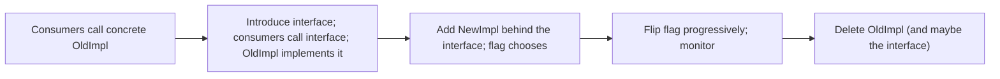
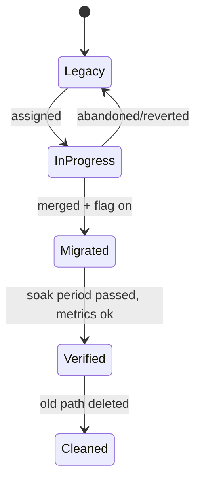
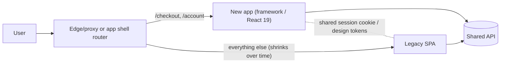

# 10 / 13 — Application Migrations: Moving a Live React App Without Stopping the Business

## 1. Lesson metadata

| | |
|---|---|
| **Level** | Professional |
| **Study time** | 4–5 hours (reading 2 h, hands-on 1.5 h, exercises 1.5 h) |
| **Prerequisites** | [12 — Backward compatibility](./12-backward-compatibility.md), [04 / 24 — Refactoring legacy React](../04-react-architecture/24-refactoring-legacy-react.md), [08 / 08 — Integration testing](../08-testing-and-quality/08-integration-testing.md), [09 / 15 — React API changes across versions](../09-advanced-rendering-and-ecosystem/15-react-api-changes-across-versions.md), [00 / 20 — Tooling, transpilation, and bundling](../00-web-and-javascript-foundations/20-tooling-transpilation-and-bundling.md) |
| **Next** | [14 — Multi-team collaboration](./14-multi-team-collaboration.md) |
| **Related** | [15 — Technical debt](./15-technical-debt.md), [18 — Continuous delivery](./18-continuous-delivery.md), [Phase 11 — Large-scale refactoring](../11-senior-and-architect-mastery/03-large-scale-refactoring.md) |

**Learning objectives.** After this lesson you can:
1. Distinguish a migration from a refactor and a rewrite, and choose among them with evidence.
2. Plan a migration as a sequence of independently shippable, reversible steps.
3. Apply the strangler fig, branch by abstraction, and parallel-run patterns to a React application.
4. Use codemods, compatibility shims, and feature flags to keep the main branch releasable.
5. Define "done" for a migration with measurable burndown, and prevent regression (the "ratchet").
6. Execute common React migrations: build tool (CRA → Vite), language (JS → TS), React version (17/18 → 19), class → function components, routing library upgrades, state library replacement.

**Concepts covered:** migration vs refactor vs rewrite, strangler fig, branch by abstraction, expand/contract applied to code, incremental adoption, codemods, feature flags/dark launches, parallel run and shadow traffic, ratcheting lint rules, migration burndown, dual-stack period, big-bang risk, rollback, communication plan, freeze windows.

---

## 2. Deep conceptual explanation

### 2.1 What problem is this lesson solving?

Software is never finished, and its foundations age: a build tool is abandoned, a state library is superseded, a React major removes APIs, an old router can no longer be upgraded, a language migration (JavaScript → TypeScript) becomes necessary for safety. Meanwhile the business needs features *now*, from the same codebase, by the same people. A **migration** is a deliberate, staged change of a foundational dependency or approach across a large body of existing code, executed while the application stays in production.

The core engineering problem: **how do you move 500 components from approach A to approach B when you cannot stop the world?** The answer is always some form of *coexistence*: A and B run side by side, work moves from A to B in small safe increments, and A is deleted at the end.

### 2.2 Refactor, migration, rewrite

| | Refactor | Migration | Rewrite |
|---|---|---|---|
| Goal | Improve internal structure, behavior unchanged | Replace a foundational dependency/approach, behavior unchanged | Replace the system, behavior may change |
| Scope | Local (module/feature) | Cross-cutting (many modules) | Whole system |
| Duration | Hours–days | Weeks–quarters | Months–years |
| Coexistence of old/new | Not needed | **Required** | Required if incremental; otherwise parallel system |
| Risk | Low | Medium; mostly *coordination* risk | High: lost implicit requirements |
| Typical tool | IDE, tests | Codemods, adapters, flags | New repo, strangler routing |

Rewrites carry a notorious failure mode: the old system encodes years of implicit requirements (edge cases, bug-compatible behavior, integrations) that a fresh codebase rediscovers painfully, while the old system must still be maintained in parallel. This is a widely-reported industry experience rather than a law; there are legitimate rewrites (the old platform is unsupportable, the domain was misunderstood, the language/runtime is dead). Prefer an *incremental replacement* (strangler) even when the destination is a "rewrite".

### 2.3 Patterns for coexistence

**1. Strangler fig.** Named by Martin Fowler after a vine that gradually envelops a tree. New functionality is built in the new system; a routing layer sends traffic for migrated parts to the new implementation; the old system shrinks until it can be deleted. In React apps the "routing layer" can be: the HTTP reverse proxy (route `/checkout/*` to the new app), the client router (new routes render new components), or a component-level facade.

**2. Branch by abstraction.** Introduce an abstraction layer in the old code that both old and new implementations satisfy; switch consumers to the abstraction; then swap implementations (possibly behind a flag); finally remove the old one and, if it is useless, the abstraction. Good for replacing a state library or an HTTP client inside a single app.



**3. Parallel run / shadow.** Run old and new implementations on the same input and compare results while only the old result is used. Appropriate for pure computation (pricing, tax, search ranking) where outputs are comparable. In the frontend, this is mostly used for logic modules and API clients, not for rendering.

**4. Dark launch / feature flag.** The new path is deployed but disabled; enable for staff, then a percentage, then everyone. Rollback is flipping a flag, not redeploying.

**5. Vertical slice.** Migrate one end-to-end feature fully (UI + state + API) before the next, rather than all UIs then all state. Reduces the dual-stack period per feature and gives early feedback.

**6. Horizontal layer.** Migrate one layer (e.g., all fetches to a new client) across the codebase. Good for mechanical, codemod-friendly changes.

Choosing vertical vs horizontal: use **horizontal** when the change is mechanical and uniform (rename imports, JSX transform, `defaultProps` → default parameters); use **vertical** when the change requires design decisions per feature (new state architecture).

### 2.4 The ratchet: preventing backsliding

A migration fails slowly when new code keeps being written in the old style. The **ratchet** pattern: a CI check that counts old-style occurrences and fails if the count *increases*, while allowing it to decrease.

```ts
// scripts/ratchet.ts (conceptual)
const baseline = JSON.parse(fs.readFileSync('migration-baseline.json', 'utf8')) as { classComponents: number };
const current = countClassComponents('src');          // AST or regexp scan
if (current > baseline.classComponents) {
  console.error(`Class components increased: ${baseline.classComponents} -> ${current}`);
  process.exit(1);
}
if (current < baseline.classComponents) {
  // lower the bar so progress is locked in
  fs.writeFileSync('migration-baseline.json', JSON.stringify({ classComponents: current }));
}
```

Alternatives to a numeric baseline: ESLint with the rule as `error` and per-file `// eslint-disable` comments generated for existing violations (which are then removed as files migrate), or lint config overrides by directory (new directories strict, old directories lenient). This lets the rule be *on* for new code immediately.

### 2.5 Migration economics and when NOT to migrate

A migration is an investment: cost now for lower cost or risk later. Evaluate:

- **Trigger**: security (end-of-life dependency), capability (feature impossible on old stack), productivity (build times), hiring/maintainability, ecosystem support.
- **Cost**: engineer-weeks, opportunity cost of features not built, risk of regressions, dual-stack complexity.
- **Benefit**: measurable if possible (CI time, bundle size, defect rate, onboarding time).
- **Alternatives**: pin and patch, wrap and isolate, defer.

The best migration is often the one you choose not to do *yet*, but you must do it before the cost curve turns against you (for example, end-of-life dependencies with no security patches).

### 2.6 Common React migrations and their specifics

⚠ Version-sensitive: tool and library status changes quickly. Items below were checked against react.dev, the React 19 upgrade guide, and the sandbox on 2026-10-22; still re-check tool status before planning.

**Build tool: Create React App → Vite (or a framework).** CRA is no longer recommended for new apps; the React team's current guidance points to frameworks or build tools such as Vite (react.dev's "Sunsetting Create React App" post, February 2025, deprecates CRA for new apps and points to frameworks or build tools such as Vite, Parcel or RSBuild; see [react.dev/learn/build-a-react-app-from-scratch](https://react.dev/learn/build-a-react-app-from-scratch) and [react.dev/learn/creating-a-react-app](https://react.dev/learn/creating-a-react-app)). Migration issues: `process.env.REACT_APP_*` vs `import.meta.env.VITE_*`, the `public/` and `index.html` location, absolute imports (`baseUrl` → `resolve.alias`), SVG-as-component imports, Jest → Vitest (or keep Jest with extra config), CommonJS-only dependencies. Strategy: horizontal and mostly mechanical; do it in a branch with a CI matrix producing both builds until parity is shown, then switch.

**JavaScript → TypeScript.** Incremental: enable `allowJs` and `checkJs: false`, rename files one by one, start with `strict: false` and ratchet strictness (`noImplicitAny`, then `strictNullChecks`, then `strict`). Migrate leaf modules and shared types first (the dependency graph, [00 / 10](../00-web-and-javascript-foundations/10-modules-and-dependency-graphs.md), tells you the order); migrate boundaries (API types) early because they give the most safety per line.

**React 17/18 → 19.** Use the official upgrade guide and codemods (the upgrade guide documents `npx codemod@latest react/19/migration-recipe` and `npx types-react-codemod@latest preset-19 ./path-to-app` for `@types/react` changes). Typical steps: upgrade to the latest 18.x first and resolve deprecation warnings; adopt the new JSX transform if not already; replace `ReactDOM.render` with `createRoot`; replace `defaultProps` on function components; replace string refs and legacy context (if any survive); check libraries' peer ranges; run with Strict Mode to find effect/ref cleanup issues ([02 / 28](../02-react-rendering-and-internals/28-strict-mode-behavior.md)). Use the 18 → 19 two-step: ship on 18.3 with warnings fixed *before* bumping major, so each step is individually revertible.

**Class components → function components with hooks.** Not required by React (classes remain supported, though not recommended for new code). Migrate opportunistically when touching a component; error boundaries still require classes unless you adopt a library wrapper ([04 / 19](../04-react-architecture/19-error-boundaries.md)). Mechanical codemods exist for simple cases, but lifecycle-to-effect translation requires understanding ([01 / 17](../01-react-fundamentals/17-lifecycle-concepts.md), [03 / 04](../03-react-state-and-hooks/04-useeffect-synchronization.md)); blindly converting `componentDidUpdate` to `useEffect` creates subtle bugs.

**State library replacement (e.g., legacy Redux → Redux Toolkit; Redux → server-state library + local state).** Prefer *branch by abstraction at the selector/hook level*: components consume `useCart()`; swap the implementation behind it. Often the real win is separating server state from client state ([04 / 16](../04-react-architecture/16-server-vs-client-state.md), [06 / 07](../06-data-fetching-and-state-ecosystems/07-server-state-management.md)).

**Router upgrade or replacement.** Routes are public URLs ([12](./12-backward-compatibility.md)). Migrate by route group; keep URL parity with redirect tests; consider the strangler at the proxy level for large moves (e.g., to a framework). See [04 / 18](../04-react-architecture/18-routing-architecture.md) and [09 / 10](../09-advanced-rendering-and-ecosystem/10-routing-and-nested-layouts.md).

**CSS strategy migration (e.g., CSS-in-JS runtime → CSS modules or utility CSS).** Runtime CSS-in-JS libraries have faced compatibility questions with concurrent rendering and Server Components, and several are in maintenance modes. Verify your library's current guidance. Migrate by component with both approaches coexisting; the dual-stack cost is bundle size and specificity conflicts, so establish a CSS layer order (`@layer`) early.

**Client-side SPA → SSR/RSC framework.** The largest. Use strangler: put the framework in front, render legacy routes through a catch-all that mounts the SPA, then peel routes off ([09 / 01](../09-advanced-rendering-and-ecosystem/01-spa-ssr-ssg-streaming.md), [09 / 09](../09-advanced-rendering-and-ecosystem/09-framework-architecture.md)).

### 2.7 What makes migrations fail

1. **No definition of done**, so "90% migrated" lasts years.
2. **Big-bang branch** that diverges from main; merge conflicts and stale tests.
3. **No ratchet**, so new code keeps using the old way.
4. **Hidden requirements** discovered late (analytics events, accessibility behaviors, edge-case formats).
5. **Single-person ownership**: a migration depending on one hero.
6. **No rollback plan** (data migration without reversibility).
7. **Dual-stack forever**: the old system stays "just in case". Every day with both costs build time, cognitive load, and bugs at the seam.
8. **Underestimating the long tail**: the last 10% of usages are the hardest (weird files, undocumented dependents). Plan explicit time and budget to finish.

---

## 3. Internal mechanics

### 3.1 Why codemods work (and when they don't)

**Public guarantee:** JavaScript/TypeScript source can be parsed into an Abstract Syntax Tree (AST) following a specification (ESTree-like, or TypeScript's own AST); transformation tools modify the tree and print it back out. jscodeshift (facebook/jscodeshift) wraps the recast library so output preserves original formatting as much as possible.

**Teaching model:** A codemod is a *pure function from source text to source text* run over many files. It is effective when the transformation is **syntactic and local** (rename an import, change a JSX prop, convert `React.FC` annotations). It is ineffective when the transformation needs **semantic understanding** (which variables are server state, whether an effect's dependencies are correct). Rule: automate the mechanical 80%, let compile errors and tests flag the rest, and handle the residue by hand with a checklist.

**Implementation detail ⚠:** Type-aware codemods (e.g., ts-morph, which exposes the TypeScript compiler's type information) can resolve what an identifier refers to (so you can check that `Button` really comes from your design system), at the cost of slower runs and a requirement that the code compiles.

### 3.2 Incremental TypeScript adoption: how the compiler treats JS

With `allowJs: true`, `tsc` accepts JS files in the program; with `checkJs: false` it does not report type errors in them but still infers types for imports from TS files; `// @ts-check` opts a single file in; `// @ts-expect-error` marks a known error and itself errors when no longer needed (excellent for ratcheting). Strictness flags can be enabled progressively. ⚠ Verify flags against the TypeScript version you use ([typescriptlang.org/tsconfig](https://www.typescriptlang.org/tsconfig/)).

### 3.3 Bundler migrations: what changes semantically

Different bundlers differ in: how they treat CommonJS interop (`default` imports from CJS), environment variable injection (compile-time replacement of specific expressions), dev server module model (native ESM vs bundled), handling of side-effect-only imports and `sideEffects` flags, JSX transform defaults, and CSS handling order. These differences cause *behavioral* regressions (a global style order change, a `process.env` reference undefined at runtime) that type-checking cannot catch. Hence the importance of end-to-end smoke tests ([08 / 09](../08-testing-and-quality/09-e2e-with-playwright.md)) and visual regression ([08 / 12](../08-testing-and-quality/12-visual-regression.md)) as the migration safety net.

### 3.4 Feature flags as migration infrastructure

A flag evaluation is `(flagKey, context) → value` where context includes user id, tenant, environment, version. Properties needed for migrations: **per-user stickiness** (a user stays on one path during a session), **targeting** (staff first), **percentage rollout**, **kill switch** (instant disable), **observability** (record which path served each request/error). ⚠ Flags create combinatorial states; each long-lived flag doubles test paths. Treat migration flags as *temporary* with an owner and an expiry date ([15](./15-technical-debt.md)).

### 3.5 Migration state as a data structure

Keep a machine-readable list of "units" (files, routes, components) with status; this drives dashboards and ratchets.



---

## 4. Step-by-step execution walkthrough: migrating a CRA app to Vite and React 19 in two stages

Context: a 400-component app, CRA, React 18.2, JavaScript + partially TypeScript, Jest, one deployment per week, 12 engineers on 3 teams.

**Stage 0 — Prepare (week 1).**
1. Write the *migration charter*: goal (Vite + React 19), non-goals (no redesign, no state refactor), definition of done (CRA removed, `react-scripts` not in lockfile, React 19 in production, all warnings resolved), owners, timeline, rollback plan.
2. Establish a **safety net**: ensure the smoke e2e suite covers login, main flows; capture baseline metrics (build time, bundle size, Web Vitals p75, error rate). Without a baseline you cannot claim the migration helped or did no harm.
3. Freeze dependency churn: stop merging unrelated dependency upgrades during the migration window.

**Stage 1 — React 18.3 hygiene (week 2).**
4. Upgrade to the latest 18.x. Fix warnings emitted by deprecated APIs (the 18.3 release surfaces warnings for APIs removed in 19; verify in the upgrade guide).
5. Run the app in Strict Mode locally; fix double-invocation bugs (missing effect cleanup).
6. Add the ratchet: lint rules for `defaultProps` on function components and `ReactDOM.render`.

**Stage 2 — Build tool (weeks 3–4).**
7. Add Vite config *alongside* CRA (both scripts available: `start:cra`, `start:vite`). Move `index.html` to project root, replace env access via a single `env.ts` module (an anti-corruption layer) so only one file knows `import.meta.env` vs `process.env`.
8. Fix import and asset issues; get dev server running. Run unit tests (Vitest or Jest) and e2e against the Vite build in CI as a **non-blocking job**.
9. Compare bundles and metrics versus baseline. When CI parity holds for a week, flip the default; keep CRA scripts for one release as a rollback path.
10. Deploy to staging, then production in the normal weekly release; monitor error rate and Web Vitals ([04](./04-observability-and-logging.md), [05](./05-error-monitoring.md)).

**Stage 3 — React 19 (weeks 5–6).**
11. Check each dependency's peer range for React 19; list blockers; upgrade or replace. Pin problem libraries; consider overrides only as a *temporary* measure with a ticket.
12. Run official codemods; upgrade types. Fix compile errors in a single PR if mechanical; otherwise per feature.
13. Release behind **no flag** (React version is not flaggable), so protect through canary deploy: roll out to 5% of traffic using your deployment infrastructure ([18](./18-continuous-delivery.md)) and watch error budgets.
14. Bake for a week; then remove the 18-specific shims.

**Stage 4 — Cleanup (week 7).**
15. Delete CRA dependencies, scripts, and docs. Update onboarding. Publish the retrospective with measured results (build time, bundle size). Close the ratchet by turning the rules into permanent lint rules.

Notice the principles: every stage ships independently; each has a rollback; metrics are captured before and after; there is a cleanup phase scheduled up front.

---

## 5. Code examples

### 5.1 Minimal example: an environment anti-corruption layer

```ts
// src/env.ts — the only file allowed to read build-tool-specific env access
interface AppEnv {
  apiBaseUrl: string;
  sentryDsn: string | undefined;
  mode: 'development' | 'production' | 'test';
}

// Vite exposes import.meta.env; CRA exposed process.env.REACT_APP_*
export const env: AppEnv = {
  apiBaseUrl: import.meta.env.VITE_API_BASE_URL,
  sentryDsn: import.meta.env.VITE_SENTRY_DSN,
  mode: import.meta.env.MODE as AppEnv['mode'],
};
```

Everywhere else imports `env`. During a migration you can implement `env.ts` for both tools (conditionally or via two files and an alias) and the rest of the codebase does not change. See [03 — Environment configuration](./03-environment-configuration.md) for secrets and public-vs-private rules: anything in a client bundle is public.

### 5.2 Practical: branch by abstraction for a state library swap

```ts
// src/features/cart/cart-store.ts — the abstraction consumers depend on
export interface CartItem { sku: string; qty: number }
export interface CartApi {
  items: readonly CartItem[];
  add(sku: string, qty?: number): void;
  remove(sku: string): void;
}
```

```tsx
// src/features/cart/useCart.ts
import { useLegacyReduxCart } from './impl/legacy-redux';
import { useZustandCart } from './impl/zustand';
import { useFlag } from '../../flags';

export function useCart(): CartApi {
  // ⚠ Both hooks must not be called conditionally in the same render (Rules of Hooks).
  // Choose the implementation at a stable boundary, e.g. module level or via a provider, not per-render.
  const useImpl = useFlag('cart-zustand') ? useZustandCart : useLegacyReduxCart;
  return useImpl();
}
```

**Is this correct?** Predict before reading on. The flag can change during the component's lifetime (flag refresh), which would change *which hook runs* between renders — a violation of the Rules of Hooks ([03 / 16](../03-react-state-and-hooks/16-rules-of-hooks-and-composition.md)): hooks must be called in the same order every render. If the flag value is stable for the session (evaluated once at app start), the pattern works in practice, but it is fragile.

**Corrected: select implementation at a provider boundary.**

```tsx
// CartProvider decides once per mount and renders the correct implementation as a subtree.
import { createContext, useContext, type ReactNode } from 'react';

const CartContext = createContext<CartApi | null>(null);

function LegacyCartProvider({ children }: { children: ReactNode }) {
  const api = useLegacyReduxCart();
  return <CartContext value={api}>{children}</CartContext>;
}
function ZustandCartProvider({ children }: { children: ReactNode }) {
  const api = useZustandCart();
  return <CartContext value={api}>{children}</CartContext>;
}

export function CartProvider({ children }: { children: ReactNode }) {
  const useNew = useFlag('cart-zustand');
  // Different component types => React unmounts one and mounts the other when the flag flips.
  return useNew
    ? <ZustandCartProvider>{children}</ZustandCartProvider>
    : <LegacyCartProvider>{children}</LegacyCartProvider>;
}

export function useCart(): CartApi {
  const api = useContext(CartContext);
  if (!api) throw new Error('useCart must be used inside <CartProvider>');
  return api;
}
```

`<CartContext value={...}>` as a provider (without `.Provider`) is React 19 syntax (confirmed in the sandbox); use `<CartContext.Provider value={...}>` for React 18. Flipping the flag at runtime swaps component types, which **remounts the subtree and discards its state** ([01 / 16](../01-react-fundamentals/16-state-preservation-and-reset.md)), so decide whether runtime flips are allowed or whether the flag is evaluated once per session. Data in the old store must also be mirrored or migrated; for a cart, that implies a one-time import of items from the old store on first use of the new one.

### 5.3 Practical: a ratcheting ESLint config by directory

```js
// eslint.config.js (flat config, ESLint 9+; verify against your ESLint version)
import tseslint from 'typescript-eslint';

export default [
  // strict everywhere by default
  {
    files: ['src/**/*.{ts,tsx}'],
    rules: {
      'no-restricted-syntax': ['error', {
        selector: 'ClassDeclaration[superClass.name=/^(React\\.)?(Pure)?Component$/]',
        message: 'New class components are not allowed. See migration doc.',
      }],
    },
  },
  // grandfathered legacy directories: warn only; shrink this list as you migrate
  {
    files: ['src/legacy/**', 'src/features/reports/**'],
    rules: { 'no-restricted-syntax': 'warn' },
  },
];
```

Selector accuracy depends on how the superclass appears in the AST (`Component` identifier vs `React.Component` member expression, which has `superClass.property.name`), so the regexp above handles only the identifier form; verify with an AST explorer. That is the point of testing lint rules on fixtures.

### 5.4 Incorrect example: the big-bang long-lived branch

```text
main:      A──B──C──D──E──F──G──H──I──J──K    (features continue shipping)
migration:    └──M1──M2──M3──...──M147         (3 months, rebasing weekly)
```

Problems: constant conflicts, features implemented twice, no production feedback for 3 months, all risk released at once, morale decays. Commonly the branch dies or is merged under pressure with a long stabilization period.

### 5.5 Corrected: trunk-based incremental with flags and a tracked burndown

```text
main:  A──M1──B──M2──C──M3──D──M4... each M is small, behind a flag or behavior-neutral, releasable
```

Each step: green CI, no behavior change (or gated), deployable. The dual-stack exists but is explicit and time-boxed.

### 5.6 Advanced: shadow-running a pure computation

```ts
type PriceFn = (cart: Cart) => Money;

export function withShadow(oldFn: PriceFn, newFn: PriceFn, report: (diff: unknown) => void): PriceFn {
  return (cart) => {
    const result = oldFn(cart);          // authoritative result
    queueMicrotask(() => {               // do not delay the caller; keep the shadow off the critical path
      try {
        const candidate = newFn(structuredClone(cart)); // clone to avoid shared mutation
        if (candidate.amount !== result.amount || candidate.currency !== result.currency) {
          report({ cartId: cart.id, old: result, new: candidate });
        }
      } catch (error) {
        report({ cartId: cart.id, error: String(error) });
      }
    });
    return result;
  };
}
```

Notes: `queueMicrotask` still runs before the next rendering opportunity ([00 / 11](../00-web-and-javascript-foundations/11-event-loop-tasks-microtasks.md)) so heavy shadow work can still delay paint; for expensive functions use `setTimeout`, `requestIdleCallback` where available, or sample (shadow 1% of calls). Report only non-sensitive data (ids, not personal data), and sample to limit telemetry cost.

---

## 6. Visual explanations

### 6.1 Strangler routing



### 6.2 Migration burndown (what to track)

```text
Units remaining (components on legacy approach)
  400 |■
  300 |  ■■
  200 |     ■■■          <- steady rate; if flat, migration is stalled
  100 |          ■■■
    0 |                ■■■__ cleanup/delete
        W1 W2 W3 ...
Also track: new violations (should be 0), flag-on percentage, error rate by path.
```

### 6.3 Risk over time: big-bang vs incremental

```text
risk released at once
big-bang:     ____________________________███████  (single spike at cutover)
incremental:  ██ ██ ██ ██ ██ ██ ██ ██ ██ ██ ██    (many small, reversible exposures)
```

---

## 7. Alternative approaches and trade-offs

| Criterion | Incremental (strangler/flags) | Big-bang branch | Rewrite beside (new repo) | Freeze-and-patch (don't migrate) | Framework-supplied automation |
|---|---|---|---|---|---|
| Time to first value | Fast | Slow | Slow | None | Fast if available |
| Risk profile | Many small | One large | Large, delayed | Growing (security/EOL) | Low–medium |
| Dual-stack cost | Medium, prolonged | Low | Very high | None | Low |
| Feature delivery during | Continues | Blocked or conflicting | Split attention | Continues | Continues |
| Rollback | Per step | All-or-nothing | Keep old running | n/a | Revert commit |
| Needs strong tests | Yes | Yes | Yes | No | Yes |
| Best when | Large live app | Small app, short window | Domain redesign, old stack dead | App is short-lived/retiring | Framework offers official codemods |

**Scenario where incremental is NOT best.** A small internal tool (20 components, 3 users) on React 17: a big-bang upgrade in two days is cheaper than building flags, ratchets, and dual stacks. Also, some changes cannot coexist: two React majors in one page tree is not supported in the normal way (you can load separate roots/apps with isolation, e.g., micro-frontends, but sharing a tree or context across versions is not feasible). For those, use the *separate-app strangler* at the routing level, not component-level coexistence.

**Scenario where "do nothing" is best.** The product is being sunset in 9 months; the old build tool still receives no CVE-relevant exposure (build-time only tooling has a different risk profile than runtime dependencies). Document the decision as an [ADR](./16-architecture-decision-records.md) with an explicit revisit date.

---

## 8. Best practices and anti-patterns

### 8.1 Best practices
- **Write a migration charter** with goal, non-goals, definition of done, owners, rollback, timeline.
- **Baseline metrics before starting**; compare after each stage.
- **Keep main releasable**; each step small and independently revertible.
- **Introduce an abstraction at the seam** so consumers change once.
- **Automate the mechanical parts** (codemods) and **verify by tests**, not by eyeballing diffs.
- **Ratchet**: prevent new legacy code from day one.
- **Time-box the dual-stack** period; put the cleanup tasks in the plan with dates.
- **Publish progress** (dashboard); celebrate deletions.
- **Migrate the high-traffic or high-risk paths early** to learn, or the lowest-risk first to build tooling confidence. Decide consciously; a common compromise is a pilot on a medium-risk feature owned by a willing team.
- **Communicate** freeze windows, changes to developer workflow, and where to ask questions ([14](./14-multi-team-collaboration.md)).

### 8.2 Beginner mistakes
- Starting with the hardest module.
- Mixing refactors, feature changes, and migration steps in one PR (impossible to review or bisect).
- Not running the app in production-like mode after bundler changes.

### 8.3 Experienced-developer mistakes
- Underestimating **cross-team coordination**: the code is the easy part.
- Building a perfect migration framework for a one-off change.
- Declaring victory at 90%, leaving a permanently split codebase.
- Letting flags live indefinitely.
- Forgetting **non-code consumers**: analytics dashboards keyed on old event names, e2e tests, docs, runbooks, alerts referencing old file paths or build output.

### 8.4 Smells
- `// TODO: migrate` with no ticket and owner.
- Two competing state libraries with no plan.
- A "temporary" adapter file imported from 150 places.
- CI time creeping up because both toolchains run.
- Release notes that say "no changes" while the bundler changed.

### 8.5 Justified exceptions
- A hard cutover is justified when old and new cannot coexist (a data store change with no dual-write possibility, a protocol change with a strict maintenance window). Compensate with rehearsals, rollback scripts, and a communicated downtime or read-only window.
- Skipping the ratchet is justified for a migration finishing within days.

---

## 9. Real-world application

**E-commerce checkout.** Money paths deserve the most careful method: migrate checkout *last* or *first with extreme rigor*. A common compromise: strangler at the route level, shadow-compare price calculation, a canary of 1% of sessions, instant flag rollback, and a business-hours freeze avoiding peak events (Black Friday freeze policy).

**Dashboards.** Many widgets, each independent: ideal for vertical slices by widget, with the highest-traffic widget migrated as the pilot to flush out issues. Constraint: data freshness and performance regressions are visible to users; compare render timings before/after ([07 / 22](../07-performance/22-production-performance-investigations.md)).

**Finance.** Regulatory requirements may demand evidence (test reports, sign-offs) per change; build the evidence collection into the pipeline. Parallel-run calculations to prove equivalence is a persuasive artifact for auditors.

**Forms.** Moving form libraries risks subtle validation and accessibility differences (error announcement, focus-on-error). Capture behavior as contract tests *before* migrating, then run the same tests against the new implementation ([08 / 11](../08-testing-and-quality/11-component-contract-testing.md)).

**Auth.** Changing the auth provider or token storage invalidates sessions; plan a dual-validation window where the backend accepts both token types and the client migrates silently on next login.

**Multi-team.** The platform team provides codemods and a dashboard; each team migrates its areas within a quarter; the platform team handles the long tail by pairing. Use the ratchet to stop regressions and set a hard deadline for deleting the legacy path.

---

## 10. Debugging and troubleshooting

| Symptom | Reproduce | Investigate | Root cause | Validate |
|---|---|---|---|---|
| Works in dev, blank page in prod after bundler swap | `vite build && vite preview` (or equivalent) | Console errors; Network for 404 base paths; `process is not defined` | Env access/`base` path/CJS interop differences | Production build smoke test in CI |
| Styles in different order after migration | Compare computed styles on same page | DevTools → Elements → Styles order; check CSS import order and `@layer` | Bundler concatenates CSS in different order | Visual regression diff passes |
| Memory/duplicate state after flag flip | Toggle flag at runtime | React DevTools component tree: provider type changed → remount | Different component types at same position reset state | Flip tested; state mirrored/migrated |
| "Invalid hook call" after React upgrade | `npm ls react react-dom` | Duplicate versions in tree | A dependency bundles/pins its own React | Single version; override/upgrade the dependency |
| Type errors explode after enabling `strict` | Run `tsc --noEmit` | Group errors by rule/directory | Strictness enabled globally | Enable per directory (project references or per-folder tsconfig), ratchet |
| Codemod changed semantics subtly | Review diff by category; run tests | Check cases with spreads, aliases, dynamic values | Codemod assumed local syntactic patterns | Add fixtures for edge cases; manual review list |
| Migration stalls at 85% | Check burndown | Group remaining units by blocker | Long-tail items need design decisions | Assign owners, time-box, decide delete vs migrate |

**Process debugging.** If the burndown is flat for two sprints, treat it as an incident: Is it priority (no time allocated)? Capability (no codemod for the hard cases)? Ownership (nobody responsible)? Fix the cause, not the symptom.

---

## 11. Exercises

### Level A — Knowledge
**A1.** Define the strangler fig pattern and name two places the routing layer can live in a React app.
**A2.** What is branch by abstraction and what problem does it solve?
**A3.** What is a ratchet and why does a migration need one?
**A4.** Give two examples of migrations that are best done horizontally and two vertically.
**A5.** List four reasons a migration might fail that are not technical.

### Level B — Code comprehension
**B1.** In §5.2's first (flag-based) `useCart`, why can the code violate the Rules of Hooks? Describe a sequence that makes it fail.
**B2.** In the corrected `CartProvider`, what happens to the state of components under the provider when the flag flips from false to true?
**B3.** In `withShadow`, why is `structuredClone(cart)` used, and what would go wrong without it if `newFn` mutates its input?

### Level C — Implementation
**C1.** Write a jscodeshift codemod that replaces `ReactDOM.render(<App />, document.getElementById('root'))` with `createRoot(...).render(<App />)`, adding the correct import.
**C2.** Write a CI script that fails when the number of files containing `// @ts-nocheck` increases relative to a committed baseline and updates the baseline when it decreases.

### Level D — Debugging
**D1.** After moving to Vite, production shows `ReferenceError: process is not defined` in one vendor chunk only. Diagnose and fix.
**D2.** A team finishes migrating to the new data-fetching library, but the bundle still includes both libraries 6 months later. Diagnose organizational and technical causes.

### Level E — Architecture decisions
**E1.** You own a 5-year-old CRA app with 600 components, React 17, Redux, and Enzyme tests (Enzyme is unmaintained; only unofficial community adapters exist for React 17 and later, so verify before relying on it). Propose the sequence of migrations, with justification for the order.
**E2.** Decide between a big-bang and incremental migration for: (a) a 25-component admin tool, (b) a 900-component customer-facing app, (c) migrating the payment form's validation library.

### Level F — Expert challenge
**F1.** Design the migration of a large SPA (800 routes, 6 teams) to a server-rendering framework with the strangler pattern, including routing, authentication/session sharing, shared design system, analytics continuity, SEO risk management, rollout strategy, and success metrics.

---

## 12. Detailed answers and explanations

> Attempt the exercises first.

**A1.** Strangler fig: build new functionality in a new system and route traffic incrementally to it, letting the old system shrink until it is deleted. The routing layer can live at the edge/reverse proxy (path-based routing to separate apps), in the SPA's client router or app shell (new routes render new modules), or at a component boundary (a facade selecting old or new implementation). Wrong answer: "rewrite everything in parallel and switch", which is a parallel-run big-bang.

**A2.** Introduce an interface at the seam; make consumers depend on it; implement new behind it; switch with a flag; delete the old. It solves replacing an implementation used from many places without a long-lived branch: consumers change once (to the abstraction), and the swap is a small, reversible change.

**A3.** A mechanism that prevents new instances of the legacy pattern from entering the codebase (count check or lint rule), usually allowing counts to only go down. Without it, ongoing feature development re-creates the legacy at least as fast as the migration removes it, so the burndown never reaches zero.

**A4.** Horizontal (mechanical, uniform): import rewrites, `defaultProps` → default params, JSX runtime change, `React.FC` removal. Vertical (needs design per feature): state architecture changes, new data-fetching model, form library swap, new routing structure for a feature. Defend the choice by *how much human judgment each unit needs*.

**A5.** No clear owner or ownership by one person; no allocated capacity (competes with feature work); unclear definition of done; lack of communication with dependent teams (analytics, QA, support); stakeholder impatience or losing sponsorship; cutover during a high-risk business period; cultural resistance. Any four with brief justification.

**B1.** The chosen hook (`useZustandCart` or `useLegacyReduxCart`) depends on a flag evaluated each render. If the flag flips between renders (a remote config refresh, a user toggling it in a dev panel), React sees a different sequence of hooks than in the previous render for the same component instance, so hook state slots misalign (React matches hooks by call order, [03 / 16](../03-react-state-and-hooks/16-rules-of-hooks-and-composition.md)), producing errors such as "Rendered more hooks than during the previous render" or incorrect state. The ESLint rule `react-hooks/rules-of-hooks` may not flag this because the hook is called unconditionally via a variable (but it will often flag dynamic hook references; verify). Safe if flag is constant for the component's lifetime, but not guaranteed.

**B2.** The provider element changes type from `LegacyCartProvider` to `ZustandCartProvider` at the same position; reconciliation sees a different element type, unmounts the old subtree (including its descendants) and mounts a new one ([02 / 06](../02-react-rendering-and-internals/06-reconciliation-fundamentals.md)). All descendant local state (inputs, open dialogs, scroll positions held in state) is lost, and effects clean up and re-run. Therefore flip flags only at safe moments (page load) or accept remounts. Wrong answer: "state is preserved because `children` is the same", `children` elements are the same objects, but they are placed under a different parent type, hence a fresh mount.

**B3.** The shadow implementation runs later in a microtask, after the caller may have used or mutated the cart. If `newFn` mutates its argument, it would corrupt the live cart object; and conversely, mutations by the caller between the call and the microtask would alter the shadow's input and produce false diffs. Cloning gives the shadow a stable snapshot. Cost: clone time and non-cloneable values (functions) throwing; hence the `try/catch` and possibly a sampling guard. Also note that if `oldFn` itself mutates its argument, the cloned snapshot is taken *after* that mutation; for strict equivalence, clone before calling `oldFn`.

**C1.** Reference:
```ts
import type { API, FileInfo } from 'jscodeshift';

export default function transform(file: FileInfo, api: API) {
  const j = api.jscodeshift;
  const root = j(file.source);
  let changed = false;

  root.find(j.CallExpression, {
    callee: { type: 'MemberExpression', object: { name: 'ReactDOM' }, property: { name: 'render' } },
  }).forEach((path) => {
    const [element, container] = path.node.arguments;
    if (!element || !container) return;
    j(path.parent).replaceWith(
      j.expressionStatement(
        j.callExpression(
          j.memberExpression(j.callExpression(j.identifier('createRoot'), [container as any]), j.identifier('render')),
          [element as any]
        )
      )
    );
    changed = true;
  });

  if (!changed) return undefined;

  const hasImport = root.find(j.ImportDeclaration, { source: { value: 'react-dom/client' } }).size() > 0;
  if (!hasImport) {
    root.get().node.program.body.unshift(
      j.importDeclaration(
        [j.importSpecifier(j.identifier('createRoot'))],
        j.literal('react-dom/client')
      )
    );
  }
  return root.toSource();
}
```
Edge cases: the callback form (`ReactDOM.render(el, c, cb)`), `render` imported by name (`import { render } from 'react-dom'`), an unused `ReactDOM` import left behind (clean with a second pass or lint `--fix`), and SSR `hydrate` → `hydrateRoot` (a different signature: `hydrateRoot(container, element)`). The official react-codemod repository provides vetted transforms for many of these; prefer it where available. Evaluation criteria: correct target API, import added once, handles absent callback, flags unsupported cases.

**C2.**
```ts
import { readFileSync, writeFileSync, existsSync } from 'node:fs';
import { execSync } from 'node:child_process';

const BASELINE = 'ts-nocheck-baseline.json';
const out = execSync(`grep -rl "@ts-nocheck" src || true`, { encoding: 'utf8' });
const current = out.split('\n').filter(Boolean).length;
const baseline = existsSync(BASELINE) ? (JSON.parse(readFileSync(BASELINE, 'utf8')) as { count: number }).count : Infinity;

if (current > baseline) {
  console.error(`@ts-nocheck files increased: ${baseline} -> ${current}`);
  process.exit(1);
}
if (current < baseline) {
  writeFileSync(BASELINE, JSON.stringify({ count: current }) + '\n');
  console.log(`Ratchet lowered to ${current}. Commit ${BASELINE}.`);
}
```
Considerations: CI should *fail* if the baseline file changes but is not committed (otherwise the ratchet never persists; typical approach is a local pre-commit step or a bot commit); `grep` portability on Windows (use a Node glob); include first-time baseline creation. Evaluation: compares to baseline, only decreases allowed, deterministic.

**D1.** Likely a dependency (or your code) referencing `process.env.X` or `process` directly, which webpack-based CRA polyfilled/replaced but Vite does not in client bundles (Vite replaces `import.meta.env` and a limited set of defined constants). Investigate: find the chunk (source map), search the vendor package for `process.env`. Fix: replace usage with `import.meta.env`; for third-party code, define the replacement (`define: { 'process.env.NODE_ENV': JSON.stringify(mode) }` is handled by Vite, but other `process.env.X` keys need explicit `define`), or upgrade the vendor package. Validate with a production build smoke test in CI. Avoid blindly polyfilling the full `process` object (bundle cost, and it can mask real issues).

**D2.** Technical: a few hard-to-migrate screens (long tail) depend on the old API; wrappers hide dependency so deletion looked risky; no ratchet so new code used the old library; tests mock the old library. Organizational: no owner after the champion moved teams; no deadline or reporting; features always won prioritization; no one defined "done". Fixes: ratchet, burndown dashboard, named owner, delete-by date approved by management, dedicated capacity for the long tail, explicit delete-or-migrate decision for each remaining screen.

**E1.** Example answer with justification: (1) Establish safety net (replace Enzyme-dependent tests incrementally with React Testing Library tests, because Enzyme blocks React 18/19 and tests that assert implementation details will break during every other step) while keeping the app on React 17. (2) Bump to React 18 with `createRoot` after tests no longer depend on Enzyme, since 18 introduced behaviors like automatic batching and Strict Mode changes that tests should catch. (3) CRA → Vite (build speed unlocks the faster feedback needed for the rest). (4) React 19 upgrade via 18.3 warnings. (5) Redux → RTK and separate server state (opportunistic, vertical by feature). (6) JS → TS ratchet in parallel, starting at API boundaries. Criteria: dependencies between steps are respected (tests before runtime upgrades), risk is staged, each step shippable, and the answer defends order. Alternative orders are acceptable if justified, e.g., Vite first for developer experience.

**E2.** (a) Big-bang is acceptable: small surface, few users, tests in a day; incremental overhead outweighs risk. (b) Incremental: strangler/flags, ratchet, dashboards; business can't tolerate a long freeze. (c) Branch by abstraction with parallel-run: validation rules are logic that can be run on both libraries with the same inputs (golden test vectors from production traffic samples), and rollout behind a flag; the payment context justifies extra safety. Scoring: names the deciding factors (surface size, risk, user impact, ability to coexist).

**F1.** Reference outline. *Routing:* a reverse proxy/edge routes by path to either the framework app or the legacy SPA; the framework has a catch-all route that serves the legacy SPA shell, so URLs never change; migrate route groups in priority order by traffic and SEO value. *Auth/session:* shared cookie-based session on the same top-level domain; the framework verifies the session server-side; avoid separate login systems; make logout cross-app. *Design system:* a single package consumed by both with tokens; verify RSC/SSR compatibility of components (client directives, no browser-only access at import time). *Analytics:* a single analytics adapter; keep event names; verify event parity via a side-by-side test; page view tracking on route transitions in both. *SEO:* migrate the high-SEO routes carefully; keep URLs, canonical tags, structured data, and sitemap parity; monitor Search Console and server-rendered HTML diffs; do not release large groups simultaneously. *Rollout:* canary by path and percent via the proxy; metrics: LCP/INP p75, error rate, conversion, crawl stats; instant rollback by routing back to legacy. *Governance:* ratchet that new routes are created only in the new app after date X; burndown by route; owners per route group; deletion milestones. *Risks:* duplicated layouts (shared shell), state sharing between apps (avoid; use URL/server), two build pipelines (time-box). Evaluation criteria: URL stability, shared auth, measurable rollout and rollback, SEO safeguards, explicit end-state and deletion plan.

---

## 13. Senior engineer interview questions

1. **"How would you migrate a large app from X to Y without stopping feature work?"** *Strong answer:* establish a safety net and baseline metrics; introduce an abstraction or routing seam; migrate in small, releasable, reversible steps with flags/canaries; automate mechanical steps with codemods; add a ratchet to stop new legacy; track a burndown; schedule cleanup. Causal reasoning: coexistence converts one large risk into many small ones, and a ratchet ensures the denominator stops growing.

2. **"When is a rewrite justified?"** When the old system cannot evolve (unsupported platform, fundamentally wrong domain model, impossible hiring), the surface is small enough, or business requirements are changing so radically that preserving behavior has no value. Even then, prefer a strangler to preserve delivery and learning. Mention the hidden-requirements risk.

3. **"How do you know a migration is done?"** The old path is deleted (not just unused): dependencies removed from the lockfile, flags removed, docs and CI updated, metrics confirm no regressions, and the ratchet turned into a permanent rule. "Done" is defined in the charter and verified by a script where possible.

4. **"A flag-based swap of two implementations crashes on toggle. Why?"** Different hook orders or component types at the same position cause hook misalignment or remount/state loss; fix by selecting implementation at a boundary component and deciding the flip policy (session-stable flags).

5. **"Your React 19 upgrade is blocked by a library with a peer range ≤18."** Check if a newer version exists; evaluate overrides (works only if the library is truly compatible; test thoroughly), fork/patch (patch-package or equivalent, with a ticket), replace the library, or defer with a documented ADR. Reason: peer ranges express maintainers' tested compatibility; overriding shifts risk to you.

6. **"How do you handle the last 10% of a migration?"** Group remaining items by blocker, decide delete-vs-migrate per item with product, assign time-boxed ownership, pair or mob on the hardest cases, and enforce a deadline with leadership support. The long tail is typically a prioritization problem, not a technical one.

---

## 14. Further learning resources

| Resource | URL | Covers / why | Level | Study |
|---|---|---|---|---|
| React docs — Build a React app from scratch | <https://react.dev/learn/build-a-react-app-from-scratch> | Official guidance on build tooling and frameworks | Intermediate | Whole page |
| React docs — Creating a React App | <https://react.dev/learn/creating-a-react-app> | Official recommendation on frameworks/tools | Beginner | Whole page |
| React blog — React 19 upgrade guide | <https://react.dev/blog/2024/04/25/react-19-upgrade-guide> | Breaking changes and codemods for React 19 | Intermediate | Whole post |
| react-codemod | <https://github.com/reactjs/react-codemod> | Official codemods | Intermediate | README |
| jscodeshift | <https://github.com/facebook/jscodeshift> | Writing codemods | Intermediate | README, examples |
| ts-morph | <https://ts-morph.com/> | Type-aware code transformations | Advanced | Navigation/manipulation docs |
| Martin Fowler — Strangler Fig | <https://martinfowler.com/bliki/StranglerFigApplication.html> | Origin of the pattern | Intermediate | Whole article |
| Martin Fowler — Branch By Abstraction | <https://martinfowler.com/bliki/BranchByAbstraction.html> | Abstraction-based replacement | Intermediate | Whole article |
| TypeScript — Migrating from JavaScript | <https://www.typescriptlang.org/docs/handbook/migrating-from-javascript.html> | Incremental adoption steps | Beginner | Whole page |
| Vite — Guide | <https://vite.dev/guide/> | Env handling, build, migration notes | Intermediate | "Env variables and modes" |

URLs in this table were checked for HTTP 200 on 2026-10-22; any still marked *(unverified)* could not be checked automatically (blocked or unreachable). A 200 response does not guarantee the page content still matches the description; if a link has moved, search the site for the quoted title.

---

## 15. Knowledge checkpoint

**You should now understand**
- Why migrations require coexistence and how strangler, branch by abstraction, flags, and shadow runs provide it.
- Why ratchets and a defined "done" are what finish a migration.
- The specific risk profiles of common React migrations (build tool, TypeScript, React major, state, routing).

**You should be able to explain without notes**
- Why a long-lived migration branch is risky.
- Why flipping implementations at hook level is unsafe and how a provider boundary helps.
- How to decide between big-bang and incremental for a given context.

**You should be able to implement**
- A codemod, a ratchet script, an environment anti-corruption layer, and a branch-by-abstraction seam.

**You should be able to debug**
- Production-only failures after bundler changes, duplicate React copies, flag toggle remounts, and stalled migrations.

**Before moving on:** read [14 — Multi-team collaboration](./14-multi-team-collaboration.md), because most migrations succeed or fail on coordination.
