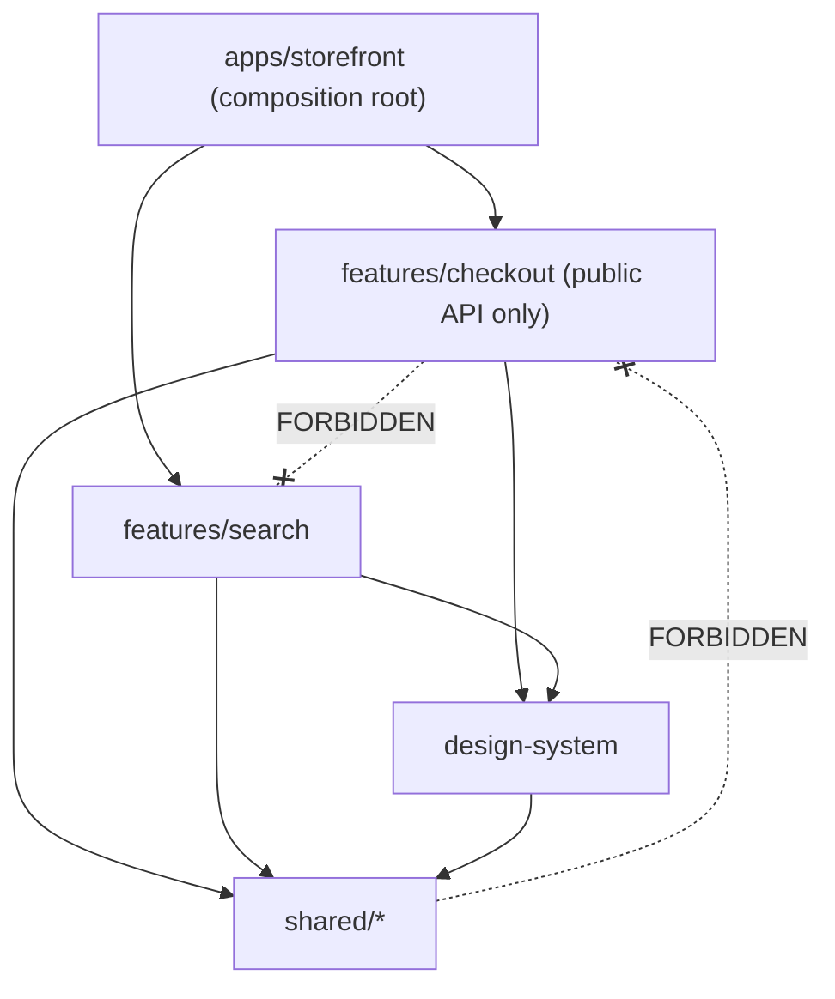
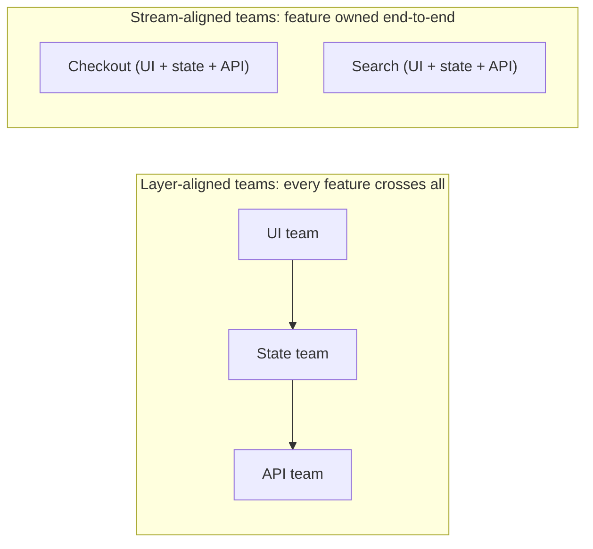

# 10 / 14 — Multi-Team Collaboration: Ownership, Boundaries, and Contracts in a Shared Frontend

## 1. Lesson metadata

| | |
|---|---|
| **Level** | Professional |
| **Study time** | 4–5 hours (reading 2 h, hands-on 1 h, exercises 1.5 h) |
| **Prerequisites** | [04 / 23 — Multi-team ownership](../04-react-architecture/23-multi-team-ownership.md), [04 / 22 — Monorepos and shared packages](../04-react-architecture/22-monorepos-and-shared-packages.md), [04 / 25 — Architectural fitness and enforcement](../04-react-architecture/25-architectural-fitness-and-enforcement.md), [10 / 01 — Repository organization](./01-repository-organization.md), [11 — Design system governance](./11-design-system-governance.md), [13 — Application migrations](./13-application-migrations.md) |
| **Next** | [15 — Technical debt](./15-technical-debt.md) |
| **Related** | [16 — Architecture decision records](./16-architecture-decision-records.md), [Phase 11 — Supporting multiple teams](../11-senior-and-architect-mastery/16-supporting-multiple-teams.md), [Phase 11 — Microfrontends](../11-senior-and-architect-mastery/12-microfrontends.md) |

**Learning objectives.** After this lesson you can:
1. Explain Conway's law and use it to design team and code boundaries together.
2. Define ownership at multiple granularities (code, runtime, on-call, product) and encode it in tooling.
3. Design explicit contracts between teams: typed APIs, events, URLs, design tokens, and shared state boundaries.
4. Enforce module boundaries automatically so architecture does not erode.
5. Choose collaboration mechanisms (RFCs, inner source, release trains, working agreements) appropriate to team count and coupling.
6. Diagnose coordination failures: the merge-queue pile-up, the cross-team PR deadlock, shared-code tragedy of the commons.

**Concepts covered:** Conway's law, team topologies (stream-aligned, platform, enabling, complicated-subsystem), ownership models, CODEOWNERS, module boundaries, public interfaces of features, contract tests, event contracts, shared dependencies, inner source, trunk-based development, merge queues, review SLAs, working agreements, cross-team RFCs, dependency between teams, API governance, on-call and escalation.

---

## 2. Deep conceptual explanation

### 2.1 What problem is this lesson solving?

One developer can hold an app in their head. Ten developers need conventions. Fifty developers in six teams need *structure*: who may change what, how they find out about each other's changes, how disagreements are resolved, and how integration problems are surfaced early rather than in production. Most scaling pain in frontend organizations is not technical complexity but **coordination cost**: waiting for reviews, resolving merge conflicts in shared files, breaking someone else's feature, and unclear responsibility when something fails at 2 AM.

This lesson is about reducing coordination cost without reducing quality. The strategy: **make boundaries explicit, make contracts typed and tested, give each area one accountable owner, and automate everything that would otherwise need a meeting.**

### 2.2 Conway's law and the inverse Conway maneuver

Melvin Conway (1968) observed that organizations design systems that mirror their communication structures: roughly, *if four teams build a compiler, you get a four-pass compiler*. Practitioners use this in two ways:

- **Diagnostic.** If two modules are tightly entangled in code and two different teams own them, expect constant cross-team friction. The code boundary is wrong, or the team boundary is.
- **Prescriptive (the "inverse Conway maneuver").** Organize teams around the architecture you want: if you want the checkout to evolve independently, give one team end-to-end ownership of checkout (UI, state, API integration), instead of splitting "UI team" and "API team" which forces every checkout change to need two teams.

This is an observation and a heuristic, not a physical law; use it to ask the right question: *does our code structure match who has to talk to whom to make a change?*

### 2.3 Team shapes that work for frontend

A widely used vocabulary comes from the book *Team Topologies* (Skelton and Pais). It defines four fundamental team types and three interaction modes.

| Team type | Purpose | Frontend example |
|---|---|---|
| **Stream-aligned** | Owns a flow of value end-to-end (a product area or user journey) | Checkout, Search, Account, Onboarding |
| **Platform** | Provides internal services that reduce stream teams' cognitive load | Design system, build/CI platform, auth shell, observability setup |
| **Enabling** | Helps other teams adopt capabilities temporarily | Accessibility, performance, testing coaches |
| **Complicated-subsystem** | Owns a part requiring specialist knowledge | Rich text editor, charting engine, maps, video |

Interaction modes: **collaboration** (working closely for a time-boxed period), **X-as-a-service** (consume a stable interface with minimal contact), and **facilitating** (coaching). The principle most relevant to React codebases: *prefer X-as-a-service interfaces between teams, and use collaboration only when discovering a new boundary.* An X-as-a-service interface in a frontend is a **package with a public API, versioning, docs, and tests**: exactly what [11](./11-design-system-governance.md) and [12](./12-backward-compatibility.md) described.

⚠ These models are frameworks for thinking, not prescriptions; many organizations adapt them heavily.

### 2.4 Cognitive load as the real constraint

Each team can effectively own only so much complexity. Symptoms of overload: slow onboarding, fear of changing core code, frequent regressions, unaddressed technical debt. Remedies: reduce the *surface* a team owns (split by domain), raise the *floor* with platform capabilities, and provide golden paths (templates, generators, docs). This ties directly to [04 / 07 — Modular architecture](../04-react-architecture/07-modular-architecture.md) and [04 / 08 — Domain-driven frontend](../04-react-architecture/08-domain-driven-frontend.md): modules are the unit that maps to ownership.

### 2.5 Ownership: what exactly is owned?

"Owning" something means being accountable for it. Make the kinds explicit:

| Ownership kind | Question | Mechanism |
|---|---|---|
| **Code ownership** | Who reviews and maintains this code? | `CODEOWNERS`, package manifests (`owner` field) |
| **Runtime ownership** | Who is paged when this fails in production? | On-call rotation, service catalog entries, alert routing ([10 / 05](./05-error-monitoring.md)) |
| **Product ownership** | Who decides what it should do? | Product manager/roadmap |
| **Data/contract ownership** | Who defines the API/event/schema? | API specs and schema registry |
| **Documentation ownership** | Who keeps docs accurate? | Docs-as-code with codeowners |
| **Dependency ownership** | Who upgrades and audits its dependencies? | Renovate/Dependabot routing, [10 / 07](./07-dependency-security.md) |

A thing with three code owners but no runtime owner is a classic failure: everyone can approve, nobody responds. Pair them: *who can change it* and *who gets paged* should be the same team wherever possible ("you build it, you run it").

### 2.6 Boundaries inside one codebase

Teams often share one repository (monorepo or single app). The shape of directories should express ownership ([04 / 06 — Feature vs layer structure](../04-react-architecture/06-feature-vs-layer-structure.md), [04 / 09 — Feature-sliced design](../04-react-architecture/09-feature-sliced-design.md)):

```text
apps/
  storefront/                # composition root, owned by "web-platform"
packages/
  design-system/             # owner: ds-core
  features/
    checkout/                # owner: team-checkout
      src/index.ts           # PUBLIC API: only this is importable from outside
      src/internal/...       # private
    search/                  # owner: team-search
  shared/
    api-client/              # owner: web-platform
    analytics/               # owner: data-eng + web-platform
```

The rule: **features import other features only through their public entry point (or not at all); shared packages never import features; the composition root wires features together.** Dependencies point downward in a layered graph; cycles are forbidden. Enforcement is automated (§3.2), because a rule that depends on code review attention erodes.

### 2.7 Contracts between teams

When team A needs something from team B, the interface should be an explicit contract:

| Channel | Contract form | Example |
|---|---|---|
| Component usage | Typed props, documented behavior, Storybook | `<ProductCard>` from the catalog team |
| Navigation | Route registry with typed params | `routes.checkout({ cartId })` |
| Events/messages | Typed event names and payloads, versioned | `cart:item-added` |
| Data | API schema (OpenAPI/GraphQL/TS types generated from them) | Product API |
| Shared state | A narrow, documented store or context API | `useSession()` from the auth package |
| Styling | Design tokens (CSS custom properties) | `--color-action-primary` |
| Config | Feature flag keys and their semantics | `checkout.new-payment-form` |

**Typed route registry example** (prevents "it's a string URL scattered across 14 files"; also helps [backward compatibility](./12-backward-compatibility.md) as URLs are public API):

```ts
// packages/shared/routes/src/index.ts
export const routes = {
  home: () => '/' as const,
  product: (p: { slug: string }) => `/p/${encodeURIComponent(p.slug)}` as const,
  checkout: (p: { cartId: string; step?: 'shipping' | 'payment' }) =>
    `/checkout/${encodeURIComponent(p.cartId)}${p.step ? `?step=${p.step}` : ''}` as const,
} as const;
```

Each team imports `routes` rather than hand-assembling URLs. A change to a route's shape produces compile errors in every caller at once.

### 2.8 Shared code: the tragedy of the commons

A `shared/` or `utils/` folder owned by "everyone" becomes owned by no one. Symptoms: a 4,000-line `helpers.ts`, circular imports, a "temporary" hack that three features now depend on. Defenses:

1. **Rule of three** before extracting shared code ([05 / 02](../05-design-patterns/02-dry-kiss-yagni.md)): duplication is cheaper than the wrong abstraction across team boundaries.
2. **Shared code has an owner** and a public API like any package.
3. **Prefer composition and injection to shared mutable singletons.**
4. **Domain code stays in domain packages**; `shared` contains only domain-agnostic utilities (date formatting, a typed fetch wrapper).
5. **Allow duplication across teams** where coupling would be worse than copying; document the duplication consciously.

### 2.9 Collaboration mechanisms

| Mechanism | Purpose | Cost | Use when |
|---|---|---|---|
| **RFC / design doc** | Surface cross-team impact before building | Writing time, review latency | Changes to shared APIs, patterns, or platform choices ([16](./16-architecture-decision-records.md)) |
| **ADR** | Record decisions and reasoning | Low | Every significant decision |
| **Inner source** | Anyone can contribute to any team's package via PRs; owners review | Needs good docs, CONTRIBUTING | Many consumers needing small changes |
| **Working agreements** | Team-level norms (review SLA, WIP limits, definition of done) | Minimal | Always |
| **Guilds/communities of practice** | Share knowledge across teams (frontend guild) | Meeting time | 4+ teams with similar problems |
| **Release trains** | Batch releases on a schedule | Latency, coordination | Tightly coupled deployables, regulated environments |
| **Trunk-based development with flags** | Integrate continuously | Needs flag discipline, strong CI | Most teams; see [18](./18-continuous-delivery.md) |
| **Embedded engineer / rotation** | Move knowledge | Staffing | Platform ↔ stream alignment |
| **Office hours** | Support consumers | Predictable time block | Platform teams |

### 2.10 Review as coordination

Code review in multi-team repositories has two jobs: *quality* and *information spread*. Both degrade when review latency is high or when PRs are huge. Practices:

- Aim for small PRs (reviewable in ~15–30 minutes). Large mechanical changes (codemods) are an exception, reviewed by sampling plus tests.
- A **review SLA** in the working agreement (e.g., first response within one business day); measure it.
- **CODEOWNERS auto-requests** the right reviewers; avoid requiring approval from *multiple* teams for every change; reserve cross-team approval for public API changes.
- Separate **style** from **substance**: automate formatting/linting so reviewers discuss design ([08 / 14](../08-testing-and-quality/14-linting-and-static-analysis.md)).
- A merge queue (GitHub merge queue or similar) avoids "green when tested alone, red when combined" for busy main branches. Check the current features of your platform's merge queue.

### 2.11 Common misconceptions

| Misconception | Reality |
|---|---|
| "Monorepo means shared ownership of everything." | A monorepo is a storage choice. Ownership and boundaries must still be explicit. |
| "Microfrontends solve team coordination." | They move coordination from compile time to runtime integration contracts; they can add overhead. See Phase 11 lesson 12. |
| "If everyone can edit everything, we move faster." | Short term yes; long term, no one can reason about the whole, and quality regresses. |
| "Process slows teams down." | Unplanned coordination (meetings, outages) slows teams more. Good process is automation of agreements. |
| "A platform team's job is to build what product teams ask." | A platform's job is to reduce product teams' cognitive load with products they *choose* to use. |
| "More reviewers means better review." | Diffusion of responsibility: each assumes others checked. Prefer one accountable reviewer plus automation. |

---

## 3. Internal mechanics

"Mechanics" here are the mechanics of the tools that implement collaboration agreements.

### 3.1 CODEOWNERS

**Public guarantee (GitHub):** a `CODEOWNERS` file (in `.github/`, repo root, or `docs/`) maps path patterns to users or teams. When a PR modifies matching files, those owners are automatically requested as reviewers, and with branch protection "Require review from Code Owners", their approval is required. Pattern matching resembles `.gitignore` syntax, and the **last matching pattern wins**. GitLab and other platforms have similar features with different syntax; check your platform documentation.

```text
# .github/CODEOWNERS
*                              @acme/web-platform           # fallback
/packages/design-system/       @acme/ds-core
/packages/features/checkout/   @acme/team-checkout
/packages/features/search/     @acme/team-search
/packages/shared/routes/       @acme/web-platform @acme/team-checkout   # public contract: platform + biggest consumer
/docs/adr/                     @acme/web-architecture-guild
```

Implications: (1) ordering matters (specific rules after general ones); (2) team handles must exist and have write access; (3) a single-person owner is a bus-factor risk; (4) CODEOWNERS is a *review* mechanism, not a security boundary against someone with admin rights.

### 3.2 Boundary enforcement

Boundaries are enforced in three layers, from cheapest feedback to strongest guarantee:

1. **Editor/lint feedback**: ESLint rules (`no-restricted-imports`, `import/no-restricted-paths`, `eslint-plugin-boundaries`, or monorepo tooling such as Nx's module-boundary rule) flag illegal imports immediately.
2. **Dependency analysis in CI**: tools like dependency-cruiser analyze the import graph and fail on forbidden dependencies and cycles.
3. **Package manager/runtime structure**: separate workspace packages with explicit `dependencies` and `exports` make illegal imports *unresolvable*, not just discouraged ([11](./11-design-system-governance.md)).

⚠ Rule names, config formats, and capabilities differ between tools and versions; verify in each tool's docs.



### 3.3 Architectural fitness functions

An *architectural fitness function* is an automated check that an architectural property holds (no cycles, layer rules, bundle budgets, forbidden dependencies, a11y rules) — see [04 / 25](../04-react-architecture/25-architectural-fitness-and-enforcement.md). They are how agreements survive staff changes. Treat their failures like failing tests: fix the code, or consciously update the rule via an ADR.

### 3.4 Cross-feature communication without coupling

When feature A must react to something in feature B without importing B:

| Mechanism | Coupling | Notes |
|---|---|---|
| Props/callbacks via the composition root | Low | The composition root connects them; features stay ignorant of each other |
| Shared domain event bus (typed) | Low–medium | Events are an API; version and document them; avoid hidden control flow |
| URL/search params | Low | Public, shareable, survives refresh ([06 / 18](../06-data-fetching-and-state-ecosystems/18-url-state-management.md)) |
| Shared store slice | Medium–high | A third module owns the state; both depend on it |
| Server as integration point | Low | Features refetch/subscribe; the backend is the shared truth |
| Direct import of internals | High | Forbidden by boundary rules |

### 3.5 Release coupling

If teams deploy one artifact (monolithic SPA), **release coupling** means one team's bug can block everyone's release. Mechanisms to decouple: feature flags (merge incomplete work safely), per-team build/test partitioning with affected-only CI, canary/progressive delivery, and—at the extreme—independently deployed microfrontends (with runtime contract risks). See [18](./18-continuous-delivery.md).

---

## 4. Step-by-step execution walkthrough: a cross-team change

Scenario: the **Search** team needs the **Checkout** team's `AddToCartButton` to emit an analytics event with a `source: 'search'` property, and needs the **platform** team's `analytics` package to support a new event type.

1. **Identify the contract surfaces.** (a) `AddToCartButton` props (checkout-owned), (b) analytics event schema (platform-owned).
2. **Check ownership** via CODEOWNERS and the package `README`/service catalog: owners are `@acme/team-checkout` and `@acme/web-platform`.
3. **Open an issue/RFC in the owner's tracker** (lightweight): problem, proposed API (`source?: 'search' | 'pdp' | 'recommendations'`), alternatives, and who will implement. The Search team offers to implement the PR (inner source), and Checkout agrees to review.
4. **Decide the shape.** Checkout prefers `analyticsContext?: AnalyticsContext` (extensible) over `source` string union; the RFC discussion surfaces this in one day rather than after 800 lines of code.
5. **Implement in small PRs**: (1) platform adds the event type (backward compatible, MINOR), (2) checkout adds the optional prop (MINOR), (3) search consumes both.
6. **CI gates**: boundaries lint (Search imports only public APIs), contract tests for the `AddToCartButton` props, API report diff.
7. **Review**: CODEOWNERS auto-requests; reviewers respond within SLA; the merge queue validates the combination.
8. **Release** via the normal pipeline; flag guards the new analytics event in case of volume issues.
9. **Document** in the package changelog and update the ADR/RFC status.
10. **Observe**: dashboards in [10 / 04 — Observability](./04-observability-and-logging.md) confirm event volume; Search closes the loop.

Note the principle: *the team needing the change drives it, the owner governs it.* This avoids both "wait for the other team's roadmap" and "reach in and edit their internals".

---

## 5. Code examples

### 5.1 Minimal example: a feature's public API barrel

```ts
// packages/features/checkout/src/index.ts — the ONLY importable surface
export { CheckoutPage } from './internal/CheckoutPage';
export { AddToCartButton } from './internal/AddToCartButton';
export type { AddToCartButtonProps } from './internal/AddToCartButton';
export { useCartCount } from './internal/useCartCount';
// Everything else is private by convention AND by lint/exports.
```

```jsonc
// packages/features/checkout/package.json
{
  "name": "@acme/feature-checkout",
  "private": true,
  "exports": { ".": "./src/index.ts" }
}
```

Trade-off: barrel files can hurt tree-shaking and dev-server performance if they re-export huge module sets and the bundler cannot prune (⚠ modern bundlers handle ES module barrels well when `sideEffects` is configured; measure with your build, see [00 / 10](../00-web-and-javascript-foundations/10-modules-and-dependency-graphs.md) and [07 / 16](../07-performance/16-bundle-analysis.md)). A barrel at a **package boundary** is more defensible than barrels inside every folder.

### 5.2 Practical: boundary rules with ESLint

```js
// eslint.config.js (flat config; illustrative, verify rule options in your plugin versions)
export default [
  {
    files: ['packages/features/**/*.{ts,tsx}'],
    rules: {
      'no-restricted-imports': ['error', {
        patterns: [
          {
            group: ['@acme/feature-*/*', '**/features/*/src/internal/**'],
            message: 'Import other features only via their package entry point.',
          },
          {
            group: ['@acme/app-*'],
            message: 'Features must not import from applications.',
          },
        ],
      }],
    },
  },
  {
    files: ['packages/shared/**/*.{ts,tsx}'],
    rules: {
      'no-restricted-imports': ['error', {
        patterns: [{ group: ['@acme/feature-*'], message: 'shared must not depend on features.' }],
      }],
    },
  },
];
```

The first rule says "you may import `@acme/feature-search` (entry) but not `@acme/feature-search/src/internal/x`". The pattern `@acme/feature-*/*` matches any subpath import. A feature importing *any other feature*, even through its entry point, is a design smell worth a stricter rule; many teams forbid feature→feature imports completely and route interactions via the composition root.

### 5.3 Practical: typed event contract between independent features

```ts
// packages/shared/events/src/index.ts
export interface AppEvents {
  'cart:item-added': { sku: string; qty: number; source: 'pdp' | 'search' | 'recs' };
  'auth:signed-out': { reason: 'user' | 'expired' };
}

type Handler<K extends keyof AppEvents> = (payload: AppEvents[K]) => void;

class Bus {
  private handlers = new Map<keyof AppEvents, Set<Handler<any>>>();

  on<K extends keyof AppEvents>(type: K, h: Handler<K>): () => void {
    const set = this.handlers.get(type) ?? new Set();
    set.add(h);
    this.handlers.set(type, set);
    return () => { set.delete(h); }; // block body: returns void, valid as an effect cleanup
  }

  emit<K extends keyof AppEvents>(type: K, payload: AppEvents[K]): void {
    this.handlers.get(type)?.forEach((h) => {
      try { h(payload); } catch (e) { console.error(`handler for ${String(type)} failed`, e); }
    });
  }
}

export const bus = new Bus();
```

```tsx
// in a feature: subscribe with cleanup
import { useEffect } from 'react';
import { bus } from '@acme/shared-events';

export function useOnItemAdded(cb: (p: { sku: string }) => void) {
  useEffect(() => bus.on('cart:item-added', cb), [cb]);
}
```

**Line notes.** The returned unsubscribe from `on` doubles as the effect cleanup (an effect may return a cleanup function). `cb` in dependencies means an unstable callback re-subscribes every render ([03 / 05](../03-react-state-and-hooks/05-effect-dependencies-and-stale-closures.md)); consumers should memoize or the hook should hold the latest callback in a ref. The try/catch isolates a failing subscriber so one team's bug does not break another team's handler.

**Trade-offs.** Event buses make control flow implicit (hard to trace "who reacts to this?"). For state that must be consistent, prefer an owned store or server state. Reserve events for notifications where publishers should not know subscribers (analytics, cache invalidation hints). Document each event with an owner.

### 5.4 Incorrect example: reaching into another team's internals

```ts
// features/search/ResultCard.tsx
import { priceFormatter } from '../../checkout/src/internal/formatters'; // ❌
import { cartStore } from '../../checkout/src/internal/store';           // ❌

export function ResultCard({ sku }: { sku: string }) {
  const qty = cartStore.getState().items[sku]?.qty ?? 0; // couples to checkout's state shape
  // ...
}
```

Consequences: Checkout cannot refactor its store without breaking Search, there is no owner for the contract, and nobody notices until a deploy breaks Search. Reviews miss it because the diff is in Search's files.

### 5.5 Corrected: depend on a narrow public hook

```ts
// checkout/src/index.ts exports:
export function useCartQuantity(sku: string): number { /* implementation private */ }

// search/ResultCard.tsx
import { useCartQuantity } from '@acme/feature-checkout';

export function ResultCard({ sku }: { sku: string }) {
  const qty = useCartQuantity(sku);
  // ...
}
```

Checkout may change its store implementation freely; `useCartQuantity` is the contract with its tests ([08 / 11](../08-testing-and-quality/11-component-contract-testing.md)). If even this coupling is unwanted, the composition root passes `qty` or a render prop into `ResultCard`.

### 5.6 Advanced: ownership metadata that drives automation

```ts
// packages/features/checkout/package.json (excerpt)
// "acme": { "owner": "team-checkout", "slack": "#team-checkout", "oncall": "pagerduty:checkout-web", "tier": 1 }
```

```ts
// tools/ownership-report.ts — fail CI if any package lacks required metadata
import { globSync } from 'node:fs';
import { readFileSync } from 'node:fs';

const missing: string[] = [];
for (const file of globSync('packages/**/package.json', { exclude: (f) => f.includes('node_modules') })) {
  const pkg = JSON.parse(readFileSync(file, 'utf8'));
  if (pkg.private === false || pkg.name?.startsWith('@acme/')) {
    const meta = pkg.acme;
    if (!meta?.owner || !meta?.oncall) missing.push(file);
  }
}
if (missing.length) {
  console.error('Packages missing ownership metadata:\n' + missing.join('\n'));
  process.exit(1);
}
```

`fs.globSync` is a relatively recent Node.js API (it exists in Node 24, confirmed in the sandbox, and is documented in the Node 24 API docs; it was experimental in early releases, so check your Node version or use a glob library). The idea: metadata makes ownership queryable (who to page, which channel), drives alert routing, dashboards, and Renovate assignments, and prevents orphaned packages.

---

## 6. Visual explanations

### 6.1 Coordination cost: layered vs end-to-end teams



Changing "add a coupon field" needs three teams in the layered model, one in the stream-aligned model.

### 6.2 Ownership and escalation

```text
Failure in production
   │
   ├─ Alert routes by package.acme.oncall ──▶ owning team's on-call
   │         │
   │         ├─ resolves in own code ─▶ fix + postmortem (see 19)
   │         └─ root cause in dependency owned by another team
   │                     └─▶ escalate via the *platform's* on-call, with trace/evidence
   └─ No owner found ─▶ incident commander assigns; ownership gap becomes an action item
```

### 6.3 Working agreement skeleton

```text
Review:   first response < 1 business day; blocking comments only for correctness/contract/security
PR size:  target < 400 changed lines excluding generated/codemod
CI:       main always green; broken main = stop-the-line; revert first, fix second
Docs:     public API change => docs + changelog in same PR
Flags:    every flag has an owner and a removal date
Contracts: cross-team API change => RFC or issue in owner's tracker before code
```

---

## 7. Alternative approaches and trade-offs

| Criterion | Monorepo + strict boundaries | Multi-repo (per team) | Microfrontends (independent deploy) | Single app, shared ownership |
|---|---|---|---|---|
| Atomic cross-cutting change | Yes | No: coordinated releases | No | Yes |
| Team autonomy (deploy) | Medium (shared CI, can be partitioned) | High | Highest | Low |
| Consistency (deps, tooling) | High | Drifts | Drifts or needs governance | High |
| Integration risk | Compile-time | Version skew at install | **Runtime** contract risk | Low |
| Tooling cost | Needs affected-only CI, caching | Low per repo, high to coordinate | High (loading, shared deps, routing) | Low |
| Onboarding | One place to learn | Many places | Many places + integration | One place |
| Good for | 3–20 teams, shared design system | Strongly independent products | Large orgs with autonomous teams and mature platform | 1–2 teams |

**Scenario where strict boundaries in a monorepo are NOT best.** Two teams of four working on one tightly coupled product (a single wizard flow): the boundary overhead (public APIs, contracts, ownership files) exceeds the coordination savings. A single feature-structured app with shared review is better; add boundaries when the third team arrives or when merge conflicts and cross-feature breakages become frequent.

**Scenario where microfrontends ARE justified.** Acquisitions or truly independent products that must appear under one shell, with different tech/release cadences. Accept runtime contract testing, shared dependency strategy, performance overhead, and design system versioning problems ([Phase 11 — microfrontends](../11-senior-and-architect-mastery/12-microfrontends.md)).

---

## 8. Best practices and anti-patterns

### 8.1 Best practices
- **One accountable owner per module**, recorded in machine-readable form, mirrored by on-call.
- **Public API per feature/package**; everything else private and unreachable.
- **Automate boundary rules** and run them in CI and the editor.
- **Contracts as code**: typed routes, event maps, API clients generated from schemas, design tokens.
- **Inner source with a CONTRIBUTING guide** for each shared package: how to run, test, propose.
- **Write down decisions** (ADRs) when cross-team agreements are made.
- **Make cross-team work visible**: shared board or labelled issues for dependencies, with owners and dates.
- **Run a regular architecture forum** (biweekly, 30 minutes) to review RFCs; keep it advisory unless it owns a clearly scoped decision.
- **Measure coordination**: PR review latency, time-to-merge, number of cross-team PRs, main-branch breakage rate, and lead time.

### 8.2 Beginner mistakes
- Putting everything in `shared/` "so others can use it".
- Importing from another feature's internals because it was convenient.
- Pushing large changes without discussing the contract with consumers.

### 8.3 Experienced-developer mistakes
- **Premature platform building**: a platform team building tools no stream team asked for.
- **Architecture committees without delivery accountability**: decisions made by those who do not live with them.
- **Mandating tools without migration support** ([13](./13-application-migrations.md)).
- **Over-fragmentation**: a package per component, with versioning overhead nobody benefits from.
- **Hero ownership**: one person is the only one who can approve changes in a critical area.

### 8.4 Smells
- PRs that touch five teams' directories and need eight approvals.
- Release days that require a Slack thread of "who is still merging?".
- `shared/utils/index.ts` growing weekly.
- "Ask Priya" as the architecture documentation.
- Breakages found by users, then ownership argued about for an hour.

### 8.5 Justified exceptions
- **Cross-team PRs** are acceptable for mechanical refactors (codemod across the repo) if the platform team coordinates and informs owners; use a time-boxed "CODEOWNERS bypass" with a bot, not manual force-merges.
- **Direct collaboration** (pairing across teams) is the right interaction mode when the boundary itself is being discovered, even if it violates the "X-as-a-service" ideal temporarily.
- **Temporary boundary violations** with a documented ticket and an expiry (the lint disable comment includes a ticket number).

---

## 9. Real-world application

**E-commerce (storefront with 6 teams).** Teams: Catalog, Search, Cart/Checkout, Account, Marketing/CMS, Platform (design system + shell + analytics). The shell owns routing, auth, and layout; features export `routes` and lazy-loaded entry components registered at the composition root. Constraint: analytics must be consistent for the data team: a typed analytics package with an event schema is a contract with data engineering as well as other teams.

**Dashboards for operations.** Widgets are contributed by many teams (inner source). The dashboard shell defines a `Widget` contract (props, loading/error states, data access hook, size constraints). Each widget is an independently owned package; the shell isolates failures with error boundaries ([04 / 19](../04-react-architecture/19-error-boundaries.md)) so one team's bug does not take down the board.

**Finance.** Compliance requires four-eyes approval on changes to calculation modules. Express it in CODEOWNERS plus required reviews on those paths, with an audit trail (PR history, release notes). Constraint: speed vs control: confine the heavy process to the *regulated modules*, not the whole repository.

**Forms and auth.** A shared form engine and an auth shell are classic platform products. Contract: the auth shell exposes `useSession()` and `RequireAuth`; feature teams never read tokens or cookies directly ([09 / 12](../09-advanced-rendering-and-ecosystem/12-auth-boundaries.md)).

**Realtime.** A WebSocket connection manager is a *shared singleton resource*; the platform team owns the connection, features subscribe to topics via a typed API, preventing each team from opening its own socket ([06 / 17](../06-data-fetching-and-state-ecosystems/17-real-time-websockets-subscriptions.md)).

**Multi-team with different cadences.** The marketing team ships daily content changes; the checkout team ships weekly with heavy testing. Decouple through flags and independent CI partitions so one cadence does not throttle the other; keep one deploy artifact if the infrastructure cost of splitting is not justified.

---

## 10. Debugging and troubleshooting

Treat coordination failures as system faults with observable symptoms.

| Symptom | Investigation (data) | Likely root cause | Fix | Validation |
|---|---|---|---|---|
| PRs wait days for review | Query PR time-to-first-review by path/team | Owners overloaded; CODEOWNERS too broad; single-person owners | Narrow ownership, add teams not individuals, review rota, SLA alerts | Median time-to-first-review |
| Main frequently red | Count breakages by cause (flaky tests vs semantic conflicts) | Semantic conflicts between concurrent PRs; flaky tests | Merge queue; quarantine flaky tests; revert-first policy | Red-main minutes/week |
| Feature A breaks after Feature B change | Dependency graph: import path A → B internals | Boundary violation | Lint rule + public API; contract test | Rule added; violation count 0 |
| Nobody responds to alerts for a package | Alert routing config; ownership metadata | Orphaned package | Ownership metadata required in CI; reassign | Alert acknowledgement time |
| Duplicate components proliferate | Static scan for similar component names/implementations | Slow intake to shared library ([11](./11-design-system-governance.md)) | Fast contribution path, discoverability (catalog), deprecate duplicates | Duplicate count trend |
| Shared `utils` is a dumping ground | Look at git blame: who changes it and why | No owner; low barrier | Split by domain; owner; deprecate | File size and import fan-in |
| Release blocked by another team's bug | Release retrospective | Release coupling | Flags; revert capability; per-team partitioned CI | Fewer cross-team blocks |

**Investigation using the repository itself.** Use `git log --format='%an' -- path | sort | uniq -c` to see de facto owners; use the import graph (dependency-cruiser output or `madge`-style tools) to find cycles; compare *declared* ownership (CODEOWNERS) with *actual* committers. Large mismatches reveal either wrong ownership declarations or key-person risk.

---

## 11. Exercises

### Level A — Knowledge
**A1.** State Conway's law and the inverse Conway maneuver.
**A2.** Name the four team types from Team Topologies and give a frontend example of each.
**A3.** Why should "who can change it" and "who gets paged" ideally be the same team?
**A4.** List three layers at which module boundaries can be enforced and their relative strength.
**A5.** In CODEOWNERS, which rule applies when several patterns match a file?

### Level B — Code comprehension
**B1.** In §5.3, what happens if one subscriber throws during `emit`? What would happen without the `try/catch`?
**B2.** In §5.3's `useOnItemAdded`, why can an inline arrow function as `cb` cause repeated resubscription? How many times does `on`'s unsubscribe run when the parent re-renders three times with inline callbacks?
**B3.** Which of these imports would the rules in §5.2 reject (assume file in `packages/features/search`): (a) `@acme/feature-checkout`, (b) `@acme/feature-checkout/src/internal/store`, (c) `@acme/shared-events`, (d) `@acme/app-storefront`?

### Level C — Implementation
**C1.** Write a dependency-cruiser-style or ESLint-based rule set (pseudo-config acceptable) that forbids cycles between feature packages and forbids features importing the app.
**C2.** Implement a typed `routes` registry with a `matchRoute(path)` function that returns the route name and typed params, and a unit test that guards route compatibility (old URLs still resolve).

### Level D — Debugging
**D1.** After a Checkout refactor, Search's product cards show "NaN items in cart". No Search code changed. Investigate and fix both the symptom and the process gap.
**D2.** Your main branch is red for ~6 hours per week; each break is a semantic conflict between two individually green PRs. Diagnose and remediate.

### Level E — Architecture decisions
**E1.** A 40-engineer org has teams organized by layer (UI, state, API). Delivery is slow. Propose a re-organization of both teams and code structure, including the migration path, and name the risks.
**E2.** Decide whether a shared `useDebounce` hook, a shared `Money` formatting module, and a shared `ProductCard` should live in `shared`, a platform package, or be duplicated. Justify each.

### Level F — Expert challenge
**F1.** Design the collaboration model (ownership, boundaries, contracts, release process, and incident response) for a 120-engineer organization building a single customer-facing React app plus an admin app, with 12 teams, one design system, and a requirement of multiple deploys per day.

---

## 12. Detailed answers and explanations

> Attempt the exercises first.

**A1.** Conway's law: systems tend to mirror the communication structure of the organization that builds them. Inverse Conway maneuver: deliberately structure teams around the desired architecture so the natural communication paths produce it (e.g., give one team end-to-end ownership of checkout to get a decoupled checkout module). Wrong answer: "teams should mirror the org chart", which is reversed causation.

**A2.** Stream-aligned (Checkout feature team), platform (design system/CI/auth shell), enabling (accessibility or performance coaching team), complicated-subsystem (rich-text editor or charting engine team). Reasoning: each differs in whether it owns a user journey, a service, a skill transfer, or specialist technology.

**A3.** Because accountability and authority align: the team that can change the code also feels the pain when it fails, improving quality incentives and shortening mean time to repair. When they differ, on-call engineers must escalate to owners who are not paged, delaying resolution and creating blame loops.

**A4.** (1) Lint/editor rules: fast feedback but can be disabled; (2) CI dependency analysis: cross-file/graph level, can detect cycles; fails the build; can still be bypassed by changing config; (3) Package structure with `exports`/explicit deps: strongest, because the import cannot be resolved. Combine all three; use (3) where practical and (1)/(2) for finer rules.

**A5.** On GitHub, the last matching pattern in the file takes precedence (and only that pattern's owners are requested). Hence general rules at the top, specific at the bottom. Common wrong answer: "the most specific path wins" (it only does so because specific patterns are placed later by convention).

**B1.** With the `try/catch`, the failing handler logs an error and the remaining handlers still run, since the loop continues. Without it, the exception propagates out of the `forEach` callback, aborting `emit` for subsequent handlers and throwing into the publisher (e.g., into Checkout's click handler), so one team's subscriber bug breaks another team's feature. Trade-off: swallowing errors hides failures; log to error monitoring ([10 / 05](./05-error-monitoring.md)) rather than only the console.

**B2.** An inline arrow gets a new identity every render, so the dependency array `[cb]` changes each render; React runs the previous effect's cleanup (unsubscribe) and re-runs the effect (subscribe). If the parent re-renders three times after the first mount, the initial subscription is cleaned up and replaced three times: unsubscribe runs three times in addition to the final one on unmount. (Plus StrictMode in development performs an extra mount/unmount/mount cycle, [02 / 28](../02-react-rendering-and-internals/28-strict-mode-behavior.md).) Fix: `useCallback` in the consumer, or keep latest callback in a ref inside the hook so the effect depends only on the bus.

**B3.** (a) `@acme/feature-checkout`: not matched by `@acme/feature-*/*` (no subpath); allowed by the rule as written (though a stricter policy may forbid feature→feature entirely). (b) Rejected by both patterns (subpath). (c) Allowed. (d) Rejected by the `@acme/app-*` pattern. The matching semantics of `group` use gitignore-style patterns; verify behavior in your ESLint version.

**C1.** Example with dependency-cruiser style config (verify syntax against the version you use):
```js
// .dependency-cruiser.cjs
module.exports = {
  forbidden: [
    { name: 'no-circular', severity: 'error', from: {}, to: { circular: true } },
    {
      name: 'features-not-import-apps', severity: 'error',
      from: { path: '^packages/features/' },
      to:   { path: '^apps/' },
    },
    {
      name: 'features-no-cross-feature-internals', severity: 'error',
      from: { path: '^packages/features/([^/]+)/' },
      to:   { path: '^packages/features/(?!\\1/)[^/]+/src/internal/' },
    },
  ],
};
```
The third rule uses a capture group reference (`\\1`) which dependency-cruiser supports for group matching in `from`/`to` (verify). Evaluation criteria: cycles forbidden; app direction enforced; internals protected; message/severity set; CI integration described.

**C2.**
```ts
type RouteDef<N extends string, P extends Record<string, string>> = {
  name: N; pattern: RegExp; keys: (keyof P)[]; build: (p: P) => string;
};

const product: RouteDef<'product', { slug: string }> = {
  name: 'product', pattern: /^\/p\/([^/]+)$/, keys: ['slug'],
  build: ({ slug }) => `/p/${encodeURIComponent(slug)}`,
};
const legacyProduct = { pattern: /^\/product\/([^/]+)$/ }; // legacy URL still resolves

export function matchRoute(path: string):
  | { name: 'product'; params: { slug: string } }
  | null {
  const m = product.pattern.exec(path) ?? legacyProduct.pattern.exec(path);
  return m ? { name: 'product', params: { slug: decodeURIComponent(m[1]) } } : null;
}

// test (Vitest)
import { describe, it, expect } from 'vitest';
describe('route compatibility', () => {
  it.each(['/p/blue-shirt', '/product/blue-shirt'])('resolves %s', (url) => {
    expect(matchRoute(url)).toEqual({ name: 'product', params: { slug: 'blue-shirt' } });
  });
  it('round-trips', () => {
    expect(matchRoute(product.build({ slug: 'a b' }))?.params.slug).toBe('a b');
  });
});
```
Edge cases: `decodeURIComponent` throws on malformed input (`%E0%A4%A`); catch and return null. Query strings and trailing slashes need decisions. Criteria: typed build/match, legacy URLs covered, test guards compatibility ([12](./12-backward-compatibility.md)).

**D1.** Investigation: Search reads Checkout's internal store shape (see §5.4), `qty` becomes `undefined`/non-number after the refactor; `NaN` results from arithmetic on `undefined`. Use DevTools / React DevTools to inspect the value flow; check the import path in blame; search for `checkout/src/internal` imports repo-wide. Fix: replace with `useCartQuantity` public hook; add a lint rule forbidding internals imports; add a contract test for the hook; add a CI check or API report to the Checkout package. Process gap: boundary not enforced; consumer unknown; ownership communication. Wrong answer: "revert the refactor", which addresses the symptom but leaves the coupling.

**D2.** Diagnosis: PRs are validated against an old main snapshot; both pass individually; the combination fails. Remedy: enable a merge queue (tests on the PR rebased onto latest main plus queued PRs), require branches be up to date for risky paths, reduce CI time so the queue is fast, partition CI by affected packages, and adopt revert-first on red main with an auto-revert bot if justified. Validate by tracking red minutes per week. Flaky tests are a separate cause; separate them in the data first.

**E1.** Example answer: move to stream-aligned teams per domain (Catalog, Cart/Checkout, Account, etc.) each owning UI+state+API integration; spin out a platform team (design system, shell, build). Code migration: first introduce feature folders/packages and boundaries with lint rules while the old layered teams exist (the code gets modular *before* people move); then reassign ownership per feature; keep the "UI team" as the design system/platform. Risks: loss of specialist depth (mitigate with guilds/enabling teams), inconsistent patterns (golden paths, ADRs), transition dip in productivity, unresolved shared ownership of the old `state/` layer (assign explicit owners per slice). Scoring: both org and code structure, a staged path, risk awareness.

**E2.** `useDebounce`: generic and domain-free; a shared utility package with a platform owner (or use a library hook); duplication is acceptable if small and stable. `Money` formatting: domain-sensitive (rounding, locale, currency rules), should have a single owner and live in a domain/platform package, never duplicated—inconsistent money display is a correctness and compliance risk. `ProductCard`: depends on the catalog domain; owned by the Catalog team and exported as a feature component, not shared "utils", and consumers (Search, Recommendations) use its public API; if it is purely presentational and used widely, the design system may own a presentational `Card` while Catalog composes domain data in `ProductCard`. Criteria: domain-agnostic vs domain, correctness risk, owner, consumer count.

**F1.** Reference outline. *Structure:* stream-aligned teams per journey (≈8), platform teams for design system, web platform (shell, routing, build, CI, observability), data/analytics enablement; an accessibility/performance enabling team. *Code:* monorepo with apps (customer, admin), feature packages per team, shared packages with owners, composition roots; boundaries enforced by lint + dependency analysis + `exports`; typed routes/events/analytics contracts. *Decision-making:* RFC → ADR flow with a 5-day comment window; architecture guild advisory; platform consults via office hours. *Release:* trunk-based, flags for incomplete work, merge queue, affected-only CI, canary with automatic rollback metrics, per-team flag ownership and expiry; deploy-on-green multiple times a day ([18](./18-continuous-delivery.md)). *Ownership & incidents:* metadata in package manifests drives alert routing and on-call; an incident commander role; blameless postmortems ([19](./19-incident-debugging.md)); shared services escalate to platform on-call. *Metrics:* DORA (deployment frequency, lead time, change failure rate, time to restore), review latency, red-main minutes, design-system adoption, Web Vitals by team. *Risks:* platform bottleneck (inner source + SLAs), flag debt ([15](./15-technical-debt.md)), cross-team contract drift (contract tests), alert fatigue. Criteria: coherence of structure with ownership, automation of agreements, measurable outcomes, incident path.

---

## 13. Senior engineer interview questions

1. **"How do you structure teams and code in a React org with ten teams?"** *Strong answer:* stream-aligned teams owning features end to end, platform teams for shared capabilities, explicit public APIs between them, automated boundaries, and ownership metadata tied to on-call. Reasoning: reduces handoffs for change and aligns accountability; Conway's law implies code structure will follow team structure anyway.

2. **"How do you stop shared code from becoming a dumping ground?"** Owner per shared package, public API, rule of three, domain code stays in domain packages, review by owners, fitness functions for cycles, and deprecation of unused exports. The root cause is lack of accountability, not lack of rules.

3. **"Another team's component has a bug blocking you. What do you do?"** Check whether you can fix it via inner source: reproduce, write a failing test, propose a PR, tag owners. If urgent, use a temporary local workaround with a ticket and expiry; communicate in the owner's channel. Escalate through the platform/engineering manager only if blocked on priority. This preserves ownership while avoiding waiting.

4. **"Microfrontends or a monorepo?"** They solve different problems: monorepo is about code organization and atomic change; microfrontends are about independent deployment at runtime. Choose based on the need for independent releases, team autonomy, and the willingness to pay for runtime integration (shared dependencies, performance, design consistency). Many orgs need only a modular monorepo.

5. **"How do you handle disagreement between teams about a shared API?"** Put proposals in writing with alternatives; evaluate against criteria (consumer impact, migration cost, consistency); time-box discussion; decision rights lie with the owner of the contract (or an architecture forum for platform-wide choices); record outcome in an ADR; revisit when evidence changes. "Disagree and commit" requires that decisions are recorded and revisitable.

6. **"Main is red constantly. Where do you look?"** Separate flaky tests from semantic conflicts and environment issues using CI data; then merge queues, test quarantine, faster CI, ownership of flaky tests, and revert-first policy. Causal reasoning: red main is a throughput tax on all teams, so it is a platform-priority issue.

---

## 14. Further learning resources

| Resource | URL | Covers / why | Level | Study |
|---|---|---|---|---|
| Team Topologies (book site) | <https://teamtopologies.com/> | Team types and interaction modes | Intermediate | "Key concepts" |
| Conway, "How Do Committees Invent?" (1968) | <https://www.melconway.com/Home/Committees_Paper.html> | Original statement of Conway's law | Intermediate | Whole paper |
| GitHub Docs — About code owners | <https://docs.github.com/en/repositories/managing-your-repositorys-settings-and-features/customizing-your-repository/about-code-owners> | CODEOWNERS syntax and enforcement | Beginner | Whole page |
| GitHub Docs — Merge queue | <https://docs.github.com/en/repositories/configuring-branches-and-merges-in-your-repository/configuring-pull-request-merges/managing-a-merge-queue> | Merge queue behavior | Intermediate | Whole page |
| dependency-cruiser | <https://github.com/sverweij/dependency-cruiser> | Dependency rules and graphs | Intermediate | README, rules reference |
| ESLint — `no-restricted-imports` | <https://eslint.org/docs/latest/rules/no-restricted-imports> | Import restriction patterns | Beginner | Options |
| Trunk Based Development | <https://trunkbaseddevelopment.com/> | Branching model for continuous integration | Intermediate | Core pages |
| DORA research | <https://dora.dev/> | Delivery performance metrics and capabilities | Intermediate | Capabilities, four key metrics |
| Nx — Enforce module boundaries | <https://nx.dev/features/enforce-module-boundaries> | Tag-based boundaries in monorepos | Intermediate | Whole page |

URLs in this table were checked for HTTP 200 on 2026-10-22; any still marked *(unverified)* could not be checked automatically (blocked or unreachable). A 200 response does not guarantee the page content still matches the description; if a link has moved, search the site for the quoted title.

---

## 15. Knowledge checkpoint

**You should now understand**
- Conway's law as a design tool and how team types map to frontend ownership.
- That ownership has several dimensions (code, runtime, product, contract) that must align.
- Why explicit, typed, tested contracts and automated boundary enforcement reduce coordination cost.
- The trade-offs between monorepo boundaries, multi-repo, and microfrontends.

**You should be able to explain without notes**
- How a cross-team change should flow (RFC, inner source, owner review).
- Why shared code needs owners and why duplication is sometimes right.
- How merge queues and review SLAs reduce coordination waste.

**You should be able to implement**
- CODEOWNERS, boundary lint rules, a typed route registry and event bus, and an ownership-metadata check.

**You should be able to debug**
- Boundary violations, red-main patterns, review latency, and orphaned packages, using repository data rather than opinions.

**Before moving on:** read [15 — Technical debt](./15-technical-debt.md); unmanaged coordination debt and code debt feed each other.
