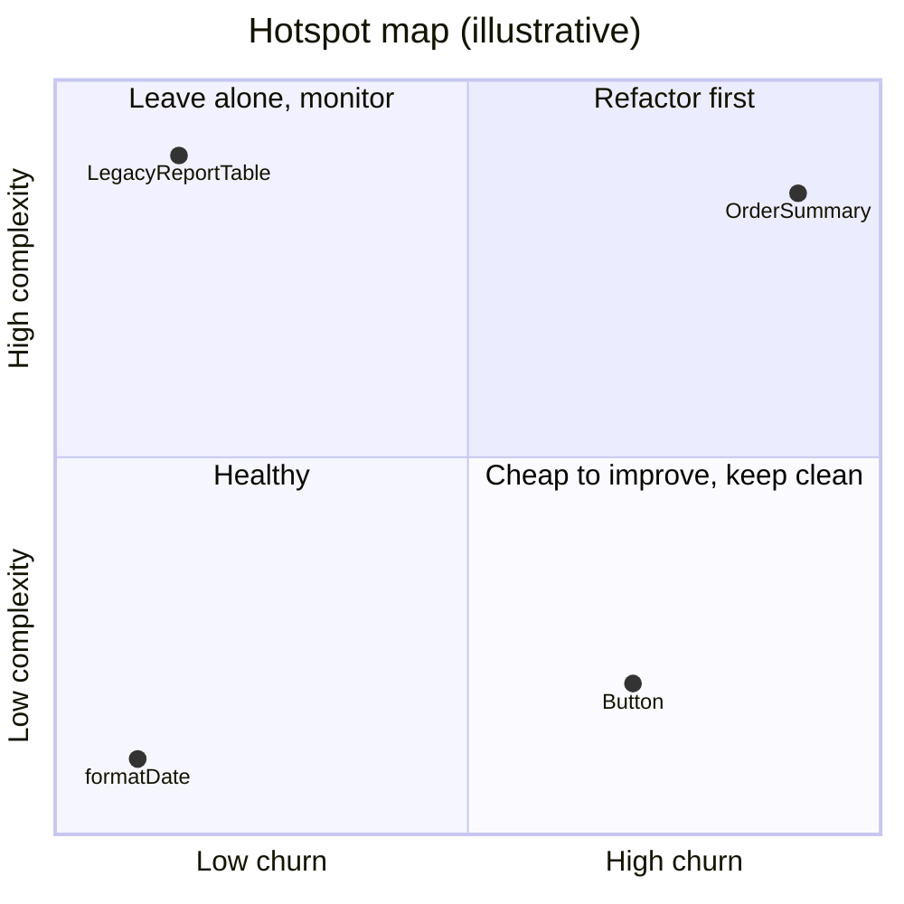
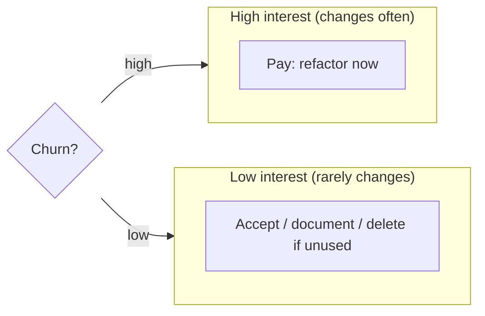
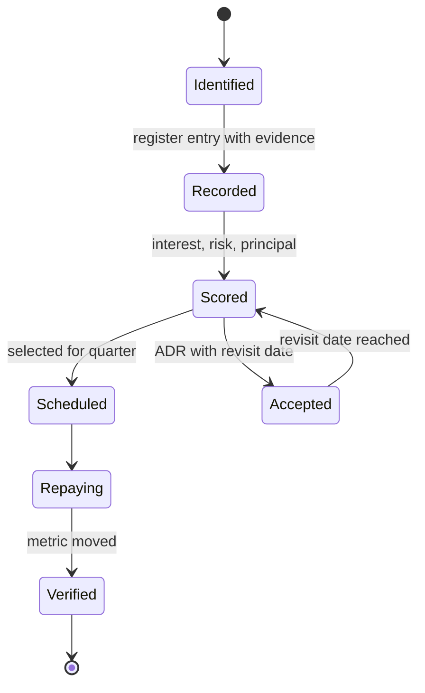

# 10 / 15 — Technical Debt: Recognizing, Measuring, Prioritizing, and Paying It Down

## 1. Lesson metadata

| | |
|---|---|
| **Level** | Professional |
| **Study time** | 4 hours (reading 1.5 h, hands-on 1 h, exercises 1.5 h) |
| **Prerequisites** | [04 / 24 — Refactoring legacy React](../04-react-architecture/24-refactoring-legacy-react.md), [05 / 02 — DRY, KISS, YAGNI](../05-design-patterns/02-dry-kiss-yagni.md), [08 / 14 — Linting and static analysis](../08-testing-and-quality/14-linting-and-static-analysis.md), [13 — Application migrations](./13-application-migrations.md), [14 — Multi-team collaboration](./14-multi-team-collaboration.md) |
| **Next** | [16 — Architecture decision records](./16-architecture-decision-records.md) |
| **Related** | [07 / 23 — Counterproductive optimizations](../07-performance/23-counterproductive-optimizations.md), [12 — Backward compatibility](./12-backward-compatibility.md), [Phase 11 — Large-scale refactoring](../11-senior-and-architect-mastery/03-large-scale-refactoring.md) |

**Learning objectives.** After this lesson you can:
1. Define technical debt precisely, separating it from bugs, mess, and missing features.
2. Classify debt (deliberate/inadvertent, prudent/reckless; code, architecture, test, dependency, documentation, process).
3. Make debt visible with a register, hotspot analysis, and a small set of leading indicators.
4. Prioritize debt by interest (ongoing cost), blast radius, and payoff cost using an explicit model.
5. Choose among repayment strategies (opportunistic, scheduled, migration, rewrite, accept) and fund them sustainably.
6. Recognize React-specific debt patterns and their remedies.
7. Communicate debt to non-engineers in terms of delivery speed, risk, and cost.

**Concepts covered:** debt metaphor (principal, interest), Fowler's debt quadrant, hotspots (churn × complexity), debt register, interest rate, bus factor, flag debt, dependency debt, test debt, documentation debt, architectural debt, ratchets, boy-scout rule, debt budget, risk-based prioritization, stakeholder communication.

---

## 2. Deep conceptual explanation

### 2.1 What problem is this lesson solving?

Every codebase that survives accumulates decisions that were reasonable at the time and expensive later. If you do nothing, delivery slows, defects rise, and engineers leave. If you try to fix everything, you never ship. **Technical debt management is the practice of making these trade-offs visible and deliberate**, so that the organization chooses which costs to carry and which to pay.

### 2.2 The metaphor, precisely

Ward Cunningham coined the "debt" metaphor for the case where shipping with a *current understanding* of the domain is acceptable, provided you later refactor the code to reflect what you learned; unrefactored code accrues "interest" in the form of extra effort for every change. Over time, the term was stretched to cover any bad code. For engineering decisions, it is more useful to keep the original economic meaning:

| Term | Meaning in software |
|---|---|
| **Principal** | The work needed to bring the code to the desired state (e.g., 3 weeks to untangle the order module) |
| **Interest** | The *recurring* extra cost of working with the code as it is (slower changes, more bugs, workarounds) |
| **Interest rate** | How fast interest accrues: depends on how often the area changes and how many people touch it |
| **Default** | The debt becomes unpayable or catastrophic: an outage, a security breach, an unmaintainable module that must be rewritten |
| **Leverage** | Taking on debt consciously to hit a market window |

**Key insight:** debt in code nobody touches costs almost nothing. A gnarly, stable module that works and has no change planned has a near-zero interest rate; refactoring it is often a poor investment. A mediocre module changed daily by five teams has a high rate. This is why *hotspots* matter more than aesthetics.

### 2.3 Not everything is debt

| Thing | Is it debt? | Why |
|---|---|---|
| A bug | No (defect) | Behavior deviates from intent; fix it as a bug. A *class* of recurring bugs from a structural cause can indicate debt. |
| A missing feature | No | Roadmap item |
| Code you dislike stylistically | Usually no | Preference without measurable cost is not debt |
| Code that works but is slow to change | **Yes** | Interest paid on every change |
| Outdated dependency with known CVEs | **Yes** (and risk) | Principal grows with each major; risk is non-linear |
| Outdated dependency, no CVEs, still works | Maybe | Cost may be deferred; watch the support window |
| Missing tests in a high-change area | **Yes** | Each change costs more and has more risk |
| Missing tests in stable, low-risk code | Weak | Low interest |
| Stale documentation | **Yes** | Onboarding and incident costs |
| A prototype in production | **Yes** | Often deliberate debt that was never repaid |

### 2.4 The debt quadrant

Martin Fowler's *Technical Debt Quadrant* (building on Steve McConnell's work) classifies debt by two questions: *was it deliberate?* and *was it prudent?*

| | **Reckless** | **Prudent** |
|---|---|---|
| **Deliberate** | "We don't have time for design." Skipping tests and structure with no plan to repay | "We must ship now and deal with the consequences." Conscious trade-off with a repayment plan |
| **Inadvertent** | "What's layering?" Lack of knowledge/skill | "Now we know how we should have done it." Learning from experience; the design that was right at the time is no longer |

Practical consequences: **prudent-deliberate** debt is a legitimate tool (record it in an ADR with a repayment trigger, [16](./16-architecture-decision-records.md)); **reckless-deliberate** needs a conversation about incentives; **reckless-inadvertent** needs training, review, and mentoring; **prudent-inadvertent** is unavoidable and healthy: it is the cost of learning, repaid through refactoring.

### 2.5 Kinds of debt in a React codebase

| Kind | Examples | Typical interest |
|---|---|---|
| **Code-level** | 1,500-line components; deeply nested conditionals; duplicated logic; `any` | Slow comprehension, bug-prone edits |
| **State-architecture** | Server data copied into global store; prop drilling through 8 layers; contexts that re-render the world ([07 / 06 — Context propagation cost](../07-performance/06-context-propagation-cost.md)) | Performance regressions, inconsistent data |
| **Effect misuse** | Effects that synchronize state with state ([03 / 07](../03-react-state-and-hooks/07-you-might-not-need-an-effect.md)); missing cleanup | Race conditions, flaky UI |
| **Type debt** | `any`, `as` casts, `// @ts-ignore`, loose `strict` | Hidden runtime errors; fear of refactoring |
| **Test debt** | Tests tied to implementation (Enzyme-style), snapshot spam, no integration tests, flaky e2e | Refactors blocked, false confidence |
| **Dependency debt** | Unmaintained libraries; multiple majors behind; deprecated React APIs | Security exposure; blocked upgrades ([10 / 07](./07-dependency-security.md)) |
| **Architectural** | No boundaries, cyclic imports, a shared `utils` blob, a monolithic bundle | Cross-team friction ([14](./14-multi-team-collaboration.md)), slow builds |
| **Flag debt** | Feature flags never removed; combinations untested | Complexity, dead code, risk when someone flips an old flag |
| **Build/infra debt** | Slow CI, custom webpack config nobody understands | Developer time lost daily |
| **Documentation/knowledge debt** | Undocumented decisions; single person knows the flow | Bus factor; slow incident response |
| **Design-system debt** | Duplicated components, inconsistent tokens | Inconsistent UX, a11y gaps ([11](./11-design-system-governance.md)) |
| **Accessibility debt** | Missing semantics, keyboard traps | Legal/ethical risk, rework ([10 / 08](./08-accessibility-as-architecture.md)) |

### 2.6 Why debt accumulates: the dynamics

1. **Deadline pressure** with no explicit repayment mechanism.
2. **Learning** (prudent-inadvertent): the domain model changes, the code does not.
3. **Copy-paste at scale** when abstraction is expensive or ownership is unclear.
4. **Ecosystem churn**: dependencies age, even if your code does not.
5. **Missing feedback**: nobody measures the cost, so it is invisible to decision-makers.
6. **Local optimization**: each team makes sensible choices that jointly produce global complexity.
7. **Success**: the scale of usage exceeds what the original design assumed.

A *vicious circle* exists: debt slows delivery → deadline pressure increases → more shortcuts → more debt. Breaking it requires explicit capacity for repayment and visible metrics.

### 2.7 Measuring debt without pretending to precision

No tool yields "your debt is $1.2M". Useful signals are comparative and trend-based.

| Signal | How to get it | What it suggests |
|---|---|---|
| **Churn × complexity hotspots** | `git log` file-change counts; cyclomatic/cognitive complexity from ESLint (`complexity`) or analysis tools | Files that change often *and* are complex: highest interest |
| **Lead time and cycle time** | Issue tracker + VCS data | Rising trend suggests friction |
| **Change failure rate / bug density by module** | Incident data tagged to modules | Modules with repeated defects |
| **Build and test time** | CI metrics | Infrastructure debt |
| **Dependency freshness** | Tools such as `npm outdated`, Renovate dashboards | Dependency debt and its trend |
| **Type-escape count** | Count of `any`, `as unknown as`, `@ts-ignore` | Type debt (as a ratchet) |
| **Flag count and age** | Flag platform data | Flag debt |
| **Onboarding time / "first PR" time** | Survey/HR data | Knowledge debt |
| **Developer survey** | Short quarterly survey ("which areas slow you down most?") | Qualitative hotspot candidates |
| **Bus factor** | Authors of changes per module | Concentrated knowledge |

Beware metric gaming (Goodhart's law): once a number becomes a target, it ceases to be a good measure. Keep a *few* signals, review them with judgment, and never tie individual performance to them.

### 2.8 Prioritizing: interest, risk, and payoff

A transparent model beats a gut-feel backlog. A simple scoring approach:

```text
priority = (interest per month × expected months of continued use + risk exposure) / principal
```

- **Interest per month**: engineer-hours lost, estimated by asking owners ("each change here costs ~2 extra days; ~4 changes a month → ~8 days").
- **Months of continued use**: if the area will be deleted in 3 months, interest is multiplied by 3, not 36.
- **Risk exposure**: probability × impact of a failure (security, outage, compliance), expressed in the same units where possible (expected hours/cost).
- **Principal**: the estimated effort to fix, including migration and risk.

Estimates are rough; the value is in forcing a conversation about *interest*, which is usually ignored. Combine with *strategic alignment*: debt blocking an upcoming roadmap item gets priority because the interest is about to spike.

### 2.9 Repayment strategies

| Strategy | When | Mechanism | Risk |
|---|---|---|---|
| **Opportunistic (boy-scout rule)** | Small debt in areas you are already changing | "Leave it better than you found it"; refactor within the feature PR (separate commit) | Scope creep; reviewers overwhelmed |
| **Scheduled debt capacity** | Steady background interest across the codebase | A fraction of each sprint reserved (commonly 10–20%; a heuristic, not a standard) | Gets cannibalized by deadlines |
| **Dedicated project** | Large, high-interest area | Time-boxed, with outcome metrics | Never-ending project; unclear done |
| **Migration** ([13](./13-application-migrations.md)) | Foundation change | Strangler, codemods, ratchet | Dual-stack drag |
| **Pre-feature refactor ("make the change easy, then make the easy change")** | Debt in the path of a planned feature | Refactor first, then implement | Appears as delay to stakeholders |
| **Rewrite/replace** | Module is fundamentally wrong and small enough | Replace behind an interface | Hidden requirements, over-run |
| **Delete** | Unused code/flags/features | Remove | Missing dependents (check usage data) |
| **Accept** | Low interest or short remaining life | Document in an ADR with a revisit date | Becomes permanent silently |

**Deleting** is the most underrated payment: dead code has principal (cognitive load, build time) and no value. Use coverage in production, route analytics, and flag evaluation logs to find it.

### 2.10 Communicating debt to stakeholders

Non-engineers respond to: *delivery speed* ("changes in checkout take 3x longer than in search"), *risk* ("unsupported library with no security patches"), *cost* ("CI wastes 40 engineer-hours per week"), and *options* ("pay now for 3 weeks, or add 30% to each feature in this area for the next year"). Avoid "we need to refactor because the code is ugly". Use data from §2.7 and a concrete before/after: "After this change, adding a payment method is a 2-day task instead of 2 weeks". Make the **cost of delay** visible alongside the cost of repayment.

### 2.11 Common misconceptions

| Misconception | Reality |
|---|---|
| "Technical debt is bad code." | Debt is a trade-off with interest; some is deliberate and fine. Bad code that is never touched may cost nothing. |
| "We'll fix it later." | "Later" needs a trigger, an owner, and capacity; otherwise "later" is "never". |
| "Refactoring is not delivering." | Refactoring that reduces lead time *is* delivering, measured over time. |
| "All debt must be paid." | Pay debt with high interest or high risk; accept or delete the rest. |
| "A rewrite will clear the debt." | A rewrite creates new debt and discards embedded knowledge; sometimes right, often not. |
| "Tools can compute our debt." | Tools give proxies. Judgment and local knowledge decide. |

---

## 3. Internal mechanics

### 3.1 Why interest compounds

**Teaching model.** Each change to a debt-laden area has a *cost multiplier* `m > 1` relative to a clean area. If `f` changes per month touch that area, the monthly interest is `f × base_cost × (m − 1)`. Compounding appears when workarounds (feature flags, special cases) are added on top of debt: each workaround raises `m` for future changes, and each new dependent increases `f`'s blast radius. Moreover, low confidence causes *defensive behavior*: engineers avoid refactoring because they fear regressions, so debt accrues faster in areas with low test coverage.

### 3.2 Hotspot analysis mechanics

Churn × complexity is a heuristic popularized by Adam Tornhill's *Your Code as a Crime Scene* (behavioral code analysis). **Public fact:** version control history contains per-file change frequency; static analysis yields complexity measures. **Teaching model:** plot files with churn on one axis and complexity on the other; the top-right quadrant is where defects and slowdowns concentrate. **Implementation detail:** exact measures (lines of code as a complexity proxy vs cyclomatic complexity vs cognitive complexity) vary; lines of code correlates well enough for a first pass.



### 3.3 Flags as debt

Each boolean flag doubles the possible states of the system. With `n` independent flags there are `2^n` configurations, of which you test few. A removed flag eliminates a branch in code and in your test matrix. A flag that was fully rolled out two years ago is dead code in disguise. **Lifecycle:** create (owner, purpose, expiry) → rollout → full enablement → *remove code paths and flag* → archive. The last step is the one organizations skip; automate reminders and CI failures for expired flags.

### 3.4 Dependency debt mechanics

Dependency age is not linear in cost. Staying one major version behind is cheap; staying four behind may require sequential upgrades, each with breaking changes, and may block other upgrades through peer dependency chains ([12](./12-backward-compatibility.md)). Meanwhile security exposure is determined by *specific advisories* and *reachability* of the vulnerable code path, not by age. Therefore: small regular upgrades (automated PRs with CI) are cheaper than periodic large ones; adopt a policy per dependency tier (framework-critical vs dev tool).

### 3.5 Type debt as a ratchet

TypeScript provides escape hatches: `any`, type assertions (`as`), `// @ts-ignore`, `// @ts-expect-error`, non-null assertions (`!`). `@ts-expect-error` is preferable to `@ts-ignore` because it fails when the error disappears, so stale suppressions surface. Counting suppressions in CI and requiring the count never rises is a cheap, effective ratchet.

---

## 4. Step-by-step execution walkthrough: running a debt review for a product team

Context: a team of 8 owns a customer portal (React 18, Redux, mixed JS/TS). Velocity has dropped; stakeholders want a roadmap commitment.

1. **Set the frame (day 1).** Define what the review is for: decide what to fix *this quarter* and what to document and defer. Time-box to one week.
2. **Collect objective signals (days 1–2).**
   - Hotspots: script over `git log` for the last 12 months (§5.2).
   - CI duration trend and flaky test list.
   - Dependency report: majors behind, deprecated packages, advisories.
   - Type-escape counts and flag inventory with ages.
   - Incident/bug tags by module over six months.
3. **Collect subjective signals (day 2).** 15-minute survey: "Top three places where you lose time", "Where do you fear to make changes?". Tally by area.
4. **Triangulate (day 3).** Items that appear in both objective and subjective lists get nominated. Example: `OrderSummary.tsx` (high churn, 1,300 lines, mentioned by 6/8 engineers, tagged in 4 incidents).
5. **Record in the debt register (day 3).** Each entry: description, area, type, evidence, estimated interest, estimated principal, risk, proposed strategy, owner, trigger.
6. **Score and select (day 4).** Use the model from §2.8 with the team; pick a *small* set (e.g., three items) matching available capacity; explicitly label others as "accepted until X".
7. **Align with roadmap (day 4).** Pre-feature refactors attach to planned features (e.g., "Add invoice download" requires the order summary split).
8. **Communicate (day 5).** One-page summary for stakeholders: what we will fix, expected benefit (lead time reduction, risk removed), cost, and what we deliberately leave.
9. **Execute with guardrails.** Small PRs, tests added before refactoring, ratchets to prevent recurrence, tracked outcomes.
10. **Review outcomes next quarter.** Did the targeted metrics move? Adjust estimates; update the register; delete resolved entries.

---

## 5. Code examples

### 5.1 Minimal example: a debt marker convention enforced by lint

Convention: any deliberate shortcut is annotated with a ticket and owner so it is searchable and reviewable.

```ts
// DEBT(PORTAL-482, owner: team-orders, until: 2026-03-31): duplicates tax rules from backend until /v2/quote ships.
function estimateTax(amount: number, country: string): number {
  return country === 'DE' ? amount * 0.19 : amount * 0.2;
}
```

```js
// scripts/check-debt-markers.mjs — fails if a DEBT comment lacks a ticket, or is past its date
import { readFileSync } from 'node:fs';
import { execSync } from 'node:child_process';

const files = execSync('git ls-files "src/**/*.ts" "src/**/*.tsx"', { encoding: 'utf8' }).split('\n').filter(Boolean);
const re = /DEBT\(([A-Z]+-\d+),\s*owner:\s*([\w-]+),\s*until:\s*(\d{4}-\d{2}-\d{2})\)/;
const today = new Date().toISOString().slice(0, 10);
let failures = 0;

for (const f of files) {
  readFileSync(f, 'utf8').split('\n').forEach((line, i) => {
    if (!line.includes('DEBT')) return;
    const m = re.exec(line);
    if (!m) { console.error(`${f}:${i + 1} malformed DEBT marker`); failures++; return; }
    if (m[3] < today) { console.error(`${f}:${i + 1} expired on ${m[3]} (${m[1]}, ${m[2]})`); failures++; }
  });
}
process.exit(failures ? 1 : 0);
```

**Line notes.** String comparison of ISO dates works lexicographically. `git ls-files` with quoted globs relies on git pathspec matching (verify on your shell). Expired markers fail CI on purpose: the expiry converts "later" into a decision (extend with justification, or fix). Trade-off: failing CI on a date can block unrelated work; some teams surface it as a warning or a weekly report instead. Choose by culture.

### 5.2 Practical: a hotspot script (churn × size)

```ts
// scripts/hotspots.ts — run with tsx: churn from git history, size as complexity proxy
import { execSync } from 'node:child_process';
import { readFileSync, existsSync } from 'node:fs';

const since = process.argv[2] ?? '12 months ago';
const log = execSync(
  `git log --since="${since}" --name-only --pretty=format: -- "src/**/*.ts" "src/**/*.tsx"`,
  { encoding: 'utf8', maxBuffer: 64 * 1024 * 1024 }
);

const churn = new Map<string, number>();
for (const file of log.split('\n').filter(Boolean)) churn.set(file, (churn.get(file) ?? 0) + 1);

const rows = [...churn.entries()]
  .filter(([f]) => existsSync(f))                      // skip deleted/renamed files
  .map(([file, changes]) => {
    const loc = readFileSync(file, 'utf8').split('\n').length;
    return { file, changes, loc, score: changes * Math.log2(loc + 1) };
  })
  .sort((a, b) => b.score - a.score)
  .slice(0, 15);

console.table(rows);
```

**Interpretation notes.** `changes` counts commits touching a file, which over-counts files in huge refactor commits and ignores renames (use `git log --follow` per file for accuracy at higher cost). The `log2` weighting is arbitrary: it prevents huge files from dominating by size alone. **This is a prioritization aid**, not a verdict: a top-ranked file may be a legitimately central, well-structured module (e.g., a routes file).

**Predict:** A generated file (`api-types.ts`, 12k lines, regenerated weekly) appears first. Is it debt? No: it is a false positive; exclude generated files via a path filter or `.gitattributes` `linguist-generated` convention.

### 5.3 Practical: a React debt example and a safe, incremental refactor

Before (a typical hotspot component):

```tsx
function OrderSummary({ orderId }: { orderId: string }) {
  const [order, setOrder] = useState<Order | null>(null);
  const [promo, setPromo] = useState('');
  const [discount, setDiscount] = useState(0);
  const [total, setTotal] = useState(0);
  const [error, setError] = useState<string | null>(null);

  useEffect(() => {
    fetch(`/api/orders/${orderId}`).then(r => r.json()).then(setOrder).catch(e => setError(String(e)));
  }, [orderId]);

  useEffect(() => {                        // derived state synchronized via an effect
    if (order) setTotal(order.items.reduce((s, i) => s + i.price * i.qty, 0) - discount);
  }, [order, discount]);

  // ... 900 more lines: promo validation, shipping, tax, rendering
}
```

Problems (debt categories): fetching in component without cancellation ([06 / 02](../06-data-fetching-and-state-ecosystems/02-cancellation-and-race-conditions.md)), derived state in state + effect ([03 / 17](../03-react-state-and-hooks/17-derived-state.md)), mixed responsibilities ([04 / 03](../04-react-architecture/03-component-responsibility.md)), no types for the response (JSON `any`), untestable.

**Refactoring plan as a sequence of small, behavior-preserving PRs**, each shippable:

1. **Characterization tests**: write RTL tests that capture current behavior (render with mocked network, assert totals, promo, errors) — including known quirks. ([08 / 03](../08-testing-and-quality/03-react-testing-library.md), [08 / 06](../08-testing-and-quality/06-mocking-strategies-and-msw.md))
2. **Extract pure functions**: `calculateTotal(order, discount)` unit-tested.
3. **Remove derived state**: compute `total` during render.
4. **Move fetching to a server-state hook** (`useOrder(orderId)`) with cancellation/caching ([06 / 08](../06-data-fetching-and-state-ecosystems/08-tanstack-query.md)).
5. **Split by responsibility** into `PromoCodeForm`, `ShippingSection`, `TotalsPanel`.
6. **Add a ratchet** (file size/complexity lint threshold for this directory).

After step 3:

```tsx
function OrderSummary({ orderId }: { orderId: string }) {
  const { data: order, error } = useOrder(orderId);   // step 4 later; stub with the existing fetch effect meanwhile
  const [discount, setDiscount] = useState(0);
  const total = order ? calculateTotal(order, discount) : 0;   // derived during render
  // ...
}
```

Why this order: tests first protect behavior; pure extraction is lowest risk; removing derived state eliminates a render-order bug class (one extra render with stale total) without touching network; fetching change is riskier and comes after tests exist.

### 5.4 Incorrect example: "stop the world" refactor

```text
Ticket: "Refactor OrderSummary" — estimate 6 weeks — assigned to one engineer — branch lives for 6 weeks.
Result: conflicts with 11 feature PRs, behavior regression discovered in week 7, 'we don't do refactors anymore'.
```

### 5.5 Corrected: debt repayment embedded in delivery

```text
Feature: "Add invoice download to OrderSummary"
  PR 1: characterization tests (no behavior change)
  PR 2: extract calculateTotal + remove derived state
  PR 3: extract TotalsPanel (new feature goes here)
  PR 4: implement invoice download (feature)
Each PR deployable; stakeholders see feature delivered with a slight lead-time increase on PR 1-3.
```

### 5.6 Advanced: flag expiry check driven by a flag registry

```ts
// flags/registry.ts
export const flags = {
  'checkout.new-payment-form': { owner: 'team-checkout', created: '2025-09-01', expires: '2026-01-15', note: 'Remove after 100% rollout' },
  'cart.zustand-store':        { owner: 'team-cart',     created: '2026-02-10', expires: '2026-05-01', note: 'Migration flag; see 13' },
} as const;
export type FlagKey = keyof typeof flags;

// Using the registry key type means unknown flags are compile errors,
// and a registry entry is the single place to see owner + expiry.
```

```ts
// scripts/check-flags.ts
import { flags } from '../flags/registry';
const today = new Date().toISOString().slice(0, 10);
const expired = Object.entries(flags).filter(([, f]) => f.expires < today);
if (expired.length) {
  console.error('Expired flags (remove code paths and registry entries):');
  for (const [k, f] of expired) console.error(` - ${k} (owner ${f.owner}, expired ${f.expires})`);
  process.exit(1);
}
```

Also scan source for `useFlag('...')` string literals not present in the registry (dead-flag detection), and for registry entries with zero usages (already removed from code).

---

## 6. Visual explanations

### 6.1 Interest vs principal



### 6.2 Cost of change over time

```text
effort per feature
  ^
  |                                 ......  no repayment
  |                           ......
  |                   ........
  |         ..........             ____ _____ _____ steady repayment (slower start, flat later)
  |   ......   ______ _____ _____
  +---------------------------------------------> time
```

(Conceptual illustration; actual curves depend on the codebase.)

### 6.3 Debt lifecycle



### 6.4 Prioritization matrix

```text
                 Low principal        High principal
High interest |  DO NOW (quick wins) | PLAN (project / pre-feature refactor)
Low interest  |  Opportunistic       | ACCEPT or DELETE; revisit on trigger
```

---

## 7. Alternative approaches and trade-offs

| Criterion | Opportunistic (boy-scout) | Fixed capacity (e.g., 15%) | Dedicated "debt sprints" | Pre-feature refactor | Rewrite |
|---|---|---|---|---|---|
| Predictability | Low | High | Medium | Medium | Low |
| Stakeholder visibility | Hidden in features | Visible as allocation | Very visible | Attached to features | Very visible |
| Fits large structural debt | No | Partly | Partly | If in path of features | Yes (if justified) |
| Risk of being cut | Low (invisible) | High under pressure | High | Medium | Medium |
| Merge conflicts | Low | Low | Medium | Low | High |
| Measurable | Hard | Yes | Yes | Yes | Yes |
| Best when | Healthy codebase | Steady accrual | Backlog crisis | Roadmap known | Module is wrong and small |

**Scenario where paying down debt is NOT best.** A startup 3 months before a decisive launch or funding event whose product direction might change: pay only debt that would endanger the launch (security, data loss), document everything else, and revisit with a firm date. Another scenario: a module scheduled for deletion in the next quarter: patch, do not refactor.

**Scenario where "no debt policy" fails.** Treating all shortcuts as forbidden causes missed opportunities and hidden debt (people take shortcuts silently). Healthy cultures allow deliberate, recorded debt.

---

## 8. Best practices and anti-patterns

### 8.1 Best practices
- **Keep a debt register** visible to the team and product management; prune it regularly.
- **Tie debt to evidence**: incidents, cycle time, onboarding pain.
- **Tag deliberate shortcuts** with a ticket, owner, and expiry.
- **Add ratchets** (type escapes, lint exceptions, flag age, file size) to prevent regression.
- **Refactor under tests**; write characterization tests first.
- **Separate refactor commits from behavior changes** so reviewers and `git bisect` can follow.
- **Delete aggressively**: unused components, flags, routes, dependencies.
- **Automate dependency upgrades** with small PRs and good CI ([10 / 07](./07-dependency-security.md)).
- **Reserve capacity** and protect it; report outcomes ("lead time in orders module fell 30%").
- **Include debt in estimates** for features in poor areas (explicit "tax").

### 8.2 Beginner mistakes
- Equating style disagreements with debt.
- Starting a large refactor without tests.
- Fixing symptoms (adding `useMemo` everywhere) rather than structure ([07 / 23](../07-performance/23-counterproductive-optimizations.md)).

### 8.3 Experienced-developer mistakes
- **Gold-plating**: building the perfect abstraction for code that rarely changes.
- **Debt hoarding**: a backlog of 800 items nobody reads.
- **Uncommunicated trade-offs**: taking debt without informing product, who then are surprised by slowdowns.
- **Heroic cleanups** that skip review and break behavior.
- **Metric worship**: pushing coverage percentages by writing low-value tests.

### 8.4 Smells
- `// HACK`, `// TODO` with no owner or date.
- 20 `eslint-disable` lines at the top of files.
- Engineers estimate "plus a week" for anything in a particular directory.
- A flag named `newCheckoutV2Final2`.
- Retrospectives repeatedly list the same pain.

### 8.5 Justified exceptions
- Prototype/spike code intended for deletion (label it, put it in a separate folder, set a deletion date).
- Taking on debt to meet a regulatory deadline or a time-boxed commercial window, with a written repayment plan.
- Leaving complex, stable, well-understood legacy code alone.

---

## 9. Real-world application

**E-commerce.** Seasonal peaks create hard deadlines. A mature approach: declare a *code freeze plus debt-repayment window* after peak season, funded in the roadmap. Hotspots: cart/checkout and pricing logic: concentrate characterization tests there before touching.

**Dashboards.** Chart libraries and data-grid dependencies tend to be heavily coupled; swapping them later is expensive. Wrap them behind an adapter interface from the start ([05 / 15](../05-design-patterns/15-adapter-strategy-factory.md)) to cap future principal.

**Finance.** Compliance may force repayment (end-of-life frameworks) on a timeline. Reflect this as a *risk-driven* priority: the cost of non-compliance exceeds productivity interest.

**Forms.** Debt appears as 30-field forms built with ad hoc state. Interest: every new field or validation requires touching five places. Repayment: schema-driven forms ([03 / 21](../03-react-state-and-hooks/21-forms-and-complex-state.md)).

**Auth.** Security-sensitive debt (home-grown token handling, outdated libraries) is high *risk exposure*, even with low change frequency; prioritize by risk, not by churn.

**Multi-team.** Cross-team debt (shared `utils`, no ownership) has no natural payer. Create an explicit owner (platform team) with a roadmap and a budget, or the interest is shared by all and paid by no one.

---

## 10. Debugging and troubleshooting

"Debugging debt" means diagnosing why velocity is falling and whether debt is the cause.

| Symptom | Investigation | Possible root cause | Action | Validate |
|---|---|---|---|---|
| Features in area X take 3x longer | Compare cycle time by area; interview engineers | High-interest debt in X (coupling, no tests) | Pre-feature refactor; characterization tests | Cycle time trend in X |
| Same bug class reappears | Tag bugs by cause | Structural issue (shared mutable state, effect-based sync) | Fix the structure and add a test/lint rule | Recurrence rate |
| Nobody wants to touch module Y | Survey; git blame concentration | Fear due to missing tests/knowledge | Tests, documentation, pairing | Contributors count; willingness |
| CI takes 40 min | CI timing breakdown | Test debt (slow e2e), build config | Parallelize, affected-only, remove obsolete tests | CI p50/p90 |
| Upgrade stuck for months | Dependency graph; peer conflicts | Accumulated dependency debt | Sequence upgrades; replace or fork blocker | Version lag |
| Performance regressions after small changes | Profiler; render counts ([07 / 02](../07-performance/02-profiler-workflows.md)) | Context/state architecture debt | State colocation; split contexts | Render counts; INP |
| Flaky tests | Failure statistics per test | Timing-dependent tests, shared state | Fix or quarantine with deadline | Flake rate |

**Evidence-first rule.** Before proposing a refactor, collect at least two independent signals (data + testimony). If you cannot, you may be solving an aesthetic problem.

---

## 11. Exercises

### Level A — Knowledge
**A1.** Define principal and interest in the context of technical debt.
**A2.** Describe the four quadrants of Fowler's debt model with one React example each.
**A3.** Why is a stable, ugly module often not worth refactoring?
**A4.** Give three signals useful for finding debt hotspots.
**A5.** Why is `@ts-expect-error` preferable to `@ts-ignore` for managing type debt?

### Level B — Code comprehension
**B1.** In §5.1, a marker has `until: 2026-03-31` and the date today is 2026-04-02. What does the script do and why does the comparison work?
**B2.** In §5.2, why filter with `existsSync(f)`? What does `changes * Math.log2(loc + 1)` represent and what are its weaknesses?
**B3.** In §5.3's "after step 3" snippet, why is removing the `total` state safer than keeping it? Describe a bug that the effect-synchronized `total` could show.

### Level C — Implementation
**C1.** Write a CI ratchet script counting `@ts-ignore` and `as any` occurrences in `src/` and failing when the count increases versus a committed baseline.
**C2.** Write `calculateTotal(order, discount)` as a pure function with unit tests including edge cases (empty order, discount larger than subtotal, floating-point money).

### Level D — Debugging
**D1.** Velocity for the "Reports" area has halved over six months, but the code looks "fine". Outline an investigation to determine whether it is debt.
**D2.** A team repaid debt for a quarter, and yet lead time did not improve. List five hypotheses and how to test each.

### Level E — Architecture decisions
**E1.** You have capacity for one: (a) upgrading from React 17 to 19 across a 400-component app; (b) splitting a 1,500-line `OrderSummary` that changes weekly; (c) replacing a home-grown auth token module with a standard library (no incidents so far). Rank and justify, stating assumptions.
**E2.** Design a debt policy for a 6-team org: capacity, register, scoring, ratchets, communication cadence, and escalation.

### Level F — Expert challenge
**F1.** The CTO asks you to justify a six-month, four-engineer "platform debt" program (cost ≈ 2 engineer-years). Build the business case: baseline measurement, target outcomes, scope, phasing with kill criteria, and how you will prove the benefit.

---

## 12. Detailed answers and explanations

> Attempt the exercises first.

**A1.** Principal is the effort required to bring the code to the desired state (the one-time payment). Interest is the recurring extra cost of working with the code as it is (slower changes, defects, workarounds). Interest depends on how often the area is changed. Wrong answer: "principal = number of bad files".

**A2.** Deliberate/prudent: shipping a feature with a duplicated tax rule, documented with a ticket and plan. Deliberate/reckless: skipping tests and boundaries "because deadlines", with no plan. Inadvertent/reckless: using effects to sync derived state because the team did not know better. Inadvertent/prudent: after a year, the team realizes that their domain model should split "order" and "quote", and the previous structure no longer fits. The key distinction is about knowledge and intent, which determines the right remedy (record and schedule, incentive conversation, training, or refactoring).

**A3.** Because interest is proportional to change frequency. If no one needs to change it, the recurring cost is near zero, while the principal and the risk of regression from touching it are real. Also, the knowledge of how it works may be embedded in its quirks. Exception: if it has a security exposure, or is blocking an upgrade.

**A4.** Any three: churn × complexity, bug/incident density by module, lead-time by area, developer survey results, bus factor, CI time contribution, dependency age/advisories, flag age, type-escape counts. Strong answers combine objective with subjective signals.

**A5.** `@ts-expect-error` produces an error if the line below no longer has an error, so stale suppressions are surfaced and can be removed. `@ts-ignore` silently stays forever and can mask new, different errors. Also, `@ts-expect-error` with a description acts as documentation. Caveat: in test files that intentionally test invalid usage it is also the correct choice.

**B1.** The regex matches, `m[3]` is `'2026-03-31'`, `today` is `'2026-04-02'`; `'2026-03-31' < '2026-04-02'` is true (ISO 8601 dates compare correctly lexicographically because year, month, day are fixed-width and ordered most-to-least significant), so it logs "expired" and the failure count increments; the process exits 1, failing CI. Wrong answer: "it parses to Date" — the code compares strings. Edge: if `today` is derived via `toISOString`, it is UTC; near midnight the local date can differ.

**B2.** Files deleted or renamed since the commit still appear in git history; reading them would throw `ENOENT`. The score weights churn by the log of size so that very large files do not dominate; it ranks frequently changed, larger files higher. Weaknesses: LOC is a crude complexity proxy; commit count is sensitive to commit style (squashes vs many small commits); mass-reformat commits inflate churn; generated files; renames; it ignores who changed it and why. Use it to start conversations, not to decide.

**B3.** A state variable that is a function of other state must be kept in sync via an effect, which runs *after* the render commit; so there is a render where `order` or `discount` has changed but `total` is stale (visible as a flicker or, worse, a stale value captured by an event handler or analytics call during that render). Computing `total` during render guarantees consistency in the same render and removes an effect ([03 / 17](../03-react-state-and-hooks/17-derived-state.md), [03 / 07](../03-react-state-and-hooks/07-you-might-not-need-an-effect.md)). If calculation is expensive, memoization is an optimization only after measurement ([07 / 04](../07-performance/04-memoization-trade-offs.md)).

**C1.**
```ts
import { execSync } from 'node:child_process';
import { existsSync, readFileSync, writeFileSync } from 'node:fs';

const BASELINE = 'type-escapes.baseline.json';
const count = (pattern: string) => {
  const out = execSync(`git grep -E -c "${pattern}" -- "src/**/*.ts" "src/**/*.tsx" || true`, { encoding: 'utf8' });
  return out.split('\n').filter(Boolean).reduce((n, line) => n + Number(line.split(':').pop()), 0);
};

const current = { tsIgnore: count('@ts-ignore'), asAny: count('as any') };
const baseline = existsSync(BASELINE)
  ? (JSON.parse(readFileSync(BASELINE, 'utf8')) as typeof current)
  : { tsIgnore: Infinity, asAny: Infinity };

let failed = false;
for (const k of Object.keys(current) as (keyof typeof current)[]) {
  if (current[k] > baseline[k]) { console.error(`${k} rose ${baseline[k]} -> ${current[k]}`); failed = true; }
}
if (!failed) writeFileSync(BASELINE, JSON.stringify(current, null, 2) + '\n');
process.exit(failed ? 1 : 0);
```
Notes: `git grep -c` counts matching *lines per file* (`file:count`); a line with two matches counts once. Writing the baseline only when not failed ratchets down automatically; commit the updated file (or have CI bot do it). An ESLint rule (`@typescript-eslint/ban-ts-comment`, `no-explicit-any`) is a stronger alternative for new code; the ratchet handles existing violations. Evaluation criteria: baseline persistence, only decreases allowed, deterministic.

**C2.**
```ts
interface OrderItem { price: number; qty: number } // price in minor units (cents)
interface Order { items: OrderItem[] }

export function calculateTotal(order: Order, discount: number): number {
  const subtotal = order.items.reduce((s, i) => s + i.price * i.qty, 0);
  return Math.max(0, subtotal - discount);
}

// Vitest
import { describe, it, expect } from 'vitest';
describe('calculateTotal', () => {
  it('returns 0 for an empty order', () => expect(calculateTotal({ items: [] }, 0)).toBe(0));
  it('sums price * qty', () => expect(calculateTotal({ items: [{ price: 1999, qty: 2 }] }, 0)).toBe(3998));
  it('never goes negative', () => expect(calculateTotal({ items: [{ price: 500, qty: 1 }] }, 900)).toBe(0));
  it('is exact with integer minor units', () => {
    expect(calculateTotal({ items: [{ price: 10, qty: 3 }] }, 0)).toBe(30); // 0.1*3 in floats would be 0.30000000000000004
  });
});
```
Reasoning: money should be integers in minor units to avoid floating-point error. Edge cases: negative quantities, non-integer price input (validate at the boundary), per-line discounts, rounding of taxes (where banker's vs half-up rounding rules come from business requirements). Evaluation: pure, tested edge cases, money representation justified.

**D1.** Steps: (1) quantify: cycle time and PR sizes in Reports vs other areas over time; (2) check what changed: team turnover, new requirements, dependency changes, test suite state; (3) inspect code: hotspot data, coupling, test coverage and flakiness, review comments themes; (4) interview engineers and look at work items for rework (reopened tickets); (5) look at external dependencies (backend API changes, design churn): the cause may be *not code*; (6) decide: if code-related, run an experiment (pre-feature refactor on the next feature) and compare estimates vs actuals. Evaluation: evidence from several angles; does not assume debt as the answer.

**D2.** Hypotheses: (1) repaid debt in low-interest areas (check: where did the changes land vs where the hotspots are); (2) the bottleneck is process (review latency, release cadence) (check: time in each workflow stage); (3) new debt created as fast as repayment (check: ratchet metrics, new hotspots); (4) metrics measured too early or noisily (check: longer window; control for scope); (5) the real constraint is cross-team dependency or product churn (check: blocked-time data). Each with a data source. Good answers note that proving causality is hard and propose leading indicators.

**E1.** Example ranking with assumptions: (b) first: weekly changes ⇒ high interest, moderate principal, and likely on the roadmap path; (a) second *if* React 17 has end-of-life exposure or blocks libraries, as dependency-driven risk grows non-linearly and could become urgent; it can be staged (17 → 18 → 19) and partly automated by codemods; (c) last unless the auth module is untested or has security exposure: "no incidents so far" is weak evidence for security code; if there is a known vulnerability class (home-grown crypto/token storage), risk-based priority could put (c) first. State the assumptions: the answer is judged by reasoning on interest, risk, principal, and sequencing.

**E2.** Example policy: capacity: each team reserves ~15% (heuristic; adjust from data) tracked in the planning tool; register: a shared repository of entries with required fields; scoring: interest × lifetime + risk over principal, reviewed quarterly; ratchets: type escapes, lint exceptions, flag expiry, bundle size; communication: a quarterly debt report to product/leadership with outcomes; escalation: cross-team or platform debt goes to an architecture forum which assigns an owner and funding; critical risk debt (security, EOL) bypasses scoring with a deadline. Evaluation criteria: explicit mechanisms rather than slogans; mixes capacity with prevention; includes outcomes measurement.

**F1.** Reference outline. *Baseline:* measure lead time, CI duration, change failure rate, dependency age/advisories, onboarding time, defect density in target areas, developer survey scores; compute engineer-hours lost per month attributable to platform issues (e.g., CI wait × engineers × runs). *Targets:* e.g., CI p90 from 40 to 15 min (saves X hours/week), React/TS/tooling on supported versions, eliminate top three hotspot modules' defect classes, flag count halved. *Scope:* limit to items with evidence; explicit non-goals. *Phasing:* three 8-week phases with exit criteria and kill criteria (if phase 1 does not reduce CI time by ≥30%, reconsider); deliver value incrementally rather than at the end. *Benefit proof:* before/after metrics and a control (areas not touched), and survey. *Cost of inaction:* quantify EOL risk, projected interest growth, attrition risk. *Risks:* scope creep, feature pressure cannibalizing capacity (secure explicit commitment), metric gaming. Evaluation: quantification with honest uncertainty, phasing with decision points, communication in business terms.

---

## 13. Senior engineer interview questions

1. **"How do you decide what technical debt to fix?"** *Strong answer:* I estimate interest (how much it slows or endangers work per month, driven by change frequency), the remaining lifetime of the area, risk exposure, and principal; I combine data (hotspots, incidents) with testimony and align with the roadmap. Reason: high change frequency makes interest dominant, and risk can override frequency (security).

2. **"How do you convince product to allow refactoring time?"** Translate to delivery impact and risk with data, offer options (attach to features, reserve capacity, targeted project), define outcomes and kill criteria, and report results. Avoid framing as engineering preference. Causal reasoning: stakeholders optimize for outcomes; show how debt affects outcomes.

3. **"Is all technical debt bad?"** No. Deliberate, prudent debt is a financing tool: it buys time when the value of speed exceeds interest; it needs a recorded repayment trigger. Harm arises from invisible, unowned, reckless debt.

4. **"A team wants to rewrite a module. What do you ask?"** What is the measurable problem; interest vs principal; can it be strangled incrementally ([13](./13-application-migrations.md)); what hidden requirements exist; what tests characterize behavior; what's the timeline and kill criteria; what is the cost of continuing. A rewrite is justified when incremental change cannot reach the target and the module is small enough to replace with confidence.

5. **"How do you keep new debt from accumulating?"** Ratchets, lint rules, review checklists, definition of done including tests/docs, flag expiry, dependency automation, ADRs for conscious trade-offs, and capacity for repayment. Prevention is cheaper than cure; automation scales better than vigilance.

6. **"What's the difference between a bug, a hack, and technical debt?"** A bug is behavior contradicting intent; a hack is a deliberate shortcut; debt is the *ongoing cost* a hack or outdated design imposes. A hack becomes debt when it has future cost and no repayment plan. Treat them differently: fix bugs, record hacks with expiry, schedule debt.

---

## 14. Further learning resources

| Resource | URL | Covers / why | Level | Study |
|---|---|---|---|---|
| Martin Fowler — Technical Debt | <https://martinfowler.com/bliki/TechnicalDebt.html> | The metaphor and its use | Beginner | Whole article |
| Martin Fowler — Technical Debt Quadrant | <https://martinfowler.com/bliki/TechnicalDebtQuadrant.html> | Deliberate/inadvertent × reckless/prudent | Beginner | Whole article |
| Ward Cunningham — Debt Metaphor (video/transcript) | <https://wiki.c2.com/?WardExplainsDebtMetaphor> | Original intent of the metaphor | Intermediate | Whole page |
| Refactoring (Fowler), catalog | <https://refactoring.com/catalog/> | Named refactorings | Intermediate | Browse extract function, split phase |
| Your Code as a Crime Scene (Tornhill) | <https://pragprog.com/titles/atcrime2/your-code-as-a-crime-scene-second-edition/> | Hotspot analysis and behavioral code analysis | Advanced | Hotspots chapters |
| React docs — You Might Not Need an Effect | <https://react.dev/learn/you-might-not-need-an-effect> | Removing effect-based derived state debt | Intermediate | Whole page |
| DORA research | <https://dora.dev/> | Delivery metrics for measuring improvement | Intermediate | Capabilities, metrics |
| typescript-eslint — `ban-ts-comment` | <https://typescript-eslint.io/rules/ban-ts-comment/> | Lint rule for suppression comments | Intermediate | Options |
| Renovate docs | <https://docs.renovatebot.com/> | Automated dependency updates | Intermediate | Configuration options |

URLs in this table were checked for HTTP 200 on 2026-10-22; any still marked *(unverified)* could not be checked automatically (blocked or unreachable). A 200 response does not guarantee the page content still matches the description; if a link has moved, search the site for the quoted title.

---

## 15. Knowledge checkpoint

**You should now understand**
- Debt as a trade-off with principal and interest, and why frequency of change dominates its cost.
- The quadrant and the kinds of debt specific to React codebases.
- How to measure with proxies and prioritize by interest, risk, and principal.
- Repayment strategies, including deleting and consciously accepting debt.

**You should be able to explain without notes**
- Why an ugly stable module may not be worth refactoring.
- How to present a debt case in stakeholder language.
- Why flags and dependencies are forms of debt with expiry.

**You should be able to implement**
- A debt marker checker, hotspot script, ratchets, and a flag registry with expiry; a behavior-preserving refactor sequence under tests.

**You should be able to debug**
- Velocity declines by separating debt from process and requirement causes using data.

**Before moving on:** read [16 — Architecture decision records](./16-architecture-decision-records.md); recording deliberate debt decisions is one of ADRs' most important uses.
