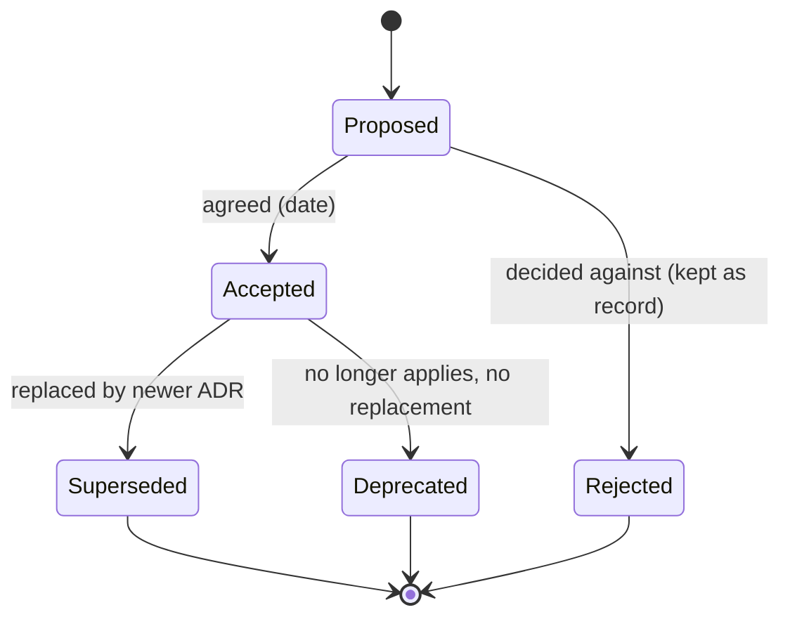
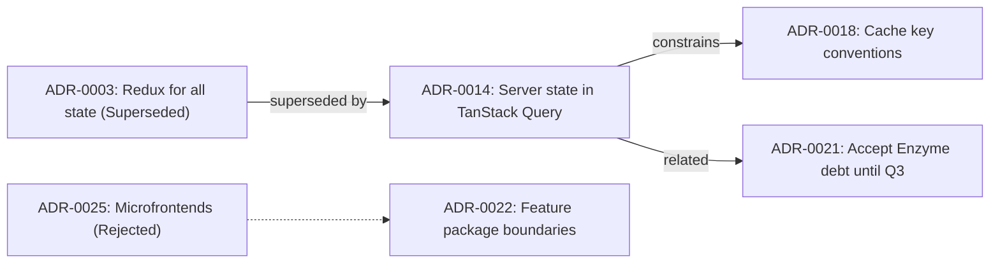
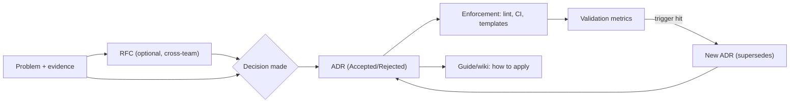

# 10 / 16 — Architecture Decision Records: Capturing Decisions, Context, and Consequences

## 1. Lesson metadata

| | |
|---|---|
| **Level** | Professional |
| **Study time** | 4 hours (reading 1.5 h, writing practice 1.5 h, exercises 1 h) |
| **Prerequisites** | [04 / 01 — Architecture fundamentals](../04-react-architecture/01-architecture-fundamentals.md), [04 / 25 — Architectural fitness and enforcement](../04-react-architecture/25-architectural-fitness-and-enforcement.md), [11 — Design system governance](./11-design-system-governance.md), [14 — Multi-team collaboration](./14-multi-team-collaboration.md), [15 — Technical debt](./15-technical-debt.md) |
| **Next** | [17 — Documentation](./17-documentation.md) |
| **Related** | [Phase 11 — Technical design documents](../11-senior-and-architect-mastery/02-technical-design-documents.md), [Phase 11 — Trade-off analysis](../11-senior-and-architect-mastery/01-trade-off-analysis.md), [06 / 19 — Technology selection matrix](../06-data-fetching-and-state-ecosystems/19-technology-selection-matrix.md) |

**Learning objectives.** After this lesson you can:
1. Explain what an ADR is, what problem it solves, and what it is not (a design doc, a wiki page, a meeting note).
2. Write a high-quality ADR: context with forces, a clear decision, honest alternatives, and consequences including negatives.
3. Manage the ADR lifecycle: proposed, accepted, rejected, deprecated, superseded; never rewrite history.
4. Decide *which* decisions deserve an ADR and keep the log useful as it grows.
5. Integrate ADRs into the repository, review process, and fitness functions.
6. Review someone else's ADR critically.

**Concepts covered:** decision log, ADR formats (Nygard, MADR, Y-statement), architecturally significant decisions, forces, alternatives, consequences, status lifecycle, supersession, immutability, decision drivers, reversibility, "two-way doors", ADR review, linkage to code (enforcement), tooling (adr-tools, log4brains), RFC vs ADR vs design doc.

---

## 2. Deep conceptual explanation

### 2.1 What problem is this lesson solving?

Six months after a decision, a new engineer asks, "Why do we use X instead of Y here?" Typical answers: silence, "I think Maria decided it", or a confident but wrong reconstruction. Without the original reasoning, teams either *repeat* old debates endlessly or *undo* decisions that had good reasons they no longer remember (Chesterton's fence: do not remove a fence until you know why it was built). Conversely, they cling to decisions whose reasons have expired because nobody can see the assumptions.

An **Architecture Decision Record (ADR)** is a short document capturing one architecturally significant decision: the *context* that forced it, the *decision* itself, the *alternatives* considered, and the *consequences* (good and bad). Michael Nygard popularized the lightweight form in a 2011 blog post, "Documenting Architecture Decisions". The practice relies on a few ideas:

1. **Decisions are the unit of architectural knowledge**, not diagrams. A diagram shows *what*; an ADR explains *why*.
2. **Records are append-only.** You do not edit the past; you add a new ADR that supersedes the old one. History becomes a narrative of how understanding evolved.
3. **Short and stored with the code.** If an ADR takes a day to write or lives in a tool nobody opens, it will not be written.

### 2.2 What is "architecturally significant"?

Not every choice needs an ADR. A decision is architecturally significant if it **affects structure, non-functional qualities, dependencies, interfaces, or construction techniques** and is *costly to reverse* or *affects multiple teams*. Heuristics:

| Write an ADR when… | Skip the ADR when… |
|---|---|
| Choosing a framework, state management approach, data-fetching library, styling strategy, test strategy | Choosing a variable naming convention that a linter enforces |
| Setting a rule that other teams must follow (module boundaries, error handling standard) | A local implementation detail inside one component |
| Accepting deliberate technical debt ([15](./15-technical-debt.md)) | Trivial, easily reversed choices |
| Rejecting a popular option (people will ask again) | A decision already documented elsewhere (link to it) |
| A decision with significant trade-offs or dissent | There was only one viable option |
| Changing a previous decision (supersession) | Bug fixes |
| A decision driven by a constraint not visible in code (compliance, contract, org structure) | |

A useful test: *"Would a competent new teammate be surprised, or would they reasonably propose the alternative?"* If yes, record why.

**Reversibility (one-way vs two-way doors).** Jeff Bezos's shareholder-letter metaphor: some decisions are *two-way doors* (cheap to reverse; decide fast, document lightly) and some are *one-way doors* (costly; deliberate more, document thoroughly). Match ADR depth to reversibility.

### 2.3 Anatomy of a good ADR

The classic Nygard format has five parts: **Title, Status, Context, Decision, Consequences**. Extended formats (MADR, "Markdown Any Decision Records" or "Markdown Architectural Decision Records" in different versions) add *decision drivers*, *considered options*, and *pros/cons*. The format matters less than the discipline. A strong ADR contains:

| Section | Purpose | Quality signals |
|---|---|---|
| **Title** | A noun phrase naming the decision (e.g., "Use TanStack Query for server state") | Specific; includes the choice |
| **Status** | Proposed / Accepted / Rejected / Deprecated / Superseded by ADR-NNNN | Dated; links to related ADRs |
| **Context** | Forces at play: requirements, constraints, team skills, scale, deadlines, what is currently broken | Neutral language; facts and numbers; includes constraints that make the decision non-obvious |
| **Decision drivers** (optional) | The criteria used to choose | Prioritized; explicit |
| **Considered options** | Real alternatives, including "do nothing" | At least two; each fairly described |
| **Decision** | "We will…" stated in active voice | Unambiguous; scope boundaries |
| **Consequences** | What becomes easier, what becomes harder, what new problems arise | Includes negatives; names follow-up work and risks |
| **Validation / Fitness** (optional) | How we'll know it is working or being followed | A lint rule, metric, or review checklist |
| **Revisit trigger** (optional) | Conditions to reconsider | Dates or measurable thresholds |

**Y-statement** (a one-sentence summary used in some formats): *In the context of* [use case], *facing* [concern], *we decided for* [option] *and neglected* [other options], *to achieve* [quality], *accepting that* [downside].

### 2.4 ADR vs RFC vs design doc vs wiki

| Artifact | Purpose | Lifecycle | Length |
|---|---|---|---|
| **RFC / proposal** | Collect input *before* deciding; often cross-team | Open for comment, then closed with an outcome | Medium–long |
| **Design doc / TDD** ([Phase 11 / 02](../11-senior-and-architect-mastery/02-technical-design-documents.md)) | Explain how a particular system or feature will be built | Written pre-implementation, may become stale | Long |
| **ADR** | Record a decision and why | Immutable once accepted; superseded rather than edited | Short (1–2 pages) |
| **Wiki page / guide** | Describe how to do things now | Living, edited | Variable |
| **Meeting notes** | Capture discussion | Archive | Variable |

Typical flow: an RFC gathers opinions → a decision is made → an ADR records it → a guide/wiki explains how to apply it. An ADR may link to the RFC for the full discussion, but should be self-sufficient for the *reasoning*.

### 2.5 Status lifecycle and immutability



Rules:
- **Accepted ADRs are not edited** except to change the status line (e.g., "Superseded by ADR-0014") or fix typos/links. The *new* ADR explains what changed and why.
- **Rejected ADRs are valuable.** They prevent the same proposal returning every year with no new information; if circumstances change materially, a new ADR can revisit it, citing the old one.
- **Numbering is sequential and permanent** (`0001-…`). Do not renumber; gaps are fine.

### 2.6 Where ADRs live

Commonly in the repository: `docs/adr/0007-use-tanstack-query-for-server-state.md` ([10 / 01 — Repository organization](./01-repository-organization.md)). Benefits: versioned with code, reviewable via PRs, discoverable. For multi-repo organizations, a central "architecture decisions" repository for cross-cutting decisions plus per-repo ADRs for local ones. Tools: `adr-tools` (shell scripts for Nygard-style records), `log4brains` (a docs-site generator and ADR management tool), `adr-viewer`, or just a template and a convention. Tool maintenance status varies; check before adopting, as a Markdown folder plus a lint script is enough.

### 2.7 ADRs in the review process

An ADR is proposed via a **pull request** containing the ADR file with status `Proposed`. Reviewers comment on the PR; discussion lives with the document. On agreement, the status changes to `Accepted` in the same or a follow-up PR, and the date is recorded. If the decision requires code changes, link the implementation PRs. For decisions with wide impact, the PR should be announced in the architecture forum/channel with a comment deadline (e.g., 5 business days).

**Decision rights matter.** An ADR records a decision *made by someone with authority*. Declare it: "Decided by: web architecture group, with agreement of Checkout and Search teams." Without decision rights, an ADR becomes a petition.

### 2.8 Making ADRs enforceable

A decision that is only documented decays. Pair significant ADRs with enforcement where possible (see [04 / 25](../04-react-architecture/25-architectural-fitness-and-enforcement.md)):

| ADR | Enforcement |
|---|---|
| "Features import each other only via public APIs" | ESLint boundaries rule / dependency-cruiser ([14](./14-multi-team-collaboration.md)) |
| "No new class components" | ESLint rule + ratchet ([13](./13-application-migrations.md)) |
| "Server state lives in TanStack Query, not Redux" | Lint rule against fetching in thunks for new code; PR checklist |
| "Bundle budget per route" | CI check ([07 / 21](../07-performance/21-web-vitals-and-budgets.md)) |
| "All public components have accessibility tests" | CI gate ([08 / 10](../08-testing-and-quality/10-accessibility-testing.md)) |

Include a **Compliance** or **Enforcement** line in the ADR.

### 2.9 Common failure modes

| Failure | Why it happens | Remedy |
|---|---|---|
| **ADR graveyard**: ADRs written once, never read | No link to daily work | Reference ADRs in PR templates, onboarding, code comments; enforce via lint |
| **Post-hoc justification**: the ADR rationalizes a decision already made | Written after the fact, no real alternatives | Write during the decision; include dissent; review options honestly |
| **Too many ADRs**: log full of trivia | No significance filter | Use the significance test; archive or merge |
| **Too vague**: "We will use best practices" | Avoid conflict | Make decision testable: "We will use X for Y, and not for Z" |
| **Missing negatives**: consequences are all upside | Advocacy | Require at least two real negative consequences |
| **Edited history**: old ADRs rewritten | Convenience | Immutability convention; CODEOWNERS on `docs/adr` |
| **Bus factor**: only one person writes ADRs | Culture | Rotate; make it part of definition of done for significant changes |
| **Stale "Proposed"**: ADRs stuck for months | No decision owner | Deadline and owner; auto-reminders; "decide or drop" |

### 2.10 Common misconceptions

| Misconception | Reality |
|---|---|
| "ADRs are bureaucracy." | They replace repeated explanations and meetings; a good ADR takes 30–60 minutes. |
| "ADRs describe the architecture." | They describe *decisions*. Architecture overviews are separate documents ([17](./17-documentation.md)). |
| "An ADR means the decision is final." | An ADR records current best judgment; superseding is normal. |
| "Only architects write ADRs." | Anyone making a significant decision should. |
| "The decision section is the most important." | Context and consequences are what make an ADR useful years later. |
| "Rejected options should be omitted." | The alternatives section is the part that prevents re-litigation. |

---

## 3. Internal mechanics

"Mechanics" of an ADR practice: how decisions are made, recorded, linked, and retrieved.

### 3.1 The decision-making process an ADR encodes

**Teaching model** (a lightweight process, adapt as needed):

1. **Frame**: state the problem and constraints; define decision drivers and their relative priority (e.g., "time to deliver" > "bundle size" > "familiarity").
2. **Generate options**, including "status quo".
3. **Evaluate** against drivers with evidence: prototypes (spikes), benchmarks, team skills, cost, risk, ecosystem health. Use a weighted matrix *as a conversation tool*, not an oracle ([Phase 11 / 01](../11-senior-and-architect-mastery/01-trade-off-analysis.md)).
4. **Decide** with explicit authority (consensus, consent, or a named decider).
5. **Record** the decision as an ADR.
6. **Implement and verify** against the validation criteria.
7. **Revisit** on trigger.

### 3.2 Linking decisions: a graph

ADRs relate: *supersedes*, *amends*, *depends on*, *constrained by*, *related to*. Treat the log as a graph. A convention: front matter or a "Links" section.



### 3.3 Machine-readable metadata

Adding structured front matter enables automation (index generation, stale detection, linting):

```md
---
status: accepted            # proposed | accepted | rejected | deprecated | superseded
date: 2026-03-14
deciders: [web-architecture-group, team-checkout]
supersedes: [ADR-0003]
tags: [state, data-fetching]
revisit: 2027-03-01
---
```

**Public facts vs conventions:** there is no universal standard for ADR front matter. Nygard's original is plain Markdown with headings; MADR uses YAML front matter in recent versions (verify the template version you adopt). Pick one convention for your repository and enforce it with a script.

### 3.4 Retrieval: how people actually find ADRs

People find ADRs by (1) search in the repository, (2) links from code comments or lint messages ("see ADR-0022"), (3) PR templates and onboarding docs, (4) a generated index page, (5) CODEOWNERS ping when `docs/adr` changes. Design for retrieval: descriptive filenames, tags, an index, and *links from the places where the decision applies*. A lint error that reads `Features must not import internals (ADR-0022)` is the best documentation placement possible.

---

## 4. Step-by-step execution walkthrough: from a problem to an accepted ADR

Scenario: the team is debating whether to continue managing API data in Redux or adopt a server-state library.

1. **Trigger.** Bugs from stale cache and duplicated fetching logic recurring over three quarters; a new feature needs optimistic updates.
2. **Pre-work (1–2 days).** Collect evidence: incidents tagged "stale data" (7 in 6 months), fetch-related code volume in Redux slices (≈ 2,800 lines), render performance traces. A spike builds the "Orders list" with TanStack Query and measures the code reduction.
3. **Draft ADR as a PR** (status `Proposed`) using the template. The author writes context first, *before* the decision, forcing a clear problem statement. They add three options: (A) keep Redux and add RTK Query, (B) adopt TanStack Query alongside Redux for client state, (C) status quo with discipline.
4. **Solicit review.** The PR description mentions the decision deadline (one week), and tags affected teams. Reviewers ask: "What about our offline requirement?" The author adds a consequence and a mitigation, updating the ADR.
5. **Decision meeting (optional, 30 min).** Only to resolve open objections, not to read the document aloud. The decider records the outcome: Option B accepted, with a migration scope limitation (new features first; existing slices migrate opportunistically).
6. **Set status to Accepted** with the date; merge.
7. **Create follow-ups**: lint rule, migration ticket ([13](./13-application-migrations.md)), updating the architecture guide ([17](./17-documentation.md)), onboarding docs.
8. **Announce** in the engineering channel with a two-sentence summary and a link.
9. **Revisit** at the trigger date: after two quarters, review incidents and code volume against predictions in the ADR's *Validation* section.

---

## 5. Code examples

Code here is mostly Markdown and small scripts: four **complete example ADRs** appear in §5.2–§5.5 as realistic models to study and copy.

### 5.1 Minimal template (Nygard-style with a few modern additions)

```md
# ADR-NNNN: <Title: verb phrase naming the decision>

- Status: Proposed | Accepted (YYYY-MM-DD) | Rejected (YYYY-MM-DD) | Deprecated | Superseded by ADR-MMMM
- Deciders: <teams/roles with decision authority>
- Date: YYYY-MM-DD
- Tags: <area tags>

## Context
<Forces: problem, requirements, constraints, current state, evidence (numbers/links). Neutral tone.>

## Decision drivers
1. <most important>
2. ...

## Considered options
1. <Option A>: pros / cons
2. <Option B>: pros / cons
3. Do nothing

## Decision
We will <...>. This applies to <scope>. It does not apply to <non-scope>.

## Consequences
**Positive:** ...
**Negative / risks:** ...
**Follow-ups:** ...

## Validation and enforcement
<How we'll check it's working / followed: metric, lint rule, review item.>

## Revisit trigger
<Date or measurable condition.>

## Links
<RFC, spike PR, related ADRs>
```

### 5.2 Example ADR 1 (Accepted): Server state in TanStack Query

```md
# ADR-0014: Manage server state with TanStack Query; keep Redux for client-only state

- Status: Accepted (2026-03-14)
- Deciders: Web architecture group; agreement from Checkout, Orders and Account teams
- Date: 2026-03-02 (proposed), 2026-03-14 (accepted)
- Tags: state, data-fetching, performance
- Supersedes: ADR-0003 (Redux for all application state)
- Links: RFC-0009 (discussion), PR #4182 (Orders list spike)

## Context
The portal (React 18, ~420 components) keeps all state in Redux, including data
fetched from 31 REST endpoints. Over six months:
- 7 production incidents were tagged "stale data" (e.g., an order status shown as
  "Pending" after payment because the cached slice was not invalidated).
- Fetch/cache logic (thunks, loading flags, normalizers) accounts for roughly 2,800
  of 9,400 lines under `src/store/` (measured 2026-02-20).
- New features (optimistic updates for order notes, background refresh of dashboards)
  require invalidation, retries, and deduplication that each team reimplements differently.
- The team has 12 engineers; three have used TanStack Query in prior roles; none have used RTK Query.
- Constraints: no big-bang migration (13 weekly releases, quarterly freezes); bundle size budget
  of 250 kB gzipped for the initial route; offline support is on the roadmap for Q4 but not committed.

Spike result (PR #4182): rebuilding the Orders list with TanStack Query removed ~190 lines
(thunk, slice, selectors, loading flags) and ~95 lines of tests, added ~60 lines, with
automatic dedup and background refetch. Added ~13 kB gzipped to the bundle (measured
with the bundle analyzer; to be re-measured on upgrade).

## Decision drivers
1. Eliminate stale-data defects and duplicated cache logic.
2. Incremental adoption without a big-bang rewrite.
3. Team familiarity and onboarding cost.
4. Bundle size and runtime cost.
5. Alignment with the roadmap (optimistic updates, possible offline).

## Considered options
1. **TanStack Query for server state; Redux Toolkit for client-only state** (chosen).
   + Purpose-built caching, dedup, invalidation, retries, mutations, devtools.
   + Incremental: queries can be introduced per endpoint.
   + Familiar to part of the team.
   − New dependency (~13 kB gz); two state mechanisms to explain.
   − Cache key discipline required.
2. **RTK Query** (within Redux Toolkit).
   + No additional state paradigm; shares the store; good Redux DevTools integration.
   + Likely smaller incremental bundle cost as RTK is already present.
   − Less team familiarity; fewer examples of the optimistic/offline patterns we expect to need.
   − Couples server cache to the Redux store lifecycle.
3. **Keep hand-written thunks with stricter conventions.**
   + No new dependency.
   − Does not remove the duplicated logic; relies on discipline that has already failed (7 incidents).
4. **SWR** — not evaluated in depth; mutation and devtools support judged less complete for our needs at the time of the spike (assumption to re-check).

## Decision
We will use TanStack Query for all new server-state access (REST reads and mutations).
Redux Toolkit remains the home for client-only state (UI state shared across distant components,
wizard progress, feature-flag snapshot). Existing slices that contain server data will be migrated
opportunistically when the owning feature is next modified; we will not schedule a dedicated rewrite.
This does not apply to data needed synchronously before first render (feature flags, session
bootstrap), which remain in the existing bootstrap flow.

## Consequences
**Positive**
- Stale-data class of bugs addressed by one invalidation mechanism.
- Less boilerplate for new features; optimistic updates become routine.
**Negative / risks**
- Two state mechanisms for a transition period (estimated 2–3 quarters); engineers must know
  which to use. Mitigation: a decision table in the architecture guide; a lint rule for new thunks.
- Query key conventions can drift. Mitigation: a shared `queryKeys` factory per domain.
- Bundle +~13 kB gz; mitigated by removal of migrated slice code over time. Monitored by the budget check.
- Test setup must provide a fresh QueryClient per test.
**Follow-ups**
- ADR-0018 (query key conventions), lint rule `no-new-thunks`, migration tracking board,
  onboarding doc update.

## Validation and enforcement
- Track "stale data" incidents per quarter (target: ≤ 2 by Q4).
- Count of Redux slices holding server data (baseline 19; target ≤ 8 by end of Q4).
- ESLint rule flags `createAsyncThunk` in new files outside `legacy/`.

## Revisit trigger
Review 2027-01 or earlier if: bundle budget breach attributed to the library, or offline requirements
become committed (re-evaluate persistence support).
```

**Why this is a good ADR.** Context has numbers and constraints; alternatives are real (including the option the author may prefer less); negatives are specific and come with mitigations; scope boundaries (what does *not* change) prevent misreading; validation metrics make the decision testable; assumptions are flagged (SWR "to re-check"). Note it does not claim the library is *objectively best*, only that it best satisfied these drivers *in this context*.

### 5.3 Example ADR 2 (Superseded): the decision that was replaced

```md
# ADR-0003: Use Redux for all application state

- Status: Superseded by ADR-0014 (2026-03-14)
- Deciders: Frontend lead; team consensus
- Date: 2023-05-09

## Context
The app grows from 3 to 9 screens, data is shared between screens, and developers
want predictable updates and debuggability. Team of 5, all familiar with Redux.
React 18 is current; no server-state library is in the codebase.

## Decision
We will keep all application state, including data loaded from the API, in a single Redux store using
Redux Toolkit. Components access state via typed hooks and selectors.

## Consequences
+ One mental model; time-travel debugging; consistent patterns.
− Every endpoint needs boilerplate for loading/error flags and caching.
− Cache invalidation is manual and per-slice.
```

*Observation.* The superseded ADR is **unchanged** except for the status. It was reasonable for the team of five in 2023; ADR-0014 explains what changed (scale, incidents, new requirements). Reading both tells the story, with no blame.

### 5.4 Example ADR 3 (Accepted, deliberate debt): keep a legacy test library temporarily

```md
# ADR-0021: Accept Enzyme-based tests in `legacy/` until the Q3 RTL migration

- Status: Accepted (2026-04-02)
- Deciders: Orders and Platform teams; engineering manager informed
- Tags: testing, technical-debt
- Related: ADR-0014, ticket PORTAL-611

## Context
~310 tests use Enzyme with an unofficial adapter. They block the React 19 upgrade
(adapter not maintained against React 19) and rely on implementation details (instance methods, state).
The Checkout feature must ship by 2026-06-15 (contractual date); rewriting 310 tests costs an estimated 6 engineer-weeks.

## Decision drivers
1. Do not endanger the contractual date.
2. Do not block the React 19 upgrade beyond Q3.
3. Prevent growth of the problem.

## Considered options
1. Rewrite all 310 tests before the deadline (rejected: displaces Checkout work).
2. Do nothing, indefinitely (rejected: blocks upgrade, no end date).
3. **Freeze and migrate in Q3** (chosen): no new Enzyme tests; existing tests remain; migrate in Q3 with RTL.
4. Delete low-value tests now. Partially adopted: tests judged redundant (≈40) will be deleted opportunistically.

## Decision
Existing Enzyme tests under `src/legacy/` and `src/features/orders/` remain until Q3 (target completion 2026-09-30).
New tests must use React Testing Library. Tests are migrated when the code under test changes, or in the scheduled Q3 effort.

## Consequences
+ Checkout ships on time.
− React 19 upgrade is delayed until at least October.
− Two testing styles in CI for ~6 months; slightly higher onboarding confusion.
− Risk: a hidden dependency makes the Q3 migration larger than estimated (estimate ±50%).

## Validation and enforcement
- Lint rule forbids importing `enzyme` in files outside the legacy allowlist (allowlist can only shrink).
- Weekly count in CI summary: Enzyme test files remaining (baseline 118 files).

## Revisit trigger
2026-09-30, or earlier if the React 19 upgrade becomes a security/compliance requirement.
```

*This ADR is a model of recording deliberate, prudent debt:* it states the trade-off, an owner, a ratchet, and a date ([15](./15-technical-debt.md)).

### 5.5 Example ADR 4 (Rejected): microfrontends

```md
# ADR-0025: Do not adopt microfrontends for the customer portal (at this time)

- Status: Rejected (2026-05-20)
- Deciders: Web architecture group
- Date: 2026-05-06 (proposed)
- Related: ADR-0022 (feature package boundaries), RFC-0014

## Context
Three product teams want independent deploys. Merge-queue wait is ~35 minutes at p90,
and one team's failing end-to-end test has blocked releases twice this quarter.
Proposal: split into three independently deployed microfrontends loaded by a shell.

## Considered options
1. Microfrontends with runtime composition.
2. **Modular monorepo with enforced feature boundaries, affected-only CI, and per-team feature flags** (chosen alternative).
3. Status quo.

## Decision
We will not adopt microfrontends now. We will instead (a) enforce feature package boundaries (ADR-0022),
(b) partition CI to run only affected tests, and (c) use flags and canary releases to decouple releases.

## Rationale
- The measured problem is release coupling and CI latency, which the alternative targets directly at lower cost.
- Microfrontends introduce runtime integration risk, duplicated dependencies and a design-system version-skew problem we are not staffed to manage (platform team: 2 engineers).
- Teams share one design system and one auth/session model; independent technology choices are not needed.

## Consequences
+ Lower complexity and operational cost.
− One deployable artifact remains; a severe defect in one area can still require a full rollback (mitigated by flags).
− If acquisition integrations bring a separate stack, this decision should be revisited.

## Revisit trigger
Any of: more than 8 product teams; a requirement to embed a separately-owned application; CI p90 > 30 min after the partitioning is complete.
```

*Rejected ADRs prevent re-litigation.* If the proposal returns, the proposer must address the recorded rationale and the revisit triggers.

### 5.6 Practical: ADR linter and index generator

```ts
// scripts/adr-check.ts — validates structure; generates docs/adr/README.md index
import { readdirSync, readFileSync, writeFileSync } from 'node:fs';
import { join } from 'node:path';

const dir = 'docs/adr';
const files = readdirSync(dir).filter((f) => /^\d{4}-.+\.md$/.test(f)).sort();
const required = ['## Context', '## Decision', '## Consequences'];
const statuses = ['Proposed', 'Accepted', 'Rejected', 'Deprecated', 'Superseded'];
const rows: string[] = [];
let errors = 0;

files.forEach((f, i) => {
  const text = readFileSync(join(dir, f), 'utf8');
  const n = Number(f.slice(0, 4));
  if (n !== i + 1) { console.error(`${f}: expected sequence number ${i + 1}`); errors++; }
  for (const h of required) if (!text.includes(h)) { console.error(`${f}: missing "${h}"`); errors++; }
  const statusLine = /^- Status:\s*(\w+)/m.exec(text)?.[1];
  if (!statusLine || !statuses.includes(statusLine)) { console.error(`${f}: invalid/missing Status`); errors++; }
  const title = /^# (ADR-\d{4}:.*)$/m.exec(text)?.[1] ?? f;
  rows.push(`| [${title}](./${f}) | ${statusLine ?? '?'} |`);
});

writeFileSync(join(dir, 'README.md'), `# Architecture Decision Records\n\n| ADR | Status |\n|---|---|\n${rows.join('\n')}\n`);
process.exit(errors ? 1 : 0);
```

**Notes.** The sequence check assumes no gaps; if you allow gaps, relax it. The linter does not judge quality; it enforces *structure*, which keeps the log navigable. Immutability can be enforced in CI by failing a PR that changes more than the status line of an existing accepted ADR (compare diffs with `git diff` against the base branch), with an escape hatch for typo fixes.

### 5.7 Incorrect example: a weak ADR

```md
# ADR-0030: State management

## Decision
We use Zustand because it's simple and everyone likes it.

## Consequences
It will be great.
```

Problems: no context (what problem?), no alternatives, subjective reasons, no scope, no negatives, no status/date, no validation. A reader cannot tell when to apply it, why not Redux or Context, or when to reconsider.

### 5.8 Corrected excerpt

```md
# ADR-0030: Use Zustand for client-only UI state shared across distant components

## Context
Three features (multi-step wizard, notification center, command palette) share client-only state that
React Context caused to re-render ~40 subscribers per keystroke (Profiler capture, PR #5011).
Redux Toolkit is present for legacy code but is judged heavy for these small, isolated stores.
...
## Decision
Use Zustand for client-only state that (a) is shared by components that do not share a close ancestor and
(b) does not derive from server data. Not for server state (ADR-0014). Not for state local to one subtree
(use `useState`/`useReducer`/Context).
## Consequences
+ Selective subscriptions avoid broad re-renders.
− A third state mechanism to learn (after Redux and TanStack Query); store boundaries need review to avoid a global grab-bag.
```

---

## 6. Visual explanations

### 6.1 Decision flow with documents



### 6.2 Anatomy: which part answers which question

```text
Context       -> "Why were we even deciding this?"
Drivers       -> "What did we care about, in what order?"
Options       -> "What else was possible? Why not those?"
Decision      -> "What exactly do we do (and not do)?"
Consequences  -> "What did we trade away? What's the follow-up work?"
Validation    -> "How will we know it worked / is followed?"
Revisit       -> "When do we look again?"
```

### 6.3 ADR volume heuristic

```text
Too few  (0–3 per year, 12 teams)  : decisions live in heads; repeated debates
Healthy  (1–3 per month, 12 teams) : significant decisions recorded
Too many (>10 per month)           : trivia; low signal; people stop reading
```

(Illustrative ranges; calibrate to your org.)

---

## 7. Alternative approaches and trade-offs

| Criterion | ADRs in repo | RFC process | Wiki/Confluence pages | Design docs only | Commit messages / PR descriptions | Nothing (tribal knowledge) |
|---|---|---|---|---|---|---|
| Captures *why* | Yes (explicit) | Yes (pre-decision) | If disciplined | Yes, but long | Partly, hard to find | No |
| Discoverable | Good (grep, index) | Medium | Medium (search) | Medium | Poor | None |
| Versioned with code | Yes | Maybe | No | Maybe | Yes | n/a |
| Immutability/history | Yes (supersede) | Archive | Edits overwrite | Often stale | Yes | No |
| Effort | Low | Medium–high | Low | High | Very low | None |
| Cross-team input | Via PR | **Strong** | Comments | Reviews | Weak | None |
| Best for | Recording decisions | Gathering input on big changes | Living guides | Complex feature design | Small local decisions | Throwaway prototypes |

**Scenario where ADRs are NOT best.** A two-person team iterating quickly on a prototype: a short `DECISIONS.md` list or commit messages suffice; formal ADRs add overhead without readers. Likewise, decisions that are *constantly* revisited by design (an experimental UI layout) belong in a design tool or an experiment log, not an immutable ADR log.

**Scenario where an RFC beats an ADR alone.** A decision affecting twelve teams needs structured input *before* the decision, with comment windows and explicit decision rights; the ADR then records the outcome. Skipping the RFC and publishing only the ADR risks "decision by announcement".

---

## 8. Best practices and anti-patterns

### 8.1 Best practices
- **Write the ADR while deciding**, not after; the act of writing alternatives improves the decision.
- **Keep it to one or two pages**; link to spikes, benchmarks, and RFCs for details.
- **State context with evidence** (numbers, incidents, links).
- **Record dissent and open concerns**; unresolved concerns appear in consequences/risk.
- **Define scope both ways** (what it applies to and what it doesn't).
- **Name the decider(s)**; decisions without authority become suggestions.
- **Add a revisit trigger** based on conditions, not only dates.
- **Link ADRs from code and tooling** (lint messages, README, PR template).
- **Do not delete ADRs**; supersede them.
- **Review ADRs like code**: the PR is the forum.
- **Maintain an index** (generated) and tags.
- **Use ADRs for accepted debt** ([15](./15-technical-debt.md)) and rejected proposals.

### 8.2 Beginner mistakes
- Writing the decision first and context after (rationalization).
- Omitting alternatives or listing strawmen.
- Listing only benefits.

### 8.3 Experienced-developer mistakes
- **Over-formalizing**: ADRs for every library bump.
- **Architect-only authorship**: decisions made in isolation; the ADR is a mandate, not a record.
- **Consensus paralysis**: refusing to accept until everyone agrees; use a decider with consent-based process (no *reasoned* objection) instead.
- **Treating ADRs as permanent law**; no revisit trigger.
- **Decision laundering**: citing an ADR as authority to shut down conversation rather than as context to inform it.

### 8.4 Smells
- ADR statuses all "Proposed".
- An ADR whose consequences list is empty.
- Numbers missing from the context ("slow", "large", "many").
- ADR text contradicts what the code does (and nobody noticed).
- ADRs written exclusively by one person.

### 8.5 Justified exceptions
- Fast, low-risk, easily reversible decisions can be recorded as a one-line entry in a changelog or the PR description.
- In regulated settings, ADRs may need approvals and signatures; heavier process is justified when auditors require it.
- Editing an Accepted ADR is justified for factual errors, broken links, or clarifications that do not change the decision (note the edit at the bottom).

---

## 9. Real-world application

**E-commerce.** Decisions with long half-lives: rendering strategy (SSR vs SPA), checkout provider integration, analytics architecture, A/B testing framework, cart persistence. These involve marketing, data, and compliance stakeholders: an RFC → ADR flow ensures non-engineers can comment, and the ADR becomes the reference when a vendor changes pricing and the question "why did we choose this?" resurfaces.

**Dashboards.** Charting library, data-grid, real-time transport (WebSocket vs polling), and virtualization approach. ADRs record performance measurements that justified choices (e.g., "virtualized at ≥ 500 rows based on the profile in PR #xxx") so that future changes can be evaluated against the same thresholds.

**Finance.** Numeric representation (integer minor units vs decimal libraries), rounding rules, audit logging, and data retention in the browser (what is stored locally). ADRs here double as compliance evidence; link to regulatory requirements.

**Forms.** Form library, validation schema sharing between client and server, error announcement pattern for accessibility. A uniform decision prevents each team from inventing its own.

**Auth.** Token storage (memory vs cookies), session refresh strategy, protected-route pattern. High-stakes, security-reviewed ADRs with explicit threat considerations ([10 / 06](./06-security-xss-csrf-csp.md)). Include "security review by X on date" in the record.

**Multi-team.** The *platform* ADR set (module boundaries, release process, testing pyramid, error handling standard) becomes the constitution that new teams read on day one. Keep an "ADR starter pack" in onboarding.

---

## 10. Debugging and troubleshooting

Debugging an ADR practice means diagnosing why decisions are not recorded, read, or followed.

| Symptom | Investigation | Root cause | Fix | Validate |
|---|---|---|---|---|
| Same debate recurs quarterly | Search for prior discussions; check whether an ADR exists | Decision never recorded, or rejected alternative not documented | Write/restore the ADR including rejected options; link in discussions | Fewer repeated debates |
| New engineers violate a decision | Check onboarding docs and lint | ADR not discoverable or not enforced | Add lint rule, link ADR in error message, add to onboarding | Violation count |
| ADR log is ignored | Measure views/links; ask team | Too many low-value ADRs; poor titles | Prune scope; tags; index; better titles | Qualitative + link counts |
| ADR contradicts code | Compare; check history | Decision drifted without update | New ADR superseding, or fix code; add fitness test | Contradiction removed |
| Proposed ADRs stale | List by age | No decider/deadline | Add decision deadline and owner; "decide or drop" ritual | Age of open ADRs |
| People feel decisions are imposed | Interview; review ADR authorship | Process lacks input stage | Introduce RFC stage; record dissent | Participation, trust |
| ADR history lost in repo migration | Check repository moves | ADRs in wiki, not in code | Move into repo; keep redirects | Searchable history |

**Reading an ADR critically (a debugging skill).** Ask: Is the context falsifiable (numbers)? Are alternatives genuinely different? Does the decision follow from the drivers or from the author's preference? Are consequences honest? Is there a way to tell if it failed? Would I be able to apply this to a borderline case?

---

## 11. Exercises

### Level A — Knowledge
**A1.** List the sections of a Nygard-style ADR and what question each answers.
**A2.** What does it mean for ADRs to be immutable, and what are the allowed edits?
**A3.** Give three examples of decisions that warrant an ADR and three that do not.
**A4.** Distinguish ADR, RFC, and design doc.
**A5.** What is a "revisit trigger", and why prefer conditions over only dates?

### Level B — Code comprehension
**B1.** Read ADR-0014 (§5.2). List its decision drivers in priority order, and state which driver the rejected "keep thunks" option fails most clearly and why.
**B2.** In ADR-0021 (§5.4), what are the three mechanisms that make the accepted debt *bounded* rather than open-ended?
**B3.** The `adr-check.ts` script verifies sequence continuity. A team deletes a rejected ADR #0008 because it's "irrelevant". What does the script report and what principle was violated?

### Level C — Implementation
**C1.** Write an ADR for: "Use CSS Modules with design tokens (CSS custom properties) rather than a runtime CSS-in-JS library for new components." Include context with fictitious but plausible numbers, at least three options, consequences with negatives, and enforcement.
**C2.** Write a CI script (pseudo-code or TypeScript) that fails a PR if it modifies the body of an existing Accepted ADR (allowing only the status line and trailing "Amendments" section).

### Level D — Debugging
**D1.** A team has 90 ADRs but engineers say they "never read them". Diagnose and propose improvements.
**D2.** An ADR says "all data fetching goes through the `api` module", but a code search reveals 40 direct `fetch` calls. What are possible causes and what do you do?

### Level E — Architecture decisions
**E1.** You must decide whether to adopt React Server Components via a framework for a 300-component SPA. Outline the ADR: drivers, options (including "stay SPA"), consequences, validation, and revisit triggers. (You need not decide; show the structure and key evidence you'd gather.)
**E2.** Two senior engineers disagree strongly on a testing strategy. Design the decision process: who decides, how input is gathered, how the ADR records dissent, and what happens after.

### Level F — Expert challenge
**F1.** Design an ADR system for a 15-team organization with multiple repositories: scope levels (org, domain, repo), storage, discoverability, conflict resolution between levels, enforcement, review cadence, and metrics of effectiveness.

---

## 12. Detailed answers and explanations

> Attempt the exercises first.

**A1.** Title (what the decision is), Status (where it is in its lifecycle), Context (what forces led to needing a decision), Decision (what we will do), Consequences (what changes, positive and negative). Extended: drivers (criteria), options (alternatives), validation, revisit trigger, links. Wrong answer: "Problem, solution, benefits": it leaves out status, alternatives, and negatives, which differentiate an ADR from a pitch.

**A2.** Once accepted, the text of the decision/context/consequences is not rewritten. Changes of mind produce a *new* ADR that supersedes the old one, and the old one's status is updated to "Superseded by ADR-NNNN". Allowed edits: status line, links, typo fixes, and clarifications that do not alter meaning (noted). Reason: the log is a historical record of what was believed and why; rewriting destroys the ability to learn from it and to audit.

**A3.** Warrant: choosing a state-management/data-fetching approach; defining module boundary rules; accepting deliberate debt or rejecting microfrontends. Do not warrant: a variable naming preference enforced by lint; which icon for a button; a patch-level dependency bump. Test: structural impact, cost to reverse, cross-team effect, non-obviousness.

**A4.** RFC: a proposal soliciting input before deciding. Design doc: explains how to build a system/feature (long, may go stale). ADR: short immutable record of a decision and why. They are often chained: RFC → decision → ADR → guide. Wrong answer: "they're the same document with different names", but they differ in lifecycle and audience.

**A5.** A condition or date at which the decision should be reconsidered, such as "if more than 8 product teams" or "CI p90 > 30 min". Conditions track the *assumptions* that justified the decision, so they trigger when the world changes; dates alone trigger review even when nothing changed, and may miss changes between dates. Use both when possible.

**B1.** Drivers: (1) eliminate stale-data defects and duplicated cache logic; (2) incremental adoption; (3) team familiarity; (4) bundle and runtime cost; (5) roadmap alignment. "Keep thunks with stricter conventions" fails driver 1 most clearly: duplicated logic persists, and the incidents already occurred under existing conventions, indicating discipline alone is insufficient. It scores well on driver 4 (no new dependency), which is why it is a real option and not a strawman.

**B2.** (1) Scope and rule: no *new* Enzyme tests; the legacy allowlist can only shrink (lint). (2) A dated target and a revisit trigger (2026-09-30, or earlier on compliance need). (3) Measurement: weekly count of remaining Enzyme files. Also: named deciders and a ticket. Together they convert "we'll fix it later" into a managed trade-off.

**B3.** The script checks `n !== i + 1` (sequence), so after deleting #0008, file #0009 is at index 7, expected 8: it reports "expected sequence number 8" (and so on for later files). The deeper violation: ADRs are an append-only log; rejected ADRs are the most useful to prevent re-litigation. The correct action is to restore it (with status Rejected) or, if it was truly misfiled, mark it Deprecated with an explanation rather than deleting.

**C1.** Example skeleton with the key content:
```md
# ADR-0033: Use CSS Modules with design tokens for new components (no new runtime CSS-in-JS)

- Status: Proposed
- Deciders: Web architecture group; Design System core team
- Tags: styling, performance, design-system

## Context
- The portal ships 38 kB gzipped of runtime CSS-in-JS library code; style serialization appears in 11% of
  scripting time during route transitions in the Profiler trace of the Orders page (PR #5230).
- The design system is moving to CSS custom properties for themes (ADR-0029), enabling theme switching without re-render.
- 60% of components still use the runtime library (≈250 files), 25% CSS Modules, 15% plain CSS.
- Server rendering is on the 2027 roadmap; runtime style injection complicates streaming/SSR setups (to be verified for our chosen library and framework).

## Decision drivers
1. Runtime performance on mid-tier mobile devices.
2. Compatibility with planned SSR and Server Components.
3. Migration cost and developer ergonomics.
4. Theming through tokens (ADR-0029).

## Considered options
1. **CSS Modules + tokens (CSS custom properties)** (chosen).
2. Zero-runtime CSS-in-JS (build-time extraction).
3. Utility-first CSS framework.
4. Keep runtime CSS-in-JS.

## Decision
New components use CSS Modules and tokens. Existing components migrate when touched. The runtime library stays for existing code until removed (not before the migration ratchet reaches zero).

## Consequences
+ Less runtime JS, cacheable CSS, straightforward SSR.
− Dynamic styles based on props need CSS variables or data attributes, a new pattern to teach.
− Two styling systems during migration; cascade/specificity conflicts possible (mitigate with `@layer` ordering).
− Loss of co-located style-as-JS ergonomics some engineers like.

## Validation and enforcement
- ESLint rule bans importing the runtime library in new files (allowlist shrinks).
- Track styled-component file count weekly; target zero by Q2 next year.
- Re-profile Orders route after the first 10 migrated components.

## Revisit trigger
If migration stalls (<5 files per month for 3 months) or the design system adopts a different styling approach.
```
Evaluation criteria: context with evidence; ≥3 real options; scope; negative consequences; enforcement; revisit trigger.

**C2.** Reference TypeScript sketch:
```ts
import { execSync } from 'node:child_process';

const base = process.env.BASE_REF ?? 'origin/main';
const changed = execSync(`git diff --name-only ${base}...HEAD -- docs/adr`, { encoding: 'utf8' }).split('\n').filter(Boolean);
let failed = false;

for (const f of changed) {
  let old: string;
  try { old = execSync(`git show ${base}:${f}`, { encoding: 'utf8' }); } catch { continue; } // new file: allowed
  if (!/^- Status:\s*Accepted/m.test(old)) continue;                          // only protect accepted ADRs
  const cur = execSync(`cat ${f}`, { encoding: 'utf8' });
  const strip = (t: string) => t.replace(/^- Status:.*$/m, '').split(/^## Amendments/m)[0].trim();
  if (strip(old) !== strip(cur)) { console.error(`${f}: Accepted ADR body modified; supersede instead.`); failed = true; }
}
process.exit(failed ? 1 : 0);
```
Edge cases: renamed files, line-ending changes, typo fix override label (e.g., a `adr-typo` PR label that the CI honors), `cat` portability (use `readFileSync`). Evaluation criteria: protects accepted ADRs, allows status/amendments, handles new files.

**D1.** Likely causes: low signal (too many trivial ADRs), poor titles and no index/tags, no links from code and tooling, onboarding does not reference them, ADRs are long and written for approval rather than reading, decisions not enforced so they feel optional. Improvements: prune with a significance filter; add a generated index with tags; link ADR IDs in lint messages, PR template, README sections; onboarding path of the 8 most important ADRs; add "Y-statement" summary at the top; monitor ADR link clicks or search queries; ritual: quarterly ADR review to supersede/deprecate stale ones. Wrong answer: "mandate reading", which does not change the structural cause.

**D2.** Possibilities: code predates the ADR (legacy), the ADR was never enforced, the ADR is unclear on scope (e.g., third-party SDKs, test code), the module lacks capabilities some teams need, or the decision is actively ignored because it conflicts with reality. Steps: classify the 40 calls (legacy/new/valid exceptions); check blame dates; for new violations add a lint rule and fix; for valid exceptions amend scope via superseding ADR; for capability gaps improve the `api` module; track the number as a ratchet. The ADR may need revision if reality diverged for good reasons.

**E1.** Skeleton: Context: SPA performance (LCP, bundle), SEO needs, backend-for-frontend capacity, team skills, hosting constraints. Drivers: user-facing performance, delivery risk, team learning curve, framework lock-in, operational cost, ability to migrate incrementally ([13](./13-application-migrations.md)). Options: stay SPA with optimizations; framework with SSR (no RSC); framework with RSC; hybrid by route. Evidence to gather: performance baselines (Web Vitals field data), a spike on one route, build/deploy cost, library compatibility with RSC, hiring, framework maturity ⚠ (verify current framework RSC support and stability). Consequences: server infrastructure, caching complexity, new mental model for client/server boundaries ([09 / 04](../09-advanced-rendering-and-ecosystem/04-client-server-boundaries-and-serialization.md)), testing changes. Validation: metrics on migrated routes; incident rate. Revisit: after pilot results, or framework changes. The answer should show a credible option for staying put.

**E2.** Process: define the problem and criteria jointly; each engineer writes their option's best case (steel-manning the other); run a time-boxed experiment (spike on a feature) with agreed measures (flake rate, authoring time, refactor survival); name a decider (tech lead or architecture group) up front using a consent-based approach: proceed unless a *reasoned, evidence-based* objection exists; the ADR records alternatives, the dissent and the conditions under which it should be revisited ("if flake rate > 3%, revisit"); after the decision, "disagree and commit" with a defined revisit date. Evaluation: fair process, evidence, authority clarity, dissent recorded, revisit.

**F1.** Reference outline. *Scope levels:* org-wide (cross-cutting standards: security, languages, observability), domain/platform (frontend platform decisions), repo/team (local choices). *Storage:* org ADRs in an "architecture" repo with CODEOWNERS (architecture guild); domain/repo ADRs in each repo's `docs/adr`; a generated portal aggregating all indexes (static site). *Conflict resolution:* lower levels may be stricter, not looser, unless the higher-level ADR allows exceptions; conflicts resolved by the higher-level decider; exceptions recorded as ADRs with expiry. *Discoverability:* IDs namespaced (`ORG-0007`, `WEB-0014`, `PORTAL-0021`), tags, search, links from lint messages and templates; onboarding path. *Enforcement:* lint/CI rules per ADR where possible; compliance dashboards (adoption of standards). *Cadence:* biweekly architecture forum to review proposed ADRs with a 5-day comment window; quarterly review of aging/deprecated ADRs. *Metrics:* time from proposal to decision, % of significant changes referencing ADRs, repeated-debate incidents, violation counts, onboarding feedback. *Risks:* central bottleneck, ADR inflation, "architecture theater". Mitigations: delegate decision rights, significance filter, measure outcomes not volume.

---

## 13. Senior engineer interview questions

1. **"What goes into a good ADR and why?"** *Strong answer:* context with evidence, drivers, real alternatives, a precise decision with scope, honest consequences including negatives, validation, and a revisit trigger. Reason: the value comes years later when someone must judge whether the decision still holds; that requires knowing the assumptions it rested on.

2. **"Your team disagrees about an architecture choice. How do you run the decision?"** Frame criteria, time-box discovery with experiments, designate a decider, use a consent-based test (is there a reasoned objection that evidence supports?), write the ADR with dissent recorded, commit with a review date. Reason: consensus is not required but transparency and authority are.

3. **"Why shouldn't you edit an accepted ADR?"** The log's value is its history: what we believed and why at that time. Editing erases the trail, makes audits impossible, and hides learning. Supersede with a new ADR explaining the change.

4. **"How do you keep decisions from being forgotten or ignored?"** Enforce with tooling (lint messages citing ADR IDs), reference in PR templates/onboarding, generate an index, schedule revisit triggers, and keep the log small and significant. Documentation without enforcement or discoverability decays.

5. **"When is an ADR a bad idea?"** For trivial, easily reversed decisions, when no real alternatives exist, in tiny prototype teams, or when it substitutes for needed conversations. It should lower coordination cost, not raise it.

6. **"Tell me about a decision you'd reverse and how you'd document it."** A strong answer shows a decision that made sense with the then-current information, what changed (scale, incident data, ecosystem), a new ADR superseding it, and a migration plan; and avoids blame, reflecting learning culture.

---

## 14. Further learning resources

| Resource | URL | Covers / why | Level | Study |
|---|---|---|---|---|
| Michael Nygard — Documenting Architecture Decisions | <https://www.cognitect.com/blog/2011/11/15/documenting-architecture-decisions> | The original lightweight ADR proposal | Beginner | Whole post |
| ADR GitHub organization | <https://adr.github.io/> | Overview, templates, tooling, examples | Beginner | Templates, tools |
| MADR (Markdown Architectural Decision Records) | <https://adr.github.io/madr/> | A popular ADR template with options and drivers | Intermediate | Template and examples |
| adr-tools | <https://github.com/npryce/adr-tools> | CLI for Nygard-style ADRs | Beginner | README |
| log4brains | <https://github.com/thomvaill/log4brains> | ADR management and static site tooling | Intermediate | README |
| Martin Fowler — Architecture Decision Record | <https://martinfowler.com/bliki/ArchitectureDecisionRecord.html> | Concise overview and practice tips | Beginner | Whole article |
| Documenting Software Architectures (Clements et al.) | <https://www.sei.cmu.edu/> *(book; search the SEI site / publisher; unverified link)* | Background on architecture documentation | Advanced | Decision/rationale parts |
| Fundamentals of Software Architecture (Richards, Ford) | <https://www.oreilly.com/> *(book; search by title; unverified link)* | Architecture decisions and trade-off analysis | Intermediate | ADR chapter |
| Chesterton's fence | <https://en.wikipedia.org/wiki/G._K._Chesterton#Chesterton's_fence> | Why to understand before removing | Beginner | Concept |

URLs in this table were checked for HTTP 200 on 2026-10-22; any still marked *(unverified)* could not be checked automatically (blocked or unreachable). A 200 response does not guarantee the page content still matches the description; if a link has moved, search the site for the quoted title.

---

## 15. Knowledge checkpoint

**You should now understand**
- Why decisions need records, and why those records are immutable and short.
- The roles of context, alternatives, consequences, validation, and revisit triggers.
- How ADRs relate to RFCs, design docs, enforcement, and technical debt.
- Typical failure modes of ADR practices.

**You should be able to explain without notes**
- Which decisions deserve ADRs and how to write one in under an hour.
- How supersession preserves history.
- How to make an ADR enforceable and discoverable.

**You should be able to implement**
- An ADR template, a linter/indexer, an immutability check, and four kinds of ADR (accepted, superseded, accepted debt, rejected).

**You should be able to debug**
- Ignored, stale, or contradicted ADRs and repeated-debate patterns.

**Before moving on:** read [17 — Documentation](./17-documentation.md), where ADRs fit into a broader documentation system.
