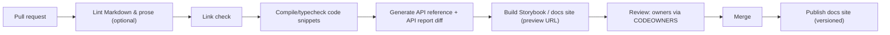
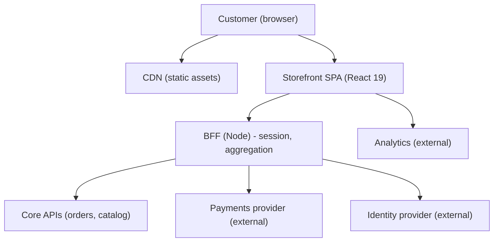
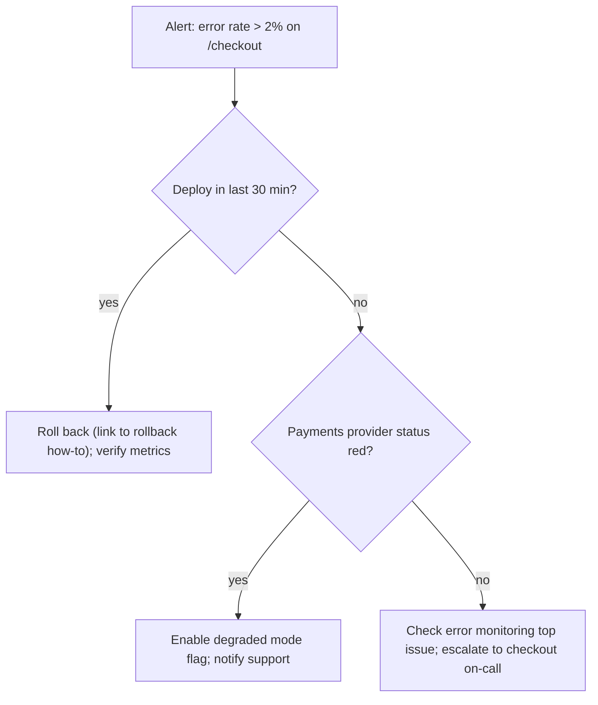

# 10 / 17 — Documentation: Docs as a System, Not an Afterthought

## 1. Lesson metadata

| | |
|---|---|
| **Level** | Professional |
| **Study time** | 4 hours (reading 1.5 h, hands-on 1.5 h, exercises 1 h) |
| **Prerequisites** | [16 — Architecture decision records](./16-architecture-decision-records.md), [11 — Design system governance](./11-design-system-governance.md), [14 — Multi-team collaboration](./14-multi-team-collaboration.md), [08 / 11 — Component contract testing](../08-testing-and-quality/11-component-contract-testing.md), [10 / 01 — Repository organization](./01-repository-organization.md) |
| **Next** | [18 — Continuous delivery](./18-continuous-delivery.md) |
| **Related** | [19 — Incident debugging](./19-incident-debugging.md) (runbooks), [12 — Backward compatibility](./12-backward-compatibility.md) (changelogs and migration guides), [Phase 11 — Technical design documents](../11-senior-and-architect-mastery/02-technical-design-documents.md) |

**Learning objectives.** After this lesson you can:
1. Classify documentation by purpose (tutorial, how-to, reference, explanation) and write each type appropriately.
2. Design a documentation system for a React codebase: README, architecture overview, ADRs, component docs, runbooks, onboarding, changelogs.
3. Apply docs-as-code: keep docs in the repository, reviewed, tested, and versioned with the code they describe.
4. Generate reference documentation from types and comments, and know the limits of generation.
5. Prevent documentation rot with ownership, freshness metadata, automated checks, and proximity to code.
6. Write runbooks that an on-call engineer can follow at 3 AM.
7. Diagram architecture with an appropriate model (C4) and keep diagrams maintainable as code.

**Concepts covered:** Diátaxis framework, docs-as-code, README structure, architecture overview, C4 model, diagram-as-code (Mermaid), TSDoc, TypeDoc/API reference generation, Storybook docs/MDX, changelogs, migration guides, runbooks, onboarding paths, doc ownership, freshness metadata, link and snippet testing, documentation debt, search and information architecture.

---

## 2. Deep conceptual explanation

### 2.1 What problem is this lesson solving?

Documentation exists to transfer knowledge across *time* and *people*: from the author to a future reader who has less context, more urgency, or both. In a team of one, you can be your own future reader. In a multi-team organization ([14](./14-multi-team-collaboration.md)), documentation is the cheapest scaling mechanism for knowledge: a clear page answers a question ten times without interrupting anyone.

Most documentation fails in predictable ways: it is **missing** (never written), **stale** (written once, now wrong and harmful), **unfindable** (exists but nobody can locate it), or **misdirected** (a long tutorial where a reference was needed). This lesson treats documentation as a *system* with types, owners, quality gates, and lifecycle, the same way you treat code.

### 2.2 A taxonomy: the four kinds of documentation (Diátaxis)

The Diátaxis framework (Daniele Procida, [diataxis.fr](https://diataxis.fr/)) observes that documentation serves four distinct needs, and mixing them produces confusing pages.

| Type | Reader's need | Orientation | Form | React-team example |
|---|---|---|---|---|
| **Tutorial** | "I am new; teach me" | Learning | A guided, safe, end-to-end experience; the author controls the path | "Build your first feature in our app" in the onboarding guide |
| **How-to guide** | "I need to accomplish X" | Task | Steps for a competent person with a goal; assumes knowledge | "How to add a new route", "How to add a feature flag", "How to release a hotfix" |
| **Reference** | "What exactly does this do?" | Information | Accurate, complete, neutral, structured like the code | Component props table, CLI flags, config options, API types |
| **Explanation** | "Why is it like this?" | Understanding | Discursive; context, trade-offs, history | Architecture overview, "Why we use TanStack Query", ADRs |

Where each of this curriculum's artifacts belong: ADRs ([16](./16-architecture-decision-records.md)) are *explanation*; runbooks are *how-to* (task under pressure); generated API docs are *reference*; onboarding walkthrough is *tutorial*.

**Why the separation matters.** A reference page full of narrative is slow to scan; a tutorial that stops to explain every design decision loses the learner; a how-to that teaches fundamentals buries the steps. When a page feels bad, ask which of the four it is trying to be.

### 2.3 What to document in a React codebase

| Artifact | Type | Purpose | Lives where |
|---|---|---|---|
| **Root README** | Orientation (mix, short) | What this is, how to run, test, build; links to everything else | Repo root |
| **Architecture overview** | Explanation | System context, major modules, data flow, boundaries, key decisions | `docs/architecture.md` + diagrams |
| **ADRs** | Explanation | Decisions and reasoning ([16](./16-architecture-decision-records.md)) | `docs/adr/` |
| **Contributing guide** | How-to | Branching, PR process, review norms, code style, commit conventions | `CONTRIBUTING.md` |
| **Onboarding path** | Tutorial | Day-1 setup to first merged PR | `docs/onboarding/` |
| **Component docs** | Reference + how-to | Props, variants, accessibility notes, do/don't, examples | Storybook/MDX next to components |
| **Hook and util docs** | Reference | Signature, behavior, edge cases | TSDoc comments → generated |
| **Feature docs** | Explanation + how-to | Domain concepts, flows, state machines, feature flags | `docs/features/<feature>.md` or next to the feature |
| **Runbooks** | How-to | Steps for operational problems; links to dashboards | `docs/runbooks/` |
| **Changelog** | Reference | What changed in each release | `CHANGELOG.md` / release notes |
| **Migration guides** | How-to | Moving between major versions ([12](./12-backward-compatibility.md), [13](./13-application-migrations.md)) | `docs/migrations/` |
| **API/contract docs** | Reference | Endpoints, events, routes, tokens | Generated from schemas where possible |
| **Glossary** | Reference | Domain vocabulary (what is an "order", a "shipment", a "case") | `docs/glossary.md` |

### 2.4 Docs-as-code

Treat documentation like source: **plain text (Markdown/MDX), in the repository, changed through pull requests, reviewed by owners, built and checked by CI, versioned alongside the code.**

Benefits:
- A PR that changes behavior can change docs in the same commit; reviewers see both.
- Version history and blame explain doc changes.
- Automation applies: link checking, spell checking, snippet compilation, style linting.
- Docs for old versions remain available by tag/branch.

Costs and limits: non-engineers (designers, PMs, support) may find Git-based workflows hard; for them, a wiki or a docs platform with an editing UI is valid, but then you lose some automation. A pragmatic split: *engineering docs in the repo; business/process docs in the wiki; each links to the other*.

### 2.5 Proximity and the rule of locality

**The closer docs live to what they describe, the more likely they stay true.** Hierarchy of proximity:

1. **Types and names**: self-documenting code, precise TypeScript types ([00 / 18](../00-web-and-javascript-foundations/18-typescript-fundamentals-and-narrowing.md)). Cannot go stale relative to code because the compiler checks them.
2. **Comments next to code (TSDoc)**: explain *why* and contract details not visible in types.
3. **Docs in the same folder** (a `README.md` per feature/package, an `.mdx` beside the component).
4. **Docs in the same repo** (architecture, ADRs, runbooks).
5. **Docs in a separate system** (wiki): the farthest; needs strong ownership and links *from* the code.

Choose the level by *volatility* and *audience*: details that change often belong in types/comments; big-picture material that changes slowly can live in `docs/`.

### 2.6 Code comments: what to write

Good comments explain what code cannot: **why**, constraints, non-obvious consequences, links to decisions or issues, and the *contract* of public APIs. Bad comments restate the code or lie after changes.

| Comment kind | Example | Verdict |
|---|---|---|
| Restating | `// increment i` | Delete |
| Why | `// Safari fires blur before click here; delay validation (see #4432)` | Keep |
| Contract (TSDoc) | `@param ms - debounce window; 0 disables` | Keep for public APIs |
| Warning | `// Must run before hydration: reads window.__BOOT__` | Keep |
| TODO without owner | `// TODO fix` | Replace with ticket link/DEBT marker ([15](./15-technical-debt.md)) |
| Commented-out code | `// oldImplementation()` | Delete (Git remembers) |

TSDoc is a standard for TypeScript doc comments (`/** … */` with tags such as `@param`, `@returns`, `@remarks`, `@example`, `@deprecated`, `@see`). Editors display it on hover, and tools (TypeDoc, API Extractor) can build reference docs from it. ⚠ TSDoc vs JSDoc syntax differs slightly (TSDoc does not use `{type}` annotations in tags, since types come from TypeScript); verify tag support in the tool you use ([tsdoc.org](https://tsdoc.org/)).

### 2.7 Architecture documentation and the C4 model

Architecture diagrams often fail by mixing levels of abstraction: boxes for services, components, and functions in one picture. The **C4 model** (Simon Brown, [c4model.com](https://c4model.com/)) proposes four zoom levels:

| Level | Shows | Audience | Frontend example |
|---|---|---|---|
| **1 System Context** | The system and its users/external systems | Everyone | "Customer portal; users; payments provider; identity provider; backend APIs" |
| **2 Containers** | Deployable/runnable units (apps, services, databases) | Technical stakeholders | "Web SPA, BFF, CDN, API gateway, analytics" |
| **3 Components** | Major building blocks inside a container | Developers | "Features: checkout, search; shared packages: ds, api-client, routes; composition root" |
| **4 Code** | Classes/functions | Developers (usually generated/IDE) | Rarely drawn by hand |

Draw levels 1–3 and keep each diagram single-level. For frontends, level 3 is where the module boundaries from [14](./14-multi-team-collaboration.md) belong.

**Diagrams as code.** Mermaid (supported by GitHub's Markdown rendering and many docs tools) lets diagrams live in Markdown and be reviewed as text diffs. Alternatives include PlantUML and Structurizr DSL. Trade-off: text-based diagrams are easier to keep current but offer less layout control than a drawing tool.

### 2.8 Runbooks

A **runbook** is a how-to guide for operational situations (an alert fires, a deploy must be rolled back, a third-party provider is down). It is read under stress, often by someone who did not write the code. Properties of a good runbook:

- **Triggered from the alert**: the alert message links to it.
- **Starts with impact and urgency**: "What users see; how severe".
- **Decision tree, not essay**: "If X, do A; else B".
- **Copy-pasteable commands** and **direct links** to dashboards.
- **Rollback/mitigation first, root cause later**.
- **Escalation**: who to call, when.
- **Last verified date and owner**; tested in game days.

Runbooks connect directly to [10 / 05 — Error monitoring](./05-error-monitoring.md), [18 — Continuous delivery](./18-continuous-delivery.md) (rollback), and [19 — Incident debugging](./19-incident-debugging.md).

### 2.9 Component documentation

For a design system or shared library ([11](./11-design-system-governance.md)), per-component docs typically include: purpose and when (not) to use it; live examples of variants and states; props reference (generated from types); accessibility notes (keyboard behavior, ARIA, focus management); content guidelines; related components; changelog/status (stable, beta, deprecated). Storybook is a widely-used tool for this: stories are executable examples that double as test fixtures ([08 / 12](../08-testing-and-quality/12-visual-regression.md)), and its docs features can generate prop tables from TypeScript types. ⚠ Storybook's package names, configuration format, and APIs change across major versions; verify against [storybook.js.org/docs](https://storybook.js.org/docs).

### 2.10 The documentation lifecycle: why docs rot, and how to resist

Documentation rots because:
1. **No owner**: nobody is accountable for accuracy.
2. **Distance from code**: updates are not part of the code-change workflow.
3. **No feedback**: readers hit errors and silently give up.
4. **No deletion**: obsolete pages stay and mislead.
5. **Duplication**: the same facts in four places drift apart.

Countermeasures:

| Failure | Countermeasure |
|---|---|
| No owner | CODEOWNERS for docs paths; `owner` in front matter |
| Distance | Docs in repo; PR template asks "docs updated?"; docs checks in CI |
| No feedback | "Edit this page" links; issue template for doc bugs; analytics on search misses |
| No deletion | `last_reviewed` metadata; quarterly pruning; automated stale-doc reports |
| Duplication | **Single source of truth**: link, do not copy; generate where possible |
| Unverified examples | Compile and run snippets in CI |
| Dead links | Link checker in CI |

### 2.11 Common misconceptions

| Misconception | Reality |
|---|---|
| "Good code needs no documentation." | Code shows *how*; it does not show *why*, operational procedures, or the big picture. |
| "More documentation is better." | Unmaintained docs are worse than none: they mislead. Document what is valuable and maintainable. |
| "Documentation is a one-time project." | It is a continuous practice, part of the definition of done. |
| "Auto-generated docs are enough." | Generated reference is necessary but not sufficient; explanation and how-to need humans. |
| "A wiki is where docs go." | Fine for some; engineering docs near code tend to be more accurate. |
| "Docs are for new people only." | Experienced engineers use reference, runbooks, and rationale constantly. |

---

## 3. Internal mechanics

### 3.1 How doc generation from types works

**Public guarantee:** The TypeScript compiler exposes its AST and type information through a public API; doc tools use it to read declarations plus attached doc comments. TypeDoc ([typedoc.org](https://typedoc.org/)) produces HTML/JSON/Markdown docs from TypeScript declarations and comments. Microsoft's API Extractor produces an *API report* (a `.api.md` file listing public API signatures) that can be checked into the repo and diffed in PRs, and can roll up `.d.ts` files. Storybook's docs addon can derive prop tables from component types using a docgen tool. ⚠ The mechanism used for React component prop extraction (`react-docgen`, `react-docgen-typescript`, or Storybook's own integrations) has changed over versions; verify in Storybook's current docs.

**Teaching model:** generation is a *projection* of source facts to a human-readable form. It cannot add meaning that is not in the source. A prop typed `variant: 'a' | 'b'` yields a table row; *which to choose when* must be written by a person.

**Implementation detail ⚠:** React component prop extraction struggles with complex generics, polymorphic components, and props derived from utility types (`Omit<ComponentPropsWithRef<'button'>, 'color'> & {…}`): generated tables may show hundreds of inherited DOM attributes unless filtered. Document the intended API explicitly or configure the tool's prop filtering.

### 3.2 Docs build and verification pipeline



### 3.3 Executable documentation

Snippets in docs drift from the real API unless verified. Options:

| Technique | How | Notes |
|---|---|---|
| **Snippets as real files** | Docs include code by reference from files that are compiled/tested (`!include` or MDX imports) | Strong: compiled and tested |
| **Extract and typecheck** | Script extracts ```` ```ts ```` blocks from Markdown and runs `tsc --noEmit` against a harness | Works for self-contained snippets |
| **Stories as docs** | Storybook stories render real components; interaction tests run in CI | Executable and visual |
| **Doctests** | Run examples in comments (more common in Python/Rust) | Rare in JS/TS |

### 3.4 Information architecture and search

Readers search before browsing. Docs need: consistent titles using the words users use (the *symptom* "blank screen after login", not only the internal term), a single entry point (`docs/README.md` index), predictable URLs, descriptions in front matter, and a search facility. Measure *failed searches* (queries with no clicks) to find missing docs.

---

## 4. Step-by-step execution walkthrough: documenting a new feature end to end

Scenario: Team Checkout is shipping "saved payment methods".

1. **Before coding: explanation.** An ADR for the key decision (store tokens via the payment provider, not in our DB: [16](./16-architecture-decision-records.md)); a short feature doc: domain terms (payment method, token), state diagram of lifecycle, what is behind flag `checkout.saved-methods`.
2. **During coding: reference by construction.** Strong types (`PaymentMethod` discriminated union), TSDoc on the public hook `useSavedPaymentMethods` including `@remarks` about caching and `@example`.
3. **Component docs.** The new `PaymentMethodList` gets a story per state (loading, empty, error, many items), an a11y note (radio group semantics, keyboard), and a docs page generated from props.
4. **How-to for others.** "How to add a payment provider adapter" (task-focused steps) in the feature folder.
5. **Operational docs.** A runbook: "Saved payment methods failing to load" with the alert link, dashboard, likely causes (provider outage; token expiry; flag misconfiguration), mitigation (disable flag), escalation to Payments platform.
6. **PR checklist.** The PR template asks: docs updated? runbook updated? changelog entry? CI verifies links and snippet compilation; reviewers include the docs owner.
7. **Release.** Changelog entry and, if user-visible, support-facing release note.
8. **After release.** The feature doc gains "known limitations" discovered in QA; the onboarding guide's "feature index" links to it.
9. **Maintenance.** `last_reviewed` set in front matter; quarterly docs review lists pages not reviewed in 6 months for the owning team.

---

## 5. Code examples

### 5.1 Minimal example: a useful README skeleton

```md
# @acme/storefront

Customer-facing web app (React 19, TypeScript, Vite). Owner: @acme/team-storefront (#storefront-web).

## Quick start
    pnpm install
    pnpm dev            # http://localhost:5173
    pnpm test           # unit + component tests
    pnpm test:e2e       # Playwright (requires `pnpm dev` running or CI mode)

## Where things live
| Path | What |
|---|---|
| `src/features/*` | Feature modules (public API: each folder's `index.ts`) |
| `src/shared/*`   | Domain-agnostic utilities (no feature imports) |
| `docs/`          | Architecture, ADRs, runbooks, how-tos |

## Documentation
- Architecture overview: docs/architecture.md
- Decisions: docs/adr/
- Runbooks: docs/runbooks/
- Contributing: CONTRIBUTING.md

## Support
Questions: #storefront-web. On-call/incidents: see docs/runbooks/README.md.
```

**Why it works.** A README is an entry point, not the encyclopedia: how to run, where to look, who owns it, where to ask. Everything else is linked. Anything you copy into the README duplicates a fact that will drift.

### 5.2 Practical: TSDoc on a public hook

```tsx
import { useQuery } from '@tanstack/react-query';

export interface UseOrderResult {
  /** The order, or `undefined` while loading or on error. */
  order: Order | undefined;
  /** `true` only for the first load; background refetches do not set it. */
  isLoading: boolean;
  /** Present when the request failed after retries. */
  error: Error | null;
}

/**
 * Loads one order by id and keeps it fresh in the background.
 *
 * @remarks
 * Uses the shared query cache; two components calling `useOrder('42')`
 * issue a single request. The cache entry is invalidated by
 * `useCancelOrder` and `useUpdateShippingAddress`.
 *
 * Data is considered fresh for 30 seconds (see ADR-0014 for the staleness policy).
 *
 * @param orderId - Order identifier. Pass `undefined` to disable the query (e.g., before the route param is known).
 * @returns Loading state, order data, and error. See {@link UseOrderResult}.
 *
 * @example
 * ```tsx
 * function OrderHeader({ id }: { id: string }) {
 *   const { order, isLoading } = useOrder(id);
 *   if (isLoading) return <Skeleton />;
 *   return <h1>Order {order?.number}</h1>;
 * }
 * ```
 *
 * @see {@link https://tanstack.com/query/latest | TanStack Query}
 */
export function useOrder(orderId: string | undefined): UseOrderResult {
  const q = useQuery({
    queryKey: ['order', orderId],
    queryFn: () => fetchOrder(orderId!),
    enabled: orderId !== undefined,
    staleTime: 30_000,
  });
  return { order: q.data, isLoading: q.isLoading, error: q.error };
}
```

**Notes.** The doc comment captures contract facts types cannot: caching behavior, invalidation relationships, and what `undefined` means. `q.isLoading` in TanStack Query v5 is true only while a fetch is in flight *and* there's no data (first load; `isLoading` is `isFetching && isPending` in v5, so a disabled query with no data is *not* loading, it is pending); semantics of `isLoading`/`isPending`/`isFetching` changed between v4 and v5, so check your version ([06 / 08](../06-data-fetching-and-state-ecosystems/08-tanstack-query.md)). Because `@remarks` references an ADR and invalidation hooks, a refactor that changes those must update the comment; reviewers should look for it. Over-documenting internals in comments creates drift; keep to the *contract*.

### 5.3 Practical: component documentation with Storybook (CSF) and an accessibility note

```tsx
// Button.stories.tsx — Component Story Format (CSF 3). Storybook's current docs (storybook 10.6) import `Meta`/`StoryObj` from the framework package (written `@storybook/your-framework` in the docs, e.g. `@storybook/react-vite`) rather than `@storybook/react`; adjust the import for your setup.
import type { Meta, StoryObj } from '@storybook/react';
import { Button } from './Button';

const meta = {
  title: 'Components/Button',
  component: Button,
  tags: ['autodocs'],
  parameters: {
    docs: {
      description: {
        component:
          'Triggers an action. Use a link (`<a>`) for navigation. Keyboard: Space/Enter activate. ' +
          'Always provide an accessible name; icon-only buttons require `aria-label`.',
      },
    },
  },
  argTypes: {
    tone: { control: 'select', options: ['primary', 'secondary', 'ghost'] },
  },
} satisfies Meta<typeof Button>;

export default meta;
type Story = StoryObj<typeof meta>;

export const Primary: Story = { args: { tone: 'primary', children: 'Save' } };
export const Disabled: Story = { args: { tone: 'primary', children: 'Save', disabled: true } };
export const IconOnly: Story = {
  args: { tone: 'ghost', 'aria-label': 'Close', children: '×' },
};
```

**Line notes.** `tags: ['autodocs']` asks Storybook to generate a docs page (prop table and stories) in recent versions. `satisfies` (TypeScript 4.9+) keeps the literal type of `meta` while checking it against `Meta`. Each exported story is an executable example and test fixture; stories document *states* (disabled, icon-only) that are easy to forget in prose.

### 5.4 Practical: front matter for freshness and ownership, plus a checker

```md
---
title: Release rollback runbook
type: how-to            # tutorial | how-to | reference | explanation
owner: team-platform
last_reviewed: 2026-02-10
review_every_days: 90
---
```

```ts
// scripts/docs-freshness.ts
import { readdirSync, readFileSync, statSync } from 'node:fs';
import { join } from 'node:path';

function walk(dir: string): string[] {
  return readdirSync(dir).flatMap((n) => {
    const p = join(dir, n);
    return statSync(p).isDirectory() ? walk(p) : p.endsWith('.md') ? [p] : [];
  });
}

const now = Date.now();
let stale = 0;
for (const file of walk('docs')) {
  const fm = /^---\n([\s\S]*?)\n---/.exec(readFileSync(file, 'utf8'))?.[1];
  if (!fm) continue;
  const get = (k: string) => new RegExp(`^${k}:\\s*(.+)$`, 'm').exec(fm)?.[1]?.trim();
  const reviewed = get('last_reviewed');
  const every = Number(get('review_every_days') ?? 180);
  const owner = get('owner');
  if (!owner || !reviewed) { console.error(`${file}: missing owner/last_reviewed`); stale++; continue; }
  const ageDays = (now - Date.parse(reviewed)) / 86_400_000;
  if (ageDays > every) { console.warn(`${file}: review overdue by ${Math.round(ageDays - every)} days (owner ${owner})`); stale++; }
}
process.exit(0); // report-only; fail CI only for missing metadata if desired
console.log(`${stale} docs need attention`);
```

*(The final `console.log` after `process.exit` is unreachable; this is an intentional bug to find in exercise B2.)*

**Design note.** Failing the build for overdue reviews punishes unrelated PRs; a weekly report to owners (Slack/issue) is often better. Make the *absence* of owner a hard failure, and staleness a soft signal.

### 5.5 Incorrect example: duplicated, drifting documentation

```md
<!-- README.md -->
To run the tests: `npm test`
<!-- CONTRIBUTING.md -->
To run the tests: `yarn test:unit`
<!-- docs/onboarding.md -->
To run the tests: `pnpm vitest`
<!-- wiki -->
To run the tests: ask in #dev-help
```

Four answers; at most one is right. New engineers waste time and lose trust in all docs.

### 5.6 Corrected: one source of truth, linked elsewhere

```md
<!-- README.md: canonical commands -->
Test: `pnpm test` (unit/component), `pnpm test:e2e`.

<!-- CONTRIBUTING.md -->
Run tests as described in the [README](../README.md#quick-start) before opening a PR.

<!-- docs/onboarding.md -->
Step 4: run the test suite (see [README](../README.md#quick-start)).
```

Better still: expose a single command (`pnpm check`) and document only that; the details live in `package.json` scripts, which cannot go stale relative to themselves.

### 5.7 Advanced: verifying code snippets in docs compile

```ts
// scripts/check-doc-snippets.ts — extracts ```tsx blocks marked `check` and type-checks them
import { readFileSync, readdirSync, mkdirSync, writeFileSync, rmSync } from 'node:fs';
import { execSync } from 'node:child_process';
import { join } from 'node:path';

const OUT = '.doc-snippets';
rmSync(OUT, { recursive: true, force: true });
mkdirSync(OUT);

let n = 0;
for (const f of readdirSync('docs').filter((f) => f.endsWith('.md'))) {
  const text = readFileSync(join('docs', f), 'utf8');
  for (const m of text.matchAll(/```tsx check\n([\s\S]*?)```/g)) {
    writeFileSync(join(OUT, `${f.replace(/\W/g, '_')}_${n++}.tsx`), m[1]);
  }
}
writeFileSync(join(OUT, 'tsconfig.json'), JSON.stringify({
  extends: '../tsconfig.json',
  compilerOptions: { noEmit: true },
  include: ['./*.tsx'],
}));
execSync(`tsc -p ${OUT}/tsconfig.json`, { stdio: 'inherit' });
```

Authors opt a snippet in with the info string ```` ```tsx check ````; snippets must be self-contained (imports included). The base `tsconfig.json` supplies path aliases so imports like `@acme/ds` resolve. Trade-off: snippets with intentionally incomplete code (`// ...`) are not marked `check`, which is itself a signal of which examples are trustworthy.

---

## 6. Visual explanations

### 6.1 The four documentation types

```text
                       PRACTICAL (doing)             THEORETICAL (knowing)
STUDY (learning)       TUTORIAL                      EXPLANATION
                       "Follow along, build X"       "Why we do it this way"
WORK (applying)        HOW-TO GUIDE                  REFERENCE
                       "Do X to achieve Y"           "Exact facts about X"
```

### 6.2 C4 level 2 (containers) as Mermaid



### 6.3 Documentation proximity vs volatility

```text
volatility ^
  high     | types, comments        stories/tests
           |
  medium   | feature README         onboarding steps
           |
  low      | architecture, ADRs     glossary
           +---------------------------------------->
             close to code                     far from code
(Put fast-changing facts close to code; slow-changing narrative can live farther away.)
```

### 6.4 Runbook decision structure



---

## 7. Alternative approaches and trade-offs

| Criterion | Docs in repo (Markdown/MDX) | Wiki (Confluence/Notion) | Docs platform/site (Docusaurus, VitePress, etc.) | Storybook docs | Code comments + generated reference |
|---|---|---|---|---|---|
| Versioned with code | Yes | No | If sourced from repo | Yes | Yes |
| Accessibility to non-engineers | Medium | **High** | Medium (Git-backed) | Medium | Low |
| Automation (links, snippets) | **High** | Low | High | Medium | High |
| Search and navigation | Basic (GitHub) | Good | Good (site search) | Component-focused | IDE hover / generated site |
| Rich collaboration (comments) | PR comments | **High** | PR comments | Limited | PR comments |
| Rot risk | Lower | Higher | Lower | Lower | Lowest for signatures |
| Best for | Engineering docs, ADRs, runbooks | Process, product, cross-functional | Public/external or large internal docs | Component libraries | API reference |

**Scenario where docs-in-repo is NOT best.** Support and operations staff must update a "known issues" list during incidents; requiring PRs adds friction and delays. A wiki or status-page tool suits that content. Also for rapidly evolving product requirements that involve designers and product managers, a collaborative document tool is more appropriate; the engineering docs can link to it for context.

**Scenario where less documentation is best.** A small team with highly volatile code: write types, tests, and a README only, and invest in making the code readable. Prefer self-documenting structure and a few high-value pages over a documentation site nobody maintains.

---

## 8. Best practices and anti-patterns

### 8.1 Best practices
- **Know the type of page you are writing** (tutorial/how-to/reference/explanation) and keep it pure.
- **Write for a specific reader** in a specific situation (new hire on day 2; on-call at 3 AM).
- **Put docs in the PR**: the definition of done includes docs/runbook/changelog updates.
- **Prefer links over copies**; one source of truth.
- **Make examples runnable/typechecked**.
- **Assign an owner and review cadence** to every page.
- **Delete or archive obsolete pages**; mark deprecated with pointers.
- **Write the "why"**: context, constraints, trade-offs.
- **Use consistent terminology** (glossary); do not rename concepts between pages.
- **Make docs discoverable**: index, search, links from code, error messages, and alerts.
- **Keep it short and scannable**: headings, tables, code blocks, front-loaded answers.
- **Test the onboarding**: ask each new hire to follow the guide and fix what breaks (their first PR can be a docs fix).

### 8.2 Beginner mistakes
- Writing docs for oneself ("setup: you know the drill").
- Documenting *what* a function does when the name says it, but not *why*.
- Screenshots of text/terminal output (not searchable, quickly stale).

### 8.3 Experienced-developer mistakes
- **Documentation sprawl**: seven overlapping systems; nobody knows the canonical one.
- **Curse of knowledge**: skipping steps that are obvious to the author.
- **Heroic docs sprints** that produce a pile of pages with no maintenance plan.
- **Prescriptive docs without rationale**: "Always do X" without saying why leads to cargo culting.
- **Architecture docs as wall art**: one huge diagram with 80 boxes.

### 8.4 Smells
- "Last updated 2022" on a page describing a deprecated tool.
- Docs that start with a history lecture before the instructions.
- Contradictory instructions in different pages.
- Frequent "ask Sam" in docs.
- Broken links and images.

### 8.5 Justified exceptions
- A throwaway prototype may have only a README.
- Generated reference for internal-only, short-lived packages can be skipped when types are clear.
- Some knowledge (security-sensitive operational detail) belongs in restricted documentation; link by reference with access controls.

---

## 9. Real-world application

**E-commerce.** Seasonal events require *event runbooks* (Black Friday: scaling, flag switches, degraded modes, who is on-call). Pricing and promotion rules need explanation docs that product, support, and engineering share (glossary and rules). Component docs for the storefront design system carry brand and a11y guidelines.

**Dashboards.** Document data semantics ("what does 'active users' mean?"), refresh cadence, and data lineage next to the widget. A "metrics dictionary" is reference documentation as important as code docs; discrepancies between dashboards destroy trust faster than UI bugs.

**Finance.** Regulatory documentation: calculation rules, rounding policy, audit trail behavior, and data handling must be accurate and traceable to requirements. Docs-as-code with review and history provides evidence; link requirement IDs from tests and docs.

**Forms.** A form builder or schema-driven form system needs a *schema reference* and *recipes* (conditional fields, async validation, error announcements). Executable examples in stories prevent drift.

**Auth.** Authentication flows are classic "explanation + runbook" topics: sequence diagrams of login/refresh/logout, token storage rationale, what to do when users are locked out or the IdP is down. Security-sensitive details may be restricted.

**Multi-team.** A documentation *map* (index of all docs with owners) is the front door. Platform teams publish "golden path" tutorials and how-tos ("create a new feature package") with templates. Office hours complement docs; recurring questions in office hours become pages.

**Realtime.** Document message contracts (event names, payloads, versioning) as reference, and reconnection/backoff behavior as explanation; runbooks for "WebSocket connections failing" with dashboard links ([06 / 17](../06-data-fetching-and-state-ecosystems/17-real-time-websockets-subscriptions.md)).

---

## 10. Debugging and troubleshooting

Debugging documentation means finding why readers fail to get answers.

| Symptom | Investigation | Root cause | Fix | Validate |
|---|---|---|---|---|
| New hires take 2 weeks to run the app | Observe a setup session; collect failures | Stale onboarding steps; undocumented prerequisites | Rewrite steps; add a `doctor` script; assign owner | Time-to-first-run |
| Same question asked repeatedly in chat | Export common questions | Doc missing or unfindable | Write/relocate doc; link from chat bot/README | Question frequency |
| Docs say X, code does Y | Compare behavior; git blame for doc vs code | Code changed without docs | Fix; add PR checklist/CI check; move closer to code | Drift incidents |
| Snippets in docs fail when copied | Run extraction/typecheck | Examples unverified | Compile snippets in CI | CI passes |
| Incident responders cannot follow runbook | Post-incident review; walk through it | Missing context, outdated commands/links | Game day; test runbook; add decision tree | Time-to-mitigate in drills |
| Search returns old versions | Check site search index | Multiple versions indexed; no canonical | Version selector; deprecate banners | Search result quality |
| Nobody knows who owns a page | Docs metadata audit | Missing owner | Required front matter; CODEOWNERS | % with owner |

**Technique: the "cold read" test.** Give a page to someone unfamiliar and silently observe them following it. Every hesitation is a bug in the doc. Record, fix, repeat. For runbooks, run **game days**: simulate the failure in staging and follow the runbook literally.

**Technique: docs analytics.** Page views by path, search queries without results, time-on-page for how-tos (very short may mean not finding what they need), and click-through from alerts to runbooks.

---

## 11. Exercises

### Level A — Knowledge
**A1.** Name the four Diátaxis documentation types and the reader need each serves.
**A2.** Explain the "proximity" principle and give three levels of proximity for documenting a React hook.
**A3.** List five elements of an effective runbook.
**A4.** What are the C4 model levels, and which would you use to show module boundaries in a frontend monorepo?
**A5.** Give four causes of documentation rot and a countermeasure for each.

### Level B — Code comprehension
**B1.** In §5.2, which statements in the TSDoc are *contract* facts and which are risky to document because they may drift?
**B2.** In §5.4's script, what is wrong with the last two lines, and what is the correct behavior if you want a report-only run?
**B3.** In §5.7, why must snippets be self-contained, and what happens to a snippet that uses `useState` but omits the import?

### Level C — Implementation
**C1.** Write a runbook for the alert "JavaScript error rate on /checkout above 2% for 5 minutes", using a decision-tree structure, with placeholders for links and commands.
**C2.** Write a script that scans `docs/**/*.md` for relative links and fails if the target file does not exist.

### Level D — Debugging
**D1.** A new hire reports the setup guide fails at step 3 (`pnpm install` complaining about Node version). Diagnose, fix the doc and prevent recurrence.
**D2.** Two pages give conflicting guidance on error handling ("use error boundaries everywhere" vs "only at route level"). Determine the right resolution process.

### Level E — Architecture decisions
**E1.** Design the documentation architecture for an organization with 8 teams and one monorepo: what lives where, who owns it, how it is verified and discovered.
**E2.** Decide whether to adopt Storybook as the primary component documentation tool vs a custom MDX docs site. List criteria and a recommendation for a 25-component internal library with 6 consumers.

### Level F — Expert challenge
**F1.** Propose a measurement plan for documentation effectiveness: define 5–7 metrics (leading and lagging), data sources, targets, anti-gaming considerations, and how you'd use them to prioritize doc work.

---

## 12. Detailed answers and explanations

> Attempt the exercises first.

**A1.** Tutorial: learning by doing, guided path. How-to: accomplishing a specific task for someone already competent. Reference: accurate, complete facts about the machinery. Explanation: understanding why and how things fit (context, design rationale). Wrong answer: "tutorial and how-to are the same". A tutorial controls the path to teach; a how-to assumes competence and serves a goal.

**A2.** The closer documentation is to the thing it describes, the more likely it is kept accurate. For a hook: (1) the TypeScript signature and result type (compiler-checked), (2) TSDoc comment with contract details and an example, (3) a README/doc page in the feature folder or a how-to in `docs/` explaining usage patterns and rationale. Further levels: an ADR and a wiki page. Choose by volatility and audience.

**A3.** Triggered from alert (linked), impact/severity statement, decision tree with clear conditions, copy-paste commands/links, mitigation/rollback before root cause, escalation contacts, owner/last verified date, and verification steps ("how to know it's fixed"). Any five with justification.

**A4.** Level 1 System Context, Level 2 Containers, Level 3 Components, Level 4 Code. Use Level 3 for module boundaries inside the SPA container (features, shared packages, composition root, allowed dependency directions). Wrong answer: Level 1, which hides internals by design.

**A5.** No owner → CODEOWNERS and front matter owners; distance from code → docs in repo and PR checklist; no feedback → "edit this page" and issue template, search analytics; no deletion → review cadence and archival; duplication → single source of truth and links; unverified examples → compile/test snippets; stale diagrams → diagrams as code near the module. Four of these with the countermeasure.

**B1.** Contract facts: what `undefined` means for `orderId`; that `isLoading` is only for initial load; that identical calls share one request; which operations invalidate the cache. Risky: "Data is considered fresh for 30 seconds" (a constant that might change in code: better to reference the exported constant or omit the number), and the pointer to ADR-0014 (fine as a link but must be maintained). The list of invalidating hooks is also drift-prone: a new mutation hook might invalidate it without updating the comment. Mitigation: keep numbers in code, reference by name, and have reviewers check TSDoc when changing query behavior.

**B2.** `process.exit(0)` executes before the final `console.log`, so the summary never prints (and exit code is always 0, which is fine for report-only). Fix: print the summary first, then `process.exit(stale > 0 && hardFail ? 1 : 0)`. A subtle second issue: missing metadata increments `stale` and `continue`s, mixing "invalid" with "overdue" in one counter; separate them if you want hard failure for missing metadata and soft for overdue. Also `Date.parse` of an invalid date returns `NaN`, making `ageDays` NaN and the comparison false (silently passing); validate the date.

**B3.** The extraction creates separate files compiled by `tsc`; without imports, identifiers like `useState` are undefined, producing "Cannot find name" errors. Self-contained snippets keep the check deterministic and also teach readers exactly what to import. Snippets that deliberately omit context should not be marked `check`.

**C1.** Example:
```md
---
title: Runbook - Checkout JS error rate high
type: how-to
owner: team-checkout
last_reviewed: 2026-04-01
---
# Checkout JS error rate > 2% for 5 min

**Impact:** Customers may be unable to complete purchases. **Severity:** SEV-2 by default; SEV-1 if the checkout success rate < 80%.

## 1. Confirm (2 min)
- Dashboard: <link: checkout-errors>. Is the error rate still high? Is the conversion funnel dropping? <link: funnel>

## 2. Triage
1. **Was there a deploy in the last 60 min?** (<link: deploy log>)
   - Yes -> Roll back: `pnpm release:rollback --env prod --to <previous-version>` (see rollback how-to (not included in this curriculum)). Verify the error rate falls within 10 min.
   - No -> go to 2.
2. **Is a flag change recent?** (<link: flag audit log>) -> Revert the flag; verify.
3. **Is the top error from third-party scripts or a provider?** (<link: error monitoring, group by script origin>)
   - Payments provider status red -> enable `checkout.degraded-mode` flag; post in #incidents; notify support.
4. **Single browser/version?** (group by browser) -> If yes, consider disabling the affected feature for that segment via flag.

## 3. Escalate
- After 15 min without mitigation: page Payments platform on-call (<link>) and the incident commander.

## 4. After mitigation
- Capture links to error groups and traces; open a postmortem (see incident process).
- Update this runbook if a step was wrong or missing.
```
Evaluation criteria: starts with impact, decision tree, links/commands, rollback-first, escalation, "how to verify", ownership, and final improvement loop.

**C2.**
```ts
import { readdirSync, readFileSync, statSync, existsSync } from 'node:fs';
import { dirname, join, resolve } from 'node:path';

function walk(d: string): string[] {
  return readdirSync(d).flatMap((n) => {
    const p = join(d, n);
    return statSync(p).isDirectory() ? walk(p) : p.endsWith('.md') ? [p] : [];
  });
}

let broken = 0;
for (const file of walk('docs')) {
  const text = readFileSync(file, 'utf8');
  for (const m of text.matchAll(/\[[^\]]*\]\(([^)\s]+)\)/g)) {
    const target = m[1];
    if (/^(https?:|mailto:|#)/.test(target)) continue;     // external and in-page anchors
    const path = resolve(dirname(file), target.split('#')[0]);
    if (!existsSync(path)) { console.error(`${file}: broken link -> ${target}`); broken++; }
  }
}
process.exit(broken ? 1 : 0);
```
Limits: it ignores anchors (`#section`), reference-style links, images with special syntax, links in code blocks (false positives), and URLs with parentheses. Mature link checkers (e.g., `lychee`, `markdown-link-check`) handle more; verify current tools. Evaluation: relative-path resolution against the *file's* directory, not the cwd.

**D1.** Investigation: check the doc's stated Node version versus `.nvmrc`/`engines` in `package.json`; reproduce on a clean machine. Fix: update the doc, but better to remove duplication: the doc should reference `.nvmrc` (`nvm use`) and `packageManager` field (Corepack) rather than hard-coding a version number; add a `pnpm doctor`/`scripts/check-env` that prints actionable errors; enable `engine-strict`. Prevent recurrence: a CI job that follows the quick-start in a clean container (tests the docs) and assigns the new hire to propose fixes. Wrong answer: only change the version number in the doc.

**D2.** Process: find the authority (an ADR? the error handling standard?), check the code's actual practice and context (which one applies to which case?), bring the authors together or use the architecture forum, decide and record in an ADR (perhaps: boundaries at route level plus around widgets with independent failure), then fix both pages to link to the canonical source and remove duplicates. Don't simply edit one page without resolving the underlying disagreement.

**E1.** Example architecture: *Repo level*: root README (entry), `docs/architecture/` (C4 L1–L3 in Mermaid), `docs/adr/`, `docs/runbooks/`, `docs/how-to/`, `docs/glossary.md`, `CONTRIBUTING.md`. *Package level*: per-package README (purpose, public API, owner) + TSDoc + Storybook for UI packages. *Ownership*: CODEOWNERS for each docs path; front matter owner/last_reviewed. *Verification*: link checker, snippet typecheck, API report diff, Storybook build, docs freshness report to owners weekly. *Discovery*: `docs/README.md` index generated; docs site (e.g., static site generator) with search, "edit this page"; links from lint messages, alerts, and PR templates. *Process*: PR template checkbox; quarterly doc review rotation; new-hire onboarding feedback loop. *Non-engineering content*: wiki for product requirements; link from repo. Criteria: coverage of types, ownership, verification, discovery.

**E2.** Criteria: audience (engineers + designers), need for live interactive examples and a11y checks, TypeScript prop extraction, effort to maintain a custom site, search and navigation needs, consistency across components, integration with visual regression ([08 / 12](../08-testing-and-quality/12-visual-regression.md)), contribution friction, versioning. Recommendation for 25 components and 6 consumers: Storybook, because stories double as tests and visual regression fixtures, prop tables are generated, and the cost of a custom MDX site (navigation, search, playground, prop extraction) is not justified at this size. Add MDX pages in Storybook for guidelines. Re-evaluate if the library goes external or needs rich marketing/pattern content. ⚠ Verify the current Storybook version's capabilities and maintenance burden (upgrades between majors can be significant).

**F1.** Example answer. *Leading metrics*: (1) % of pages with owner and review within cadence (docs freshness); (2) time-to-first-green-setup for new hires (measured at onboarding); (3) search success rate (queries with a click vs without). *Lagging metrics*: (4) volume of repeated questions in support channels (tagged) over time; (5) time-to-mitigate in incidents when a runbook exists vs not; (6) new-hire time to first merged PR; (7) survey: "I can find what I need" (quarterly, 1–5). Data sources: docs repo metadata, docs site analytics, chat export tagging, incident tools, HR/onboarding surveys. Targets: relative improvement per quarter, not absolute vanity numbers. Anti-gaming: do not reward page counts or edit counts; combine quantitative with qualitative; sample cold-read tests; avoid tying individual performance to these metrics. Use: prioritize pages that appear in failed searches or repeated questions; fix runbooks implicated in slow incidents. Criteria: mix of leading/lagging, concrete data sources, awareness of gaming and attribution limits.

---

## 13. Senior engineer interview questions

1. **"What would you document in a new frontend codebase, and in what order?"** *Strong answer:* start with the README quick start and ownership, then the architecture overview (C4 levels 1–3) and ADRs for major decisions, then contributing/onboarding, then runbooks for the highest-risk operational scenarios, then component/hook reference generated from types. The order follows who will be hurt most by the absence: first-day contributors, then reviewers, then on-call.

2. **"How do you keep documentation from going stale?"** Locality (docs near code), docs in the PR definition of done, owners and review metadata, CI checks (links, snippets, API report diffs), single source of truth, deletion of dead pages, and cold-read tests. The root cause of rot is lack of accountability and friction, so address both.

3. **"Explain the difference between a tutorial, how-to, reference, and explanation, and why it matters."** Each serves a different reader state: learning vs working, practical vs theoretical. Mixing them produces pages that serve nobody. Give an example of a page you restructured by separating types.

4. **"What makes a good runbook?"** Linked from the alert, impact first, decision tree, commands/links ready, mitigation before root cause, escalation, verified by game days, owned and dated. Reason: it is used under stress by someone without context, so cognitive load must be minimal.

5. **"Is generated API documentation enough?"** No. Generation is a projection of source facts; it gives accurate reference but not guidance, rationale, or tasks. It is necessary because it cannot drift, but explanation and how-to require human judgment. Also mention generation limits with complex generics and polymorphic React components.

6. **"A senior engineer refuses to write docs, saying code is self-documenting. Response?"** Acknowledge the value of readable code and types; then identify what code cannot express: rationale, operational procedures, cross-system flows, constraints. Propose low-friction practices: ADRs for decisions, TSDoc for public APIs, runbooks for their services, and measure the cost of questions they get repeatedly. Frame docs as leverage on their time.

---

## 14. Further learning resources

| Resource | URL | Covers / why | Level | Study |
|---|---|---|---|---|
| Diátaxis | <https://diataxis.fr/> | The four-type documentation framework | Beginner | Whole site, esp. tutorials vs how-to |
| C4 model | <https://c4model.com/> | Hierarchical architecture diagrams | Intermediate | Abstractions, diagrams |
| Mermaid documentation | <https://mermaid.js.org/> | Diagrams as code syntax | Beginner | Flowchart, sequence, state |
| TSDoc | <https://tsdoc.org/> | Standard doc-comment syntax for TypeScript | Beginner | Tag reference |
| TypeDoc | <https://typedoc.org/> | Generate API docs from TypeScript | Intermediate | Getting started, options |
| API Extractor | <https://api-extractor.com/> | API reports and `.d.ts` rollups | Advanced | Getting started |
| Storybook docs | <https://storybook.js.org/docs> | Stories, autodocs, testing | Beginner–Int. | Writing docs, writing stories |
| Write the Docs guide | <https://www.writethedocs.org/guide/> | Community guide to documentation practice | Beginner | Docs as code, writing |
| Google SRE Book — Postmortem Culture | <https://sre.google/sre-book/postmortem-culture/> | Postmortem and learning culture (related to runbooks) | Intermediate | Whole chapter |
| GitHub Docs — Mermaid diagrams | <https://docs.github.com/en/get-started/writing-on-github/working-with-advanced-formatting/creating-diagrams> | Mermaid support in GitHub Markdown | Beginner | Whole page |

URLs in this table were checked for HTTP 200 on 2026-10-22; any still marked *(unverified)* could not be checked automatically (blocked or unreachable). A 200 response does not guarantee the page content still matches the description; if a link has moved, search the site for the quoted title.

---

## 15. Knowledge checkpoint

**You should now understand**
- That documentation serves four different purposes and that mixing them harms readers.
- That docs-as-code, locality, and ownership are the main defenses against rot.
- How generated reference, comments, stories, ADRs, runbooks and architecture diagrams fit together.
- That documentation quality is measured by reader outcomes, not page counts.

**You should be able to explain without notes**
- What to document first in a codebase and where it should live.
- Why runbooks need a different structure from guides.
- How to keep examples from drifting.

**You should be able to implement**
- A README, TSDoc with contract details, Storybook component docs, a runbook, a freshness checker, a link checker, and a snippet typechecker.

**You should be able to debug**
- Documentation failures using cold reads, game days, search analytics, and drift detection.

**Before moving on:** read [18 — Continuous delivery](./18-continuous-delivery.md); delivery pipelines are where documentation checks and runbooks become automated guardrails.
