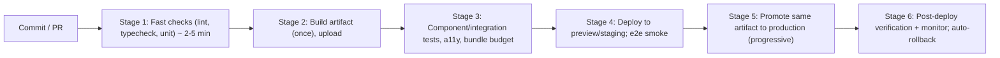
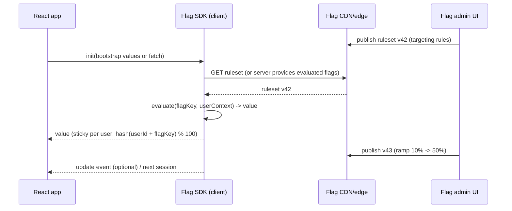
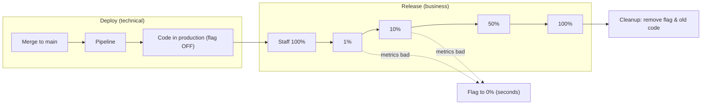
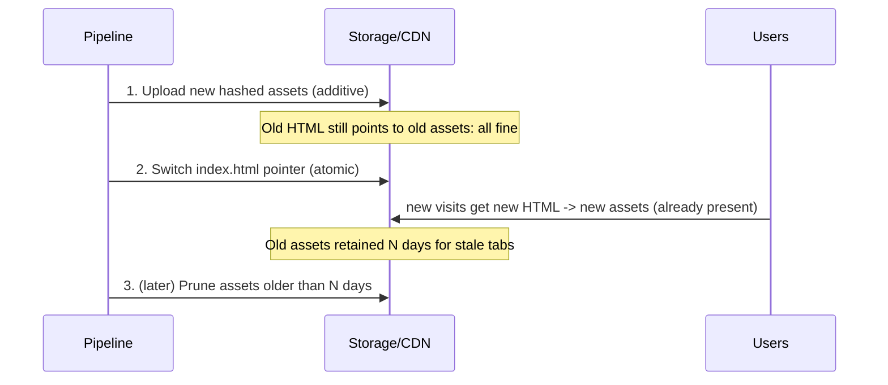
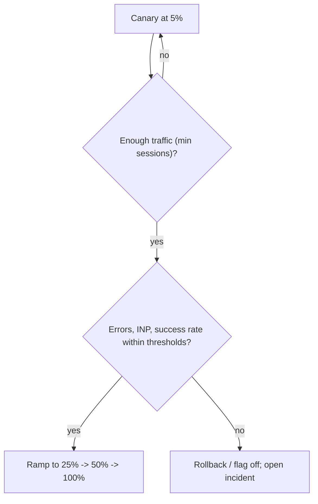

# 10 / 18 — Continuous Delivery: Shipping React Apps Safely, Frequently, and Reversibly

## 1. Lesson metadata

| | |
|---|---|
| **Level** | Professional |
| **Study time** | 5 hours (reading 2 h, hands-on 1.5 h, exercises 1.5 h) |
| **Prerequisites** | [02 — Deployment workflows](./02-deployment-workflows.md), [03 — Environment configuration](./03-environment-configuration.md), [04 — Observability and logging](./04-observability-and-logging.md), [05 — Error monitoring](./05-error-monitoring.md), [08 / 15 — CI checks](../08-testing-and-quality/15-ci-checks.md), [12 — Backward compatibility](./12-backward-compatibility.md), [14 — Multi-team collaboration](./14-multi-team-collaboration.md), [00 / 15 — HTTP caching and navigation](../00-web-and-javascript-foundations/15-http-caching-and-navigation.md) |
| **Next** | [19 — Incident debugging](./19-incident-debugging.md) |
| **Related** | [10 — Resilience and degradation](./10-resilience-and-degradation.md), [15 — Technical debt](./15-technical-debt.md) (flag debt), [17 — Documentation](./17-documentation.md) (runbooks) |

**Learning objectives.** After this lesson you can:
1. Distinguish continuous integration, continuous delivery, and continuous deployment, and state what each requires.
2. Design a pipeline for a React application with fast feedback, immutable artifacts, and promotion across environments.
3. Separate *deploy* (code arrives in production) from *release* (users see it) using feature flags and progressive delivery.
4. Implement and reason about canary, blue/green, and ring-based rollouts for frontend assets and BFF/server components.
5. Handle frontend-specific delivery hazards: asset caching, deployment skew, service worker updates, source maps, and runtime configuration.
6. Define rollback, roll-forward, and automated verification strategies with measurable criteria.
7. Use delivery metrics (DORA) to improve the system without gaming them.

**Concepts covered:** CI/CD, trunk-based development, build once deploy many, immutable artifacts, pipeline stages and gates, preview environments, feature flags (release toggles, ops toggles, experiment toggles, permission toggles), progressive delivery, canary analysis, blue/green, rollback vs roll-forward, deployment skew, cache invalidation by content hashing, post-deploy verification, smoke tests, merge queues, flaky tests, change failure rate, lead time, deployment frequency, time to restore.

---

## 2. Deep conceptual explanation

### 2.1 What problem is this lesson solving?

Releasing software is risky when releases are rare and large: many changes combined, difficult to test fully, hard to diagnose when something breaks, and stressful to roll back. The remedy, repeated across the industry, is to make releasing **small, frequent, automated, and reversible**, so the risk of each change is low and the cost of mistakes is bounded. This is the core thesis of the *Continuous Delivery* book by Jez Humble and David Farley and of the DORA/*Accelerate* research linking delivery capabilities to organizational performance.

For a React application the problems are concrete: *How do I know this change is safe? How do I get it to users without downtime? How do I turn it off at 2 AM without a redeploy? How do users with a stale tab survive a deploy? How do I know within minutes that it broke something?*

### 2.2 Definitions that matter

| Term | Meaning | Requires |
|---|---|---|
| **Continuous Integration (CI)** | Developers integrate into the shared mainline frequently (at least daily); each integration is verified by an automated build and tests | Fast automated build/tests; small changes; main stays green |
| **Continuous Delivery (CD)** | Every change that passes the pipeline is *releasable*; the decision to release is a business choice, executed by pushing a button | Automated deploy to production-like environments; deploy and release decoupled |
| **Continuous Deployment** | Every change that passes the pipeline is automatically deployed to production, no manual gate | High confidence in automated checks; progressive rollout; fast rollback |
| **Deploy** | Put a version of the code on production infrastructure | Pipeline |
| **Release** | Make a capability available to users | Flags, rollout controls |
| **Rollback** | Return production to a previous version | Immutable artifacts, compatible data |
| **Roll-forward** | Fix by shipping a new version quickly | Small changes, fast pipeline |

Note the nuance: *delivery* means "releasable at any time", whereas *deployment* means "released automatically". Many organizations rationally choose continuous delivery with manual release timing for regulatory or business reasons (marketing launch, compliance windows) while deploying continuously.

### 2.3 The DORA software delivery metrics (four keys, now five)

DORA (DevOps Research and Assessment, [dora.dev](https://dora.dev/)) identified four "key metrics" of software delivery performance, and its current guide (dora.dev/guides/dora-metrics, checked 2026-10-22) describes **five** metrics in two groups, throughput and instability. The table lists the classic four plus the fifth:

| Metric | Measures | Notes |
|---|---|---|
| **Deployment frequency** | How often you deploy to production | Throughput |
| **Lead time for changes** | Time from commit to running in production | Throughput |
| **Change failure rate** | % of deployments causing a failure requiring remediation (hotfix, rollback, patch) | Stability |
| **Failed deployment recovery time** (older name: time to restore service / MTTR) | How long it takes to recover from a deployment that fails and needs immediate intervention | Stability (DORA now groups this with throughput; see note) |
| **Deployment rework rate** (added later) | Ratio of deployments that are unplanned and happen because of a production incident | Instability |

The research's key finding: throughput and stability are *not* a trade-off for high performers; they correlate. Caveats: (1) metric definitions vary and DORA updates its framework (DORA's current guide lists throughput = change lead time, deployment frequency, failed deployment recovery time; instability = change fail rate, deployment rework rate; "change failure rate" is now spelled "change fail rate" there); (2) these metrics describe a *team's delivery system*, not individual performance; (3) Goodhart's law: if you reward deployment frequency, people split deploys artificially. Use the metrics as diagnostics, trends over comparisons between teams.

### 2.4 Trunk-based development

**Trunk-based development** ([trunkbaseddevelopment.com](https://trunkbaseddevelopment.com/)): developers integrate to a single main branch ("trunk") at least daily, using short-lived branches (hours to a day or two) or committing directly; incomplete work is hidden by feature flags, not long-lived branches. It enables CI in the real sense (continuous integration of *everyone's* work), reduces merge pain, and makes the pipeline the single path to production. Alternatives (GitFlow-style long-lived `develop`/`release` branches) make sense for products with multiple supported versions (installed software) and are less suited to web apps where one version runs in production.

Prerequisites for trunk-based: fast CI (minutes), good tests, feature flags, code review that keeps pace (small PRs, [14](./14-multi-team-collaboration.md)), and a culture where a broken main is fixed or reverted immediately.

### 2.5 Deploy versus release: feature flags

A **feature flag** (toggle) decouples shipping code from exposing behavior. Types (after Pete Hodgson's well-known taxonomy):

| Type | Lifetime | Dynamism | Example |
|---|---|---|---|
| **Release toggle** | Days–weeks | Per rollout stage | `checkout.new-payment-form` while the feature is incomplete or being ramped |
| **Experiment toggle** | Weeks | Per user (randomized, sticky) | A/B test of a layout |
| **Ops toggle** | Long-lived | Operator-controlled | Kill switch for a heavy feature under load; degraded mode ([10](./10-resilience-and-degradation.md)) |
| **Permission toggle** | Long-lived | Per user/tenant/plan | Premium features, beta programs |

Each has different hygiene: release toggles must be **removed** after rollout ([15](./15-technical-debt.md)); ops toggles need runbooks ([17](./17-documentation.md)); experiment toggles need analysis and cleanup; permission toggles are really entitlements, not temporary flags, and should not live in the same tooling lifecycle.

**Frontend-specific flag concerns:**
- Evaluate flags **before first render** where flicker would be visible (e.g., bootstrap with server-evaluated values) to avoid layout shift and "flash of old UI".
- Flag data shipped to the client is **public**: never put secrets or sensitive targeting rules in it, and never rely on flags for security: authorization must be enforced server-side.
- Make evaluation **stable** during a session (sticky), or components may remount when flags flip mid-session ([13](./13-application-migrations.md)).
- **Bundle cost**: code behind a flag is still shipped unless split (`React.lazy`, [07 / 15](../07-performance/15-code-splitting-and-lazy-loading.md)) and gated; dead code accumulates.
- **Test both states** of important flags in CI.

### 2.6 The deployment pipeline

A pipeline is an automated, staged process transforming a commit into a running production system, giving **fast feedback first** and **expensive verification later**, building the artifact **once**.



Key principles:

1. **Build once, promote many.** The artifact tested in staging is *byte-identical* to what runs in production. Rebuilding per environment can produce different outputs (different dependency resolutions, timestamps), invalidating test evidence. For frontends this implies **environment-specific configuration must be injected at runtime or deploy time**, not compiled into the bundle ([03](./03-environment-configuration.md)): e.g., a `config.json` served per environment or server-rendered into the HTML, instead of `VITE_API_URL` baked in at build time. (Tools bake in env vars at build; if you must bake, build per environment but then treat each build as its own artifact with its own tests.)
2. **Fast feedback.** Developers should know within ~10 minutes whether their change is acceptable; slow pipelines cause batching and context switching. Parallelize, cache dependencies and build outputs, run affected-only tests in monorepos.
3. **Immutable artifacts and infrastructure as code.** Artifacts are versioned and never modified; deploys reference a version.
4. **Same process for every change**, including hotfixes: no bypass path that skips tests, because hotfix paths cause the worst incidents.
5. **Pipeline as code**: pipeline definitions live in the repo and are reviewed.
6. **Automate gates; reserve manual approval for business/compliance reasons.**
7. **Keep main green**: a failing main is a stop-the-line event; revert first, fix second.

### 2.7 Frontend deployment mechanics

**Static assets and caching.** Build tools emit files with content hashes in their names (`app.3f9a1c.js`). Because the name changes when content changes, such files can be cached **forever** (`Cache-Control: public, max-age=31536000, immutable`), while the HTML entry (`index.html`) must be revalidated (`no-cache`, or short `max-age`) so clients pick up new hashes quickly ([00 / 15](../00-web-and-javascript-foundations/15-http-caching-and-navigation.md)). The deploy sequence matters: **upload new hashed assets first, then switch the HTML**, so no client can receive HTML that references missing assets. And **keep old assets for a retention window** so clients with stale HTML/tabs can still load lazy chunks ([12](./12-backward-compatibility.md)).

**Atomic deploy.** Platforms that stage a complete new deployment and flip an alias/pointer (immutable deployments) give atomicity: either all of the new version or all of the old. Hand-rolled "rsync to a web root" can expose half-updated states.

**Deployment skew** ([12](./12-backward-compatibility.md)): clients running version N talk to servers at N+1. Protect with backward-compatible APIs for at least the maximum client lifetime; handle chunk-load failures with a controlled reload; in frameworks with server components, pay attention to documented skew-protection features ⚠ (verify in your framework's docs).

**Service workers.** A service worker caches assets and controls updates; a broken service worker can strand users on an old version (it intercepts the request for the new one). Rules: version the worker, use `skipWaiting`/`clients.claim` deliberately, provide an update prompt, and keep a kill-switch (a worker that unregisters itself, served at the same URL) plan. ⚠ Service worker lifecycle details are subtle; test update paths explicitly.

**Source maps.** Upload source maps to the error-monitoring service at deploy time, associated with the release version, but do not serve them publicly unless you accept exposing source ([10 / 05](./05-error-monitoring.md)). Tag the release so errors map to versions, making "did this deploy cause it?" answerable.

**BFF/server side.** If the app has a server (BFF, SSR), deploy it with the same rigor: rolling updates, health checks, readiness probes, graceful shutdown, and compatibility between old and new instances serving at the same time (rolling deploys run both).

### 2.8 Progressive delivery

Instead of switching 100% of traffic, expose the change gradually and watch.

| Strategy | Mechanism | Strength | Weakness |
|---|---|---|---|
| **Canary** | Route a small percentage (1–5%) of traffic to the new version; compare metrics; ramp | Real traffic, small blast radius | Needs traffic split capability and good metrics; for static frontends, splitting means cohort assignment (cookie/flag) |
| **Blue/green** | Two full environments; switch traffic atomically | Instant rollback by switching back; simple mental model | Double capacity; data/state compatibility during the switch |
| **Rolling** | Replace instances gradually | Resource efficient | Mixed versions serve concurrently (compatibility required); slower rollback |
| **Ring-based** | Deploy to rings: internal staff → beta → 10% → 100% | Staged confidence; gives feedback from friendly users first | Longer lead time |
| **Feature-flag ramp** | Same deployed code; flag percentage ramps | Fast, per-feature control; no redeploy for rollback | Flag hygiene; code paths multiply |
| **Dark launch / shadow** | New path runs but results unused | Validates backend/perf without user exposure | Extra load; side effects must be avoided |

For static SPAs served via CDN, a *canary of the whole bundle* is awkward (the CDN serves one `index.html`). Common solutions: edge logic (CDN worker) that serves different HTML to a cohort; or deploy the same bundle and use **flags** for the risky change (the usual approach); or percentage-based traffic routing at the load balancer/edge for SSR/BFF. Choose by where risk lives.

**Automated canary analysis.** Compare key signals between canary and baseline: error rate (JS errors per session, HTTP 5xx), latency, Core Web Vitals (INP, LCP), business metrics (conversion, checkout success). Define thresholds and a minimum observation window, and abort automatically on violation. Beware statistical noise: with low traffic, you cannot detect small regressions in minutes; define the *minimum detectable effect* you care about and size the canary and time accordingly.

### 2.9 Rollback versus roll-forward

| | Rollback | Roll-forward |
|---|---|---|
| Action | Redeploy previous artifact or flip pointer/flag | Ship a fix as a new version |
| Speed | Seconds to minutes (if prepared) | Minutes to hours |
| Risk | Requires data/API compatibility with older version | A rushed fix may add new bugs |
| Good when | The cause is the latest change; state is compatible | Rollback would corrupt state or older version is unsafe (e.g., security fix) |

**Design for rollback:** immutable versioned artifacts retained; database/API changes backward compatible (expand/contract, [12](./12-backward-compatibility.md)); flags default to safe; clear owner and procedure ([17](./17-documentation.md) runbook); practice it (game days). **Rollback of a client app is not instant for users**: clients with the bad version loaded still run it until reload. Mitigation: the "new version available" check that prompts reload ([10 / 10](./10-resilience-and-degradation.md)) and server-side kill switches via flags/config that the running client polls.

### 2.10 Verification after deploy

Deployment is not complete when the pipeline says "success"; it is complete when *production behavior is verified*.

1. **Health/smoke checks**: scripted checks of critical paths against production (login page loads, key API responds, a synthetic checkout in a test tenant).
2. **Version assertion**: verify that the expected build ID is being served (a `/version.json` or meta tag).
3. **Golden signals watch**: error rate, latency, saturation, traffic; for frontends, JS error rate per release, INP/LCP p75, failed network calls ([04](./04-observability-and-logging.md), [05](./05-error-monitoring.md)).
4. **Business KPIs**: conversion and key funnel steps.
5. **Alert on release-correlated change**: annotate dashboards with deploy markers.

### 2.11 Common misconceptions

| Misconception | Reality |
|---|---|
| "CI/CD means we use Jenkins/GitHub Actions." | Tools implement practices; CI is a practice of frequent integration with automated verification. |
| "Continuous deployment is reckless." | With flags, progressive rollout, and automated verification, small frequent deploys are *safer* than infrequent big ones. |
| "More testing before release makes releases safe." | Late, heavy test phases create batching. Safety comes from small changes, fast feedback, and reversibility. |
| "Feature flags are free." | Each flag adds states and debt; they need owners and removal. |
| "Rollback always fixes it." | Not if data/schema/API changes are not backward compatible, or if users still run the bad client. |
| "A staging environment replicates production." | It never fully does (data, scale, traffic, third parties); treat staging as a filter, production verification as the truth. |
| "We need 100% test coverage to deploy continuously." | You need *relevant* confidence and a safety net (monitoring, rollback), not a coverage number. |

---

## 3. Internal mechanics

### 3.1 How content-hash caching and HTML revalidation interact

**Public guarantee (HTTP semantics, RFC 9111):** A cache may reuse a stored response without contacting the origin while it is *fresh* (per `max-age`/`Expires`); `immutable` indicates that the response will not change during its freshness lifetime, so browsers can skip revalidation on reload. `no-cache` means stored responses must be revalidated before reuse (it does *not* mean "don't store"); `no-store` forbids storing.

**Teaching model:** Think of two kinds of URLs: (1) *names that point to content* (hashed filenames): immutable; (2) *names that point to the latest version* (`/`, `index.html`): mutable pointers. Cache the first forever; always revalidate the second. A deploy changes only the pointers.

```text
Request /                -> index.html  Cache-Control: no-cache   (ETag revalidation => 304 if unchanged)
index.html references    -> /assets/app.3f9a1c.js  Cache-Control: public, max-age=31536000, immutable
After deploy:
Request /                -> NEW index.html (revalidation returns 200 with new content)
                            -> references /assets/app.b72e90.js (not in cache => fetched)
Old tab (stale HTML)     -> asks for /assets/chunk-old.1234.js => needs to still exist (retention window)
```

**Implementation detail ⚠:** CDNs may add their own caching layers and defaults; some respect `s-maxage` or surrogate headers; purge semantics vary; test your platform's behavior. Also, some platforms rewrite 404 for missing assets to `index.html` (SPA fallback), which makes a missing chunk return HTML with status 200 — and the browser fails with a confusing syntax error (`Unexpected token '<'`). Configure the fallback to exclude `/assets/` paths so missing assets return real 404s.

### 3.2 How a flag evaluation system works (conceptually)



**Percentage rollouts** are typically implemented by hashing a stable identifier with the flag key into a bucket 0–99, so the same user gets the same result and increasing the percentage only *adds* users (monotonic). **Teaching model:** do not implement your own at scale without understanding the pitfalls (bucketing bias, experiment contamination); using a vendor or OpenFeature-style standard is common ⚠ (verify OpenFeature status and SDK support for your stack at [openfeature.dev](https://openfeature.dev/)).

### 3.3 Pipeline caching and determinism

Reproducible builds depend on: a lockfile committed and respected (`npm ci`, `pnpm install --frozen-lockfile`), pinned toolchain versions (Node via `.nvmrc`/`engines`), cached dependency stores keyed by lockfile hash, and build caches keyed by inputs. Non-determinism sources: unpinned dependencies, timestamps in outputs, environment differences, network access during build. For monorepos, *affected* analysis plus remote caching (build once, reuse everywhere) cuts times drastically ⚠ (tool-specific; verify your tool's cache correctness model).

### 3.4 The merge queue

A **merge queue** serializes merges: each PR is tested against the latest main *plus all PRs ahead of it*, and merged only if green. It prevents the "semantic conflict" red-main case ([14](./14-multi-team-collaboration.md)). Cost: more CI runs and queue latency; benefit: main is always green, which is a precondition for continuous deployment. ⚠ Features and configuration are platform-specific.

### 3.5 Error budgets and release policy

An **SLO** (service level objective) defines target reliability (e.g., 99.9% successful checkouts); the **error budget** is the allowed unreliability. If the budget is exhausted, shift effort from features to reliability (slow or pause risky releases). This is an SRE practice ([sre.google](https://sre.google/books/)) that turns release risk appetite into a measurable policy. For frontends, SLOs can be defined on user-centric indicators: successful page loads, JS-error-free sessions, INP/LCP thresholds.

---

## 4. Step-by-step execution walkthrough: one change from commit to verified production

Scenario: a developer adds a "Saved addresses" selector to checkout, behind flag `checkout.saved-addresses`.

1. **Branch and PR (hours).** Short-lived branch; small PR (≈250 lines). The flag defaults to `off` in production.
2. **PR pipeline (≈8 min).** Parallel jobs: install (cached), lint, typecheck, unit/component tests, a11y checks, build, bundle budget check. A preview deployment is created with a unique URL for designers/QA; a bot comments the link.
3. **Review (hours).** CODEOWNERS requests checkout owners; reviewer checks flag usage, tests for both flag states, and that no secret is in flag config.
4. **Merge queue.** The PR is rebased onto latest main plus queued PRs; the full suite runs; merges on green.
5. **Main pipeline.** Build the artifact once (`web-1.42.0+sha.ab12cd`), upload to the artifact store with source maps to the monitoring service (private). Deploy to **staging**; run e2e smoke tests (Playwright) against staging with the flag on and off.
6. **Production deploy (auto or one click).** Deploy assets first (hashed filenames, immutable), then update the HTML pointer atomically. Old assets retained for 14 days. A deploy marker is posted to dashboards.
7. **Post-deploy verification (≈10 min).** Synthetic smoke test against production (`/version.json` shows the new build; login and cart load). Error rate and INP per release compared against the previous release.
8. **Release by flag (days).** Ramp `checkout.saved-addresses`: staff only → 1% → 10% → 50% → 100%, at each step watching checkout success rate, error rate, and latency, for a minimum of N sessions or hours. The experiment shows checkout completion improves by a small, statistically supported margin (or not).
9. **Incident branch (what if it fails).** At 10%, JS errors from a Safari version spike. The ops dashboard alert links to the runbook ([17](./17-documentation.md)). The on-call sets flag to `0%` (seconds); error rate normalizes; no redeploy was needed. A bug ticket is opened with the Safari repro.
10. **Cleanup (weeks later).** After 100% for two weeks, a cleanup PR removes the flag, the old code path, and the registry entry ([15](./15-technical-debt.md)). CI would have failed on the flag's expiry date had it been forgotten.
11. **Learn.** Update DORA dashboards; if the change failed in production, a blameless review ([19](./19-incident-debugging.md)) asks what pipeline check would have caught it.

---

## 5. Code examples

### 5.1 Minimal example: a PR CI workflow (GitHub Actions)

```yaml
# .github/workflows/ci.yml
name: ci
on:
  pull_request:
  push:
    branches: [main]

concurrency:
  group: ci-${{ github.ref }}
  cancel-in-progress: true          # cancel superseded runs on the same ref

permissions:
  contents: read                    # least privilege

jobs:
  checks:
    runs-on: ubuntu-latest
    timeout-minutes: 15
    steps:
      - uses: actions/checkout@v4
      - uses: pnpm/action-setup@v4
      - uses: actions/setup-node@v4
        with:
          node-version-file: .nvmrc
          cache: pnpm
      - run: pnpm install --frozen-lockfile
      - run: pnpm lint
      - run: pnpm typecheck
      - run: pnpm test -- --run          # unit/component tests (Vitest single run)
      - run: pnpm build
      - run: pnpm size                   # bundle budget check
      - uses: actions/upload-artifact@v4
        with:
          name: web-dist
          path: dist
          retention-days: 7
```

**Line notes.** `concurrency` avoids wasting minutes on obsolete runs; `permissions: contents: read` follows least privilege (grant more per job only if needed); `--frozen-lockfile` fails if the lockfile is out of date, ensuring reproducibility; `node-version-file` keeps CI and local Node aligned; `timeout-minutes` prevents hung jobs. Action major versions change (as of 2026-10 the latest releases are `actions/checkout` v7 and `actions/setup-node` v7; `@v4` still works but is old); check each action's documentation and pin by commit SHA for supply-chain hardening ([10 / 07](./07-dependency-security.md)).

### 5.2 Practical: build once, promote the same artifact, with runtime config

```yaml
# .github/workflows/deploy.yml (excerpt)
on:
  workflow_run:
    workflows: [ci]
    types: [completed]
    branches: [main]

jobs:
  deploy-staging:
    if: ${{ github.event.workflow_run.conclusion == 'success' }}
    runs-on: ubuntu-latest
    environment: staging
    steps:
      - uses: actions/download-artifact@v4
        with:
          name: web-dist
          run-id: ${{ github.event.workflow_run.id }}
          github-token: ${{ secrets.GITHUB_TOKEN }}
      - run: ./scripts/deploy.sh staging dist
      - run: ./scripts/smoke.sh https://staging.example.com

  deploy-production:
    needs: deploy-staging
    runs-on: ubuntu-latest
    environment: production         # can require approvals / wait timers (continuous delivery gate)
    steps:
      - uses: actions/download-artifact@v4
        with:
          name: web-dist
          run-id: ${{ github.event.workflow_run.id }}
          github-token: ${{ secrets.GITHUB_TOKEN }}
      - run: ./scripts/deploy.sh production dist
      - run: ./scripts/smoke.sh https://www.example.com
      - run: ./scripts/verify-version.sh https://www.example.com ${{ github.event.workflow_run.head_sha }}
```

```html
<!-- dist/index.html (template): runtime config is NOT baked into the JS bundle -->
<script>
  window.__APP_CONFIG__ = /*CONFIG_PLACEHOLDER*/ {};
</script>
```

```ts
// src/config.ts — typed accessor over runtime config
interface AppConfig { apiBaseUrl: string; flagsEndpoint: string; release: string }
declare global { interface Window { __APP_CONFIG__?: Partial<AppConfig> } }

export const config: AppConfig = {
  apiBaseUrl: window.__APP_CONFIG__?.apiBaseUrl ?? '',
  flagsEndpoint: window.__APP_CONFIG__?.flagsEndpoint ?? '',
  release: window.__APP_CONFIG__?.release ?? 'dev',
};
if (!config.apiBaseUrl && import.meta.env.PROD) {
  throw new Error('Missing runtime config: apiBaseUrl');   // fail loudly at startup, not on first API call
}
```

**Why.** The deploy script substitutes `/*CONFIG_PLACEHOLDER*/` per environment when publishing `index.html`, leaving the hashed JS identical across environments, so staging tests evidence the production bundle. ⚠ Inline script and CSP: if you use a strict Content-Security-Policy, inline scripts need a nonce/hash, or serve config as JSON loaded via fetch ([10 / 06](./06-security-xss-csrf-csp.md)). Config is public; never put secrets here.

### 5.3 Practical: cache headers for an SPA (nginx-style example)

```nginx
# Hashed assets: cache for a year
location /assets/ {
  add_header Cache-Control "public, max-age=31536000, immutable";
  try_files $uri =404;                 # missing asset => real 404, NOT the SPA fallback
}

# The HTML entry (and version file): always revalidate
location = /index.html { add_header Cache-Control "no-cache"; }
location = /version.json { add_header Cache-Control "no-store"; }

# SPA fallback for client-side routes
location / {
  add_header Cache-Control "no-cache";
  try_files $uri /index.html;
}
```

Caveats: `add_header` directives in a nested `location` replace those from outer levels; test with `curl -I`. On managed platforms (Vercel, Netlify, CloudFront, etc.) the same policy is expressed in their config format; the policy (immutable hashed assets, revalidated HTML, no SPA fallback for assets) is the portable part.

### 5.4 Practical: detecting a new deployment from a running client

```tsx
import { useEffect, useRef, useState } from 'react';

const BUILD = import.meta.env.VITE_BUILD_ID as string; // baked at build; unique per build

export function useNewVersionAvailable(pollMs = 5 * 60_000) {
  const [available, setAvailable] = useState(false);
  const timer = useRef<number | undefined>(undefined);

  useEffect(() => {
    let cancelled = false;
    async function check() {
      try {
        const res = await fetch('/version.json', { cache: 'no-store' });
        if (!res.ok) return;
        const { build } = (await res.json()) as { build: string };
        if (!cancelled && build !== BUILD) setAvailable(true);
      } catch { /* offline or transient: ignore */ }
    }
    const onVisible = () => { if (document.visibilityState === 'visible') void check(); };
    document.addEventListener('visibilitychange', onVisible);
    timer.current = window.setInterval(check, pollMs);
    void check();
    return () => {
      cancelled = true;
      document.removeEventListener('visibilitychange', onVisible);
      window.clearInterval(timer.current);
    };
  }, [pollMs]);

  return available;
}

export function UpdateBanner() {
  const available = useNewVersionAvailable();
  if (!available) return null;
  return (
    <div role="status">
      A new version is available. <button onClick={() => location.reload()}>Reload</button>
    </div>
  );
}
```

**Notes.** `role="status"` announces politely to assistive tech without stealing focus. Do not force-reload automatically; users may lose unsaved form data: offer reload, or reload on navigation boundaries. The effect cleans up listeners and the interval (mandatory with StrictMode double-invocation in development, [02 / 28](../02-react-rendering-and-internals/28-strict-mode-behavior.md)). `VITE_BUILD_ID` is a *build-time* value, which is fine: it identifies the artifact, not the environment. `import.meta.env.VITE_*` is Vite-specific.

### 5.5 Practical: a percentage rollout bucket function and flag hook

```ts
// Deterministic, sticky bucketing: same user + flag => same bucket; raising % only adds users.
export function bucket(userId: string, flagKey: string): number {
  // FNV-1a 32-bit hash
  let h = 0x811c9dc5;
  const s = `${flagKey}:${userId}`;
  for (let i = 0; i < s.length; i++) {
    h ^= s.charCodeAt(i);
    h = Math.imul(h, 0x01000193) >>> 0;
  }
  return h % 100;
}

export function isEnabled(rule: { percent: number; allow?: string[] }, userId: string, flagKey: string): boolean {
  if (rule.allow?.includes(userId)) return true;
  return bucket(userId, flagKey) < rule.percent;
}
```

```tsx
import { createContext, useContext, useMemo, type ReactNode } from 'react';

type Rules = Record<string, { percent: number; allow?: string[] }>;
const FlagCtx = createContext<{ rules: Rules; userId: string } | null>(null);

export function FlagProvider({ rules, userId, children }: { rules: Rules; userId: string; children: ReactNode }) {
  const value = useMemo(() => ({ rules, userId }), [rules, userId]);   // evaluated once per provider value
  return <FlagCtx value={value}>{children}</FlagCtx>;                  // React 19 syntax (sandbox-confirmed); use <FlagCtx.Provider> on 18
}

export function useFlag(key: string): boolean {
  const ctx = useContext(FlagCtx);
  if (!ctx) throw new Error('useFlag must be used within <FlagProvider>');
  const rule = ctx.rules[key];
  return rule ? isEnabled(rule, ctx.userId, key) : false;   // unknown flag => off (safe default)
}
```

**Teaching points.** The *salt* (`flagKey:`) decorrelates buckets across flags, otherwise the same 5% of users would be the guinea pigs for every flag. Defaults are **off** for unknown flags (fail-safe). This is a teaching implementation: vendors add targeting rules, audit logs, and SDK caching ([OpenFeature](https://openfeature.dev/) provides a vendor-neutral API ⚠ verify). `userId` should be a stable identifier (not session id for logged-in experiments) and for anonymous users a persistent first-party anonymous id.

**Predict:** user `u1` is in bucket 37 for flag `a`. The rule is `percent: 30`. Enabled? No (37 ≥ 30). Raised to 40? Yes, and no other user is *removed* from the enabled set.

### 5.6 Advanced: automated canary gate (post-deploy verification script)

```ts
// scripts/canary-gate.ts — compare canary vs baseline over a window; exit non-zero to trigger rollback
interface Sample { sessions: number; jsErrorSessions: number; checkoutStarts: number; checkoutSuccess: number; inpP75: number }

async function fetchMetrics(release: string, minutes: number): Promise<Sample> {
  const res = await fetch(`${process.env.METRICS_URL}/release/${encodeURIComponent(release)}?minutes=${minutes}`, {
    headers: { authorization: `Bearer ${process.env.METRICS_TOKEN}` },
  });
  if (!res.ok) throw new Error(`metrics ${res.status}`);
  return (await res.json()) as Sample;
}

const [canaryRelease, baselineRelease] = process.argv.slice(2);
const MIN_SESSIONS = 2_000;                               // below this, we can't conclude: keep waiting, do not pass
const deadline = Date.now() + 30 * 60_000;

while (Date.now() < deadline) {
  const [c, b] = await Promise.all([fetchMetrics(canaryRelease, 15), fetchMetrics(baselineRelease, 15)]);
  if (c.sessions < MIN_SESSIONS) { await new Promise((r) => setTimeout(r, 60_000)); continue; }

  const errC = c.jsErrorSessions / c.sessions, errB = b.jsErrorSessions / b.sessions;
  const sucC = c.checkoutSuccess / Math.max(1, c.checkoutStarts), sucB = b.checkoutSuccess / Math.max(1, b.checkoutStarts);

  const failures: string[] = [];
  if (errC > errB * 1.25 + 0.001) failures.push(`JS error sessions ${errC.toFixed(4)} vs ${errB.toFixed(4)}`);
  if (sucC < sucB - 0.02)         failures.push(`checkout success ${sucC.toFixed(3)} vs ${sucB.toFixed(3)}`);
  if (c.inpP75 > b.inpP75 * 1.2)  failures.push(`INP p75 ${c.inpP75}ms vs ${b.inpP75}ms`);

  if (failures.length) { console.error('CANARY FAILED:\n' + failures.join('\n')); process.exit(1); }
  console.log('Canary healthy at this checkpoint');
  process.exit(0);
}
console.error('Canary inconclusive (insufficient traffic); do not promote automatically');
process.exit(2);
```

**Design decisions.** Insufficient data yields *inconclusive*, never "pass". Thresholds combine relative and absolute margins (`* 1.25 + 0.001`) so tiny baselines do not trigger on noise. Real systems use statistical tests and sequential analysis (⚠ vendor/tool-specific). Top-level `await` requires ESM and a recent Node version. Hit exit code 1 → pipeline rolls back (flag to 0% or redeploy previous).

### 5.7 Incorrect example: rebuild per environment, mutate in place, no verification

```bash
# deploy.sh (anti-pattern)
git pull && npm install && VITE_API_URL=$ENV_URL npm run build   # different build per env; unpinned deps
rm -rf /var/www/app/*                                              # window of downtime / mixed state
cp -r dist/* /var/www/app/                                         # old chunks deleted instantly
echo "deployed"                                                    # no verification
```

Failures: tests ran on a different artifact than what shipped; `npm install` may resolve different dependency versions; deleting old assets breaks stale tabs; non-atomic copy exposes a half-updated site; no way to roll back; "success" means the script ended.

### 5.8 Corrected: immutable release directories with an atomic pointer flip

```bash
#!/usr/bin/env bash
set -euo pipefail
ENV="$1"; DIST="$2"; SHA="${GITHUB_SHA:?}"
REL="/var/www/releases/$SHA"

mkdir -p "$REL" && cp -r "$DIST"/. "$REL"/
./scripts/inject-config.sh "$ENV" "$REL/index.html"          # per-env runtime config
echo "{\"build\":\"$SHA\"}" > "$REL/version.json"

# keep previous release for rollback and its assets for stale clients
PREV="$(readlink -f /var/www/current || true)"
ln -sfn "$REL" /var/www/current.new && mv -T /var/www/current.new /var/www/current   # atomic switch
echo "$PREV" > /var/www/previous

# serve assets from a shared directory that keeps old hashed files for N days (see retention job)
rsync -a --ignore-existing "$REL/assets/" /var/www/assets-shared/
```

The `mv -T` of a symlink is atomic on POSIX filesystems; rollback is repointing `current` to the saved previous release. Hashed assets accumulate in a shared directory with a cleanup job (retain 14 days) so stale tabs still resolve old chunk names. In managed platforms, the same ideas are provided as "immutable deployments" and "instant rollback" features.

---

## 6. Visual explanations

### 6.1 Deploy vs release



### 6.2 Where risk is reduced

```text
 Small change   -> easier review, easier diagnosis            (batch size)
 Fast CI        -> quick feedback, less context switching     (feedback)
 Flags          -> release decoupled from deploy              (blast radius, reversibility)
 Canary/rings   -> real traffic, limited exposure             (blast radius)
 Observability  -> detect within minutes                      (time to detect)
 Rollback       -> restore within minutes                     (time to restore)
```

### 6.3 Frontend asset deployment order (avoid broken states)



### 6.4 Canary decision



---

## 7. Alternative approaches and trade-offs

| Criterion | Continuous deployment (auto to prod) | Continuous delivery (manual release gate) | Scheduled release trains | Long-lived release branches |
|---|---|---|---|---|
| Lead time | Minutes–hours | Hours–days | Days–weeks | Weeks |
| Batch size | Smallest | Small | Large | Largest |
| Requires | Strong automation, flags, observability | Same, plus a human gate | Coordination | Merge discipline |
| Risk per release | Lowest | Low | Medium–high | High |
| Compliance fit | Needs automated evidence | Good (approvals recorded) | Good | Good |
| Best for | Web apps with mature testing | Regulated or marketing-gated releases | Many dependent teams/apps | Multiple supported versions |

| Criterion | Canary (traffic split) | Blue/green | Feature-flag ramp | Rolling update |
|---|---|---|---|---|
| Rollback speed | Fast (route back) | Fastest (switch) | Fastest (flag) | Slow-moderate |
| Infra cost | Low–medium | High (2x) | None | Low |
| Granularity | Whole version | Whole version | Per feature/user | Instance |
| Needs traffic control | Yes | Yes | No (app-level) | Orchestrator |
| Static SPA fit | Awkward | Good (pointer swap) | **Good** | n/a |

**Scenario where continuous deployment is NOT best.** A banking client app with regulator-mandated change windows and sign-off for each production change: use continuous *delivery* (every build releasable, evidence collected automatically), with a scheduled approval step and still small batches. Also, an app whose failures cause irreversible harm (medical device UI, financial transfers without compensating actions) may justify extra gates (formal verification, staged hospital/site rollouts), while still automating all possible checks.

**Scenario where feature flags are NOT best.** Pervasive infrastructure changes (React major upgrade, bundler swap) cannot be flagged within one bundle ([13](./13-application-migrations.md)); use canary or ring-based *deployment* of the whole app, or separate app-level routing.

**Scenario where blue/green is NOT best.** When the database/state cannot be shared safely between versions or capacity cost is prohibitive; use rolling or canary with expand/contract compatibility.

---

## 8. Best practices and anti-patterns

### 8.1 Best practices
- **Keep main always releasable**; revert on red, investigate after.
- **Small PRs, short-lived branches**, frequent merges.
- **Build once, deploy many**; inject config at runtime.
- **Immutable, versioned artifacts**; retain previous versions.
- **Automate quality gates** (lint, types, tests, a11y, bundle budgets, security scans); make them *fast* and *reliable* (quarantine flaky tests with a deadline).
- **Decouple deploy and release** with flags; give flags owners and expiry.
- **Progressive rollouts** with automated verification and clear abort criteria.
- **Tag errors and metrics by release**; annotate deploys on dashboards.
- **Practice rollback** regularly; document in runbooks.
- **Protect the pipeline**: least-privilege tokens, protected environments, pinned actions, secrets handling ([10 / 07](./07-dependency-security.md)).
- **Measure DORA metrics** as team-level diagnostics.
- **Treat the pipeline as a product**: owned, monitored, with SLOs for duration and reliability.

### 8.2 Beginner mistakes
- Manual deploys with unrepeatable steps ("run these 12 commands").
- Letting CI run for 45 minutes and merging without waiting.
- Using environment-specific builds without tracking which artifact is where.
- Treating "tests pass" as "safe to ship".

### 8.3 Experienced-developer mistakes
- **Flag sprawl** without cleanup.
- **Staging cargo cult**: long staging soak with no production-like data or traffic gives false confidence while delaying delivery.
- **Over-gating**: five manual approvals that add latency but not safety.
- **Pipelines that only test the happy path** and no post-deploy verification.
- **Hotfix bypasses** that skip the pipeline.
- **Ignoring flaky tests**, teaching teams that red builds are noise.

### 8.4 Smells
- "We deploy on Thursdays because Friday is risky." (A symptom of low confidence in rollback/verification.)
- Rollback procedure that has never been executed.
- Releases requiring a coordinator and a spreadsheet.
- A "release manager" who manually cherry-picks commits.
- Different bundles in staging and production.
- Production-only config changes made by hand.

### 8.5 Justified exceptions
- Change freezes around peak business periods (retail holidays): justified when pipeline confidence cannot offset the risk of rare, high-cost failure; keep freezes short, allow security fixes and flag-based ops changes.
- Manual approval for compliance-critical modules.
- Building per environment when a framework requires compile-time config (accept and document; ensure each artifact is tested).

---

## 9. Real-world application

**E-commerce.** Peak events (Black Friday) demand ops toggles: kill switches for recommendations, reviews, and heavy personalization; pre-agreed degraded modes ([10](./10-resilience-and-degradation.md)); canary releases on checkout with conversion guardrails; and a freeze policy with an expedited path for fixes. Pre-warm CDN caches and verify cache headers before events.

**Dashboards.** Internal operations tooling: continuous deployment with flags per widget; error and performance regressions measured by release; a "version available" banner for long-lived tabs (operators keep dashboards open for days), with preservation of filter state across reloads (URL state, [06 / 18](../06-data-fetching-and-state-ecosystems/18-url-state-management.md)).

**Finance.** Controlled releases with audit trails: pipeline logs, approvals, artifact hashes, and change tickets generated automatically; environments with segregation of duties; evidence collection as pipeline output. Rollback plans documented per change; calculations versioned so results can be reproduced.

**Forms.** Multi-step forms with drafts: a deploy mid-session must not lose user input; version the draft schema ([12](./12-backward-compatibility.md)); prefer reload prompts at safe boundaries.

**Auth.** Changes to authentication flows are high risk and hard to roll back (session invalidation); use flags, small cohorts (internal users first), and parallel validation of old and new tokens; monitor login success rate by release.

**Multi-team.** One pipeline template per repo type (platform-provided), consistent stages, shared actions, standardized deploy markers; each team owns its flags and dashboards; the platform team owns pipeline reliability and publishes DORA dashboards per team, used for improvement not ranking.

**Realtime.** WebSocket servers during deploy: graceful shutdown, client reconnect with backoff, protocol version negotiation; test mixed-version operation ([06 / 17](../06-data-fetching-and-state-ecosystems/17-real-time-websockets-subscriptions.md)).

---

## 10. Debugging and troubleshooting

| Symptom | Reproduce | Investigate | Root cause | Fix and validate |
|---|---|---|---|---|
| Users see old version for hours | Hard reload vs normal reload; `curl -I` for `/` and `index.html` | Check `Cache-Control`, CDN cache status header, service worker registration in DevTools → Application | HTML cached by CDN/browser (`max-age`), or SW serving cached shell | `no-cache` on HTML; purge CDN; SW update strategy; verify `version.json` |
| `Unexpected token '<'` after deploy | Load stale tab, navigate to lazy route | DevTools → Network: JS URL returns HTML with 200 | SPA fallback serving `index.html` for missing chunk | Exclude `/assets` from fallback; retain old assets; reload-on-chunk-error |
| Staging passes, production fails | Compare artifacts' hashes; compare configs | Diff runtime config; data differences; third-party behavior | Different build or config per env; production-only dependency | Build once, runtime config; add production synthetic checks |
| Flaky CI | Re-run; collect failure stats per test | Test-level history; timing; shared state; CPU contention | Race conditions, time-based tests, network dependency | Fix/quarantine with deadline; deterministic clocks; MSW ([08 / 06](../08-testing-and-quality/06-mocking-strategies-and-msw.md)) |
| Rollback didn't fix | Compare behavior after rollback | Look for data/schema/flag changes; clients still on bad version | Non-backward-compatible data change; stale clients | Compatibility rules; "reload now" kill switch; roll-forward |
| Canary passes but 100% fails | Compare cohorts/time | Traffic mix (regions, devices) differences; low-sample canary | Unrepresentative canary; load-related failure | Cohort-aware canary; load tests; longer observation |
| Flag change "did nothing" | Check client flag cache and TTL | SDK cache; streaming vs polling; CDN caching of flag payload | Stale flag data in clients | Reduce TTL / use streaming; show flag state in debug panel |
| Source maps don't resolve errors | Inspect error event release tag | Check upload step and release identifiers | Release mismatch, upload failure | Fail the pipeline if upload fails; tag release consistently |

**Investigation workflow for "bad deploy suspected":**
1. Compare error rate/latency before and after the **deploy marker** (is there a step change?).
2. Group errors by release; check for new error signatures.
3. Check flags changed in the same period (audit log).
4. Check infrastructure/third-party status.
5. If correlated with release → mitigate first (rollback or flag-off), then diagnose in a calm environment ([19](./19-incident-debugging.md)).

---

## 11. Exercises

### Level A — Knowledge
**A1.** Distinguish continuous integration, continuous delivery, and continuous deployment.
**A2.** Explain "build once, deploy many" and why runtime configuration is needed for frontends.
**A3.** List the DORA metrics (the classic four, plus deployment rework rate in the current five-metric model) and one way each can be gamed.
**A4.** What is the correct `Cache-Control` strategy for hashed assets and for `index.html`, and why?
**A5.** Name four types of feature toggles and their expected lifetimes.

### Level B — Code comprehension
**B1.** In §5.5, user `u1` has bucket 37 for flag `a` with rule `percent: 30`. Is the flag on? What happens for `u1` when the rule changes to `percent: 40`? What happens to users who had it on at 30%?
**B2.** In §5.4, why is `cancelled` needed, and what would be the consequence of omitting the cleanup function in React StrictMode development?
**B3.** In §5.6, what are the three possible outcomes of the script, and why is "inconclusive" a separate exit code from "failed"?

### Level C — Implementation
**C1.** Write a GitHub Actions job (or equivalent pseudo-config) that, after production deploy, verifies the served build ID equals the deployed commit SHA, retrying for up to 5 minutes, and fails otherwise.
**C2.** Implement `useFlag` bootstrapping so the first render uses server-provided flag values from `window.__FLAGS__` and later updates arrive via polling without remounting components that already rendered.

### Level D — Debugging
**D1.** After a deploy, 3% of users hit a blank page with "Failed to fetch dynamically imported module". Diagnose and fix, covering immediate mitigation and long-term prevention.
**D2.** The pipeline takes 38 minutes; developers batch changes and merge less often. Diagnose and propose a plan with measurable targets.

### Level E — Architecture decisions
**E1.** Choose a rollout strategy for each: (a) a new checkout payment form; (b) migrating the SPA from React 18 to 19; (c) a copy change on the marketing homepage; (d) a new authentication provider. Justify each.
**E2.** Decide between continuous deployment and continuous delivery for a SaaS B2B product with 200 enterprise customers who have contractual change-notification requirements.

### Level F — Expert challenge
**F1.** Design the delivery system for a 12-team monorepo with one customer-facing app and one admin app: pipeline stages, caching strategy, merge queue, environments, flags, progressive delivery, observability, rollback, and governance, with targets for DORA metrics.

---

## 12. Detailed answers and explanations

> Attempt the exercises first.

**A1.** CI: frequent integration into mainline with automated build/tests. CD (delivery): every passing change is *releasable* on demand; release is a decision. Continuous deployment: every passing change is automatically *released* to production. Wrong answer: "CD = deploying to production automatically" conflates delivery and deployment.

**A2.** Build the artifact once, test that exact artifact, and promote the same bytes to each environment. Frontend bundles often compile `import.meta.env` / `process.env` values in at build time; to keep a single artifact, environment-specific settings (API URLs, flag endpoints) must come from runtime config (served JSON, injected into HTML, or deployed alongside) rather than compiled constants. Otherwise staging tests provide weaker evidence for production.

**A3.** Deployment frequency (gamed by splitting trivial deploys), lead time (gamed by merging empty or partial changes, or measuring from a later start point), change failure rate (gamed by not reporting/classifying failures or by relabeling incidents), time to restore (gamed by closing incidents early or redefining recovery), deployment rework rate (gamed by not labelling unplanned deploys as incident-driven). Use metrics as diagnostics; define them consistently; combine with qualitative review.

**A4.** Hashed assets: `public, max-age=31536000, immutable` because their URL changes when content changes, so they can safely be cached "forever"; `index.html` (and entry pointers): `no-cache` (revalidate each time, using ETag) or a very short `max-age`, because it is the mutable pointer to the current asset set. Wrong answer: caching HTML for a long time: users would never see new deploys.

**A5.** Release toggles (days–weeks), experiment toggles (weeks, until analysis ends), ops toggles (long-lived kill switches/degraded modes), permission toggles (long-lived entitlements; really product features, not temporary flags). Hygiene differs: only release/experiment flags must be deleted soon.

**B1.** `bucket = 37`, `37 < 30` is false → off. At `percent: 40`, `37 < 40` → on. Users who were on at 30% (buckets 0–29) remain on at 40%: the enabled set grows monotonically because membership is `bucket < percent`. This stickiness is why the hash is deterministic and independent of time or session.

**B2.** `cancelled` prevents setting state after the effect was cleaned up (e.g., a response arriving after unmount, or after the effect re-ran) and avoids acting on stale async results. Without cleanup in StrictMode, React runs the effect, simulates unmount (cleanup), and runs again; missing cleanup would leave *two* intervals and two `visibilitychange` listeners alive (and a further pair on each re-mount), doubling requests and possibly logging duplicated updates; after real unmount they'd keep running and call `setAvailable` on an unmounted component. (React 18+ doesn't warn about setState on unmounted components, but the leaks and wasted requests remain.)

**C1.** Example:
```yaml
  verify-version:
    needs: deploy-production
    runs-on: ubuntu-latest
    steps:
      - name: Wait for new build to be served
        run: |
          for i in $(seq 1 30); do
            served=$(curl -fsS -H 'Cache-Control: no-cache' https://www.example.com/version.json | jq -r .build || echo none)
            echo "attempt $i: served=$served expected=${{ github.sha }}"
            [ "$served" = "${{ github.sha }}" ] && exit 0
            sleep 10
          done
          echo "Version mismatch after 5 minutes" >&2
          exit 1
```
Considerations: `version.json` must be served `no-store`; behind CDN with multiple edges, verify from several regions or add a cache-busting query; this verifies *deployment visibility*, not *health*: pair with smoke checks and metric gates. Evaluation: retry with bounded time, compares exact identifier, fails loudly.

**C2.**
```tsx
import { createContext, useContext, useEffect, useRef, useSyncExternalStore, type ReactNode } from 'react';

type FlagValues = Record<string, boolean>;
declare global { interface Window { __FLAGS__?: FlagValues } }

class FlagStore {
  private values: FlagValues;
  private listeners = new Set<() => void>();
  private frozenKeys = new Set<string>();     // keys already read during this session: freeze to avoid remount flapping
  constructor(initial: FlagValues) { this.values = initial; }
  get = (key: string): boolean => { this.frozenKeys.add(key); return this.values[key] ?? false; };
  subscribe = (l: () => void) => { this.listeners.add(l); return () => { this.listeners.delete(l); }; };
  update(next: FlagValues) {
    // apply updates only to keys not yet consumed; consumed keys take effect next session
    const merged = { ...this.values };
    for (const k of Object.keys(next)) if (!this.frozenKeys.has(k)) merged[k] = next[k];
    this.values = merged;
    this.listeners.forEach((l) => l());
  }
}

const StoreCtx = createContext<FlagStore | null>(null);

export function FlagProvider({ children, pollUrl }: { children: ReactNode; pollUrl: string }) {
  const store = useRef<FlagStore | null>(null);
  store.current ??= new FlagStore(window.__FLAGS__ ?? {});
  useEffect(() => {
    const id = window.setInterval(async () => {
      try { store.current!.update(await (await fetch(pollUrl)).json()); } catch { /* keep current values */ }
    }, 60_000);
    return () => window.clearInterval(id);
  }, [pollUrl]);
  return <StoreCtx value={store.current}>{children}</StoreCtx>;   // React 19 syntax (sandbox-confirmed); use .Provider on 18
}

export function useFlag(key: string): boolean {
  const store = useContext(StoreCtx);
  if (!store) throw new Error('useFlag outside <FlagProvider>');
  return useSyncExternalStore(store.subscribe, () => store.get(key), () => store.get(key));
}
```
Design choice: keys already consumed in this session are "frozen" so a flag flip doesn't remount trees mid-session ([13](./13-application-migrations.md)); ops/kill-switch flags need the opposite (immediate effect): add a per-flag `live: true` option for those. `useSyncExternalStore` ensures tear-free reads ([03 / 20](../03-react-state-and-hooks/20-usesyncexternalstore-and-external-stores.md)). `store.current ??= ...` assigns during render: acceptable for lazy ref initialization because it is idempotent, though some teams prefer `useState(() => new FlagStore(...))`. Evaluation criteria: bootstraps synchronously, updates without remount, handles server snapshot, cleans up, safe defaults.

**D1.** Diagnosis: stale clients requesting old chunk hashes that no longer exist (or SPA fallback returning HTML), consistent with a deploy that deleted old assets. Evidence: network tab shows 404 or HTML for `chunk-XXXX.js`; error monitoring groups by "Failed to fetch dynamically imported module" with release mismatch. Immediate mitigation: restore the previous assets to the origin/CDN (copy back from previous release artifact), purge HTML cache; ensure missing assets return 404. Long-term: retention window for old assets (≥ max client lifetime), chunk-load error handler that prompts reload (guard against reload loops), `version.json` polling banner, deploy ordering (assets before HTML), test: automated e2e "stale tab survives deploy". Wrong answer: "tell users to hard refresh".

**D2.** Measure first: break down pipeline duration by stage and by job (critical path), flaky-test rerun rate, queue time, cache hit rates. Typical causes: serial stages that could run in parallel, no dependency/build cache, running all tests for every change in a monorepo, slow e2e in the critical path, underpowered runners. Plan: parallelize and shard tests; cache dependencies and build outputs (remote cache); affected-only; move heavy e2e to post-merge/nightly with a small smoke suite on PR; faster runners; fix flakiness to eliminate reruns. Targets: PR checks p90 < 10 minutes; full main pipeline < 20 minutes; flaky rate < 1%; track developer merge frequency and lead time as outcomes. Validate by trends over several weeks.

**E1.** (a) Checkout payment form: ship behind a flag; ramp with internal users → 1% → 10% → 50% → 100%; guardrail metrics (payment success, JS errors, INP); instant flag-off rollback. (b) React 18→19: not flaggable in one bundle; use whole-app canary (traffic split at edge or SSR layer) or ring-based rollout; extensive pre-prod testing (Strict Mode, e2e, visual regression); stage by deploying 18.3-clean code first ([13](./13-application-migrations.md)). (c) Marketing copy change: low risk; deploy directly, or edit via CMS; no flag or ramp needed beyond normal pipeline; spelled right. (d) New authentication provider: dual-run; flag by cohort (staff first), parallel token validation, monitor login success and support tickets, long-lived rollback path; consider session migration. Evaluation: matches rollout to risk, reversibility, and ability to flag.

**E2.** Likely continuous *delivery*: deploy continuously to production behind flags where possible, but control *release* timing and communication according to contracts: release notes and notifications to customers, scheduled windows for visible changes, tenant-level flags allowing opt-in/opt-out for UI changes. Even if every deploy is automated, "release" of customer-visible changes follows the contractual process; bug fixes and invisible changes can flow continuously. Evaluate against compliance, customer success needs, and support readiness.

**F1.** Reference outline. *Pipeline:* PR stage (lint, typecheck, unit/component, a11y, bundle budget) with affected-only and remote cache, p90 < 10 min; merge queue with the same checks plus integration; main build produces immutable artifacts per app with source maps uploaded privately; staging deploy + smoke e2e; production deploy via progressive rollout. *Environments:* preview per PR, staging (production-like), production; runtime config. *Flags:* vendor or OpenFeature-based service; bootstrapped flags; registry with owner/expiry; flag-state tests; kill switches for each major feature. *Progressive delivery:* ring (internal → beta tenants → 10% → 100%) for app-level; flag ramps per feature; automated canary gate on JS error rate, INP/LCP p75, conversion/success metrics with minimum-sample logic. *Observability:* release-tagged errors, deploy markers, SLOs on user-centric indicators (successful sessions, INP), alert routing to owners from package metadata ([14](./14-multi-team-collaboration.md)). *Rollback:* previous artifact retained; pointer flip; flag kill; stale-client banner + server-side "minimum supported build"; asset retention 14+ days. *Governance:* platform team owns pipeline templates and DORA dashboards; team-level targets (deploy daily, lead time < 1 day, change failure < 15%, restore < 1 hour, adjusted to context); post-incident learning ([19](./19-incident-debugging.md)); quarterly pipeline health review; security hardening (OIDC to cloud, pinned actions, protected environments). *Risks:* flag debt, flaky tests, queue latency, vendor dependency. Evaluation criteria: coherent end-to-end, measurable targets, rollback and verification, governance, realistic scope.

---

## 13. Senior engineer interview questions

1. **"What's the difference between deploying and releasing, and why does it matter?"** *Strong answer:* deploy puts code in production; release exposes behavior to users. Decoupling them through flags lets you merge continuously, test in production safely, ramp gradually, and roll back in seconds without redeploying. The cost is flag hygiene.

2. **"How do you make frontend deployments safe for users with long-lived tabs?"** Immutable hashed assets with retention, HTML revalidation, atomic switch, backward-compatible APIs for the max client lifetime, chunk-load error handling, a new-version banner, and (if used) careful service worker updates. The underlying cause is that clients are *stateful and long-lived*, unlike servers you can replace.

3. **"Walk me through your ideal pipeline for a React app."** Fast PR checks (lint, types, tests, a11y, budgets), preview environments, merge queue, build once, staging smoke tests, progressive production rollout, automated verification, release-tagged observability, rollback path, and metrics. Explain why each stage exists and what feedback time it targets.

4. **"What do you do when a deploy causes an incident?"** Mitigate first: roll back or turn off the flag; verify recovery with metrics; communicate; investigate after stability; blameless postmortem with improvements to detection, testing, and rollout. Priority is minimizing user impact, not diagnosis under pressure.

5. **"How do you decide between canary, blue/green, and flags?"** Based on where the risk lives, rollback speed, infrastructure, and ability to split traffic: flags for feature-level risk; canary for version-level risk with traffic control; blue/green for fast whole-system switchbacks when state is compatible and capacity allows. For SPAs on CDNs, flags are usually the primary tool.

6. **"Deployment frequency is the only metric leadership tracks. Concerns?"** Goodhart's law: gaming; ignoring stability; encouraging trivial deploys. Advocate for the four metrics together, team-level use, trend focus, and pairing with outcome metrics (customer impact). Explain that DORA research links throughput *and* stability, so measure both.

---

## 14. Further learning resources

| Resource | URL | Covers / why | Level | Study |
|---|---|---|---|---|
| DORA | <https://dora.dev/> | Four key metrics, capabilities research | Intermediate | Research, capabilities |
| Continuous Delivery (Humble, Farley) | <https://continuousdelivery.com/> | Foundational practices and principles | Intermediate | Principles, patterns |
| Trunk Based Development | <https://trunkbaseddevelopment.com/> | Branching model for CI/CD | Intermediate | Core pages, feature flags |
| Martin Fowler — Feature Toggles | <https://martinfowler.com/articles/feature-toggles.html> | Taxonomy and practices of toggles | Intermediate | Whole article |
| Google SRE Book / Workbook | <https://sre.google/books/> | SLOs, error budgets, release engineering | Intermediate | Release engineering, SLO chapters |
| MDN — HTTP caching | <https://developer.mozilla.org/en-US/docs/Web/HTTP/Caching> | `Cache-Control`, validation, immutable | Intermediate | Whole page |
| RFC 9111 — HTTP Caching | <https://www.rfc-editor.org/rfc/rfc9111> | Normative caching semantics | Advanced | Cache-Control directives |
| OpenFeature | <https://openfeature.dev/> | Vendor-neutral feature flag API | Intermediate | Specification overview *(verify current status)* |
| GitHub Actions docs | <https://docs.github.com/en/actions> | Workflows, environments, security hardening | Beginner–Int. | Workflow syntax, security hardening |
| web.dev — Service worker lifecycle | <https://web.dev/articles/service-worker-lifecycle> | Install/activate/update behavior | Advanced | Whole article |

URLs in this table were checked for HTTP 200 on 2026-10-22; any still marked *(unverified)* could not be checked automatically (blocked or unreachable). A 200 response does not guarantee the page content still matches the description; if a link has moved, search the site for the quoted title.

---

## 15. Knowledge checkpoint

**You should now understand**
- The difference between CI, continuous delivery, and continuous deployment, and between deploy and release.
- Why small, frequent, reversible changes reduce risk and how DORA metrics diagnose a delivery system.
- Frontend-specific mechanics: content hashing, HTML revalidation, atomic switches, deployment skew, runtime config, service workers.
- How progressive delivery and automated verification bound the blast radius.

**You should be able to explain without notes**
- A safe deployment order for frontend assets and why old assets must be retained.
- How percentage rollout bucketing is sticky and monotonic.
- When rollback works and when it does not.

**You should be able to implement**
- A CI workflow, build-once promotion with runtime config, correct cache headers, a new-version banner, a flag bucketing function and provider, and a canary gate script.

**You should be able to debug**
- Stale-version issues, missing-chunk errors, staging/production divergence, flaky or slow pipelines, and failed rollbacks.

**Before moving on:** read [19 — Incident debugging](./19-incident-debugging.md): when delivery safeguards fail, you must diagnose and recover under pressure.
