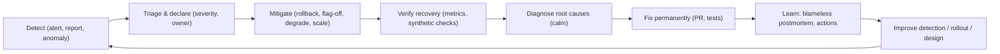
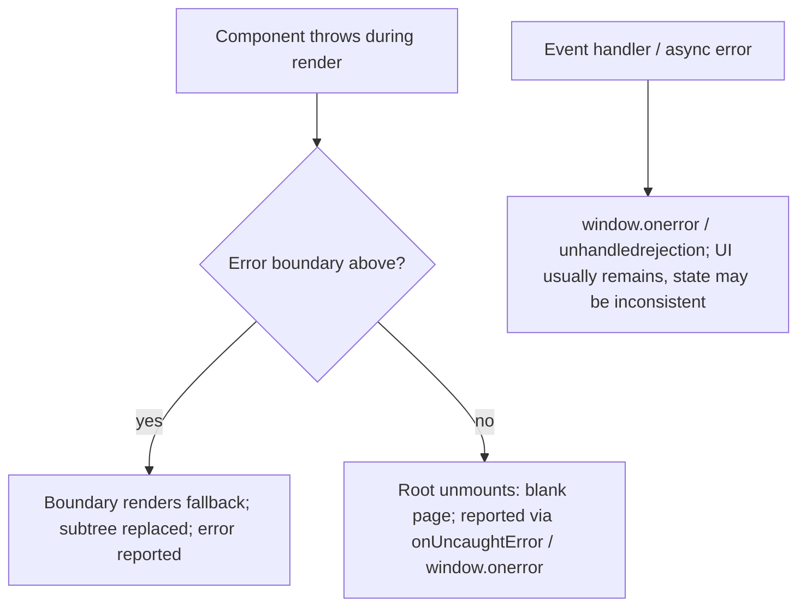
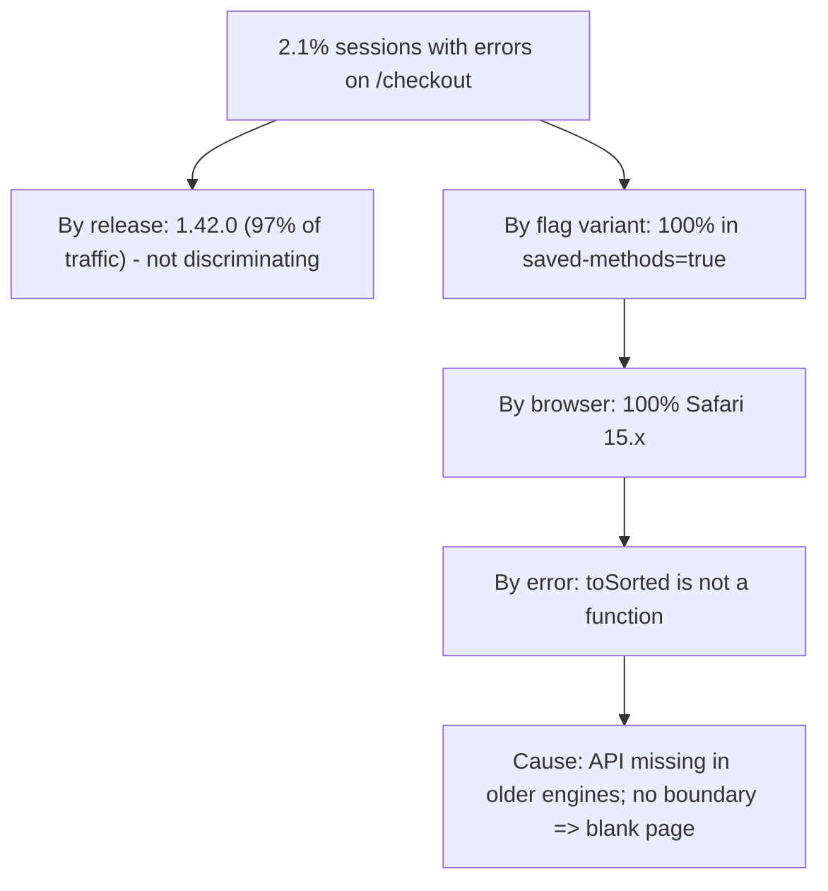

# 10 / 19 — Incident Debugging: Detecting, Mitigating, Diagnosing, and Learning from Production Failures

## 1. Lesson metadata

| | |
|---|---|
| **Level** | Professional |
| **Study time** | 5–6 hours (reading 2 h, worked incident 1.5 h, exercises 2 h) |
| **Prerequisites** | [04 — Observability and logging](./04-observability-and-logging.md), [05 — Error monitoring](./05-error-monitoring.md), [10 — Resilience and degradation](./10-resilience-and-degradation.md), [17 — Documentation](./17-documentation.md) (runbooks), [18 — Continuous delivery](./18-continuous-delivery.md), [04 / 19 — Error boundaries](../04-react-architecture/19-error-boundaries.md), [07 / 22 — Production performance investigations](../07-performance/22-production-performance-investigations.md), [00 / 20 — Tooling, transpilation, and bundling](../00-web-and-javascript-foundations/20-tooling-transpilation-and-bundling.md) |
| **Next** | [20 — Phase 10 assessment](./20-phase-assessment.md) |
| **Related** | [Phase 11 — Debugging with incomplete information](../11-senior-and-architect-mastery/19-debugging-with-incomplete-information.md), [15 — Technical debt](./15-technical-debt.md), [16 — Architecture decision records](./16-architecture-decision-records.md) |

**Learning objectives.** After this lesson you can:
1. Run the incident lifecycle: detect, declare, triage, mitigate, diagnose, resolve, learn, in that priority order.
2. Apply hypothesis-driven investigation using the available evidence (release markers, error groups, traces, flags, browser/device breakdowns).
3. Classify frontend production failures by failure class and know the first questions to ask for each.
4. Reproduce environment-specific bugs (browser, device, data, locale, network) in a controlled way.
5. Write a blameless postmortem with a timeline, contributing factors, and concrete, owned action items.
6. Walk through a complete worked incident from alert to postmortem, including wrong turns.
7. Use incidents to improve detection, rollout safety, and architecture.

**Concepts covered:** severity levels, incident roles (commander, communications, operations/investigators), mitigation vs fix, MTTD/MTTR, hypothesis-driven debugging, change correlation, bisection, RED/USE signals for frontends, error grouping and cohorting, session replay and breadcrumbs, source maps, reproduction techniques, blameless postmortems, contributing factors vs root cause, five whys limits, action item quality, detection gaps, safety nets.

---

## 2. Deep conceptual explanation

### 2.1 What problem is this lesson solving?

Production is where assumptions fail. Despite tests, reviews, and progressive delivery ([18](./18-continuous-delivery.md)), some failures reach users: a browser nobody tested, a data shape nobody anticipated, a third-party outage, a race that only appears under load. When it happens, you must do two different jobs that compete for attention:

1. **Reduce user harm now** (mitigation, communication).
2. **Understand why** (diagnosis) so it cannot recur (learning).

The most common error of inexperienced responders is doing (2) before (1): spending 40 minutes understanding the bug while users suffer, when a rollback or flag flip would have fixed the experience in 2 minutes. The most common error of experienced teams is doing (1) and skipping (2): the same class of failure recurs. This lesson teaches the discipline of sequencing and the techniques for each phase, with emphasis on React/web-specific failure classes.

### 2.2 Incident lifecycle



**Mitigation** restores user-facing function without necessarily understanding the cause (rollback, disable flag, redirect traffic, serve cached/degraded content). **Resolution** removes the underlying defect. **Time to detect (MTTD)**, **time to mitigate**, and **time to restore (MTTR)** are measured separately; improving detection and mitigation usually pays more than improving diagnosis speed.

### 2.3 Severity and roles

A severity scale aligns urgency and communication; define yours in advance. Example:

| Severity | Definition (example) | Response |
|---|---|---|
| **SEV-1** | Core flow (login, checkout) unavailable or data loss/security exposure for many users | Page on-call + incident commander; all-hands on deck; exec/customer comms |
| **SEV-2** | Major degradation or a significant segment affected; workaround exists | Page on-call; commander; regular updates |
| **SEV-3** | Minor/partial impact; limited users | Handle in business hours; ticket |
| **SEV-4** | Cosmetic or very small | Backlog |

Roles in a significant incident (adapted from common incident-management practice, e.g., Google SRE and PagerDuty's open-source response docs; ⚠ vocabulary varies):

| Role | Responsibility |
|---|---|
| **Incident Commander (IC)** | Coordinates; decides; keeps the team focused; does *not* debug hands-on |
| **Operations / investigators** | Hands-on diagnosis and mitigation |
| **Communications lead** | Status page, stakeholder updates, support liaison |
| **Scribe** | Keeps the timeline (feeds postmortem) |

In small teams one person may hold several roles, but the *functions* still need to happen. A single shared channel (a "war room") and a written timeline prevent confusion.

### 2.4 Hypothesis-driven investigation

Debugging under pressure improves with a disciplined loop:

1. **State the symptom precisely**: *what* fails, *for whom*, *since when*, *how much*. ("JS error sessions on /checkout rose from 0.2% to 2.1% starting 14:31 UTC.")
2. **List what changed**: deploys, flags, config, dependencies, infrastructure, traffic patterns, third-party status, data, time (cron, certificates, daylight saving, new month/year). Most incidents correlate with a change. Check the **change log first**.
3. **Segment the impact**: by release, browser/OS/version, device, region, locale, user cohort, flag variant, route, entry path, network type. Segmentation is the most powerful single technique: the failing dimension nearly names the cause.
4. **Form hypotheses** ranked by (probability × ease of testing). Write them down.
5. **Test the cheapest discriminating experiment** first, one variable at a time.
6. **Record results** (what you ruled out is as valuable as what you found).
7. **Mitigate as soon as a safe mitigation is available**, even before certainty.
8. **Verify** the fix with the same metric that detected the problem.

**Reproduce, don't theorize.** Reproduce the failure in a controlled environment (specific browser version, locale, data) when feasible; a reproduction proves understanding and becomes a regression test.

### 2.5 Evidence sources for frontend incidents

| Source | Answers | Caveats |
|---|---|---|
| **Error monitoring (grouped events)** | What exception, how often, which release/browser, stack trace (via source maps) | Sampling; minified stacks if maps missing; third-party noise |
| **Release/deploy markers** | Did the change align with the onset? | Flags changes may not appear as deploys |
| **Flag audit log** | Was a flag changed? Which cohort? | Must be integrated with dashboards |
| **RUM (real user monitoring)** | Web Vitals, page loads, resource timing by segment | Sampling; consent |
| **Logs (client + BFF/server)** | Request failures, status codes, correlation IDs | Client logs often lost on crash; batching |
| **Distributed traces** | Which backend span failed/was slow for a given user action | Needs propagation of trace context from the browser |
| **Session replay / breadcrumbs** | What the user did before the error | Privacy (mask inputs), cost |
| **Synthetic checks** | Are critical paths up from outside? | Scripted; not representative of all users |
| **Support tickets/social** | Qualitative and early signals | Biased; delayed |
| **Backend metrics** | 5xx, latency, saturation | A frontend incident may have clean backend metrics |
| **Third-party status** | Provider outages | Often lag reality |
| **Browser DevTools on a reproduction** | Network, console, performance, memory, application storage | Requires reproduction |

### 2.6 Failure classes in React web apps and first questions

| Failure class | Typical symptoms | First questions |
|---|---|---|
| **Unsupported API/syntax in some browsers** | `X is not a function`; only certain browser versions | Which browsers/versions? Which API is new (ES2022/2023)? Does build target/polyfill cover it? |
| **Render exception without an error boundary** | Entire page blank (React unmounts the tree on an uncaught render error) | Is there a boundary around this subtree? What was thrown? |
| **Unhandled promise rejection / async error** | Spinner forever; partial UI | Did a `fetch` fail without `catch`? Race with navigation? ([06 / 02](../06-data-fetching-and-state-ecosystems/02-cancellation-and-race-conditions.md)) |
| **Chunk/asset load failure** | `ChunkLoadError`, `Failed to fetch dynamically imported module` | Deployment skew? CDN purge? Ad blocker? ([12](./12-backward-compatibility.md), [18](./18-continuous-delivery.md)) |
| **Hydration mismatch** | Console warnings, flicker, broken interactivity after SSR | Time/locale/random in render? Browser-extension DOM mutation? ([02 / 37](../02-react-rendering-and-internals/37-scenario-f-hydration-mismatch.md)) |
| **Infinite render/effect loop** | Browser tab freezes, high CPU, "Maximum update depth exceeded" | Effect sets state unconditionally or with unstable deps? ([03 / 05](../03-react-state-and-hooks/05-effect-dependencies-and-stale-closures.md)) |
| **Stale closure / race** | Wrong value used intermittently; double submit | Which handler captured old state? Which request returned last? |
| **Memory leak** | Slowdown over hours; tab crash on dashboards | Listeners/intervals/subscriptions not cleaned? Detached DOM? ([07 / 19](../07-performance/19-memory-leaks.md)) |
| **Performance regression** | INP/LCP worsens; "feels slow" | Which release? Which interaction? Long tasks? ([07 / 20](../07-performance/20-long-tasks-and-main-thread.md)) |
| **Third-party script failure** | Blocking or erroring scripts; CSP violations | Is the third party down/slow? Did CSP change? ([10 / 06](./06-security-xss-csrf-csp.md)) |
| **Data shape surprise** | `Cannot read properties of undefined` for specific accounts | Which API field is null/missing for them? Schema drift? ([12](./12-backward-compatibility.md)) |
| **Time/locale/timezone** | Wrong dates for some users; errors on specific dates | Locale, timezone, DST, date parsing differences? ([09 — i18n](./09-internationalization.md)) |
| **Auth/session expiry** | Sudden 401 loops, redirect storms | Token refresh logic, clock skew, cookie policy changes? |
| **Storage corruption** | Crash only for returning users | Persisted state shape ([12](./12-backward-compatibility.md)); private mode/quota |
| **Service worker stale shell** | "Fixed" bug persists for some users | Is an old SW serving the old app? |
| **Security event** | Unexpected scripts, token exfiltration, defacement | Treat as a security incident: preserve evidence, involve security |

### 2.7 Blameless postmortems

A **postmortem** (incident review) is a written analysis of an incident to learn and improve. The "blameless" principle: assume people acted reasonably on the information they had; focus on *how the system allowed the failure*, not on who made the mistake. (See Google SRE's chapter on postmortem culture; the term "just culture" is also used.) Blameless does **not** mean accountability-free: *actions* are owned and tracked; individuals are not scapegoated.

Postmortem contents:

| Section | Purpose |
|---|---|
| **Summary** | One paragraph: what happened, impact, duration |
| **Impact** | Users, sessions, revenue, SLO burn, support tickets |
| **Timeline** | Timestamps in UTC: detection, actions, decisions, mitigation, resolution |
| **Detection** | How was it detected? How long after onset? Could it have been detected sooner? |
| **Root cause(s) / contributing factors** | Technical, process, and organizational contributors; "why did this reach production?" |
| **What went well / badly / lucky** | Calibration and learning |
| **Action items** | Specific, owned, prioritized, with due dates and a link to tracking; classified (prevent, detect, mitigate, process) |
| **Lessons / follow-ups** | Broader insights, updates to runbooks and ADRs |

**Root cause vs contributing factors.** Complex failures rarely have a single root cause. "Five whys" is a common technique but can oversimplify into a linear chain and stop at a convenient human error. Prefer a *contributing-factors* view: the bug (proximate cause), the missing test (why not caught), the missing boundary (why impact was large), the detection gap, the rollout safety, the knowledge gap.

**Good action items** are specific and verifiable ("Add an ESLint compat rule to CI that fails on APIs unsupported by our browserslist; owner: Priya; due: 2026-05-15") rather than vague ("be more careful", "improve testing"). Prefer systemic fixes (automation, guardrails) over exhortations. Limit to those you will actually do; track them to completion.

### 2.8 Common misconceptions

| Misconception | Reality |
|---|---|
| "Find the root cause first, then fix." | Mitigate first when a safe mitigation exists; diagnose after users are safe. |
| "The person who made the change caused the incident." | Systems allowed the change to cause harm: review, tests, rollout, detection all failed. |
| "More alerts means better detection." | Noisy alerts get ignored; alert on user-impact symptoms with actionable runbooks. |
| "If tests pass, a production bug must be a fluke." | Tests model a small subset of reality (browsers, data, scale). |
| "Backend metrics are green so it's not us." | Frontend failures can occur entirely client-side; check client signals. |
| "Postmortems are for big outages only." | Near-misses and small incidents teach cheaply. |
| "A hotfix directly to production is faster." | Bypassing the pipeline often causes the next incident; fast pipelines make the normal path the hotfix path. |

---

## 3. Internal mechanics

### 3.1 What React does when rendering throws

**Public guarantee (React docs, [Error boundaries](https://react.dev/reference/react/Component#catching-rendering-errors-with-an-error-boundary)):** If a component throws during rendering, React looks up the tree for the nearest **error boundary** (a class component defining `static getDerivedStateFromError` and/or `componentDidCatch`) and renders its fallback. If there is **no** boundary, the error is not caught by React, and React **unmounts the whole root tree** ("the entire tree below the root is removed"), leaving a blank page (ignoring any static HTML outside the root). Error boundaries do **not** catch errors in event handlers, asynchronous code (e.g., `setTimeout`, promises), server-side rendering, or errors thrown in the boundary itself.

**Teaching model:** treat an error boundary as a `try/catch` around a *subtree's render and lifecycle phase*. Event-handler errors are ordinary JavaScript errors: they surface to `window.onerror`/`unhandledrejection`, not to boundaries.

**React 19 (verified against react.dev and react-dom 19.3.1 in the sandbox):** `createRoot`/`hydrateRoot` accept error callbacks such as `onCaughtError` (errors caught by a boundary), `onUncaughtError` (errors not caught by any boundary), and `onRecoverableError` (errors React recovers from, e.g., hydration), enabling central reporting. React 19 also changed how errors are logged (a single deduplicated report instead of duplicates). Passing a callback replaces React's default logging for that category; `onCaughtError` runs before the boundary's `componentDidCatch`. See the [React docs for `createRoot`](https://react.dev/reference/react-dom/client/createRoot).



### 3.2 JavaScript syntax versus APIs: why "it builds" doesn't mean "it runs on old browsers"

Build tools **transpile syntax** (arrow functions, optional chaining, class fields) down to a configured **target** (for example via esbuild/SWC/Babel using a browserslist or `build.target`). They do **not**, by default, **polyfill runtime APIs** (methods and global objects): `Array.prototype.toSorted`, `Object.hasOwn`, `structuredClone`, `Array.prototype.findLast`, `Intl` features, `AbortSignal.timeout`, etc. An application can compile with no error, pass tests on a modern Node and Chrome, and throw `TypeError: x.toSorted is not a function` on an older Safari. Tools exist to detect this (linting against browserslist via `eslint-plugin-compat`-style rules, or `es-x`-style plugins ⚠ verify capabilities; and polyfill libraries such as `core-js` ⚠ verify configuration). Browser support data: check [caniuse.com](https://caniuse.com/) and MDN compatibility tables for the specific API.

### 3.3 Source maps: from minified stack to code

An error event contains a stack with minified file/line/column positions. A **source map** file maps these back to original files and lines. For production, upload maps to the error service per release, keyed by a release identifier; configure the SDK to send the same identifier, so symbolication succeeds. If the identifier mismatches or upload failed, stacks remain minified (`a.js:1:48372`), slowing investigation ([05](./05-error-monitoring.md)).

### 3.4 Correlating a client error to a server trace

If the browser sends `traceparent` (W3C Trace Context) headers on `fetch` calls and the backend continues the trace, a frontend error report that includes the trace ID can be followed to the exact backend spans ([04](./04-observability-and-logging.md)). Without propagation, you can only correlate by time and user ID, which is slow and error-prone.

### 3.5 Bisecting a regression

When you know "good at version A, bad at version B", `git bisect` performs a binary search over commits: ~log₂(N) steps for N commits. With an automated test script returning exit 0/1 (and 125 for untestable commits), `git bisect run` finds the first bad commit unattended. Bisect needs a **deterministic reproduction**, which is why reproduction is valuable.

---

## 4. Step-by-step execution walkthrough: the first 30 minutes of an incident

1. **Acknowledge the alert (0–2 min).** On-call acknowledges, opens the runbook link from the alert, and posts in the incident channel: "Investigating alert X, owner: me."
2. **Assess impact and declare (2–5 min).** Open the dashboard: is the alert real (is the metric high and still high)? How many users/sessions? Which flows? Decide severity; if SEV-2 or higher, declare an incident, assign an IC (if available), and start the timeline. If uncertain, **declare early** and downgrade later.
3. **Check what changed (5–8 min).** Deploy markers, flag audit log, config changes, third-party status, infrastructure events. If a change aligns with onset and a safe rollback exists, prepare to roll back.
4. **Segment (5–12 min).** In error monitoring: group by release, browser, OS, route, flag variant, region. Look for 100% concentration on a value.
5. **Mitigate (as soon as safe).** Roll back or flip the flag; if neither is possible, degrade (disable feature), serve static fallback, or scale resources. Communicate the mitigation action in the channel.
6. **Verify recovery (10–20 min).** Wait for the metric to recover; confirm with synthetic checks and a manual test in an affected environment, not just "alert resolved".
7. **Communicate (throughout).** Status updates at fixed intervals (e.g., every 15–30 minutes for SEV-1/2): impact, current action, next update time. Support receives a customer-facing explanation and workaround.
8. **Preserve evidence.** Save links to error groups, traces, dashboards, deploy and flag states before they roll out of retention.
9. **Stand down and hand off.** Once stable, the IC declares mitigation complete; diagnosis and permanent fix continue as normal work, with a postmortem scheduled (within days, while memory is fresh).

---

## 5. Code examples and the worked incident

### 5.1 Minimal example: global error capture with release tagging

```ts
// src/monitoring/report.ts — vendor-agnostic wrapper; swap internals for your error service SDK
interface ErrorReport {
  message: string; stack?: string; kind: 'uncaught' | 'caught' | 'unhandled-rejection' | 'recoverable';
  release: string; route: string; flags: Record<string, boolean>; ua: string; time: string;
}

const release = import.meta.env.VITE_BUILD_ID as string;     // Vite-specific (import.meta.env)
let getFlags: () => Record<string, boolean> = () => ({});
export function registerFlagSnapshot(fn: () => Record<string, boolean>) { getFlags = fn; }

const sent = new Set<string>();                               // dedupe floods from loops
export function reportError(err: unknown, kind: ErrorReport['kind']) {
  const e = err instanceof Error ? err : new Error(String(err));
  const key = `${kind}:${e.message}:${e.stack?.split('\n')[1] ?? ''}`;
  if (sent.has(key) || sent.size > 50) return;                // cap per page load
  sent.add(key);
  const payload: ErrorReport = {
    message: e.message, stack: e.stack, kind, release,
    route: location.pathname, flags: getFlags(), ua: navigator.userAgent, time: new Date().toISOString(),
  };
  const body = JSON.stringify(payload);
  if (!navigator.sendBeacon?.('/api/client-errors', body)) {  // beacon survives page unload
    void fetch('/api/client-errors', { method: 'POST', body, keepalive: true, headers: { 'content-type': 'application/json' } });
  }
}

window.addEventListener('error', (ev) => reportError(ev.error ?? ev.message, 'uncaught'));
window.addEventListener('unhandledrejection', (ev) => reportError(ev.reason, 'unhandled-rejection'));
```

**Line notes.** Including `release`, `route`, `flags`, and `ua` in every report enables the segmentation in §2.4: without them, the first 20 minutes of an incident are spent *getting* the dimensions you could have had for free. The dedupe set prevents an effect loop from sending thousands of events (cost and rate limits). `sendBeacon` is designed for reliably sending small payloads during page unload; `fetch` with `keepalive` is the alternative. Ensure payloads avoid personal data and respect consent. A vendor SDK does these things and adds sampling, source-map integration, and breadcrumbs.

### 5.2 Practical: wiring React 19 root error callbacks and an error boundary

```tsx
// src/main.tsx
import { createRoot } from 'react-dom/client';
import { reportError } from './monitoring/report';
import { App } from './App';

createRoot(document.getElementById('root')!, {
  // React 19 root options (names confirmed on react.dev and in the sandbox)
  onUncaughtError: (error) => reportError(error, 'uncaught'),
  onCaughtError: (error) => reportError(error, 'caught'),
  onRecoverableError: (error) => reportError(error, 'recoverable'),
}).render(<App />);
```

```tsx
// src/components/RouteErrorBoundary.tsx — class component: boundaries still require classes (React docs)
import { Component, type ErrorInfo, type ReactNode } from 'react';

interface Props { children: ReactNode; fallback: (reset: () => void, error: Error) => ReactNode; resetKey?: unknown }
interface State { error: Error | null; prevResetKey: unknown }

export class RouteErrorBoundary extends Component<Props, State> {
  state: State = { error: null, prevResetKey: this.props.resetKey };

  static getDerivedStateFromError(error: Error): Partial<State> { return { error }; }

  static getDerivedStateFromProps(props: Props, state: State): Partial<State> | null {
    // reset when the key (e.g., route) changes, so navigating away recovers the UI
    if (props.resetKey !== state.prevResetKey) return { error: null, prevResetKey: props.resetKey };
    return null;
  }

  componentDidCatch(error: Error, info: ErrorInfo) {
    // With React 19 root callbacks, avoid double-reporting: sandbox-confirmed that both onCaughtError and componentDidCatch fire for the same error, so choose ONE reporting place.
    console.error('Boundary caught', error, info.componentStack);
  }

  reset = () => this.setState({ error: null });

  render() {
    return this.state.error ? this.props.fallback(this.reset, this.state.error) : this.props.children;
  }
}
```

```tsx
// usage: isolate a risky subtree so a failure does not blank the whole page
<RouteErrorBoundary
  resetKey={location.pathname}
  fallback={(reset) => (
    <section role="alert">
      <h2>We couldn't load the payment step</h2>
      <p>Your cart is saved. You can try again, or continue with another payment method.</p>
      <button onClick={reset}>Try again</button>
    </section>
  )}
>
  <PaymentStep />
</RouteErrorBoundary>
```

**Notes.** Boundary *granularity* is a design decision: one boundary at the root yields a generic error page for any failure; boundaries around independent sections (payment step, recommendations widget) contain the blast radius so the rest of the page works ([04 / 19](../04-react-architecture/19-error-boundaries.md)). `role="alert"` announces the problem to assistive tech. A fallback should offer a recovery action and, for money flows, a reassuring message about state. Resetting on route change prevents the boundary from staying stuck after navigation.

### 5.3 Worked incident: INC-2417, "Payment step blank for some users after 1.42.0"

This is a realistic composite incident, written as an investigation log. Times are UTC. Read it as a case study; then try the exercises.

#### Context
- Storefront SPA (React 19, TypeScript, Vite), deployed with the pipeline from [18](./18-continuous-delivery.md). Release **1.42.0** shipped at 14:02. It includes the new "Saved payment methods" UI behind flag `checkout.saved-methods`, ramped to **10%** at 14:20.
- Alert rules: "sessions with an unhandled error on /checkout > 2% for 5 min" → pages checkout on-call.
- Build config: Vite default build target (`baseline-widely-available`; in Vite 8 that is Chrome 111, Edge 111, Firefox 114, Safari 16.4 — per the Vite 8 docs) with no polyfills; `browserslist` not set. (The scenario is that the product *supports* Safari 15 in practice, 18% of checkout traffic, while the build target and CI never exercised it; a default Vite 8 target of Safari 16.4 would already exclude Safari 15, so a real team would either raise its stated support floor or lower `build.target` and add polyfills.) CI runs unit tests in Node 22 and e2e in current Chromium.

#### Timeline

| Time | Event |
|---|---|
| 14:02 | Release 1.42.0 deployed; flag at 0%. Post-deploy checks pass. |
| 14:20 | Flag `checkout.saved-methods` ramped to 10% (staff were already at 100%) |
| 14:31 | **Alert:** unhandled-error sessions on /checkout = 2.1% (baseline 0.2%). On-call (Dana) acknowledges. |
| 14:33 | Dana opens the runbook and the dashboard. The conversion funnel shows the "payment step reached" → "order placed" rate dropping from 71% to 64% overall. Declares **SEV-2**; Ravi joins as IC. |
| 14:36 | **Change check:** deploy marker at 14:02 (28 minutes earlier), flag ramp at 14:20 (11 minutes before onset, with the error rate rising at ~14:24). Payments provider status page: green. Backend 5xx: flat. |
| 14:38 | **Hypothesis 1: payments provider/network issue.** Evidence against: backend and provider metrics flat; error is thrown client-side. Dropped. |
| 14:41 | **Segment by release:** 100% of errors on 1.42.0 (but 1.42.0 is also ~97% of all traffic by now: weak discriminator). **Segment by flag variant** (flags are attached to each report): 100% of error sessions have `checkout.saved-methods=true`. Strong signal. |
| 14:43 | **Segment by browser:** 100% of error events are Safari 15.x on iOS/macOS (Safari 15.2–15.6); Safari 16+/Chrome/Firefox: zero. Safari 15 is ~18% of checkout traffic. Combined with flag cohort 10% → 1.8% of sessions: matches the 2.1% alert level. |
| 14:44 | **Top error (symbolicated via source maps):** `TypeError: p.toSorted is not a function` in `SavedMethodsList.tsx:41`. Not a render-logic bug: the API doesn't exist on that engine. |
| 14:45 | **Mitigation decision:** a rollback of 1.42.0 would also remove unrelated fixes; the flag-off is smaller and faster. IC approves: set flag to 0%. |
| 14:46 | Dana sets `checkout.saved-methods` to 0%. Flag SDK caching: clients refresh within ≤ 60 s. |
| 14:50 | Error rate falling; at 14:52 = 0.3%; at 14:58 = 0.2% (baseline). Funnel recovers (the remainder of the drop at 14:20–14:46 reflects users already affected). |
| 14:58 | Verified with a manual test on a Safari 15.6 device farm session: checkout works with flag off. IC declares **mitigated**. Impact window for affected users: 14:24–14:48 (~24 min). |
| 15:30 | Fix PR opened (see below). |
| Next day | Fix released; flag re-ramped with additional guardrails. Postmortem held. |

#### Wrong turns and what they cost
1. **Provider hypothesis** (3 min): reasonable, but the error was client-side. Cheap to eliminate because backend dashboards were already on the incident board.
2. **Release-only segmentation** (2 min): not discriminating, as 1.42.0 served almost all traffic. Only the *flag variant* attribute (which the team had added to error reports after a previous incident) split the population. *Lesson:* include every rollout dimension (release, flag, experiment) in error context.
3. **Considering rollback of the release**: would have worked but with higher collateral cost; the flag was the smaller lever. *Lesson:* design rollouts so the smallest effective rollback exists.

#### Evidence (illustrative queries)
Pseudo-SQL over an error events table (adapt to your error tool):
```sql
SELECT browser_family, browser_major, COUNT(DISTINCT session_id) AS sessions
FROM client_errors
WHERE route LIKE '/checkout%' AND time > now() - interval '30 minutes'
  AND message LIKE '%toSorted is not a function%'
GROUP BY 1, 2 ORDER BY sessions DESC;
-- Safari 15  ->  412 sessions; Safari 16 -> 0; Chrome -> 0; Firefox -> 0
```
A cross-tab of `flags['checkout.saved-methods']` by error presence showed 100% variant `true`.

#### Root cause (proximate)
`SavedMethodsList.tsx` sorted payment methods with `methods.toSorted(byLastUsed)`. `Array.prototype.toSorted` (ES2023) is unavailable in browsers released before roughly 2023 (MDN browser-compat data: Chrome 110, Firefox 115, Safari 16 are the first versions with `toSorted`). The build tool transpiles syntax but does not polyfill APIs; tests ran on Node 22 and current Chromium, where the method exists.

```tsx
// SavedMethodsList.tsx (before)
export function SavedMethodsList({ methods }: { methods: readonly PaymentMethod[] }) {
  const sorted = methods.toSorted((a, b) => b.lastUsedAt.localeCompare(a.lastUsedAt)); // ❌ not available on Safari 15
  return (
    <ul>{sorted.map((m) => <li key={m.id}><PaymentMethodRow method={m} /></li>)}</ul>
  );
}
```

#### Why the impact was large (contributing factors)
1. **API availability not covered by tooling**: no lint rule or compat check against the supported browser list; no browserslist declared; the supported-browser policy existed only in a wiki page that nobody linked to the build.
2. **Test environment skew**: unit tests on Node 22; e2e only on latest Chromium/WebKit; no check on the oldest supported Safari.
3. **No error boundary around PaymentStep**: a render exception unmounted the whole root, so affected users saw a **blank page** instead of a contained error with an alternative payment path. Without the boundary, the *bug* became an *outage of checkout* for that cohort.
4. **Rollout safeguards partially effective**: the 10% ramp *limited* the blast radius (good), but the automated canary gate checked overall JS error rate and not per-browser rate, so it took the alert (14:31) rather than a gate to detect it. *(What went well: the ramp, the flag, error context with flag variants.)*
5. **Detection delay**: onset 14:24, alert 14:31 (7 minutes: the 5-minute window plus alert evaluation).
6. **Mitigation time**: 15 minutes from alert to flag-off, mostly spent on hypotheses 1–2 and decision about rollback vs flag.

#### The fix (permanent)

```tsx
// SavedMethodsList.tsx (after)
export function SavedMethodsList({ methods }: { methods: readonly PaymentMethod[] }) {
  // Copy then sort: works in all supported browsers; does not mutate props.
  const sorted = [...methods].sort((a, b) => b.lastUsedAt.localeCompare(a.lastUsedAt));
  return <ul>{sorted.map((m) => <li key={m.id}><PaymentMethodRow method={m} /></li>)}</ul>;
}
```

Plus guardrails (each a tracked action item):

```jsonc
// package.json
{
  "browserslist": ["defaults and fully supports es6-module", "ios_saf >= 15", "safari >= 15"]
}
```
```js
// eslint.config.js (excerpt; eslint-plugin-compat documents the `flat/recommended` config, check your plugin version)
import compat from 'eslint-plugin-compat';
export default [ compat.configs['flat/recommended'] ];
```
The compat plugin checks usage of web APIs against the browserslist; **but** it covers browser APIs (e.g., `fetch`, `IntersectionObserver`) better than language built-ins such as `Array.prototype.toSorted`. For ECMAScript built-ins, use an ES-feature-focused plugin (e.g., `eslint-plugin-es-x` with a target version) or TypeScript's `lib` setting (set `"lib": ["ES2021", "DOM"]` so that `toSorted` fails *type-checking*: types declare what you allow yourself to use). The TypeScript `lib` approach is simple and compiler-enforced:

```jsonc
// tsconfig.json
{ "compilerOptions": { "target": "ES2021", "lib": ["ES2021", "DOM", "DOM.Iterable"] } }
// `[].toSorted()` => error TS2550: Property 'toSorted' does not exist ... Do you need to change your target library?
```
(Verified with TypeScript 5.9 in the sandbox: `TS2550: Property 'toSorted' does not exist on type 'number[]'. Do you need to change your target library?`; the exact wording can differ between TypeScript versions.)

Regression test using Playwright to simulate the missing API:

```ts
// e2e/checkout-legacy-browser.spec.ts
import { test, expect } from '@playwright/test';

test('checkout works when ES2023 array methods are missing', async ({ page }) => {
  await page.addInitScript(() => {
    // simulate Safari 15: remove APIs newer than our supported baseline BEFORE app scripts run
    for (const m of ['toSorted', 'toReversed', 'toSpliced', 'with', 'findLast', 'findLastIndex', 'at'] as const) {
      delete (Array.prototype as unknown as Record<string, unknown>)[m];   // deliberate deletion for simulation
    }
    // @ts-expect-error
    delete Object.hasOwn;
    // @ts-expect-error
    delete globalThis.structuredClone;
  });
  await page.goto('/checkout?flags=checkout.saved-methods:on');
  await expect(page.getByRole('heading', { name: /saved payment methods/i })).toBeVisible();
  await expect(page.getByRole('alert')).toHaveCount(0);
});
```
Limitations: this simulates *missing API methods* but not other engine differences; real-device/browser-farm smoke checks on the oldest supported Safari remain valuable, run nightly rather than per PR. Also note deleting `at` removes a method used by libraries; if a *dependency* uses it, the test would reveal that too (a feature, but maybe noisy).

Containment improvement: wrap `PaymentStep` with `RouteErrorBoundary` (§5.2) offering "Try again" and "Pay another way".

Rollout improvement: extend the canary gate to evaluate **error rate per browser family/major** with minimum sample thresholds, flagging any browser cohort with a significantly higher error rate than baseline.

#### Postmortem document (filled-in extract)

```md
# Postmortem: INC-2417 Payment step blank on Safari 15 after Saved Methods ramp
Status: Final · Date: 2026-05-12 · Authors: Dana, Ravi · Severity: SEV-2 · Duration of user impact: ~24 min

## Summary
After ramping the `checkout.saved-methods` flag to 10% at 14:20 UTC, users on Safari 15.x in the cohort saw a blank page on the payment step because the new code called `Array.prototype.toSorted`, which that browser does not implement. Impact ended when the flag was set to 0% at 14:46.

## Impact
~410 sessions affected (all Safari 15.x within the 10% cohort); estimated 38 lost orders (funnel delta, refined with order data); 7 support tickets. No data loss or security impact. SLO: checkout success SLO burned 6% of the monthly error budget.

## Detection
Alert at 14:31 (onset ~14:24). Fires on aggregate sessions with unhandled errors. Not detected by CI, canary gate (aggregate-only), or staging.

## Timeline
(see incident log above, UTC)

## Contributing factors
1. No compile-time or lint-time check that APIs used exist in the supported browser baseline (TS `lib` was ES2023+; no browserslist).
2. E2E and unit environments did not include browsers/engines at the baseline's lower bound.
3. No error boundary around PaymentStep: a render error blanked the whole page.
4. Canary gate evaluated aggregate error rate only; the cohort (≈1.8% of sessions) was below the threshold's sensitivity.
5. The supported-browser policy was documented only in a wiki page.

## What went well
- Flag at 10% bounded the blast radius; flag-off took seconds.
- Flag variant and release were attached to error events, enabling a 3-minute segmentation.
- Source maps were correct for the release; the error was symbolicated immediately.
- Clear IC role; communications were timely.

## What went poorly / was lucky
- ~7 minutes spent on provider hypothesis before looking at client segments.
- Lucky: the flag cohort was small and checkout is not at peak time.

## Action items
| # | Action | Type | Owner | Due | Tracking |
|---|---|---|---|---|---|
| 1 | Set TS `target/lib` to ES2021 and fix resulting type errors | Prevent | Priya | 05-19 | PORTAL-901 |
| 2 | Add `browserslist` + compat/ES-feature lint in CI | Prevent | Priya | 05-26 | PORTAL-902 |
| 3 | Playwright "legacy API" suite + nightly Safari-15 real-device smoke | Detect | Team QA | 06-02 | PORTAL-903 |
| 4 | Error boundary + alternative path around PaymentStep and other money flows | Mitigate | Dana | 05-21 | PORTAL-904 |
| 5 | Per-browser cohort comparison in canary gate (min sample sizes) | Detect | Platform | 06-16 | PORTAL-905 |
| 6 | Move supported-browser policy into repo docs + link from CONTRIBUTING; reference in ADR | Process | Ravi | 05-19 | PORTAL-906 |
| 7 | Add "browser" and "flag variant" to the default incident dashboard | Detect | Dana | 05-14 | PORTAL-907 |
```

#### Verification of the fix
Fix released 2026-05-13; flag re-ramped: staff → 1% → 10% → 100% across a week with the improved gate; the Safari-15 nightly smoke test runs against the flag-on path; the new CI check fails on a deliberate `toSorted` call (verified by a temporary canary PR, then reverted).

### 5.4 Practical: reproducing an environment-specific bug

```ts
// Techniques ordered from cheapest to most faithful
// 1. Remove APIs before the app loads (Playwright addInitScript, see above)
// 2. Emulate device/viewport/UA (DevTools device mode, Playwright devices) — does NOT change the JS engine
// 3. Use the actual engine: Playwright WebKit/Firefox/Chromium builds (current versions) — covers engine differences, not old versions
// 4. Real-device/browser-farm sessions for old versions (BrowserStack, Sauce Labs, lab devices) — highest fidelity
// 5. Replay production data: export an anonymized failing payload, load via MSW in a local run
```

```ts
// MSW handler replaying a problematic production payload (anonymized)
import { http, HttpResponse } from 'msw';
import failingPayload from './fixtures/order-INC-2417.json';
export const handlers = [http.get('/api/orders/:id', () => HttpResponse.json(failingPayload))];
```

Principle: choose the **cheapest technique that preserves the cause**. Emulating a user agent string will not reproduce a missing JS API; deleting the API will.

### 5.5 Practical: automated bisect for a regression

```bash
# Find the first commit that breaks the checkout e2e test, between v1.41.0 (good) and v1.42.0 (bad)
git bisect start v1.42.0 v1.41.0
git bisect run bash -c 'pnpm install --frozen-lockfile >/dev/null 2>&1 && pnpm exec playwright test e2e/checkout-legacy-browser.spec.ts'
git bisect reset
```

Notes: `git bisect run` uses the script's exit code (0 good, 1–127 bad except 125 = "skip this commit"; ≥128 aborts). Dependency installation per commit is slow; if lockfile changes rarely, cache the install and skip commits that fail to build with exit 125. Bisect assumes a single transition from good to bad; flaky tests make results unreliable: run the repro multiple times per step.

### 5.6 Incorrect example: investigation by guesswork and untracked actions

```text
14:31 alert
14:33 "maybe it's the payment provider, let's restart the BFF"        (no evidence; restart masks state)
14:40 "someone also bump the cache TTL"                                  (changes two variables at once)
14:52 "I think it's fixed?"  (no verification metric; no one knows what helped)
Postmortem: "Human error: developer should have tested on Safari." (blame; no systemic action)
```

Failures: no segmentation, multiple simultaneous changes, no verification, no timeline, blame-oriented conclusion that yields no prevention.

### 5.7 Corrected: structured response

```text
14:31 alert ack; 14:33 SEV-2 declared, IC assigned, timeline started
14:36 change check: deploy 14:02, flag ramp 14:20
14:41 segmentation: all errors in flag-on cohort
14:43 segmentation: all errors Safari 15.x
14:44 symbolicated error: toSorted is not a function
14:45 decision: flag-off (smallest rollback)
14:46 flag-off; 14:52 metric recovered; 14:58 verified on real device
Postmortem: contributing factors + 7 owned actions (prevent/detect/mitigate)
```

---

## 6. Visual explanations

### 6.1 The incident funnel: segmentation narrows the cause



### 6.2 Time budget of the incident (INC-2417)

```text
14:24 onset ──7 min detection──▶ 14:31 alert ──15 min to mitigation──▶ 14:46 flag off ──12 min──▶ 14:58 verified
                    ▲                                  ▲
           improve: per-cohort gate           improve: pre-built dashboard with browser+flag segmentation
```

### 6.3 Contributing factors (not a single root)

```text
                      ┌───────────────┐
 No API compat check ─┤               │
 Test env skew ───────┤  Incident     │── Impact: blank payment page for ~410 sessions
 No error boundary ───┤  INC-2417     │
 Aggregate-only gate ─┤               │
 Policy not in repo ──┘               │
                      └───────────────┘
Any single barrier working would have reduced or prevented the impact (Swiss-cheese model).
```

### 6.4 Mitigation options ordered by speed and blast radius

```text
flag-off (seconds) < config change (minutes) < rollback (minutes) < roll-forward fix (hour+)
smaller blast radius & fewer side effects  --->  prefer the smallest effective lever
```

---

## 7. Alternative approaches and trade-offs

| Criterion | Rollback | Flag-off | Roll-forward fix | Degraded mode / kill switch | Traffic reroute (to old version/region) |
|---|---|---|---|---|---|
| Speed | Minutes | Seconds–1 min | 30 min–hours | Seconds | Minutes |
| Collateral changes | High (removes unrelated fixes) | Minimal | None extra | Feature loss | Moderate |
| Requires prior prep | Immutable artifacts | Flag wrapped the change | Fast pipeline | Designed fallbacks | Multi-version infra |
| Risk | Data compatibility | Flag SDK cache delay | Rushed fix | UX loss | Capacity |
| Best when | Cause is a recent version, no flag | Cause is a flagged feature | Rollback unsafe | Dependency outage | Regional failure |

| Criterion | Blameless postmortem | Five Whys RCA | Fault-tree / contributing factors | No review |
|---|---|---|---|---|
| Learning depth | High | Medium (can be linear) | High | None |
| Risk of blame | Low | Medium | Low | n/a |
| Effort | Medium | Low | High | None |
| Best for | Most incidents | Simple causal chains | Complex multi-factor failures | Trivial events |

**Scenario where "mitigate first" is NOT best.** A suspected security breach (e.g., malicious script injected via a compromised third-party): rollback or flag-off may destroy evidence or alert an attacker; coordinate with security before changing state, isolate (e.g., block the script domain via CSP/edge) while preserving logs and artifacts. Also for data-corrupting bugs where *stopping writes* is the mitigation, do that immediately and carefully.

**Scenario where a full postmortem is NOT worth it.** A SEV-4 with a trivial, understood cause and an existing action item; a short written note in the ticket suffices. Reserve full reviews for incidents that reveal systemic gaps or high impact; also review *near misses* where luck, not safeguards, prevented impact.

---

## 8. Best practices and anti-patterns

### 8.1 Best practices
- **Mitigate before you diagnose** when a safe lever exists.
- **Attach context to every error**: release, flags/experiments, route, browser, locale, user cohort (non-PII), trace ID.
- **Know your levers in advance**: flags, rollback, degraded modes, runbooks ([17](./17-documentation.md)); practice them in game days.
- **Alert on user-impact symptoms** (SLO burn, error sessions, checkout success), not on every exception; each alert links to a runbook.
- **Build the incident dashboard before the incident**: error rate by release, flag variant, browser, route; funnel metrics; deploy and flag markers.
- **Keep a timeline** as you go; timestamps in UTC.
- **Change one variable at a time**; record what you tried.
- **Contain blast radius by design**: error boundaries around independent sections, bulkheads, timeouts, circuit breakers ([10](./10-resilience-and-degradation.md)).
- **Write blameless postmortems** with systemic action items, owned and tracked; follow up at a set date.
- **Turn every incident into a regression test and a detection improvement.**
- **Share learnings** (short internal write-ups, review sessions).

### 8.2 Beginner mistakes
- Reading only the top error message and not segmenting.
- Deploying a speculative "fix" to production under pressure without reproduction.
- Not preserving evidence before it expires.

### 8.3 Experienced-developer mistakes
- **Hero debugging**: silent solo investigation, no communication, no handoff.
- **Fixing the symptom** (add `try/catch`) and closing the incident, leaving the class of problem.
- **Action-item inflation**: 25 vague items, none completed.
- **Assigning blame subtly** ("the engineer who merged it") in postmortems.
- **Over-trusting dashboards** without checking that the measurement itself is broken (a monitoring outage looks like "all green").

### 8.4 Smells
- Alerts that regularly fire without action.
- Runbooks last edited two years ago.
- The same class of incident recurs every quarter.
- On-call dread: engineers avoid shipping on Fridays because rollback is untested.
- Postmortems with no action items, or with the same action repeated across reviews.

### 8.5 Justified exceptions
- Skip declaring a formal incident for minor issues, but record them.
- Direct production hotfixes for severe security issues when the pipeline is itself compromised (document and review afterwards).
- Delaying a postmortem for a few days when responders are exhausted (but do not skip it).

---

## 9. Real-world application

**E-commerce.** Revenue-sensitive: incident severity ties to funnel metrics; peak events increase severity and shorten time budgets. Maintain pre-approved degraded modes (hide recommendations, switch to simpler payment UI) and a "static order status" fallback. Run pre-event game days.

**Dashboards.** Failures are often slow burns (memory leaks, accumulating data) rather than sharp errors: alert on trend metrics (heap growth, long-task frequency) and keep session duration in segmentation ([07 / 19](../07-performance/19-memory-leaks.md)).

**Finance.** Incidents involving incorrect numbers are worse than outages: define a "wrong data" severity, a process to freeze affected views, and communication to compliance. Preserve audit evidence; postmortems may be shared with regulators.

**Forms.** Data-loss incidents (draft lost, double submit) are high severity; instrument form submission outcomes and idempotency keys; design recovery (drafts, resubmit protections).

**Auth.** Login incidents lock out all users; maintain break-glass procedures, test IdP failure modes, and avoid single points of failure in token refresh. Security incidents follow a separate protocol (contain, preserve evidence, notify).

**Multi-team.** Cross-team incidents need a clear *owner of coordination* (IC) and well-defined escalation paths via ownership metadata ([14](./14-multi-team-collaboration.md)); post-incident actions may cross team boundaries and need a shared tracker with a champion.

**Realtime.** Reconnection storms after a deploy or network blip can overwhelm servers; client jitter/backoff and server load shedding are mitigations; incident debugging needs connection-state metrics and message-level tracing ([06 / 17](../06-data-fetching-and-state-ecosystems/17-real-time-websockets-subscriptions.md)).

---

## 10. Debugging and troubleshooting

This section is a reference for the *investigation toolbox*.

### 10.1 Browser DevTools workflow for a reproduction
1. **Console**: first exception; enable "Preserve log"; filter by `Errors`; note CSP violations and failed resource loads.
2. **Network**: status codes, response bodies for failing calls, cached vs network, timing waterfall; look for HTML returned for JS (SPA fallback).
3. **Application**: storage contents (localStorage/IndexedDB for corrupted state), service workers (version, "Update on reload", "Bypass for network"), cookies.
4. **Performance**: record the failing interaction; look for long tasks and repeated renders; flame chart for loops.
5. **Memory**: heap snapshots before/after repeated actions for leaks ([07 / 19](../07-performance/19-memory-leaks.md)).
6. **React DevTools Profiler/Components**: why did it render, what props/state changed ([02 / 30](../02-react-rendering-and-internals/30-react-devtools-profiler.md)).
7. **Sources**: breakpoints on exceptions ("Pause on caught exceptions"), source-mapped files.

### 10.2 Symptom → first move

| Symptom | First move | Likely class |
|---|---|---|
| Blank page, console error on load | Check boundaries; read first exception | Render exception, missing API, bad data |
| Blank page, no console error | Check network for failed entry script / CSP / HTML served as JS | Asset/deploy/CSP problem |
| Works for some browsers only | Segment by browser/version; check API compat | Unsupported API |
| Infinite spinner | Network tab: pending/failed request; unhandled rejection? | Missing error handling, timeout, CORS |
| Works after hard refresh | Compare cached assets vs fresh; SW | Stale cache/SW/deployment skew |
| Slow after hours | Performance + Memory | Leak, accumulating state |
| Only specific accounts | Compare payload shape for those accounts | Data shape, permissions, feature entitlements |
| Only at certain times | Check cron, DST, token expiry, certificate expiry | Time-based |
| Wrong date/number for locale | Reproduce with locale/timezone override | i18n |
| High CPU/tab freeze | Performance panel: repeating render/effect | Loop |

### 10.3 Validate the fix
- The **same metric** that fired the alert returns to baseline, for a long enough window (not just minutes if the problem is intermittent).
- A **regression test** fails before the fix and passes after.
- **Segments** that were affected (browser, flag variant) show zero errors.
- Check for **side effects**: the fix may have moved the failure (e.g., errors now occur in the fallback).
- **Rollout again with guardrails** if the mitigation was a flag-off.

### 10.4 When evidence is missing
If you lack the data to segment (no flag variant, no release tag), add instrumentation **as part of the mitigation or fix** and record the gap as a detection action item. See [Phase 11 — Debugging with incomplete information](../11-senior-and-architect-mastery/19-debugging-with-incomplete-information.md).

---

## 11. Exercises

### Level A — Knowledge
**A1.** List the phases of the incident lifecycle and explain why mitigation precedes diagnosis.
**A2.** Which kinds of errors do React error boundaries *not* catch? Where do those errors surface?
**A3.** What is the difference between transpiling syntax and polyfilling APIs? Give two examples of each.
**A4.** List five segmentation dimensions useful when triaging a frontend incident.
**A5.** What makes a postmortem action item good?

### Level B — Code comprehension
**B1.** In `reportError` (§5.1), what does the `sent` set prevent, and what is lost by capping at 50 keys per page load?
**B2.** In `RouteErrorBoundary` (§5.2), explain how `getDerivedStateFromProps` with `resetKey` recovers the UI after navigation, and what would happen if it were omitted and the user navigated within the same boundary instance.
**B3.** In the Playwright test (§5.3), why is `addInitScript` used rather than deleting the methods after `page.goto`?
**B4.** `git bisect run` returns exit code 125 for a commit. What does it mean, and when would you use it?

### Level C — Implementation
**C1.** Write an ESLint-independent TypeScript check (using the compiler API or a script with `tsc` settings) that fails CI if the codebase uses any API outside `lib: ["ES2021","DOM"]`; explain why a `tsconfig` `lib` setting alone is sufficient for built-ins but not for DOM/Web APIs.
**C2.** Implement a `useErrorReporter` hook or utility that adds breadcrumbs (last 20 user actions: route changes, clicks on elements with `data-track`, failed fetches) and attaches them to error reports.
**C3.** Write a runbook entry titled "Spike of `ChunkLoadError` after deploy" with decision structure, commands, and verification.

### Level D — Debugging
**D1.** After a release, a dashboard page freezes for ~5% of users with high CPU. React DevTools Profiler shows `Widget` rendering hundreds of times per second. Describe your investigation and the likely root cause classes.
**D2.** Error monitoring shows `Hydration failed because the initial UI does not match what was rendered on the server` for 12% of sessions, mostly in one country, starting at midnight UTC. Provide hypotheses and a discriminating test for each.
**D3.** Users report "Login keeps redirecting back to login" for 20 minutes during a deploy. Backend metrics are normal. List hypotheses (at least five) and what evidence would confirm or refute each.

### Level E — Architecture decisions
**E1.** Design error-boundary placement for a dashboard with a header, a navigation, a main grid of 12 independent widgets, and a payment panel. Specify fallbacks, reset behavior, and reporting.
**E2.** Decide what to alert on for a checkout flow (symptom vs cause alerts), define thresholds, windows, severities, and the runbook links. Explain how you would avoid alert fatigue.

### Level F — Expert challenge
**F1.** You are the incident commander for a SEV-1: 60% of users get a blank screen after a deploy; rollback fails because the previous artifact's assets were purged; the flag service is also down. Describe your first 30 minutes minute by minute, including decisions, communication, and what you'd verify, then propose the systemic fixes.

---

## 12. Detailed answers and explanations

> Attempt the exercises first.

**A1.** Detect, triage/declare, mitigate, verify, diagnose, fix, learn, improve. Mitigation precedes diagnosis because user harm accumulates every minute, and a safe lever (rollback, flag-off, degrade) stops it independently of understanding the cause; diagnosis under pressure with ongoing impact is error-prone. Exception: security incidents or data corruption where changes may destroy evidence or worsen harm.

**A2.** Not caught: errors in event handlers, asynchronous code (timeouts, promises), server-side rendering, and errors thrown in the boundary itself. They surface as ordinary uncaught errors/rejections (`window.onerror`, `unhandledrejection`), and your handlers must cope (e.g., showing an error state in a data layer). With React 19, additional root-level callbacks (`onCaughtError`, `onUncaughtError`, `onRecoverableError`) report errors React handles or doesn't; event-handler errors still only reach `window` `error` (sandbox-confirmed).

**A3.** Transpiling rewrites *syntax* the target engine can't parse: optional chaining `a?.b`, nullish coalescing `??`, class fields, arrow functions, `async/await` (to generators), JSX. Polyfilling adds missing *runtime APIs*: `Array.prototype.toSorted`, `Object.hasOwn`, `Promise.allSettled`, `structuredClone`, `Intl.*` features, `fetch`. Build tools transpile by default; polyfills require explicit configuration (e.g., core-js, polyfill services).

**A4.** Release version, feature-flag/experiment variant, browser family and version, OS/device, route/page, country/region/locale, user type/tenant/plan, network type, entry source, time since page load, authenticated vs anonymous. Any five with a reason each; the best segments are those aligned with your rollout dimensions.

**A5.** Specific, verifiable, owned, dated, linked to a tracker, classified (prevent/detect/mitigate/process), and systemic rather than behavioral ("add lint rule X to CI" vs "be careful"). Few enough to complete; reviewed at a follow-up date.

**B1.** The `sent` set de-duplicates identical errors (same kind, message, and first stack frame) so loops or repeated failures do not flood the endpoint; capping at 50 distinct keys avoids unbounded memory/network use per page load. Lost: after 50 distinct errors, new ones are dropped (acceptable because a page producing 50 distinct errors has bigger problems, but you lose later evidence); also identical errors repeated many times are counted once, so *frequency* information per session is lost: store counts if rate matters (increment a counter and send periodically).

**B2.** `getDerivedStateFromProps` runs on every render before `render`; if `resetKey` (e.g., pathname) differs from the saved previous value, it clears `error` and updates `prevResetKey`, so the next render shows children again. Without it, after an error the boundary's state keeps `error` non-null; navigating to another route that renders within the same boundary instance (same element type/position) would continue to show the fallback because boundary state persists across re-renders with the same identity ([01 / 16](../01-react-fundamentals/16-state-preservation-and-reset.md)). Alternatives: change the boundary's `key` on navigation (remount), or provide a reset button only.

**B3.** `addInitScript` runs before any page script on every navigation (and new frames), simulating an engine that never had the API. Deleting after `goto` happens after the app loaded and possibly already captured references or run feature detection; it also wouldn't affect scripts executed during page load.

**B4.** Exit code 125 tells `git bisect run` to *skip* the commit (cannot be tested, e.g., build fails for unrelated reasons). Use it when a commit is broken for reasons unrelated to the bug you are bisecting, so bisect doesn't misclassify it as "bad".

**C1.** Discussion plus sketch: set `"lib": ["ES2021", "DOM", "DOM.Iterable"]` and `"target": "ES2021"` in `tsconfig.json`; run `tsc --noEmit` in CI. Built-ins like `Array.prototype.toSorted` live in ES2023 lib declarations (`lib.es2023.array.d.ts`), so excluding that lib makes use a type error. DOM/Web APIs are declared in `lib.dom.d.ts`, which TypeScript tracks to the *current* spec snapshot rather than to your supported-browser list, so you can type-check `IntersectionObserver` features regardless of whether your oldest browser supports them: for those you need compat data (browserslist-based lint rules) or feature detection. Script example:
```ts
// scripts/check-lib.ts
import ts from 'typescript';
const cfgPath = ts.findConfigFile('.', ts.sys.fileExists, 'tsconfig.json')!;
const cfg = ts.getParsedCommandLineOfConfigFile(cfgPath, {}, { ...ts.sys, onUnRecoverableConfigFileDiagnostic: (d) => { throw new Error(String(d.messageText)); } })!;
const program = ts.createProgram(cfg.fileNames, cfg.options);
const diagnostics = ts.getPreEmitDiagnostics(program).filter((d) => d.code === 2550 || d.code === 2339 /* property does not exist */);
diagnostics.forEach((d) => console.error(ts.flattenDiagnosticMessageText(d.messageText, '\n')));
process.exit(diagnostics.length ? 1 : 0);
```
(In practice `tsc --noEmit` already fails on any error; the script is only needed to filter or report specific categories. Code 2550 was confirmed with TypeScript 5.9 in the sandbox; re-check codes after upgrading TypeScript.) Evaluation: explains lib vs DOM distinction; uses compiler checks; knows code `2550` ("Do you need to change your target library?") is typical.

**C2.** Reference:
```ts
type Crumb = { t: number; type: 'nav' | 'click' | 'fetch-fail'; detail: string };
const crumbs: Crumb[] = [];
const push = (c: Omit<Crumb, 't'>) => { crumbs.push({ t: Date.now(), ...c }); if (crumbs.length > 20) crumbs.shift(); };

export function getBreadcrumbs(): readonly Crumb[] { return crumbs.slice(); }

export function installBreadcrumbs() {
  document.addEventListener('click', (e) => {
    const el = (e.target as Element | null)?.closest?.('[data-track]');
    if (el) push({ type: 'click', detail: el.getAttribute('data-track') ?? '' });
  }, { capture: true });

  window.addEventListener('popstate', () => push({ type: 'nav', detail: location.pathname }));

  const orig = window.fetch;
  window.fetch = async (...args) => {
    try {
      const res = await orig(...args);
      if (!res.ok) push({ type: 'fetch-fail', detail: `${res.status} ${String(args[0]).split('?')[0]}` });
      return res;
    } catch (err) {
      push({ type: 'fetch-fail', detail: `network ${String(args[0]).split('?')[0]}` });
      throw err;
    }
  };
}
```
Then include `getBreadcrumbs()` in `reportError`'s payload. Considerations: strip query strings and PII; patching `fetch` globally can interfere with other wrappers (vendor SDKs do this carefully); SPA navigation via `pushState` doesn't fire `popstate`, so hook your router instead. Evaluation: bounded buffer, no PII, attached to reports, careful with global patching.

**C3.** Example outline:
```md
# Runbook: ChunkLoadError / dynamic import failures spike after deploy
Impact: users navigating to lazy routes see errors or blank content (stale tabs or CDN/asset problems).
1. Confirm: error group "Failed to fetch dynamically imported module" count and release split (dashboard <link>).
2. Is the failing asset URL returning 404 or HTML? `curl -sI https://www.example.com/assets/<file>.js` (expect 200 + application/javascript).
   - 404/HTML for an OLD hash -> old assets were purged: re-upload previous release assets: `./scripts/restore-assets.sh <previous-sha>`; then verify with curl.
   - 404 for a NEW hash -> deploy ordering/partial upload: re-run deploy for current sha; verify `version.json`.
   - 200 but fails in browser -> check CSP/adblock/regional CDN problem; test from another region.
3. Mitigate: enable "new version available" banner flag `ui.force-update-banner`; if > 5% affected, set min-supported-build to current (forces reload on next navigation).
4. Verify: error rate returns to baseline in 15 min; smoke test passes.
5. Escalate to platform on-call if assets cannot be restored in 15 min.
6. After: ensure retention window job is configured (>= 14 days); open follow-up.
```

**D1.** Investigation: Profiler recording during the freeze; check "why did this render" (React DevTools setting to record why components render), which prop/state/context changes each commit; look for an effect that sets state each run (unstable dependency like an inline object/array/function; or a state update derived from props), a parent re-creating a context value every render causing consumer storms, a polling hook returning new object identity, or an event stream (WebSocket/SSE) handler setting state per message without throttling. Compare to the previous release (what changed in `Widget` and its parents); segment affected users (data volume? widget count? browser?) to find a data-dependent trigger (e.g., many items causing a loop). Fix via stable references, derived state during render, batching/throttling message handlers, correct deps. Validate with the Profiler (commits per second), and a regression test that asserts bounded renders (e.g., render count via a profiler wrapper). Classes: effect loop, context churn, unthrottled subscription, key instability remounting, expensive derived computation ([07 / 03](../07-performance/03-why-components-rerender.md), [03 / 05](../03-react-state-and-hooks/05-effect-dependencies-and-stale-closures.md)).

**D2.** Hypotheses: (1) time-dependent render (`new Date()` or locale-formatted date) differing between server and client: onset at midnight UTC suggests date boundary: server renders "today" in UTC while clients in the country render local date: test by freezing time to 00:30 UTC and rendering with TZ of the country on server vs client; (2) locale/number formatting differences (`Intl` default locale differing: server `en-US` vs browser `xx-XX`): test by setting `Accept-Language` and comparing HTML; (3) browser extension (translation, ad block) mutating DOM before hydration in that country: test with extension disabled / incognito; correlates with a language/translate feature; (4) CDN/edge serving cached HTML for the wrong locale/variant (cache key missing `Accept-Language`/cookie): compare served HTML vs expected for affected region; (5) A/B variant assigned on client but server rendered default: check flag evaluation environment; (6) A deploy changed SSR/CSR code paths: check release. Discriminating tests listed. Remedy depends: render dates in a deterministic way/useEffect for client-only values or pass server time into the client, make locale explicit, vary cache keys ([09 / 02](../09-advanced-rendering-and-ecosystem/02-hydration-internals-deep-dive.md), [02 / 37](../02-react-rendering-and-internals/37-scenario-f-hydration-mismatch.md)).

**D3.** Hypotheses and evidence: (1) cookie domain/`SameSite` or `Secure` attribute differences between old and new instances: inspect `Set-Cookie` headers from each instance; (2) session store inconsistency across instances during rolling deploy (sessions created on new instance unreadable by old): compare responses by instance ID header; (3) token signature/key rotation: new instance signs with a new key that old instances cannot verify: check auth service logs "invalid signature"; (4) redirect logic bug: client sees 401 from `/me`, redirects to login, login redirects back due to a stale flag: check network waterfall for loops; (5) CDN caching authenticated responses or redirects (301 cached): check cache headers/status; (6) clock skew making tokens appear expired/not-yet-valid: compare server time; (7) client version expecting a response field the new server removed → client treats as unauthenticated: compare payloads; (8) CORS/credentials mode mismatch after a config change. Evidence: HAR capture from an affected user, response headers incl. instance IDs, auth logs, deploy diff. The backend aggregate metrics being normal doesn't exclude cross-version incompatibilities that affect only a path. Mitigation: pause the rolling deploy or roll back to uniform version; later introduce compatibility testing between adjacent versions ([12](./12-backward-compatibility.md)).

**E1.** Placement: a top-level boundary around the app shell (last resort: full-page fallback with reload and support link); a boundary around navigation/header separately (their failure should not blank content; a minimal static nav fallback); per-widget boundaries in the grid (each shows a compact "Widget failed - Retry" card with its own reset and doesn't affect others); the payment panel with its own boundary and a high-quality fallback that preserves cart state, offers retry and an alternative payment path, and emits a higher-severity report. Reset: per-boundary retry button, auto-reset on route/key change; for widgets, optional automatic retry with backoff for transient errors. Reporting: a single reporting location (root callbacks or boundary `componentDidCatch`, not both) including boundary name, widget id, release, and flags; rate-limit duplicates. Also consider error boundaries not catching async errors: data layer must expose error states ([06 / 03](../06-data-fetching-and-state-ecosystems/03-loading-and-error-states.md)). Evaluate: independence, user-centered fallbacks, reporting, resets.

**E2.** Symptom alerts (page): checkout success rate below SLO (e.g., < 95% over 10 min with enough volume), sessions with unhandled errors on /checkout > 2% for 5 min, synthetic checkout failing 3 consecutive runs; (ticket/warn): INP p75 > 500 ms on checkout for 30 min, payment-provider latency p95 > 2 s, JS errors by single release/browser cohort > threshold with minimum sample. Cause alerts (dashboards, not pages): CPU, memory, dependency latency. Each alert links to a runbook, includes dashboard links and recent deploy/flag changes. Anti-fatigue: alert only on user-impact, require minimum volume, multi-window burn-rate for SLOs, auto-resolve, review alerts monthly (delete those without action), route by ownership. Severity mapping: SLO burn rate thresholds. Evaluate: symptom-based, volume-aware thresholds, runbook links, maintenance process.

**F1.** Reference answer (condensed). *Minutes 0–5:* acknowledge, declare SEV-1, open the war room channel, assign roles (IC = me; ops leads; comms lead; scribe); post initial status ("investigating blank screen; next update at +15 min"). Check change log: deploy marker and flag changes; confirm blank page and failure signature (console error or asset 404). *5–10:* rollback is blocked (assets purged) → find alternate levers: (a) restore previous assets from artifact store/CI cache into the CDN origin (the artifact is immutable and still in the registry: re-publish the previous release's `dist`), (b) re-deploy the previous version through the pipeline/emergency deploy path, (c) if the failure is an entry-bundle crash, serve a minimal static maintenance/fallback page from the edge with a message. Flag service down means we cannot flip flags; check whether flag SDK defaults are safe (fail-safe to off) and whether the app crashes because flags are unavailable (a plausible cause!). *10–20:* execute (a)/(b) with a second engineer verifying hashes and cache headers; purge HTML caches; verify `version.json` from multiple regions; communicate progress. In parallel, someone investigates the cause in staging/dev using source maps. *20–30:* verify recovery metrics (error sessions, funnel); test real flows; update status; hold the "min-supported-build" prompt for stale tabs; keep the war room open for 30 more minutes of monitoring. *Systemic fixes:* asset retention window and rollback drills; deploy gating that blocks purges of assets referenced by the last N releases; flag SDK defaults and local fallback so flag service outage degrades gracefully; entry-bundle error boundary and static fallback page; staging soak with prod-like caching; runbook for "rollback not possible"; canary to detect 60% blank before full ramp; postmortem with owned actions. Evaluation criteria: prioritizes restoring service via alternative levers, assigns roles, communicates on a cadence, verifies, avoids speculative changes, outlines systemic fixes.

---

## 13. Senior engineer interview questions

1. **"Walk me through how you'd handle a production incident in a React app."** *Strong answer:* declare and assign roles; check what changed; segment the impact by release/flag/browser/route; mitigate with the smallest safe lever; verify with the detecting metric; diagnose once stable; write a blameless postmortem with owned, systemic actions. Reason: harm accrues with time, so lever-first; segmentation compresses the hypothesis space quickly.

2. **"A new feature works in all your tests but breaks for some users. Why might that be and how do you find out?"** Environment differences: browser APIs, data shapes, locale/timezone, network, extensions, cached assets. Segment errors by browser/flag/region; reproduce with the matching environment; examine API availability; add compat checks. Emphasize that tests model a subset of reality.

3. **"What does React do if a component throws during render and there's no error boundary?"** The tree is unmounted, leaving a blank page; therefore boundaries at meaningful granularity contain blast radius. Mention what boundaries don't catch (event handlers, async) and how to report errors centrally.

4. **"How do you write an effective postmortem?"** Blameless, factual timeline, impact quantified, contributing factors (not just one root cause), what went well/badly/lucky, owned and dated action items classified by prevent/detect/mitigate, follow-up review. Avoid "human error" as a conclusion; ask why the system allowed it.

5. **"How do you decide between rollback and fixing forward?"** Rollback if the cause is the latest version and data/API compatibility is safe, because it's fastest and lowest risk; flag-off if the change is flagged; fix forward if rollback is unsafe (schema changes) or the fix is trivial and the pipeline is fast. Always verify with metrics. Considering client stickiness: stale clients keep running the bad bundle until reload.

6. **"What would you put on an incident dashboard for a frontend?"** Error sessions by release, flag variant, browser, route; funnel conversion; Web Vitals; backend 5xx/latency; third-party status; deploy and flag markers; synthetic check results; active alerts. Because it enables segmentation in the first minutes.

7. **"How do you prevent the same class of incident from recurring?"** Convert the incident into guardrails: tests/regression, lint/compile checks, boundaries, rollout gates, runbooks, and detection improvements, tracked to completion. Prefer automation over exhortation.

---

## 14. Further learning resources

| Resource | URL | Covers / why | Level | Study |
|---|---|---|---|---|
| Google SRE Book — Postmortem Culture | <https://sre.google/sre-book/postmortem-culture/> | Blameless postmortems and learning culture | Intermediate | Whole chapter |
| Google SRE Book — Managing Incidents | <https://sre.google/sre-book/managing-incidents/> | Roles (IC, ops, comms), practices | Intermediate | Whole chapter |
| PagerDuty Incident Response docs | <https://response.pagerduty.com/> | Open-source incident response process and roles | Beginner–Int. | Before, During, After sections |
| React — Error boundaries (Component reference) | <https://react.dev/reference/react/Component#catching-rendering-errors-with-an-error-boundary> | Boundary semantics and limits | Intermediate | The section |
| React — `createRoot` reference | <https://react.dev/reference/react-dom/client/createRoot> | Root options incl. error callbacks (React 19) | Intermediate | Parameters / options |
| MDN — Window `error` event; `unhandledrejection` | <https://developer.mozilla.org/en-US/docs/Web/API/Window/error_event> | Global error handling in browsers | Intermediate | Event pages |
| Can I use | <https://caniuse.com/> | Browser support data | Beginner | Search for specific APIs |
| MDN — Browser compatibility tables | <https://developer.mozilla.org/en-US/docs/Web/JavaScript/Reference/Global_Objects/Array/toSorted> | Per-API compatibility data | Beginner | Compat table |
| git bisect docs | <https://git-scm.com/docs/git-bisect> | Automated regression search | Intermediate | `git bisect run` |
| W3C Trace Context | <https://www.w3.org/TR/trace-context/> | Trace propagation headers | Advanced | Overview |
| Chrome DevTools docs | <https://developer.chrome.com/docs/devtools> | Debugging tools | Beginner–Int. | Console, Network, Performance, Memory |
| Etsy — Debriefing Facilitation Guide (blameless review) | <https://extfiles.etsy.com/DebriefingFacilitationGuide.pdf> | Facilitating blameless reviews | Intermediate | Whole guide |

URLs in this table were checked for HTTP 200 on 2026-10-22; any still marked *(unverified)* could not be checked automatically (blocked or unreachable). A 200 response does not guarantee the page content still matches the description; if a link has moved, search the site for the quoted title.

---

## 15. Knowledge checkpoint

**You should now understand**
- Why incident response puts mitigation before diagnosis, and how roles and communication keep response coherent.
- How segmentation, change correlation, and reproduction compress investigation time.
- What React does with uncaught render errors, what boundaries do not catch, and why granularity matters.
- Why transpiling syntax does not guarantee API availability on older browsers.
- How blameless postmortems convert incidents into systemic improvement.

**You should be able to explain without notes**
- The sequence and reasoning of the first 30 minutes of a SEV-2.
- The contributing factors in INC-2417 and which barrier would have prevented or limited it.
- When rollback, flag-off, degrade, or roll-forward is the right lever.

**You should be able to implement**
- Error reporting with release and flag context, error boundaries with reset behavior, a regression test simulating missing APIs, automated bisect, runbooks, and postmortem documents.

**You should be able to debug**
- Environment-specific failures, blank pages, chunk-load errors, hydration mismatches, effect loops, and cross-version authentication failures using evidence and hypotheses.

**Before moving on:** complete the [Phase 10 assessment](./20-phase-assessment.md), which covers lessons 01–19.
