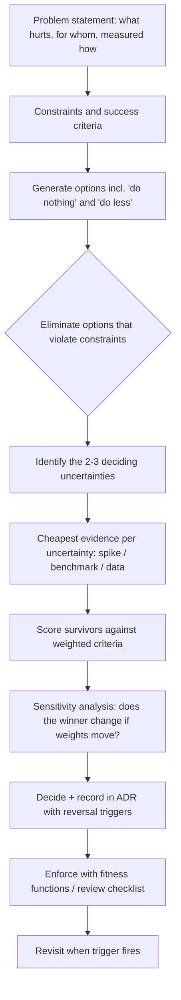
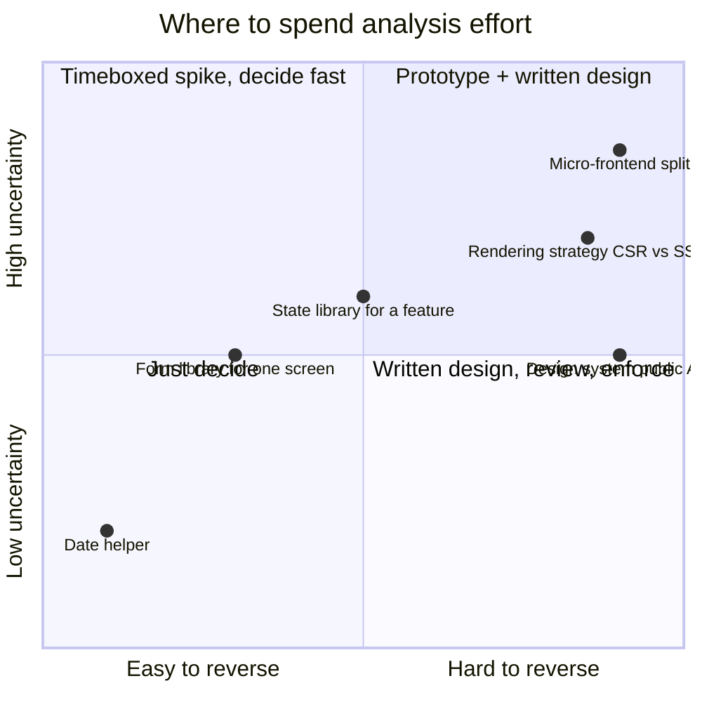
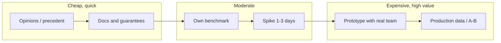

# 11 / 01 — Trade-Off Analysis: Making Architecture Decisions with Evidence

## 1. Lesson metadata

| | |
|---|---|
| **Level** | Architect |
| **Study time** | 5–6 hours (reading 2 h, worked examples 1.5 h, exercises 2 h) |
| **Prerequisites** | [Phase 4 — Architecture fundamentals](../04-react-architecture/01-architecture-fundamentals.md), [DRY/KISS/YAGNI](../05-design-patterns/02-dry-kiss-yagni.md), [Memoization trade-offs](../07-performance/04-memoization-trade-offs.md), [Context vs external stores](../06-data-fetching-and-state-ecosystems/11-context-vs-external-stores.md), [Architectural fitness and enforcement](../04-react-architecture/25-architectural-fitness-and-enforcement.md) |
| **Next** | [02 — Technical design documents](./02-technical-design-documents.md) |
| **Related** | [04 — Choosing abstraction level](./04-choosing-abstraction-level.md), [08 — State architecture at scale](./08-state-architecture-at-scale.md), 14 — Build vs buy, 15 — Framework selection |

**Learning objectives.** After this lesson you can:
1. Name the quality attributes a front-end decision actually trades (not "good vs bad", but "which property do we pay for which property").
2. Classify a decision by reversibility and blast radius and size the analysis effort accordingly.
3. Build a decision matrix, run a sensitivity analysis on its weights, and explain why a matrix alone never decides.
4. Choose the cheapest *evidence* that can change the decision: spike, benchmark, prototype, production data, or precedent.
5. Write an Architecture Decision Record (ADR) that survives staff turnover, including the conditions under which it should be revisited.
6. Recognise decision-making failure modes: resume-driven development, premature generalisation, the sunk-cost lock-in, analysis paralysis, and "best practice" appeals to authority.

**Concepts covered:** quality attributes, constraints vs preferences, reversibility (one-way / two-way decisions), blast radius, cost of delay, option value, weighted decision matrices and their pitfalls, sensitivity analysis, evidence hierarchy, spikes and timeboxes, second-order effects, ADRs, fitness functions as decision enforcement, reversal triggers.

---

## 2. Deep conceptual explanation

### 2.1 What problem is this lesson solving?

Up to this point the curriculum has taught *how things work* and *what each tool is good at*. A senior or architect-level engineer is paid for something else: choosing between several technically valid options when the information is incomplete, the team is real, and the deadline is real.

Typical questions:

- "Should we adopt Redux Toolkit, Zustand, or stay with Context?"
- "Do we split the app into micro-frontends?"
- "Do we build our own data table or buy one?"
- "Should this be a shared package or copied into three apps?"

None of these has a correct answer in the abstract. Each has a correct answer **for a context**: team size and skill, change rate, performance requirements, regulatory constraints, hiring market, existing code, time horizon. Trade-off analysis is the discipline of making that context explicit and letting it, rather than taste or fashion, drive the choice.

> **Architecture is the set of decisions that are expensive to change.** If a decision is cheap to reverse, deliberate less and ship. If it is expensive to reverse, deliberate more, and design to make it cheaper.

### 2.2 Everything is a trade-off, but trade-offs are not symmetric

"It depends" is a non-answer unless you say *on what*. The useful move is to list the **quality attributes** a decision moves. A practical front-end vocabulary:

| Attribute | Question it answers | Typical front-end evidence |
|---|---|---|
| **Correctness** | Does it do the right thing under all states (loading, error, stale, offline, concurrent)? | Tests, state-machine coverage, production error rates |
| **Performance** (runtime) | Is the interaction fast enough? | INP, render counts in the React Profiler, long tasks |
| **Performance** (load) | How much does the user download and execute? | Bundle analysis, LCP, JS bytes per route |
| **Changeability** | How expensive is the *next* change, for this and for unrelated features? | Files touched per feature, PR size, lead time |
| **Comprehensibility** | Can a new hire predict behaviour by reading the code? | Onboarding time, review latency, bug-introduction rate |
| **Testability** | Can behaviour be verified cheaply and deterministically? | Test run time, flakiness, mocks per test |
| **Team autonomy** | Can team A ship without team B? | Cross-team PR count, release coupling |
| **Operability** | Can we observe, roll back and debug it in production? | MTTR, feature-flag coverage, error attribution |
| **Cost** | Build cost, run cost, licence cost, cognitive cost | Engineer-weeks, infra bill |
| **Optionality** | How much does it constrain future choices? | Migration cost estimate; number of abstractions that leak the dependency |

Two rules make this table useful:

1. **A decision rarely improves more than two or three attributes at once.** Improving one almost always spends another. If a proposal claims to improve everything, you are looking at an incomplete analysis (or marketing).
2. **Attributes are weighted by context, not by prestige.** An internal admin tool used by 12 people weights *changeability* and *cost* far above *load performance*. A public checkout page weights *load performance* and *correctness* above *comprehensibility of the abstraction layer*.

### 2.3 Constraints versus preferences

Before scoring anything, separate:

- **Constraints (hard):** "must support SSO via the corporate IdP", "must pass WCAG 2.2 AA audit", "must run inside the existing Angular host", "team has three engineers". An option that violates a constraint is eliminated, not scored low.
- **Preferences (soft):** "we'd like less boilerplate". These are scored.

A very common error is encoding a hard constraint as a heavy weight in a matrix; a weight of 30% can be outvoted by other criteria, a constraint cannot. Eliminate first, then score the survivors.

### 2.4 Reversibility and blast radius

Two properties determine how much analysis a decision deserves.

**Reversibility** — how costly is it to undo?

| Class | Examples | Cost to reverse | Right posture |
|---|---|---|---|
| **Two-way door** | Choice of date-formatting helper, a hook's internal implementation, a CSS-in-JS vs CSS Modules choice *for one new component* | Hours | Decide fast, one person, note it in the PR |
| **Costly-but-bounded** | State library for a single feature area behind a module boundary | Days–weeks | Short written rationale; prototype if unsure |
| **One-way door** | Rendering strategy (CSR vs SSR/RSC) for the whole product, URL structure and routing model, design-system public API, micro-frontend split, data-model shapes exposed to many teams | Months; often never fully | Written design, review, evidence, explicit reversal triggers |

**Blast radius** — how many people and how much code does the decision touch? A choice made in a leaf package has a small radius; a choice encoded in the public API of a shared design-system component has the radius of every consumer.

A useful heuristic: **effort of analysis ∝ (cost to reverse) × (blast radius) × (uncertainty)**. If all three are low, the best analysis is a five-minute conversation.

### 2.5 Optionality: paying for flexibility, and when not to

Architecture often *buys options*: an adapter around a library means you could replace the library. Options are not free. Each costs indirection now, in exchange for a cheaper change later that may never come.

Rule of thumb for deciding whether to buy an option:

- **Buy** when the probability of the change is meaningful *and* the cost of a late change is much greater than the cost of the indirection (vendor you may exit for commercial reasons; an API you know is being versioned).
- **Don't buy** when the change is speculative ("we might move off React someday") and the indirection is large. YAGNI applies to architecture too ([DRY/KISS/YAGNI](../05-design-patterns/02-dry-kiss-yagni.md)).
- **Buy cheap options** that cost almost nothing: keep side effects at module edges, keep domain logic free of React imports, keep a library's types out of your domain types. These make changes cheaper without a framework of indirection.

### 2.6 The evidence hierarchy

Opinions are cheap and often loud. Rank your evidence:

1. **Production data about *your* system** (traces, RUM, error rates, bundle reports, PR-cycle-time data).
2. **A prototype or spike against *your* real constraints** (your data size, your devices, your team writing it).
3. **A benchmark you wrote for a representative workload**, with methodology documented.
4. **A reproduction by others on a comparable system** (published case study with numbers and context).
5. **Library documentation and maintainers' stated guarantees** (a *public guarantee* in this curriculum's sense).
6. **Generic benchmarks and "X vs Y" blog posts** — often measure a workload unlike yours.
7. **Precedent ("big company uses it")** — their constraints are not yours, and survivorship bias hides their failures.
8. **Personal experience** — valuable for *generating hypotheses*; weak as proof, especially when it is one project.

The architect's job is often to find the **cheapest piece of level 1–3 evidence** that could change the outcome, and to get it before committing.

### 2.7 Misconceptions

| Misconception | Reality |
|---|---|
| "The decision matrix gives the answer." | A matrix organises your reasoning and exposes disagreement. The scores are themselves judgments; the matrix is only as good as its criteria, weights and evidence. Always sensitivity-test it. |
| "Choose the most powerful tool; you can always use less of it." | Power has a carrying cost: more concepts to learn, more ways to misuse. The unused capability still costs onboarding and review attention. |
| "Choose the most popular tool; it's safest." | Popularity reduces *some* risks (hiring, ecosystem) and is irrelevant to others (fit to your problem). Weigh it as one attribute. |
| "Rewrite is cleaner than refactor." | A rewrite resets *known* bugs and reintroduces all the *forgotten* ones, while freezing feature delivery. See [03 — Large-scale refactoring](./03-large-scale-refactoring.md). |
| "Document the decision later." | Decisions are cheapest to record when the alternatives are still in people's heads. Later, only the choice survives and the reasons are lost. |
| "We must decide now." | Sometimes the correct decision is to delay and *design for the decision to be made later* (the last responsible moment), because information is arriving. |

---

## 3. Internal mechanics

"Internal mechanics" for a decision process means *how the analysis actually works and where it breaks*. Per the curriculum convention: **public guarantee** = things that hold regardless of team; **teaching model** = simplifications for explanation; **implementation detail** = what varies by organisation.

### 3.1 The decision pipeline



*Teaching model:* the pipeline is linear on paper; in practice you loop back from F to C because evidence generates new options.

### 3.2 Generating options honestly

Every decision should include at least:

- **Do nothing** (what is the actual cost of the status quo? often it is lower than the change advocates claim).
- **Do less** (a smaller change that captures 80% of the value).
- **The incumbent option, improved** (fix the current approach's pain points before replacing it).
- **The fashionable option.**
- **The boring option.**

If the options differ only cosmetically, you have not found the real axis of the decision. Example: "Redux vs Zustand vs Jotai" may all be variants of "an external client store", while the real axis is *"do we need a client store at all, given server state already lives in a query cache?"* ([Server vs client state](../04-react-architecture/16-server-vs-client-state.md)).

### 3.3 Weighted decision matrices: mechanics and failure modes

A weighted matrix computes, for option *o*, `score(o) = Σ weight(c) × rating(o, c)`, where weights sum to 1 (or 100) and ratings are on a fixed scale (e.g. 1–5).

Failure modes:

| Failure | Mechanism | Mitigation |
|---|---|---|
| **Criteria double counting** | "Ease of use" and "learning curve" and "DX" are the same thing counted three times | Make criteria mutually independent; merge synonyms |
| **Weights chosen to fit a pre-decided answer** | Facilitator adjusts weights until the favourite wins | Fix weights *before* rating options; have people weight independently and compare |
| **False precision** | 3.7 vs 3.6 is noise | Treat differences under a threshold (e.g. ~10%) as ties and fall back to a tie-breaker (reversibility, team familiarity) |
| **Ratings without evidence** | "Performance: 4" is a feeling | Each rating cites evidence level (see §2.6) |
| **Missing criteria** | Omitted attribute (e.g. operability) silently weighs zero | Walk the attribute table in §2.2 |
| **Compensation** | A catastrophic weakness is averaged away by strengths | Use constraints/veto criteria for must-haves; apply a minimum-rating rule |

### 3.4 Sensitivity analysis

After scoring, ask: *how much would a weight have to change for the ranking to flip?* If a 10-percentage-point shift in a single weight flips the winner, the decision is **weight-sensitive**, and the real discussion is about the priority, not the tool. If the winner survives wide weight changes, the decision is **robust** and you can proceed with confidence even while people disagree on priorities.

Mechanically: vary each weight ±50% (renormalising), recompute, and record the winner. Section 5.2 does this by hand.

### 3.5 Second-order effects

First-order effects are what the change does directly. Second-order effects are what the *organisation* does in response:

- Adopting a flexible compound-component API → teams create bespoke compositions → visual drift → support burden on the design-system team.
- Mandating a lint rule → developers add `eslint-disable` comments → the rule now measures nothing.
- Introducing a global store → "just put it in the store" becomes the default → state that should be colocated becomes global → rendering and comprehension costs rise ([State colocation for perf](../07-performance/07-state-colocation-for-perf.md)).

Ask: "If a competent but rushed engineer takes the cheapest path through this design, what do they build in six months?"

### 3.6 Cost of delay and the last responsible moment

Delaying a decision costs something (blocked work, rework). Making it early costs something (decided with less information). The *last responsible moment* is the point after which delay costs more than the information it yields. Techniques that move that moment later: interface seams, feature flags, adapters at the edges, expand/contract migrations.

---

## 4. Step-by-step execution walkthrough

A full run of the pipeline on a realistic question: **"Our dashboard has grown; state is a mess of Context providers. Should we adopt a state library?"**

**Step 1 — Problem statement with measurements.** Not "state is messy" but:
- Profiler traces show a `PricesContext` update re-renders ~400 components, INP p75 on the main trading view is 380 ms (target 200 ms).
- Onboarding survey: new hires take ~3 weeks to be comfortable with data flow.
- 11 providers nested in `App`.

**Step 2 — Constraints and success criteria.**
- Constraint: no big-bang rewrite; must be adoptable per feature.
- Constraint: must work with the existing TanStack Query for server data.
- Success: INP p75 ≤ 200 ms on the trading view; new state added in one file; no regression in test coverage.

**Step 3 — Options.** (0) do nothing; (1) split contexts and colocate state (do less); (2) Redux Toolkit; (3) Zustand; (4) Jotai-style atoms. *(Keep the list short and mutually distinct.)*

**Step 4 — Eliminate by constraints.** All remain: each is incrementally adoptable.

**Step 5 — Deciding uncertainties.**
- U1: Is the re-render cost caused by context propagation, or by something else (expensive render, unstable props)?
- U2: How much of the "messy" state is actually server state that a query cache already owns?

**Step 6 — Cheapest evidence.**
- U1: a Profiler recording (30 minutes). Suppose it shows 70% of the render time is `PricesContext` consumers re-rendering on every tick.
- U2: a code audit counting each context's data origin (2 hours). Suppose 6 of 11 contexts wrap data fetched from the API.

**Step 7 — Re-frame.** Evidence shows that more than half of the providers hold server state, and the real hot path is one high-frequency context. The question changed from "which store?" to "(a) move server state into the query cache, (b) give the high-frequency feed a selector-based subscription".

**Step 8 — Score survivors** (worked in §5.2).

**Step 9 — Sensitivity analysis and decision.** Decide, with a reversal trigger.

**Step 10 — Record and enforce.** ADR + lint rule restricting new `createContext` for data that has a query key.

Notice what the pipeline did: it *changed the question*. That is the common outcome of doing the evidence step honestly, and it is why jumping straight to a matrix is a mistake.

---

## 5. Code examples

### 5.1 Minimal example: making a decision reversible with a seam

**Problem.** You are choosing a client-state library but the choice is uncertain. Minimise the cost of being wrong by confining the library to one module that exposes a *domain-shaped* hook.

```ts
// features/trading/state/useQuote.ts  — the only file that imports the store library
import { useStore } from "./quoteStore"; // implementation detail, may be Zustand today

export interface Quote {
  symbol: string;
  bid: number;
  ask: number;
}

export function useQuote(symbol: string): Quote | undefined {
  // Selector keeps the subscription narrow: re-render only when this symbol's quote changes.
  return useStore((s) => s.quotes[symbol]);
}
```

**Line notes.**
- `useQuote` is the **seam**: consumers depend on a domain function and a domain type, not on the library.
- The selector argument (`(s) => s.quotes[symbol]`) is the library-specific mechanism, hidden behind the seam.
- Cost of the option: one tiny file per concern. Cost of switching later: rewrite the implementation file, not 80 consumers.

**Predict:** If you later replace the library with `useSyncExternalStore` over a hand-written store, how many consumer files change? *Answer:* zero, provided no consumer imported the store directly. That property is checkable (see §5.5).

**Trade-off.** This is a *cheap option*. It does not require an adapter hierarchy or a dependency-injection container. See [04 — Choosing abstraction level](./04-choosing-abstraction-level.md) for when a heavier seam is justified.

### 5.2 Practical worked example: weighted matrix with sensitivity analysis

Context: the trading dashboard of §4. After Step 7, three options remain for the *client-side* part:

- **A — Split contexts + `useSyncExternalStore`-based selector hook (do less).** Hand-written, ~60 lines.
- **B — Zustand** for client UI/live-feed state, TanStack Query for server state.
- **C — Redux Toolkit** (store + slices + selectors) plus Query.

Criteria and weights (agreed *before* rating; sum = 100):

| Criterion | Weight | Why this weight |
|---|---|---|
| Runtime performance on the live feed (selector-granular subscriptions) | 30 | The measured pain point |
| Adoptability per feature (incremental, low ceremony) | 20 | Hard constraint of no big-bang, scored as degree |
| Team familiarity / onboarding | 15 | Three of eight engineers know Redux; none know Zustand |
| Debuggability / traceability of updates | 15 | Financial domain; support asks "why did this value change?" |
| Maintenance risk (library health, bus factor of hand-written code) | 10 | |
| Bundle cost | 10 | Mobile web users |

Ratings (1–5), with evidence level in parentheses:

| Criterion | A: hand-rolled | B: Zustand | C: RTK |
|---|---|---|---|
| Runtime performance | 4 (spike: selector hook meets target) | 5 (spike: same workload, built-in selectors) | 4 (spike: needs memoised selectors; met target) |
| Adoptability | 3 (everything custom) | 5 (hook-per-store, no provider) | 3 (slice/store/provider ceremony) |
| Familiarity | 3 (JS-level; no library concepts) | 3 (small API but unfamiliar) | 4 (3 engineers experienced) |
| Debuggability | 2 (we'd have to build devtools) | 3 (devtools middleware available) | 5 (action log, time travel) |
| Maintenance risk | 2 (bus factor) | 4 | 5 |
| Bundle cost | 5 | 4 | 3 |

Computation (score = Σ weight × rating / 100):

- **A:** 0.30·4 + 0.20·3 + 0.15·3 + 0.15·2 + 0.10·2 + 0.10·5 = 1.20 + 0.60 + 0.45 + 0.30 + 0.20 + 0.50 = **3.25**
- **B:** 0.30·5 + 0.20·5 + 0.15·3 + 0.15·3 + 0.10·4 + 0.10·4 = 1.50 + 1.00 + 0.45 + 0.45 + 0.40 + 0.40 = **4.20**
- **C:** 0.30·4 + 0.20·3 + 0.15·4 + 0.15·5 + 0.10·5 + 0.10·3 = 1.20 + 0.60 + 0.60 + 0.75 + 0.50 + 0.30 = **3.95**

*B wins, C is close (within ~6%), A is clearly behind.* Under the "differences below ~10% are ties" rule, B and C are effectively tied. Sensitivity analysis decides whether we can break the tie with the matrix.

**Sensitivity analysis.** Raise *Debuggability* from 15 to 30 and renormalise the other weights proportionally (the other 85 shrink to 70, factor 70/85 ≈ 0.8235):

- Performance 24.7, Adoptability 16.5, Familiarity 12.4, Debuggability 30, Maintenance 8.2, Bundle 8.2.
- **B:** 0.247·5 + 0.165·5 + 0.124·3 + 0.30·3 + 0.082·4 + 0.082·4 = 1.235 + 0.825 + 0.372 + 0.90 + 0.328 + 0.328 = **3.99**
- **C:** 0.247·4 + 0.165·3 + 0.124·4 + 0.30·5 + 0.082·5 + 0.082·3 = 0.988 + 0.495 + 0.496 + 1.50 + 0.41 + 0.246 = **4.13**

C overtakes B. **Conclusion: the decision is weight-sensitive on exactly one axis — how much we value action-level traceability.** The right next step is not a better matrix; it is a conversation with support and compliance: *is "why did this value change" a hard requirement?* If yes, choose C (or B with a disciplined event-style update API and devtools). If it is nice-to-have, choose B.

**What the example teaches.**
1. The matrix narrowed 3 options to a *single decisive question*.
2. The "do less" option (A) lost on maintenance risk and debuggability, not performance — it is not the cheapest *total* cost.
3. Ratings cited evidence levels; the unevidenced ratings (familiarity, debuggability) are exactly where to look for bias.

**Result of the conversation (continuing the story):** support confirms they have tickets weekly asking "why did this price change". The team picks **C for the live-feed slice only**, with Query for server data and Context retained for truly static values (theme, locale). The ADR records the reversal trigger in §5.4.

### 5.3 Incorrect: the matrix as theatre

```md
| Criterion        | Weight | Redux | Zustand |
|------------------|--------|-------|---------|
| DX               | 40%    | 3     | 5       |
| Ease of use      | 30%    | 3     | 5       |
| Learning curve   | 20%    | 2     | 5       |
| Bundle size      | 10%    | 3     | 5       |
```

Problems:
1. **Triple counting:** "DX", "Ease of use", "Learning curve" measure the same thing: 90% of the weight is one criterion.
2. **No evidence column.** Ratings are vibes.
3. **No constraint check.** Nothing about existing code, server state, or debugging requirements.
4. **Every rating favours the author's preference** — a signal the matrix was reverse-engineered.
5. **No sensitivity analysis; no ADR.**

### 5.4 Corrected: the ADR that records reversal triggers

```md
# ADR-014: Client state for the live price feed uses Redux Toolkit (scoped)

Status: Accepted (2026-03-12)
Deciders: Frontend platform (A. Novak, R. Li), Trading team lead, Support lead
Supersedes: ADR-009 (single PricesContext)

## Context
- INP p75 on /trade is 380 ms; Profiler shows PricesContext consumers re-render per tick.
- 6 of 11 contexts hold server state; moving to TanStack Query (ADR-013).
- Support needs to answer "why did this value change?" within one ticket.

## Options considered
A. Hand-rolled selector hook; B. Zustand; C. Redux Toolkit. Matrix and sensitivity analysis in /docs/decisions/014-matrix.md.

## Decision
Use Redux Toolkit only for `features/trading/live-feed`. Expose it through domain hooks (`useQuote`).
Do not introduce Redux elsewhere without a new ADR.

## Consequences
+ Action log supports support's traceability requirement.
+ Selector-granular subscriptions meet INP target in spike (p75 170 ms on reference device).
- Adds ~3 concepts (slice, selector, middleware) to onboarding for one area.
- Bundle +~X KB on /trade only (route-split; measure in CI).

## Reversal triggers (revisit if any occurs)
- Support no longer uses action history for investigations for two consecutive quarters.
- More than 2 other features request a client store (then reconsider a single standard).
- RTK major version imposes migration cost > 1 engineer-week.

## Enforcement
- ESLint `no-restricted-imports` for `@reduxjs/toolkit` outside `features/trading/live-feed` and `app/store`.
```

*Why it is better:* alternatives and evidence are discoverable; constraints and consequences are honest about costs (the `-` lines); reversal triggers make the decision *falsifiable*; enforcement keeps the decision from eroding silently.

### 5.5 Advanced: enforcing a decision as a fitness function

A decision no one enforces is a suggestion. Express it as an automated check ([Architectural fitness and enforcement](../04-react-architecture/25-architectural-fitness-and-enforcement.md)):

```ts
// tools/check-store-imports.ts — run in CI
import { readdirSync, readFileSync, statSync } from "node:fs";
import { join } from "node:path";

const ALLOWED = ["src/features/trading/live-feed", "src/app/store"];
const FORBIDDEN = /from\s+["']@reduxjs\/toolkit["']/;

function* walk(dir: string): Generator<string> {
  for (const name of readdirSync(dir)) {
    const p = join(dir, name);
    if (statSync(p).isDirectory()) yield* walk(p);
    else if (/\.(ts|tsx)$/.test(p)) yield p;
  }
}

let violations = 0;
for (const file of walk("src")) {
  if (ALLOWED.some((a) => file.startsWith(a))) continue;
  if (FORBIDDEN.test(readFileSync(file, "utf8"))) {
    console.error(`ADR-014 violation: ${file}`);
    violations++;
  }
}
process.exit(violations ? 1 : 0);
```

**Line notes.** The allow-list *is* the decision's scope. A violation prints the ADR number so the developer can read the rationale, not just a red build. In a real repo prefer ESLint's `no-restricted-imports` (or an import-boundary plugin) over a script because it integrates with editors; the script shows the mechanism. ⚠ Tool choice here is illustrative; verify against your linter's current options.

---

## 6. Visual explanations

### 6.1 Effort of analysis vs reversibility and uncertainty



### 6.2 Evidence cost vs decision value



Pick the cheapest evidence that could *flip* the decision. If no feasible evidence could flip it, stop gathering and decide.

### 6.3 Sensitivity: winner regions

```text
Weight on "Debuggability" (others scaled proportionally)

 0%        15% (baseline)       ~24%         30%         50%
 |-----------|---------------------|-----------|-----------|
   Zustand (B) wins ...............|   RTK (C) wins ..........
                                   ^ crossover
```

A crossover inside the range of plausible disagreement means *the decision hinges on that weight*; resolve it with stakeholders, not with more scoring.

---

## 7. Alternative approaches and trade-offs

Different ways to *make* the decision:

| Approach | Strengths | Weaknesses | Best when |
|---|---|---|---|
| **Weighted matrix** | Makes criteria explicit; exposes disagreement; auditable | False precision; gameable; ratings can be vibes | 3–5 serious options, multiple stakeholders |
| **Pros/cons list** | Fast; low ceremony | No weighting; length ≠ importance | Two options, low stakes |
| **Spike / prototype ("bake-off")** | Real evidence; reveals unknown unknowns | Costs engineer time; prototype quality bias; small sample | A decisive technical uncertainty exists |
| **Benchmark** | Quantitative | Easy to measure the wrong workload; microbenchmarks mislead | Performance is the deciding criterion |
| **Pre-mortem** ("it failed in a year — why?") | Surfaces risks and second-order effects | Imaginative, not empirical | Before committing to one-way doors |
| **Reference-class forecasting** (how did similar migrations go in our org?) | Counters optimism bias | Needs a history of comparable projects | Estimating migration cost/time |
| **Consent-based decision (RFC with objection window)** | Scales to many teams; builds buy-in | Slow; can degrade to design by committee | Cross-team standards ([16 — Supporting multiple teams](./16-supporting-multiple-teams.md)) |
| **Single-owner decision (DRI)** | Fast, accountable | Risk of blind spots | Two-way doors; clear expertise |
| **Defer and add a seam** | Preserves information gain | Seam costs; risk of never deciding | Uncertainty will resolve soon |

**Scenario where the recommended approach (a matrix with evidence) is *not* best.** A three-person startup choosing between two form libraries for an MVP that will be rewritten if it succeeds: the analysis costs more than a wrong choice. Pick the one someone already knows and move on. Likewise when the decision is truly dictated by one constraint (the host app is Angular → you must embed; the matrix is theatre). Also when evidence is unobtainable in time: use a pre-mortem, choose the more reversible option, and set a reversal trigger.

---

## 8. Best practices and anti-patterns

### 8.1 Good practice

- State the problem as a *measured pain*, not a solution ("INP 380 ms", not "we need Redux").
- Always include "do nothing" and "do less".
- Set weights before rating options; have stakeholders weight independently.
- Cite an evidence level for every rating.
- Prefer decisions that are **cheap to reverse**; add seams only at *measurably* risky points.
- Write the reversal trigger down.
- Turn decisions into automated checks when they define a boundary.
- Timebox spikes (1–3 days), with a stated question the spike answers.

### 8.2 Beginner mistakes

- Treating "best practice" or a blog post as proof.
- Choosing by familiarity without noticing it is the criterion.
- Not considering the cost of migration at all.

### 8.3 Experienced-developer mistakes

- **Resume-driven development:** choosing technology for career value.
- **Premature generalisation:** abstracting for hypothetical second consumers ([DRY/KISS/YAGNI](../05-design-patterns/02-dry-kiss-yagni.md)).
- **Sunk-cost lock-in:** continuing with a decision that its own reversal trigger says to revisit.
- **Analysis paralysis:** applying one-way-door rigor to two-way doors.
- **Local optimisation:** optimising your team's DX at the cost of every other team's integration.
- **Confusing preference with constraint** (and vice versa).
- **Optimism about migration cost:** estimates for migrations are chronically low; use reference-class data.

### 8.4 Smells

- A matrix where the favoured option wins on every row.
- ADRs with no "negative consequences".
- "Industry standard" appearing as a justification.
- Decisions with no owner or no date.
- A proposal that requires everyone to be disciplined forever, with no enforcement.

### 8.5 Justified exceptions

- Choosing a technology purely for **hiring pool** or **existing org expertise** is legitimate if stated; it is a real cost attribute.
- Skipping written analysis for an urgent incident fix is fine; write the ADR *after*, labelled as retroactive.
- Choosing a weaker-scoring but **more reversible** option is often right; reversibility is itself an attribute that rarely appears in the matrix.

---

## 9. Real-world application

| Domain | Typical decision | Dominant attributes | Constraint example |
|---|---|---|---|
| **E-commerce** | SSR/RSC vs CSR for product pages | Load performance, SEO, correctness of price/stock | Marketing tags must keep working; checkout in a separate PCI scope |
| **Dashboards / finance** | Live data propagation strategy | Runtime performance, traceability, correctness | Audit requirement to reproduce what the user saw |
| **Forms-heavy B2B** | Form library vs in-house | Changeability, accessibility, testability | Complex conditional validation owned by domain experts |
| **Auth / identity** | Where session state lives (cookie, in-memory token, server session) | Security, operability | Compliance mandates httpOnly cookies |
| **Real-time collaboration** | Optimistic updates + conflict strategy | Correctness, perceived performance | Offline editing |
| **Multi-team platform** | Shared component package vs per-team copies | Team autonomy vs consistency | Independent release cadences |

**Engineering constraints that distort trade-offs in practice:**
- **Org structure** (Conway's law): the "right" technical boundary may be unworkable if no team can own it.
- **Hiring market:** a niche tool shrinks your candidate pool.
- **Compliance/audit:** may make a particular approach mandatory.
- **Release trains:** mobile-wrapped webviews cannot ship daily, which changes the value of feature flags and reversibility.
- **Migration capacity:** the team can only run so many parallel migrations; a "good" decision queued behind three others may be effectively unavailable.

---

## 10. Debugging and troubleshooting

"Debugging" a decision process: *symptoms of a decision that went wrong, and how to investigate.*

| Symptom | Likely root cause | Investigation | Fix / validation |
|---|---|---|---|
| Team keeps routing around the chosen abstraction | Abstraction doesn't fit the common case; second-order effect | Count `eslint-disable` and bypass imports; interview 3 consumers | Redesign the abstraction or retire it; validate by bypass count falling |
| Migration started 9 months ago is "80% done" | Optimistic estimate; long tail; no deletion plan | Plot migrated-modules vs time; list blockers | Re-plan with explicit end-state and deletion milestone ([03 — Large-scale refactoring](./03-large-scale-refactoring.md)) |
| Same decision is re-litigated every quarter | No ADR, or ADR lacks reasons/triggers | Search for prior discussions | Write ADR; define triggers; link in PR template |
| Two teams chose different libraries for the same job | No visibility of decisions | Audit `package.json`s | Lightweight RFC process, tech radar *(verify practice fit for your org)* |
| Decision "worked" in the spike but fails in production | Spike workload unrepresentative | Compare spike data size, devices, concurrency with production telemetry | Re-run on production-shaped data; update ADR |
| Matrix winner feels wrong to everyone | A missing criterion, or hidden constraint | Ask "what would make us *refuse* this winner?" | Add the criterion or move it to constraints |

**A concrete investigation recipe: auditing a past decision.**
1. Retrieve the ADR (or reconstruct from PRs).
2. List predicted consequences (positive and negative).
3. Measure each against the present (bundle size, PR sizes, bug classes, onboarding feedback).
4. Compare to the reversal triggers.
5. Record the result as an ADR amendment — *validating the fix* is the amendment plus a measurable change.

---

## 11. Exercises

### Level A — Knowledge
A1. Name five quality attributes from §2.2 and give one front-end metric or artefact for each.
A2. Distinguish a *constraint* from a *preference*. Why must constraints not be modelled as weights?
A3. What does "one-way door" mean, and give two React-ecosystem examples.
A4. List the first four levels of the evidence hierarchy in order.
A5. What is a reversal trigger, and why does an ADR need one?

### Level B — Code comprehension
B1. In §5.1, the consumer imports `useQuote` and the `Quote` type only. A teammate adds `import { useStore } from "../state/quoteStore"` directly in a component "for convenience". Name two costs this adds and one automated way to prevent it.
B2. In the §5.2 matrix, option A has the highest *bundle* rating but loses. Explain, by quoting the scoring, why.
B3. In the fitness function of §5.5, what happens to a file in `src/features/trading/live-feed/chart/` that imports `@reduxjs/toolkit`? What about `src/features/orders/x.ts`? Why?

### Level C — Implementation
C1. Write a TypeScript function `rank(options, weights)` that takes ratings per option per criterion and weights, returns options sorted by score, and a second function `flipPoints(options, weights, criterion)` that returns the weight values (0–100 in steps of 5) of the given criterion at which the top-ranked option changes, renormalising the other weights proportionally.
C2. Write an ADR (≤ 40 lines) for the decision "Use `<dialog>`-based modals vs a library modal" in a design system, including at least two negative consequences and two reversal triggers.

### Level D — Debugging
D1. A team's ADR says "we chose Zustand for simplicity". A year later, state logic is spread across 25 stores, tests mock stores in every file, and onboarding takes longer. List four hypotheses for root causes in the *decision process* (not the library), and for each, the evidence you would collect.
D2. A matrix has weights: Performance 50, DX 40, Bundle 10, and was used to pick a heavy framework. Months later bundle size is a business problem. Identify at least three process failures.

### Level E — Architecture and engineering decisions
E1. You must choose a data-table solution for a design system used by 6 teams: (1) build headless + styled in-house, (2) adopt a commercial grid, (3) adopt an open-source headless table library and style it. Define constraints vs preferences, name the deciding uncertainties, propose the cheapest evidence for each, and recommend a decision procedure (not necessarily the answer).
E2. A team wants to wrap *every* third-party library in an adapter "so we can swap it". Argue for a policy that decides *which* libraries earn an adapter.

### Level F — Expert challenge
F1. Your company's 12 front-end teams each have an informal tech radar. Design a lightweight, scalable decision-governance mechanism (RFC, ADR, review, enforcement, sunset) that avoids both anarchy and a bottleneck architecture committee. State the failure modes of your design and how you'd detect them.
F2. You're asked to decide between a staged migration to RSC/server rendering and optimising the existing CSR app. Produce an evidence plan with a 2-week budget: what you measure, what spikes you build, what would make you choose each branch, and what you'd do if the evidence is ambiguous.

---

## 12. Detailed answers and explanations

> Attempt the exercises first.

### Level A

**A1.** Example set: *Correctness* — error rates, test coverage of state machines; *Runtime performance* — INP, render counts in Profiler; *Changeability* — files touched per feature, PR size; *Testability* — test runtime/flakiness; *Team autonomy* — number of cross-team PRs, release coupling; *Load performance* — JS bytes per route, LCP. Any defensible metric per attribute is accepted; the evaluation criterion is that the metric is *observable* rather than a feeling.

**A2.** A constraint is a hard requirement whose violation eliminates an option (e.g. must run inside an Angular host). A preference is something we'd like more of. Modelling a constraint as a weight lets other criteria compensate — an option that cannot satisfy the constraint can still win — which is a logical error. Eliminate first, then score. *Wrong answer:* "constraints are just high weights" — fails the compensation problem.

**A3.** A one-way door is a decision that is very expensive or impractical to undo. Examples: the rendering strategy for the product (CSR vs SSR/RSC) because routing, data loading and deployment all depend on it; the public API of a widely consumed design-system component because every consumer encodes it. Also acceptable: URL structure, micro-frontend boundaries, shape of data exposed across teams.

**A4.** (1) Production data about your system; (2) prototype/spike on your real constraints; (3) your own representative benchmark; (4) reproduction/case studies on comparable systems.

**A5.** A reversal trigger is a pre-agreed observable condition under which the decision is re-opened. Without it, decisions either never get revisited (sunk-cost lock-in) or are revisited by whoever is loudest (re-litigation). It turns the decision into a falsifiable hypothesis.

### Level B

**B1.** Costs: (1) the seam is broken — swapping the library now requires finding and editing that component; (2) the component gains an *unnarrowed* subscription possibility (it may select the whole state) creating render-performance regressions; (3) tests for that component must now mock the store. Automated prevention: `no-restricted-imports` (or an import-boundaries lint rule) forbidding imports of `quoteStore` outside `features/trading/state`; or a dependency-cruiser-style rule. *Wrong answer:* "code review will catch it" — correct as a layer but not reliable over time.

**B2.** A scores 5 on bundle with weight 10 → contribution 0.50, the highest. But it scores 2 on debuggability (weight 15 → 0.30) and 2 on maintenance (weight 10 → 0.20), and 3 on adoptability and familiarity. The weights put the biggest mass on performance and adoptability where A is average or lower; B and C dominate those. Total A = 3.25 vs 4.20/3.95. Lesson: the cheapest-bundle option is not the cheapest *total-cost* option.

**B3.** `src/features/trading/live-feed/chart/...` starts with the allowed prefix `src/features/trading/live-feed`, so it is skipped: allowed. `src/features/orders/x.ts` is not in the allow-list; if it contains an import from `@reduxjs/toolkit` it triggers a violation and the process exit code becomes 1. Note: the regex checks `from "…"` statements; a dynamic `import("@reduxjs/toolkit")` or `require` would slip through — a limitation of the sketch and a reason to prefer a real lint rule.

### Level C

**C1.** Sample solution:

```ts
type Ratings = Record<string, Record<string, number>>; // option -> criterion -> rating
type Weights = Record<string, number>;                 // criterion -> weight

const score = (r: Record<string, number>, w: Weights): number => {
  const total = Object.values(w).reduce((a, b) => a + b, 0);
  return Object.entries(w).reduce((s, [c, wt]) => s + (wt / total) * (r[c] ?? 0), 0);
};

export function rank(options: Ratings, weights: Weights) {
  return Object.entries(options)
    .map(([name, r]) => ({ name, score: score(r, weights) }))
    .sort((a, b) => b.score - a.score);
}

export function flipPoints(options: Ratings, weights: Weights, criterion: string): number[] {
  const others = Object.entries(weights).filter(([c]) => c !== criterion);
  const othersTotal = others.reduce((s, [, w]) => s + w, 0);
  let prevWinner: string | undefined;
  const flips: number[] = [];
  for (let wt = 0; wt <= 100; wt += 5) {
    const scaled: Weights = { [criterion]: wt };
    for (const [c, w] of others) scaled[c] = othersTotal === 0 ? 0 : ((100 - wt) * w) / othersTotal;
    const winner = rank(options, scaled)[0]?.name;
    if (prevWinner !== undefined && winner !== prevWinner) flips.push(wt);
    prevWinner = winner;
  }
  return flips;
}
```

Evaluation criteria: normalisation by total weight; proportional renormalisation of other weights; handling `othersTotal === 0`; ties (here the first max wins — document it). Edge cases: missing ratings treated as 0 (arguably should throw); exact ties produce unstable flip points; steps of 5 may miss a narrow window.

**C2.** Evaluation criteria for an ADR: states context with measurable need; at least three options including do-nothing; decision in one sentence; **honest negatives**; reversal triggers; enforcement. Example essentials: *Decision:* use native `<dialog>` with a thin wrapper in the design system. *Negatives:* focus-management and backdrop behaviour differences across supported browsers must be tested and polyfilled where necessary ⚠ (verify current support matrix); styling the backdrop and stacking multiple dialogs needs custom work; consumers used to library props must migrate. *Triggers:* if a supported browser lacks a behaviour we depend on for two consecutive release cycles; if accessibility audit finds issues that the wrapper cannot fix; if more than two consumer teams require capabilities (e.g. complex nested focus traps) the wrapper doesn't provide.

### Level D

**D1.** Hypotheses (any four, evidence):
1. *"Simplicity" was never defined/measured.* Evidence: ADR has no success criteria; compare the original claim with PR sizes and onboarding data.
2. *No boundary rules, so stores proliferated by default.* Evidence: store-per-file count over time; whether a lint/ownership rule exists.
3. *Server state wasn't separated.* Evidence: audit store contents for fetched data and manual cache invalidation code ([Server vs client state](../04-react-architecture/16-server-vs-client-state.md)).
4. *Seam absent → tests mock stores everywhere.* Evidence: count `jest.mock`/mock-store lines per test; check whether components import stores directly.
5. *No reversal trigger/review.* Evidence: ADR lacks one; no scheduled revisit.
Evaluation: the answer must locate causes in the process (criteria, boundaries, enforcement, review), not "Zustand is bad".

**D2.** Failures: (1) *Weights* gave Bundle 10% despite mobile users — criteria weights weren't tied to business data; (2) *double counting* — Performance and DX are broad, vague categories; (3) *no constraints/veto* such as a bundle budget ([09 — Performance budgets at scale](./09-performance-budgets-at-scale.md)); (4) *no sensitivity analysis* — raising bundle weight likely flips; (5) *no reversal trigger or measurement plan*; (6) *no enforcement* (no CI budget).

### Level E

**E1.** Model answer.
*Constraints:* accessible (keyboard grid semantics, screen-reader support) to WCAG 2.2 AA; virtualisation for ≥ 50k rows; works with the design system's tokens; licence compatible with distribution to 6 teams; SSR-safe if any consumer uses it.
*Preferences:* low learning curve; small bundle; extensibility; vendor support.
*Deciding uncertainties:* (U1) Can an off-the-shelf solution meet the accessibility requirement without heavy patching? (U2) Do we need features (pivoting, grouping, Excel-like editing) that make building in-house infeasible? (U3) Real data volumes and interaction patterns.
*Cheapest evidence:* U1: screen-reader/keyboard audit of the top two candidates on a representative demo (2–3 days). U2: inventory feature requests from the 6 teams, classify must/should/never (1 day). U3: pull real row counts and column counts from production telemetry. Then a 1-week spike building the same three representative tables in the leading headless option and measuring effort and INP on a mid-range device.
*Decision procedure:* eliminate options failing constraints; if U2 shows heavy spreadsheet-like needs, buy; if needs are table-centric with custom styling, go headless library + in-house styling, because the design-system integration cost dominates; build in-house only if neither passes the audit. Include licence and total cost across teams. See 14 — Build vs buy. Evaluation criteria: separation of constraints and weights; each uncertainty tied to cheap evidence; recognises hidden cost of building accessibility from scratch; includes a reversal trigger (e.g. grid vendor price/licence change).

**E2.** Policy: adapter if at least two hold — (a) the library's types or concepts would otherwise appear in domain/consumer APIs (leakage), (b) credible exit reason exists (commercial vendor, deprecated, security), (c) multiple consumers will depend on it, (d) testing it needs substitution at a boundary (network, storage, analytics). Do not adapt: stable low-level utilities (date formatting if a single call site), React itself, the design-system primitives (they *are* the abstraction), libraries used in leaf implementation only. Argue with costs: each adapter adds code, tests, lag behind library features, and may become the weakest abstraction ("lowest common denominator"). Reference: [Dependency inversion](../04-react-architecture/11-dependency-inversion.md), [04 — Choosing abstraction level](./04-choosing-abstraction-level.md).

### Level F

**F1.** Model answer outline.
*Mechanism:* (1) **Tiering by reversibility**: tier 0 (two-way) any team decides, note in PR; tier 1 (team-bounded) team ADR; tier 2 (cross-team/one-way) RFC with a fixed consent window (e.g. 7 days, objections must be addressed or the objector proposes an alternative) and a named DRI; (2) **ADR repo** with template including negatives and reversal triggers, searchable, linked from PR template; (3) **Enforcement** via lint/dependency rules owned by platform, with changes to rules requiring an ADR; (4) **Sunset**: each ADR has a review date; stale ADRs auto-flag; (5) **Office hours**, not gate — platform reviewers advise, don't block, except tier 2.
*Failure modes & detection:* committee bottleneck (RFC lead time p90 rising → raise tier thresholds); rubber-stamping (no objections ever → sample for quality); ADR graveyard (no references in PRs → measure link rate); shadow decisions (audit dependency drift between repos); rule evasion (count disables).
Evaluation: must address scale, ownership, speed, enforcement and measured feedback; reward explicit tradeoffs between autonomy and consistency.

**F2.** Model answer. *Week 1:* measure — RUM for LCP/INP segmented by route and device; bundle report; server cost; the share of time spent on data waterfalls vs hydration vs render. Identify whether the pain is *network/waterfall*, *JS execution*, or *render cost*: these respond differently (RSC/SSR helps first two; targeted memoisation/colocation helps the third — see [Measure before optimizing](../07-performance/01-measure-before-optimizing.md)). Build a spike: migrate one high-traffic route to server rendering ⚠ (framework APIs volatile: verify current docs) and an alternative spike applying low-cost optimisations (route splitting, query prefetch, colocation) to the CSR version. *Week 2:* compare lab and field metrics on equal devices, effort estimates, operational burden (new server infrastructure, observability, caching), and team skill gaps. *Branch rules:* choose migration if the optimised-CSR spike cannot reach targets *and* the migration spike does; choose optimise if it reaches targets at a fraction of cost — noting the migration remains an option. *Ambiguous evidence:* do the cheaper reversible improvements now, instrument the remaining gap, set a trigger (e.g. LCP p75 still above target after one quarter) and design seams (data loading separated from components) that make a later migration cheaper. Evaluation: honest diagnosis step; reversibility discussion; decision rules fixed before looking at results.

---

## 13. Senior engineer interview questions

**Q1. "How do you decide between two libraries that both look fine?"**
*Strong answer:* First ask whether the decision is reversible; if it is, decide quickly with the team's familiarity as tie-breaker. If not, identify the deciding uncertainty (perf, accessibility, ecosystem fit), get the cheapest evidence (a timeboxed spike on real data), and record the result with reversal triggers. The causal point: analysis effort should scale with cost-to-reverse × blast radius × uncertainty; applying max rigor everywhere slows delivery, none anywhere creates irreversible mistakes.

**Q2. "Tell me about a decision you'd reverse."**
*Strong answer* names a real trade-off, what evidence changed, and what the reversal costs now; shows that seams and ADR triggers were (or should have been) used. Weak answers blame the tool or claim no regrets.

**Q3. "Why not just pick the most popular tool?"**
Popularity lowers hiring and ecosystem risk; it says nothing about fit with your constraints, and it can mask misuse (the tool's default pattern may not suit your workload). Weight popularity as *one attribute*, with evidence.

**Q4. "How do you stop a decision from eroding?"**
Automate: lint/import boundaries, CI budgets, codeowners. Social enforcement decays as people rotate. Also: put the rationale where developers hit the rule (error message links the ADR).

**Q5. "A matrix says A wins by 5%. What do you do?"**
Treat as a tie; run sensitivity analysis; look at the most evidence-light ratings; use reversibility and team familiarity as tie-breakers; and ask whether a missing criterion exists.

**Q6. "How do you evaluate a vendor's benchmark?"**
Check workload representativeness, methodology reproducibility, hardware, versions, and what was *not* measured. Reproduce a reduced version on your data. Treat as level 6 evidence until reproduced.

**Q7. "How do you handle a senior colleague who insists on their preference?"**
Move the disagreement from preference to *criteria and evidence*: agree the criteria and weights first, identify the uncertainty their position rests on, and propose the cheapest test. If still undecided, escalate to the decision owner with a written summary; document dissent in the ADR.

---

## 14. Further learning resources

| Resource | URL | Covers / why | Level | Study |
|---|---|---|---|---|
| React docs — Thinking in React | <https://react.dev/learn/thinking-in-react> | Baseline mental model for component/state decomposition | Beginner | Whole page |
| React docs — Choosing the state structure | <https://react.dev/learn/choosing-the-state-structure> | State-design principles used in the examples | Intermediate | Principles list |
| TanStack Query docs | <https://tanstack.com/query> | Server-state cache that changes the "which store?" question | Intermediate | Overview and important defaults |
| Redux Toolkit docs | <https://redux-toolkit.js.org/> | Features cited in the worked example (devtools, slices) | Intermediate | Overview |
| Zustand repository | <https://github.com/pmndrs/zustand> | The lightweight store option | Intermediate | README |
| Architecture Decision Records (Michael Nygard, "Documenting Architecture Decisions") | <https://cognitect.com/blog/2011/11/15/documenting-architecture-decisions> | Origin of the ADR format | Intermediate | Whole post |
| adr.github.io | <https://adr.github.io/> | ADR templates and tooling hub | Intermediate | Templates |
| web.dev — Core Web Vitals | <https://web.dev/articles/vitals> | Metrics used as decision evidence | Intermediate | INP, LCP |
| Chrome DevTools — Performance | <https://developer.chrome.com/docs/devtools/performance> | Evidence gathering | Intermediate | Recording and analysis |
| Building Evolutionary Architectures (book; Ford, Parsons, Kua) | publisher page: search the title | Fitness functions as decision enforcement | Advanced | Fitness function chapters |

URLs in this table were checked for HTTP 200 on 2026-10-22; any still marked *(unverified)* could not be checked automatically (blocked or unreachable). A 200 response does not guarantee the page content still matches the description; if a link has moved, search the site for the quoted title.

---

## 15. Knowledge checkpoint

**You should now understand**
- Architecture decisions trade named quality attributes; weights come from context.
- Reversibility and blast radius size the analysis effort.
- A matrix organises reasoning, and sensitivity analysis shows whether it decides anything.
- The evidence hierarchy and the value of the cheapest decisive evidence.

**You should be able to explain without notes**
- Why constraints are not weights.
- Why "do nothing" and "do less" belong in every option list.
- What a reversal trigger is and how it prevents both lock-in and re-litigation.

**You should be able to implement**
- A weighted ranking with sensitivity analysis.
- An ADR with honest negatives, reversal triggers and enforcement.
- A seam that confines a library to one module.

**You should be able to debug**
- A decision that is "re-litigated every quarter", "80% migrated for nine months", or "routed around by the team".

**Before moving on:** read [02 — Technical design documents](./02-technical-design-documents.md), which turns a decision into a reviewable proposal.
