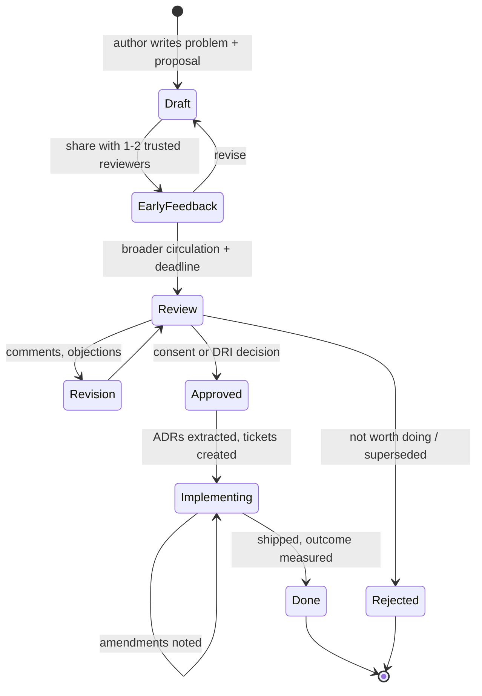
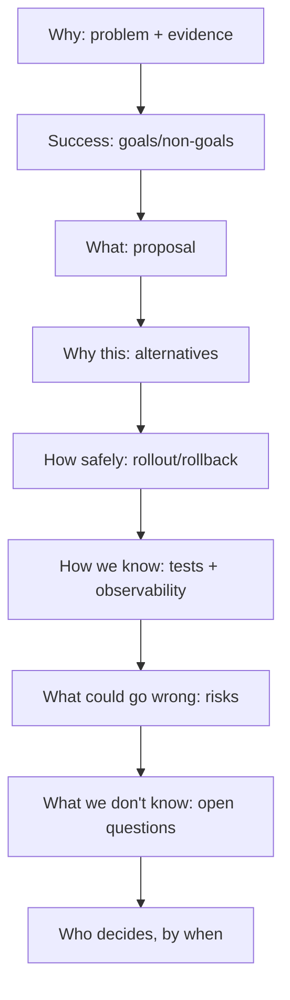
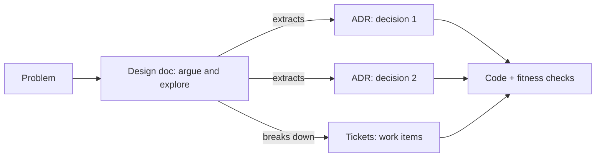

# 11 / 02 — Technical Design Documents: Proposing, Reviewing, and Recording Front-End Designs

## 1. Lesson metadata

| | |
|---|---|
| **Level** | Architect |
| **Study time** | 5–6 hours (reading 2 h, annotating the example 1 h, exercises 2.5 h) |
| **Prerequisites** | [01 — Trade-off analysis](./01-trade-off-analysis.md), [Architecture fundamentals](../04-react-architecture/01-architecture-fundamentals.md), [URL state management](../06-data-fetching-and-state-ecosystems/18-url-state-management.md), [TanStack Query](../06-data-fetching-and-state-ecosystems/08-tanstack-query.md) |
| **Next** | [03 — Large-scale refactoring](./03-large-scale-refactoring.md) |
| **Related** | [Multi-team ownership](../04-react-architecture/23-multi-team-ownership.md), 17 — Code review and standards, 18 — Technical leadership |

**Learning objectives.** After this lesson you can:
1. Explain what a technical design document (TDD, also "design doc" or RFC) is *for* and what it is not.
2. Decide when a design doc is warranted and how long it should be.
3. Structure a design doc: context, goals/non-goals, proposal, alternatives, risks, rollout, testing, observability, open questions.
4. Write a design for a front-end change that a reviewer can evaluate without a meeting.
5. Run an effective review: what reviewers look for, how to resolve disagreement, how decisions get recorded.
6. Distinguish a design doc from an ADR, a spec, a ticket and documentation.
7. Read a complete example design doc critically (§5.2) and identify what makes it reviewable.

**Concepts covered:** purpose of design docs, "thinking in writing", goals vs non-goals, alternatives considered, rollout and migration plan, failure modes and rollback, observability plan, open questions, review process (async + sync), approval and consent, doc lifecycle, relationship to ADRs.

---

## 2. Deep conceptual explanation

### 2.1 What problem is this lesson solving?

Complex changes fail for reasons that are cheap to catch on paper and expensive to catch in code:

- Two teams assume different ownership of the same state.
- The migration plan has no safe intermediate step, so it cannot be shipped incrementally.
- The proposal solves a symptom; nobody asked which metric would prove it worked.
- The design is fine but nobody considered what happens when the network is slow, the user is offline, or a deploy happens mid-session.

A design doc is a **cheap simulation of the change in prose**. Writing forces you to turn vague intuition into explicit claims that others can attack. A frequently cited principle in engineering writing: *writing is thinking* — if you cannot write the design clearly, you probably do not yet understand it.

### 2.2 What a design doc is — and is not

| It **is** | It is **not** |
|---|---|
| A proposal and argument: "here is the problem, here is what I'll do, here is why this beats the alternatives" | A tutorial or reference for the system after it ships (that is documentation) |
| A tool to find flaws *before* code | A bureaucratic gate to be passed |
| A communication artefact for people who were not in the room | A transcription of a meeting |
| Time-boxed: most valuable *before* and during implementation | A living spec that must be kept in sync forever (the code and tests are the living spec) |
| Opinionated, with a recommendation | A neutral survey of options |

**Design doc vs ADR.** An ADR records *a decision* and its context (usually one page; see [01](./01-trade-off-analysis.md) §5.4). A design doc explores *a solution* — often producing several decisions. A good design doc yields one or more ADRs on approval; the ADR is the durable summary, the design doc is the working argument.

**Design doc vs ticket.** A ticket says *what to do and by when*. A design doc says *why this is the right thing and how it fits*.

### 2.3 When is a design doc warranted?

Use the same logic as trade-off analysis (effort ∝ cost-to-reverse × blast radius × uncertainty):

| Situation | Doc? | Size |
|---|---|---|
| Bug fix, copy change, small isolated component | No | — |
| New feature in one team's code with a clear pattern | Optional: paragraph in the ticket or PR | ½ page |
| New feature touching shared state, shared packages, URL structure, or data contracts | Yes | 2–4 pages |
| Cross-team change, new framework/library, migration of > 1 team's code, security- or compliance-relevant change | Yes, with formal review | 4–10 pages |
| Whole-product rendering or architecture change | Yes, possibly multi-doc (overview + sub-designs) | Varies |

Heuristics for "yes": (a) more than one person will implement it; (b) it will take more than ~2 engineer-weeks; (c) it changes a contract other code depends on; (d) the first attempt would be expensive to throw away; (e) you feel unsure and want a second pair of eyes.

### 2.4 The anatomy of a good design doc

Every doc should answer, in this order, the questions a reviewer will have:

1. **Why are we doing this?** (Context / problem / evidence)
2. **What does success look like?** (Goals, with measurable targets)
3. **What are we deliberately not doing?** (Non-goals)
4. **What is the proposal?** (Design: components, data flow, contracts, states)
5. **What else did you consider and why not?** (Alternatives)
6. **How do we get there safely?** (Rollout, migration, rollback)
7. **How do we know it works, and how do we notice it breaking?** (Testing, observability)
8. **What can go wrong?** (Risks, failure modes, security, accessibility, performance)
9. **What are you still unsure about?** (Open questions)
10. **Who needs to agree, by when?** (Reviewers, decision process)

Section order matters because it mirrors the reviewer's reading: motivation first, solution second. Docs that begin with the solution invite bike-shedding on implementation before agreement on the problem.

### 2.5 Goals and non-goals

**Goals** must be *testable*. "Improve performance" is a wish. "Reduce INP p75 on `/orders` from 410 ms to ≤ 200 ms on the reference mid-tier Android device" is a goal.

**Non-goals** are decisions about scope, and are the most underrated section. They:
- prevent scope creep in review ("could we also …?"),
- protect you from being judged on problems you never intended to solve,
- often reveal hidden disagreement early ("wait, I thought this included mobile").

Good non-goals are things a reasonable reader *might* expect to be in scope: "This does not change the order-detail page", "This does not introduce a global client store."

### 2.6 Alternatives considered

The alternatives section is where trust is built. A reviewer who proposes an alternative that your doc already analysed, with evidence, usually concedes quickly. A doc that lists only strawmen ("do nothing: bad") destroys credibility. Include:
- the **status quo** with its *true* cost,
- the **simplest thing that could work**,
- the **reviewer's likely favourite**,
- and **why the proposal wins on the criteria stated in Goals**, not on taste.

Link to the trade-off analysis ([01 — §5.2](./01-trade-off-analysis.md)) rather than repeating it.

### 2.7 Writing for the front end: what to specify

Front-end designs have recurring blind spots. A checklist of topics that deserve explicit treatment when relevant:

| Topic | Questions |
|---|---|
| **UI states** | Loading, empty, partial, error, stale, offline, permission-denied — which are in scope? |
| **State ownership** | Which state is server cache, URL, local component state, global client state? Who owns each? ([State ownership](../04-react-architecture/15-state-ownership.md)) |
| **Contracts** | API shapes, props of shared components, events, URL schema; versioning and compatibility |
| **Navigation/URL** | What is shareable/bookmarkable? Back-button behaviour? Deep links? |
| **Rendering strategy** | CSR/SSR/streaming; hydration; what runs on server vs client |
| **Performance** | Bundle impact per route; request waterfalls; render budgets; measured targets |
| **Accessibility** | Keyboard behaviour, focus management, announcements, reduced motion |
| **Security & privacy** | XSS surfaces, token storage, PII in logs/URLs |
| **Internationalisation** | Text expansion, formats, RTL |
| **Browser/device support** | What is the minimum? |
| **Feature flags / rollout** | Per-cohort enablement; kill switch |
| **Testing** | Unit/integration/e2e/visual; what's the highest-value test? |
| **Observability** | Error attribution, performance marks, product metrics, alerts |
| **Ownership after launch** | Who is on call? Who maintains? |

Not every doc needs every row; the discipline is to **consciously exclude** a row (and say so) rather than forget it.

### 2.8 Misconceptions

| Misconception | Reality |
|---|---|
| "Design docs are waterfall." | A short doc before building is compatible with iterative delivery; it designs the *first safe increment* and the direction, not every detail. Update it when you learn. |
| "Longer is more rigorous." | Rigor is in the clarity of claims and the evidence. Long docs are reviewed shallowly. Aim for the shortest doc that answers reviewers' questions. |
| "The doc is for approval." | The doc is for *finding mistakes*. Approval is a by-product. Authors who treat reviews as defence lose the benefit. |
| "Only seniors write docs." | Writing a design doc for a medium change is one of the fastest ways to grow; reviewers (including seniors) get the context to coach. |
| "Once approved, the doc binds." | The doc records intent at a point in time. Implementation may deviate when reality demands it; deviations should be noted. |
| "The doc replaces conversation." | It *prepares* conversation: async review resolves the easy 80%, so the meeting is spent on real disagreements. |

---

## 3. Internal mechanics

### 3.1 How a design doc moves through its lifecycle



*Teaching model.* Organisations differ on formality; the useful invariants are: early feedback before wide circulation, a **deadline** on review, an explicit **decision-maker**, and an **outcome review** after shipping.

### 3.2 Review as a search process

A reviewer's job is to look for specific classes of flaw. Authors can pre-empt each:

| Class of flaw | Reviewer's question | How the author pre-empts |
|---|---|---|
| **Wrong problem** | "Is this the real cause?" | Evidence section with measurements |
| **Wrong scope** | "What's missing / what's extra?" | Goals and non-goals |
| **Wrong solution** | "What about X?" | Alternatives |
| **Unsafe delivery** | "How do I roll this out and back out?" | Rollout plan with kill switch and intermediate states |
| **Hidden coupling** | "Who else is affected?" | Stakeholders/consumers list; contract changes called out |
| **Unverifiable** | "How will we know it worked?" | Success metrics and observability |
| **Underspecified edge cases** | "What if the request fails/slow/offline?" | State table |
| **Maintenance burden** | "Who owns this in a year?" | Ownership and complexity cost |

### 3.3 The "walking skeleton" and incremental safety

A design that can only be shipped in one big step is high risk. Reviewers should look for **intermediate states that are safe to deploy** and **a path where each step is independently revertible**. Common front-end mechanisms: feature flags, parallel routes (old and new behind a flag), expand/contract changes to contracts, adapters letting old and new code coexist ([03 — Large-scale refactoring](./03-large-scale-refactoring.md)).

### 3.4 Decision rights

State, in the doc, how the decision will be made:
- **DRI (directly responsible individual)**: one person decides after input. Fast, accountable.
- **Consent-based**: proceed unless someone raises a *reasoned objection* within the window. Scales across teams.
- **Committee**: slow; use only for compliance- or security-owned decisions.

Ambiguity in decision rights is a top cause of docs stalling in review ("everyone commented, nobody decided").

### 3.5 Public guarantee / teaching model / implementation detail

- *Public guarantee* (of the practice): writing the problem and alternatives before coding exposes disagreement earlier than code review does — the economics (cost of change rises through the lifecycle) are well accepted, though precise multipliers vary by context and should not be quoted as facts.
- *Teaching model*: the 10-question anatomy in §2.4.
- *Implementation detail*: templates, tooling (docs, wikis, Markdown in repo), and review forums vary by company. Pick what fits; keep docs close to code if they should survive.

---

## 4. Step-by-step execution walkthrough

How a design doc actually gets written and landed, chronologically:

1. **Notice the trigger.** You're about to start a task that touches shared state/contracts or is > 2 weeks. Decide: doc or not (§2.3).
2. **Write the one-paragraph problem.** If you can't do it, you don't understand the problem yet. Attach evidence: a profiler capture, a support-ticket count, a bundle report.
3. **Write goals/non-goals.** Put numbers on goals. Get one trusted colleague to read *only this section* and confirm they'd judge the project by the same measures.
4. **Explore alternatives quickly.** Spike if a central uncertainty exists ([01 §2.6](./01-trade-off-analysis.md)). Record what you tried even if it failed.
5. **Write the proposal.** Start with a diagram of data flow/ownership; then contracts (types, URLs); then the states table; then sequencing.
6. **Write rollout and rollback.** Identify the smallest first shippable increment.
7. **Write risks, testing, observability.** Be specific about metrics and alerts.
8. **List open questions.** Assign each an owner and a date, or mark as "decide during implementation, within these bounds".
9. **Early review** with 1–2 people: ask them to attack the weakest part.
10. **Circulate** with deadline, DRI, and *specific* questions ("I'm least sure about section 5.3").
11. **Handle comments.** Resolve factual ones in the doc; for design disagreements, get to a call with the doc as the agenda; record the outcome *in the doc*.
12. **Approve and extract ADRs.** One ADR per durable decision.
13. **Implement, noting deviations** in an "Amendments" section.
14. **Post-launch review**: compare outcome to goals; close the loop in the doc.

---

## 5. Code examples

Design docs are mostly prose; the "code" is the design artefact itself. This section gives (a) a reusable template, (b) a **full worked design doc**, (c) an incorrect doc and its correction, and (d) an advanced technique: a type-level contract as a design artefact.

### 5.1 Minimal example: the one-page template

```md
# <Title: verb + object, e.g. "Move Orders table state to the URL">

Author: · Reviewers: · DRI: · Status: Draft | In review | Approved | Superseded
Review deadline: <date> · Target ship: <date>

## 1. Problem and evidence
## 2. Goals (measurable) / Non-goals
## 3. Proposal
   3.1 Overview diagram
   3.2 State ownership
   3.3 Contracts (types, URL schema, API)
   3.4 UI states
## 4. Alternatives considered
## 5. Rollout and rollback
## 6. Testing and observability
## 7. Risks and mitigations
## 8. Open questions
## 9. Amendments (post-approval)
```

**Line notes.** `DRI` and `Review deadline` are the two header fields most often forgotten; without them docs stall. `Amendments` makes deviations visible. For small changes, collapse sections 4–8 to one or two sentences each; do not delete the headings mentally — consciously decide each is not needed.

### 5.2 Practical example: a complete design doc

Below is a full, realistic design doc. It is written to be **read critically**: after it, §5.2.1 annotates what makes it work. (Numbers and names are illustrative, as in all worked examples in this curriculum.)

---

> # Move Orders Table State to the URL and Server-Driven Pagination
>
> **Author:** A. Author · **Reviewers:** Platform FE (R. Li), Orders BE (S. Kaur), Support Tools (D. Osei), Accessibility (M. Rossi)
> **DRI:** R. Li · **Status:** In review · **Review deadline:** Fri 24 Apr · **Target first ship:** 2 sprints after approval
>
> ## 1. Problem and evidence
>
> The Orders page (`/orders`) loads **all orders for the selected account** (median 1,800; p95 24,000) in a single request, then filters, sorts and paginates on the client.
>
> Evidence (from RUM and Profiler, last 28 days):
> - Payload p95: 6.1 MB, time-to-first-row p95: 4.8 s on the reference device (mid-tier Android, Fast 3G profile).
> - INP p75: 410 ms; Profiler shows 150–250 ms main-thread time per filter keystroke re-filtering/sorting the full array and re-rendering 100 visible rows plus table chrome.
> - Support Tools reports ~35 tickets/month of the form "I can't send you my filtered view" — filter/sort/page state lives in `useState` and is lost on refresh and cannot be shared.
> - 3 separate incidents in the last quarter where the page crashed the tab for accounts with > 50k orders.
>
> ## 2. Goals and non-goals
>
> **Goals**
> 1. Time-to-first-row p95 ≤ 1.5 s on the reference device/profile.
> 2. INP p75 on `/orders` ≤ 200 ms.
> 3. Filter, sort, page and search state is **in the URL**: reload, back/forward, and sharing a link reproduce the same view.
> 4. No page-crash incidents attributable to row count (monitored: tab crash reports from RUM, error count of `OOM-suspected` heuristic).
> 5. First increment ships behind a flag with a kill switch within 2 sprints.
>
> **Non-goals**
> - Redesigning the table visually.
> - Changing the order-detail page.
> - Introducing a global client store.
> - Real-time updates of rows (separate project; this design must not preclude it).
> - Exporting > 1k rows (existing async CSV export stays as is).
>
> ## 3. Proposal
>
> ### 3.1 Overview
>
> ```mermaid
> flowchart LR
>   U[URL search params] -->|parse + validate| Q[OrdersQuery object]
>   Q -->|queryKey| TQ[TanStack Query]
>   TQ -->|GET /orders?...| API[(Orders API v2: server-side filter/sort/cursor)]
>   TQ --> T[OrdersTable]
>   T -->|user edits filter| H[setQuery -> navigate]
>   H --> U
> ```
>
> The **URL is the source of truth** for the *query* (filters, sort, page). **TanStack Query** is the cache for the *results*. There is no other copy of the query in component state.
>
> ### 3.2 State ownership
>
> | State | Owner | Notes |
> |---|---|---|
> | Filters, sort, cursor/page size, search text (committed) | URL search params | Parsed into `OrdersQuery` by a single function |
> | Search text *while typing* | Local component state | Debounced 250 ms into the URL (`replace`, not `push`) |
> | Row data, total count | Query cache | `keepPreviousData` semantics for smooth paging (see §3.4) |
> | Selected rows | Local component state, cleared on query change | Cross-page selection is a non-goal |
> | Column visibility | `localStorage` per user (unchanged) | |
>
> ### 3.3 Contracts
>
> **URL schema** (stable, versioned by additive change only):
>
> ```
> /orders?status=open,shipped&from=2026-01-01&to=2026-03-31&q=acme&sort=-createdAt&cursor=eyJ...&size=50
> ```
>
> ```ts
> // features/orders/query.ts
> export type OrdersSort = `${"" | "-"}${"createdAt" | "total" | "status"}`;
>
> export interface OrdersQuery {
>   status: ReadonlyArray<"open" | "shipped" | "cancelled">;
>   from?: string; // ISO date, inclusive
>   to?: string;   // ISO date, inclusive
>   q?: string;
>   sort: OrdersSort;
>   cursor?: string; // opaque, issued by server
>   size: 25 | 50 | 100;
> }
>
> export const DEFAULT_QUERY: OrdersQuery = { status: [], sort: "-createdAt", size: 50 };
>
> /** Total, never throws: invalid or unknown params fall back to defaults. */
> export function parseOrdersQuery(params: URLSearchParams): OrdersQuery { /* §3.3.1 */ }
> export function toSearchParams(q: OrdersQuery): URLSearchParams { /* inverse; omits defaults */ }
> ```
>
> `parse(toSearchParams(q))` must equal `q` for every valid `q` (property-tested). `toSearchParams` omits default values so canonical URLs are short and stable.
>
> **API (owned by Orders BE, coordinated with S. Kaur):** `GET /v2/orders` accepting the equivalent parameters, returning `{ items: Order[]; nextCursor?: string; prevCursor?: string; total: number | null }`. `total` may be `null` for very large accounts (counts are expensive); the UI must render "50+ results" when `null`. **Dependency:** BE delivers v2 behind a header-based version switch by end of sprint 1; until then FE develops against a contract mock (see §6).
>
> ### 3.4 UI states
>
> | State | Behaviour |
> |---|---|
> | Initial load | Skeleton rows (50), table header interactive |
> | Query change (filter/sort/page) | Previous rows stay visible, dimmed, with `aria-busy="true"` on the table; new rows replace on arrival (no layout jump to skeleton) |
> | Empty result | Empty state with the active filters listed and a "Clear filters" action |
> | Error | Inline error with retry; previous rows kept if present |
> | Invalid URL params | Silently normalised to defaults; one-time toast "Some filters were invalid and were reset" |
> | Stale cursor (server rejects) | Reset cursor, keep filters, notify |
> | Offline | Existing rows remain; banner; retry on reconnect |
>
> ### 3.5 Component structure
>
> - `OrdersPage` (route component): reads URL → `OrdersQuery`; renders `OrdersFilters` and `OrdersTable`.
> - `useOrdersQuery()`: the only hook that couples URL ↔ `OrdersQuery` ↔ TanStack Query.
> - `OrdersTable`, `OrdersFilters`: **receive `query` and `onQueryChange` as props**; they don't read the URL themselves, which keeps them testable without a router.
>
> ## 4. Alternatives considered
>
> | Option | Summary | Why not (or later) |
> |---|---|---|
> | **A. Do nothing; virtualise rows** | Keep full download, virtualise rendering | Fixes render cost, not payload (6.1 MB p95), memory, or sharing links. Goals 1, 3, 4 unmet. Cheap, and still useful later. |
> | **B. Client-side pagination of full download + URL state** | Move state to URL only | Meets goal 3 only. Payload and memory remain. |
> | **C. Server-driven (proposed)** | URL → API → cache | Meets all goals; requires BE v2 (dependency risk). |
> | **D. Global store (Redux/Zustand) for table state** | Centralise query state | Doesn't meet the shareable-links goal without extra sync to the URL; adds a second source of truth. Rejected unless a non-URL consumer appears. |
> | **E. GraphQL for flexible queries** | New API surface | Out of scope: org-wide decision. Not blocked by this design. |
>
> Trade-off summary: C costs a BE dependency and loses instant client-side filtering of already-loaded data; for accounts with ≤ 500 orders (≈ 55% of accounts per BE data), perceived latency per filter change rises from ~0 ms to a request round-trip (target p95 ≤ 300 ms). Mitigation: debounce, keep previous rows, prefetch next page on idle.
>
> ## 5. Rollout and rollback
>
> 1. **Sprint 1:** Land `OrdersQuery` + parse/serialise (+ property tests), no UI change. Land contract mock.
> 2. **Sprint 2:** `useOrdersQuery` + new table behind flag `orders.serverTable` (default off). Internal users on.
> 3. **Sprint 3:** 5% → 25% → 100% of accounts, gated by guardrails: INP p75, error rate on `GET /v2/orders`, support-ticket volume.
> 4. **Sprint 4:** Remove old client-side path and flag (deletion is a milestone, not a "later").
>
> **Rollback:** flag off returns to old path (kept intact until step 4). URLs created under the new scheme are ignored (old page does not read them); acceptable because sharing only worked under the new scheme.
>
> **Compatibility:** old bookmarks `/orders` still work (defaults).
>
> ## 6. Testing and observability
>
> - **Unit/property:** `parse`/`toSearchParams` round-trip, garbage input never throws.
> - **Component:** `OrdersTable` with stubbed `onQueryChange`; asserts `aria-busy`, empty/error states.
> - **Integration:** MSW-based mock of `GET /v2/orders` covering pagination, stale cursor, `total: null`, 500s.
> - **Contract:** shared JSON schema with BE; CI on both sides validates examples.
> - **E2E (2 flows):** filter → reload → same view; back button restores previous query.
> - **A11y:** keyboard-only pass for filters; announcement of result count changes (polite live region); reviewed by M. Rossi.
> - **Observability:** custom performance marks `orders:query-start`/`orders:rows-painted`; RUM dimension `serverTable=true|false`; dashboards for guardrail metrics; alert if error rate > 2× baseline for 15 minutes during rollout.
>
> ## 7. Risks
>
> | Risk | Likelihood | Impact | Mitigation |
> |---|---|---|---|
> | BE v2 slips | Medium | High | Contract mock; Sprint 1/2 FE work not blocked; flag stays off |
> | Debounce + `replace` produce confusing history | Medium | Low | Use `replace` while typing, `push` on committed filter changes; e2e test back-button |
> | Cache key explosion from many filter combinations | Low | Low | Bounded `gcTime`, key = canonical serialised query |
> | Large cursor URLs | Low | Low | Opaque short cursors; BE caps at 512 bytes |
> | Accessibility regressions on dimmed/busy state | Medium | Medium | A11y review + automated checks |
> | PII in URLs (customer name search `q=`) | Medium | High | Confirm with Security: URLs are logged by proxies/analytics. Proposal: do **not** put free-text PII in the URL; use order-number prefix search for `q`, and keep name search in a POST-backed saved search (open question 2). |
>
> ## 8. Open questions
>
> 1. Do we need `prevCursor` (backwards paging), or only "load more" + page size? *Owner: Orders BE + Support Tools; decide by end of sprint 1.*
> 2. How to handle PII search (see risk 6)? *Owner: Security + FE; blocks sprint 3 rollout, not sprint 2.*
> 3. Is `total: null` acceptable to Support Tools? *Owner: D. Osei.*
>
> ## 9. Amendments
>
> *(empty at approval; additions dated)*

---

#### 5.2.1 Annotating the example: why it works

| Feature | Why it makes review easier |
|---|---|
| Evidence in §1 with reference device and profile | Reviewer can challenge the *measurement*, not the existence of pain |
| Goals numbered and measurable | "Done" is unambiguous; outcome review is mechanical |
| Non-goals include "global client store" and "real-time" | Pre-empts the two most likely scope expansions |
| One diagram, one table of ownership | Reviewers can verify the **single-source-of-truth** claim in seconds |
| Contract section has types *and* an invariant (`parse(toSearchParams(q)) = q`) | Testable promise, not prose |
| UI-states table | Covers the cases that usually surface in QA instead of design |
| Alternatives include "do nothing; virtualise" with honest "still useful later" | Shows the author didn't strawman |
| Trade-off paragraph names who loses (small accounts) and the mitigation | Honest costs build trust |
| Rollout with deletion milestone | Prevents "temporary" dual paths from becoming permanent |
| Risk table includes a **security/PII** risk the author found themselves | Demonstrates self-review; moves a late-found issue early |
| Open questions with owners and deadlines | Distinguishes "unknown" from "undecided" |

**Predict:** A reviewer asks: "Why not just use `useState` plus `localStorage` so refresh keeps filters?" Which sections answer it? *Answer:* §1 (support tickets are about *sharing*, which localStorage can't do), §2 goal 3 (URL), and the alternatives table (partially: option B/D). A good doc anticipates this; if it were missing, add a row to alternatives.

### 5.3 Incorrect: a design doc that cannot be reviewed

```md
# Orders Refactor

We will refactor the Orders page to use modern patterns. The table will be
rewritten with hooks and we will use React Query. This will improve performance
and maintainability. Estimated: 3 weeks.

## Design
We'll create a useOrders hook and a new OrdersTable component. Filters will be
handled in state. See Figma.

## Alternatives
Keep the current approach (bad).
```

Problems:
1. **No problem statement or evidence** — "modern patterns" is not a problem.
2. **No measurable goals**, no non-goals.
3. **Solution described as technology** ("hooks", "React Query") not behaviour or contract.
4. **Filters "in state"** — silently decides the ownership question and ignores sharing/URL.
5. **Alternatives is a strawman.**
6. **No rollout/rollback, testing, observability, risks, open questions.**
7. **No reviewer, DRI, deadline** — will receive "LGTM" or silence.
8. **Estimate without decomposition** — can't be validated.

### 5.4 Corrected: rewriting the weakest part

Take the "Alternatives" line and make it reviewable:

```md
## Alternatives considered
| Option | What it fixes | What it doesn't | Cost |
|---|---|---|---|
| Status quo | — | Payload p95 6.1 MB, INP 410 ms, no sharing | 0 |
| Virtualise rows only | Render cost (est. −60% scripting in profile) | Payload, memory, sharing | ~3 days |
| Server-driven + URL (proposed) | All stated goals | Needs BE v2; small-account latency | ~6 weeks incl. BE |
Why proposed: only option that meets goals 1, 3, 4. Virtualisation recommended as a follow-up regardless.
```

*What changed:* each option is evaluated on the *goals*; costs are explicit; the proposal's selection logic is traceable; a partial option is respected rather than ridiculed.

### 5.5 Advanced: a contract as a design artefact (types + property test)

For front-end designs with a URL contract, include executable evidence that the contract is coherent.

```ts
// features/orders/query.test.ts  (run-tested with fast-check 4 and Vitest 3 against a reference `query.ts`; `requiredKeys` is a valid `fc.record` option)
import fc from "fast-check";
import { parseOrdersQuery, toSearchParams, DEFAULT_QUERY, type OrdersQuery } from "./query";

const arbQuery: fc.Arbitrary<OrdersQuery> = fc.record({
  status: fc.subarray(["cancelled", "open", "shipped"] as const), // listed in canonical (alphabetical) order; subarray preserves source order
  sort: fc.constantFrom("createdAt", "-createdAt", "total", "-total", "status", "-status") as fc.Arbitrary<OrdersQuery["sort"]>,
  size: fc.constantFrom(25, 50, 100) as fc.Arbitrary<OrdersQuery["size"]>,
}, { requiredKeys: ["status", "sort", "size"] });

test("round-trips", () => {
  fc.assert(fc.property(arbQuery, (q) => {
    expect(parseOrdersQuery(toSearchParams(q))).toEqual(q);
  }));
});

test("never throws on garbage", () => {
  fc.assert(fc.property(fc.string(), (s) => {
    expect(() => parseOrdersQuery(new URLSearchParams(s))).not.toThrow();
  }));
});

test("defaults produce an empty query string", () => {
  expect(toSearchParams(DEFAULT_QUERY).toString()).toBe("");
});
```

**Line notes.** The first test states the *invariant* promised in §3.3. The second states totality (the "never throws" promise). The third pins canonical form — important because cache keys derive from it. Caveat: if the implementation canonicalises `status` (sorted, de-duplicated) but the generator produces arbitrary orderings, the round-trip fails (run-tested: counterexample `status: ["open","cancelled"]`). The contract must define the canonical ordering and the generator must produce canonical values (here the source array is listed alphabetically, and `fc.subarray` preserves that order) — an example of *design emerging from the executable spec*.

---

## 6. Visual explanations

### 6.1 Document anatomy as a reading path



### 6.2 Where review effort should go

```text
Reviewer attention (finite) allocation, high to low value:

  [#######] Problem is real & scope right   (cheapest to fix now)
  [######]  Contracts and ownership         (expensive to fix later)
  [#####]   Rollout / rollback safety
  [####]    Risks, security, a11y
  [##]      Component names, folder layout  (cheap to change in code review)
  [#]       Style/prose nits
```

Authors can steer reviewers by saying in the header which sections to focus on.

### 6.3 Design doc vs ADR vs ticket



---

## 7. Alternative approaches and trade-offs

| Approach | Strengths | Weaknesses | Best when |
|---|---|---|---|
| **Full design doc + review** | Deep scrutiny; durable record; async | Slow; can become ceremony | One-way doors, cross-team changes |
| **Lightweight RFC (1–2 pages)** | Fast; focuses on decision | Less detail; implementation risks missed | Team-level changes with a contract |
| **ADR only** | Tiny; durable | No exploration of the solution | Decision is clear; need a record |
| **Prototype first, doc later** | Real evidence; learn fast | Tempting to ship prototype; wasted work if wrong direction | High technical uncertainty, low coordination |
| **Design review meeting without doc** | Quick, interactive | Not asynchronous; knowledge evaporates; dominated by loud voices | Tiny team, same room |
| **Spec-as-tests (executable)** | Precise, verifiable | Poor at communicating *why*; high authoring cost | Well-understood contracts (parsing, state machines) |
| **Living architecture docs in repo** | Co-located; versioned with code | Drift if not owned | Stable architecture overviews |

**Scenario where the full doc is *not* best:** you've been asked for a quick UI experiment behind a flag, reversible in an hour, owned by you alone. A doc would take longer than the experiment. Write a short PR description with the hypothesis and the success metric. Equally, if the technical unknown is whether something is *possible*, prototype for two days first, then write the doc with the prototype as evidence.

---

## 8. Best practices and anti-patterns

### 8.1 Good practice
- Put the **recommendation and the ask** at the top (summary + who must decide by when).
- Make goals measurable; write non-goals deliberately.
- Draw the data-flow/ownership diagram before writing prose.
- Specify contracts as types and invariants, not adjectives.
- Include a **UI-states table** for any user-visible change.
- Plan the **deletion** of temporary dual paths.
- Name the biggest uncertainty and what would resolve it.
- Ask for *specific* feedback from *specific* people.
- Record decisions and deviations; extract ADRs.
- After shipping, add an outcome note comparing results to goals.

### 8.2 Beginner mistakes
- Describing the implementation steps instead of the design (a to-do list is not a design).
- Omitting alternatives or listing only strawmen.
- No measurable goals.

### 8.3 Experienced-developer mistakes
- **Doc as defence:** responding to review comments by justifying rather than testing the design.
- **Over-documentation:** 20-page docs no one reads; detail that belongs in code.
- **Under-consulting:** not inviting the BE, a11y, security or support stakeholder who would catch the flaw.
- **Designing the final state only**, with no safe intermediate steps.
- **Stale docs** presented as current truth.
- **Hiding uncertainty** to appear confident.

### 8.4 Smells
- No one named as decider.
- "TBD" in core sections (not just open questions).
- Every alternative is rejected for a one-word reason ("complex").
- No section says what could go wrong.
- Success measured by "shipped", not by outcome.

### 8.5 Justified exceptions
- In incident response, a post-hoc doc is acceptable; the first priority is mitigation.
- For purely exploratory work, replace the proposal with "hypothesis + experiment plan".
- A tiny team that shares context daily may use half-page RFCs; the structure still helps.

---

## 9. Real-world application

| Domain | Design-doc focus | Distinctive concerns |
|---|---|---|
| **E-commerce** | Checkout flow changes, product-page rendering strategy | Revenue guardrails, A/B experiment design, PCI scope, third-party tags |
| **Dashboards** | Live-data propagation, widget framework | Update frequency, memory, partial failure per widget |
| **Finance** | Money formatting, audit trail UI state | Correctness, reproducibility of what the user saw, compliance review |
| **Forms-heavy** | Validation strategy, draft saving | Data loss, accessibility, long sessions |
| **Auth** | Session handling, SSO flows | Token storage, redirect loops, security review mandatory |
| **Real-time** | Subscription model, reconnection | Ordering, backpressure, optimistic reconciliation |
| **Multi-team platforms** | Shared package API, deprecation policy | Versioning, migration support, ownership |

**Constraints that shape the doc:** reviewers' availability and time zones (async-first), compliance sign-off lead time (start early), release train cadence, and the existence of a design-review forum. For cross-team designs, **who must say yes** (security, accessibility, platform, BE) should be identified in the header, and their review deadline shorter than the project deadline.

---

## 10. Debugging and troubleshooting

| Symptom | Likely root cause | Investigation | Fix / validation |
|---|---|---|---|
| Doc has 40 comments, no decision | No DRI or decision process; comments are preference debates | Check header for DRI and deadline | Assign DRI; classify comments (blocking / suggestion / question); hold a 30-min call on blocking ones; record outcome in the doc |
| "LGTM" from everyone, project later fails | Reviewers lacked context or time; doc too long or shapeless | Ask what each reviewer focused on; check whether risky sections got specific comments | Ask for targeted reviews: "please attack §3.3"; shorter docs |
| Implementation diverges from design silently | No amendment habit; design not decomposed to tickets | Diff design vs code at midpoint | Amendments section; checkpoint review |
| Surprise blocker late (security, a11y, BE) | Stakeholder not consulted | Retro: which review would have caught it? | Add stakeholder checklist to template |
| Doc rots; people stop trusting docs | No lifecycle; docs are treated as living spec | Check staleness dates | Mark docs "historical after launch" + keep ADRs and code-adjacent docs current |
| Everything becomes a doc; delivery slows | No threshold | Count docs vs change size | Adopt §2.3 thresholds; allow PR-description-only path |
| Disagreement persists after review | Hidden criteria difference | Ask each side to state which goal they think the other's option fails | Return to goals/weights ([01 §3.4](./01-trade-off-analysis.md)); cheap spike on the crux |

**Validating that the process works:** track (a) review lead time, (b) the fraction of projects where a major redesign was triggered during implementation (should fall), (c) post-launch goal attainment, (d) the number of comments that change the design (if zero, reviews are theatre).

---

## 11. Exercises

### Level A — Knowledge
A1. List the ten questions of the design-doc anatomy in order, and say why "Why" comes before "What".
A2. State two differences between a design doc and an ADR.
A3. Give three criteria for deciding whether a change needs a design doc.
A4. What makes a non-goal good? Give an example for a "Move table state to URL" project.
A5. Why is "Alternatives considered" more than a courtesy?

### Level B — Code comprehension
B1. In the §5.2 example, the invariant `parse(toSearchParams(q)) = q` is promised. Why does the doc also require that `toSearchParams` *omits defaults*? Which later system depends on canonical form?
B2. In §3.4, query changes keep previous rows dimmed rather than showing skeletons. Which goal does this serve, and what accessibility attribute is called out?
B3. In the property test of §5.5, the arbitrary generates `status` via `subarray`. Why can the round-trip test fail even if the code "works", and what design decision does that force?

### Level C — Implementation
C1. Implement `parseOrdersQuery` and `toSearchParams` for the `OrdersQuery` type in §5.2 satisfying the three tests of §5.5 (canonical `status` ordering, defaults omitted, total/never throws).
C2. Write the "UI states" table for a *comments panel* on a document editor (posting, failure, offline, permission denied, deleted-while-viewing).

### Level D — Debugging
D1. A review of your doc produces this comment: "The rollout plan looks fine but I don't see how we turn this off if conversion drops." Identify what's missing and rewrite the rollout section accordingly.
D2. After shipping, the team realises that names typed in `q=` end up in the analytics tool. Using the doc's structure, show which sections should have caught this, and what process change prevents recurrence.

### Level E — Architecture and engineering decisions
E1. Your team of 6 is asked to introduce a design-review process. Propose thresholds, template, review roles, SLA, and how you'll prevent it from becoming a bottleneck.
E2. A senior colleague argues that "the code is the documentation; design docs are waste." Give the strongest version of their argument, then a reasoned response that identifies where they're right and wrong.

### Level F — Expert challenge
F1. You must design a **two-team** change: Team A owns the design system's `Select`; Team B owns three product apps. A new `Select` API breaks 140 call sites. Write the skeleton (headings with 1–2 sentences each) of a design doc that includes a migration strategy with codemods, compatibility window, and ownership of the deletion milestone.
F2. Critique the following goal list and rewrite it: "(1) Improve the architecture. (2) Make the code cleaner. (3) Reduce technical debt. (4) Use best practices."

---

## 12. Detailed answers and explanations

> Attempt the exercises first.

### Level A

**A1.** (1) Why — problem/evidence; (2) success — goals; (3) non-goals; (4) what — proposal; (5) alternatives; (6) rollout/rollback; (7) tests and observability; (8) risks; (9) open questions; (10) who decides by when. "Why" first because agreement on the problem is cheaper than agreement on the solution, and reviewers who disagree about the problem will argue about solution details as a proxy. *Wrong answer:* "solution first so people see it quickly" — encourages implementation bike-shedding.

**A2.** (1) An ADR records a *decision* in ~1 page; a design doc argues a *solution* and may yield several decisions. (2) ADRs are durable summaries that stay valid after implementation; design docs are working documents for the approval period and may become historical. (Also acceptable: ADR lists consequences/triggers; design doc includes rollout/testing.)

**A3.** Any three of: multiple implementers; > ~2 engineer-weeks; changes a contract others consume (props of shared components, URLs, API); a throw-away first attempt would be expensive; touches security/compliance/accessibility; one-way-door nature; author is unsure.

**A4.** A good non-goal is something a reasonable reader might otherwise assume in scope, and whose exclusion is a real decision. Example: "Cross-page row selection", "Real-time updates", "Visual redesign", "Introducing a global store". A poor non-goal: "We won't make the app slower" (a goal restated negatively).

**A5.** It is the evidence that the author searched the solution space, the place reviewers check whether their favourite was considered, and the record that prevents re-litigation. It also forces articulating the *criteria* that chose among options.

### Level B

**B1.** If defaults were serialised, `/orders` and `/orders?sort=-createdAt&size=50` would be different URLs for the same view, leading to multiple cache keys for the same data (cache fragmentation), unstable links, and analytics noise. The **query key** of TanStack Query is derived from the serialised query, so canonical form determines cache sharing. Omitting defaults gives one canonical URL per view.

**B2.** It serves goal 2 (INP) indirectly by avoiding layout shifts and heavy skeleton re-renders, and the UX of continuity; it also supports perceived performance. The accessibility attribute is `aria-busy="true"` on the table. (Caveat to mention: `aria-busy` support varies in screen readers; the doc also requires a polite live region for result count changes.)

**B3.** `subarray` can generate `["shipped","open"]` while the parser might return a canonical order (e.g. sorted `["open","shipped"]`), so `toEqual` fails. The design must decide: is `status` an ordered list or a set, and is canonical order sorted? Either (a) define canonical sorted order and make the arbitrary generate sorted subarrays, or (b) change the type to a set-like representation. The failure is the test *discovering an under-specified contract* — good.

### Level C

**C1.** Sample solution:

```ts
const STATUSES = ["open", "shipped", "cancelled"] as const;
const SORT_FIELDS = ["createdAt", "total", "status"] as const;
const SIZES = [25, 50, 100] as const;
type Status = (typeof STATUSES)[number];

export function parseOrdersQuery(params: URLSearchParams): OrdersQuery {
  const status = (params.get("status") ?? "")
    .split(",")
    .filter((s): s is Status => (STATUSES as readonly string[]).includes(s));
  const canonicalStatus = STATUSES.filter((s) => status.includes(s)); // canonical order

  const rawSort = params.get("sort") ?? "";
  const field = rawSort.replace(/^-/, "");
  const sort = (SORT_FIELDS as readonly string[]).includes(field)
    ? (rawSort as OrdersSort)
    : DEFAULT_QUERY.sort;

  const sizeNum = Number(params.get("size"));
  const size = (SIZES as readonly number[]).includes(sizeNum) ? (sizeNum as OrdersQuery["size"]) : DEFAULT_QUERY.size;

  const isIso = (v: string | null): v is string => !!v && /^\d{4}-\d{2}-\d{2}$/.test(v) && !Number.isNaN(Date.parse(v));
  const from = params.get("from");
  const to = params.get("to");

  return {
    status: canonicalStatus,
    ...(isIso(from) ? { from } : {}),
    ...(isIso(to) ? { to } : {}),
    ...(params.get("q") ? { q: params.get("q")! } : {}),
    sort,
    ...(params.get("cursor") ? { cursor: params.get("cursor")! } : {}),
    size,
  };
}

export function toSearchParams(q: OrdersQuery): URLSearchParams {
  const p = new URLSearchParams();
  const status = STATUSES.filter((s) => q.status.includes(s));
  if (status.length) p.set("status", status.join(","));
  if (q.from) p.set("from", q.from);
  if (q.to) p.set("to", q.to);
  if (q.q) p.set("q", q.q);
  if (q.sort !== DEFAULT_QUERY.sort) p.set("sort", q.sort);
  if (q.cursor) p.set("cursor", q.cursor);
  if (q.size !== DEFAULT_QUERY.size) p.set("size", String(q.size));
  return p;
}
```

Evaluation: totality (no throws), canonical ordering of `status`, defaults omitted, no `undefined` keys (important for `toEqual`/query keys), validation by whitelist. Edge cases: duplicate statuses collapse; `to < from` is *not* validated here (document where it is — likely the API, or add a normalisation rule); `Date.parse` accepts impossible dates in some engines, so a stricter check may be wanted. The test arbitrary must generate canonical-ordered `status` (use `fc.subarray` then sort) for the round-trip test to pass.

**C2.** Model answer (condensed table): *Idle:* list of comments, composer enabled. *Posting:* optimistic comment shown with "sending" affordance, composer cleared but draft kept until success. *Post failed:* comment shown with error state and retry/discard; draft preserved. *Offline:* composer enabled, posts queued locally with banner; or disabled with explanation — decision recorded. *Permission denied (read-only):* composer hidden, explanation shown, existing comments readable. *Deleted while viewing:* thread shows "This comment was deleted" tombstone, replies preserved. *Conflict/edit race:* last-write-wins vs warn. *Loading:* skeleton. *Empty:* prompt. Evaluation: each state names user-visible behaviour *and* what happens to the user's input (data loss avoidance), and acknowledges the offline decision is a product choice.

### Level D

**D1.** Missing: a **kill switch/rollback** and **guardrail metrics** with thresholds and owners. Rewrite: "Flag `x.newCheckout` (server-evaluated, instant off, no deploy needed). Ramp 1% → 5% → 25% → 100% at ≥ 24h per step. Guardrails: checkout conversion within X% of control (statistical test defined with data science), payment error rate ≤ 1.2× baseline, INP p75 ≤ baseline. Automatic hold on breach; on-call can disable. Rollback leaves in-flight carts intact (cart schema unchanged: expand/contract)." Evaluation: instant reversibility, defined thresholds, who can press the switch, compatibility of persisted data.

**D2.** Sections that should catch it: §7 Risks (a security/privacy row), §3.3 Contracts (URL schema: "which params can contain PII?"), and the reviewers header (Security not listed). In the example doc the author found it; in this scenario the reviewer list lacked Security and the template lacked a privacy checklist row. Process change: add "URLs, logs, analytics" to the front-end checklist in §2.7; include Security/Privacy as required reviewers when the URL schema changes; add an automated check (analytics scrubbing rules for sensitive params). Validate by a test that asserts the analytics payload doesn't include `q`.

### Level E

**E1.** Model answer. *Thresholds:* doc required if ≥ 2 of: multiple implementers, > 2 engineer-weeks, contract change, security/compliance impact; otherwise PR description. *Template:* §5.1, trimmed. *Roles:* author, DRI (tech lead rotates), two reviewers (one outside the team), mandatory specialist reviewers by trigger (security, a11y). *SLA:* reviewers respond in 3 working days; silence after the deadline = consent for non-blocking. *Anti-bottleneck:* DRI can approve; no standing committee; track lead time and "comments that changed the design"; quarterly review of the threshold. Risks: ceremony creep (watch docs per change size), rubber-stamping (watch zero-change reviews). Evaluation: includes explicit exemptions, measured feedback loop, and decision rights.

**E2.** Strongest version: code is executable and cannot drift, docs rot, writing before coding delays learning, most design is discovered by building, and docs produce false confidence. Response: agree that *implementation detail* belongs in code and that docs about "how it works" rot; but code cannot express *why this and not alternatives*, goals, non-goals, rollout plans, or cross-team agreements, and reading code to learn intent is expensive. Design docs are cheap for changes that are costly to reverse, and they surface disagreements before code is written. The reconciliation: write design docs *only* where the cost of being wrong is high; keep them short; extract ADRs; treat docs as historical after shipping; keep behaviour specs as tests. Evaluation: steelmans fairly; locates the boundary rather than declaring a winner.

### Level F

**F1.** Skeleton (model): Title "Select v2: breaking API change and migration". *Problem:* current `Select` API cannot support async options/virtualisation; evidence (support requests, a11y audit findings). *Goals:* a11y audit pass; async options; 100% of 140 call sites migrated within 2 quarters; no regression in bundle size. *Non-goals:* restyling, other form controls. *Proposal:* new API (`options`, `onChange(value)`), contract types; compound-component escape hatch. *Compatibility:* v1 exported as `SelectLegacy` for one major version; both render the same visual. *Migration:* codemod (AST-based, e.g. jscodeshift-style) handling the ~80% mechanical cases; manual list for the rest; Team A owns codemod and support, Team B owns merging PRs per app by agreed dates; dashboards of remaining call sites by app. *Rollout:* publish v2 as minor with both; deprecation warning in dev only; later major removes legacy. *Deletion milestone:* date, owner, and what happens if teams miss it (e.g. Team A merges codemod PRs automatically after notice). *Testing:* visual regression + a11y tests on both; codemod snapshot tests on real call sites. *Risks:* codemod mis-transforms; teams deprioritise; dual maintenance cost. *Open questions.* Evaluation: explicit ownership of migration labor, deletion milestone, measurable progress, compatibility window, and an escalation rule. See [Multi-team ownership](../04-react-architecture/23-multi-team-ownership.md) and [03 — Large-scale refactoring](./03-large-scale-refactoring.md).

**F2.** Critique: all four are adjectives or activities, not outcomes; none is measurable; "best practices" is an appeal to authority; no baseline, no target, no deadline, no owner; they cannot be falsified, so success is unprovable. Rewrite example: (1) "Reduce median PR cycle time for `features/billing` from 5.2 days to ≤ 3 days by Q3 (baseline from Git analytics), by eliminating cross-feature imports (currently 47 violations → 0, enforced in CI)." (2) "Cut files changed per new field in a form from ~7 to ≤ 3 (measured on the last 10 such PRs)." (3) "Delete the legacy `LegacyTable` (12 usages, ~2,100 LOC) by end of Q3." (4) Drop it, or replace with a specific rule: "All new data fetching uses the query layer; lint rule bans `fetch` in components." Evaluation: each goal has a metric, baseline, target and method; vague aspirations either become measurable or are removed.

---

## 13. Senior engineer interview questions

**Q1. "When do you write a design doc and when do you skip it?"**
*Answer:* By cost-to-reverse × blast radius × uncertainty. Skip for local, reversible changes (PR description is enough). Write for shared contracts, cross-team impact, > 2 weeks, or when I'm unsure. The reasoning: a doc is a cheap simulation of an expensive change; where the change is cheap, simulation costs more than the real thing.

**Q2. "A reviewer keeps proposing alternatives you rejected. What do you do?"**
*Answer:* Check whether my doc made the criteria and evidence visible; if the alternative is a recurring question, add it to the Alternatives table with data. If the disagreement is about weights/priorities, escalate to the DRI with both positions summarised. The causal point: repeated objections signal a documentation gap or a real criteria disagreement, both fixable.

**Q3. "How do you keep a design doc from becoming stale?"**
*Answer:* Accept that it's a point-in-time argument. Extract durable decisions to ADRs, keep operational docs near code and owned, mark design docs "historical" after launch with an outcome note, and put living behaviour in tests.

**Q4. "What do you put in rollout for a front-end change?"**
*Answer:* Smallest shippable increment, flag with a kill switch, ramp with guardrail metrics and thresholds, compatibility with persisted data/URLs, a deletion milestone for the old path, and who is on call. The reason: front-end deploys are immediate for users but coupled to caches and persisted state, so reversibility must be designed.

**Q5. "How do you handle a doc that touches another team's domain?"**
*Answer:* Identify them as required reviewers early, agree the contract and ownership explicitly, build against a contract mock to decouple schedules, and write dependency risk into the doc with a fallback.

**Q6. "How would you review someone else's design doc?"**
*Answer:* First challenge the problem and scope, then contracts and ownership, then rollout safety; leave style for later. Ask for evidence rather than asserting my preference; label comments blocking vs non-blocking; propose cheap tests for disputed claims.

**Q7. "Why include non-goals?"**
*Answer:* Because scope is the cheapest thing to negotiate before code and the most expensive after; non-goals pre-empt unspoken expectations and let reviewers judge the doc on its intended problem.

---

## 14. Further learning resources

| Resource | URL | Covers / why | Level | Study |
|---|---|---|---|---|
| React docs — Thinking in React | <https://react.dev/learn/thinking-in-react> | Decomposition and state placement used in designs | Beginner | Whole page |
| React docs — Sharing state between components | <https://react.dev/learn/sharing-state-between-components> | Ownership reasoning behind §3.2 | Beginner | Whole page |
| React Router docs | <https://reactrouter.com/> | URL/search-params primitives (check your version's API) | Intermediate | Search params and navigation |
| TanStack Query — Query keys / caching | <https://tanstack.com/query> | Cache-key canonicalisation, previous data behaviour | Intermediate | Guides on query keys and paginated queries |
| MSW (Mock Service Worker) | <https://mswjs.io/> | Contract mocks for integration tests | Intermediate | Getting started |
| fast-check | <https://fast-check.dev/> | Property-based testing used in §5.5 | Advanced | Properties and arbitraries |
| W3C WAI — WCAG overview | <https://www.w3.org/WAI/standards-guidelines/wcag/> | Accessibility requirements to cite in designs | Intermediate | Overview and quick reference |
| ADR hub | <https://adr.github.io/> | ADR formats to extract from design docs | Intermediate | Templates |
| Google design docs article ("Design Docs at Google") | <https://www.industrialempathy.com/posts/design-docs-at-google/> | A widely read description of the practice | Intermediate | Whole post |

URLs in this table were checked for HTTP 200 on 2026-10-22; any still marked *(unverified)* could not be checked automatically (blocked or unreachable). A 200 response does not guarantee the page content still matches the description; if a link has moved, search the site for the quoted title.

---

## 15. Knowledge checkpoint

**You should now understand**
- A design doc is a cheap simulation of an expensive change; its aim is to find flaws, not obtain approval.
- Goals must be measurable; non-goals are scope decisions.
- Alternatives and rollout/rollback sections carry most of the doc's credibility.
- A design yields ADRs; the doc is the argument, the ADR is the durable record.

**You should be able to explain without notes**
- When to write a doc, when not to, and why.
- The ten-question anatomy and why the order matters.
- What a reviewer looks for and how authors pre-empt it.

**You should be able to implement**
- A complete design doc for a cross-cutting front-end change, with contract types and invariants.
- A parse/serialise contract with property tests.

**You should be able to debug**
- A stalled review, a late surprise blocker, silent drift between design and code.

**Before moving on:** read [03 — Large-scale refactoring](./03-large-scale-refactoring.md), which treats the *rollout* section as a discipline of its own.
