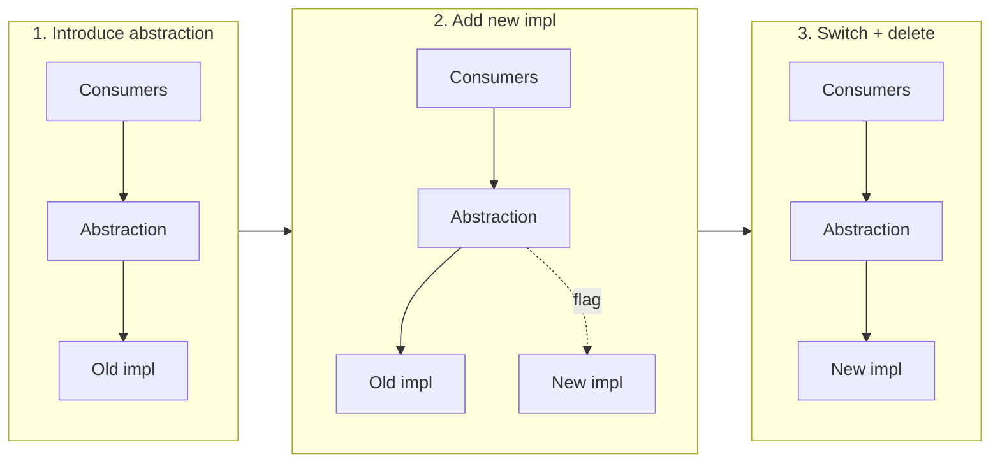
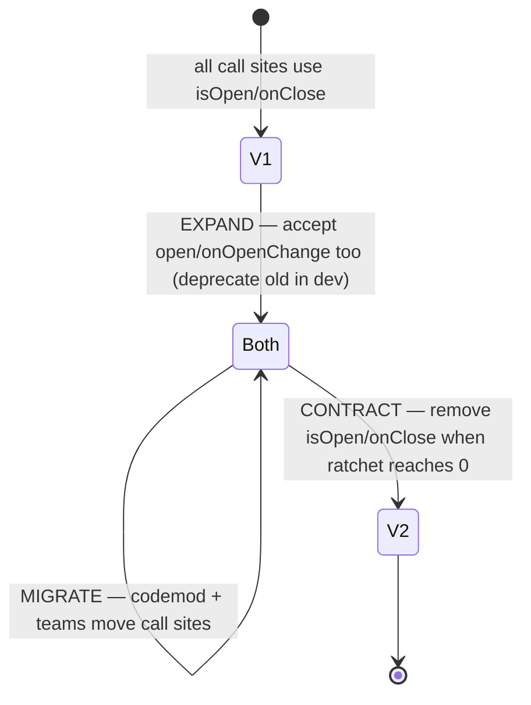
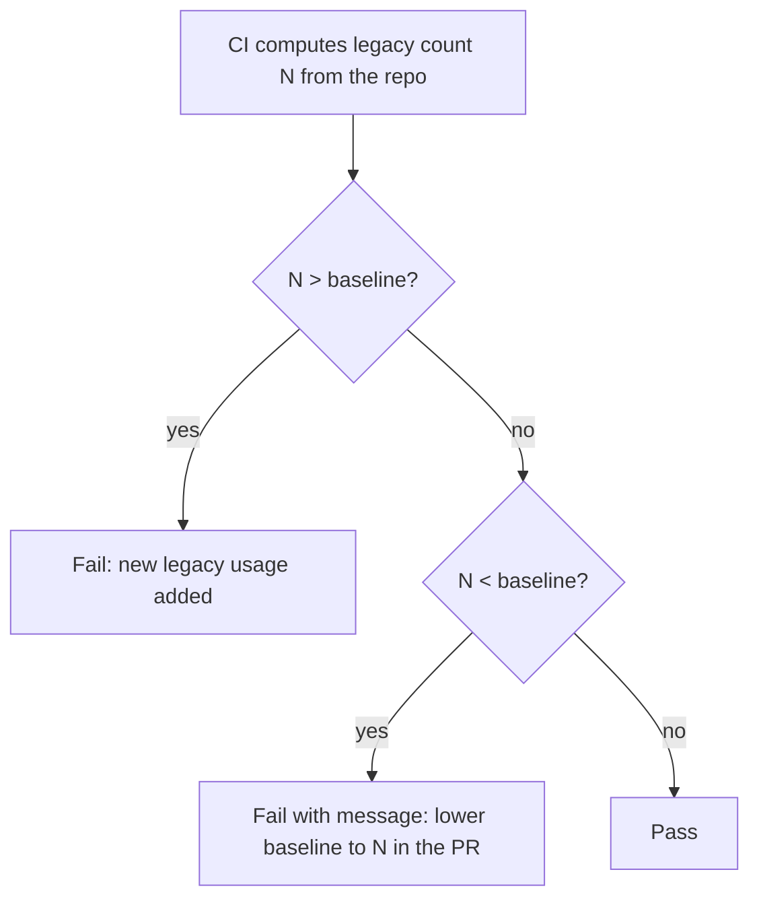
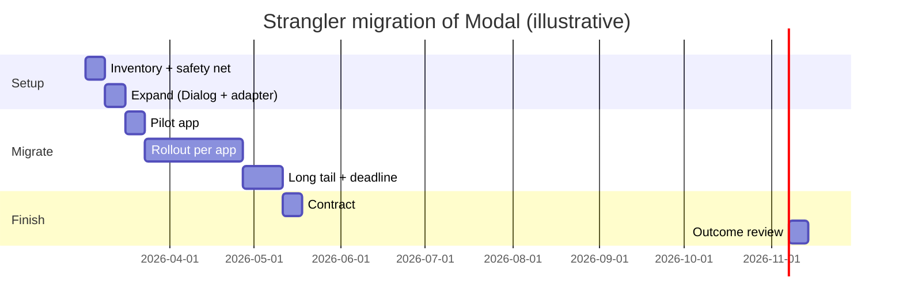
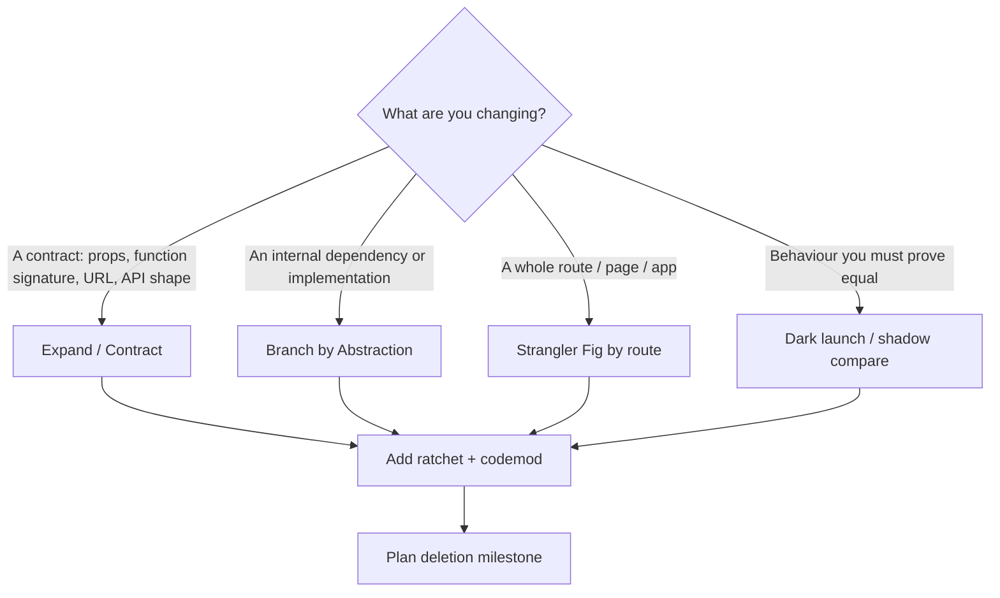

# 11 / 03 — Large-Scale Refactoring: Migrating Big Codebases Without Stopping Delivery

## 1. Lesson metadata

| | |
|---|---|
| **Level** | Architect |
| **Study time** | 6–7 hours (reading 2.5 h, worked example 1.5 h, exercises 3 h) |
| **Prerequisites** | [Refactoring legacy React](../04-react-architecture/24-refactoring-legacy-react.md), [Architectural fitness and enforcement](../04-react-architecture/25-architectural-fitness-and-enforcement.md), [01 — Trade-off analysis](./01-trade-off-analysis.md), [02 — Technical design documents](./02-technical-design-documents.md), [Adapter, strategy, factory](../05-design-patterns/15-adapter-strategy-factory.md) |
| **Next** | [04 — Choosing abstraction level](./04-choosing-abstraction-level.md) |
| **Related** | [Comparative refactoring labs](../05-design-patterns/25-comparative-refactoring-labs.md), [Monorepos and shared packages](../04-react-architecture/22-monorepos-and-shared-packages.md), 12 — Micro-frontends, 16 — Supporting multiple teams |

**Learning objectives.** After this lesson you can:
1. Distinguish a *refactoring* (behaviour-preserving) from a *migration* (changing the platform or contract) from a *rewrite*, and choose among them with evidence.
2. Apply the core incremental patterns: strangler fig, branch by abstraction, expand/contract (parallel change), feature flags, and the ratchet.
3. Build a safety net for code you do not understand: characterization tests, snapshot discipline, observability.
4. Automate mechanical change with codemods and verify them.
5. Plan a migration as a *program*: inventory, sequencing, ownership, progress metrics, deletion milestone.
6. Detect and handle the failure modes: the stalled 80%, dual maintenance, big-bang merge conflicts, and "zombie" abstractions.
7. Produce a plan for a realistic migration and defend its trade-offs.

**Concepts covered:** refactor vs migration vs rewrite, Strangler Fig, branch by abstraction, expand/contract, Parallel Change, characterization tests, golden-master, feature flags and dark launches, codemods (AST transforms), lint ratchets, migration inventory and dashboards, long-lived branches vs trunk-based migration, deletion milestones, change-failure containment.

---

## 2. Deep conceptual explanation

### 2.1 What problem is this lesson solving?

Every long-lived React codebase eventually needs a change that touches hundreds of files: moving off a deprecated library, replacing a state architecture, adopting a design system, changing a data-fetching approach, restructuring folders around features, converting JavaScript to TypeScript, adopting a new routing model. Such a change shares three hard properties:

1. **It is too big to do in one pull request** (review, conflicts, risk).
2. **It cannot stop feature work** (the business doesn't pause).
3. **It is hard to verify** (the code is often untested or poorly understood).

The skill is turning an unshippable big change into a *sequence of small, individually safe, individually valuable, individually reversible steps*, with a defined end state and a plan to delete the scaffolding.

For the smaller-scale mechanics of improving legacy components, see [Refactoring legacy React](../04-react-architecture/24-refactoring-legacy-react.md). This lesson is about *scale*: dozens of contributors, hundreds of call sites, months of elapsed time.

### 2.2 Refactor, migration, rewrite

| Term | Definition | Behaviour changes? | Typical scope | Risk profile |
|---|---|---|---|---|
| **Refactor** | Restructure code to improve internal design without changing observable behaviour | No | Function → module | Low per step; needs tests |
| **Migration** | Move from one technology/contract/platform to another, while preserving user-visible behaviour | Intended: no (users) / yes (developers) | Many files/teams | Medium; long duration |
| **Rewrite** | Build a replacement system, then switch | Often yes (inevitably) | Whole app or major subsystem | High: second-system effect, feature freeze, forgotten behaviours |

Most "rewrites" proposed in practice are better executed as migrations using the strangler pattern. A rewrite can still be right: when the platform is end-of-life with no incremental bridge, when the existing system's *domain model* is wrong (not just the code), or when the system is small enough that the rewrite is a matter of weeks. Decide with the reasoning of [01](./01-trade-off-analysis.md): reversibility, uncertainty, blast radius.

### 2.3 Why big-bang changes fail

| Failure | Mechanism |
|---|---|
| **Merge-conflict hell** | Long-lived branch diverges from main while others change the same files; conflicts grow superlinearly with branch age × change size |
| **Unreviewable PR** | Reviewers cannot meaningfully inspect 15,000 lines; "LGTM" approves unseen bugs |
| **All-or-nothing risk** | Any defect blocks the whole change; rollback means losing everything |
| **Feature freeze** | Business pressure forces cutting corners or abandoning the effort |
| **Late discovery** | Unknown behaviours are found at the end, when the cost of changing the plan is greatest |
| **No learning loop** | You only learn if the approach works after months of work |

Incremental approaches address all of them by keeping the system **shippable at every step** and by **learning early** from the first migrated slice.

### 2.4 The core patterns

#### 2.4.1 Strangler Fig

Named after the vine that grows around a tree and eventually replaces it. New functionality is routed to the new implementation; old functionality is migrated slice by slice behind a routing layer; the old implementation is deleted when nothing routes to it.

In front-end terms, the "routing layer" can be: a URL router (route-level migration), a feature flag, an adapter component, or a module alias. A route-level strangler for a React app: both apps share a shell; `/orders/*` served by the new code, everything else by the old, until the old has no routes.

#### 2.4.2 Branch by Abstraction

Introduce an abstraction in front of the thing you want to replace; migrate consumers to the abstraction (still backed by the old implementation); add the new implementation behind the same abstraction; switch (per consumer, per flag, per cohort); delete the old implementation and, if no longer justified, the abstraction. This is the pattern for replacing *internal* dependencies (a UI library, an HTTP client) without a long branch.



⚠ The abstraction is *scaffolding*. If it earns a permanent role (a real boundary), keep it; otherwise delete it after the switch, or you create a zombie layer ([04 — Choosing abstraction level](./04-choosing-abstraction-level.md)).

#### 2.4.3 Expand / Contract (Parallel Change)

To change a contract (prop API, function signature, URL schema, data shape) without breaking consumers:

1. **Expand:** support both old and new forms; new form is additive.
2. **Migrate:** move consumers to the new form (manually or by codemod).
3. **Contract:** remove the old form when usage is zero.

Each step is independently deployable and reversible. This is the universal pattern for breaking changes in shared packages, design systems, and APIs.

#### 2.4.4 Feature flags and dark launches

A flag lets new and old code coexist in production, selects per user/cohort, and provides a kill switch. Distinguish:
- **Release flags** (temporary; delete after rollout),
- **Ops flags / kill switches** (may be long-lived),
- **Experiment flags** (A/B),
- **Permission flags** (entitlements — not for migration).
Release flags are a form of debt: schedule their removal when you create them.

A **dark launch** runs the new path in production without showing its result (shadow computing), comparing outputs to detect discrepancies — useful for data-layer or calculation migrations (e.g. a new price formatter run alongside the old one with mismatches logged).

#### 2.4.5 The ratchet

A ratchet permits progress in one direction only. Implement as a CI check that counts legacy usage (imports of the old library, number of `any`, files in the legacy folder) and **fails if the count rises** above a committed baseline, and requires lowering the baseline when it falls.

Effects: stops *new* legacy usage while the migration runs (the migration doesn't chase a moving target), makes progress visible, and costs nearly nothing to build. See §5.2.

### 2.5 Making unfamiliar code safe to change

Before changing code you don't understand, capture its current behaviour.

- **Characterization tests** (Michael Feathers' term): write tests that assert *what the code currently does*, not what it should do. They are a net, not a spec.
- **Golden master / snapshot** of outputs for a large input set — useful for pure functions (formatters, reducers, selectors). Be cautious with DOM snapshots of large components: they fail on irrelevant changes and invite blind `-u`.
- **Visual regression** for UI-heavy migrations (e.g. design-system adoption) — screenshot comparisons at component/story level.
- **Behaviour-level integration tests** with Testing Library for flows (user-event, accessible queries) — these survive internal refactors.
- **Production observability**: error rate, performance, and key-journey metrics split by flag state.
- **Type system as a safety net**: tightening types *first* (e.g. `strict`, removing `any` on boundaries) turns many refactor mistakes into compile errors.

### 2.6 Codemods

A codemod is a program that transforms source code by manipulating its abstract syntax tree (AST) rather than text. Tools in the JS ecosystem include jscodeshift and ts-morph, among others (jscodeshift 17.4.0 and ts-morph are both current on npm as of 2026-10-22).

When to write a codemod: the change is **mechanical** across many files (rename a prop, swap an import, wrap in a new component, change a call signature) and **>~ 20 call sites**. When not to: the change requires judgement per site, or fewer than ~10 sites (hand-edit; the codemod costs more).

A good codemod is:
- **Conservative:** transform only patterns it fully understands; leave a `// TODO(migration)` marker or list for the rest.
- **Idempotent:** running twice changes nothing more.
- **Tested** with fixture input/output pairs, including tricky cases.
- **Reviewed** by sampling its output, not only its code.
- **Formatted** by the repo's formatter afterwards to minimise noisy diffs.

### 2.7 Migration as a program

A multi-month migration needs *program management*, not just engineering:

| Element | Purpose |
|---|---|
| **Inventory** | A complete list of items to migrate (files, components, call sites), generated by a script, not by hand |
| **Classification** | Group by difficulty/risk: mechanical (codemod), simple manual, hard (needs design), won't-migrate (delete) |
| **Sequencing** | Order by value, risk and dependency; start with a *pilot slice* that is representative and low-risk |
| **Ownership** | Who migrates which items — central migration team vs each owning team vs hybrid |
| **Progress metric** | One number from the ratchet (e.g. remaining legacy imports), plotted over time |
| **Definition of done** | Includes **deletion** of the old code, flags, adapters, and docs |
| **Communication** | Where to ask, how to opt out, how to report problems |
| **Stop-loss** | Conditions under which the migration is paused or abandoned |

### 2.8 Who does the work?

| Model | Description | Pros | Cons |
|---|---|---|---|
| **Central team does it** | Platform team migrates all call sites | Consistent; fast learning; codemod tuned | Lacks domain knowledge; PRs land in others' code; review burden on owners |
| **Owning teams do it** | Platform provides tools/docs; each team migrates their code | Domain knowledge; spreads effort | Uneven priority; long tail; support load on platform |
| **Hybrid** | Central codemod + each team reviews/finishes; central team handles the stragglers after a deadline | Balanced | Needs clear deadlines and escalation |
| **Opportunistic** ("boy-scout rule") | Migrate when touching the code | No dedicated effort | Long tail never finishes; needs ratchet and a deadline |

For widely-shared contracts, hybrid with a deadline and a ratchet generally works best; but the right answer depends on team structure ([Multi-team ownership](../04-react-architecture/23-multi-team-ownership.md)).

### 2.9 Misconceptions

| Misconception | Reality |
|---|---|
| "Refactoring means rewriting it cleaner." | Refactoring preserves behaviour in small, verified steps. Wholesale rewriting is a different activity with different risks. |
| "We'll migrate everything, then delete." | Deleting is part of every step; the old path left in place accumulates cost (two ways of doing things). |
| "Tests must exist first." | Ideal, but often impossible; characterization tests of the *seams you touch* are the pragmatic minimum. 100% coverage first is a way to never start. |
| "A codemod makes the migration automatic." | It handles the mechanical 60–90%; the hard tail needs humans and a plan. |
| "A long-lived branch is fine if we rebase often." | Branch age and divergence drive conflict and integration risk; prefer trunk-based small steps behind flags. |
| "We can pause features to focus on the refactor." | Rarely true for more than a sprint; plan for coexistence. |
| "Done = 100% migrated." | Done = old code, flags, shims and docs deleted; metrics improved. |

---

## 3. Internal mechanics

### 3.1 The invariant: always shippable

The central mechanical rule: **at the end of each PR, main is releasable and behaviour is unchanged for users** (unless the flag is on). Every pattern above is a different way of maintaining this invariant while moving toward a new state.

### 3.2 Expand/contract in React terms

Changing a component's prop contract is the most common instance.

States of a `Modal` prop API during migration:



During `Both`, the component must define precedence and conflict behaviour (what if both are passed?). The usual choice: new props win; in development, log a warning if both are set. ⚠ Dev-only warnings are a convention (`process.env.NODE_ENV !== "production"` style, or bundler-specific equivalents) — verify what your build setup removes.

### 3.3 Branch by abstraction mechanics in a bundle

When the old and new implementations are both shipped during the transition, **bundle size increases**. Mitigations: load the new implementation lazily by flag cohort; ensure the flag evaluation happens early; measure the transition cost in CI ([09 — Performance budgets at scale](./09-performance-budgets-at-scale.md)). In module-graph terms, the abstraction module imports both; a bundler cannot tree-shake a branch it cannot prove dead ([Modules and dependency graphs](../00-web-and-javascript-foundations/10-modules-and-dependency-graphs.md)), so use dynamic `import()` per implementation.

### 3.4 What a codemod actually does

1. Parse source into an AST (for TS/JSX, with a TS-aware parser).
2. Find nodes matching a pattern (e.g. JSX elements named `Modal` with attribute `isOpen`).
3. Mutate or replace nodes.
4. Print the modified AST back to source (preserving formatting as far as the tool can; run the formatter afterwards).

Pitfalls: aliased imports (`import { Modal as Dialog }`), re-exports, spread props (`<Modal {...props} />` — you cannot statically know whether `isOpen` is inside), dynamic components (`const C = cond ? Modal : Other`), and comments/formatting preservation. A conservative codemod skips ambiguous cases and reports them.

### 3.5 The ratchet's mechanism



The second branch (fail when *lower* than baseline) forces the file to be updated so the baseline keeps shrinking, making progress a committed, reviewable artifact. Some teams make it a warning instead; the tradeoff is friction vs ratchet tightness.

### 3.6 Merge-conflict economics

Conflicts arise when two changes edit the same lines. A large mechanical change (e.g. reformatting, rename across files) conflicts with every in-flight PR touching those files. Strategies:
- **Land mechanical changes in a quiet window** and notify.
- **Split by directory/team** to localise conflicts.
- **Separate mechanical from semantic** — one PR purely formatting/rename (reviewable by sampling), another with logic changes.
- **Use `git blame` ignore lists** (`.git-blame-ignore-revs`) for formatting-only commits so history stays useful. GitHub's blame UI honours a root-level `.git-blame-ignore-revs` file automatically; locally run `git config blame.ignoreRevsFile .git-blame-ignore-revs`; check other hosts' blame UIs individually.
- **Provide the codemod** so teams can re-apply it to their open branches rather than resolving conflicts manually.

---

## 4. Step-by-step execution walkthrough

A canonical migration: **replace a legacy `Modal` API and implementation with a new accessible `Dialog` across 140 call sites in 6 apps**, over a quarter. Chronological:

**Week 0 — Decision and design.**
Trade-off analysis ([01](./01-trade-off-analysis.md)) selects native-`<dialog>`-based design-system `Dialog`. Design doc ([02](./02-technical-design-documents.md)) includes goals (a11y audit pass, 140 sites migrated, legacy deleted by week 12), non-goals (restyle), rollout and deletion milestone.

**Week 1 — Inventory and safety net.**
- A script lists every import of `LegacyModal` with file, line, props used (inventory CSV generated, committed under `migrations/modal/`).
- Classification: ~95 sites use only `isOpen/onClose/title/children` (mechanical); ~30 use `footer` and `size` (mechanical with mapping); ~15 use `onAfterClose`/portal targets/custom focus (manual).
- Characterization: for the 15 hard sites, write behaviour tests (open, close on Esc, focus return, scroll lock). Visual regression baselines for 20 representative stories.

**Week 2 — Expand.**
- Ship `Dialog` (new) in the design system. Export `Modal` unchanged. Add an *adapter* `Modal` implemented *on top of* `Dialog` for the 95 mechanical cases (branch by abstraction): `Modal` props map to `Dialog`. Behind flag `ui.dialogAdapter`, off by default.
- Add the **ratchet**: counts imports of `LegacyModal` outside `design-system/legacy`. Baseline 140.

**Week 3 — Pilot.**
- Codemod migrates one low-risk app (14 sites) from `LegacyModal` to `Dialog`. Review a sampled diff; fix codemod edge cases found (spread props, aliased import). Ship, observe error rates and a11y reports for a week. Baseline → 126.

**Weeks 4–8 — Rollout.**
- Run codemod per app, one PR per app (or per team directory), owning team reviews. The central team handles hard 15 with pairing. Each landing lowers the baseline.
- Mid-point check: ratchet at ~50; is the burn-down on schedule? If not, re-plan (stop-loss).

**Weeks 9–10 — Long tail and deadline.**
- Announce: after week 10, the platform team opens PRs for remaining sites. Escalate blockers.

**Week 11 — Contract.**
- Ratchet = 0. Remove `LegacyModal`, the adapter, the flag, the legacy tests and docs. Remove the ratchet script or retarget it to "no imports from `design-system/legacy`" permanently.

**Week 12 — Outcome review.**
- Compare to goals: a11y audit pass, bundle size delta, incident count. Update the design doc with outcomes. Record lessons (what the codemod missed).

Observe the properties: always shippable; first slice teaches; the ratchet protects progress; deletion is scheduled and counted as part of "done".

---

## 5. Code examples

### 5.1 Minimal example: expand/contract on a component's props

```tsx
// design-system/Modal.tsx — EXPAND phase: both APIs accepted
import type { ReactNode } from "react";
import { Dialog } from "./Dialog";

interface ModalPropsV2 {
  open: boolean;
  onOpenChange: (open: boolean) => void;
  title: string;
  children: ReactNode;
}

/** @deprecated use open/onOpenChange. Removal tracked in migrations/modal. */
interface ModalPropsV1Deprecated {
  isOpen?: boolean;
  onClose?: () => void;
}

type ModalProps = Omit<ModalPropsV2, "open" | "onOpenChange"> &
  Partial<Pick<ModalPropsV2, "open" | "onOpenChange">> &
  ModalPropsV1Deprecated;

export function Modal({ open, onOpenChange, isOpen, onClose, ...rest }: ModalProps) {
  if (process.env.NODE_ENV !== "production") {
    if ((open !== undefined && isOpen !== undefined) || (onOpenChange && onClose)) {
      console.warn("Modal: both old (isOpen/onClose) and new (open/onOpenChange) props passed; new props win.");
    }
  }
  const resolvedOpen = open ?? isOpen ?? false;
  const resolvedOnOpenChange = onOpenChange ?? ((next: boolean) => { if (!next) onClose?.(); });
  return <Dialog open={resolvedOpen} onOpenChange={resolvedOnOpenChange} {...rest} />;
}
```

**Line notes.**
- `ModalProps` keeps `open`/`onOpenChange` **optional** during expand so old call sites still type-check. At *contract* time they become required and the V1 interface is deleted — a compile-time list of remaining sites.
- `open ?? isOpen ?? false`: explicit precedence, new wins.
- The dev-only warning makes mixed usage visible; verify your bundler strips `process.env.NODE_ENV` branches in production builds (most do via define/replace, but it depends on configuration).
- `{...rest}` forwards `title` and `children`; if V1 had extra props (`footer`, `size`), map them explicitly in the adapter rather than spreading unknown keys into `Dialog`.

**Predict:** A call site passes `open={false}` and `isOpen={true}`. Does the dialog render open? *Answer:* No — `open ?? isOpen` yields `false` (nullish coalescing only falls through on `null`/`undefined`), and a warning is logged in development.

**Trade-off.** Accepting both props temporarily makes the type signature uglier and adds a tiny runtime cost; in exchange every step is shippable and every consumer can move on its own schedule.

### 5.2 Practical example: a TypeScript ratchet script

```ts
// tools/ratchet.ts — run in CI: `tsx tools/ratchet.ts`
import { readFileSync, readdirSync, statSync, writeFileSync } from "node:fs";
import { join } from "node:path";

interface Rule { id: string; description: string; pattern: RegExp; exclude: string[] }

const RULES: Rule[] = [
  {
    id: "legacy-modal-import",
    description: "Imports of LegacyModal outside design-system/legacy",
    pattern: /from\s+["'][^"']*LegacyModal["']/g,
    exclude: ["packages/design-system/legacy"],
  },
];

const BASELINE_FILE = "tools/ratchet-baseline.json";
const baseline: Record<string, number> = JSON.parse(readFileSync(BASELINE_FILE, "utf8"));

function* files(dir: string): Generator<string> {
  for (const name of readdirSync(dir)) {
    if (name === "node_modules" || name.startsWith(".")) continue;
    const p = join(dir, name);
    const s = statSync(p);
    if (s.isDirectory()) yield* files(p);
    else if (/\.(ts|tsx|js|jsx)$/.test(p)) yield p;
  }
}

const counts: Record<string, number> = Object.fromEntries(RULES.map((r) => [r.id, 0]));
for (const f of files(".")) {
  const src = readFileSync(f, "utf8");
  for (const r of RULES) {
    if (r.exclude.some((e) => f.startsWith(e))) continue;
    counts[r.id] += (src.match(r.pattern) ?? []).length;
  }
}

let failed = false;
for (const r of RULES) {
  const now = counts[r.id];
  const base = baseline[r.id] ?? 0;
  if (now > base) { console.error(`RATCHET: ${r.id} increased ${base} -> ${now}. ${r.description}`); failed = true; }
  else if (now < base) { console.error(`RATCHET: ${r.id} decreased ${base} -> ${now}. Update ${BASELINE_FILE}.`); failed = true; }
  else console.log(`ok ${r.id}: ${now}`);
}
if (process.argv.includes("--update")) {
  writeFileSync(BASELINE_FILE, JSON.stringify(counts, null, 2) + "\n");
  console.log("baseline updated");
  process.exit(0);
}
process.exit(failed ? 1 : 0);
```

**Line notes.**
- The baseline is a **committed file**, so progress shows in PR diffs and git history, and lowering it is a conscious act.
- `exclude` lets the legacy implementation itself and its adapter import the legacy file.
- Regex counting is crude (comments, strings, re-exports are miscounted); for precision use an ESLint rule (`no-restricted-imports`) with a warning count, or an AST-based count. The script's value is *monotonicity*, not exact numbers.
- `--update` rewrites the baseline; run it in the PR that migrates sites.
- ⚠ `tsx` as a runner is one option among several (ts-node, compiling ahead) — choose per your toolchain.

**Trade-off.** A ratchet is gameable (move code into the exclude path, or alias the import). Pair it with review attention on changes to the rule/exclude list (codeowners on `tools/ratchet*`).

### 5.3 Incorrect: the big-bang branch

```text
Plan: create branch `modal-rewrite`. Rewrite all 140 call sites and
the Modal component in one PR. Freeze merges to modal-related files for 2 weeks.
Merge when QA signs off.
```

What goes wrong, concretely:
1. Two weeks of divergence across 6 apps; every team has in-flight work in those files: conflict storms.
2. A 9,000-line PR is not reviewable: reviewers sample, defects pass.
3. QA signs off a one-time state; any fix restarts the cycle.
4. If production reveals a problem, rollback = revert 9,000 lines, including unrelated fixes landed since.
5. No flag, no cohort rollout; 100% of users get the change at once.
6. "Freeze" is negotiated away within days under delivery pressure.
7. No ratchet: while the branch lives, new `LegacyModal` usages are added on main and must be migrated again at merge.

### 5.4 Corrected: a conservative codemod with fixtures

Because §5.1's adapter accepts both prop APIs, the codemod's job shrinks to something small and safe: **rename the import** (preserving any local alias) and leave props untouched. Prop migration is a second, separate step (§5.4.1). The sketch uses the jscodeshift API (run-tested with jscodeshift 17.4 / recast 0.23 and `@types/jscodeshift`: the transform below ran over fixtures, produced the stated output, and reported unchanged files as "skipped"); develop real codemods in an AST explorer with fixtures.

```ts
// migrations/modal/rename-import.ts
import type { API, FileInfo } from "jscodeshift";

export const parser = "tsx"; // so JSX/TS fixtures parse, and so test fixtures use the .tsx extension

export default function transform(file: FileInfo, api: API) {
  const j = api.jscodeshift;
  const root = j(file.source);
  let changed = false;

  root
    .find(j.ImportDeclaration)
    .filter((p) => String(p.node.source.value).endsWith("/LegacyModal"))
    .forEach((p) => {
      const defaultSpec = (p.node.specifiers ?? []).find((s) => s.type === "ImportDefaultSpecifier");
      if (!defaultSpec || !defaultSpec.local) return; // unknown import shape: leave for manual migration
      const local = defaultSpec.local.name;

      // import LegacyModal from "@acme/ui/LegacyModal"
      //   -> import { Modal } from "@acme/ui"            (local name "Modal")
      //   -> import { Modal as Dlg } from "@acme/ui"     (alias preserved)
      const imported = j.identifier("Modal");
      const spec = local === "Modal" ? j.importSpecifier(imported) : j.importSpecifier(imported, j.identifier(local));
      const next = j.importDeclaration([spec], j.literal("@acme/ui"));
      next.comments = p.node.comments; // replacing the node would otherwise drop comments attached to the old import
      p.replace(next);
      changed = true;
    });

  return changed ? root.toSource() : undefined; // undefined = file unchanged
}
```

**Line notes.**
- It matches only a *default import* from a path ending in `/LegacyModal`; anything else is left alone and will remain visible in the ratchet and the inventory (conservative by construction).
- Preserving the local name means JSX usage sites need no edit, which keeps the diff to one line per file and makes review-by-sampling reliable.
- Returning `undefined` for untouched files keeps the tool's "changed files" report honest, and running it twice is a no-op (idempotent: after the first run no `LegacyModal` import remains).
- Copying `comments` onto the replacement node matters: without that line the run-test dropped a `// keep me` comment above the import, contradicting the fixture list below.
- Run the repo formatter afterwards; `toSource()` may not reproduce formatting exactly.

#### 5.4.1 The second, optional step

A separate codemod migrates `isOpen/onClose` to `open/onOpenChange` only where `onClose` is a simple identifier or member expression (rename attributes; wrap nothing) *and* the element has no spread attributes. Spread elements are logged for manual handling. Wrapping handlers in new inline arrow functions would change function identity every render, so the adapter, not the codemod, does the translation (§5.1).

*Why this is better than one clever codemod:* **two small mechanical steps are safer than one clever step**; each is reviewable by sampling and independently revertible. It is the same principle as splitting mechanical from semantic changes (§3.6).

**Fixture-based test** (a table of input → expected output):

```ts
// migrations/modal/__tests__/rename-import.test.ts
import { defineTest } from "jscodeshift/dist/testUtils"; // path exists in jscodeshift 17.x
defineTest(__dirname, "rename-import", null, "basic");        // ../__testfixtures__/basic.input.tsx -> basic.output.tsx
defineTest(__dirname, "rename-import", null, "aliased-import");
defineTest(__dirname, "rename-import", null, "already-migrated"); // output fixture must be EMPTY: an unchanged file returns undefined
```

Run-tested caveats: `defineTest` looks for the transform at `<dirName>/../<name>` and fixtures in `<dirName>/../__testfixtures__`, so the test file must live in a `__tests__/` folder next to the transform; it uses global `describe`/`it`/`expect` (Vitest needs `globals: true`) and loads the transform with `require`, which needs a runner that can require TypeScript (Jest with Babel/ts-jest) — under plain Vitest it failed with "Cannot find module". A runner-agnostic alternative that passed under Vitest is `runInlineTest(module, options, { source, path }, expectedOutput)` from the same `testUtils` file.

Fixtures to include: aliased import, already-migrated file (idempotent), named import (untouched), two imports of the legacy path in one file, JSX in a `.js` file, comments above the import preserved.

### 5.5 Advanced: branch by abstraction with a per-cohort lazy implementation

```tsx
// design-system/Modal.tsx — adapter chooses implementation at runtime
import { lazy, Suspense, type ComponentType } from "react";
import { useFlag } from "../flags";           // project-specific flag hook
import type { ModalProps } from "./modal.types";

const Legacy = lazy(() => import("./legacy/LegacyModal"));
const Next = lazy(() => import("./Dialog.adapter"));

export function Modal(props: ModalProps) {
  const useNext = useFlag("ui.dialogAdapter");
  const Impl: ComponentType<ModalProps> = useNext ? Next : Legacy;
  return (
    <Suspense fallback={null}>
      <Impl {...props} />
    </Suspense>
  );
}
```

**Line notes and critique.**
- Both implementations are *lazy*, so a user downloads only the one their cohort gets (subject to bundler chunking; verify in the bundle analyser).
- `Suspense fallback={null}` makes the first open of a modal potentially *flash* nothing while the chunk loads; for modals opened by user interaction, **prefetch** the chunk on hover/focus or on app idle, or render the adapter only when `open` is true, so the chunk loads before it matters. This is a real cost of this pattern: do not accept it silently.
- Flag evaluation inside the component means flipping the flag can swap implementation **during** a session; remounting resets dialog state. Prefer evaluating the flag once at app start for stable behaviour.
- Remove the flag, the lazy legacy import, and the `Suspense` wrapper at contract time; the adapter shrinks to direct export of `Dialog`.

---

## 6. Visual explanations

### 6.1 Strangler timeline



### 6.2 Burn-down with a ratchet

```text
Legacy imports remaining
140 |■
120 |  ■
100 |    ■ ■
 80 |         ■
 60 |            ■ ■
 40 |                  ■
 20 |                     ■ ■   <- long tail; deadline + central team finish
  0 |                            ■ <- delete legacy, flag, adapter, ratchet
    +---------------------------------> weeks
```

Shape to expect: fast start (mechanical), slowdown (hard cases), long tail (stragglers). Plan for the tail explicitly.

### 6.3 Choosing the incremental pattern



---

## 7. Alternative approaches and trade-offs

| Approach | Strengths | Weaknesses | Best when |
|---|---|---|---|
| **Incremental (strangler / expand-contract) with ratchet** | Always shippable; learn early; reversible per step | Long duration; dual maintenance; needs discipline to delete | Most migrations in products with ongoing delivery |
| **Big-bang branch** | Single cutover; no dual code | Conflict, review and risk problems | Tiny codebases; a weekend rewrite of an internal tool |
| **Rewrite as a new app + switch** | Clean slate; modern tooling | Second-system effect; feature parity chase; double maintenance; forgotten behaviours | Platform is dead-end and the domain is well understood and small |
| **Codemod-only** | Fast and uniform for mechanical changes | Only the mechanical part; poor for semantic changes | Rename/signature change across many sites |
| **Opportunistic ("migrate when you touch")** | Zero dedicated cost | Never completes; long tail forever | Low-priority hygiene, with a ratchet and no deadline |
| **Compatibility shim forever** | Zero migration cost | Permanent complexity; the shim becomes the real API | Third-party consumers you can't change |
| **Freeze and live with it** | No migration cost | Tech debt compounds; hiring/security risk | The legacy part is stable, isolated, and rarely changed |
| **Micro-frontend by route** | Independent teams/stacks per slice | Operational and UX complexity (shared state, consistency, bundle duplication) | Multiple teams, mixed stacks, long coexistence ([12](./12-microfrontends.md)) |

**Scenario where the recommended approach is *not* best.** A 40-component internal admin tool with no external consumers, 2 developers, and a new quarter of calm: migrate in one focused branch over three days. Incremental machinery (flags, ratchet, adapters) costs more than the risk it removes. Also: if the old and new cannot coexist at all (e.g. a global CSS reset that conflicts, or two incompatible major versions of a framework context in one tree), you may need isolation (route-level apps, iframe boundaries) or a genuine cutover.

---

## 8. Best practices and anti-patterns

### 8.1 Good practice
- State the **end state and deletion milestone** in the design doc. "Done" includes deletion.
- Start with a **pilot slice**: representative, low-risk, observable.
- **Separate mechanical from semantic changes** into different PRs/commits.
- Generate the **inventory by script**; re-run it to track progress.
- Add the **ratchet before** the migration starts so the target stops moving.
- Make coexistence explicit: precedence rules, dev warnings, docs.
- Keep PRs small (reviewable in ~30 minutes) and independently revertible.
- Measure outcomes (a11y, bundle, incidents), not just completion.
- Communicate: a migration channel, FAQ, office hours, an "opt-out/blocked" process.
- Give each step an **owner and a date**.

### 8.2 Beginner mistakes
- Starting to edit files before inventorying.
- Making a "quick cleanup" inside migration PRs, mixing concerns.
- Not running the app/tests after codemods; trusting the tool blindly.

### 8.3 Experienced-developer mistakes
- **Abstraction astronautics:** building a generic migration framework for a one-off.
- **Perfect codemod syndrome:** spending three weeks automating the last 5% that costs two days by hand.
- **Underestimating the long tail** and not planning for stragglers.
- **Leaving flags and shims behind** — "temporary" becomes permanent.
- **Migrating by taste:** changing style or architecture opinions while "just" migrating the dependency.
- **No stop-loss:** continuing a migration whose value has fallen below remaining cost (sunk-cost).
- **Central team heroics:** doing it all alone, leaving teams unaware of the new patterns, so they reintroduce legacy.

### 8.4 Smells
- A migration PR title like "Big refactor" with 200+ files and logic changes.
- Two ways of doing the same thing with no deletion date.
- Flags older than a release cycle with no owner.
- A ratchet baseline that never moves, or an exclude list that keeps growing.
- "Temporary" adapters with their own tests and docs.
- Burn-down chart flat for > 4 weeks.

### 8.5 Justified exceptions
- A hard-cut migration for a feature with **no persisted state and no consumers** can skip expand/contract.
- Leaving legacy code in place is the right call when it is stable, isolated, and the cost of migration exceeds the risk (record that in an ADR with a trigger).
- Compatibility shims are legitimate for public packages with external consumers; set a major-version removal policy.

---

## 9. Real-world application

| Domain | Typical large refactor | Specific constraints |
|---|---|---|
| **E-commerce** | Checkout rewritten into a new state model; product pages to server rendering | Revenue guardrails; A/B rollout; payment provider scripts; seasonal freeze periods (peak sales) |
| **Dashboards** | Replace charting library; unify widget data fetching | Dozens of widget types owned by different teams; visual regression essential |
| **Finance** | Monetary formatting/rounding migration; audit trails | Correctness is paramount — use dark-launch comparison of old/new outputs; compliance review |
| **Forms-heavy B2B** | Change form library; adopt schema-based validation | Hundreds of forms; behaviour parity (validation timing, error messages) is hard to inspect |
| **Auth** | Move token storage or session model | Security review; staged rollout; users mid-session; rollback must not log everyone out |
| **Real-time** | Replace polling with subscriptions | Dual-write period; ordering and duplicate event handling during coexistence |
| **Multi-team platforms** | Design-system major version; JS→TS; React major upgrade | Diverse team velocities; ownership of the tail; compatibility windows |

**Engineering constraints to design around:**
- **Code freezes** (holiday, peak season): plan lulls for risky steps, and use them for mechanical landing windows.
- **Team churn:** the migration plan must survive the person who designed it leaving — docs, dashboards, automation.
- **Release cadence:** mobile-wrapped webviews or enterprise customers on old versions extend coexistence.
- **Cross-repo consumers:** a package API can only contract after *all* consumers migrate; track by telemetry or by dependency scanning.

---

## 10. Debugging and troubleshooting

| Symptom | Likely root cause | Investigation | Fix / validation |
|---|---|---|---|
| Migration "80% done" for months | Long-tail items need design or belong to unresponsive teams; no deadline/escalation | Classify remaining items by blocker type; list owners | Set a deadline; platform team takes stragglers; split "hard" items into their own design; verify with burn-down slope |
| Ratchet fails CI for everyone after a merge | Two PRs each lowered the baseline (conflict) or counted differently | Compare baseline file history; check rule regex | Make baseline merge-friendly (one entry per rule, or compute-only mode with a warning); re-run `--update` |
| Production regression after rollout step | Behavioural difference not covered by tests | Compare error rates and key-journey metrics by flag state; replay the failing flow | Roll back via flag; add a characterization test; fix; ramp again |
| Codemod broke edge cases silently | Pattern too aggressive; no fixtures | Diff sample of 20 transformed sites; search for spread/alias/dynamic cases | Make codemod conservative; add fixtures; list skipped sites for manual handling |
| Both old and new code paths receive bug fixes | Dual maintenance during long coexistence | Look at PR history touching both | Freeze legacy except for severity-1; shorten coexistence; set deadline |
| Bundle size spikes during migration | Both implementations shipped to everyone | Bundle analyser per route | Lazy-load per cohort; prune; set CI budget for transition |
| Feature flag evaluates inconsistently (flicker) | Evaluated per render or after hydration | Reproduce with network throttling; log flag value at mount | Evaluate once, early; for SSR ensure server/client agree to avoid hydration mismatch |
| Merge conflicts for all in-flight PRs after a mass-change PR | Mechanical change landed without notice | Check open PR list for touched files | Publish the codemod to re-apply on branches; use quiet window and blame-ignore |
| Teams keep adding legacy usage | No ratchet; docs not visible | Search recent PRs for legacy imports | Add ratchet, lint rule with message pointing to the new API |

**Investigation recipe for a stalled migration.**
1. Re-run the inventory script; diff against last month's.
2. Sort remaining items by (owner, difficulty, age).
3. For each blocker class decide: automate, escalate, redesign, or accept (and exclude with a recorded ADR).
4. Reset the plan with dates, and publish.
5. **Validate** the fix by a visibly steeper burn-down over the next two sprints and by stakeholder confirmation of owner/date for the remainder.

---

## 11. Exercises

### Level A — Knowledge
A1. Define refactor, migration, and rewrite, and say which is behaviour-preserving.
A2. Name the three steps of expand/contract and the invariant each preserves.
A3. What is a ratchet, and why must it also fail when the count *decreases* (in the strict variant)?
A4. List four reasons a big-bang branch fails.
A5. When is writing a codemod *not* worth it?

### Level B — Code comprehension
B1. In §5.1, what renders when `open={undefined} isOpen={true}`? What if `onOpenChange` and `onClose` are both given — which is called, and is a warning emitted?
B2. In the ratchet of §5.2, a team moves 12 `LegacyModal` imports into `packages/design-system/legacy-copy/` instead of migrating them. What does the script report, and what review control stops this?
B3. In §5.5, a user toggles the flag mid-session while a modal is open. What happens to dialog state, and why?

### Level C — Implementation
C1. Write a TypeScript script (Node) that, given a directory, prints an inventory (file, line, and the list of JSX attribute names) of every `<LegacyModal …>` usage using a regex or the TypeScript compiler API, and flags usages containing spread attributes as "manual".
C2. Write the fixtures (input and expected output as code blocks) for a codemod that renames import `LegacyModal` → `Modal` from the design system, including an aliased import and an already-migrated file.

### Level D — Debugging
D1. After a mass codemod PR, three apps' CI show `Type 'undefined' is not assignable to type 'boolean'` on `Modal` usages. Diagnose using the expand-phase types of §5.1 and propose a fix.
D2. A migration of data fetching from `useEffect`+`fetch` to a query library is "done" per ratchet (0 legacy imports), but production shows duplicated requests and stale data bugs. What did "done" fail to capture, and how do you investigate?

### Level E — Architecture and engineering decisions
E1. You must upgrade a 600-component app from a legacy global-CSS approach to CSS Modules (or another scoped approach) while 5 teams ship daily. Propose an incremental plan: pattern choice, pilot, ratchet, ownership, risks, deletion.
E2. Argue for or against a rewrite for: a 7-year-old class-component app on React 16 with 15% test coverage, 20 engineers, and a roadmap demanding quarterly features. Define the evidence you'd gather first and what would change your mind.

### Level F — Expert challenge
F1. Design a **dark-launch** comparison harness for migrating a price-calculation module (used on cart and checkout) from an old implementation to a new one. Specify: where it runs, how mismatches are sampled/logged, privacy and performance constraints, rollout, success criteria, and what you do with mismatches.
F2. Your company has 9 apps on 3 different routers. Design a staged migration to one routing approach that respects: two apps cannot change for 6 months (regulatory freeze), two share a shell, and executives want a single navigation experience in 2 quarters. Include the intermediate architecture and the failure modes.

---

## 12. Detailed answers and explanations

> Attempt the exercises first.

### Level A

**A1.** *Refactor:* restructure internal design without changing observable behaviour (behaviour-preserving). *Migration:* move to a different technology/contract/platform; user-visible behaviour should be preserved, developer-facing contract changes. *Rewrite:* build a replacement; behaviour usually changes in unplanned ways. Only refactoring is behaviour-preserving by definition; migrations aim to be.

**A2.** *Expand:* add the new form alongside the old (invariant: all existing consumers still work). *Migrate:* move consumers to the new form (invariant: both forms work, so each consumer can move independently and be reverted). *Contract:* remove the old form once usage is zero (invariant: no consumer depends on it, verified by the ratchet/type-check). A wrong answer is "replace and fix errors" — that is a big-bang with the compiler as the safety net, and doesn't work across repos/teams.

**A3.** A ratchet is a check that allows legacy-usage counts to move only downward relative to a committed baseline. In the strict variant it also fails when the count is *lower* than baseline so the baseline file must be updated in the same PR, making the new, lower number part of history and preventing the "free slack" that would later let someone re-add legacy usage up to the old baseline.

**A4.** Any four: conflict growth with branch age; unreviewable size; all-or-nothing risk; feature freeze unsustainable; late discovery of unknowns; no early feedback/learning; hard rollback; moving target (new legacy usage added on main).

**A5.** When there are few sites (~< 10) so hand-editing is cheaper; when each site needs judgement; when the pattern is too varied to match conservatively; when the code is about to be deleted anyway. Rule: codemod cost (write + fixture + review) must be below total manual cost, accounting for review time.

### Level B

**B1.** `open={undefined} isOpen={true}`: `open ?? isOpen ?? false` → `true`; renders open. The first warning condition `(open !== undefined && isOpen !== undefined)` is false (open is undefined), so no warning from that clause. With both `onOpenChange` and `onClose` provided, `resolvedOnOpenChange = onOpenChange ?? …` → `onOpenChange` is used; `onClose` is ignored; a dev-only warning is emitted by the second clause `(onOpenChange && onClose)` (in non-production builds).

**B2.** The pattern matches imports ending with `LegacyModal`; files under `packages/design-system/legacy-copy/` are **not** excluded (only `packages/design-system/legacy` is, and `startsWith("packages/design-system/legacy")` — careful: the code excludes with `startsWith(e)` and the exclude string is `"packages/design-system/legacy"`, so `legacy-copy` **does** start with that string and would be excluded!). So the script reports the count dropped by 12 — looks like progress — and the strict mode demands baseline lowering, rewarding the evasion. This demonstrates a real bug in the exclude semantics (prefix without a path separator). Fix: compare with a trailing slash (`f.startsWith(e + "/")`). Review control: CODEOWNERS on `tools/ratchet*` and on the legacy directory so adding to it requires platform approval; plus counting legacy *usage* (consumers of the legacy component) rather than only imports.

**B3.** The component chooses `Impl` from the flag; when the flag flips, `Impl` changes from `Legacy` to `Next`, which is a *different component type* at the same position, so React unmounts the old subtree and mounts the new one (identity by type, see [Identity, keys and reconciliation](../02-react-rendering-and-internals/07-identity-keys-and-reconciliation.md)). All state inside the dialog (focus, scroll position, form input in uncontrolled fields) is lost, and focus may jump. Evaluating the flag once at startup, or keying by a session-stable value, avoids mid-session swaps.

### Level C

**C1.** Sample solution using the TypeScript compiler API (robust to formatting) — evaluation emphasises AST use and spread detection:

```ts
import * as ts from "typescript";
import { readFileSync, readdirSync, statSync } from "node:fs";
import { join } from "node:path";

function* walk(dir: string): Generator<string> {
  for (const n of readdirSync(dir)) {
    if (n === "node_modules" || n.startsWith(".")) continue;
    const p = join(dir, n);
    if (statSync(p).isDirectory()) yield* walk(p);
    else if (/\.(tsx|jsx)$/.test(p)) yield p;
  }
}

const root = process.argv[2] ?? ".";
console.log("file,line,attrs,status");
for (const file of walk(root)) {
  const sf = ts.createSourceFile(file, readFileSync(file, "utf8"), ts.ScriptTarget.Latest, true, ts.ScriptKind.TSX);
  const visit = (node: ts.Node) => {
    if ((ts.isJsxOpeningElement(node) || ts.isJsxSelfClosingElement(node)) && node.tagName.getText() === "LegacyModal") {
      const attrs: string[] = [];
      let hasSpread = false;
      for (const a of node.attributes.properties) {
        if (ts.isJsxSpreadAttribute(a)) hasSpread = true;
        else attrs.push(a.name.getText());
      }
      const { line } = sf.getLineAndCharacterOfPosition(node.getStart());
      console.log(`${file},${line + 1},${attrs.join("|")},${hasSpread ? "manual" : "auto"}`);
    }
    ts.forEachChild(node, visit);
  };
  visit(sf);
}
```

Edge cases to note: aliased imports (`import { LegacyModal as M }`) are missed by name matching — resolve import bindings first for completeness; namespace-qualified tags (`Legacy.Modal`) — `getText()` differs; non-JSX usage (`React.createElement`). Evaluation criteria: handles spread, produces machine-readable output, acknowledges aliasing limitation.

**C2.** Fixtures:

`basic.input.tsx`
```tsx
import LegacyModal from "@acme/ui/LegacyModal";
export const A = () => <LegacyModal isOpen onClose={close} title="Hi">x</LegacyModal>;
```
`basic.output.tsx`
```tsx
import { Modal } from "@acme/ui";
export const A = () => <Modal isOpen onClose={close} title="Hi">x</Modal>;
```
`aliased.input.tsx`
```tsx
import Dlg from "@acme/ui/LegacyModal";
export const B = () => <Dlg isOpen onClose={close} title="Hi">x</Dlg>;
```
`aliased.output.tsx`
```tsx
import { Modal as Dlg } from "@acme/ui";
export const B = () => <Dlg isOpen onClose={close} title="Hi">x</Dlg>;
```
`already-migrated` — input equals output (idempotence). Additional recommended: spread props untouched with a reported warning; two `LegacyModal` imports in one file; type-only usage. Evaluation: output preserves local alias (minimal diff), is idempotent, and the transformation is limited to import path/name (props handled by the adapter).

### Level D

**D1.** In the expand phase, `open`/`onOpenChange` are optional, `isOpen`/`onClose` optional — so mass-codemodded code that sets `open={someValue}` where `someValue` is `boolean | undefined` is fine at the `Modal` level. The error arises if the codemod renamed to `open` but passed an expression typed `boolean | undefined` into a component version whose `open` was already required (e.g. the `Dialog`, or the contract phase), or in apps pinned to an older design-system version where the new props don't exist. Diagnosis steps: check the installed design-system version in each app (lockfile), check whether the `Modal` type in that version has required `open`, check the failing expression types. Fix: either widen at the call site (`open={Boolean(x)}` — preferable to meaningless defaults only if semantics match) or fix the type: keep `open` optional until contract, release design-system with expand-phase types before running the codemod, and gate codemod runs on `@acme/ui >= x.y.z`. Process lesson: *order of release vs codemod* is part of the plan.

**D2.** "Done" per ratchet only measured *absence of the old import*, not *correct usage of the new approach*. Likely causes: queries created with unstable or non-canonical keys (cache fragmentation, duplicate requests); multiple components calling the hook with different options (different `staleTime`) for the same data; migrated code still holds *copies* of server data in `useState` (stale data); invalidation after mutations missing (the old code refetched manually); `refetchOnWindowFocus`/mount defaults not considered ([TanStack Query](../06-data-fetching-and-state-ecosystems/08-tanstack-query.md)). Investigation: network panel for duplicate requests; query devtools to inspect keys and observers; grep for `useState` initialised from query data; compare behaviour with pre-migration characterization tests (which should have covered "refetch after save"). Validate via request-count and stale-bug metrics. Lesson: ratchet conditions should include *quality* checks (lint rules for query-key factories, bans on copying query data into state), and the migration should have had acceptance criteria beyond usage counts.

### Level E

**E1.** Model answer. *Pattern:* expand/contract + strangler by component, not a big switch. *Setup:* scoped styling convention (e.g. CSS Modules with design tokens as CSS variables so both worlds share values — [Styling architecture](../04-react-architecture/27-styling-architecture.md)); **specificity strategy** (layers or naming) to ensure global CSS doesn't override new scoped CSS — verify cascade layers support for your browser matrix. *Inventory:* script mapping each component to the global CSS selectors that style it (hard: global CSS is implicit coupling; use a tool such as coverage reports from the browser to find used rules; mark unused rules as deletable). *Pilot:* one leaf feature (e.g. Settings page) migrated fully; measure visual diffs via screenshots. *Ratchet:* count of global stylesheet imports and rules; new components must use modules (lint rule on `className` with literal global names?). *Ownership:* hybrid — platform provides codemod-assisted tooling for mechanical wrappers and reviews; teams migrate their features within quarter slices; stragglers handled by platform after deadline. *Risks:* visual regressions (use visual snapshot tests on key pages), cascade-order bugs (dual loading order differs between dev and prod bundles — test production builds), performance (duplicate CSS). *Deletion:* remove each global rule when its component migrates; final milestone deletes global sheet; ratchet at zero. Evaluation: explicit handling of implicit global coupling, visual-regression net, production-vs-dev ordering risk, deletion.

**E2.** Model answer (a position, argued). *Gather evidence first:* (1) classify why the app is painful — is it **React 16/class components** (technical) or **domain/model/UX** problems (not fixed by rewrite)? (2) Measure change failure rate and lead time by area; hot areas vs stable. (3) Inventory behaviours (which are undocumented and business-critical). (4) Estimate parity cost with reference-class data (past rewrites at this company). (5) Probe incremental feasibility: can React 16 → 18/19 upgrade be done incrementally? (Typically yes: the React upgrade path is incremental, class components continue to work; see [Refactoring legacy React](../04-react-architecture/24-refactoring-legacy-react.md); verify the current upgrade guides.) *Position:* against a rewrite — because class components and 15% coverage are **fixable incrementally** (upgrade React, write characterization tests around hot paths, strangle by route), and a rewrite with a quarterly feature demand implies running two systems for a long time (second-system effect). *What would change my mind:* the domain model is wrong; the platform has no incremental bridge (e.g. unsupported framework, incompatible build); a small, well-bounded subsystem where parity is knowable in weeks; the rewrite is already de-risked by a working strangler slice. Evaluation: uses evidence, considers incremental alternative, states falsifiable conditions.

### Level F

**F1.** Model answer.
*Where it runs:* in the client at the call site that already computes the price (cart/checkout) **and/or** server-side in a shadow endpoint; for pure-JS calculation, run both in the client: `result = old(input)` is **returned**; `candidate = new(input)` is computed in a non-blocking way (`requestIdleCallback` or `queueMicrotask` after returning) so UX is unaffected, wrapped in try/catch so exceptions in the new path never affect users.
*Comparison:* compare in integer minor units (avoid float formatting noise); define equivalence (exact equality for money; tolerance only if rounding-mode difference is intended and documented).
*Sampling and logging:* sample (e.g. 5% of sessions, 100% when mismatch is found in dev); on mismatch log a **minimised, privacy-safe** record: hash/ID of cart, line-item structure (SKU IDs, quantities, currency, tax rules version), old/new result, versions — **no PII**; rate limit and batch to avoid log flood; include build and flag versions.
*Performance:* the extra compute must be bounded — measure on low-end devices; skip when the main thread is busy; cap per-session samples.
*Rollout:* shadow at 1% → 10% → 50% → 100% of sessions for two business cycles including peak patterns; **success criteria:** zero unexplained mismatches over N (e.g. 1M) comparisons, all mismatches categorised and either fixed or accepted-with-sign-off by finance.
*Handling mismatches:* triage into (a) new bug, (b) old bug (the old behaviour was wrong: decision for finance/product), (c) input-shape difference. Add each as a fixture/unit test (golden master grows). Only switch the returned value (flag, per cohort, with kill switch) after criteria are met; keep shadow reverse (old as candidate) for a period post-switch to detect regressions.
Caveats: server-side recalculation is the source of truth for money, so the harness is a *safety net* not authority; privacy review; consent/regulatory constraints on logging. Evaluation: non-interference with UX, equivalence definition, privacy, objective success criteria, plan for mismatches.

**F2.** Model answer sketch. *Principle:* make routing a **seam** (shell-level), not a rewrite of each app. *Intermediate architecture:* a thin **shell** hosts navigation (single top nav, user menu, global search) and delegates route subtrees to apps. Options: (a) **server-level routing** (edge/reverse proxy) sends path prefixes to the owning app — hard page loads between apps, works with any router, easy; (b) **client-side composition** (module federation/micro-frontends, [12 — Micro-frontends](./12-microfrontends.md)) for soft navigation — more complex. Given two apps frozen for 6 months and 2-quarter executive deadline: start with (a) plus a **shared navigation package** consumed by all apps (rendered consistently, driven by a shared config manifest), so the "single navigation experience" is achieved *without* touching routers; the frozen apps only need a nav component update — which regulatory freeze may forbid; if so, host their navigation via the shell by wrapping them (iframe or edge-injected nav) as a last resort, with security review. *Router unification* then proceeds opportunistically per app after the freeze, using the strangler pattern per route. *Ratchet:* count of apps/routes on legacy routers. *Failure modes:* hard navigations lose client state and feel slow (mitigate with prefetch, shared auth cookie, consistent loading UI); inconsistent URL schemes (central route manifest); auth/session handling across apps; duplicate bundle of shared libs; frozen apps blocking shared package upgrades (version skew policy, compat window). Evaluation: separates the *user outcome* (single nav) from the *technical goal* (single router), respects constraints, names mechanisms, and identifies failure modes.

---

## 13. Senior engineer interview questions

**Q1. "How do you migrate a codebase without stopping feature work?"**
*Answer:* Keep main shippable at each step using strangler/branch-by-abstraction/expand-contract; start with an inventory and a pilot; add a ratchet so the target stops moving; use codemods for mechanical parts; flag the rollout; schedule deletion. The causal reason: incremental steps keep integration continuous and give feedback early, while big-bang concentrates all risk at the end.

**Q2. "When would you recommend a rewrite?"**
*Answer:* When the domain model is wrong (not just the code), when there is no incremental bridge from the platform, or when the system is small enough that parity is knowable in weeks. I'd require evidence: pain classification, parity estimate from reference classes, and a pilot slice. Otherwise strangle.

**Q3. "What is a ratchet and why use it?"**
*Answer:* A committed baseline plus a CI check that prevents legacy usage from increasing (and, strictly, forces recording decreases). It stops regression while the migration runs and makes progress visible. Weakness: gameable via excludes or aliasing; guard rule files with codeowners.

**Q4. "How do you decide between a codemod and manual edits?"**
*Answer:* Compare total cost: codemod authoring, fixtures and review versus per-site manual effort times site count, plus risk of human error. Mechanical, uniform, > ~20 sites → codemod; judgment-heavy or few sites → manual. Keep codemods conservative and idempotent, and run them in small steps.

**Q5. "A migration is stuck at 80%. What do you do?"**
*Answer:* Classify the remainder by blocker (ownership, difficulty, uncertainty), decide automate/escalate/redesign/accept, set a deadline with an escalation path, have the platform team finish stragglers, and track burn-down. Also ask whether the remaining 20% still justifies the cost (stop-loss).

**Q6. "How do you verify behaviour is preserved when tests are sparse?"**
*Answer:* Characterization tests at the seams you touch, visual regression for UI, type tightening, dark-launch comparison for computations, observability split by flag state, and gradual cohort rollout with guardrails.

**Q7. "How do you prevent people from re-introducing the old pattern?"**
*Answer:* Lint rules with helpful messages, the ratchet, templates/generators defaulting to the new pattern, docs, and code-owner review of changes to the legacy area. Education alone decays.

---

## 14. Further learning resources

| Resource | URL | Covers / why | Level | Study |
|---|---|---|---|---|
| React docs — Upgrading / blog index | <https://react.dev/blog> | Official upgrade guides and release notes (verify for the version you migrate to) | Intermediate | Latest upgrade guide |
| React docs — Legacy APIs | <https://react.dev/reference/react/legacy> | Which APIs are legacy and their replacements | Intermediate | Whole page |
| TypeScript docs — Migrating from JavaScript | <https://www.typescriptlang.org/docs/handbook/migrating-from-javascript.html> | Incremental adoption (`allowJs`, `checkJs`) | Intermediate | Whole page |
| jscodeshift | <https://github.com/facebook/jscodeshift> | Codemod runner | Advanced | README |
| ts-morph | <https://ts-morph.com/> | TypeScript-aware code manipulation | Advanced | Getting started |
| Testing Library docs | <https://testing-library.com/docs/react-testing-library/intro/> | Behaviour-level tests as a migration net | Intermediate | Guiding principles |
| Martin Fowler — Strangler Fig | <https://martinfowler.com/bliki/StranglerFigApplication.html> | Origin of the pattern | Intermediate | Whole article |
| Martin Fowler — Branch by Abstraction | <https://martinfowler.com/bliki/BranchByAbstraction.html> | The pattern definition | Intermediate | Whole article |
| Martin Fowler — Parallel Change | <https://martinfowler.com/bliki/ParallelChange.html> | Expand/contract | Intermediate | Whole article |
| Working Effectively with Legacy Code (Feathers) | publisher/library; search the title | Characterization tests, seams | Advanced | Characterization chapters |

Links without *(unverified)* are well-known hub pages; if a path has moved, use the site search with the quoted title.

---

## 15. Knowledge checkpoint

**You should now understand**
- Why incremental patterns keep systems shippable and how each (strangler, branch by abstraction, expand/contract) maintains that invariant.
- The roles of the ratchet, the inventory, the pilot, and the deletion milestone in a migration *program*.
- Where codemods help and where they are a trap.

**You should be able to explain without notes**
- Why big-bang changes fail, and why "done" includes deletion.
- The difference between a refactor, a migration and a rewrite and how to choose.

**You should be able to implement**
- An expand-phase component API with explicit precedence and dev warnings.
- A ratchet script and a conservative, fixture-tested codemod.
- A dark-launch comparison for a calculation module.

**You should be able to debug**
- A stalled migration, a ratchet that is being gamed, a codemod that broke edge cases, flicker from flag evaluation.

**Before moving on:** read [04 — Choosing abstraction level](./04-choosing-abstraction-level.md), which addresses the question every migration eventually raises: *what should the abstraction be, and when should it exist at all?*
