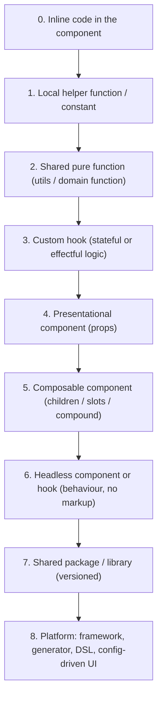
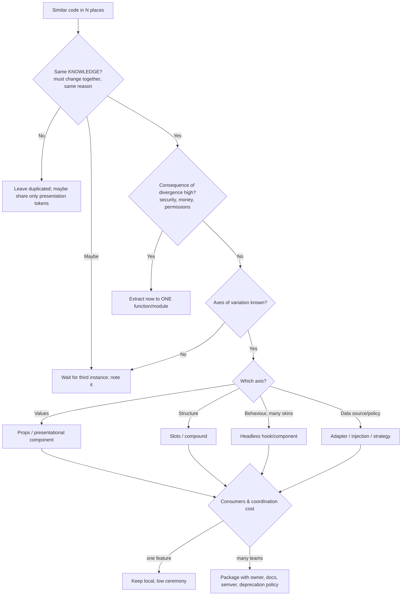

# 11 / 04 — Choosing the Abstraction Level: When to Duplicate, Extract, Generalise, or Stop

## 1. Lesson metadata

| | |
|---|---|
| **Level** | Architect |
| **Study time** | 5–6 hours (reading 2 h, worked examples 1.5 h, exercises 2.5 h) |
| **Prerequisites** | [DRY, KISS, YAGNI](../05-design-patterns/02-dry-kiss-yagni.md), [Composition over inheritance](../05-design-patterns/03-composition-over-inheritance.md), [Custom hook patterns](../05-design-patterns/06-custom-hook-patterns.md), [Headless components](../05-design-patterns/07-headless-components.md), [Patterns for reusable libraries](../05-design-patterns/22-patterns-for-reusable-libraries.md), [01 — Trade-off analysis](./01-trade-off-analysis.md) |
| **Next** | [05 — Application boundaries](./05-application-boundaries.md) |
| **Related** | [Compound components](../05-design-patterns/05-compound-components.md), [Patterns made less necessary](../05-design-patterns/23-patterns-made-less-necessary.md), [Dependency inversion](../04-react-architecture/11-dependency-inversion.md), [07 — Design system architecture](./07-design-system-architecture.md) |

**Learning objectives.** After this lesson you can:
1. Describe the *ladder of abstraction* in a React codebase, from inline code to platform, and the cost and benefit of each rung.
2. Decide whether to duplicate, extract, or generalise using evidence about **variation, volatility, and number of consumers**, not only "repeated code".
3. Recognise the *wrong abstraction* — and apply the correct remedy (inline it back, then re-abstract on real axes).
4. Design an abstraction's API surface to minimise **leakage, configuration explosion, and coupling**.
5. Choose between prop-driven components, composition (slots/compound), headless hooks, render props and plain functions for a given variation pattern.
6. Evaluate an abstraction with a checklist: cohesion, coupling, depth, stability, testability, and replacement cost.
7. Explain when a *thin* or *no* abstraction is the right call and when a *thick* one is justified.

**Concepts covered:** abstraction ladder, Rule of Three, AHA ("Avoid Hasty Abstractions"), the wrong abstraction, accidental vs essential duplication, axes of variation, volatility, deep vs shallow modules, leaky abstractions, boolean-prop explosion, inversion of control, API surface and escape hatches, adapter vs wrapper vs facade, cost of indirection, abstraction retirement.

---

## 2. Deep conceptual explanation

### 2.1 What problem is this lesson solving?

Abstraction is the main tool engineers use to manage complexity. It is also one of the main sources of complexity in mature codebases. Two opposite failure modes cost teams enormous amounts of time:

- **Under-abstraction:** the same logic copy-pasted into 30 places; a bug fix requires 30 edits and 6 are missed.
- **Over-/wrong abstraction:** a single `<GenericTable>` with 47 props and 12 internal `if (variant === …)` branches that no one dares to change; every new requirement makes it worse.

Neither is "bad engineering" in the abstract. The question at architect level is: **for this code, with this rate of change and these consumers, which rung of the abstraction ladder minimises total cost over its lifetime?**

### 2.2 What an abstraction is, precisely

An abstraction is a **named boundary that hides details behind a smaller interface**. It has a *cost side* and a *benefit side*:

| Benefits | Costs |
|---|---|
| Consumers think in terms of the interface, not the details | Readers must learn the interface *and* sometimes the details when it leaks |
| One place to fix or evolve behaviour | One place to break everyone |
| Enables substitution (test doubles, alternative implementations) | Indirection: harder to follow control flow |
| Names concepts (domain vocabulary) | A wrong name misleads for years |
| Can enforce invariants centrally | Can enforce the *wrong* invariants centrally |

A useful definition of *good* abstraction (from John Ousterhout's *A Philosophy of Software Design*, concept widely cited): modules should be **deep** — a simple interface hiding substantial functionality. A *shallow* abstraction (interface about as complex as the implementation) adds indirection but removes little complexity.

### 2.3 The ladder of abstraction in React



Each rung up:
- **increases reuse potential**,
- **increases the cost of change** (more consumers, more compatibility concerns),
- **increases the need for design quality** (API surface, docs, tests, versioning),
- **raises the number of ways it can be misused**.

| Rung | Consumers | Change cost | Typical owner | Appropriate when |
|---|---|---|---|---|
| 0 Inline | 1 | Trivial | Author | Always the starting point |
| 1 Local helper | 1 file | Trivial | Author | Naming a step improves readability |
| 2 Shared function | A few files in one feature | Low | Feature team | Pure logic repeated with *identical meaning* |
| 3 Custom hook | A few components | Low–medium | Feature team | Stateful logic reused; hides effect plumbing |
| 4 Component | Many | Medium | Feature/app team | UI pattern with stable shape |
| 5 Composable component | Many; varied layouts | Medium–high | Platform/design system | Variation in *structure*, not just values |
| 6 Headless | Many apps/skins | High | Platform | Behaviour/a11y is the hard part; visuals vary widely |
| 7 Package | Multiple apps/teams | High (semver, migrations) | A named team | Cross-team reuse with ownership and support |
| 8 Platform/DSL | Whole org | Very high | Platform org | Dozens of near-identical features (e.g. config-driven forms) with a dedicated team |

**Climb only when the evidence demands it, and descend when it stops paying.** Descending (inlining an abstraction back into its call sites) is a legitimate and often *underused* refactoring.

### 2.4 Duplication is not the same as redundancy of meaning

"Don't Repeat Yourself" is about **knowledge**, not text. Distinguish:

| Type | Example | Treatment |
|---|---|---|
| **Essential (same knowledge) duplication** | The rule "orders over €500 need manager approval" implemented in three components | Extract to one domain function: if the rule changes, all must change together |
| **Accidental (coincidental) duplication** | Two components happen to format a date the same way today, but one is a legal document and the other a UI timestamp | Leave separate; they will diverge |
| **Structural duplication** | Several screens have the same layout skeleton | Component with slots, maybe; or leave |
| **Test duplication** | Similar test setup | Often fine; DRY in tests can harm readability |

**The test:** *If one copy needs to change, must the others change at the same time, for the same reason?* If yes → same knowledge → extract. If "maybe" → wait. If no → leave.

### 2.5 The Rule of Three and AHA

- **Rule of Three:** tolerate duplication until the third occurrence; then abstract. The rationale: with one or two examples you cannot tell which parts are the invariant and which vary.
- **AHA (Avoid Hasty Abstractions)**, popularised in the front-end community by Kent C. Dodds: prefer duplication over the wrong abstraction; optimise for change, wait until you know the axes of variation.
- **The wrong abstraction** (Sandi Metz): "duplication is far cheaper than the wrong abstraction." The mechanism: someone extracts a shared function; a new requirement *almost* fits; instead of re-evaluating, a developer adds a parameter/flag; repeat; the abstraction becomes a bag of conditionals nobody understands, yet everyone depends on it, and sunk cost discourages inlining.

These are heuristics, not laws. They fail when:
- the duplicated thing is **essential knowledge** with high consequence (security checks, money rounding, permission rules): extract at the *second* occurrence — or the first, to a single place.
- the **third occurrence will be in another team's repo**, where you can't coordinate later.
- the duplication is large and the variation axes are already known from the domain.

### 2.6 Axes of variation, volatility, and consumers: three measurements

Rather than "how much repeated code", measure:

1. **Axes of variation** — in what *dimensions* do the instances differ? Values (strings, icons), behaviour (what happens on click), structure (extra regions, different order), data shape, or policy (permissions)? The abstraction mechanism must match the axis:

| Variation axis | Natural mechanism |
|---|---|
| Values | Props |
| Structure/regions | `children`, slots, compound components ([Slot patterns](../05-design-patterns/20-slot-patterns.md), [Compound components](../05-design-patterns/05-compound-components.md)) |
| Behaviour/policy | Callbacks, strategy objects, render props |
| Behaviour with different markup/skins | Headless hook/component ([Headless components](../05-design-patterns/07-headless-components.md)) |
| Data source | Dependency injection / adapter ([Dependency injection](../05-design-patterns/16-dependency-injection.md)) |
| Rendering target | Host-config / platform abstraction (rare) |

2. **Volatility** — how often does each part change, and *why*? Parts that change for the same reason should live together (cohesion); parts that change for different reasons should be separated (single responsibility in the *change* sense — see [SOLID in React](../05-design-patterns/01-solid-in-react.md)).

3. **Consumers** — how many, how coupled, who owns them, can you migrate them? An abstraction used by 3 components in one folder is cheap to evolve. One used by 6 teams needs semver and a deprecation process ([03 — Large-scale refactoring](./03-large-scale-refactoring.md)).

### 2.7 Leaky abstractions and where they leak

"All non-trivial abstractions, to some degree, are leaky" (Joel Spolsky's "Law of Leaky Abstractions"). In React the usual leaks:

| Leak | Example |
|---|---|
| **Performance leak** | A `useData` hook that creates a new object each render; consumers' `memo` is defeated ([Referential equality](../07-performance/05-referential-equality.md)) |
| **Lifecycle leak** | A hook that subscribes in an effect; consumers must know to clean up or avoid conditional use |
| **Rendering leak** | A wrapper component that adds a DOM node, breaking CSS selectors, flex/grid layouts, or `:first-child` styles |
| **Accessibility leak** | A custom `Select` that hides native semantics: keyboard and screen-reader behaviour must be reimplemented |
| **Error leak** | A "clean" API that throws library-specific error types |
| **Type leak** | Generic types from a third-party library appear in your public prop types |
| **Ref/event leak** | A wrapper that swallows `ref`, `className`, or event props (in React 19 `ref` is a normal prop for function components, simplifying forwarding; verified on react.dev and react 19.3.1) |

Design implication: **abstractions should expose the escape hatches that real consumers will need** (forwarding `ref`, `className`, `data-*`, native props) rather than force them to fork.

### 2.8 Configuration explosion and boolean props

The signature failure of prop-driven abstraction is the growth of mutually-interacting flags:

```tsx
<Button primary danger outline small loading iconLeft iconRight fullWidth link />
```

What does `primary danger outline` mean? The combinatorial space is 2ⁿ while meaningful states are few. Remedies:

- **Replace flags with a discriminated union**: `variant: "primary" | "danger" | "ghost"`; make illegal states unrepresentable ([TypeScript generics and utility types](../00-web-and-javascript-foundations/19-typescript-generics-and-utility-types.md)).
- **Split into components** when variants diverge in structure: `<Button>` vs `<IconButton>` vs `<LinkButton>`.
- **Switch to composition**: `<Button><Spinner/> Save</Button>` rather than `loading` + `loadingText` + `spinnerPosition`.
- **Invert control**: accept a render prop/slot for the part that varies.

### 2.9 Inversion of control as a cost-shifter

Prop-driven abstractions put the **abstraction author in control**: every new need requires a new prop. Composition-based and headless abstractions give **the consumer control** of structure/markup while the abstraction retains *invariants* (state, a11y behaviour).

| Style | Who changes when a new variation appears | Risk |
|---|---|---|
| Configuration (props) | The abstraction author | Prop explosion; author becomes a bottleneck |
| Composition (children/slots) | The consumer | Consumers may compose invalid structures; visual drift |
| Headless (hooks) | The consumer, entirely for markup | Accessibility and consistency depend on discipline; more code per use |

Choosing among them is a trade-off, not a hierarchy ([Patterns made less necessary](../05-design-patterns/23-patterns-made-less-necessary.md)).

### 2.10 Misconceptions

| Misconception | Reality |
|---|---|
| "Duplication is always bad." | Wrong abstraction is costlier than duplication; essential duplication of *knowledge* is bad, coincidental duplication is not. |
| "Abstraction always improves testability." | Poor abstractions add layers that need mocking; testability improves when the abstraction isolates *effects* at edges, not when it wraps everything. |
| "More reusable = better." | Reusability has a design and maintenance cost; unused flexibility is pure cost (YAGNI). |
| "If it's in a shared package, it's well designed." | A shared package is a *distribution* mechanism, not a quality guarantee. |
| "Always wrap third-party libraries." | Wrapping has a cost; wrap when the library's API leaks into domain code or exit probability is real (see [01 §2.5](./01-trade-off-analysis.md)). |
| "A custom hook is just a way to reuse code." | A hook is also a way to *name and isolate* a concern; a single-use hook can still be valuable for readability, but is also an indirection. |
| "Prop drilling is always bad, so use context." | Drilling through 2 layers is often the cheapest explicit design; context hides dependencies and affects rendering ([Context propagation cost](../07-performance/06-context-propagation-cost.md)). |

---

## 3. Internal mechanics

### 3.1 How abstractions get "wrong": the drift mechanism

```mermaid
sequenceDiagram
  participant A as Dev A
  participant S as Shared abstraction
  participant B as Dev B
  participant C as Dev C
  A->>S: Extract after seeing 2 similar usages
  B->>S: New usage almost fits; adds optional param `mode`
  C->>S: Another near-fit; adds `skipValidation` flag
  Note over S: Branches multiply; behaviour depends on flag combos
  B->>S: Bug fix for B's flow breaks A's tests
  Note over S: Everyone is afraid to change; sunk cost keeps it alive
  S-->>A: Eventually: inline back into callers, delete, re-abstract on real axes
```

The key insight: **the abstraction's interface freezes assumptions about variation**. When reality varies along an axis the abstraction didn't anticipate, the cheapest local move is a flag. Each flag adds a branch *inside* the abstraction and a mode *outside* it: the abstraction gets both more complex and less meaningful.

### 3.2 The remedy: inline and re-derive

The Metz remedy:
1. **Inline** the abstraction back into every caller (mechanical, safe by tests).
2. In each caller, **delete the code paths that caller doesn't use** (flags become constants → dead branches disappear).
3. Observe what is *actually* shared among the now-specialised callers. Often it's smaller than the original or has a different shape.
4. **Re-extract** the genuinely shared parts, on the axes that actually vary.

This costs a day or two and can be the highest-value refactor in the repo.

### 3.3 Measuring abstraction quality

| Metric/signal | What it indicates |
|---|---|
| **Props/params count and boolean ratio** | Configuration explosion |
| **Branch count on prop values inside** (`if (variant === …)`) | Hidden multiple components |
| **Percentage of consumers using each prop** | Unused flexibility; dead options |
| **Number of consumers that bypass it** (copy, fork, custom CSS overrides) | Abstraction doesn't fit real needs |
| **Change locality:** do feature changes touch the abstraction? | If yes frequently, it's too coupled to feature concerns |
| **Bug density / PR churn on the abstraction** | Instability |
| **Time to explain it to a new hire** | Comprehensibility |
| **Number of `any`/casts at its boundary** | Type design problems |

These make the discussion evidence-based rather than aesthetic.

### 3.4 What React itself implies for abstraction design

*Public guarantees relevant here:* components are functions of props and state; hooks must be called unconditionally in the same order; effects synchronise with external systems ([Effects and their timing](../02-react-rendering-and-internals/18-effects-and-their-timing.md)); props are read-only; identity of component types determines mount/unmount ([Identity, keys and reconciliation](../02-react-rendering-and-internals/07-identity-keys-and-reconciliation.md)).

Consequences:
- **Defining components inside components** destroys state each render (new type identity). A "convenience" abstraction that creates components dynamically is a trap.
- **Hooks compose, but their effects and state compose too:** wrapping a hook that subscribes in a hook that fetches yields combined lifecycle behaviour the consumer must understand.
- **Context-based abstractions** couple the rendering of all consumers; abstraction authors should consider granularity (split contexts, selectors, external stores).
- **Elements as values** allow slot patterns: passing `<Icon/>` as a prop transfers *what to render* without transferring *how to render it*.
- **The React Compiler** (stable 1.0 since 2025-10-07; an opt-in build step) may reduce the need for manual memoisation in abstractions, shifting design effort away from `useMemo`/`useCallback` stability concerns — but does not change the need for sound API boundaries.

### 3.5 The cost model (a simplified economic view)

Total cost of an abstraction over its life ≈
`design + implementation + documentation + (consumers × integration) + (changes × consumers affected × coordination) + (misuse incidents) + (removal cost)`
versus the cost of **not** abstracting:
`(copies × changes that must be mirrored) + (inconsistency bugs)`.

When the **change rate of the shared knowledge is high and consumers are few and nearby**, abstraction is cheap and valuable. When the **change rate is low**, duplication is cheap, and abstraction's overhead dominates. When **consumers are many and far away**, abstraction is valuable but its *change cost* explodes — design it carefully and keep the interface small.

*Teaching model:* this isn't a computable formula. It's a structured prompt for the questions: *how often will this change, in how many places, at what coordination cost?*

---

## 4. Step-by-step execution walkthrough

A realistic decision sequence: **three screens show a "status badge" derived from different domain statuses (Orders, Shipments, Invoices).** What abstraction level?

**Step 1 — Look at the three implementations.**

```tsx
// OrderRow.tsx
<span className={order.status === "open" ? "badge badge-green" : order.status === "cancelled" ? "badge badge-red" : "badge"}>
  {order.status}
</span>
// ShipmentRow.tsx
<span className={s.state === "delivered" ? "badge badge-green" : s.state === "delayed" ? "badge badge-amber" : "badge"}>
  {t(`shipment.${s.state}`)}
</span>
// InvoiceRow.tsx
<span className={inv.paid ? "badge badge-green" : inv.overdueDays > 0 ? "badge badge-red" : "badge badge-amber"}>
  {inv.paid ? "Paid" : inv.overdueDays > 0 ? `Overdue ${inv.overdueDays}d` : "Due"}
</span>
```

**Step 2 — Ask the knowledge question.** Is the mapping from *domain status → colour* the same knowledge? No: Orders, Shipments and Invoices each have their own state model. Is the **presentation** (a coloured pill) the same knowledge? Yes: the design system's definition of "badge" with *tones*.

**Step 3 — Identify axes of variation.** Values: text, tone. Not behaviour, not structure. So a prop-driven presentational component is the right *mechanism*: `<Badge tone="success">Paid</Badge>`.

**Step 4 — Decide the abstraction boundaries.** Two levels, not one:
- `Badge` (presentation): knows tones, not domains.
- Per-domain mapping functions (domain): `orderStatusTone(status): Tone`, colocated with each domain's model.

*Rejected:* a single `<StatusBadge type="order|shipment|invoice" value=… />`. It would combine unrelated domain knowledge into the UI component, branching on `type`, and change whenever any domain changes (low cohesion, high volatility).

**Step 5 — Check consumers and volatility.** Three consumers, same app. New statuses appear every few months in each domain (domain volatility), whereas tones are stable. Therefore: the domain mapping must be *easy to change locally*; `Badge` must be *stable*. The split matches the volatility gradient.

**Step 6 — Write it.** (See §5.1.)

**Step 7 — Define the stop rule.** *Don't* add `Badge` props for `pulse`, `icon`, `dismissible` until a second real consumer needs them; if a consumer needs an icon, prefer `children` composition (`<Badge tone="success"><CheckIcon/> Paid</Badge>`).

**Step 8 — Record.** Short note in the design-system docs: "Badge is presentation only; domain mapping lives with the domain."

What the walkthrough demonstrates: the decision used *knowledge identity*, *variation axis*, *volatility* and *consumer count*, and ended with **two small abstractions** at different rungs rather than one big one.

---

## 5. Code examples

### 5.1 Minimal example: presentation abstraction + domain mapping

```tsx
// design-system/Badge.tsx
import type { ComponentPropsWithoutRef } from "react";

export type Tone = "neutral" | "success" | "warning" | "danger";

type BadgeProps = ComponentPropsWithoutRef<"span"> & { tone?: Tone };

export function Badge({ tone = "neutral", className, ...rest }: BadgeProps) {
  return <span className={["badge", `badge--${tone}`, className].filter(Boolean).join(" ")} {...rest} />;
}
```

```ts
// features/orders/orderStatusTone.ts — domain knowledge, colocated with the domain
import type { Tone } from "@acme/design-system";

export type OrderStatus = "open" | "shipped" | "cancelled" | "returned";

const TONE: Record<OrderStatus, Tone> = {
  open: "neutral",
  shipped: "success",
  cancelled: "danger",
  returned: "warning",
};

export const orderStatusTone = (s: OrderStatus): Tone => TONE[s];
```

```tsx
// features/orders/OrderRow.tsx (excerpt)
<Badge tone={orderStatusTone(order.status)}>{order.status}</Badge>
```

**Line notes.**
- `ComponentPropsWithoutRef<"span">` gives consumers native attributes (`aria-*`, `data-*`, `title`, event handlers) — an *escape hatch by design*. In React 19, `ref` is a regular prop for function components, so a `ref` can be forwarded through `...rest` if you type it with `ComponentProps<"span">`; in earlier versions you needed `forwardRef` (still supported in 19, but react.dev lists it under Legacy APIs and says it will be deprecated in a future release). Check the React version you ship.
- `Record<OrderStatus, Tone>` makes the mapping **exhaustive at compile time**: adding a status to the union produces a type error until the tone is chosen — a domain-owned safety net.
- `Badge` has **one** axis of variation (`tone`) and **no** domain knowledge; it is deep enough to hide class naming and token usage.

**Predict:** Where does a new `"on_hold"` order status require a change? *Answer:* only in `orderStatusTone.ts` (and the `OrderStatus` union); `Badge` is untouched — the volatility boundary matches the module boundary.

### 5.2 Practical example: one hook, three levels of abstraction for the same problem

Problem: components need debounced search input that triggers a query. Show the ladder in action.

**Rung 0/1: inline** (fine for one place)

```tsx
function Search() {
  const [text, setText] = useState("");
  const [debounced, setDebounced] = useState("");
  useEffect(() => {
    const id = setTimeout(() => setDebounced(text), 250);
    return () => clearTimeout(id);
  }, [text]);
  const { data } = useQuery({ queryKey: ["search", debounced], queryFn: () => search(debounced), enabled: debounced.length > 1 });
  /* … */
}
```

**Rung 3: a generic hook after the third occurrence**

```ts
// shared/useDebouncedValue.ts
import { useEffect, useState } from "react";

export function useDebouncedValue<T>(value: T, delayMs: number): T {
  const [debounced, setDebounced] = useState(value);
  useEffect(() => {
    const id = setTimeout(() => setDebounced(value), delayMs);
    return () => clearTimeout(id);
  }, [value, delayMs]);
  return debounced;
}
```

**Rung 3 (domain-flavoured): when the *combination* repeats**

```ts
// features/search/useSearchResults.ts
export function useSearchResults(text: string) {
  const debounced = useDebouncedValue(text.trim(), 250);
  return useQuery({
    queryKey: ["search", debounced],
    queryFn: ({ signal }) => searchApi(debounced, { signal }),
    enabled: debounced.length > 1,
  });
}
```

**Analysis.** There are *two* distinct pieces of knowledge: (1) the generic mechanism of debouncing a value (stable, domain-free, tiny interface → deep enough, safe to share widely), and (2) the policy "search starts after 2 characters, debounced 250 ms, keyed by trimmed text" (domain knowledge, changes with product decisions). Combining them into one generic `useDebouncedQuery(text, fetcher, options)` would produce a hook with a growing options bag (min length, delay, key builder, enabled override…) — the configuration explosion of §2.8. Keeping them separate preserves *stable generic parts* and *volatile domain parts* in different modules.

**Trade-off:** a trivial hook like `useDebouncedValue` is arguably not worth sharing at 5 lines if only two places use it; but the *name* documents intent, and debouncing has subtle failure modes (clearing timers, stale values) that are worth fixing once. Judge by the consumers and error-proneness, not line count. See [Debounce and throttle](../07-performance/14-debounce-and-throttle.md).

### 5.3 Incorrect: the wrong abstraction (boolean/mode soup)

```tsx
interface GenericTableProps<T> {
  data: T[];
  columns: Column<T>[];
  isAdmin?: boolean;
  isOrders?: boolean;
  isInvoices?: boolean;
  showTotals?: boolean;
  allowExport?: boolean;
  compact?: boolean;
  onRowClickNavigateTo?: string;
  customRowRenderer?: (row: T) => JSX.Element;
  selectable?: boolean;
  selectionMode?: "single" | "multi" | "none";
  mobileLayout?: "cards" | "scroll";
  // …31 more
}

function GenericTable<T>(p: GenericTableProps<T>) {
  if (p.isOrders && p.isAdmin) { /* …special sort… */ }
  if (p.isInvoices && p.showTotals) { /* …sum column logic… */ }
  // …
}
```

Why this is wrong:
1. **Domain knowledge inside a "generic" component** (`isOrders`, `isInvoices`): it isn't generic; it's three tables in a trench coat.
2. **Flags interact** (`selectable` + `selectionMode`): invalid combinations representable.
3. **Every new table requires modifying the shared component**, so the author is a bottleneck and each change risks all tables.
4. **Unused prop mass:** most consumers use a few props; the rest is carrying cost and a test matrix nobody runs.
5. **Layout and behaviour entangled:** can't change responsiveness without regressions in selection.
6. **Types degrade:** `T` is unconstrained, columns use `any` casts internally.

### 5.4 Corrected: invert control and split by axis

Separate **behaviour** (headless: sorting, selection, keyboard navigation) from **structure** (composition) from **domain** (columns/policy per feature).

```tsx
// design-system/table/useTableSelection.ts — headless behaviour with one axis: the selection model
import { useCallback, useState } from "react";

export type SelectionMode = "none" | "single" | "multi";

export function useTableSelection<K extends string | number>(mode: SelectionMode) {
  const [selected, setSelected] = useState<ReadonlySet<K>>(() => new Set());

  const toggle = useCallback((key: K) => {
    if (mode === "none") return;
    setSelected((prev) => {
      const next = new Set<K>(mode === "multi" ? prev : []);
      if (prev.has(key)) next.delete(key); // in "single" mode next is already empty, so this deselects
      else next.add(key);
      return next;
    });
  }, [mode]);

  const clear = useCallback(() => setSelected(new Set()), []);
  const isSelected = useCallback((k: K) => selected.has(k), [selected]);
  return { selected, toggle, clear, isSelected };
}
```

```tsx
// features/orders/OrdersTable.tsx — domain composes primitives; no "isOrders" flag anywhere
export function OrdersTable({ orders }: { orders: Order[] }) {
  const sel = useTableSelection<string>("multi");
  return (
    <Table aria-label="Orders">
      <Table.Head>
        <Table.Row>
          <Table.HeaderCell />
          <Table.HeaderCell>Order</Table.HeaderCell>
          <Table.HeaderCell align="end">Total</Table.HeaderCell>
          <Table.HeaderCell>Status</Table.HeaderCell>
        </Table.Row>
      </Table.Head>
      <Table.Body>
        {orders.map((o) => (
          <Table.Row key={o.id} aria-selected={sel.isSelected(o.id)}>
            <Table.Cell><input type="checkbox" aria-label={`Select ${o.number}`} checked={sel.isSelected(o.id)} onChange={() => sel.toggle(o.id)} /></Table.Cell>
            <Table.Cell>{o.number}</Table.Cell>
            <Table.Cell align="end">{formatMoney(o.total)}</Table.Cell>
            <Table.Cell><Badge tone={orderStatusTone(o.status)}>{o.status}</Badge></Table.Cell>
          </Table.Row>
        ))}
      </Table.Body>
    </Table>
  );
}
```

**Line notes.**
- `Table` is a **compound component set** with no domain knowledge: it fixes markup semantics (real `<table>` elements, scoped header cells; the real implementation must set appropriate `scope`/`aria` attributes) — the *a11y invariant* — while leaving structure to the consumer.
- `useTableSelection` is **headless**: its one axis is selection semantics. The `mode` parameter is a discriminated string union, not three booleans.
- `OrdersTable` owns *domain*: columns, formatting, status tone. Adding `InvoicesTable` doesn't touch the design system.
- Cost: more lines at each feature's table. That is the **price of inversion of control** — you accept some structural duplication across features to avoid centralising variation.
- What remains shared: semantics (accessibility), selection behaviour, tokens/styling. What stays local: columns, formatting, policy.

**When is the prop-driven `GenericTable` the *better* choice?** If every table in the product is a simple read-only list with the same chrome, one `<DataTable columns data />` with 4–5 props is the right rung. The corrected structure pays off when tables *diverge*.

### 5.5 Advanced: choosing between slot props and compound components with a type-safe API

Scenario: a `Card` whose header, media and actions are optional regions.

```tsx
// Option A — slots as props
interface CardProps {
  title: ReactNode;
  media?: ReactNode;
  actions?: ReactNode;
  children?: ReactNode;
}
export function Card({ title, media, actions, children }: CardProps) {
  return (
    <article className="card">
      {media && <div className="card__media">{media}</div>}
      <header className="card__header"><h3>{title}</h3></header>
      <div className="card__body">{children}</div>
      {actions && <footer className="card__actions">{actions}</footer>}
    </article>
  );
}
// <Card title="Invoice 42" actions={<Button>Pay</Button>}>…</Card>
```

```tsx
// Option B — compound components
export function Card({ children }: { children: ReactNode }) { return <article className="card">{children}</article>; }
Card.Media = function CardMedia(p: ComponentProps<"div">) { return <div className="card__media" {...p} />; };
Card.Header = function CardHeader(p: ComponentProps<"header">) { return <header className="card__header" {...p} />; };
Card.Body = function CardBody(p: ComponentProps<"div">) { return <div className="card__body" {...p} />; };
Card.Actions = function CardActions(p: ComponentProps<"footer">) { return <footer className="card__actions" {...p} />; };
// <Card><Card.Header><h3>Invoice 42</h3></Card.Header><Card.Body>…</Card.Body><Card.Actions><Button>Pay</Button></Card.Actions></Card>
```

| Criterion | A: slots as props | B: compound |
|---|---|---|
| Enforces structure/order | Yes (layout is fixed) | No — consumer decides order; invalid orderings possible |
| Typing & discoverability | Excellent: props show up in autocomplete | Good, but allowed children aren't type-enforced |
| Flexibility for new regions (e.g. a "badge" row) | Requires a new prop and release | Consumer adds a new element or the library adds a new part |
| Per-region attributes (ids, aria, className) | Awkward: need `titleProps`, `actionsProps` | Natural: props on each part |
| Context/state sharing between parts (e.g. collapsed state) | Internal and simple | Requires context |
| Rendering cost/perf | Simple | Context adds propagation concerns |
| Right when | Layout is a *design decision* the system owns; ≤ 3–4 regions | Layouts vary; parts need individual attributes; library-like use |

**Decision rule used here:** *use slot props when the system should own the layout; use compound parts when consumers need to own the layout.* In design systems, many teams use slots for small components (Card, Alert) and compound components for complex widgets (Tabs, Menu, Dialog) where parts share state ([Compound components](../05-design-patterns/05-compound-components.md); [07 — Design system architecture](./07-design-system-architecture.md)).

---

## 6. Visual explanations

### 6.1 Cost of abstraction versus cost of duplication over time

```text
Cost
 ^
 |                                 / duplication cost (copies × mirrored changes)
 |                               /
 |                             /        ______ wrong-abstraction cost (grows with flags)
 |                 ________ /     ____/
 |   abstraction  /       X  ____/
 |   overhead ---/     _/ <- right abstraction: flat after upfront cost
 |         _____/ ___/
 |   _____/ ____/
 +-------------------------------------------------> number of changes / time
      ^ too early: pay overhead, no benefit yet
```

Interpretation: a *right* abstraction has an upfront cost and then a low slope; duplication starts cheap but its slope depends on how often the shared knowledge changes; a *wrong* abstraction has an even steeper slope than duplication. The art is estimating slope **before** committing.

### 6.2 Decision flow: duplicate, extract, generalise, or stop



### 6.3 Deep vs shallow

```text
Shallow abstraction                  Deep abstraction
+----------------------+             +----------------------+
| interface: 14 props  |             | interface: 3 props   |
+----------------------+             +----------------------+
| implementation: ~20  |             |                      |
| lines forwarding     |             | implementation: lots |
| props 1:1            |             | (a11y, keyboard,     |
+----------------------+             |  focus mgmt, edge    |
 interface ≈ implementation          |  cases)              |
 → indirection only                  +----------------------+
                                      interface << implementation
                                      → real complexity hidden
```

A wrapper that forwards 14 props to a library component with different names is shallow; it should have a *reason* beyond naming (e.g. a boundary to swap the library) or be deleted.

---

## 7. Alternative approaches and trade-offs

| Approach | Strengths | Weaknesses | Best when |
|---|---|---|---|
| **Duplicate (copy)** | Zero coupling; fastest to change locally; no wrong abstraction | Divergence of *same* knowledge; bug fixes missed | Coincidental duplication; early exploration; < 3 instances |
| **Shared pure function** | Cheapest abstraction; trivially testable | Needs same meaning across callers | Domain rules, formatters, mappers |
| **Custom hook** | Encapsulates stateful logic and effects | Hidden lifecycles; consumer needs to understand | Repeated stateful/effectful logic |
| **Prop-driven component** | Simple to use; consistent output | Prop explosion; author bottleneck | Few axes (values), stable shape |
| **Slots/compound** | Flexible structure; per-part props | Possible invalid compositions; context overhead | Varying layouts, shared internal state |
| **Headless** | Behaviour reuse across skins; a11y centralised | More code per use; consistency relies on skins | Many visual variants, strict a11y requirements |
| **Config-driven UI (JSON/schema → components)** | Fast to create many similar screens; non-engineers can edit | A DSL is a language: needs validation, docs, debugging; limited expressiveness; escape hatches creep in | Dozens/hundreds of near-identical forms/pages with a dedicated platform team |
| **Wrapper around third-party** | Exit option; unified API; central policy | Lag behind upstream features; lowest-common-denominator API | Real exit probability; policy to enforce (analytics, a11y) |
| **No shared abstraction + code generation** | Local freedom; consistent scaffolding | Generated code drifts after generation; upgrading templates is hard | Boilerplate-heavy, then diverging code (e.g. per-feature scaffolds) |

**Scenario where the recommended approach (wait; duplicate until knowledge is clear) is *not* best.** (1) Money rounding, tax calculation, or permission checks: extract at once to a single, well-tested module, even at the first sharing opportunity — divergence is a defect, not a trade-off. (2) The second occurrence will live in **another team's repo**: you cannot refactor later without a cross-team migration, so design the shared package earlier, carefully, and small. (3) The variation axes are already **fully known from the domain** (e.g. the design system specifies exactly three button variants): then the abstraction is a *codification of a decision*, not a guess.

---

## 8. Best practices and anti-patterns

### 8.1 Good practice
- Start inline; abstract when you can **name** the concept in domain/design terms.
- Apply the knowledge test: *must these change together, for the same reason?*
- Place abstraction boundaries along the **volatility gradient** (stable core, volatile edges).
- Prefer **small, deep** interfaces; forward native props and `ref` where it makes sense.
- Replace boolean flags with unions or composition; make illegal states unrepresentable.
- Keep domain knowledge **out of** presentational/shared primitives and **colocated** with its domain.
- Provide **escape hatches** (`className`, `data-*`, `as`/slot overrides) deliberately and document what is *not* supported.
- Instrument usage (which props, which variants) to prune dead flexibility.
- Treat inlining as a first-class refactoring when an abstraction stops fitting.
- Write the abstraction's **contract in types and tests**, not only prose.

### 8.2 Beginner mistakes
- Extracting at the first repetition because "it looks the same".
- Creating a util for a one-line expression.
- Adding a prop for every new case.
- Putting everything into a global `utils.ts`.

### 8.3 Experienced-developer mistakes
- **Speculative generality:** building for requirements imagined, not observed.
- **The mega-component with a mode prop** that hides a `switch` over unrelated components.
- **Over-wrapping:** a wrapper around every library "for flexibility".
- **Abstraction by file size:** splitting a 150-line cohesive component into 12 tiny files that must be read together.
- **Layer cake:** `Component → Container → Hook → Service → Repository → Adapter` for a CRUD screen ([Clean and hexagonal architecture](../04-react-architecture/10-clean-and-hexagonal-architecture.md): useful where complexity justifies; heavy where it doesn't).
- **Treating the DRY heuristic as a metric** (copy-paste detectors as quality gates).
- **Sunk-cost defence** of a broken abstraction.
- **Leaving the abstraction owner-less.**

### 8.4 Smells
- A shared component with props named after consumers (`isOrders`, `forCheckout`).
- A `common/` or `shared/` dumping ground with no owner or criteria.
- `if (variant === …)` ladders more than ~3 branches inside one component.
- Consumers pass `className` overrides to fight internal styles.
- Many call sites pass the same combination of props (hidden missing abstraction).
- A hook returning > 8 values, or an options object with > 6 fields.
- Tests for the abstraction that mock half its internals.

### 8.5 Justified exceptions
- A **thick, opinionated** abstraction (e.g. a config-driven form engine) is right when product requirements are overwhelmingly uniform *and* a platform team owns it with an escape hatch strategy.
- **Copy-paste into three apps** is right when the apps are owned by different teams with different release cadences *and* the shared bit is small and likely to diverge; a shared package would impose coordination cost greater than occasional bug-fix duplication. Record that in an ADR.
- A **single-use hook** extracted purely for readability is fine: abstraction's purpose includes naming.

---

## 9. Real-world application

| Domain | Typical abstraction question | Constraint that decides it |
|---|---|---|
| **E-commerce** | Product card variants across listing, search, recommendations, cart | Marketing needs per-surface layout experiments → slots/compound over a prop-heavy card; price display logic (money) extracted once as a domain function |
| **Dashboards** | Widget framework: one `Widget` with config vs composable chart primitives | Dozens of widgets by many teams → a small widget *contract* (data in, states out) plus library primitives; avoid a config DSL until widgets prove uniform |
| **Finance** | Money/number formatting, rounding, currency | Correctness: single shared module with property tests; never duplicated; abstraction level = pure function |
| **Forms-heavy** | Form-field abstraction, schema-driven forms | Hundreds of forms: a thin field abstraction (label, error, a11y wiring) plus schema validation; resist a mega-`FormBuilder` unless forms are truly uniform |
| **Auth** | Permission checks in UI | Centralise the policy (`can(user, action, resource)`); UI helpers (`<Can>`) are thin; do not scatter role strings |
| **Real-time** | Subscription hooks | Centralise connection management and reconnection; consumers use domain hooks (`useQuote`) |
| **Multi-team** | Shared package or copy | Ownership, release cadence, coordination cost; apply [07](./07-design-system-architecture.md) criteria |

**Engineering constraints:** *team boundaries* (an abstraction used across teams needs an owner and support channel), *release process* (semver and codemods must be affordable), *hiring/onboarding* (house-made DSLs raise onboarding cost), *runtime budgets* (extra layers and context providers add render cost; measure with the Profiler), *bundle size* (generic abstractions that import broad dependencies for narrow use).

---

## 10. Debugging and troubleshooting

| Symptom | Likely root cause | Investigation | Fix / validation |
|---|---|---|---|
| Changing the shared `Table` breaks unrelated screens | Hidden coupling: multiple domain behaviours in one component | List consumers and the props each uses; look for `isX` flags; run each consumer's tests | Split by axis; inline into consumers first, then re-extract; validate each consumer's tests and visual snapshots |
| A new feature needs a prop added to the shared component, again | The abstraction is prop-driven on an axis that actually varies by structure | Review last 10 PRs touching the component; count "add prop" PRs | Move to composition/slots for that axis; validate "add prop" PR count falls |
| Consumers copy-paste the shared component | It doesn't fit; fork is cheaper than the abstraction | Search for near-duplicates (jscpd or similar) and interview the forkers | Add the missing escape hatch or retire the abstraction; validate fork count |
| Re-render storm after extracting a hook/context | Abstraction leaks identity instability (new objects/functions per render) or context granularity | React Profiler "why did this render"; check returned object identity ([Referential equality](../07-performance/05-referential-equality.md)) | Stabilise returned values or split context; validate render counts |
| State resets unexpectedly after "cleanup" refactor | A component defined inside another component, or a wrapper changing component type/position | Search for component definitions inside render; compare tree in DevTools before/after | Hoist the component; keep stable type/position; validate with a test that types, rerenders, asserts state kept |
| Hook used conditionally breaks with "Rendered more hooks than during the previous render" | Abstraction encouraged conditional invocation (e.g. `if (flag) useX()`) | Error stack points to the call site | Always call hooks; branch inside or split components; add the lint rule for rules of hooks |
| Types are all `any`/casts at the abstraction boundary | Generic design too ambitious for TypeScript's inference | Count casts; see if call sites need `as` | Simplify the generic surface; overloads/discriminated unions; validate by removing casts at call sites |
| New hires can't understand the data flow | Too many layers; indirection depth | Ask a new hire to trace one feature; count files touched | Flatten: inline pass-through layers; validate by timing the trace again |

**Investigation recipe: "Is this abstraction still paying?"**
1. List consumers and, for each, the options used (a script or manual).
2. Compute option usage frequency; mark options used by ≤ 1 consumer.
3. Count PRs in the last quarter that modified the abstraction, and categorise (bug fix, new prop, refactor).
4. Count forks and bypasses.
5. Decide: **keep**, **narrow** (delete unused options), **split by axis**, or **inline and delete**.
6. Validate with the same metrics next quarter.

---

## 11. Exercises

### Level A — Knowledge
A1. State the knowledge test for duplication in one sentence, and give one example of *essential* and one of *accidental* duplication in a front-end app.
A2. Name the rungs of the ladder from §2.3 and say what *increases* as you climb.
A3. What are the two components of the "Rule of Three" rationale? When is it *wrong* to wait for three?
A4. Why do boolean props explode combinatorially, and name two remedies.
A5. What is the difference between a shallow and a deep abstraction? Give a React example of each.

### Level B — Code comprehension
B1. In §5.1, what compile-time guarantee does `Record<OrderStatus, Tone>` give, and what happens to `Badge` if `"on_hold"` is added?
B2. In §5.2, why is `useDebouncedValue` kept separate from `useSearchResults` rather than merged into one `useDebouncedQuery` hook?
B3. Examine this snippet. What bug does the abstraction introduce, and why?
```tsx
function withLayout(Page: React.ComponentType) {
  return function Wrapped() {
    const Section = ({ children }: { children: React.ReactNode }) => <section>{children}</section>;
    return <Section><Page /></Section>;
  };
}
```
B4. In §5.5, which option (A or B) lets a consumer attach `id` and `aria-labelledby` to the header and body separately without new props, and why?

### Level C — Implementation
C1. Refactor this component from boolean flags to a discriminated union that makes illegal combinations unrepresentable, then write a type-level test (e.g. with `// @ts-expect-error`) for two illegal combinations.
```tsx
interface ButtonProps { primary?: boolean; danger?: boolean; ghost?: boolean; loading?: boolean; href?: string; onClick?: () => void; }
```
C2. Implement `useDisclosure()` (open/close/toggle with stable function identities) and explain whether it deserves to be a shared hook in a codebase that has 4 uses.
C3. Given three copies of a function that computes `totalWithTax` in different features that currently round slightly differently, write the single extracted module with tests that pin the chosen rounding, and describe how you'd find out which rounding is *correct*.

### Level D — Debugging
D1. A shared `<Select>` wrapper was added "for consistency". Now three teams report they cannot pass `aria-describedby`, `ref`, or `onBlur`. Diagnose the design flaw and fix it.
D2. After extracting `useFilters()` (returns `{ filters, setFilters, reset }` as a **new object each render**), the table re-renders on every keystroke elsewhere in the page even though it is wrapped in `React.memo`. Find the cause and fix it.
D3. A `<GenericTable>` has 38 props. Using §10's recipe, outline how you'd gather evidence and decide between "narrow", "split" and "inline".

### Level E — Architecture and engineering decisions
E1. Five product teams each have their own form-field component. A proposal: one `<FormBuilder schema={…} />` for all. Evaluate and recommend a rung, with criteria and a staged plan.
E2. Your team wraps `fetch` in a `http` client with interceptors, then wraps that in `api` objects, then wraps those in hooks, then in "services". Evaluate the layer cake: what would you keep, collapse, or remove?
E3. A design-system team wants to publish a `useTable()` headless hook to 6 product teams. List the decisions you'd require in a design doc ([02](./02-technical-design-documents.md)) before agreeing, and the deprecation policy.

### Level F — Expert challenge
F1. Design an *abstraction fitness review* process for a 150-engineer org: triggers, metrics, who decides, outputs (keep/narrow/split/inline), and how you avoid it becoming a blame exercise.
F2. You inherit a config-driven UI platform (JSON schema → pages) used by 60 pages. It now has `"type": "custom"` escape hatches in 35% of pages. Diagnose what that number means, propose three options (invest, shrink, retire) and a decision procedure including evidence you'd gather.

---

## 12. Detailed answers and explanations

> Attempt the exercises first.

### Level A

**A1.** *Knowledge test:* "If one copy must change, must the others change at the same time and for the same reason?" Essential: the rule "refunds over €1,000 need manager approval" implemented in three components — one policy, must change together. Accidental: two components both currently format a timestamp as `DD/MM HH:mm`, one in a legal audit view and one in a chat bubble — they'll diverge for unrelated reasons. A wrong answer ("code that looks the same") confuses text with knowledge.

**A2.** Inline → local helper → shared pure function → custom hook → presentational component → composable (slots/compound) → headless → package → platform/DSL. Climbing increases reuse potential, number of consumers, cost of change/coordination, need for design/documentation/versioning, and ways to misuse.

**A3.** Rationale: (1) with one or two examples you can't distinguish invariant from incidental; (2) abstractions made too early freeze wrong assumptions and become costlier than duplication. Wait is *wrong* when: divergence has serious consequences (money, security, permissions); the next instance lives where you can't coordinate later (another team/repo); the axes of variation are already known from the domain/design spec.

**A4.** n boolean props give 2ⁿ combinations but only a few are meaningful, so many states are invalid or ambiguous (`primary` + `danger` + `ghost`). Remedies: a discriminated union / single `variant` prop; splitting into separate components; replacing flags with composition (children/slots); inversion of control (render props).

**A5.** Shallow: interface about as complex as the implementation (e.g. `<MyButton>` that forwards 14 props 1:1 to a library button with renamed props). Deep: small interface hiding substantial behaviour (e.g. `<Dialog open onOpenChange>` that implements focus trapping, Esc handling, scroll locking, aria wiring). Deep abstractions remove complexity; shallow ones relocate it.

### Level B

**B1.** `Record<OrderStatus, Tone>` requires every member of the union as a key, so adding `"on_hold"` to `OrderStatus` makes `TONE` fail to compile until a tone is provided — an exhaustiveness check. `Badge` is unaffected: it only knows `Tone`. Caveat: this only protects statuses typed via the union; if the status arrives from the API as a `string` and is cast, a runtime unknown status would give `undefined` — validate at the boundary ([API boundaries and data access](../04-react-architecture/14-api-boundaries-and-data-access.md)).

**B2.** They embody two different knowledge units with different volatility: debouncing mechanics (stable, domain-free) vs search policy (min chars, delay, key, enabled — product-driven, changes). Merging yields a hook with options for each policy aspect (configuration explosion) and domain knowledge inside a generic module; callers would also need to learn the generic hook's option bag. Separation keeps the stable part reusable and the volatile part local.

**B3.** `Section` is defined **inside** `Wrapped`, so each render of `Wrapped` creates a *new component type*; React sees a different type at that position and **unmounts and remounts the entire subtree**, including `Page` — losing its state, restarting effects, and resetting focus/scroll. Fix: define `Section` outside (module scope) or use plain JSX `<section>`. Rule: never define components during render; identity of types governs reconciliation ([Identity, keys and reconciliation](../02-react-rendering-and-internals/07-identity-keys-and-reconciliation.md)). Also, a HOC wrapper changes the display name and typing — HOCs are largely superseded by hooks/composition here ([Higher-order components](../05-design-patterns/09-higher-order-components.md)).

**B4.** Option B (compound): each part (`Card.Header`, `Card.Body`) is its own element accepting its own native props through `...p`, so `<Card.Header id="h">` and `<Card.Body aria-labelledby="h">` work with no new API. Option A (slot props) would need `headerProps`/`bodyProps` or id-generating logic inside `Card`.

### Level C

**C1.** Sample:

```tsx
type Common = { loading?: boolean; children: React.ReactNode };

type ButtonProps =
  | (Common & { variant?: "primary" | "danger" | "ghost"; onClick: () => void; href?: never })
  | (Common & { variant?: "link"; href: string; onClick?: never });

export function Button(props: ButtonProps) {
  if (props.href !== undefined) {
    return <a href={props.href} aria-busy={props.loading}>{props.children}</a>;
  }
  return <button onClick={props.onClick} disabled={props.loading} data-variant={props.variant ?? "primary"}>{props.children}</button>;
}

// Type-level tests
// @ts-expect-error – onClick and href together are illegal
<Button href="/x" onClick={() => {}}>Go</Button>;
// @ts-expect-error – "primary" with href: link-only branch
<Button variant="primary" href="/x">Go</Button>;
```

Evaluation criteria: mutually exclusive props via `never`; single `variant` replaces three booleans; type tests prove illegal states are rejected. Edge: a destructured discriminated union loses narrowing in some patterns — narrow on `props` before destructuring (as shown). Also mention that a real `Button` must handle `type="button"` default, disabled semantics for links, and the a11y of `aria-busy`; the `loading` + `disabled` conflation is a design decision to document.

**C2.**
```ts
import { useCallback, useState } from "react";

export function useDisclosure(initial = false) {
  const [isOpen, setIsOpen] = useState(initial);
  const open = useCallback(() => setIsOpen(true), []);
  const close = useCallback(() => setIsOpen(false), []);
  const toggle = useCallback(() => setIsOpen((v) => !v), []);
  return { isOpen, open, close, toggle };
}
```
Is it worth sharing at 4 uses? It's 3 lines of logic repeated, no subtlety — the value is *naming and consistent function identities*. A reasonable position: yes, if identity stability matters to memoised children, or the team wants a uniform vocabulary; no, if each use is a single `useState` toggle and readability is unchanged — inline `useState` is as clear. The correct answer is a reasoned position with the criteria (error-proneness: low; volatility: low; consumers: 4; naming value: medium). The returned object is a new object each render — consumers who put it in dependency arrays should destructure the stable callbacks.

**C3.**
```ts
// domain/money/totalWithTax.ts
/** Amounts are integers in minor units (cents). Rounding: half away from zero, applied once per line then summed. */
export function lineTax(netMinor: number, rateBp: number): number {
  return Math.round((netMinor * rateBp) / 10_000); // Math.round rounds .5 toward +∞ (Math.round(-2.5) === -2); negatives need explicit handling if refunds are modelled
}
export function totalWithTax(linesMinor: readonly { netMinor: number; rateBp: number }[]): number {
  return linesMinor.reduce((sum, l) => sum + l.netMinor + lineTax(l.netMinor, l.rateBp), 0);
}
```
Tests: pin known cases (e.g. 999 @ 20% = 200 tax? 999×2000/10000 = 199.8 → 200), half cases (x.5), negative amounts, zero, many-lines accumulation vs per-total rounding; property test that `totalWithTax` of concatenated lists equals sum of the totals. *Which rounding is correct* is a **business/legal question**, not a coding one: ask finance/tax compliance; check the backend's/invoicing system's rule (the source of truth), compare UI vs invoice for a sample of real orders (differences are bugs), and record the decision in the module doc/ADR. The extraction is justified at once because divergence is a correctness defect.

### Level D

**D1.** Flaw: a *closed* wrapper: it exposes a custom prop set and doesn't forward native/`ref` props, so consumers can't attach accessibility attributes or handle events — a leaky, over-restrictive abstraction. Fix: type props as `ComponentProps<"select">` (or the underlying element's props) intersected with your additions; spread the rest onto the underlying element; pass `ref` through (React 19: `ref` is a prop; earlier: `forwardRef`; verify for your version), compose handlers instead of replacing them (call `props.onBlur?.(e)` inside your own handler if needed), and add tests asserting `aria-*`, `ref` and event forwarding. Validate with the three teams' use cases.

**D2.** The hook returns `{ filters, setFilters, reset }` as a new object each render. If the table receives the object (or any non-stable member such as a new `reset` function), `React.memo`'s shallow comparison sees a changed prop and re-renders. Fix: stabilise — `useCallback` for `setFilters`/`reset` (or use the stable `setState`), and have consumers pass the specific stable pieces (`filters` is stable as long as state doesn't change); or `useMemo` the returned object. Better: *colocate the state* so a keystroke elsewhere doesn't cause the parent holding `useFilters` to re-render at all ([State colocation for perf](../07-performance/07-state-colocation-for-perf.md)). Validate with the Profiler: table should not appear in the commit for unrelated keystrokes. With the React Compiler enabled, some manual memoisation becomes unnecessary (react.dev: keep existing memoisation unless you can test its removal); check compiler status in your project.

**D3.** Gather: (1) per-prop usage matrix across consumers (script via AST or grep); (2) PR history on the component (types of change); (3) forks/bypasses; (4) internal branch map (`isX` flags). Decision rules: if ≥ 70% of consumers use ≤ 8 props and most other props are used by one consumer → **narrow** (delete rare props; move bespoke behaviour into consumers). If clusters of props correlate with disjoint consumer groups (e.g. orders vs invoices) → **split** by axis into compound components + headless hooks. If consumers have diverged to the point where each effectively uses a different subset and PR churn is high → **inline** into consumers, then re-extract common parts. Validate each step with consumer tests and visual regression; follow expand/contract if consumers are in other teams ([03](./03-large-scale-refactoring.md)).

### Level E

**E1.** Model answer. *Pose the knowledge question:* what do the five field components share — presentation (label, help text, error placement), a11y wiring (ids, `aria-describedby`, `aria-invalid`), and validation semantics? Which differs — layout, domain controls, async validation? *Recommendation:* rung 5–6, not 8. Build a **thin `Field` composition** (label/description/error wiring with correct ids and ARIA) plus a headless `useField`/integration with the chosen form library; **not** a schema-to-UI `FormBuilder` yet. Reasons: the variation is in *structure and behaviour*, the required escape hatches would be numerous, a DSL needs tooling and docs, and forms often have bespoke interactions. *Criteria:* a11y consistency, migration cost, flexibility, onboarding. *Staged plan:* (1) build `Field` and migrate two teams as pilots; (2) measure: time-to-build a form, a11y audit findings, consumer feedback; (3) only if ≥ 60% of forms are plain field lists with validation, consider a schema-driven layer *on top* of `Field`, owned by a platform team, with an escape hatch. *Not best when:* forms are uniform and numerous (hundreds of CRUD-style) — then the builder pays off; evidence: count and classify existing forms. Evaluation criteria: separates a11y wiring from layout; stages the decision by evidence; names conditions for the bigger abstraction.

**E2.** Model answer. Keep: a **boundary at the network** (one `http` function or client that centralises base URL, auth header, error normalisation, cancellation via `AbortSignal`) and **domain-shaped hooks** (`useOrders`) built on a query library. Collapse: `api` objects and `services` that merely forward calls with renamed methods (shallow). Remove: interceptors used for one purpose that could be explicit (e.g. a single header). *Test:* trace one request through the layers; every layer must justify itself by hiding a decision (auth, retry policy, error mapping, caching) — not by existing. Replacement approach: `http.ts` → `orders.api.ts` (typed functions, DTO→domain mapping, validation at the boundary) → `useOrders` (cache/key/invalidations). Three layers with distinct reasons ([API boundaries and data access](../04-react-architecture/14-api-boundaries-and-data-access.md), [Application services and adapters](../04-react-architecture/13-application-services-and-adapters.md)). Evaluation: names what each retained layer hides; acknowledges that some "service" layers are legitimate when they orchestrate multiple APIs (domain use cases) — but then should be named for the use case, not the technology.

**E3.** Required decisions: (1) *Scope:* which features (sorting, selection, virtualisation, column resizing, server-driven mode) and explicit non-goals; (2) *State ownership:* controlled/uncontrolled for each piece (sort, selection, pagination), with the `state`/`onStateChange` pattern; (3) *A11y contract:* which ARIA grid/table semantics, keyboard model, and test coverage; (4) *Performance model:* row identity (`getRowId`), stable references, virtualisation integration, and re-render guarantees (documented); (5) *Type design:* generics for row/column types, inference quality, and tested type-level examples; (6) *Extension points:* plugin/feature composition vs options; what is guaranteed stable; (7) *Rendering independence:* no markup assumptions; (8) *Versioning:* semver policy, deprecation windows (e.g. two minor versions with dev warnings), codemods for breaking changes, support SLA; (9) *Ownership:* maintainers, issue triage, roadmap intake; (10) *Alternatives:* adopt an open-source headless table instead — compare maintenance burden ([14 — Build vs buy](./14-build-vs-buy.md)). Evaluation: covers API contract + governance + ownership, not only features.

### Level F

**F1.** Model answer. *Triggers:* (a) abstraction used by ≥ 3 teams; (b) it appears in the top-N most-changed shared files; (c) "add a prop" PRs ≥ k per quarter; (d) fork/bypass count above threshold; (e) an incident attributed to it. *Metrics:* option-usage matrix, PR churn by type, bypass count, bug density, new-hire comprehension feedback, performance cost (render cost via profiling samples). *Who decides:* the owning team proposes keep/narrow/split/inline in a short doc ([02](./02-technical-design-documents.md)); a rotating staff-engineer panel (not a standing committee) reviews with consent-based decisions; consumers' representatives have voice. *Outputs:* decision + ADR + migration plan using [03](./03-large-scale-refactoring.md) patterns + review date. *Anti-blame:* review the *abstraction*, not the author; evidence from tools, not opinions; celebrate retirement (deleting an abstraction counts as delivery); share anonymised case studies. *Failure modes:* review becomes bureaucracy (cap frequency, thresholds), metrics gaming, abstractions escape review by splitting. Evaluation: evidence-based triggers, lightweight governance, explicit retirement path.

**F2.** Model answer. *Interpretation:* 35% custom escape hatches means the DSL's expressiveness does not match real requirements; the platform covers the "uniform" majority poorly or the pages needing customisation are exactly those with business value. It is a *signal of leakage*, not necessarily failure: classify the custom usages. *Evidence:* (1) per custom block: what it does (new widget type? layout? validation? data transform?), (2) cluster: if 3–4 clusters account for most customs → they represent missing DSL features or missing primitives, (3) cost: engineer-time per page on platform vs custom code, (4) change lead time: platform-owned vs custom pages, (5) debugging cost: incidents originating in DSL interpreter vs custom, (6) who authors pages (engineers vs non-engineers) — if only engineers, the DSL's main value (empowering non-engineers) may be absent. *Options:* **Invest** — extend DSL for the top clusters; justified if the remaining pages are numerous (growth), authors are non-engineers, and clusters are coherent. **Shrink** — keep the DSL for the 65% uniform pages; formalise "custom" as first-class *React composition* with a stable contract (page = React component using primitives), drop speculative DSL features; justified if growth is flat and customs are diverse. **Retire** — migrate pages to plain composition of design-system primitives with generator-assisted scaffolding; justified if the DSL imposes high debugging/onboarding cost and few authors benefit. *Decision procedure:* weighted criteria per [01](./01-trade-off-analysis.md) (authoring speed, flexibility, onboarding, platform cost, consistency); sensitivity-test on "who authors pages"; pilot "shrink" on 5 pages; reversal triggers (e.g. if custom share rises above 50% → retire). Evaluation: treats the number as evidence needing classification; provides three real options with different conditions; uses a staged, reversible procedure.

---

## 13. Senior engineer interview questions

**Q1. "How do you decide when to extract a shared component?"**
*Answer:* I ask whether the repeated code carries the same *knowledge*, whether the axes of variation are known, who the consumers are and how costly coordination will be. If the knowledge is the same and the consequences of divergence are high, I extract immediately; otherwise I wait for more instances. The causal reason: premature abstraction freezes assumptions about variation; wrong abstractions are costlier than duplication.

**Q2. "What's the 'wrong abstraction' and how do you fix it?"**
*Answer:* A shared abstraction that no longer fits and accumulates flags/params to cover divergent cases. Fix: inline it into callers, delete each caller's unused branches, observe what is truly shared, then re-extract along real axes. I'd emphasise sunk cost as the reason it persists.

**Q3. "Props, composition, or a hook, for reuse?"**
*Answer:* Depends on the variation axis: values → props; structure → slots/compound; behaviour with different markup → headless hook; data source/policy → injection/strategy. I'd also consider who owns variation: props centralise control in the author; composition/headless distribute it to consumers.

**Q4. "Why avoid boolean props?"**
*Answer:* They produce 2ⁿ states with few valid ones, make interactions implicit, and are hard to type. Use unions, separate components, or composition so invalid states can't be represented.

**Q5. "Should we wrap every third-party dependency?"**
*Answer:* No. Wrap when the library's API/types leak into domain code, there's a real exit scenario or policy to enforce centrally, or testing needs a seam at an effectful boundary. Otherwise a wrapper is shallow indirection that lags upstream features.

**Q6. "How do you evaluate whether a shared package is healthy?"**
*Answer:* Option-usage matrix, PR churn on the package, bypass/fork counts, bug density, onboarding feedback, and performance impact. Decide among keep/narrow/split/inline; deprecations follow expand/contract with codemods.

**Q7. "A teammate says a 40-line custom hook is 'over-engineering' for one use. Your view?"**
*Answer:* Abstraction also *names* and isolates a concern; a single-use hook can improve readability if the logic is stateful/effectful and the name is accurate, with the cost being indirection. I'd weigh readability gains against indirection and ensure it isn't prematurely generalised (no options for hypothetical uses).

---

## 14. Further learning resources

| Resource | URL | Covers / why | Level | Study |
|---|---|---|---|---|
| React docs — Reusing logic with custom Hooks | <https://react.dev/learn/reusing-logic-with-custom-hooks> | When and how to extract hooks; what hooks share | Intermediate | Whole page |
| React docs — Passing props to a component | <https://react.dev/learn/passing-props-to-a-component> | Props, children as composition | Beginner | Children and composition |
| React docs — Passing data deeply with context | <https://react.dev/learn/passing-data-deeply-with-context> | Alternatives to prop drilling, trade-offs | Intermediate | "Before you use context" |
| React docs — Preserving and resetting state | <https://react.dev/learn/preserving-and-resetting-state> | Identity effects relevant to wrapper design | Intermediate | Same component at same position |
| TypeScript docs — Everyday types / narrowing | <https://www.typescriptlang.org/docs/handbook/2/narrowing.html> | Discriminated unions for variant props | Intermediate | Discriminated unions |
| Sandi Metz — "The Wrong Abstraction" | <https://sandimetz.com/blog/2016/1/20/the-wrong-abstraction> | Origin of the "duplication is cheaper" argument | Intermediate | Whole post |
| Kent C. Dodds — "AHA Programming" | <https://kentcdodds.com/blog/aha-programming> | The AHA principle in front-end context | Intermediate | Whole post |
| Joel Spolsky — "The Law of Leaky Abstractions" | <https://www.joelonsoftware.com/2002/11/11/the-law-of-leaky-abstractions/> | Why abstractions leak | Intermediate | Whole post |
| John Ousterhout — *A Philosophy of Software Design* | book; search the title | Deep vs shallow modules | Advanced | Chapters on deep modules and information hiding |
| WAI-ARIA Authoring Practices Guide | <https://www.w3.org/WAI/ARIA/apg/> | Patterns that headless/compound components must implement | Intermediate | Relevant widget patterns |

URLs in this table were checked for HTTP 200 on 2026-10-22; any still marked *(unverified)* could not be checked automatically (blocked or unreachable). A 200 response does not guarantee the page content still matches the description; if a link has moved, search the site for the quoted title.

---

## 15. Knowledge checkpoint

**You should now understand**
- The abstraction ladder, and that each rung raises reuse *and* the cost of change.
- That duplication of *knowledge* is the thing to eliminate, not duplication of text.
- How to match the mechanism (props, slots, headless, injection) to the axis of variation.
- Why wrong abstractions persist, and the inline-then-re-extract remedy.

**You should be able to explain without notes**
- The knowledge test, the Rule of Three and where it fails.
- Why boolean props explode and how unions/composition fix it.
- How leaks (performance, lifecycle, a11y, types) show up in React abstractions.

**You should be able to implement**
- A presentation primitive plus a domain mapping with exhaustiveness checking.
- A headless hook with a discriminated-union API.
- A compound component set with native prop and `ref` forwarding.

**You should be able to debug**
- A shared component everyone fears to change; forks and bypasses; identity-instability re-render storms; remounts from components defined during render.

**Before moving on:** read [05 — Application boundaries](./05-application-boundaries.md), which applies the same reasoning to the *largest* abstraction decisions: where one application, package or team ends and another begins.
