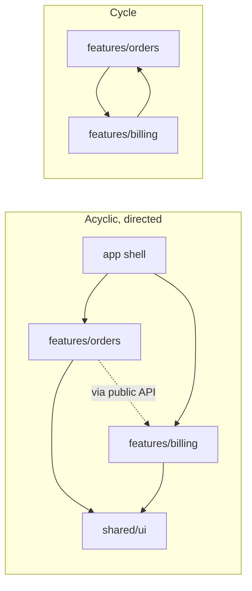
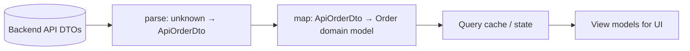
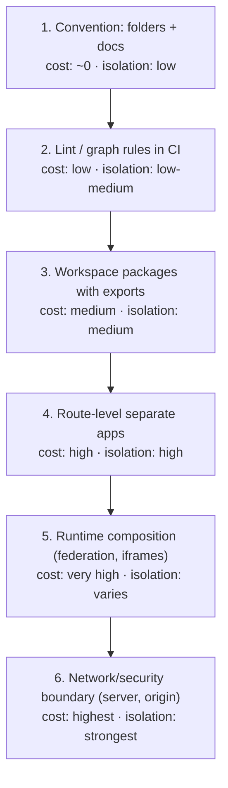
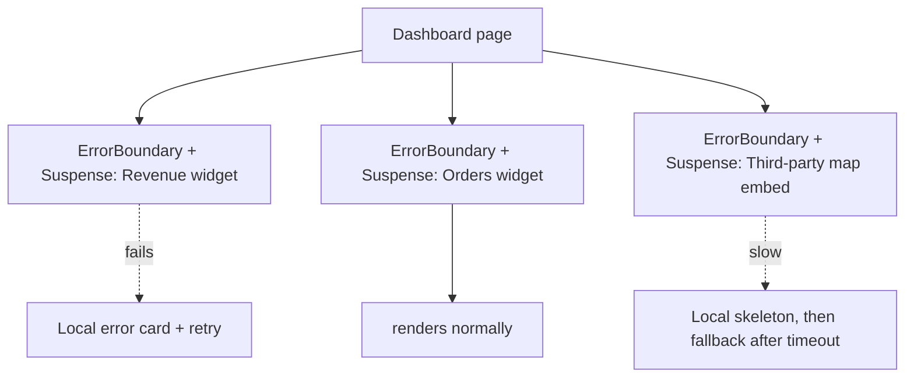

# 11 / 05 — Application Boundaries: Where One Module, App, Team, or Trust Zone Ends

## 1. Lesson metadata

| | |
|---|---|
| **Level** | Architect |
| **Study time** | 6 hours (reading 2.5 h, worked examples 1.5 h, exercises 2 h) |
| **Prerequisites** | [Modular architecture](../04-react-architecture/07-modular-architecture.md), [Domain-driven frontend](../04-react-architecture/08-domain-driven-frontend.md), [API boundaries and data access](../04-react-architecture/14-api-boundaries-and-data-access.md), [Error boundaries](../04-react-architecture/19-error-boundaries.md), [Multi-team ownership](../04-react-architecture/23-multi-team-ownership.md), [04 — Choosing abstraction level](./04-choosing-abstraction-level.md) |
| **Next** | [06 — Cross-cutting concerns](./06-cross-cutting-concerns.md) |
| **Related** | [Feature-sliced design](../04-react-architecture/09-feature-sliced-design.md), [Monorepos and shared packages](../04-react-architecture/22-monorepos-and-shared-packages.md), [React Server Components intro](../02-react-rendering-and-internals/27-react-server-components-intro.md), 12 — Micro-frontends, 13 — Monorepo vs multirepo |

**Learning objectives.** After this lesson you can:
1. Enumerate the *kinds* of boundary in a front-end system (module, package, application, deployment, runtime, trust, data, failure, team) and explain that they need not coincide.
2. Decide where to draw a boundary using domain cohesion, rate of change, team ownership, deployment cadence, and failure isolation — and quantify the cost of each added boundary.
3. Design the **contract** across a boundary: types, events, URLs, versioning, error semantics.
4. Protect a boundary: enforce import rules, parse untrusted data at the edge, build anti-corruption layers.
5. Compare the main architecture styles — modular monolith, multi-package monorepo, separate apps with a shell, micro-frontends, server/client split — against explicit criteria.
6. Recognise boundary smells (shared mutable state across apps, "god" shared package, circular dependencies, chatty contracts) and prescribe remedies.
7. Reason about the **client/server boundary** in React 19 (`"use client"`, Server Functions) as an architectural boundary with security and serialization consequences.

**Concepts covered:** bounded context, module boundary vs deployment boundary, public interface (published API), dependency direction, anti-corruption layer, Conway's law and the inverse Conway manoeuvre, shell/host app, runtime integration styles (build-time, server-side, iframe, module federation), contract testing, versioning and compatibility, trust boundary and parse-don't-validate, failure isolation, client/server boundary, boundary enforcement.

---

## 2. Deep conceptual explanation

### 2.1 What problem is this lesson solving?

Front-end systems fail at their *seams* far more often than in their interiors. A function inside a feature is easy to change; a function that 12 teams import, or a URL that 3 apps parse, or a payload shape that a mobile client and a web client both depend on, is hard to change. Boundaries determine:

- **Blast radius:** how far a change or failure propagates.
- **Autonomy:** whether a team can ship without coordinating.
- **Comprehensibility:** whether a developer can hold the relevant part in their head.
- **Cost:** every boundary has an integration cost: serialisation, versioning, duplicated dependencies, inconsistent UX, operational overhead.

The architect's question is never "should we have boundaries?" (you always do) but **"which boundaries, of what strength, at which places?"** ([01 — Trade-off analysis](./01-trade-off-analysis.md)).

### 2.2 A boundary is a promise plus an enforcement mechanism

A boundary is:

1. **A divide** — things on each side can change independently.
2. **A published interface** — the *only* sanctioned way across.
3. **A contract** — what the interface promises (shape, semantics, errors, performance, compatibility).
4. **Enforcement** — something that prevents bypassing it (language visibility, lint/dependency rules, process isolation, network, CI).

Without enforcement, a boundary is a convention that erodes. The *strength* of a boundary is how hard it is to cross illegitimately:

| Strength | Mechanism | Example | Cost |
|---|---|---|---|
| **Convention** | Folder naming, docs | `features/orders` "shouldn't" import `features/billing` internals | Free; erodes quickly |
| **Lint/static analysis** | Import restrictions, dependency-graph checks in CI | `no-restricted-imports`, dependency-cruiser-style rules | Low; bypassable by disabling |
| **Package boundary** | Separate package with `exports` map; only the public entry is resolvable | Workspace package `@acme/orders` | Medium: build config, versioning |
| **Build/deploy boundary** | Separately built and deployed artefacts | Separate apps; micro-frontends | High: integration, versioning, ops |
| **Process/network boundary** | Runs elsewhere; communicates by serialised messages | Server vs client; iframe; Web Worker; separate origin | Highest: serialisation, latency, failure modes |
| **Security boundary** | Different trust/privilege; origin isolation | Cross-origin iframe; server-only secrets | Strongest; deliberate |

**Rule:** use the weakest mechanism that gives the isolation you actually need; stronger boundaries cost more in integration and operations.

### 2.3 The kinds of boundary — and why they should be considered separately

People often equate "boundary" with "separate repo" or "micro-frontend". In reality a front-end system contains many boundary *types*, and conflating them leads to over-engineering.

| Boundary type | Question it answers | Typical front-end realisation |
|---|---|---|
| **Module** | What may import what, inside one codebase? | Feature folders, barrel files, lint rules |
| **Package** | What is a versioned, separately-built unit? | Workspace packages with `exports` |
| **Application** | What are the independently-served products? | Separate SPA/MPA/Next apps |
| **Deployment** | What is released independently? | Separate pipelines, versions |
| **Runtime/composition** | How do pieces combine in the browser? | Route-level, iframe, module federation, web components |
| **Domain (bounded context)** | Where does one model/vocabulary end? | `orders`, `billing`, `catalog` features with their own types |
| **Team/ownership** | Who is accountable? | CODEOWNERS, on-call rotations |
| **Data/contract** | What shapes cross, and who defines them? | API DTOs, events, URL schemas |
| **Trust/security** | What is untrusted? | Network input, URL params, storage, third-party scripts |
| **Failure** | What failure must not propagate? | Error boundaries, Suspense, circuit breakers, iframes |
| **Client/server** | What runs where, and what crosses? | `"use client"`, Server Functions, API calls |

These need not coincide. A modular monolith can have strong **domain** and **module** boundaries with one **deployment** boundary. A micro-frontend system has strong **deployment** boundaries but may have weak **domain** boundaries (everyone depends on a shared "common" package) — the worst combination, since it pays the integration cost and keeps the coupling.

### 2.4 Domain boundaries first

The most valuable boundary is usually the **domain boundary** (a *bounded context* in domain-driven design: [Domain-driven frontend](../04-react-architecture/08-domain-driven-frontend.md)): a region within which a model and vocabulary are consistent. "Order" in checkout (a cart being converted) differs from "Order" in fulfilment (a pick list) and from "Order" in finance (a ledger entry). Forcing one shared `Order` type across all of them couples the contexts.

Heuristics for finding domain boundaries:
- Different **vocabulary** or the same word with different meaning.
- Different **rates of change** and **change reasons**.
- Different **stakeholders**/experts.
- Different **data lifecycles** (transient cart vs durable ledger).
- Natural **transaction** boundaries: what must be consistent together?
- **Navigation** structure: where do users "enter" and "leave" a context?

Architectural rule: **draw domain boundaries before deployment boundaries**. A well-factored modular monolith can later be split along domain lines; a poorly-factored one split along arbitrary lines yields a *distributed monolith* — all the costs of distribution with all the coupling.

### 2.5 Conway's law and its inverse

Conway's observation (1968): organisations produce system designs that mirror their communication structures. Implication for boundaries:

- If the boundary doesn't match team structure, **either** the team structure or the boundary will win; expect the boundary to erode, or coordination to dominate.
- **Inverse Conway manoeuvre:** shape the teams to match the desired architecture (stream-aligned teams owning a whole domain end-to-end), rather than expecting an architecture to survive an incompatible org chart.

Practical test: for each proposed boundary, can you name **one team** that owns each side and **an interface they negotiate**? If one side has no owner, that's a smell ([Multi-team ownership](../04-react-architecture/23-multi-team-ownership.md)).

### 2.6 Dependency direction

Boundaries only help if dependencies point in a defined direction. Two common disciplines:

- **Layered:** higher layers may depend on lower ones, never the reverse (`app → features → shared`). Features do not import other features' internals.
- **Hexagonal / ports and adapters:** domain code depends on abstractions it owns (ports); infrastructure (HTTP, storage) implements them (adapters) ([Clean and hexagonal architecture](../04-react-architecture/10-clean-and-hexagonal-architecture.md), [Dependency inversion](../04-react-architecture/11-dependency-inversion.md)).

Rules that scale:
1. **No cycles** between modules/packages (cycles defeat independent change and break build tooling assumptions).
2. **Depend on stable, abstract things**; unstable, volatile things depend on stable ones (the stable-dependencies principle).
3. **Cross-feature collaboration goes through published interfaces** (a feature's `index.ts`, an event, a route) — never through deep imports.

### 2.7 The contract: what a good boundary interface contains

For each boundary, specify:

| Contract element | Examples | Failure if missing |
|---|---|---|
| **Shape** (types/schema) | Props, function signatures, event payloads, API DTOs | Runtime surprises; casts |
| **Semantics** | What `status: "pending"` *means*; ordering; idempotency | Divergent interpretation |
| **Errors** | Typed error cases; what the consumer must handle | Unhandled exceptions leaking implementation |
| **Versioning/compatibility** | Additive-only; deprecation windows; version negotiation | Breaking consumers silently |
| **Performance expectations** | Max payload; latency target; render cost | Hidden perf regressions |
| **Ownership & change process** | Who to ask; how to propose | Stalled changes |
| **Observability** | Correlation IDs, error attribution across the seam | Unattributable incidents |

**Make the contract machine-checkable** where possible: TypeScript types for in-repo boundaries; schemas (JSON Schema/OpenAPI/GraphQL SDL) and contract tests across deployables.

### 2.8 Trust boundaries: parse, don't assume

Anything crossing from outside your runtime's trust — HTTP responses, URL params, `localStorage`, `postMessage`, `window.name`, third-party script data — is *untrusted input* even if "our own API". TypeScript types do not exist at runtime: `const data = (await res.json()) as Order` is a **lie** the compiler accepts.

The principle (often phrased "parse, don't validate"): convert untrusted input into **well-typed domain values at the edge**, once, so the interior of the system can rely on invariants. In practice:

- A function `parseOrderDto(u: unknown): Order` (hand-written or via a schema library) at the data-access boundary.
- Failing *loudly and attributably* (error with context) rather than propagating `undefined` deep into rendering.
- Mapping from API shape (DTO) to domain/view model — the **anti-corruption layer** that stops backend naming and quirks from infecting the UI ([API boundaries and data access](../04-react-architecture/14-api-boundaries-and-data-access.md)).

### 2.9 The client/server boundary in React 19

With React Server Components and Server Functions (frameworks implement integration; ⚠ **verify against current React and framework docs**: this area evolves), the client/server boundary becomes explicit in the module graph:

- A **`"use client"`** directive marks a module as a client entry: it and its imports are shipped to the browser. It is a **module-graph boundary**, *not* a statement that the component only renders on the client (client components can be server-rendered for HTML, then hydrated).
- **Props that cross from a Server Component to a Client Component must be serialisable** by React's rules (plain data, certain built-ins, Promises supported with `use`; not arbitrary functions, class instances) — consult current docs for the exact list.
- **`"use server"`** marks Server Functions — callable from the client via an RPC-like boundary; arguments and return values are serialised; they are **public HTTP endpoints in effect** and must be authenticated, authorised, and validated like any API. ⚠ Don't assume "it's just a function call so it's safe".
- **Secrets and privileged code** must stay on the server side of the boundary; accidental import into a client module can leak them into bundles. Framework tooling offers guard mechanisms (e.g. packages marking modules server-only/client-only ⚠ verify names and availability in your framework).

Architecturally: the client/server boundary is a **trust boundary**, a **serialization boundary**, a **performance boundary** (network round trips, bundle size) and, for teams, often an **ownership boundary** (BE/FE). Treat it with the same discipline as any API.

### 2.10 Failure boundaries

A failure boundary limits how far a fault spreads:

- **React error boundaries** (class-based components using `getDerivedStateFromError`/`componentDidCatch`, or library wrappers) catch errors *during rendering, lifecycle methods and constructors* of descendants; they do **not** catch errors in event handlers, asynchronous code, or the boundary itself ([Error boundaries](../04-react-architecture/19-error-boundaries.md); React 19 adds the root reporting options `onCaughtError` and `onUncaughtError` (`onRecoverableError` dates from React 18) on `createRoot`/`hydrateRoot`; verified against react.dev and run on react-dom 19.3.1).
- **Suspense boundaries** isolate *loading* states.
- **Process/origin isolation** (iframes, workers) contain crashes and security issues more strongly.
- **Timeouts, retries and circuit breakers** at the data layer prevent one slow dependency from freezing all UI.
- **Per-widget isolation** in dashboards: one broken widget shows a local error state, not a blank page.

Design question: *what is the smallest region that can fail without making the whole page useless?* Put failure boundaries around **independently useful units** (widgets, routes, third-party embeds) rather than one global boundary only.

### 2.11 Misconceptions

| Misconception | Reality |
|---|---|
| "Micro-frontends are the way to get team autonomy." | They provide *deployment* autonomy at a high integration cost. Autonomy also comes from a modular monolith with clear ownership and CI boundaries. Evaluate both ([12](./12-microfrontends.md)). |
| "Separate repos = strong boundaries." | A repo boundary says nothing about coupling; a shared types package imported by everyone can couple harder than a monorepo with enforced module rules. |
| "A shared `common` package reduces duplication." | Without ownership and criteria it becomes a coupling hub that every change must go through — the boundary erodes into a ball of mud. |
| "TypeScript types protect the network boundary." | Types are erased; runtime data can differ. Parse at the edge. |
| "`'use client'` means client-only rendering." | It marks the client module boundary; client components may still render on the server for the initial HTML. |
| "Barrel files (`index.ts`) enforce encapsulation." | They *indicate* a public interface; without lint/`exports` enforcement deep imports still work. Barrels can also harm tree-shaking/dev performance in some toolchains ⚠ measure. |
| "Error boundaries catch all errors." | Only render-phase (and related) errors in descendants; not event handlers or async code. |
| "More boundaries = more modular." | Boundaries have integration costs; too many produce chatty contracts and ceremony. |

---

## 3. Internal mechanics

### 3.1 How module boundaries are actually enforced (and bypassed)

*Public guarantees (tooling-agnostic):* an ES module exposes only its `export`s; a bundler resolves import specifiers to files. *Teaching model:* "a package with an `exports` map in `package.json` exposes only listed entry points to consumers" — Node and modern bundlers honour `exports`, so deep imports of unlisted paths fail to resolve. *Implementation details:* editor/TS configuration must also respect `exports` (TypeScript only honours `exports` with `moduleResolution` set to `node16`/`nodenext`/`bundler`; the legacy `node10` mode ignores it), and path aliases (`tsconfig` `paths`) can bypass package boundaries accidentally.

Typical bypass routes:
1. Deep relative imports (`../../orders/internal/utils`).
2. Path aliases mapping straight to another package's `src`.
3. `// eslint-disable` on restricted-import rules.
4. Re-export of an internal symbol through the public barrel "just for this one case".
5. Type-only imports (don't affect runtime, but still create coupling to internal types).

### 3.2 Dependency graphs and cycles

A module graph is a directed graph; cycles make a *strongly connected component* that must be understood and released as a unit. Tools compute the graph (dependency-cruiser, madge, bundler analysers) and can fail CI on cycles or on rule violations.



Why cycles hurt in practice: initialisation-order bugs (ES module cycles can observe `undefined`/uninitialised bindings depending on evaluation order — see [Modules and dependency graphs](../00-web-and-javascript-foundations/10-modules-and-dependency-graphs.md)), inability to split packages, slower incremental builds, and mental load.

### 3.3 Runtime composition options

How separately-owned pieces become one page ("integration style"). *Teaching model; specifics vary by tool and version ⚠.*

| Style | How it composes | Isolation | Typical cost |
|---|---|---|---|
| **Build-time (monorepo packages)** | Packages bundled into one app | Source-level only; one deploy | Lowest runtime cost; deployment coupling |
| **Route-level (separate apps behind a router/proxy)** | Edge/server routes URL prefixes to different apps; hard navigations | Strong (separate pages) | Full page loads between apps; duplicated shared deps; shared navigation chrome needs care |
| **Server-side composition** | Server stitches HTML fragments (SSI, edge includes, framework features) | Medium | Operational complexity; fragment contracts |
| **Client-side runtime (module federation / dynamic import of remotes)** | Shell loads remote bundles at runtime | Weak runtime isolation (shared globals, one main thread) unless extra measures | Version skew, shared singletons (React instance!), complex failure handling |
| **Iframe** | Separate browsing context | Strong (security, CSS, JS) | UX friction (sizing, focus, history, a11y), cross-frame messaging via `postMessage` |
| **Web Components** | Custom elements as integration contract | CSS isolation via Shadow DOM, JS shared | Framework interop details (events, props as attributes/properties); verify for React 19's custom element support in docs |

All runtime-composition styles share the **main thread** (except iframes in separate processes in some browsers — an implementation detail, ⚠ not a guarantee for same-site iframes). A slow remote can block the shell.

**The shared-singleton problem** (client-side composition): if the shell and a remote each bundle their own copy of React, hooks and context won't work across the boundary; if they share one copy, **version skew** between teams becomes a coordination point. This is a concrete example of *a deployment boundary quietly reintroducing a coordination boundary*.

### 3.4 Messaging across boundaries

When two modules/apps can't import each other, they communicate by **messages**: events, a pub/sub bus, URLs, or storage. Mechanically in the browser:

- **`CustomEvent` on `window`/`document`** — same-document, decoupled, untyped by default.
- **`BroadcastChannel`/`storage` events** — across tabs of the same origin.
- **`postMessage`** — across windows/frames/workers; **always check `event.origin` and validate payloads**.
- **URL as state** — universal, user-visible, shareable.
- **Shared store** in a shell — convenient but couples; treat its API as a contract and keep it tiny.

Design rules: messages are **facts** ("OrderPlaced") or **commands** ("OpenCart") with versioned, minimal payloads; prefer facts (decoupled) over commands (couples sender to receiver's capabilities).

### 3.5 Anti-corruption layer (ACL) mechanics



Each arrow is a function with a name and tests. Benefits: backend renames/null-handling/legacy enums stop at the layer; the domain model uses UI-useful names and invariants (money as integer minor units, dates as `Temporal`/ISO strings consistently); failures are attributed to the layer (parse errors vs render errors).

---

## 4. Step-by-step execution walkthrough

**Decision walkthrough: "Our single SPA (180 engineers over time, 6 domains) is slowing us down. Should we split it?"**

**Step 1 — State the pain in measurable terms.** Median PR waits 2.5 days; CI takes 38 min; 4 of the last 10 releases were rolled back due to unrelated team changes; two teams routinely edit the same `store.ts`; bundle p75 for `/settings` includes billing code.

**Step 2 — Map the current boundaries.** Using a dependency graph: 14 cycles among features; `shared/` has 600 files imported everywhere; 3 features import each other's internals. **Finding:** domain and module boundaries are weak; the pain is mostly *coupling*, not lack of deployment independence.

**Step 3 — Identify candidate boundaries.** Domains: Catalog, Orders, Billing, Support, Settings, Analytics. Team ownership: 6 stream-aligned teams roughly matching. Release cadence: Billing needs audit; Analytics ships daily.

**Step 4 — Ladder the options by boundary strength** (cheapest first):
 1. Enforce module boundaries in the monolith (lint/graph rules, public APIs, CODEOWNERS).
 2. Split into workspace packages with `exports`, per-package CI (affected-only builds).
 3. Route-level separation for the one domain with a distinct cadence and compliance need (Billing).
 4. Full micro-frontends via runtime composition.

**Step 5 — Evaluate evidence per rung against the pain.**
- CI time and conflicts: rungs 1–2 plus affected-only CI likely address most of it.
- Rollbacks from unrelated changes: need *deployment* isolation → rung 3 for Billing; others may be solved by flags and better testing.
- Bundle p75 for Settings: route-level code splitting.
- Team autonomy: ownership + enforced boundaries.

**Step 6 — Decide and stage.** Do 1 and 2 now (weeks), measure; extract Billing to its own deployable only if the compliance cadence stays a blocker after 1–2. Reject rung 4 for now; revisit if more teams need independent stacks/versions (reversal trigger).

**Step 7 — Design the contract for the Billing boundary** (§5.4): URL scheme `/billing/*`, shared session via cookie, a shared navigation manifest, events for `CartUpdated`/`PlanChanged`, error and loading conventions, and contract tests.

**Step 8 — Enforce** (§5.2): graph rules in CI; ownership; a changelog of the contract.

**Step 9 — Measure.** CI time, PR wait time, rollbacks attributable to cross-domain changes, bundle sizes, and number of rule violations per month.

The key move: *start from pain, climb the boundary-strength ladder only as far as the evidence requires.*

---

## 5. Code examples

### 5.1 Minimal example: a feature's public interface

```text
src/features/orders/
  index.ts              ← the ONLY file other features may import
  OrdersPage.tsx
  api/ordersApi.ts
  model/order.ts
  internal/…            ← private
```

```ts
// src/features/orders/index.ts — the published interface
export { OrdersPage } from "./OrdersPage";
export type { Order, OrderId } from "./model/order";
export { useOrderSummary } from "./model/useOrderSummary"; // intentionally exposed, small, stable
// NOT exported: ordersApi, internal/*, reducers, cache keys
```

```tsx
// src/features/billing/InvoiceHeader.tsx
import { useOrderSummary, type OrderId } from "@/features/orders";   // ok: public API
// import { ordersKeys } from "@/features/orders/api/ordersApi";    // ✗ deep import: forbidden by lint rule
```

**Line notes.**
- The barrel is a *declaration of intent*; enforcement is in §5.2.
- Exporting `useOrderSummary` (a hook returning a narrow view model) rather than the query cache key makes the dependency **semantic** ("I need an order summary") instead of **mechanical** ("I need your cache internals").
- Note the cost: any consumer-visible change to `useOrderSummary` is a breaking change for Billing; that's what a published interface means. Keep it tiny.

### 5.2 Practical example: enforcing boundaries with lint rules and a graph check

ESLint's built-in `no-restricted-imports` can express the deep-import rule. Flat config (run-tested with ESLint 9: it flags `@/features/orders/api/ordersApi` and `@/features/orders/x`, allows `@/features/orders`, and, as the critique below says, also flags the owning feature's own alias imports):

```js
// eslint.config.js (excerpt)
export default [
  {
    files: ["src/features/**/*.{ts,tsx}"],
    rules: {
      "no-restricted-imports": ["error", {
        patterns: [
          {
            group: ["@/features/*/*", "@/features/*/**"],
            message: "Import other features only through their public API (@/features/<name>). See ADR-021.",
          },
        ],
      }],
    },
  },
];
```

**Critique.** This rule bans *all* deep imports, including a feature importing its **own** internals via the alias (`@/features/orders/api/ordersApi` from within `orders`). Fixes: use relative imports inside a feature; or use a plugin that understands "same feature" (e.g. `eslint-plugin-boundaries` or a dependency-graph tool); or add per-feature overrides. A recurring lesson: **a naive rule teaches people to disable it**; make the correct path ergonomic.

A graph-level check in CI (dependency-cruiser config, run-tested with dependency-cruiser 18.7: it reported `billing → orders/api/ordersApi.ts` and `shared → features/orders/index.ts`, and did not flag the intra-feature import or the import of another feature's `index.ts`):

```js
// .dependency-cruiser.cjs (excerpt, illustrative)
module.exports = {
  forbidden: [
    { name: "no-circular", severity: "error", from: {}, to: { circular: true } },
    {
      name: "features-only-via-public-api",
      severity: "error",
      from: { path: "^src/features/([^/]+)/" },
      to: {
        path: "^src/features/([^/]+)/",
        pathNot: ["^src/features/$1/", "^src/features/[^/]+/index\\.ts$"],
      },
    },
    {
      name: "shared-must-not-import-features",
      severity: "error",
      from: { path: "^src/shared/" },
      to: { path: "^src/features/" },
    },
  ],
};
```

**Line notes.**
- Rule 1 forbids cycles at any granularity.
- Rule 2 expresses "a feature may import its own files, or another feature's `index.ts`, nothing else" using dependency-cruiser's capture-group reference (`$1` in `to.pathNot` refers to the group captured in `from.path`; verified).
- Rule 3 enforces dependency direction: `shared` is a lower layer.
- Combine with **CODEOWNERS** so a change to `index.ts` of a feature requires the owning team's review: the public API is the thing most worth reviewing.

**Trade-off.** Strict rules slow quick fixes; offer an *exception process* (allow-list file with expiry dates, tracked like a ratchet; see [03](./03-large-scale-refactoring.md) §2.4.5) rather than inline disables.

### 5.3 Incorrect: the shared grab-bag and the unparsed boundary

```ts
// shared/common/index.ts  (owned by "everyone")
export * from "./orderUtils";
export * from "./billingUtils";
export * from "./userStore";      // a Zustand store!
export * from "./constants";
export * from "./api";
```

```ts
// features/orders/api.ts
export async function getOrder(id: string) {
  const res = await fetch(`/api/orders/${id}`);
  return (await res.json()) as Order; // ✗ asserts, doesn't verify
}
```

Problems:
1. `common` couples every domain to every other (orders ← billing utils, billing ← orders utils); no owner; any change triggers rebuilds/tests everywhere; cycles emerge.
2. A **mutable shared store** (`userStore`) in a shared bundle is *shared mutable state across domain boundaries* — any feature can write to it; reasoning about changes requires reading all features.
3. `as Order` makes the compiler believe untrusted JSON conforms; a backend change yields `undefined` deep in rendering, far from the cause. Also: no status-code check (`res.ok`), no error mapping, no cancellation signal.
4. `export *` hides what's public and defeats tree-shaking analysis in some toolchains ⚠.

### 5.4 Corrected: anti-corruption layer at the data boundary

```ts
// features/orders/api/orderDto.ts — what the backend sends (legacy names intact)
export interface OrderDto {
  order_id: string;
  total_cents: number;
  currency: string;
  state: "OPEN" | "SHIPPED" | "CANCELLED" | "RETURNED";
  created: string; // ISO-8601
}

// features/orders/model/order.ts — what the UI works with
export type OrderStatus = "open" | "shipped" | "cancelled" | "returned";
export interface Order {
  id: string;
  total: { minor: number; currency: string };
  status: OrderStatus;
  createdAt: Date;
}
```

```ts
// features/orders/api/parseOrder.ts — the trust boundary: unknown → Order
import type { OrderDto } from "./orderDto";
import type { Order, OrderStatus } from "../model/order";

export class ParseError extends Error {
  constructor(public readonly path: string, message: string) {
    super(`${path}: ${message}`);
    this.name = "ParseError";
  }
}

const STATUS: Record<OrderDto["state"], OrderStatus> = {
  OPEN: "open", SHIPPED: "shipped", CANCELLED: "cancelled", RETURNED: "returned",
};

function isRecord(u: unknown): u is Record<string, unknown> {
  return typeof u === "object" && u !== null;
}

export function parseOrder(u: unknown): Order {
  if (!isRecord(u)) throw new ParseError("$", "expected object");
  const { order_id, total_cents, currency, state, created } = u;
  if (typeof order_id !== "string") throw new ParseError("$.order_id", "expected string");
  if (typeof total_cents !== "number" || !Number.isInteger(total_cents)) throw new ParseError("$.total_cents", "expected integer");
  if (typeof currency !== "string" || currency.length !== 3) throw new ParseError("$.currency", "expected ISO-4217 code");
  if (typeof state !== "string" || !Object.hasOwn(STATUS, state)) throw new ParseError("$.state", `unknown state ${String(state)}`);
  if (typeof created !== "string" || Number.isNaN(Date.parse(created))) throw new ParseError("$.created", "expected ISO date");
  return {
    id: order_id,
    total: { minor: total_cents, currency },
    status: STATUS[state as OrderDto["state"]],
    createdAt: new Date(created),
  };
}
```

```ts
// features/orders/api/ordersApi.ts
import { parseOrder } from "./parseOrder";

export class HttpError extends Error {
  constructor(public readonly status: number, public readonly url: string) { super(`HTTP ${status} ${url}`); this.name = "HttpError"; }
}

export async function getOrder(id: string, signal?: AbortSignal) {
  const url = `/api/orders/${encodeURIComponent(id)}`;
  const res = await fetch(url, { signal, headers: { Accept: "application/json" } });
  if (!res.ok) throw new HttpError(res.status, url);
  return parseOrder(await res.json());
}
```

**Line notes.**
- **`unknown` in, `Order` out:** the only function that may touch raw JSON. Everything downstream sees domain types with invariants (integer minor units, a closed status union).
- **`Object.hasOwn(STATUS, state)`** guards unknown backend states (a plain `in` check would also accept inherited keys such as `"toString"`; `Object.hasOwn` requires an ES2022 lib/runtime, otherwise use `Object.prototype.hasOwnProperty.call`): failing loudly at the boundary is intentional; an alternative is mapping unknown states to `"unknown"` and rendering gracefully — a *product decision* (resilience vs strictness) to record in the design doc. For rolling backend deployments, tolerant parsing of *additive* fields and unknown enum values is often wiser; strict parsing is better where silent misinterpretation is dangerous (money).
- **`encodeURIComponent`** prevents path injection from an `id` that contains `/` or `?`.
- **`signal`** supports cancellation ([Cancellation and race conditions](../06-data-fetching-and-state-ecosystems/02-cancellation-and-race-conditions.md)).
- Production code often uses a schema library to generate parsers and types from one definition; the hand-written version shows exactly what the boundary does. ⚠ If you adopt a library (e.g. Zod, Valibot), verify its current API; the architectural point is unchanged.
- Cost: each endpoint needs a parser and tests; for 200 endpoints that's real work — hence code generation from OpenAPI schemas or schema libraries at scale (see [04](./04-choosing-abstraction-level.md) on config-driven approaches).

### 5.5 Advanced: a typed event contract between independently deployed apps

Two apps (a shell and a Billing app) cannot import each other. They agree on a **versioned event contract** published as a tiny, dependency-free package `@acme/contracts`.

```ts
// @acme/contracts/events.ts
export interface AppEvents {
  "cart:updated@1": { cartId: string; itemCount: number };
  "plan:changed@1": { accountId: string; plan: "free" | "pro" | "enterprise" };
}
export type EventName = keyof AppEvents;
export const EVENT_PREFIX = "acme:" as const;
```

```ts
// @acme/contracts/bus.ts
import { EVENT_PREFIX, type AppEvents, type EventName } from "./events";

export function emit<N extends EventName>(name: N, detail: AppEvents[N]): void {
  window.dispatchEvent(new CustomEvent(EVENT_PREFIX + name, { detail }));
}

export function on<N extends EventName>(name: N, handler: (detail: AppEvents[N]) => void): () => void {
  const listener = (e: Event) => handler((e as CustomEvent<AppEvents[N]>).detail);
  window.addEventListener(EVENT_PREFIX + name, listener);
  return () => window.removeEventListener(EVENT_PREFIX + name, listener);
}
```

```tsx
// in a React component of either app
import { useEffect, useState } from "react";
import { on } from "@acme/contracts/bus";

export function CartBadge() {
  const [count, setCount] = useState(0);
  useEffect(() => on("cart:updated@1", (d) => setCount(d.itemCount)), []);
  return <span aria-label={`${count} items in cart`}>{count}</span>;
}
```

**Line notes.**
- Event names carry a **version suffix** (`@1`); a breaking change introduces `@2` and both can be emitted during a deprecation window — expand/contract at the event level ([03](./03-large-scale-refactoring.md)).
- `on` returns an unsubscribe function, which is exactly what `useEffect` expects as cleanup — and under StrictMode in development, the effect runs, cleans up, and re-runs, so the subscription must be idempotent (it is).
- The cast `(e as CustomEvent<…>)` is the one place the type system is trusted: an untyped emitter elsewhere could send a wrong payload. Across **separately deployed** apps where payloads come from code you don't control, add runtime validation in `on` for events that matter.
- **Late subscribers miss past events** (a `CartBadge` mounted after the last `cart:updated` shows 0). Events are facts about *transitions*, not state; if consumers need *current state*, expose a query (`getCartCount()` from a shared service or a request/response event) or replay the last value. This is a classic boundary design bug.
- **Trade-off versus a shared store:** events are decoupled but harder to trace; a shared store is easier to follow but couples apps to the store shape and the library choice. Use events for cross-domain *notifications*, URLs for navigational state, and server-held state for authoritative data.
- Same-origin only: `postMessage` with origin checks is required across origins.

---

## 6. Visual explanations

### 6.1 Boundary strength ladder (cost vs isolation)



Climb only as far as the pain requires.

### 6.2 Layers and allowed dependency directions

```text
          +-----------------------------+
          |  app (shell, routing, DI)   |  may import: features, shared
          +-----------------------------+
          |  features/<domain> (public  |  may import: shared, other features' PUBLIC API
          |  API via index.ts)          |
          +-----------------------------+
          |  shared/ui, shared/lib      |  may import: nothing from features/app
          +-----------------------------+
          |  platform (http, logging,   |  may import: nothing above
          |  config)                    |
          +-----------------------------+
   Arrows only point DOWN; cross-feature arrows go through index.ts or events.
```

### 6.3 Client/server boundary as an API

```mermaid
sequenceDiagram
  participant B as Browser (client modules)
  participant S as Server (server modules)
  B->>S: Request (navigation / Server Function call)
  Note over B,S: Boundary: serialised args · auth · validation
  S->>S: Authorise + validate input
  S-->>B: Serialised result (HTML / RSC payload / JSON)
  Note over B: Only serialisable data crosses; no secrets, no functions/classes
```

### 6.4 Failure boundaries around independently useful units



---

## 7. Alternative approaches and trade-offs

| Style | Team autonomy | Deploy independence | Consistency (UX/design) | Perf (bundle/runtime) | Operational cost | Reversibility | Best when |
|---|---|---|---|---|---|---|---|
| **Modular monolith** (one app, enforced module boundaries) | Medium–high (with ownership + CI affected builds) | Low (one deploy) | High | Best (one dependency graph, shared chunks) | Low | High (can split later along domain lines) | Most products; ≤ ~10 teams; shared release train acceptable |
| **Monorepo, multiple apps + shared packages** | High | High per app | Medium–high (shared design system) | Good per app; duplicate runtime per app | Medium | Medium | Distinct products/audiences, one org, shared tooling |
| **Route-level multi-app behind proxy** | High | High | Medium (shared nav and design system needed) | Hard navigations; duplicated deps | Medium–high | Medium | Domains with distinct cadence/compliance; legacy coexistence |
| **Micro-frontends (client-side composition)** | Highest | Highest | Hard (discipline, shared libs) | Risk: duplicated deps, waterfalls, shared main thread | High | Low | Many autonomous teams, mixed stacks, strong platform team ([12](./12-microfrontends.md)) |
| **Iframe-based composition** | High | High | Hard (sizing, focus, a11y) | Heavy per-frame | Medium | Medium | Strong isolation need (untrusted/legacy/third-party content) |
| **Server-composed (RSC / edge fragments)** | Medium | Medium | High | Good (less client JS) | Medium–high (server infra) | Medium | Content-heavy pages; teams comfortable with server runtime ⚠ verify framework maturity for your needs |
| **Separate repos per domain** | High | High | Hard (version skew) | Same as above | High (cross-repo changes) | Low | Strict org/legal separation; very large scale |

**Scenario where the recommended approach (modular monolith + enforced boundaries) is *not* best.** (1) Teams need **different runtime stacks or release cadences** that cannot be reconciled (e.g. regulated Billing app with quarterly audited releases vs a daily-shipping marketing surface): separate deployment boundaries pay off. (2) **Acquisitions** with existing apps: composing at route level beats rewriting. (3) **Untrusted or third-party content** (user-supplied widgets, partner embeds): iframes/sandboxing are warranted for *security*, regardless of team structure. (4) **Thousands of engineers**: the coordination cost of a single deploy pipeline can outweigh integration costs.

---

## 8. Best practices and anti-patterns

### 8.1 Good practice
- Draw **domain boundaries first**; map teams to them; let deployment follow.
- Publish a **small public API** per module; review changes to it as contract changes.
- **Enforce** boundaries automatically (lint, graph rules, `exports`, CODEOWNERS), with an exception process that expires.
- **Parse at the edge**; map DTOs to domain types; keep API names out of components.
- Keep **cross-boundary communication** to a few mechanisms (URLs, events, public hooks); document them.
- Make contracts **versioned and additive-first**; deprecate with warnings and removal dates.
- Place **failure boundaries** around independently useful units; test failure paths.
- **Measure boundaries**: cycles, cross-feature imports, cross-team PRs, build time, and the bundle contribution of each domain.
- Treat the **client/server boundary** as a public API: authenticate, authorise, validate every server-callable entry.

### 8.2 Beginner mistakes
- Importing another feature's internals "because it's easier".
- Using `as` to describe API responses.
- One global store for everything, including data owned by different domains.

### 8.3 Experienced-developer mistakes
- **Distributed monolith:** splitting into deployables without separating domains.
- **Shared `common` package** with no ownership.
- **Premature micro-frontends** (solving an org problem with a runtime architecture).
- **Chatty contracts:** a boundary crossed 50 times per interaction (serialisation + latency + coupling).
- **Leaky abstractions at boundaries:** exposing the cache key, store shape, or backend DTO.
- **Boundary by technology** (`components/`, `hooks/`, `utils/`) instead of domain; changes touch every folder ([Feature vs layer structure](../04-react-architecture/06-feature-vs-layer-structure.md)).
- Forgetting **operational** boundaries: logging, tracing, and error attribution across the seam.

### 8.4 Smells
- A feature's PR routinely edits three other features.
- `shared/` imports from `features/`.
- Cycles in the dependency graph and "temporary" cycle allow-lists.
- Two apps sharing a mutable global (`window.__STORE__`).
- Version-skew bugs on release days.
- Types duplicated across boundaries by hand.
- A public API with > ~15 exports.

### 8.5 Justified exceptions
- A feature may import another's internals temporarily during a **migration** (tracked in a ratchet).
- Shared global state across apps is acceptable for **truly global, small, well-owned** concerns (auth session, locale) exposed through a tiny contract.
- Strict parsing may be relaxed in **internal prototypes**; record it.

---

## 9. Real-world application

| Domain | Key boundary decision | Notes |
|---|---|---|
| **E-commerce** | Checkout isolated from catalog/marketing: separate failure and often separate deploy | PCI scope shrinks if payment fields live in an isolated iframe/hosted fields provided by the payment processor ⚠ check provider and compliance guidance |
| **Dashboards** | Per-widget failure and data boundaries | One broken data source shouldn't blank the page; widget contract: `(config) → {data, loading, error}` |
| **Finance** | Money and rounding are a *domain* boundary with a single implementation; strict parsing at the API edge | Audit trail: record which version/contract produced a displayed value |
| **Forms-heavy** | Form state boundary vs server-state boundary | Draft state in the form; authoritative state in the server cache; define when they sync ([Server vs client state](../04-react-architecture/16-server-vs-client-state.md)) |
| **Auth** | Trust boundary between untrusted client and server; session ownership single-sourced | Tokens/cookies policy; never rely on client-side route guards for security (UX only) |
| **Real-time** | Message boundary with ordering, deduplication and reconnection semantics | Contract includes sequence numbers/idempotency keys |
| **Multi-team** | Ownership boundary with CODEOWNERS and contract review | Platform team owns shell and shared packages; feature teams own domains |

**Engineering constraints:**
- **Cross-boundary navigation** (hard vs soft nav) affects perceived speed — prefetch, shared cache headers.
- **Shared dependencies** (React, router, design system) duplicated per deployable cost bytes; version-skew policy needed.
- **Observability:** propagate correlation IDs across the seam so a user-visible failure can be traced to the owning team.
- **Security:** cross-origin messaging requires origin allow-lists; CSP and iframe sandboxing attributes need explicit review.
- **Compliance:** data residency and PII handling may *mandate* a boundary.

---

## 10. Debugging and troubleshooting

| Symptom | Likely root cause | Investigation | Fix / validation |
|---|---|---|---|
| Changing Orders breaks Billing tests | Billing imports Orders internals or shared mutable state | Dependency graph query: who imports `orders/**` besides `index.ts`; search for shared store writes | Introduce public API; replace with a narrow hook/event; add the graph rule; validate with failing-then-passing rule check |
| "Cannot read properties of undefined" deep in rendering after a backend deploy | Unparsed API boundary; DTO drift | Compare payload with types; check when failure began vs backend deploy; grep for `as` on `res.json()` | Add edge parser with tests from captured payloads; alert on `ParseError` rates |
| Hooks error: "Invalid hook call" in a remote | Two copies of React (shell + remote) | `npm ls react` / bundle analysis; in the browser check how many copies were loaded | Share React as a singleton with a version range policy, or avoid hooks across the seam; validate in a staging with both deployed |
| Remote works alone but not in the shell | CSS collisions, global singletons, router mismatches | Compare computed styles; check duplicated context providers; check base paths | Namespace CSS or use Shadow DOM/CSS Modules; pass router base explicitly; contract tests in the shell |
| Late-mounted component shows stale default after events | Event contract lacks current-state semantics | Log event timing vs mount timing | Provide a query API or replay; document "events are not state" |
| Build time grows; changing one file rebuilds everything | Cycles/`shared` hub | Dependency graph; measure fan-in of `shared/*` | Split `shared` by purpose with owners; break cycles via dependency inversion |
| Bundle for route X contains unrelated domains | Barrel imports (`import { a } from "@/features"`) pulling whole graph; side-effectful modules | Bundle analyser; check `sideEffects` flags | Import from the specific public entry; mark packages side-effect-free if true ⚠ verify; split entry points |
| Server Function accepting arbitrary input is exploited | Treated as internal function; missing authz/validation | Review each `"use server"` function's auth and input validation; log inputs | Add authentication, authorisation, and runtime validation; rate limit; test with malformed inputs |
| Entire page blank when a widget throws | No failure boundary around the widget | Reproduce with a forced error; check component tree | Wrap independently useful units in error boundaries; add reporting; verify via error-injection test |
| `postMessage` handler triggered by unknown sites | Missing origin check | Review handlers for `event.origin` verification | Allow-list origins; validate payload; test with a malicious frame |

**Investigation recipe: auditing a boundary.**
1. Draw the actual graph from tools, not from memory.
2. For each boundary, list what crosses (imports, events, URLs, storage keys, globals).
3. Classify crossings as *published* or *accidental*.
4. For accidental crossings: remove, promote to published (with owner review), or accept with an expiry.
5. Add enforcement; **validate** by trying to violate the rule in a throwaway branch and watching CI fail.

---

## 11. Exercises

### Level A — Knowledge
A1. List six boundary types from §2.3 and give a front-end realisation of each.
A2. Why is "draw domain boundaries before deployment boundaries" good advice? What is a *distributed monolith*?
A3. Name three bypass routes around an `index.ts` public API.
A4. State what `"use client"` does and does not mean.
A5. What do React error boundaries *not* catch?

### Level B — Code comprehension
B1. In §5.4, `parseOrder` throws on an unknown `state`. Describe one scenario where this is the right behaviour and one where it is harmful, and propose how to decide.
B2. In §5.5, a component mounts after the last `cart:updated@1` event was emitted. What does it display and why? Name two designs that fix it.
B3. Given the dependency-cruiser sketch in §5.2, would an import from `src/features/orders/OrdersPage.tsx` to `src/features/billing/index.ts` be allowed? What about `src/features/billing/internal/x.ts`? What about from `src/shared/ui/Button.tsx` to `src/features/orders/index.ts`?
B4. What breaks (and why) in this code?
```ts
// shell
import React from "react";
const Remote = React.lazy(() => import("billing/Widget")); // remote bundles its own React copy
```

### Level C — Implementation
C1. Write `parseInvoice(u: unknown): Invoice` for `{ id: string; amount: number; due: string | null; lines: {sku: string; qty: number}[] }`, returning a domain `Invoice` where `due` is `Date | undefined`, with path-aware `ParseError` and tests (table-driven) covering missing field, wrong type, empty `lines`, and invalid date.
C2. Write a `postMessage` bridge `createFrameChannel(frame: HTMLIFrameElement, allowedOrigin: string)` exposing typed `send(msg)` and `onMessage(handler)`, verifying `event.origin` and `event.source`, and returning an unsubscribe.

### Level D — Debugging
D1. After splitting a monolith into Orders and Billing deployables, "Invalid hook call" appears only in production when Billing renders inside the shell. List the likely causes in order of likelihood, and your investigation steps.
D2. A team reports that every PR touching `shared/utils.ts` triggers 40-minute CI across all packages. Using graph analysis, propose a plan to reduce this without a rewrite.
D3. A Server Function `updateProfile(formData)` was shipped without auth checks because "only the profile page calls it". Describe the vulnerability, how to demonstrate it, and the fix.

### Level E — Architecture and engineering decisions
E1. A company has 8 teams, one React SPA, a 25-minute CI, and weekly releases that regularly slip because of cross-team regressions. Propose a boundary strategy with staged milestones, measures and reversal triggers. Decide on whether micro-frontends are justified.
E2. Define the boundary and contract between a **shell** app and **feature modules** for: routing, auth/session, navigation, theming, error handling, analytics. Which of these should be centralised, which delegated?
E3. Choose between (a) shared TypeScript types package generated from OpenAPI and (b) each consumer hand-writing types + parsers. Evaluate with criteria, including versioning and runtime safety.

### Level F — Expert challenge
F1. Design the boundary architecture for a platform where **third-party developers** can publish widgets embedded in your dashboards (untrusted code). Address isolation, communication, performance, accessibility, review/versioning, and revocation.
F2. You are asked to decide whether Billing (regulated, quarterly audited) should be a separate deployable. Produce the decision using [01](./01-trade-off-analysis.md): constraints, options, criteria, evidence to collect, and reversal triggers. Include the integration contract you'd require.

---

## 12. Detailed answers and explanations

> Attempt the exercises first.

### Level A

**A1.** Any six, e.g.: *Module* — feature folder with `index.ts` + lint rule; *Package* — workspace package with `exports`; *Application* — separate SPA; *Deployment* — separate pipeline; *Runtime composition* — route-level proxy, iframe, module federation; *Domain* — bounded context such as `orders` with its own types; *Team* — CODEOWNERS; *Data/contract* — API DTO schema, event payload; *Trust* — parser at the network edge; *Failure* — error boundary; *Client/server* — `"use client"` module graph boundary and Server Functions.

**A2.** Domain boundaries encode cohesion and change reasons, and survive technology shifts. Deployment boundaries only isolate release and runtime. If you split deployment along arbitrary lines, the pieces still need to change together (high coupling) but now pay versioning, network, and operational costs: a *distributed monolith* — independently deployed units that cannot be changed independently.

**A3.** Examples: deep relative imports; path aliases pointing at another package's `src`; disabling the lint rule inline; exporting internals through the barrel "just this once"; type-only imports of internal types; reaching in via a shared global. Any three.

**A4.** `"use client"` marks a module as a client entry point of the module graph: it and its imports are bundled for the browser, and it can use client-only features (state, effects, browser APIs). It does *not* mean the component renders only in the browser — client components can still be pre-rendered to HTML on the server and hydrated. Props crossing from server components must be serialisable ⚠ verify the current serialisable-types list in React docs.

**A5.** They do not catch errors in event handlers, asynchronous code (promises, timers) unless re-thrown into render, errors thrown in the error boundary itself, or server-side rendering errors (those are handled by the server rendering APIs). (React 19 root options `onCaughtError`, `onUncaughtError` (and, since 18, `onRecoverableError`) are the central place to report them.)

### Level B

**B1.** *Right:* a money-handling endpoint where an unknown `state` could be misinterpreted (e.g. showing "shipped" for something not understood) — fail loudly, alert, show a controlled error. *Harmful:* a rolling backend deploy introduces a new enum value `"ON_HOLD"`; strict parsing throws and **every** order page fails for all users until the frontend is updated. Decision: classify by blast radius and ability to degrade — for display-only fields, map unknown to `"unknown"` and render neutrally while reporting the anomaly; for fields driving decisions with consequences (money, permissions), fail closed. Record per-field in the contract; coordinate additive-change policy with BE ("new enum values are announced N days ahead, clients must tolerate unknown values").

**B2.** It displays the initial `0`, because the event already fired and `window` doesn't replay it; the subscriber only sees *future* events. Fixes: (1) provide a *query* — a synchronous/async `getCartCount()` or a request/response event ("cart:request" → "cart:updated") that the component calls on mount; (2) have the emitter cache the last payload and the bus replay it to new subscribers (a "behaviour subject"); (3) let the authoritative state live on the server (query on mount). The principle: events convey transitions, not current state.

**B3.** `orders/OrdersPage.tsx → billing/index.ts`: allowed (cross-feature via public `index.ts`; `pathNot` matches). `orders/OrdersPage.tsx → billing/internal/x.ts`: forbidden (not the same feature and not `index.ts`). `shared/ui/Button.tsx → orders/index.ts`: forbidden by the `shared-must-not-import-features` rule (dependency direction). Caveat: verify the `$1` back-reference semantics in the tool's current docs; the sketch demonstrates intent.

**B4.** The remote bundles its own React; hooks inside the remote's components call into *its* React copy, whose dispatcher is not set by the shell's renderer, producing "Invalid hook call"-type errors (or context not shared across copies). Even without hooks, two React copies mean separate contexts and separate `Suspense` internals. Fix: share React as a singleton between shell and remotes (module federation `shared` config with `singleton: true` ⚠ verify the current configuration), or constrain the remote's interface to a framework-agnostic mount function (own React root inside the remote), accepting duplicated React and separate trees.

### Level C

**C1.** Sample:

```ts
export interface Invoice { id: string; amount: number; due?: Date; lines: { sku: string; qty: number }[] }

export class ParseError extends Error {
  constructor(public readonly path: string, message: string) { super(`${path}: ${message}`); this.name = "ParseError"; }
}

const isRec = (u: unknown): u is Record<string, unknown> => typeof u === "object" && u !== null && !Array.isArray(u);

export function parseInvoice(u: unknown): Invoice {
  if (!isRec(u)) throw new ParseError("$", "expected object");
  if (typeof u.id !== "string") throw new ParseError("$.id", "expected string");
  if (typeof u.amount !== "number" || !Number.isFinite(u.amount)) throw new ParseError("$.amount", "expected finite number");
  if (!Array.isArray(u.lines)) throw new ParseError("$.lines", "expected array");
  const lines = u.lines.map((l, i) => {
    if (!isRec(l)) throw new ParseError(`$.lines[${i}]`, "expected object");
    if (typeof l.sku !== "string") throw new ParseError(`$.lines[${i}].sku`, "expected string");
    if (typeof l.qty !== "number" || !Number.isInteger(l.qty) || l.qty < 1) throw new ParseError(`$.lines[${i}].qty`, "expected positive integer");
    return { sku: l.sku, qty: l.qty };
  });
  let due: Date | undefined;
  if (u.due !== null && u.due !== undefined) {
    if (typeof u.due !== "string" || Number.isNaN(Date.parse(u.due))) throw new ParseError("$.due", "expected ISO date or null");
    due = new Date(u.due);
  }
  return { id: u.id, amount: u.amount, ...(due ? { due } : {}), lines };
}
```

Table-driven tests (Vitest/Jest-style):

```ts
const cases: [name: string, input: unknown, path: string | null][] = [
  ["valid", { id: "i1", amount: 10, due: null, lines: [{ sku: "a", qty: 1 }] }, null],
  ["missing id", { amount: 10, due: null, lines: [] }, "$.id"],
  ["amount string", { id: "i", amount: "10", due: null, lines: [] }, "$.amount"],
  ["bad date", { id: "i", amount: 1, due: "nope", lines: [] }, "$.due"],
  ["bad line", { id: "i", amount: 1, due: null, lines: [{ sku: "a", qty: 0 }] }, "$.lines[0].qty"],
];
test.each(cases)("%s", (_n, input, path) => {
  if (path === null) expect(() => parseInvoice(input)).not.toThrow();
  else expect(() => parseInvoice(input)).toThrow(path);
});
```

Design question the exercise raises: is an **empty `lines`** valid? The prompt does not forbid it, so the parser above accepts it; the domain decides (can an invoice have zero lines?) and the answer should be encoded here, at the boundary, with a test. Also: `amount` as a floating-point currency value is a modelling smell (prefer integer minor units); a boundary parser is the place to enforce the conversion. Evaluation criteria: path-aware errors, `unknown` input, handling `null` vs missing, no `as` casts, tests per failure mode.

**C2.**

```ts
export interface FrameChannel<TIn, TOut> {
  send(msg: TOut): void;
  onMessage(handler: (msg: TIn) => void): () => void;
}

export function createFrameChannel<TIn, TOut>(
  frame: HTMLIFrameElement,
  allowedOrigin: string,
  validate: (u: unknown) => u is TIn,
): FrameChannel<TIn, TOut> {
  return {
    send(msg) {
      frame.contentWindow?.postMessage(msg, allowedOrigin); // targetOrigin restricts who can receive
    },
    onMessage(handler) {
      const listener = (e: MessageEvent) => {
        if (e.origin !== allowedOrigin) return;            // who sent it (origin)
        if (e.source !== frame.contentWindow) return;       // which window sent it
        if (!validate(e.data)) return;                      // what was sent (shape)
        handler(e.data);
      };
      window.addEventListener("message", listener);
      return () => window.removeEventListener("message", listener);
    },
  };
}
```

Key points: pass an explicit `targetOrigin` (never `"*"` for sensitive data); check `origin` *and* `source`; validate the payload; return an unsubscribe for effect cleanup. Edge cases: the frame may navigate (contentWindow changes) — compare at message time, as shown; message ordering is preserved per sender but delivery is async; `postMessage` structured-clones data (no functions).

### Level D

**D1.** Likely causes (most to least likely): (1) **Duplicate React** — the remote or Billing bundle includes its own React; check network tab/bundle contents for multiple React copies, `console.log(React.version)` from both, `npm ls react` in each package; (2) **Version mismatch of shared singleton** (shell 19.x vs remote with different major) — compare resolved versions; (3) **Hooks called outside a component** (a utility function in the remote calling a hook) — check the stack for the call site; (4) **Different module instances because of aliasing** (`react` resolving to different paths in prod build vs dev) — check bundler config differences; (5) **React DOM and React version mismatch**. Investigation: reproduce in a staging with both builds, capture the error's component stack, search the production bundle for the "react" package marker strings, verify federation `shared` configuration or externals, add a CI check that fails if two copies of React appear in the final graph. Fix: singleton share with an agreed version range, or isolate via separate roots.

**D2.** Plan: (1) compute the reverse-dependency graph for `shared/utils.ts`; if fan-in is large, it's a hub; (2) split `utils.ts` into purpose-specific modules (formatting, dates, money, a11y helpers…) each with an owner; (3) use **affected-only** task execution (workspace tools compute affected packages from the graph; ⚠ verify tool options) so a change to a leaf util doesn't rebuild everything — but only if the package graph reflects real dependencies; (4) add caching of build/test results keyed by inputs; (5) lint to prevent new imports of the old hub; (6) track CI time and fan-in over time. Validation: CI duration for a typical util-change PR drops; the number of dependents per module falls. Not a rewrite: incremental via the ratchet pattern ([03](./03-large-scale-refactoring.md)).

**D3.** Vulnerability: Server Functions are reachable via HTTP by anyone who can construct the request (framework-specific endpoint/IDs); without an authentication/authorisation check, an unauthenticated or other-user request can update any profile (broken access control / IDOR). Demonstration: replicate the request outside the UI (copy as fetch from DevTools network tab, change the user id in the payload, remove cookies) and observe success. Fix: authenticate (session) inside the function; derive the user identity from the session, never from client-sent IDs; authorise against the resource; validate input at runtime; rate-limit; log. Add tests that call the function with another user's session and expect rejection. ⚠ Details of how Server Functions are exposed vary by framework — verify current docs; the principle holds.

### Level E

**E1.** Model answer. *Diagnose first:* are slips caused by (a) coupling (cross-team regressions), (b) slow feedback (25-min CI), (c) release coordination? Measure: share of rollbacks from cross-feature changes; cross-feature import count/cycles; PR wait times. *Strategy (stage 1, 4–6 weeks):* map domains/teams; add graph rules and public APIs with CODEOWNERS; break cycles; affected-only CI; contract tests between domains; feature flags for decoupling deploy from release. *Stage 2 (a quarter):* workspace packages with `exports` for each domain; per-package test ownership; bundle budgets per domain. *Stage 3 (conditional):* extract one deployable where a *deployment-only* need remains (e.g. Billing cadence). *Micro-frontends:* **not justified yet** — the evidence points to coupling and feedback speed, which stronger module boundaries solve at a fraction of the cost and with easy reversal. *Reversal trigger:* if after stages 1–2 cross-team deploy coordination still causes > X slipped releases per quarter, or teams demand different stacks, reconsider with a design doc ([02](./02-technical-design-documents.md)). *Measures:* cycle count, cross-feature import count, CI p50/p90, weekly release slip rate, rollbacks attributable to cross-domain changes. Evaluation: pain-first, staged by boundary strength, honest about when micro-frontends are right.

**E2.** Model answer. *Centralise in the shell:* routing skeleton and navigation chrome (consistent UX), auth/session ownership (single source of truth; features get `useSession()` read-only), theming tokens and design-system provider, global error reporting setup and the top-level fallback, analytics client (a single instance with a typed `track(event)` API; event schemas owned by features but validated centrally), feature-flag client. *Delegate to features:* sub-routes and their data loading, domain state, feature-level error boundaries and empty/error states, domain events. *Contract:* a `FeatureModule` interface (e.g. `{ routes, navItems, permissions }`), a `ShellServices` interface (`session`, `track`, `flags`, `logger`) injected rather than imported ([Dependency injection](../05-design-patterns/16-dependency-injection.md)), URL conventions, error/loading conventions, and a version field for compatibility. *Trade-offs:* more centralisation = consistency and lower per-feature cost but a shell team bottleneck; more delegation = autonomy but divergent UX. Evaluation: explicit split with reasons per concern, injected services, and recognition of the shell-team bottleneck risk.

**E3.** Criteria: runtime safety, drift detection, versioning, build coupling, DX, cost. (a) Generated types (+ optionally generated parsers/schemas): single source of truth, drift detected at generation time, fast; coupling to the generation pipeline and to the backend's schema discipline; generated types alone **don't** give runtime safety (erased) — pair with generated or schema-based validators for risky endpoints; package versioning adds release coordination (mitigate with generating in-repo from a pinned schema). (b) Hand-written types and parsers: maximum local control and ACL design (domain naming); highest drift risk and labour; inconsistent across teams. Recommendation: generate DTO types + validators from the schema at the edge (a), and hand-write the **mapping to domain models** where UI needs differ (b) — separating *transport shapes* from *domain shapes*. Evaluation: distinguishes DTO from domain model; addresses runtime validation; names versioning policy (additive-only, enums tolerance).

### Level F

**F1.** Model answer. *Threat model:* arbitrary third-party JavaScript. *Isolation:* run each widget in a **cross-origin sandboxed iframe** (separate origin; `sandbox` attribute with minimal permissions ⚠ verify attribute semantics; no `allow-same-origin` with `allow-scripts` combination for untrusted code), with CSP; never inject third-party code into the host document. *Communication:* a narrow, versioned `postMessage` RPC (origin and source checked; validated payloads; capability-based: the host exposes only the data the widget's manifest requests and the user authorised); no direct DOM or cookie access. *Performance:* limit count per page, lazy-load (`loading="lazy"`/intersection observer), placeholders with fixed dimensions to avoid layout shift, resource budgets enforced by review and runtime monitors (long-task observer in the frame is limited, so use timeouts/heartbeats), kill unresponsive widgets. *Accessibility:* iframe `title`, focus management and keyboard escape, host-provided accessible primitives via an SDK so widgets can render consistent controls ⚠ cross-frame a11y is hard — require an audit as part of publishing. *Review/versioning:* manifest (permissions, data scopes, version), automated scanning, human review for sensitive scopes, semver for the SDK with long deprecation windows, contract tests. *Revocation:* server-side kill switch per widget/version/developer; hosts check status at load; signed manifests; audit logs. *Failure:* error boundary + timeout around each frame; host remains usable. *Trade-offs:* iframe UX friction vs security; Shadow DOM or realms don't provide security isolation — mention why not (same JS context). Evaluation: threat-model-driven, uses a real security boundary, specifies contract, lifecycle and revocation.

**F2.** Model answer. *Constraints:* quarterly audited releases (hard: cannot ship daily with the rest); data privacy rules; payments scope. *Options:* (0) keep in monolith, gate Billing via release branch/flags; (1) separate package with its own CI and **release-train feature flag** but one deployable; (2) separate deployable at route level `/billing/*`; (3) fully separate app/origin (strongest isolation, e.g. PCI scope reduction). *Criteria (weights set with compliance):* compliance fit, release independence, UX consistency, engineering cost, blast radius, reversibility. *Evidence:* the auditors' actual requirements (does a flagged-off code path in the shared bundle break the audit scope? Often the answer is whether *deployed code* can be shown unchanged between audits — decisive for option 2/3); frequency of Billing change vs others; cost of cross-app navigation; shared-dependency duplication cost; a spike of the shell+route-level integration measuring navigation latency and bundle sizes. *Decision (likely):* option 2 if auditors need an artefact-level freeze, else option 1. *Contract required:* URL prefix and navigation manifest; session via same-site cookie (single source of truth, owned by the shell/auth service); design-system package version range with compatibility policy; events `plan:changed@1` and `cart:updated@1`; error and loading UX conventions; observability (correlation IDs, shared logging format); contract tests in both pipelines; deprecation policy for the contract; named owners. *Reversal triggers:* audit regime changes; more than N cross-boundary incidents per quarter; shared-dependency skew causing breakage. Evaluation: constraint-first, evidence plan, real contract, reversal triggers.

---

## 13. Senior engineer interview questions

**Q1. "How do you decide where to draw a boundary in a front-end system?"**
*Answer:* Start with domain cohesion and change reasons (vocabulary, stakeholders, rate of change), align with team ownership (Conway), then choose the *weakest enforcement* that gives needed isolation: module → package → deployable → process. Stronger boundaries add integration cost (versioning, duplication, operations), so I climb only as far as the measured pain requires.

**Q2. "Monolith, monorepo packages, or micro-frontends?"**
*Answer:* Diagnose the pain: if it's coupling and slow feedback, enforce module boundaries and affected-only CI first; if it's deployment cadence or compliance for a particular domain, extract that domain at route level; micro-frontends when many autonomous teams need independent stacks/releases and a platform team can carry the integration cost. Micro-frontends solve organisational scaling problems at the price of runtime complexity.

**Q3. "Why not trust TypeScript types for API responses?"**
*Answer:* Types are erased at runtime; the compiler can't verify network data. Parse at the edge into domain types; fail loudly with attribution; map DTO to domain model to avoid leaking backend shape into the UI.

**Q4. "What does `'use client'` do architecturally?"**
*Answer:* It marks the module-graph boundary where code ships to and runs in the browser (and can still SSR). Props crossing from server components must be serialisable, and server-only code/secrets must not be imported on the client side. Server Functions are public endpoints and need auth, authorisation, and validation.

**Q5. "How do separate apps communicate safely in the browser?"**
*Answer:* URLs for navigational state, a small versioned event contract for notifications, `postMessage` with origin/source checks and payload validation across frames, and server-held state for authoritative data. I'd avoid shared mutable globals, and I'd note that events are not state.

**Q6. "What are the failure modes of a shared `common` package?"**
*Answer:* No owner, becomes a dependency hub: changes ripple everywhere, cycles appear, builds slow, and domain boundaries erode. Remedy: split by purpose, assign owners, enforce direction (`shared` can't import features), and enforce public APIs.

**Q7. "How would you enforce a boundary?"**
*Answer:* Make the right path easy and the wrong path fail: package `exports`, lint/graph rules in CI, CODEOWNERS on public APIs, ratcheted exceptions with expiry, and architectural tests. Documentation alone decays.

---

## 14. Further learning resources

| Resource | URL | Covers / why | Level | Study |
|---|---|---|---|---|
| React docs — `use client` directive | <https://react.dev/reference/rsc/use-client> | The module-graph boundary and its constraints | Intermediate | Whole page |
| React docs — `use server` directive | <https://react.dev/reference/rsc/use-server> | Server Functions and their security implications | Intermediate | Whole page, security notes |
| React docs — Server Components | <https://react.dev/reference/rsc/server-components> | What can cross the boundary | Intermediate | Whole page |
| React docs — `Component` (error boundaries) | <https://react.dev/reference/react/Component#catching-rendering-errors-with-an-error-boundary> | Error boundary semantics and limits | Intermediate | The section |
| MDN — `window.postMessage` | <https://developer.mozilla.org/en-US/docs/Web/API/Window/postMessage> | Cross-window messaging and origin checks | Intermediate | Security concerns section |
| MDN — Using custom events (`CustomEvent`) | <https://developer.mozilla.org/en-US/docs/Web/API/CustomEvent> | Event-based decoupling | Beginner–Int. | Whole page |
| Node.js docs — Package entry points (`exports`) | <https://nodejs.org/api/packages.html#package-entry-points> | How `exports` restricts deep imports | Intermediate | Exports section |
| TypeScript docs — Modules reference | <https://www.typescriptlang.org/docs/handbook/modules/reference.html> | Module resolution and `exports` support | Advanced | Resolution sections |
| dependency-cruiser | <https://github.com/sverweij/dependency-cruiser> | Graph rules and cycle detection | Intermediate | README rules reference |
| Module Federation docs | <https://module-federation.io/> | Runtime composition mechanics and shared singletons | Advanced | Shared dependencies |
| Domain-Driven Design (Evans) / Conway's law (Conway, 1968) | books/papers; search the titles | Bounded contexts; org-structure coupling | Advanced | Bounded context chapters |

URLs in this table were checked for HTTP 200 on 2026-10-22; any still marked *(unverified)* could not be checked automatically (blocked or unreachable). A 200 response does not guarantee the page content still matches the description; if a link has moved, search the site for the quoted title.

---

## 15. Knowledge checkpoint

**You should now understand**
- Boundaries come in many kinds (module, package, deployment, domain, team, trust, failure, client/server) that need not coincide.
- Boundary strength costs: choose the weakest mechanism that delivers the isolation needed.
- A boundary is a published interface + contract + enforcement.
- Types don't cross the network: parse at the edge; map DTOs to domain models.

**You should be able to explain without notes**
- Why domain boundaries precede deployment boundaries and what a distributed monolith is.
- What `"use client"` and Server Functions mean architecturally, including security implications.
- Why events are not state, and how late subscribers expose that.

**You should be able to implement**
- A public API with lint/graph enforcement and an expiring exception process.
- An anti-corruption layer with path-aware parse errors.
- A typed, versioned event contract and a safe `postMessage` channel.

**You should be able to debug**
- Hidden coupling after a split, duplicate React copies across a seam, an unparsed boundary failing after a backend deploy, and an unauthenticated Server Function.

**Before moving on:** read [06 — Cross-cutting concerns](./06-cross-cutting-concerns.md), which covers the concerns (auth, logging, i18n, errors, flags, analytics) that *cut across* every boundary you've just drawn.
