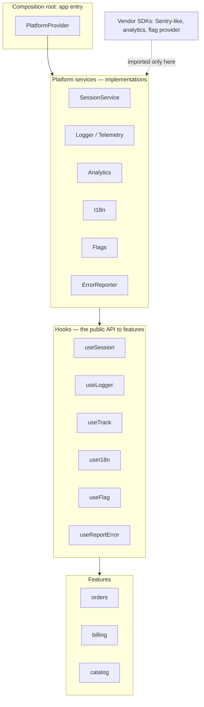
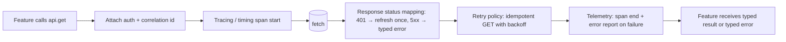
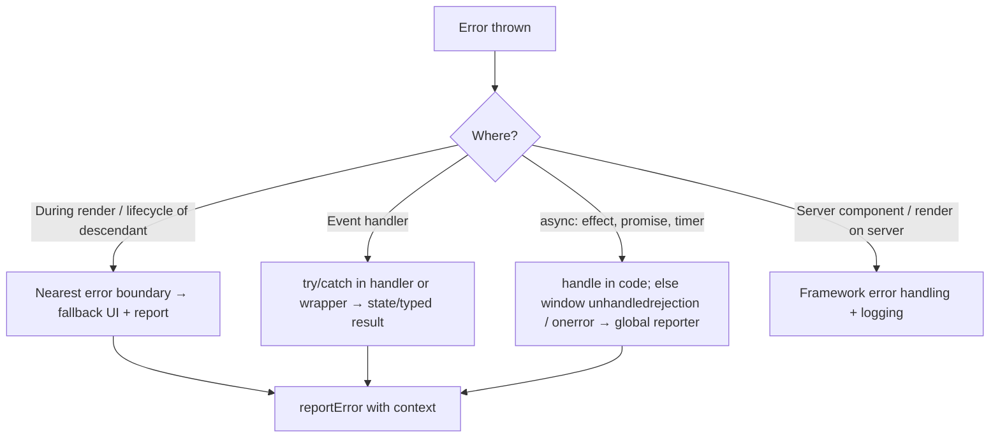
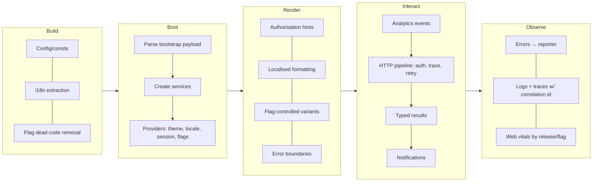
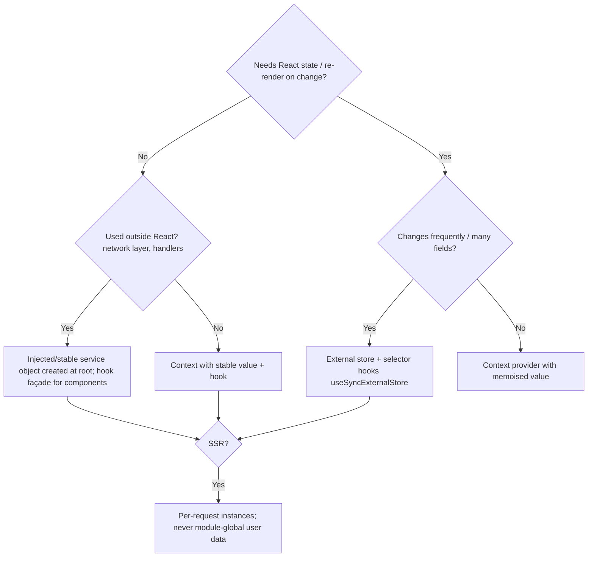

# 11 / 06 — Cross-Cutting Concerns: Auth, Errors, Telemetry, i18n, Flags, and Theming Across Every Feature

## 1. Lesson metadata

| | |
|---|---|
| **Level** | Architect |
| **Study time** | 6 hours (reading 2.5 h, worked examples 1.5 h, exercises 2 h) |
| **Prerequisites** | [05 — Application boundaries](./05-application-boundaries.md), [Provider pattern](../05-design-patterns/08-provider-pattern.md), [Dependency injection](../05-design-patterns/16-dependency-injection.md), [Error boundaries](../04-react-architecture/19-error-boundaries.md), [Context vs external stores](../06-data-fetching-and-state-ecosystems/11-context-vs-external-stores.md), [Context propagation cost](../07-performance/06-context-propagation-cost.md) |
| **Next** | [07 — Design system architecture](./07-design-system-architecture.md) |
| **Related** | [Hydration and selective hydration](../02-react-rendering-and-internals/25-hydration-and-selective-hydration.md), [Strict Mode behavior](../02-react-rendering-and-internals/28-strict-mode-behavior.md), [Routing architecture](../04-react-architecture/18-routing-architecture.md), 11 — Designing for accessibility |

**Learning objectives.** After this lesson you can:
1. Define a *cross-cutting concern* and list the ones that matter in a front-end application: authentication/authorisation, error handling, logging and telemetry, analytics, internationalisation, feature flags, theming, configuration, accessibility, and security policy.
2. Choose among the delivery mechanisms — React context providers, module-level singletons, hooks, higher-order components, dependency injection, middleware/interceptors, router-level loaders, events — for each concern, with trade-offs.
3. Design a **platform services layer** that features consume through narrow interfaces instead of importing vendor SDKs directly.
4. Avoid the common failure modes: provider pyramids, re-render storms through context, hydration mismatches from flags/locale/theme, double-firing under Strict Mode, unattributed errors, PII in telemetry, and "cross-cutting" code spread across every file.
5. Build testable versions: swap services in tests, assert telemetry and error contracts.
6. Define ownership, contracts and evolution paths for each concern in a multi-team product.

**Concepts covered:** separation of concerns vs cross-cutting concerns, aspect-oriented thinking in React, provider composition, service interfaces, singleton vs injected services, correlation IDs and observability, error taxonomy and reporting pipeline, authorisation as policy (UI hints vs server enforcement), i18n architecture (message catalogues, ICU-style formatting, locale-aware APIs), feature-flag lifecycle, theming via CSS variables, configuration at build vs runtime, SSR/hydration consistency, privacy and PII, Strict Mode idempotency of side effects.

---

## 2. Deep conceptual explanation

### 2.1 What problem is this lesson solving?

Features are organised by *domain* (orders, billing, catalogue), but some requirements apply to **all** of them regardless of domain:

- Who is the user, and what may they do?
- What happens when something fails?
- How do we know what happened in production?
- What language, formats, direction and theme does the user see?
- Which features are enabled for whom?
- Which events do analytics and product teams need?

If each feature implements these independently, you get inconsistency (three error UIs), duplication (five fetch wrappers each attaching auth differently), vendor lock-in (SDK imports in 400 files), and unsafe gaps (a feature forgets the permission check). If they're centralised carelessly, you get the opposite failure: a shell that every change must go through, a god `AppContext`, and render performance problems.

A **cross-cutting concern** is a requirement whose implementation naturally *cuts across* module boundaries. The architect's job is to decide, for each: **what is the contract, who owns it, how do features access it, and how do we make misuse hard and testing easy?**

### 2.2 Separation of concerns vs cross-cutting concerns

Separation of concerns ([Separation of concerns](../04-react-architecture/02-separation-of-concerns.md)) says keep different reasons-to-change apart. Cross-cutting concerns *violate* a clean decomposition: no module hierarchy contains "logging" as a single subtree; every module has a little logging. Different programming traditions address this with:

- **Aspect-oriented programming:** declare the concern separately and *weave* it into many places (decorators, interceptors, proxies).
- **Middleware pipelines:** requests/events pass through a chain (HTTP interceptors, Redux middleware, router loaders/guards).
- **Dependency injection:** features receive a service interface; implementation chosen at the composition root.
- **Ambient context:** a value made available to a subtree (React context).

In React the idiomatic building blocks are **context providers, hooks, and composition at the root**, plus plain modules for stateless infrastructure.

### 2.3 The catalogue of concerns

| Concern | Typical contract | Scope of impact | Typical owner |
|---|---|---|---|
| **Authentication** (who is the user) | `useSession(): { user, status }`, login/logout | Whole app; network layer | Platform / identity team |
| **Authorisation** (what may they do) | `can(action, resource)`; server-enforced | Every protected UI and API | Platform + security |
| **Error handling** | Error taxonomy, boundaries, fallback UI, reporting | Every feature | Platform |
| **Logging / telemetry** | `logger.info/warn/error`, trace/correlation IDs, performance marks | Every feature | Platform / SRE |
| **Product analytics** | `track(event, props)` with schema | Every feature | Product analytics + each feature for its events |
| **Internationalisation** | `t(key, vars)`, `formatDate/Number/Money`, locale, direction | Every user-visible string | Platform + localisation |
| **Feature flags / experiments** | `useFlag(name)`, `useExperiment(name)` | Release process, any feature | Platform + product |
| **Theming / design tokens** | CSS variables, theme switch, reduced-motion/contrast prefs | Every component | Design system |
| **Configuration** | Build-time and runtime config (API URLs, keys) | Whole app | Platform / DevOps |
| **Accessibility** | Shared primitives, focus management, announcements, testing | Every component | Design system + all teams |
| **Security policy** | CSP, sanitisation, token handling, third-party script policy | Whole app | Security + platform |
| **Performance monitoring** | Web vitals, long tasks, custom marks | Whole app | Platform |
| **Caching / data layer defaults** | Query client defaults, retry policy | Every data fetch | Platform |
| **Navigation / routing conventions** | Link components, prefetch, scroll restoration | Whole app | Platform |

### 2.4 Mechanisms and when each fits

| Mechanism | How it works | Strengths | Weaknesses | Typical use |
|---|---|---|---|---|
| **React Context + Provider** | Value available to a subtree; consumers re-render when value changes | Idiomatic; scoped (per subtree or per test); SSR-friendly (per-request) | Provider ordering; re-render fan-out; only available inside React | Session, theme, locale, flag snapshot, services container |
| **Module singleton** | Import a shared instance (`logger`, `queryClient` at module scope) | Usable outside React (network layer, event handlers); no provider | Global mutable state; hard to swap in tests; **dangerous in SSR** (shared across requests) | Stateless utilities, logger façade, constants |
| **Custom hook as façade** | `useSession()`, `useTrack()` wrap context/singleton | Stable consumer API; can change implementation underneath | Hooks only in components/hooks | The public API to features for most concerns |
| **HOC** | Wrap component to inject behaviour | Works for class components; wraps cross-cuts | Wrapper hell, props collisions, typing pain | Legacy; rarely preferred now ([Higher-order components](../05-design-patterns/09-higher-order-components.md)) |
| **Dependency injection (explicit)** | Pass services as params/props or via a container | Most testable; explicit | Plumbing cost; prop drilling unless combined with context | Domain/application-service code, non-React code |
| **Middleware / interceptors** | Chain around HTTP or dispatch | Central behaviour (auth header, retries, tracing) without touching callers | Hidden control flow; ordering subtle | HTTP client, state-store middleware |
| **Router loaders/guards** | Run before render per route | Early redirect, data prefetch, auth gating | Coupled to router; per-route duplication unless shared | Authentication gating, locale redirects |
| **Event bus** | Publish/subscribe | Loose coupling; cross-app | Hard to trace; "events are not state" ([05 §5.5](./05-application-boundaries.md)) | Analytics side-channels, cross-app notifications |
| **Build-time (compile/bundle)** | Transform code, define constants, tree-shake | Zero runtime cost | Inflexible; separate builds per variant | Config constants, flag removal, i18n extraction |

**Rule of thumb:** *features should consume a concern through a small hook or function, and never import the vendor SDK or global mutable state directly.* The hook is the seam; the implementation can change from context to singleton to server-provided without touching feature code.

### 2.5 The platform services layer

A pattern that scales: define a typed, narrow interface per concern, implement it once in a **platform** module, and provide it from the **composition root** (the app entry).



Properties:
- **Vendor SDKs are imported only inside the platform layer.** Swapping an analytics vendor changes one module.
- **Features depend on interfaces**, so tests can supply fakes.
- **Dependency direction** is down: features → hooks → services → vendors. The platform never imports features.
- The *platform layer is small and stable*: it provides mechanisms, not domain policy. Domain-specific policy (which events to track, which statuses mean "error") stays in features.

### 2.6 Authentication and authorisation

**Authentication** establishes identity; **authorisation** decides permitted actions. Architecturally:

- **Server-enforced is the only real security.** Client-side checks (hiding buttons, route guards) are **UX hints**, never protection: the client is controlled by the user. Every API/Server Function must enforce authentication and authorisation itself ([05 §2.9](./05-application-boundaries.md)).
- **Session ownership:** one source of truth for "who is logged in" (cookie-based session or token pair managed by a single module). Features read it through `useSession()`; they do not read cookies/localStorage.
- **Token storage trade-offs** (a debated, context-dependent topic; ⚠ treat as guidance and consult your security team and current OWASP guidance): httpOnly, `Secure`, `SameSite` cookies keep tokens away from JavaScript (mitigating XSS token theft) but need CSRF consideration; tokens in `localStorage`/memory are accessible to injected scripts. A common pattern is a session cookie + a backend-for-frontend (BFF) so the browser never handles long-lived tokens.
- **Authorisation as policy:** express as a function `can(user, action, resource)` evaluated consistently on server and (as a hint) on client. Avoid scattering `user.role === "admin"` across components — role names change; policies are the stable abstraction.
- **Failure semantics:** 401 (unauthenticated) → login flow/refresh; 403 (forbidden) → explain, don't loop to login; session expiry mid-action → preserve user input and retry after re-auth.
- **Race conditions:** multiple parallel requests receiving 401 should trigger *one* refresh/login ("single flight"), then retry.

### 2.7 Error handling as a concern

Errors differ in kind; the architecture must handle each deliberately.

| Class | Examples | Who handles | UX |
|---|---|---|---|
| **Expected domain failures** | Validation error, "insufficient funds" | The feature that triggered the action | Inline message; user can correct |
| **Operational/transient** | Network down, 503, timeout | Data layer (retry/backoff), feature (state) | Retry affordance, offline banner |
| **Authorisation** | 401/403 | Platform (session/redirect) + feature (message) | Login or explanation |
| **Programming errors** | `undefined is not a function`, render exceptions | Error boundaries + reporter | Fallback UI + report |
| **Unhandled async** | Rejected promises, errors in event handlers | Global handlers (`window.onerror`, `unhandledrejection`) + reporter | Usually silent to user + report |
| **Third-party failures** | Analytics script blocked | Isolated, never break the app | None |

Principles:
- **Typed results for expected failures** (discriminated union or typed error classes) so callers can't forget to handle them; **exceptions for the unexpected**.
- **Error boundaries at multiple granularities** (app, route, widget) ([Error boundaries](../04-react-architecture/19-error-boundaries.md)). They catch render-phase errors only; event-handler and async errors need explicit handling.
- **One reporting pipeline:** a single `reportError(error, context)` function that adds release version, user ID (privacy permitting), route, correlation ID, flag state, and de-duplicates.
- **Never swallow silently**; never leak raw stack traces or PII to users.
- In React 19, `createRoot`/`hydrateRoot` accept root-level options for error reporting callbacks: `onCaughtError` and `onUncaughtError` are new in 19, `onRecoverableError` has existed since 18. Run-tested on react-dom 19.3.1: `onCaughtError` receives `(error, { componentStack, errorBoundary })`, `onUncaughtError` receives `(error, { componentStack })`; an error caught by a boundary does not reach `onUncaughtError`.

### 2.8 Telemetry and observability

Telemetry makes production *explainable*. The architecture questions are: what do we emit, with what structure, and how do we tie a user's problem to a trace?

- **Logs** (discrete events with context), **metrics** (aggregates: error rate, web vitals), **traces** (causally-linked spans across front end and back end).
- **Correlation:** generate or propagate a **trace/correlation ID** per user action or page session; attach it to outgoing requests (header) and to logs/errors so support can follow one interaction end to end. (Standards exist such as W3C Trace Context's `traceparent` header; verify what your backend and tooling support.)
- **Structure over strings:** `logger.warn("order.submit.failed", { orderId, reason })`, not concatenated text.
- **Sampling and cost:** front-end telemetry volume is user-count × interactions; sample high-volume events, always keep errors.
- **Privacy:** never log PII/secrets; scrub URLs (query params), form values, and tokens by default; honour consent/regional rules ⚠ legal requirements vary; involve privacy/legal.
- **Performance telemetry:** web-vitals (LCP, INP, CLS) and custom marks (`orders:rows-painted`) segmented by release, route, device class, flag state.
- **Release tagging:** every event carries the build/version so regressions map to a deploy.

### 2.9 Internationalisation (i18n) and localisation (l10n)

i18n is **preparing the app** for multiple locales; l10n is **providing** a locale's content. Architecture decisions:

| Decision | Options | Consideration |
|---|---|---|
| **Message storage** | Per-locale JSON catalogues; ICU MessageFormat strings; extracted from source | Keys vs source-as-key; tooling for extraction and translators |
| **Plural/gender/select** | ICU-style messages; `Intl.PluralRules` | Never build sentences by concatenation: word order differs |
| **Formatting** | `Intl.DateTimeFormat`, `Intl.NumberFormat`, `Intl.RelativeTimeFormat`, `Intl.ListFormat` | Use platform APIs; never hand-format money/dates |
| **Locale detection** | URL segment, cookie, `Accept-Language`, user profile | Make it explicit and shareable; SEO implications for SSR |
| **Loading catalogues** | Bundle all vs per-locale/per-route lazy loading | Bundle size vs flash of untranslated text |
| **Direction (RTL)** | `dir` attribute and CSS logical properties (`margin-inline-start`) | Retrofits are expensive; start with logical properties |
| **Text expansion & layout** | Translations can be 30–40% longer (rule of thumb ⚠ varies by language) | Avoid fixed-width containers |
| **Time zones** | Store UTC; render in user/org zone | A *domain* decision, not a formatting detail |

Interface: `useI18n(): { t, formatMoney, formatDate, locale }`. Feature code never imports the i18n vendor directly. For SSR, the locale must be identical on server and client at hydration, or you'll get mismatches ([Hydration and selective hydration](../02-react-rendering-and-internals/25-hydration-and-selective-hydration.md)).

### 2.10 Feature flags and experiments

A flag decouples **deploy** from **release**. Types: *release flags* (temporary), *ops flags* (kill switches, long-lived), *experiment flags* (A/B with assignment and measurement), *permission flags* (entitlements; not really flags — use authorisation).

Architecture questions:
- **Evaluation point:** client SDK, server-evaluated and shipped as a snapshot, or edge-evaluated? Server evaluation avoids exposing flag rules and avoids flicker on SSR pages.
- **Consistency:** a user should not see the flag flip mid-session unless intended; evaluate once at session/page start and store a **snapshot** in context.
- **SSR/hydration:** server and client must see the same values for the first render; pass the snapshot from server to client.
- **Default/fail-safe:** what if the flag service is down? Choose safe defaults per flag.
- **Lifecycle:** every release flag has an owner and a removal date; stale flags are debt ([03 §2.4.4](./03-large-scale-refactoring.md)).
- **Testing:** combinations multiply; test flag on/off for critical paths, and keep the number of live flags small.
- **Observability:** attach flag state to errors and perf metrics to explain regressions by cohort.

### 2.11 Theming, configuration, and security policy

- **Theming:** implement with **CSS custom properties (design tokens)** at the root (`:root[data-theme="dark"]`), rather than JS-driven styles, so that theme switches don't re-render React trees and SSR can set the correct theme in the first paint ([Styling architecture](../04-react-architecture/27-styling-architecture.md)). Respect `prefers-color-scheme`, `prefers-reduced-motion`, and `prefers-contrast` media queries; persist user choice; avoid flash of the wrong theme by setting the attribute before first paint (inline script or server-rendered attribute).
- **Configuration:** separate **build-time** config (inlined into the bundle; changing it requires rebuild) from **runtime** config (fetched or injected at deploy, e.g. a config endpoint or server-rendered JSON). Never ship secrets to the client: *any* value in the bundle is public. Validate config at startup with a parser (fail fast).
- **Security policy:** Content Security Policy headers, sanitising HTML (avoid `dangerouslySetInnerHTML` with untrusted input), safe URL handling (`javascript:` URLs), third-party script governance (tag managers are a major risk vector), and dependency hygiene. Policy is set at the platform/server level and enforced by lint/CI where possible.

### 2.12 Misconceptions

| Misconception | Reality |
|---|---|
| "Hide the button, secure the action." | UI checks are UX only. Enforce on the server; assume a hostile client. |
| "Put everything in one `AppContext`." | One context changing for any reason re-renders every consumer; split by update frequency and concern ([Context propagation cost](../07-performance/06-context-propagation-cost.md)). |
| "A module singleton is simpler than a provider." | True until SSR (shared across requests), tests (leaking state), or multiple app instances (micro-frontends). |
| "Error boundaries handle errors." | Only render-phase errors in descendants. Handlers and async code need their own handling and a global safety net. |
| "i18n is translating strings." | It's also formatting, pluralisation, direction, time zones, layout resilience, and content workflows. |
| "Feature flags are free." | Each flag doubles a code path in tests and reasoning; stale flags are debt. |
| "Analytics is the PM's job." | Events are an API contract between the feature and downstream consumers; they need schemas, ownership, and tests. |
| "Logging errors to the console is monitoring." | It exists only on the user's machine. |

---

## 3. Internal mechanics

### 3.1 How context-delivered concerns behave at runtime

*Public guarantee:* when a context provider's `value` changes (compared with `Object.is`), all components that read that context re-render, regardless of `memo` on intermediate components. Components that don't read it aren't affected by the change but may still re-render for other reasons. See [Context propagation cost](../07-performance/06-context-propagation-cost.md) for the detail.

Consequences for cross-cutting design:

| Concern | Change frequency | Context consequence |
|---|---|---|
| Theme, locale | Rare | Fine as context; broad re-render on change is acceptable |
| Session | Rare (login/logout/refresh) | Fine; but avoid putting rapidly-changing fields (e.g. "lastActivityTimestamp") in the same value |
| Feature flags | Rare if snapshot; frequent if live-updating | Prefer a snapshot; or an external store with per-flag subscriptions |
| Logger/analytics/services | Never (stable references) | Provide a **stable object** (created once) so consumers don't re-render |
| Notification/toast state | Frequent | Use a store with selectors, not wide context |

A context whose `value` is created inline (`value={{ user, logout }}`) produces a new object every render of the provider, re-rendering all consumers whenever the provider re-renders. Memoise or split.

### 3.2 Service stability and Strict Mode

In development, [Strict Mode](../02-react-rendering-and-internals/28-strict-mode-behavior.md) double-invokes component bodies and, on mount, runs effect setup → cleanup → setup again. Implications:

- **Telemetry in effects will fire twice in development.** That's a signal your side effect isn't idempotent or isn't deduplicated; for "page view" analytics, use a stable key (route + navigation id) and dedupe, or fire from router events rather than component effects.
- **Services created during render** (e.g. `new Logger()` in a component body) are created twice and may leak subscriptions. Create services at module scope or in a lazily-initialised ref/`useState(() => …)` initialiser (still double-called in dev for the initialiser). Prefer composition-root creation outside React.
- Cleanup must truly undo setup (unsubscribe listeners), otherwise duplicates leak.

### 3.3 SSR/hydration constraints for cross-cutting values

For server-rendered React, the first client render must produce the same output as the server's HTML ([Hydration and selective hydration](../02-react-rendering-and-internals/25-hydration-and-selective-hydration.md)). Cross-cutting values that commonly differ:

| Value | Mismatch cause | Remedy |
|---|---|---|
| Locale/number/date formats | Server default locale ≠ browser | Resolve locale on the server per request; pass it to the client; render with the *same* locale on both |
| Time zone | Server TZ ≠ client TZ | Render absolute times in a declared zone, or render client-only after mount |
| Theme | `prefers-color-scheme` known only on client | Server-render a `data-theme` from a cookie; for "system" mode use CSS media queries rather than JS branching |
| Flags | Client SDK evaluates differently | Evaluate on the server; ship the snapshot in the initial payload |
| `Date.now()`, `Math.random()` in render | Different each time | Don't use in render; move into effects/state |
| User-agent-dependent UI | Server UA unknown/different | Use CSS/responsive design, or client-only subtree |

**Per-request state:** module-level singletons that hold per-user data (`let currentUser`) are **shared across concurrent requests on the server** and can leak one user's data into another's response. Per-request state must live in request-scoped objects/context, never module globals. ⚠ Frameworks provide request-scoped APIs; verify current guidance.

### 3.4 Interceptor/middleware mechanics for the data layer

A typical HTTP client pipeline:



Mechanically this is function composition: each stage takes `(request, next)` and returns a response promise. The **single-flight refresh** stage keeps one in-flight promise in a closure/module variable; concurrent 401s await the same promise, then retry. Order matters: auth attach must precede tracing; retry must wrap *network + status mapping*; report errors *after* retry exhaustion, not per attempt.

### 3.5 Error propagation paths in React



Design consequence: a **global safety net** (`unhandledrejection`, `error` events) plus **boundaries** plus **disciplined local handling** — each catches what the others cannot.

---

## 4. Step-by-step execution walkthrough

**Scenario:** a user clicks "Submit order" in a multi-feature dashboard. Which cross-cutting concerns participate, in order?

1. **Authorisation (UI hint):** `useCan("order:submit", order)` returned `true`, so the button is enabled. (If it were `false`, the button is disabled with an explanatory tooltip — *and* the server will still enforce.)
2. **Analytics:** click handler calls `track("order_submit_clicked", { orderId, itemCount })` via `useTrack()`; the platform adds `sessionId`, `route`, `locale`, flag snapshot, release version. Schema validation (dev) ensures event name and payload match the registry.
3. **Correlation:** the action creates a `traceId` (or continues the page's trace); the data layer attaches it as a request header and logs `order.submit.start`.
4. **Network pipeline:** auth attach → fetch → response.
5. **Response branches:**
   - `201`: success path → `track("order_submit_succeeded")`, update cache, show toast via `useNotify()` (localised with `t("order.submitted", { number })`).
   - `422` domain validation: typed error `{ kind: "validation", fields }` → inline field errors; no error-report (expected failure); analytics event with error codes (no PII).
   - `401`: single-flight session refresh; if refresh succeeds the request is retried once; if not, session service transitions to `expired`, the UI routes to login while preserving the draft (platform concern + feature concern).
   - `403`: typed `forbidden` error → explanatory message; report as a *policy mismatch* because the UI hint allowed it (indicates drift between client and server policy).
   - `503`/network failure: retry with backoff for idempotent calls (an order submission is **not** idempotent unless the API supports an idempotency key — the data layer must not blindly retry POSTs); show retry affordance; telemetry records `order.submit.failed` with `traceId`.
6. **Unexpected exception in a handler:** caught by the handler's try/catch (or a wrapper like `useAction`), routed to `reportError`, UI shows a generic failure state.
7. **Render of the result:** the next render uses locale-aware formatting (`formatMoney`), theme tokens, and flag-controlled UI variants.
8. **Error boundary (render phase)** around the order summary widget: if rendering the summary throws due to unexpected data, the widget shows a local fallback, the rest of the page continues; the boundary reports the error with the component stack and `traceId`.
9. **Support case:** the user reports a problem; support finds the `traceId` and sees front-end logs and back-end spans in one trace.

**Observation:** a single click touched at least seven concerns. If each were implemented ad hoc in the feature, the submit handler would be 150 lines of plumbing. With a platform layer, the handler orchestrates domain logic and delegates concerns through narrow hooks.

---

## 5. Code examples

### 5.1 Minimal example: a stable service via context and a hook façade

```tsx
// platform/analytics.tsx
import { createContext, useContext, type ReactNode } from "react";

export interface Analytics {
  track(event: string, props?: Record<string, string | number | boolean>): void;
}

const noop: Analytics = { track() {} };
const AnalyticsContext = createContext<Analytics>(noop);

export function AnalyticsProvider({ client, children }: { client: Analytics; children: ReactNode }) {
  return <AnalyticsContext value={client}>{children}</AnalyticsContext>;
}

export const useTrack = () => useContext(AnalyticsContext).track;
```

**Line notes.**
- The interface exposes **one method** with typed, primitive-only props — constraining payloads (no objects, hence less accidental PII).
- A **default no-op** value means tests and Storybook don't need a provider, and a missing provider never crashes production. (The trade-off: a *missing* provider fails silently — mitigate with a dev-only warning if analytics is mandatory.)
- `<AnalyticsContext value={…}>`: React 19 allows rendering a context directly as a provider; in earlier versions use `<AnalyticsContext.Provider value={…}>` (still supported; both verified on react 19.3.1).
- `useTrack` returns the stable `track` method; consumers re-render only if the **client object identity** changes. Create the client once at the composition root.

**Predict:** if `AnalyticsProvider` is rendered as `<AnalyticsProvider client={createClient()}>` inside a component that re-renders often, what happens? *Answer:* a new client each render → context value changes → every `useTrack` consumer re-renders, and effects depending on `track` re-run. Create the client outside the component or memoise it.

### 5.2 Practical example: a composition root with a typed services container

```tsx
// platform/services.ts
import type { Analytics } from "./analytics";
import type { Logger } from "./logger";
import type { ErrorReporter } from "./errors";
import type { SessionService } from "./session";
import type { FlagSnapshot } from "./flags";

export interface Services {
  analytics: Analytics;
  logger: Logger;
  errors: ErrorReporter;
  session: SessionService;
  flags: FlagSnapshot;
}
```

```tsx
// platform/PlatformProvider.tsx
import { createContext, useContext, type ReactNode } from "react";
import type { Services } from "./services";

const ServicesContext = createContext<Services | null>(null);

export function PlatformProvider({ services, children }: { services: Services; children: ReactNode }) {
  return <ServicesContext value={services}>{children}</ServicesContext>;
}

export function useServices(): Services {
  const s = useContext(ServicesContext);
  if (!s) throw new Error("useServices must be used inside <PlatformProvider>");
  return s;
}

// Narrow hooks: features use these, not useServices() directly.
export const useLogger = () => useServices().logger;
export const useReportError = () => useServices().errors.report;
export const useFlag = (name: keyof import("./flags").FlagMap) => useServices().flags[name];
```

```tsx
// main.tsx — composition root (vendor SDKs imported ONLY here and in platform/*)
import { createRoot } from "react-dom/client";
import { PlatformProvider } from "./platform/PlatformProvider";
import { createServices } from "./platform/createServices";
import { App } from "./App";

const services = createServices(window.__BOOTSTRAP__); // flag snapshot, config, locale from the server/bootstrap payload

createRoot(document.getElementById("root")!, {
  // React 19 root options (verified: react.dev createRoot reference + run on react-dom 19.3.1).
  onUncaughtError: (error, info) => services.errors.report(error, { source: "react-uncaught", componentStack: info.componentStack }),
  onCaughtError: (error, info) => services.errors.report(error, { source: "react-caught", componentStack: info.componentStack }),
}).render(
  <PlatformProvider services={services}>
    <App />
  </PlatformProvider>,
);
```

**Line notes.**
- `Services` is a **plain object** created once in `createServices`; context value identity is stable, so it never triggers re-renders. Services that *change* (session) expose subscription APIs and are consumed through specific hooks (`useSession` using `useSyncExternalStore`), not by replacing the container.
- Throwing when the provider is missing is the right default for *mandatory* services (contrast the no-op default in §5.1 for optional ones). The choice is per-service.
- The narrow hooks (`useLogger`, `useFlag`) are the **public API**; `useServices` is internal, preventing features from grabbing the whole container (service-locator anti-pattern: features should declare what they need).
- `window.__BOOTSTRAP__` represents server-provided initial data (flags, locale, config) — a typical way to avoid client-side flicker. Treat it as untrusted input shape-wise: parse/validate it with the same discipline as an API response ([05 §2.8](./05-application-boundaries.md)).
- Trade-off: a container is **less explicit** than constructor-injecting each service into each function; it is a pragmatic compromise for React trees. For non-React code (domain functions), pass dependencies as arguments ([Dependency injection](../05-design-patterns/16-dependency-injection.md)).

### 5.3 Incorrect: cross-cutting code smeared through features

```tsx
// features/orders/SubmitButton.tsx
import * as Sentry from "@sentry/browser";           // vendor SDK in a feature
import mixpanel from "mixpanel-browser";               // another one
import { flags } from "../../globalFlags";             // mutable module global

export function SubmitButton({ order }: { order: Order }) {
  const user = JSON.parse(localStorage.getItem("user")!); // reads session directly, no validation

  async function onClick() {
    mixpanel.track("Submit Order", { order, email: user.email });  // whole object + PII
    try {
      const res = await fetch("/api/orders", {
        method: "POST",
        headers: { Authorization: `Bearer ${localStorage.getItem("token")}` }, // manual auth
        body: JSON.stringify(order),
      });
      if (res.status === 401) window.location.href = "/login";    // loses the user's work
      if (!res.ok) throw new Error("failed");
    } catch (e) {
      console.log(e);                                              // monitoring = console?
      Sentry.captureException(e);                                  // no context, no dedupe
    }
  }

  if (user.role !== "admin" && !flags.newCheckout) return null;    // role string + flag logic inline
  return <button onClick={onClick}>Submit</button>;
}
```

Problems (count them):
1. Vendor SDKs imported into a feature → lock-in and untestable.
2. Raw `localStorage` for session/token → XSS-exposed token, no validation, repeated everywhere.
3. PII (`email`) and the **entire order object** sent to analytics.
4. Manual `Authorization` header duplicated in every feature; no refresh, no single flight.
5. `window.location.href = "/login"` destroys unsaved state, bypasses the router.
6. `console.log` is not telemetry; `captureException` without context/trace ID.
7. `user.role !== "admin"` is a UI-only role check scattered inline; a mutable global flag; both evaluated per render with inconsistent semantics.
8. A non-idempotent POST with no idempotency consideration or typed failure result.
9. Impossible to test without mocking four globals.

### 5.4 Corrected: the feature consumes platform hooks and typed results

```tsx
// features/orders/SubmitButton.tsx
import { useCan, useTrack, useReportError, useNotify, useI18n } from "@/platform";
import { submitOrder } from "./api/submitOrder";           // returns a typed result (below)
import type { Order } from "./model/order";

export function SubmitButton({ order }: { order: Order }) {
  const can = useCan();
  const track = useTrack();
  const report = useReportError();
  const notify = useNotify();
  const { t } = useI18n();

  async function onClick() {
    track("order_submit_clicked", { itemCount: order.lines.length });
    const result = await submitOrder(order); // never throws for expected failures
    switch (result.kind) {
      case "ok":
        track("order_submit_succeeded");
        notify({ tone: "success", message: t("order.submitted", { number: result.order.number }) });
        return;
      case "validation":
        notify({ tone: "warning", message: t("order.fixErrors") }); // field errors flow elsewhere
        return;
      case "forbidden":
        report(new Error("Client policy allowed order:submit but server forbade"), { severity: "warning" });
        notify({ tone: "danger", message: t("error.forbidden") });
        return;
      case "unavailable":
        notify({ tone: "danger", message: t("error.tryAgain"), action: { label: t("common.retry"), run: onClick } });
        return;
    }
  }

  return (
    <button onClick={onClick} disabled={!can("order:submit", order)}>
      {t("order.submit")}
    </button>
  );
}
```

```ts
// features/orders/api/submitOrder.ts
import { http } from "@/platform/http"; // owns auth, correlation, refresh, tracing
import { parseOrder } from "./parseOrder";
import type { Order } from "../model/order";

export type SubmitResult =
  | { kind: "ok"; order: Order }
  | { kind: "validation"; fields: Record<string, string> }
  | { kind: "forbidden" }
  | { kind: "unavailable" };

export async function submitOrder(order: Order): Promise<SubmitResult> {
  const res = await http.post("/orders", order, { idempotencyKey: order.id }); // key lets the platform retry safely
  switch (res.status) {
    case 201: return { kind: "ok", order: parseOrder(await res.json()) };
    case 422: return { kind: "validation", fields: await res.json() };
    case 403: return { kind: "forbidden" };
    default:  return { kind: "unavailable" };
  }
}
```

**Line notes.**
- The feature expresses **what** (track this event, notify this) and delegates **how** (vendor, auth, retry, correlation).
- `SubmitResult` is a **discriminated union** for *expected* outcomes; a `switch` without a default makes TypeScript flag unhandled kinds if `noImplicitReturns`/exhaustiveness checks are enabled (add a `never` check helper for strictness). Unexpected exceptions propagate to the platform's global handlers.
- The `forbidden` branch **reports** a policy drift: when the client hint disagrees with the server, that's a bug worth surfacing.
- `idempotencyKey` is a contract with the API: the platform may retry the POST safely only because the server de-duplicates by key. **Without server support, do not retry non-idempotent requests.**
- Analytics payloads are primitives (`itemCount`), not whole objects; no PII.
- Cost: the platform API surface (`useCan`, `useTrack`, `useNotify`, `useI18n`, `http`) must exist and be well-maintained — the investment that makes features small. That is the trade-off.

### 5.5 Advanced: single-flight session refresh and typed telemetry events

**Single-flight refresh in the HTTP pipeline**

```ts
// platform/http.ts (excerpt)
let refreshing: Promise<boolean> | null = null;

async function refreshSession(): Promise<boolean> {
  refreshing ??= (async () => {
    try {
      const res = await fetch("/auth/refresh", { method: "POST", credentials: "include" });
      return res.ok;
    } finally {
      // Clear after settle so the next expiry can trigger a new refresh.
      queueMicrotask(() => { refreshing = null; });
    }
  })();
  return refreshing;
}

export async function request(input: string, init: RequestInit & { idempotencyKey?: string } = {}): Promise<Response> {
  const exec = () => fetch(input, {
    ...init,
    credentials: "include",
    headers: { ...init.headers, "x-trace-id": currentTraceId(), ...(init.idempotencyKey ? { "idempotency-key": init.idempotencyKey } : {}) },
  });
  let res = await exec();
  if (res.status === 401 && (await refreshSession())) res = await exec(); // retry exactly once
  if (res.status === 401) sessionStore.expire();                            // notify the session service
  return res;
}
```

**Line notes.**
- `refreshing ??= …` ensures concurrent 401s share a single refresh promise (single flight). The `finally` clears it after settling so a later expiry can refresh again; `queueMicrotask` lets the concurrent waiters all observe the same resolved promise first.
- Retry **once**; a second 401 means the session is truly invalid → state transition, not a loop.
- Credentials via an httpOnly cookie (the code never touches the token) — the recommended direction for XSS resilience, subject to CSRF mitigation (SameSite policy, CSRF tokens) which the platform must also implement; ⚠ consult your security guidance.
- Replaying a request body: if `init.body` is a stream it cannot be re-sent; for retries use buffered bodies (strings/JSON). A real implementation must handle this.
- Edge case: the refresh request itself must not go through the same pipeline (would recurse on 401).

**Typed analytics events**

```ts
// platform/analytics/events.ts — a registry owned jointly by analytics + feature teams
export interface AnalyticsEvents {
  order_submit_clicked: { itemCount: number };
  order_submit_succeeded: Record<string, never>;
  search_performed: { queryLength: number; resultCount: number };
}

export type TrackFn = <E extends keyof AnalyticsEvents>(
  name: E,
  ...args: AnalyticsEvents[E] extends Record<string, never> ? [] : [props: AnalyticsEvents[E]]
) => void;
```

**Line notes.** The conditional rest tuple makes the second argument required exactly when the event has properties — wrong or missing payloads fail at compile time. The registry file is a **contract** reviewed by analytics owners (CODEOWNERS), preventing ad hoc event names and PII-laden payloads. The cost is friction when adding events; the benefit is a governed, searchable event catalogue. A runtime dev-mode validator can catch untyped call sites (e.g. from JS).

---

## 6. Visual explanations

### 6.1 Where each concern is applied in the request/UI lifecycle



### 6.2 Provider ordering (dependencies between providers)

```text
<PlatformProvider services>             ← creates stable services; nothing above depends on React state
  <ConfigProvider>                      ← validated runtime config
    <ThemeProvider>                     ← sets data-theme / reads cookie (no React deps)
      <I18nProvider locale>             ← needs config (default locale) and session? (user preference)
        <SessionProvider>               ← needs http + config
          <FlagsProvider snapshot>      ← often needs session (targeting) → AFTER session
            <QueryClientProvider>       ← needs session (auth errors) and error reporter
              <RouterProvider>
                <ErrorBoundary route-level>  ← inside router for route-aware fallbacks
                  <App/>
```

Order follows **data dependencies** (a provider that needs another's value must be below it). A long pyramid is a smell; collapse static providers into one composed provider or move creation to the composition root so only providers carrying *React state* remain.

### 6.3 Mechanism choice per concern



---

## 7. Alternative approaches and trade-offs

| Approach | Testability | SSR safety | Perf risk | Boilerplate | Works outside React | Best when |
|---|---|---|---|---|---|---|
| **Context providers + hooks** | High (swap provider) | High (per-request) | Re-render fan-out if value unstable | Medium | No | Most UI-facing concerns (theme, locale, session) |
| **Module singletons** | Low–medium (module mocks) | **Low** (shared across requests) | Low | Low | Yes | Pure stateless utilities; client-only apps with no SSR |
| **Explicit DI (params/props)** | Highest | High | Low | High (plumbing) | Yes | Domain/application services; library code |
| **HOCs** | Medium | High | Wrapper depth | Medium | No | Legacy class code only |
| **Middleware/interceptors** | High (unit-test stages) | Depends | Low | Medium | Yes | HTTP, store dispatch |
| **Router loaders/guards** | Medium | High | Low | Low–medium | No | Auth gating, redirects, data preloading |
| **Event bus** | Medium | Medium | Low | Low | Yes | Loose cross-app notifications ([05](./05-application-boundaries.md)) |
| **Code generation / build-time transforms** | High | High | None at runtime | High tooling | n/a | i18n extraction, flag dead-code elimination, typed config |
| **External store + selectors** | High | Needs per-request instance | Best for frequent updates | Medium | Yes | Frequently-changing cross-cutting state (live flags, notifications) |

**Scenario where the recommended approach (platform layer with hooks over context) is *not* best.**
(1) A small single-purpose app (one team, ~20 screens) — an elaborate services container is ceremony; a few modules (`analytics.ts`, `session.ts`) imported directly may be simplest and entirely adequate. Apply [01 §2.4](./01-trade-off-analysis.md): the cost of reversing is low.
(2) **Non-React code paths** (service workers, WebSocket handlers, Web Workers) cannot use hooks; use injected plain services there.
(3) **Performance-critical, high-frequency concerns** (live feature flags or notifications updating many times per second) should use an external store with selectors, not context.
(4) **Micro-frontend setups**: separately deployed apps cannot share a React context unless they share a React instance; use explicit contracts (events, URLs, a tiny shared service API) ([05 §3.3](./05-application-boundaries.md)).

---

## 8. Best practices and anti-patterns

### 8.1 Good practice
- **Define the contract first**: a small interface per concern, documented, typed, with a fake implementation for tests.
- **Import vendor SDKs only in the platform layer**; wrap with a narrow interface; keep the vendor's types out of feature code ([01 §2.5](./01-trade-off-analysis.md) on when wrapping is worth it).
- **Create services at the composition root**, once, outside React render.
- **Keep context values stable**; split by update frequency; use selectors for frequently-changing data.
- **Treat UI authorisation as a hint**; enforce on the server; report client/server disagreement.
- **Typed results for expected failures**; exceptions for unexpected ones; one reporting funnel.
- **Correlation IDs** end to end; release and flag state on every error/perf event.
- **Scrub PII by default**; use allow-lists for analytics payloads.
- **Resolve locale/theme/flags on the server** for SSR; pass snapshots to the client.
- **Give every flag an owner and expiry**; ratchet the count ([03](./03-large-scale-refactoring.md)).
- **Use CSS variables for theming** and logical properties for direction.
- **Make misuse hard**: lint rules for vendor imports, `localStorage` token access, raw `fetch` in features, hard-coded user-facing strings.

### 8.2 Beginner mistakes
- Console logging as monitoring; swallowing errors.
- Hard-coded strings and `toLocaleString()` calls without a locale policy.
- Checking `user.role === "admin"` in dozens of places.
- Storing tokens in `localStorage` because it's easy.

### 8.3 Experienced-developer mistakes
- **God context** (`AppContext` with user, theme, flags, toasts, cart…).
- **Provider pyramid** that nobody understands, with order-dependent bugs.
- **Over-generalising the platform**: building a plugin framework for logging.
- **Module-global per-user state in SSR.**
- **Analytics as spaghetti**: events fired from effects with ad hoc names, double-firing in dev/StrictMode and via re-renders.
- **Flag sprawl** with untested combinations.
- **Platform team as bottleneck**: every small change to a concern requires them. Design extension points and self-service.
- **Retrying non-idempotent requests** in a global interceptor.
- **Error boundary at the root only**, so one widget failure blanks the app.

### 8.4 Smells
- `import * as Sentry` (or any vendor) appears in > 5 files outside platform.
- `localStorage.getItem("token")` outside the session module.
- Role strings (`"admin"`) in components.
- A context provider with an inline object `value`.
- More than ~8 nested providers with no composition helper.
- Flags older than a quarter with no owner.
- Hard-coded `"en-US"` or currency symbols in components.
- `useEffect(() => track(...), [])` for page views in a router-based app.

### 8.5 Justified exceptions
- A **module singleton** logger is fine when it is stateless and has no per-request data (SSR-safe) and tests can stub it.
- **Direct vendor usage** is acceptable in a throwaway prototype or within a platform module dedicated to that vendor.
- **Client-only role checks** for pure UX convenience (hiding an irrelevant menu) are fine if the server enforces independently.
- **Skipping i18n** is legitimate for internal tools with a single known locale — but use `Intl` formatting and logical CSS properties anyway; they cost nothing.

---

## 9. Real-world application

| Domain | Dominant cross-cutting concerns | Specific constraints |
|---|---|---|
| **E-commerce** | i18n/currency, analytics/experiments, flags, performance telemetry | Peak-traffic kill switches; consent-gated analytics; multi-market catalogues; experiment integrity (stable assignment, SSR parity) |
| **Dashboards** | Error isolation per widget, telemetry volume, theming/density, time zones | Many concurrent data sources; widget-level boundaries; sampling; high-frequency updates need store-based delivery |
| **Finance** | Authorisation, audit logging, number/currency correctness, session timeouts | Regulatory audit trails (who saw/did what); strict session policies; locale-aware money with rounding rules; no PII in telemetry |
| **Forms-heavy** | Validation error taxonomy, autosave/draft recovery on session expiry, a11y announcements | Preserve user input through 401; error summary focus management |
| **Auth** | Single source of session truth, refresh single flight, step-up auth | CSRF/XSS posture; redirect-loop prevention; deep-link return URLs validated against open-redirect abuse |
| **Real-time** | Connection state, backoff/reconnect, telemetry on lag | Message ordering; per-connection correlation; surfacing "offline" consistently |
| **Multi-team** | Ownership, contracts, extension points | Platform versioning; deprecation windows; self-service registration of analytics events, flags, i18n namespaces |

**Engineering constraints:**
- **Privacy/consent** (regional regulations) may require delaying analytics until consent and omitting categories of data. ⚠ Not legal advice; involve legal/privacy.
- **Bundle size:** vendor SDKs (analytics, flags, error reporting) can be heavy; lazy-load non-critical ones after first paint; measure their cost in the budget.
- **Third-party scripts** (tag managers) can break performance and security; govern them like dependencies.
- **Rollout of platform changes** affects all teams: version the platform API and use expand/contract.
- **Operational ownership:** who is paged for a telemetry outage? A telemetry failure must never break the app (wrap, time-box, swallow with a self-report).

---

## 10. Debugging and troubleshooting

| Symptom | Likely root cause | Investigation | Fix / validation |
|---|---|---|---|
| Whole app re-renders when a toast appears | Toast state in a wide context or in the same context as session/theme | React DevTools Profiler "why did this render"; inspect provider `value` | Move toasts to a store with selectors or a dedicated context; stabilise value; validate with Profiler render counts |
| Analytics events double-fire in dev but not prod | Strict Mode effect re-run | Observe dev-only duplication; check `StrictMode` wrapper | Dedupe by key; fire from router events; confirm prod count is correct ([Strict Mode behavior](../02-react-rendering-and-internals/28-strict-mode-behavior.md)) |
| Analytics events double-fire in prod | Effect depends on unstable `track`/props; component remounts (key change, Suspense, route layout remount) | Log mount/unmount; check dependency arrays; check keys and parent identity | Stabilise deps; hoist the effect to the layout/router level; dedupe |
| Hydration mismatch warning on dates/currency | Locale/time zone differs between server and client | Compare server HTML and client output; log `Intl.DateTimeFormat().resolvedOptions()` on both | Resolve locale/zone per request; render with explicit options; or defer to client after mount |
| Flash of wrong theme on load | Theme decided after hydration | Disable cache, throttle, observe first paint | Set `data-theme` on the server from cookie or inline script before paint; use CSS media query for "system" |
| Users see each other's data (SSR) | Module-global per-user state shared across requests | Reproduce with concurrent requests; grep for module-level `let` holding user data | Move to request-scoped context; add a test with parallel requests; security incident process |
| Infinite redirect loop on login | 401 triggers redirect; login page also calls a 401-returning API; `returnTo` not validated | Network panel redirect chain; check guard logic | Exempt auth routes; single-flight refresh; validate return URL; add loop detector |
| 403 shown after UI allowed an action | Client policy drift from server policy | Compare `can()` rules with server rules; error reports tagged policy-mismatch | Share policy definition (generated from one source), or fetch permissions from server; tests on both |
| Errors in Sentry-like tool lack context | Reporter called without context or not initialised before first render | Inspect event payloads; check init order | Init at the composition root; enrich centrally with release, route, traceId, flags |
| Error boundary shows fallback but no report | Boundary doesn't call reporter; error caught in handler instead | Trigger a render error in dev; check reporter spy | Report in `onError`/`componentDidCatch` equivalent; add a test using a throwing component |
| Missing translations show raw keys in production | Catalogue not loaded for locale/route; extraction missing | Network tab for catalogue requests; missing-key logger | Load per-route namespaces; CI check for missing keys; missing-key telemetry |
| Request retried and order created twice | Global interceptor retried a non-idempotent POST | Inspect network log, server logs for duplicate | Retry only idempotent methods or with idempotency keys; test with a flaky-network harness |

**Investigation recipe: "Why did this cross-cutting behaviour regress?"**
1. Identify the concern (which contract broke?).
2. Check *release and flag state* attached to the failing events — is it cohort-specific?
3. Reproduce with the platform fakes in a test (deterministic) before reproducing in a browser.
4. Bisect by platform version vs feature change.
5. Fix at the **platform** layer if multiple features show it; otherwise in the feature.
6. **Validate** with a contract test that fails before the fix and passes after, plus a production metric (error rate, event volume).

---

## 11. Exercises

### Level A — Knowledge
A1. List eight cross-cutting concerns in a front-end application and, for each, one reason it is hard to implement per-feature.
A2. Why is client-side authorisation not security? What *is* it for?
A3. Give three reasons module-level singletons are risky in SSR.
A4. Which errors do React error boundaries catch, and which do they not catch?
A5. What is the difference between a release flag and an ops flag? Why should release flags have an owner and expiry?

### Level B — Code comprehension
B1. In §5.1, what happens to consumers if `AnalyticsProvider` receives a new `client` object on every render? What are two fixes?
B2. In §5.5, why does the refresh promise get cleared in `finally` via `queueMicrotask`, and what bug appears if it is never cleared?
B3. In §5.4, explain why the `forbidden` branch reports an error even though `403` is an "expected" server response.
B4. Under Strict Mode in development, a component does `useEffect(() => { track("page_view", { path }); }, [path]);`. How many events fire on initial mount, and why? What would you change?

### Level C — Implementation
C1. Implement `useSession()` using `useSyncExternalStore` over a small session store with `getSnapshot`, `subscribe`, `expire()`, and `setUser()`. Ensure the snapshot is referentially stable between changes.
C2. Implement a `can` policy function and `useCan()` hook with a rules table keyed by action, supporting resource-based rules (`order:submit` requires status `"draft"` and ownership), with unit tests.
C3. Write a typed `t()` helper that infers required interpolation variables from message templates (e.g. `"Hello {name}"` → `{ name: string }`) using TypeScript template literal types, and discuss its limits.

### Level D — Debugging
D1. After enabling a flag SDK on the client, the product page shows a hydration warning and flashes between two layouts. Identify the root cause class and give two remedies with trade-offs.
D2. Support says "we cannot find the front-end errors for a failed checkout in the tooling, but the user clearly saw an error." List four ways errors can evade your reporting pipeline in a React app and how to close each gap.
D3. A global interceptor retries all failed requests 3 times with exponential backoff. After deployment, duplicate orders appear during a partial outage. Explain, and design the safer policy.

### Level E — Architecture and engineering decisions
E1. Design the contract between the platform team and 8 feature teams for **analytics**: ownership, event schema registry, review, PII policy, consent handling, testing, deprecation. Identify bottlenecks and mitigations.
E2. Your app will support 14 locales including RTL. Propose the i18n architecture (message format, catalogue loading, formatting, SSR, CSS, QA process) and name the top five risks.
E3. Compare (a) one `AppContext` with all concerns, (b) a provider per concern, (c) a services container + narrow hooks, (d) module singletons — for a 40-engineer product with SSR. Recommend with criteria.

### Level F — Expert challenge
F1. Design a feature-flag architecture for an SSR app with experiments: assignment, consistency across server/client, caching of rendered pages (CDN), flicker avoidance, exposure logging, cleanup, and testing. Identify what breaks when pages are cached at the edge.
F2. Design an end-to-end error and telemetry pipeline including boundaries, global handlers, the data layer, sampling, PII scrubbing, source maps, release health, and alerting. Specify what you would alert on and how you would avoid alert fatigue.

---

## 12. Detailed answers and explanations

> Attempt the exercises first.

### Level A

**A1.** Examples: *Authentication* — token handling must be uniform (refresh, expiry), per-feature variants create holes; *Authorisation* — policy must be consistent with the server, per-feature checks drift; *Error handling* — inconsistent UX and gaps in reporting; *Logging/telemetry* — no correlation without a shared convention; *Analytics* — event names/schemas fragment, PII leaks; *i18n* — locale and formatting must be coherent app-wide; *Feature flags* — evaluation consistency and lifecycle; *Theming* — tokens must be global to avoid visual drift; *Configuration* — secrets and environment differences; *Accessibility* — focus/announcement patterns need shared primitives. Any eight with a plausible reason.

**A2.** The client runs on the user's machine and can be modified; any check there can be bypassed (devtools, crafted requests). Real security requires server-side authentication and authorisation. Client checks serve UX: hide or disable actions that will be rejected, explain why, avoid wasted requests. Wrong answer: "security by hiding the button" — fails against direct HTTP calls.

**A3.** (1) Module state is shared across concurrent requests in one server process, so per-user data can leak between users; (2) module-level initialisation order and side effects run once per process, not per request, causing stale config/state; (3) they hamper test isolation and make per-request overrides (locale, flags) awkward; (4) in long-lived processes, memory growth from accumulated per-request data. Any three.

**A4.** They catch errors thrown during rendering, in lifecycle methods and constructors of descendant components. They do not catch errors in event handlers, asynchronous code (timers, promises), errors in the boundary itself, or (on the server) errors in server rendering, which the server APIs handle. Use try/catch or typed results for handlers, `.catch`/`unhandledrejection` for async.

**A5.** A *release flag* gates incomplete or newly-shipped functionality during rollout and should be removed after full rollout; an *ops flag* (kill switch) is a long-lived operational control. Release flags need an owner and expiry because each flag doubles code paths and test combinations; stale flags accumulate dead branches and risk (the "forgotten flag" incidents).

### Level B

**B1.** A new object identity → context value changes → all `useTrack` consumers re-render and any effect depending on `track` re-runs. Fixes: (1) create the client once outside the component (module scope or composition root); (2) `useMemo`/`useState(() => createClient())` to keep identity stable within the provider's lifetime (the initialiser form runs twice in Strict Mode dev for the *initialiser* but React keeps one result — avoid side effects in the factory).

**B2.** The promise is shared so concurrent callers await a single refresh. Clearing in `finally` lets the *next* expiry (minutes/hours later) start a new refresh; without clearing, every later 401 would await the old (already resolved, possibly `false`) promise — a stuck state where a stale `false` makes every subsequent request treat the session as expired, or a stale `true` skips a needed refresh. `queueMicrotask` delays the clearing until after the current microtask checkpoint so all callers already awaiting the promise resolve with the shared result before a new refresh could be created. (An alternative is clearing in a `.finally()` chained handler; the point is the lifecycle.)

**B3.** `403` itself is an expected *protocol* response, but in this flow the UI had *allowed* the action via `can(...)`. The disagreement indicates policy drift between client hint and server rule — a defect (stale client rules, outdated permissions, or a server regression) that users cannot fix and developers should know about. Reporting with `severity: "warning"` and context surfaces drift; the user-facing message remains calm. For flows where the UI never offered the action (direct URL), a 403 is purely expected and need not be reported.

**B4.** In dev Strict Mode: React mounts, runs effect setup, simulates unmount (cleanup), and re-runs setup — so the effect body runs **twice** and two `page_view` events fire on initial mount. Production runs once. Improve: fire page views from the router (navigation event) rather than from a component effect, or dedupe with a ref/`Set` keyed by navigation ID, or accept dev duplicates but ensure the analytics client drops duplicates within a short window by key. Do not "fix" by removing Strict Mode.

### Level C

**C1.**

```ts
// platform/sessionStore.ts
export interface User { id: string; name: string }
export type SessionState =
  | { status: "anonymous" }
  | { status: "authenticated"; user: User }
  | { status: "expired" };

let state: SessionState = { status: "anonymous" };
const listeners = new Set<() => void>();

export const sessionStore = {
  getSnapshot: () => state,
  subscribe(l: () => void) { listeners.add(l); return () => { listeners.delete(l); }; },
  setUser(user: User) { state = { status: "authenticated", user }; listeners.forEach((l) => l()); },
  expire() { if (state.status !== "expired") { state = { status: "expired" }; listeners.forEach((l) => l()); } },
};
```
```tsx
import { useSyncExternalStore } from "react";
export const useSession = () => useSyncExternalStore(sessionStore.subscribe, sessionStore.getSnapshot, () => ({ status: "anonymous" } as const));
```

Key points: `getSnapshot` must return the **same reference** when nothing changed (here the module-level `state`), else React warns/loops; the third argument is the server snapshot for SSR. Note: this store is a **module singleton**, so for SSR you must create a *per-request* store (a factory, provided via context) — the sample is client-oriented. `expire()` is idempotent to avoid redundant notifications. Evaluation criteria: stable snapshots, unsubscribe correctness, SSR snapshot, discriminated union.

**C2.**

```ts
type Action = "order:submit" | "order:cancel";
interface User { id: string; roles: readonly string[] }
interface Order { id: string; ownerId: string; status: "draft" | "submitted" | "cancelled" }

type Rule = (u: User, r: Order) => boolean;
const RULES: Record<Action, Rule> = {
  "order:submit": (u, o) => o.status === "draft" && o.ownerId === u.id,
  "order:cancel": (u, o) => (o.ownerId === u.id || u.roles.includes("support")) && o.status !== "cancelled",
};

export const can = (u: User | null, a: Action, o: Order): boolean => !!u && RULES[a](u, o);
```
```ts
test.each([
  ["owner submits draft", { id: "u1", roles: [] }, "order:submit", { id: "o", ownerId: "u1", status: "draft" }, true],
  ["owner cannot resubmit", { id: "u1", roles: [] }, "order:submit", { id: "o", ownerId: "u1", status: "submitted" }, false],
  ["other user cannot submit", { id: "u2", roles: [] }, "order:submit", { id: "o", ownerId: "u1", status: "draft" }, false],
  ["support can cancel", { id: "s", roles: ["support"] }, "order:cancel", { id: "o", ownerId: "u1", status: "submitted" }, true],
])("%s", (_n, u, a, o, expected) => expect(can(u, a as Action, o as Order)).toBe(expected));
```
`useCan()` returns a function bound to the current session: `const { user } = useSessionUser(); return useCallback((a, o) => can(user, a, o), [user]);`. Notes: rules keyed by action (exhaustive via `Record`); roles are inputs to policy, not scattered in components; the rule table should be shared with or generated from the server's policy to avoid drift (or fetched as permissions from the server).

**C3.**

```ts
type Vars<S extends string> =
  S extends `${string}{${infer Name}}${infer Rest}` ? Name | Vars<Rest> : never;

type Params<S extends string> = [Vars<S>] extends [never] ? [] : [vars: Record<Vars<S>, string | number>];

declare function t<const S extends string>(template: S, ...args: Params<S>): string;

t("Hello {name}", { name: "Ada" });     // ok
t("Hello {name}");                       // error: missing argument
t("Total {n} of {m}", { n: 1, m: 2 });  // ok
```

Limits: only works when the template is a string *literal* at the call site, but real systems look up by **key** (`t("order.submitted")`) with messages in catalogues; types must then come from the catalogue (generate a `MessageKeys → params` map). ICU features (plural/select) need real parsing — template literal types can't practically type full ICU. `const` type parameter modifier needs TS 5.0+. So production approach: generate types from the source-locale catalogue with an extraction tool, or use a library with typed message IDs. ⚠ Verify library capabilities.

### Level D

**D1.** Root cause class: **server/client divergence in the first render** — the server rendered with default/unknown flag values (or no flags), while the client SDK evaluated real values and rendered a different layout, causing a hydration mismatch and a visible re-layout. Remedies: (1) **Server-evaluate flags** and pass a snapshot to the client (guaranteed parity; pros: no flicker, flags hidden; cons: server evaluation cost/latency, CDN caching complexity — cache key must include the variant); (2) **Render a deterministic default on both, switch after mount** (pros: simple, cacheable; cons: visible layout shift/flicker; bad for experiments and CLS). Also: avoid flag-dependent *structure* above the fold; use skeleton or reserve space.

**D2.** Gaps: (1) **Event-handler errors** not caught by boundaries — add try/catch or a wrapper that reports; (2) **Unhandled promise rejections/async errors** — add `unhandledrejection` and `error` listeners that report; (3) **Errors swallowed by `catch` blocks** that only `console.log` — lint rule against empty/console-only catch; (4) **Reporter not initialised before early errors** or blocked by ad blockers/CSP — init first in the entry, send via first-party endpoint, queue until ready, and track the "reporter heartbeat"; (5) **Sampling/dedupe** too aggressive — always keep errors; (6) **Source maps** missing so errors group wrongly — upload maps per release; (7) **Network failures typed as expected** and never reported — report aggregated rates. Any four with closures.

**D3.** Retrying a non-idempotent `POST /orders` after a timeout may create duplicates: the first attempt can succeed server-side while the client observed a timeout/5xx, so the retry creates a second order. Safer policy: retry automatically only **idempotent** methods (GET/HEAD/PUT/DELETE as defined by the API) with backoff + jitter and a retry budget; for POST require an **idempotency key** sent with the request and honoured by the server (de-duplication window); otherwise surface a retry affordance to the user with a "check status" step (`GET /orders?key=…`). Add circuit breaking to avoid retry storms during outages. Validate with chaos tests: inject timeouts after server success and assert exactly one order.

### Level E

**E1.** Model answer. *Ownership:* analytics platform team owns the client, schema registry tooling, consent integration, data-quality monitoring; feature teams own *their events* (naming, semantics, instrumentation). *Registry:* typed registry (§5.5) as code in the repo, each event with owner, description, properties (primitive types, enums), PII classification, retention; CODEOWNERS per domain section; PR template question "what decision does this event inform?" *Review:* automated checks (naming convention, property whitelist, PII flags) + a lightweight data-steward review for new properties only. *PII policy:* allow-list of property types; ban free-text; user identifiers hashed/pseudonymous IDs; URLs scrubbed; automated tests assert payloads against forbidden patterns (emails, tokens). *Consent:* the analytics client queues or drops events by consent category; events registered with a category; default deny. *Testing:* unit tests with the fake analytics client (assert called with typed payload), contract test that registry matches data warehouse schema, dev-mode runtime validator that throws on unknown events. *Deprecation:* mark events deprecated in registry; stop-emit date; dashboards check zero use. *Bottlenecks and mitigations:* registry review as a bottleneck → automated checks and self-service for non-PII events; schema drift → CI validation; double-firing → router-level page events and dedupe keys; event sprawl → quarterly pruning via usage data. Evaluation: clear ownership split, automation, privacy defaults, explicit bottleneck handling.

**E2.** Model answer. *Message format:* ICU MessageFormat strings (plural/select) stored per locale in JSON/XLIFF with stable keys; extraction tooling from source with CI check for missing/unused keys. *Catalogue loading:* split by namespace/route; load the user's locale + fallback (en); preload for the initial route; SSR renders with the resolved locale and ships the needed namespaces in the initial payload to avoid flash and hydration mismatch. *Formatting:* `Intl` APIs for dates, numbers, currency, relative time, lists, plural rules; **never** concatenate fragments; time zone as an explicit domain setting. *RTL/CSS:* logical properties (`margin-inline`, `padding-block`), `dir` on `<html>`, mirrored icons by semantics (not all icons mirror), test with pseudo-RTL; avoid left/right in code. *Layout:* flexible containers; pseudo-localisation (expanded accented strings) in dev/CI to detect truncation and hard-coded strings. *Process:* translation workflow (TMS), glossary, context for translators (screenshots/descriptions), continuous localisation pipeline, release gating on completeness thresholds with fallback policy. *Top risks:* (1) hydration mismatches from locale/time zone; (2) untranslated/hard-coded strings; (3) plural/gender mistakes via concatenation; (4) RTL layout bugs and bidi text mixing (e.g. numbers, URLs); (5) bundle bloat or flash due to catalogue loading; also testing combinatorics (14 locales × themes × devices) → prioritise representative locales (long German, RTL Arabic/Hebrew, CJK). Evaluation: concrete, SSR-aware, includes process and risks.

**E3.** Criteria: re-render isolation, testability, SSR safety, discoverability/ergonomics, ownership clarity, onboarding. (a) One `AppContext`: easiest to start; worst re-render fan-out and coupling; poor ownership; reject. (b) Provider per concern: good isolation and ownership, standard React; provider pyramid and ordering dependencies; fine with a composition helper. (c) Services container + narrow hooks: stable identity (no re-renders from the container), explicit contracts, easy fakes, vendor isolation; slightly more indirection; changing services need subscription APIs. (d) Module singletons: lowest ceremony, usable outside React; **unsafe with SSR** for per-request data, harder to test. *Recommendation:* (c) as the structure with (b)-style providers only for concerns that carry React state (theme, session, locale) — and *no* module-level per-user state under SSR. For 40 engineers, ownership and testability dominate; the container gives the platform team a clear contract surface. Evaluation: criteria-based, SSR consideration, hybrid answer.

### Level F

**F1.** Model answer. *Assignment:* server (or edge) computes assignment deterministically from a stable ID (hash of user/anonymous ID + experiment key) so the same user always gets the same variant; store anonymous ID in a first-party cookie. *Consistency:* server renders the variant; ships the flag snapshot in the initial payload (e.g. serialized state); client SDK initialises from the snapshot (no re-evaluation on first render) — avoiding hydration mismatch and flicker. *Caching:* CDN-cached pages are the hard part: either (a) **vary the cache key** by variant (cookie/header → bounded set of variants, cache per variant), (b) edge compute assigns variant and routes to variant-specific cache entries, or (c) serve a cacheable shell and apply variant client-side (flicker/CLS risk) — avoid for above-the-fold changes. Pages cached without variant in the key will show the first user's variant to everyone, corrupting experiments and UX. *Exposure logging:* log an exposure event when the user actually *sees* the variant (not when assigned), once per user per experiment, from a place that dedupes (not a component effect under Strict Mode/remounts). *Cleanup:* flag registry with owner, type, expiry; CI warns on expired flags; code removal via ratchet; flag evaluation wrapped in a typed API so removal is a codemod. *Testing:* unit tests with fixed snapshots, e2e for key flags on/off, sample-ratio-mismatch monitoring in analytics (checks assignment balance), and tests that SSR output equals first client render for each variant. *What breaks at the edge:* cache poisoning (wrong variant), inconsistent assignment when IDs differ between edge and origin, personalisation leaking via shared cache (security) — require `Vary`/cache-key design reviewed with security. ⚠ Edge caching semantics vary by CDN; verify. Evaluation: addresses parity, caching, exposure, lifecycle, and failure modes.

**F2.** Model answer. *Capture:* error boundaries at app/route/widget (report with component stack); handler wrapper utilities; `unhandledrejection`/`error` listeners; root-level React callbacks (`onCaughtError`/`onUncaughtError`); typed results for expected failures (reported only when policy mismatch/unexpected); data-layer reporting after retry exhaustion with request metadata (URL path template not full URL, status, trace ID, duration). *Enrichment:* release version, build ID, route, user pseudonymous ID, locale, flag snapshot, device class, connection type, correlation ID, breadcrumbs (last N navigation/clicks with PII scrubbed). *Scrubbing:* centralised scrubber (URL query allow-list, form fields never captured, token patterns redacted), tested with fixtures. *Sampling:* keep all errors (with rate limiting and dedupe by fingerprint), sample traces/performance events by percentage and by route importance, tail-based sampling if backend supports it (keep traces with errors). *Source maps:* generate on build, upload to the error service per release, **not** served publicly if undesirable; verify symbolication in CI via a synthetic thrown error. *Release health:* crash-free sessions/users per release, compare to baseline; automatic rollback/hold hooks in the rollout system. *Alerting:* alert on **symptoms with user impact** — error rate per release above baseline × factor over a window, new high-volume fingerprint in the latest release, INP/LCP p75 regression, checkout/key-journey success rate drop; route to the owning team using CODEOWNERS mapped from error file paths; deduplicate and set severity; avoid fatigue by alert-on-rate not on count, suppress known/ignored issues with expiry, require runbooks, review alert precision monthly. *Reporter resilience:* wrap in try/catch with a circuit breaker; never block the UI; use `sendBeacon`/keepalive for unload errors; self-monitor reporter health. Evaluation: complete lifecycle, privacy, ownership routing, fatigue management.

---

## 13. Senior engineer interview questions

**Q1. "How do you handle cross-cutting concerns in a large React app?"**
*Answer:* Define a narrow interface per concern, implement it once in a platform layer (vendors imported only there), create services at the composition root, expose them to features via small hooks (context for React-state concerns, stable service objects otherwise), and enforce usage with lint rules. The causal reason: features stay small and vendor-agnostic, tests can swap fakes, and changes to a concern happen in one place.

**Q2. "Context or a store for global concerns?"**
*Answer:* Context for rarely-changing values (theme, locale, session, service containers with stable identity); a store with selectors for frequently-changing state (notifications, live flags) because context re-renders all consumers on change. For SSR ensure per-request instances.

**Q3. "How do you secure UI actions?"**
*Answer:* Server-side enforcement is the only security; the UI uses the same policy as a hint, ideally from a shared source, and reports client/server disagreement. Don't scatter role strings; use policy functions.

**Q4. "What do error boundaries not catch and how do you cover it?"**
*Answer:* Event handlers and async code, errors in the boundary itself, and server-render errors. Cover with handler-level try/catch or typed results, global `error`/`unhandledrejection` listeners, root-level React callbacks, and a single reporting funnel.

**Q5. "How do feature flags interact with SSR?"**
*Answer:* The first client render must match the server HTML; evaluate flags server-side and ship a snapshot, or render a deterministic default and switch later accepting layout shift. Caches must key by variant. Flags need owners and expiry.

**Q6. "How would you prevent PII leaking into telemetry?"**
*Answer:* Allow-listed, typed event payloads (primitives, enums), central scrubbing of URLs and breadcrumbs, no free-text capture, automated tests with forbidden-pattern fixtures, consent gating, and review of schema additions.

**Q7. "Why did the page analytics double-fire?"**
*Answer:* In dev Strict Mode re-runs effects; in prod, remounts or unstable dependencies re-run them. Move page view tracking to router navigation events or dedupe with a stable key.

---

## 14. Further learning resources

| Resource | URL | Covers / why | Level | Study |
|---|---|---|---|---|
| React docs — Passing data deeply with context | <https://react.dev/learn/passing-data-deeply-with-context> | Context semantics and when to use | Intermediate | Whole page |
| React docs — `useSyncExternalStore` | <https://react.dev/reference/react/useSyncExternalStore> | Subscribing to external stores (session, flags) | Intermediate | Usage, SSR snapshot |
| React docs — `createRoot` (error options) | <https://react.dev/reference/react-dom/client/createRoot> | Root options for error reporting (`onCaughtError`, `onUncaughtError`, `onRecoverableError`) | Intermediate | Parameters/options |
| React docs — `StrictMode` | <https://react.dev/reference/react/StrictMode> | Why effects run twice in development | Intermediate | Fixing bugs found by double rendering |
| MDN — `Intl` | <https://developer.mozilla.org/en-US/docs/Web/JavaScript/Reference/Global_Objects/Intl> | Formatting APIs for i18n | Intermediate | DateTimeFormat, NumberFormat, PluralRules |
| MDN — CSS logical properties | <https://developer.mozilla.org/en-US/docs/Web/CSS/CSS_logical_properties_and_values> | RTL-ready layout | Intermediate | Overview |
| MDN — `prefers-color-scheme` | <https://developer.mozilla.org/en-US/docs/Web/CSS/@media/prefers-color-scheme> | Theme media query | Beginner | Whole page |
| MDN — CSP | <https://developer.mozilla.org/en-US/docs/Web/HTTP/CSP> | Content Security Policy fundamentals | Intermediate | Overview |
| OWASP Cheat Sheet Series | <https://cheatsheetseries.owasp.org/> | Authoritative security guidance (sessions, CSRF, XSS) | Intermediate | Session management, CSRF, XSS prevention |
| W3C Trace Context | <https://www.w3.org/TR/trace-context/> | Trace propagation header standard | Advanced | Header format |
| web.dev — Web Vitals | <https://web.dev/articles/vitals> | Metrics for telemetry | Intermediate | INP, LCP, CLS |
| OpenTelemetry docs | <https://opentelemetry.io/docs/> | Vendor-neutral telemetry concepts incl. JS instrumentation (browser support status varies ⚠) | Advanced | Concepts, JS |

URLs in this table were checked for HTTP 200 on 2026-10-22; any still marked *(unverified)* could not be checked automatically (blocked or unreachable). A 200 response does not guarantee the page content still matches the description; if a link has moved, search the site for the quoted title.

---

## 15. Knowledge checkpoint

**You should now understand**
- Cross-cutting concerns span feature boundaries; the contract, owner, and delivery mechanism must be designed per concern.
- A platform layer isolates vendors and exposes narrow hooks; services are created once at the composition root.
- Client-side authorisation is a hint; server enforcement is the security.
- SSR imposes parity and per-request-state constraints on locale, theme, flags, and services.

**You should be able to explain without notes**
- Why context-with-unstable-values causes re-render storms, and why module singletons are risky under SSR.
- What error boundaries do not catch, and what complements them.
- Why analytics double-fires in dev, and how to design events for idempotence.

**You should be able to implement**
- A services container with narrow hooks and fakes for tests.
- A single-flight session refresh in an HTTP pipeline; a typed analytics event registry; a policy function with tests.

**You should be able to debug**
- Hydration mismatches from locale/flags, re-render storms from wide contexts, error-reporting gaps, duplicate orders from naive retries, and cross-user data leaks in SSR.

**Before moving on:** read [07 — Design system architecture](./07-design-system-architecture.md), which addresses the concern that *every* UI feature depends on: shared components, tokens, and their governance.
