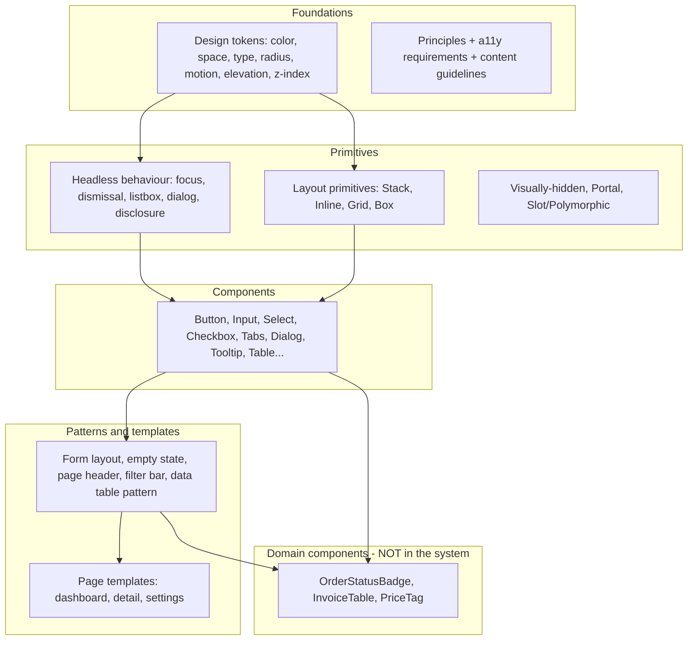
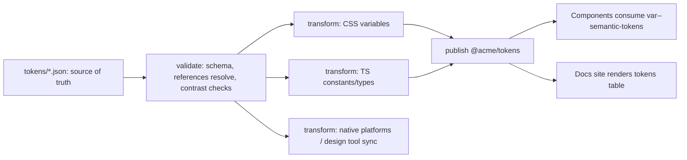
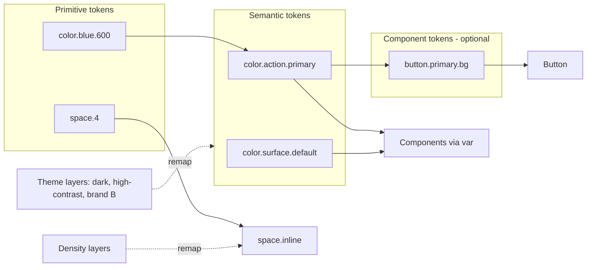
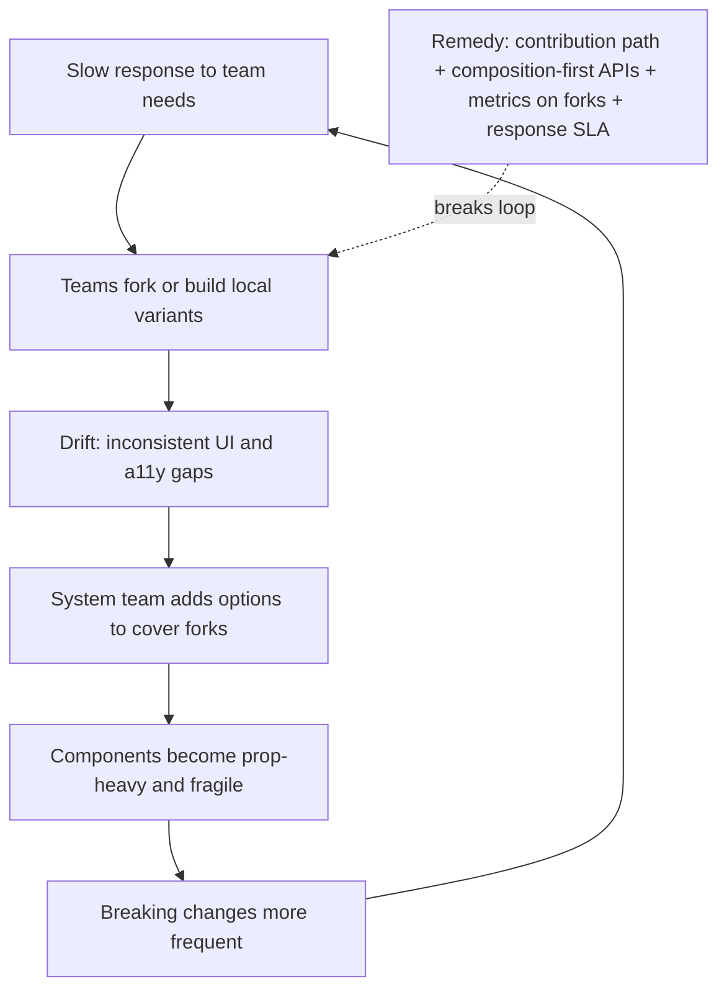

# 11 / 07 — Design System Architecture: Tokens, Primitives, Packages, Governance, and Adoption

## 1. Lesson metadata

| | |
|---|---|
| **Level** | Architect |
| **Study time** | 6–7 hours (reading 2.5 h, worked examples 2 h, exercises 2.5 h) |
| **Prerequisites** | [Design systems](../04-react-architecture/20-design-systems.md), [Component libraries](../04-react-architecture/21-component-libraries.md), [Monorepos and shared packages](../04-react-architecture/22-monorepos-and-shared-packages.md), [Styling architecture](../04-react-architecture/27-styling-architecture.md), [Headless components](../05-design-patterns/07-headless-components.md), [Patterns for reusable libraries](../05-design-patterns/22-patterns-for-reusable-libraries.md), [04 — Choosing abstraction level](./04-choosing-abstraction-level.md), [05 — Application boundaries](./05-application-boundaries.md) |
| **Next** | [08 — State architecture at scale](./08-state-architecture-at-scale.md) |
| **Related** | [03 — Large-scale refactoring](./03-large-scale-refactoring.md) (migrations), [Slot patterns](../05-design-patterns/20-slot-patterns.md), [Compound components](../05-design-patterns/05-compound-components.md), 11 — Designing for accessibility, 14 — Build vs buy |

**Learning objectives.** After this lesson you can:
1. Define a design system as a *product* with users (engineers and designers), a roadmap, a support model, and measurable outcomes — not a component folder.
2. Layer a system correctly: tokens → primitives → components → patterns/templates, and decide what belongs at which layer.
3. Design a **token architecture** (primitive, semantic, component tokens) that supports theming, density, dark mode, and multiple brands without re-rendering React trees.
4. Design component **APIs** that scale: polymorphism, native-prop forwarding, composition, controlled/uncontrolled state, accessibility contracts, and escape hatches.
5. Choose a package and distribution structure: one package vs many, `exports` maps, tree-shaking, CSS delivery, React Server Components compatibility, and framework neutrality.
6. Set up versioning, deprecation, and migration processes (semver, changelogs, codemods, compatibility windows).
7. Choose a governance model (centralised, federated, hybrid), measure adoption and quality, and recognise failure patterns (the "component graveyard", design drift, fork proliferation).
8. Decide build vs adopt vs extend (an open-source headless base, a commercial kit, or in-house) with explicit criteria.

**Concepts covered:** design tokens (global/alias/component), theming through CSS custom properties, density and mode, primitives vs components vs patterns, headless-vs-styled, polymorphic `as`/`asChild`, native prop and `ref` forwarding, compound components, accessibility contract, package `exports`, side effects and tree-shaking, CSS strategy (static CSS, CSS Modules, CSS-in-JS runtime cost, zero-runtime options), `"use client"` boundaries, Storybook-style documentation, visual and a11y testing, semver and codemods, governance models, contribution workflow, adoption and health metrics.

---

## 2. Deep conceptual explanation

### 2.1 What problem is this lesson solving?

Once a company has more than a few front-end teams, three forces appear simultaneously:

1. **Consistency pressure.** Users expect the same patterns across the product; designers want brand coherence; accessibility requires consistent, correct behaviour.
2. **Duplication pressure.** Every team builds its own button, modal, date picker and table. Each version has different bugs and a11y holes.
3. **Autonomy pressure.** Teams want to move fast and not wait for a central group to approve every UI change.

A **design system** reconciles these: a set of *shared, versioned, documented building blocks and rules* that make the right UI the easy UI, while leaving feature teams free to compose and extend. Done well it lowers the cost of building coherent, accessible UI. Done badly it becomes a bottleneck, a source of breaking changes, or an ignored library that teams fork.

> A design system is a **product**. Its customers are the engineers and designers who use it, and its success is measured in their adoption, speed, and the quality of the UI they ship — not the number of components it contains.

For the introductory material (what a design system is, component library basics), see [Design systems](../04-react-architecture/20-design-systems.md) and [Component libraries](../04-react-architecture/21-component-libraries.md). This lesson is about the *architecture* and *operation* decisions at scale.

### 2.2 The layers of a design system



| Layer | Contents | Who changes it | Rate of change | Rule |
|---|---|---|---|---|
| **Foundations/tokens** | Named design decisions | Design + system team | Low (brand-level) | Values live here once; everything references names |
| **Primitives** | Behaviour and layout building blocks (headless or minimally styled) | System team | Low | No domain knowledge; accessibility-complete |
| **Components** | Styled, opinionated UI controls | System team (+ contributors) | Medium | Stable API; backwards compatibility policy |
| **Patterns/templates** | Recipes composed of components; layout + guidance | System team and feature teams | Medium–high | Prefer documentation + composition over rigid components |
| **Domain components** | Product-specific compositions | Feature teams | High | **Do not** put in the system (see [04 §5.1](./04-choosing-abstraction-level.md)) |

The most common architectural mistake is letting **domain components creep into the system** ("`<OrderStatusBadge>` is used in three apps, so move it to the system"). The system should own *Badge*; the domain owns the mapping from status to tone.

### 2.3 Token architecture

A **design token** is a named, platform-agnostic design decision (e.g. `color.text.primary`, `space.4`, `radius.md`). Tokens separate *decision* from *implementation*, enabling theming, multi-brand, dark mode, and cross-platform consistency (web, native).

**Three tiers** (naming varies by organisation; the layering is the idea):

| Tier | Also called | Example | Purpose |
|---|---|---|---|
| **Primitive / global** | Core, reference | `color.blue.600 = #1d4ed8`; `space.4 = 16px` | The raw palette/scale; no meaning |
| **Semantic / alias** | Purpose-based | `color.action.primary = {color.blue.600}`; `color.text.danger = {color.red.700}` | Meaning in the UI; the layer themes remap |
| **Component** | Scoped | `button.primary.background = {color.action.primary}` | Optional; fine-grained component customisation |

**Why three tiers:** a *dark mode* remaps semantic tokens (`color.surface.default` from white to near-black) without touching components; a *rebrand* changes primitive values; a *component override* touches only component tokens. Components should reference **semantic** (or component) tokens, never primitives directly, otherwise theming requires editing components.

**Delivery format:** author tokens in a source of truth (JSON/YAML, ideally following a community format — the Design Tokens Community Group (DTCG) format, whose first stable version, **2025.10**, was published on 2025-10-28 at designtokens.org; it is a community-group specification, not a W3C Recommendation), transform them with a build step into **CSS custom properties** (web), and other platforms' formats. Tools such as Style Dictionary exist for this transformation; its docs (checked 2026-10-22) say support for the 2025.10 format is not yet complete, so confirm your tool's version against the spec you author in.

```css
/* generated: tokens.css */
:root {
  --color-blue-600: #1d4ed8;
  --space-4: 1rem;
  --color-action-primary: var(--color-blue-600);
  --color-surface-default: #ffffff;
  --color-text-primary: #111827;
}
:root[data-theme="dark"] {
  --color-surface-default: #0b1220;
  --color-text-primary: #f3f4f6;
  --color-action-primary: #60a5fa;
}
@media (prefers-contrast: more) { :root { --color-text-primary: #000; } }
```

Why CSS custom properties: they **cascade** and are resolved by the browser at style time. Switching `data-theme` re-resolves styles with **no React re-render** and no JS runtime cost, SSR can set the attribute before first paint, and sub-trees can be themed independently (a dark card inside a light page). Contrast this with JS-object themes passed through context, where a theme switch re-renders every consumer ([Context propagation cost](../07-performance/06-context-propagation-cost.md)).

⚠ Caveat: tokens used in contexts where CSS variables don't apply (canvas, SVG attribute values in some cases, email) need JS-accessible values too; generate both.

### 2.4 Component API design at scale

A component API is a *contract with unknown future consumers*. Principles:

1. **Be a good citizen of the platform: forward native props.** A `Button` should accept everything a `<button>` accepts (`type`, `disabled`, `aria-*`, `data-*`, `onClick`, `form`, …). In React 19, **`ref` is a regular prop for function components**, so forwarding works by spreading props onto the underlying element; before 19 you needed `forwardRef`, which remains supported in 19 but is documented as legacy (react.dev: it "will be deprecated in a future release"). Libraries that support multiple React majors must handle both.

```tsx
import type { ComponentProps } from "react";
type ButtonProps = ComponentProps<"button"> & { variant?: "primary" | "secondary" | "ghost"; size?: "sm" | "md" | "lg" };
```

2. **Design variants as unions, not booleans** ([04 §2.8](./04-choosing-abstraction-level.md)).
3. **Polymorphism where semantics demand it**: a "button" that is sometimes a link. Options: an `as` prop (typing is notoriously complex), an `asChild`/slot pattern (merge props onto the child element), or separate components (`Button` and `LinkButton`). The separate-components option is simplest to type and to reason about; polymorphic props are justified when the *styled behaviour* must be shared across many element types.
4. **Controlled and uncontrolled** state support for stateful components (`value`/`defaultValue`/`onChange`), following the native input convention; `open`/`defaultOpen`/`onOpenChange` for overlays.
5. **Compound components for structure** (Tabs, Menu, Dialog, Select) where parts share state ([Compound components](../05-design-patterns/05-compound-components.md)); slots for small fixed layouts ([Slot patterns](../05-design-patterns/20-slot-patterns.md)).
6. **Accessibility as part of the API contract**, documented per component: roles, keyboard interactions (aligned with the WAI-ARIA Authoring Practices), focus management, labelling requirements enforced by types where possible (e.g. an icon-only button *requires* `aria-label`).
7. **Escape hatches, deliberately:** `className`, `style`, `data-*`, and slot overrides — with clear guidance on what's *supported* (tokens, props) vs *unsupported* (overriding internal class names).
8. **No domain knowledge, no data fetching, no routing assumptions** (accept a `LinkComponent` via a provider or a render prop for framework links rather than importing a router).
9. **Small public API, large internal implementation** (deep modules).

Types can enforce the a11y contract:

```tsx
type IconButtonProps = Omit<ComponentProps<"button">, "children" | "aria-label" | "aria-labelledby"> &
  ({ "aria-label": string } | { "aria-labelledby": string }) & { icon: ReactNode };
```

### 2.5 Headless foundations: build, adopt, or extend?

The hardest part of components like `Dialog`, `Combobox`, `Menu` is not styling — it is **behaviour and accessibility**: focus trapping and return, Escape/outside-click dismissal, ARIA relationships, typeahead, roving tabindex, screen-reader announcements, touch/pointer nuances, portals and stacking. Options:

| Option | Description | Pros | Cons |
|---|---|---|---|
| **Build everything in-house** | Own implementation | Full control; no dependency | Very high cost for complex widgets; a11y regressions; slow |
| **Adopt an open-source headless library and style it** | Radix-style/Ark-style/React Aria-style primitives | Battle-tested behaviour; focus on brand/tokens | Dependency and upgrade risk; API constraints; bundle size per primitive |
| **Adopt a styled open-source kit and theme it** | MUI/Chakra/Mantine-style | Fastest start; large component set | Hard to match a custom brand; theming API lock-in; heavier |
| **Buy/commercial kit** | Vendor components | Support, completeness | Licence cost; lock-in; customisation limits |
| **Hybrid** | Adopt headless for hard widgets; build simple components in-house | Pragmatic | Needs clear policy for which is which |

⚠ Library landscapes and capabilities change; evaluate specific candidates against your requirements and verify current maintenance status. See [14 — Build vs buy](./14-build-vs-buy.md) and [01 — Trade-off analysis](./01-trade-off-analysis.md): wrap third-party primitives at the *system boundary* so product teams depend on the system's API, not on the underlying library. The system then absorbs library changes.

### 2.6 Package architecture and distribution

Decisions:

| Decision | Options | Consideration |
|---|---|---|
| **One package vs many** | `@acme/ui` (single) vs `@acme/ui-button`, `@acme/tokens`, `@acme/ui-table` (many) | Single: simplest versioning, atomic upgrades, cross-component consistency. Many: independent versioning and smaller dependency footprints but version-matrix complexity ("which Button works with which Theme?"). Common compromise: **few packages** (`tokens`, `primitives`/`headless`, `ui`, `icons`, optionally heavy widgets like `table` or `charts` separately). |
| **Entry points** | Barrel (`import { Button } from "@acme/ui"`) vs per-component paths (`@acme/ui/button`) | Barrels are ergonomic; bundlers can tree-shake ES modules if packages are side-effect-free and use ESM, but dev-server and some toolchains pay a cost for large barrels ⚠ measure. Provide both via `exports` if needed. |
| **Module format** | ESM (with CJS fallback if consumers need it) | Publish ESM for tree-shaking; verify your consumers' toolchains |
| **`sideEffects`** | `"sideEffects": false` or an allow-list (CSS files) | Enables dead-code elimination; wrong flags can drop required CSS or polyfill imports ⚠ |
| **Type declarations** | Generated `.d.ts` per entry | Types are part of the API; breakages in types are breaking changes |
| **Peer dependencies** | `react`, `react-dom` as peers with ranges | Avoid duplicate React copies ([05 §3.3](./05-application-boundaries.md)); declare supported majors |
| **CSS delivery** | Single `styles.css`, per-component CSS, CSS Modules compiled to static CSS, runtime CSS-in-JS | Static CSS has no runtime cost and works with RSC/streaming; runtime CSS-in-JS adds JS cost and has had RSC/SSR friction ⚠ verify your library's current support; per-component CSS needs ordering guarantees; **layers** (`@layer`) can help control cascade |
| **RSC compatibility** | Mark interactive modules with `"use client"` at the right granularity | Stateless components (layout primitives, `Text`) can be server-compatible; stateful ones need `"use client"`. Granularity matters: putting `"use client"` in a barrel marks everything client. ⚠ Verify current bundler/framework behaviour |
| **Framework neutrality** | Don't import a router/framework; inject links | Allows use in Next, Remix, Vite apps alike |

A representative `package.json` excerpt:

```json
{
  "name": "@acme/ui",
  "version": "4.2.0",
  "type": "module",
  "sideEffects": ["**/*.css"],
  "exports": {
    ".": { "types": "./dist/index.d.ts", "import": "./dist/index.js" },
    "./button": { "types": "./dist/button/index.d.ts", "import": "./dist/button/index.js" },
    "./styles.css": "./dist/styles.css",
    "./package.json": "./package.json"
  },
  "peerDependencies": { "react": "^18.2.0 || ^19.0.0", "react-dom": "^18.2.0 || ^19.0.0" },
  "dependencies": { "@acme/tokens": "^4.0.0" }
}
```

(Illustrative; ⚠ the `types`/`import` conditions and ordering depend on your TypeScript `moduleResolution` and bundler settings — verify against current Node, TypeScript and bundler docs.)

### 2.7 Versioning, deprecation, and migration

A design system's **API surface is huge**: component props, CSS class hooks (if exposed), tokens, types, visual output, even DOM structure and behaviour (consumers write tests against them). Policy decisions:

- **Semantic versioning**: breaking change → major. Define what counts as breaking *in your system*: prop removal/renaming, token removal/renaming, DOM structure changes that break documented selectors, a11y behaviour changes, visual changes beyond a tolerance (many teams treat *intentional* visual redesigns as major or as "design versions" shipped behind theme opt-ins).
- **Deprecation process:** announce → warn (dev-only console warning with a link) → remove in the next major after a *minimum window* (e.g. two minor releases or N months). Expand/contract applies ([03 §2.4.3](./03-large-scale-refactoring.md)).
- **Codemods** for every breaking change affecting more than a handful of call sites; test them on real consumer code.
- **Changelogs and release notes** generated from change files (e.g. the Changesets approach, see [13](./13-monorepo-vs-multirepo.md) §5.7), with migration guidance.
- **Version skew policy:** which majors are supported concurrently; how long old majors get security/a11y fixes.
- **Visual regression gating:** screenshot tests on component states in CI; reviewers approve intentional diffs.
- **Release channels:** canary/next for early adopters; stable for the rest.
- **Compatibility matrix:** React versions, browsers, SSR frameworks.

### 2.8 Quality gates: documentation, testing, accessibility

A component is **done** when it has:

| Aspect | Evidence |
|---|---|
| **API docs** | Props table, usage guidance (when to use / not), do and don't examples, code snippets |
| **Interactive examples** | Stories/playground for every state: default, hover, focus, active, disabled, loading, error, long text, RTL, dark mode, density |
| **Unit/interaction tests** | Behaviour tests with Testing Library (user-event; accessible queries) for keyboard and pointer interactions |
| **Accessibility tests** | Automated rule checks (axe-style) in CI ⚠ catch only a subset of issues; plus **manual screen-reader and keyboard passes** for complex widgets |
| **Visual regression** | Baselines per state/theme |
| **Type tests** | `tsd`/`expect-type`/`@ts-expect-error` tests for illegal prop combos |
| **Bundle budget** | Size of the component and its dependencies tracked in CI |
| **Performance sanity** | No unnecessary re-renders in common usage; large lists virtualised |
| **Design parity** | Design file component matches implementation (tokens in sync; naming aligned) |

### 2.9 Governance and operating model

| Model | Description | Pros | Cons | Fits |
|---|---|---|---|---|
| **Centralised** | A dedicated system team builds and maintains everything | Consistency, quality, clear ownership | Bottleneck; slow response; disconnect from product needs | Early stage; smaller orgs; high-compliance products |
| **Federated** | Contributions from product teams; a core group reviews | Scales effort; product-informed | Quality variance; review burden; inconsistent APIs without strong standards | Larger orgs with strong engineering culture |
| **Hybrid ("core + contributions")** | Core team owns foundations/primitives/high-traffic components; product teams contribute via a defined process (RFC → build → review → graduate) | Balance of throughput and quality | Needs clear contribution guidelines and a path to graduation from "incubating" to "stable" | Most mid/large organisations |
| **Community/inner-source** | Open to anyone; maintained by volunteers | Cheap | Unreliable; orphan components | Rarely sufficient alone |

**Contribution lifecycle (hybrid):** *Propose* (RFC: problem, existing solutions, evidence of ≥ 2–3 use cases) → *Incubate* (built by the requesting team to system standards; labelled experimental/unstable) → *Review* (API, a11y, tokens, docs, tests) → *Graduate* (stable, versioned, supported) → *Maintain/deprecate*. This mirrors the Rule of Three ([04 §2.5](./04-choosing-abstraction-level.md)): promote when use cases prove the shape.

**Support model:** a channel for questions, office hours, an SLA for bug triage, a roadmap shared with consumers, a changelog, and a way to *measure* satisfaction (surveys, adoption).

### 2.10 Measuring a design system

Avoid vanity metrics (component count). Measure outcomes:

| Metric | What it indicates | How |
|---|---|---|
| **Adoption (coverage)** | Share of UI built from system components | Static analysis of imports (JSX usage counts), per app/team |
| **Drift / custom overrides** | Fork and override pressure | Count `className`/style overrides on system components; count local copies of system-like components |
| **Version currency** | How many consumers are on current major | Dependency scan across repos |
| **Time to build** | Productivity effect | Survey; time-to-first-screen for new features; PR size |
| **Accessibility defects** | Quality | Audit findings; bugs per component |
| **Request lead time** | Responsiveness of the system team | Time from request to release |
| **Bundle impact** | Cost | Bytes per route attributable to the system |
| **Contribution rate** | Health of the federated model | External PRs merged |
| **Visual consistency** | Design quality | Automated design linting; token usage vs hard-coded values |

### 2.11 Misconceptions

| Misconception | Reality |
|---|---|
| "A design system is a Figma file / a component library." | It's tokens + components + guidelines + governance + support. A library without governance decays. |
| "Mandate adoption and it will work." | Mandates produce compliance without quality; adoption follows *usefulness*: docs, speed, responsiveness. |
| "More components = more value." | Unused or overlapping components are carrying costs. Curate. |
| "Tokens are just variables." | Tokens are a **layered contract** (primitive → semantic → component) that makes theming and rebrands possible. |
| "Design system components should handle every case." | They should handle the 80% with a small API and *compose* for the rest; domain cases live outside. |
| "Breaking changes are fine because we own the consumers." | Every breaking change is a migration project across teams; their cost belongs in the decision. |
| "CSS-in-JS vs CSS Modules is a style preference." | It affects runtime cost, SSR/RSC compatibility, theming mechanism, and bundle size; treat it as an architecture decision. |
| "Accessibility is solved by using ARIA attributes." | Incorrect ARIA is worse than none; native elements first; behaviour (focus/keyboard) is the hard part. |

---

## 3. Internal mechanics

### 3.1 How CSS custom properties resolve (why theming costs ~nothing in React)

*Public guarantee (CSS):* custom properties inherit by default; `var(--x)` is substituted at computed-value time, so changing `--x` on an ancestor changes the computed values of all descendants that reference it. In the browser's rendering pipeline ([Style → layout → paint → composite](../00-web-and-javascript-foundations/03-browser-rendering-pipeline.md)), a custom property change invalidates **style** for affected subtrees; whether layout or paint is also needed depends on which properties actually change (a color change needs paint only; a spacing token change needs layout).

*Consequence for React:* flipping `data-theme` on `<html>` is a DOM attribute mutation outside React's render cycle. **React doesn't re-render**; style recalculation happens in the browser. For a large page this can still cost milliseconds of style recalculation, but not component renders.

*Teaching model:* "tokens are resolved by the browser, not by React." *Implementation detail:* engines optimise style invalidation differently; measure on large DOMs if the theme switch feels slow. A common trick for instant switch without flash is to set the attribute before first paint; and to avoid expensive transitions across the entire page during switch (`transition: none` temporarily) ⚠ test for jank.

### 3.2 Token build pipeline



CI checks on tokens: every `{reference}` resolves; no cycles; semantic tokens defined for all themes (dark mode has a value for each); WCAG contrast thresholds for text/background pairs in each theme (automated using the contrast formula; **contrast is necessary but not sufficient** for accessibility); no component uses raw hex/px values (lint).

### 3.3 Polymorphism and prop merging

An `asChild`-style slot works by cloning the child element and **merging props**: event handlers are *composed* (call both), `className` concatenated, `style` merged, `ref`s merged. Pitfalls: handler composition order, `data-state` attributes, and the child *must* forward props/ref to a DOM node (otherwise behaviour is lost). In React 19 `ref` as a prop simplifies merging, but components must still spread props through. ⚠ This mechanism relies on `React.cloneElement`-style behaviour, an API that React documents as having caveats ("legacy"-labelled for some uses); libraries encapsulate it — prefer a well-tested implementation over a bespoke one.

### 3.4 Controlled/uncontrolled mechanics

A reusable pattern: a `useControllableState({ value, defaultValue, onChange })` hook returning `[state, setState]`, which:
- uses `value` when defined (controlled), else internal state seeded from `defaultValue` (uncontrolled);
- calls `onChange` in both modes;
- **warns** (dev) if the component switches between controlled and uncontrolled over its lifetime (React's own `<input>` does this).

Bugs arise from: updating internal state *and* calling `onChange` in controlled mode (double update), comparing with `Object.is` on objects, and not guarding `setState` functional forms.

### 3.5 Bundle and tree-shaking mechanics

*Teaching model:* bundlers statically analyse ES module imports and drop unused exports **if** (a) modules are ESM, (b) the package declares no side effects (or the module is provably pure), and (c) no module-level side-effecting code (registering globals, injecting CSS at import) remains. A single module with side effects imported through a barrel can force inclusion of siblings in some bundlers/configs. ⚠ Behaviour varies by bundler version and settings; verify with a **bundle analyser on a real consumer app**, and add a CI test that imports one component and asserts the resulting bundle size under a threshold.

### 3.6 RSC and the `"use client"` boundary for libraries

For libraries consumed by Server Components apps: modules using state, effects, event handlers, or browser APIs must be client components. The directive applies at the module level; the module and everything it imports (not already client) join the client bundle. Designing the system for RSC means:
- keep **pure presentational** components (Text, Stack, Card without handlers) free of client-only code so they can run on the server;
- put the directive at the **leaf-most interactive modules**, not a barrel, so importing `Card` doesn't drag `Dialog` into the client bundle;
- for compound components with context (Tabs), parts that share client context must all be client modules; ensure the `Root` and parts are in the same client boundary.

⚠ Frameworks and bundlers implement the details; verify current guidance in React and your framework docs.

---

## 4. Step-by-step execution walkthrough

**Case: a company with five product teams, three apps, and five different buttons wants a design system. Chronological plan.**

**Phase 0 — Discovery (2–3 weeks).**
- Audit UIs: inventory components, variants, colours, spacing values; count unique hex values and font sizes (often hundreds). Generate by script and screenshot.
- Interview teams and designers: top pain points; what they'd adopt.
- Define success: reduce unique colours to the token set; a11y audit findings halved; new-screen build time down X%.
- Decide scope: tokens + 12 core components + docs; non-goals: domain components, illustrations.

**Phase 1 — Foundations (4–6 weeks).**
- Token source of truth, with primitive + semantic tiers, light/dark themes; token build pipeline; docs site.
- Decide CSS strategy (static CSS with CSS Modules + custom properties), package structure (`tokens`, `ui`, `icons`), React support range.
- Primitives: layout (`Stack`, `Inline`, `Box`), `VisuallyHidden`, `Portal`, focus utilities; adopt a headless base for overlays (`Dialog`, `Popover`) and wrap it behind the system's API.

**Phase 2 — Core components (8–12 weeks).**
- Build in order of usage × a11y risk: `Button`, `Input`/`Field`, `Select`/`Combobox`, `Checkbox/Radio/Switch`, `Dialog`, `Tabs`, `Tooltip/Popover`, `Toast`, `Table` primitives.
- Each passes the **definition of done** (§2.8). Storybook-style docs + visual regression + a11y tests.
- **Pilot team** adopts early in a new feature (not a rewrite) with a weekly feedback loop.

**Phase 3 — Adoption (ongoing).**
- Hybrid governance: contribution RFC process; office hours; roadmap.
- Migrations for legacy components using strangler + ratchet ([03](./03-large-scale-refactoring.md)): lint rule against importing legacy `Button`; codemods.
- Adoption dashboard: coverage per app, token adherence, versions in use.

**Phase 4 — Evolution.**
- Deprecation policy applied; major release cadence (e.g. yearly) with codemods; changelog.
- Evaluate patterns/templates to graduate from product teams.
- Annual review of metrics and governance; prune unused components.

**What makes this sequence work:** foundations before components (tokens are the thing you can't easily change later); real consumers early (pilot) to shape APIs while changes are cheap; metrics from day one so you can show value and spot decay.

---

## 5. Code examples

### 5.1 Minimal example: a token-driven `Button` with native prop forwarding

```css
/* ui/button.module.css */
.root {
  display: inline-flex; align-items: center; justify-content: center;
  gap: var(--space-2);
  min-block-size: var(--control-height-md);
  padding-inline: var(--space-4);
  border: 1px solid transparent;
  border-radius: var(--radius-md);
  font: var(--font-control);
  cursor: pointer;
}
.root:focus-visible { outline: 2px solid var(--color-focus-ring); outline-offset: 2px; }
.root:disabled { opacity: .5; cursor: not-allowed; }
.primary { background: var(--color-action-primary); color: var(--color-on-action-primary); }
.secondary { background: transparent; color: var(--color-action-primary); border-color: var(--color-border-strong); }
.ghost { background: transparent; color: var(--color-text-primary); }
.sm { min-block-size: var(--control-height-sm); padding-inline: var(--space-3); }
.lg { min-block-size: var(--control-height-lg); padding-inline: var(--space-5); }
```

```tsx
// ui/Button.tsx
import type { ComponentProps } from "react";
import styles from "./button.module.css";

export type ButtonProps = ComponentProps<"button"> & {
  variant?: "primary" | "secondary" | "ghost";
  size?: "sm" | "md" | "lg";
};

export function Button({ variant = "primary", size = "md", className, type = "button", ...rest }: ButtonProps) {
  const cls = [styles.root, styles[variant], size !== "md" && styles[size], className].filter(Boolean).join(" ");
  return <button type={type} className={cls} {...rest} />;
}
```

**Line notes.**
- **Only semantic tokens** (`--color-action-primary`, `--space-4`) appear in CSS: theming and density are token concerns.
- **Logical properties** (`min-block-size`, `padding-inline`) support RTL and vertical writing modes without changes.
- `ComponentProps<"button">` includes `ref` in React 19 types (function components accept `ref` as a prop); spreading `{...rest}` forwards it. ⚠ On React 18 types, `ComponentProps<"button">` includes `ref` typing but forwarding requires `forwardRef` — a library supporting both must handle this (e.g. build against 18 with `forwardRef`, or publish separate builds).
- `type = "button"` default prevents accidental form submission — a deliberate a11y/behaviour decision: the native default (`submit`) is a common bug source; document the divergence.
- `:focus-visible` outline uses a token and is **never removed** without replacement.
- Class composition via array join is minimal; real systems use a tiny helper (`clsx`-style). Consumers' `className` is appended (escape hatch), with the caveat that override success depends on CSS ordering/specificity — use `@layer` for predictable cascade ⚠ verify browser support in your matrix.

**Predict:** A consumer renders `<Button variant="primary" disabled onClick={f}>`. Does `f` run when clicked? *Answer:* No — the browser does not dispatch click events on a disabled `<button>`. A related a11y caveat: disabled buttons are removed from the tab order and may be skipped by screen-reader navigation; for "loading" states prefer `aria-disabled`/`aria-busy` and keeping focusability, a decision to document.

### 5.2 Practical example: semantic/primitive tokens with multi-theme and density

```json
// tokens/core.json (primitive)
{
  "color": {
    "$type": "color",
    "blue": { "600": { "$value": { "colorSpace": "srgb", "components": [0.114, 0.306, 0.847], "hex": "#1d4ed8" } },
              "400": { "$value": { "colorSpace": "srgb", "components": [0.376, 0.647, 0.98],  "hex": "#60a5fa" } } },
    "gray": { "50":  { "$value": { "colorSpace": "srgb", "components": [0.976, 0.98, 0.984],  "hex": "#f9fafb" } },
              "900": { "$value": { "colorSpace": "srgb", "components": [0.067, 0.094, 0.153], "hex": "#111827" } } }
  },
  "space": {
    "$type": "dimension",
    "2": { "$value": { "value": 0.5,  "unit": "rem" } },
    "3": { "$value": { "value": 0.75, "unit": "rem" } },
    "4": { "$value": { "value": 1,    "unit": "rem" } }
  }
}
```

```json
// tokens/semantic.light.json
{
  "color": {
    "$type": "color",
    "surface": { "default": { "$value": "{color.gray.50}" } },
    "text": { "primary": { "$value": "{color.gray.900}" } },
    "action": { "primary": { "$value": "{color.blue.600}" } }
  }
}
```

```json
// tokens/semantic.dark.json  (only the semantic layer changes)
{
  "color": {
    "$type": "color",
    "surface": { "default": { "$value": "{color.gray.900}" } },
    "text": { "primary": { "$value": "{color.gray.50}" } },
    "action": { "primary": { "$value": "{color.blue.400}" } }
  }
}
```

```css
/* density is just another token layer */
:root                { --control-height-md: 2.5rem; --space-inline: var(--space-4); }
:root[data-density="compact"] { --control-height-md: 2rem;   --space-inline: var(--space-3); }
```

**Line notes.**
- The files follow DTCG 2025.10 (checked against designtokens.org/tr/2025.10/format): `$type` may sit on a group and is inherited; a `color` value is an object (`colorSpace`, `components`, optional `hex`) and a `dimension` value is `{ value, unit }` with unit `px` or `rem`; aliases use `{group.token}`. Older drafts (and many tools) used plain strings such as `"#1d4ed8"` and `"1rem"`; if your tool predates 2025.10, use the form it documents. The `$type` placement in the group above means the `$value` leaves no longer declare it individually.
- Dark mode redefines **only semantic tokens**; no component changes.
- A contrast check script runs over (text, surface) pairs per theme and fails CI if below WCAG thresholds.
- **Density** and **mode** are *orthogonal axes*: light/dark × comfortable/compact; the CSS selector approach composes them (`[data-theme="dark"][data-density="compact"]`). Avoid combinatorial token files by composing layers.

**Trade-off.** More tiers = more flexibility and more indirection. Teams with one brand, one theme and no plans to change can start with two tiers (primitive + semantic) and **no component tier**; add component tokens only when overrides are routinely requested.

### 5.3 Incorrect: a leaky, domain-polluted component

```tsx
// ui/Button.tsx — what NOT to do
import { useRouter } from "next/router";              // framework coupling
import { useCurrentUser } from "../../app/auth";      // domain/app coupling
import { track } from "../../app/analytics";          // app coupling

export function Button(props: {
  primary?: boolean; danger?: boolean; big?: boolean; linkTo?: string; admin?: boolean;
  trackingName?: string; label: string; onClick?: () => void; loading?: boolean;
}) {
  const router = useRouter();
  const user = useCurrentUser();
  if (props.admin && user?.role !== "admin") return null;
  return (
    <div className="btn-wrapper">
      <button
        style={{ background: props.danger ? "#d00" : props.primary ? "#06f" : "#eee", fontSize: props.big ? 18 : 14 }}
        onClick={() => { props.trackingName && track(props.trackingName); props.linkTo ? router.push(props.linkTo) : props.onClick?.(); }}
      >
        {props.loading ? "..." : props.label}
      </button>
    </div>
  );
}
```

Problems: framework and app coupling (can't use outside this app; `useRouter` fails in other frameworks); authorisation logic in a UI primitive; hard-coded colours (no tokens, no theming, no dark mode); inline styles prevent `:hover`/`:focus-visible` states; boolean flag soup; `label` prop prevents composition (no icons, no rich content); no native prop forwarding (can't pass `type`, `aria-*`, `disabled`, `ref`); an extra wrapper `div` breaks flex/grid layouts; navigation via `onClick` instead of an `<a>` (breaks middle-click, open-in-new-tab, accessibility semantics: a link is not a button); tracking inside the primitive couples analytics policy to the UI atom.

### 5.4 Corrected: composition, injection, and separation of concerns

```tsx
// ui/Button.tsx  — pure, no app/framework coupling (see 5.1)
// ui/LinkProvider.tsx — let the app inject its router's Link without the system importing it
import { createContext, useContext, type ComponentType, type ComponentProps } from "react";

type AnchorLike = ComponentType<ComponentProps<"a">>;
const LinkContext = createContext<AnchorLike>((props) => <a {...props} />); // default: plain anchor

export const LinkProvider = LinkContext.Provider; // React 19 also allows <LinkContext value=...> (verified)
export const useLinkComponent = () => useContext(LinkContext);

// ui/LinkButton.tsx — a LINK styled as a button (semantic: navigation)
export function LinkButton({ variant = "primary", className, ...rest }: ComponentProps<"a"> & { variant?: "primary" | "secondary" | "ghost" }) {
  const Link = useLinkComponent();
  return <Link className={buttonClass({ variant, className })} {...rest} />;
}
```

```tsx
// app/Providers.tsx — the app injects its framework link
import NextLink from "next/link";
<LinkProvider value={(p) => <NextLink {...(p as any)} />}>…</LinkProvider>
```

```tsx
// app feature: policy and analytics live outside the primitive
<Button variant="primary" onClick={() => { track("order_submit_clicked"); submit(); }}>
  <SendIcon aria-hidden /> Submit order
</Button>
{can("admin:export") && <Button variant="secondary">Export</Button>}
```

**Line notes.**
- **Two components** for two semantics: `Button` (action) and `LinkButton` (navigation), sharing a style function — instead of a polymorphic prop that mixes semantics.
- **Dependency inversion:** the system defines a tiny `LinkProvider` contract; the app supplies the framework `Link`. The system stays framework-neutral (⚠ the `as any` cast illustrates that framework link prop types vary — a real adapter should type its props properly).
- **Children for content** enables icons and rich content; the icon is `aria-hidden` because the text labels the button.
- Policy (`can`) and analytics stay in the feature/platform layer ([06 — Cross-cutting concerns](./06-cross-cutting-concerns.md)), not in the visual primitive.
- Cost: consumers write slightly more JSX at the call site — the price of keeping the primitive pure.

### 5.5 Advanced: a deprecation shim with dev warnings, a codemod hook, and a type-level a11y contract

```tsx
// ui/Dialog.tsx — v4 → v5 migration: `visible` → `open`
import type { ComponentProps, ReactNode } from "react";

type DialogBase = Omit<ComponentProps<"dialog">, "open" | "title"> & { title: string; onOpenChange: (open: boolean) => void; children: ReactNode };

type DialogProps =
  | (DialogBase & { open: boolean; visible?: never })
  /** @deprecated use `open`. Removal in v6. Run: npx @acme/codemods dialog-open */
  | (DialogBase & { visible: boolean; open?: never });

const warned = new Set<string>();
function warnOnce(key: string, message: string) {
  if (process.env.NODE_ENV !== "production" && !warned.has(key)) {
    warned.add(key);
    console.warn(`[@acme/ui] ${message}`);
  }
}

export function Dialog(props: DialogProps) {
  const { visible, open, ...rest } = props as DialogBase & { visible?: boolean; open?: boolean };
  if (visible !== undefined) warnOnce("Dialog.visible", "Dialog `visible` is deprecated; use `open`. See https://example.invalid/migrate-dialog");
  const isOpen = open ?? visible ?? false;
  return <DialogImpl {...rest} open={isOpen} />;
}
declare function DialogImpl(p: DialogBase & { open: boolean }): JSX.Element; // headless-based implementation (not shown)
```

```tsx
// Accessibility contract in the type system: icon-only buttons need an accessible name
import type { ComponentProps, ReactNode } from "react";
type Named = { "aria-label": string; "aria-labelledby"?: never } | { "aria-labelledby": string; "aria-label"?: never };
export type IconButtonProps = Omit<ComponentProps<"button">, "children" | "aria-label" | "aria-labelledby"> & Named & { icon: ReactNode };

// <IconButton icon={<TrashIcon />} />                 // ✗ compile error: no accessible name
// <IconButton icon={<TrashIcon />} aria-label="Delete" /> // ✓
```

**Line notes.**
- The union with `never` makes `open` and `visible` **mutually exclusive** at compile time while both are accepted — an expand-phase contract ([03 §2.4.3](./03-large-scale-refactoring.md)).
- `warnOnce` prevents console flooding; the message includes a **codemod command** and a link (the URL in the example is a placeholder domain — use your real docs). Dev-only gating relies on the consumer's bundler stripping `process.env.NODE_ENV` branches; ⚠ verify for your distribution (libraries commonly ship separate dev/prod builds or use bundler-aware conditions).
- Type-level a11y enforcement catches the most common icon-button mistake at compile time; it can't verify the *quality* of the label (a string `"button"` compiles), so pair with lint/axe-style tests and design review.
- The casts inside `Dialog` show the typical cost of union props: implementation needs a widening cast. Keep it contained; test both shapes.

---

## 6. Visual explanations

### 6.1 Token tiers and who consumes them



### 6.2 Contribution lifecycle (hybrid governance)

```mermaid
stateDiagram-v2
  [*] --> Proposal: RFC (problem, evidence, ≥2 use cases)
  Proposal --> Incubating: approved; built by requesting team to system standards
  Incubating --> Review: API + a11y + docs + tests + tokens checklist
  Review --> Stable: graduates; semver + support
  Review --> Incubating: changes requested
  Stable --> Deprecated: superseded / low use
  Deprecated --> Removed: after window + codemod
  Proposal --> [*]: rejected (compose from existing)
  Removed --> [*]
```



### 6.3 Where design systems fail (feedback loop)



---

## 7. Alternative approaches and trade-offs

| Approach | Consistency | Speed to start | Customisation | Long-term cost | Bundle | Best when |
|---|---|---|---|---|---|---|
| **In-house system on in-house primitives** | Highest | Slowest | Total | High (a11y behaviour maintenance) | Controlled | Strong brand, large org, a11y-critical, dedicated team |
| **In-house system on open-source headless primitives** | High | Medium | High (behaviour fixed by lib) | Medium | Moderate | Most organisations needing a custom brand |
| **Styled open-source kit, themed** | Medium–high | Fastest | Medium (via theme API, may fight defaults) | Medium (upgrade/theming drift) | Often heavier | MVPs, internal tools, small teams |
| **Commercial kit** | High | Fast | Medium | Licence + lock-in | Varies | Need support/SLAs, complex widgets (grids, charts) |
| **No shared system; per-team components** | Low | Immediate | Total | Rising (duplication, inconsistent a11y) | Duplicated | Tiny org; early product discovery |
| **Tokens + guidelines only (no shared code)** | Medium (visual) | Fast | Total | Low–medium | n/a | Heterogeneous stacks (multiple frameworks); acquisitions |
| **Web Components–based system** | High across frameworks | Slower | Medium (styling via parts/variables) | Medium | Moderate | Multiple frameworks must share UI ⚠ verify React integration details for your version |
| **Config/DSL-driven UI on top of the system** | Very high | Slow | Low | Platform-team heavy | Low | Many near-identical pages ([04 §7](./04-choosing-abstraction-level.md)) |

**Scenario where the recommended approach (in-house, headless-based, token-driven, hybrid governance) is *not* best.**
1. **A single small product team** shipping an MVP: adopt a styled kit and theme it lightly; a custom system is premature ([01](./01-trade-off-analysis.md): reversible, small blast radius).
2. **Multiple frameworks** (React, Vue, Angular) must share UI: tokens + Web Components, or framework-specific thin wrappers over shared tokens and guidelines.
3. **Highly specialised, data-dense UI** (trading terminals, CAD-like tools) where generic components fit poorly: invest in domain components and use the system only for foundations (tokens, primitives).
4. **No dedicated team and no funding**: a system without maintainers is worse than guidelines + one well-chosen open-source library.

---

## 8. Best practices and anti-patterns

### 8.1 Good practice
- Treat it as a **product**: roadmap, consumers, support, metrics.
- **Tokens first**, semantic tier consumed by components; verify themes by CI contrast checks.
- Keep the system **domain-free**, framework-neutral, and app-agnostic; inject links, analytics, and policy.
- **Forward native props and refs**; accept `className`; document supported customisation.
- **Variants as unions**; separate components for separate semantics (`Button`/`LinkButton`).
- **A11y in the definition of done**: keyboard, focus, labels, screen-reader checks for complex widgets.
- **Wrap third-party primitives** behind your API so upgrades/swaps stay internal.
- **Version and deprecate deliberately**: dev warnings, codemods, windows, changelogs; test codemods on real consumers.
- **Measure** adoption, drift, version currency, a11y defects, request lead time.
- **Pilot with a real team** before stabilising APIs; promote contributions through an incubation path.
- **Publish a compatibility matrix** (React versions, browsers, frameworks).
- **Budget bundle size**; test tree-shaking against a real consumer.

### 8.2 Beginner mistakes
- Hard-coding colours and spacing values in components.
- Building a giant `Button` with 25 props.
- Forgetting focus styles and keyboard interaction; removing outlines.
- No docs or only a props table without guidance.

### 8.3 Experienced-developer mistakes
- **Over-engineering the system before having consumers** (a design system "big bang").
- **Pulling domain components into the system** because they're reused.
- **Breaking visual or DOM output without major versions**, silently breaking consumers' tests and layouts.
- **Ignoring migration cost**: a beautiful v2 that nobody can afford to adopt.
- **Central bottleneck**: all requests funnel to a 3-person team with no contribution path.
- **Component graveyard:** 150 components, 30 used, none deprecated.
- **Mandating adoption** without making the system faster than the alternative.
- **Treating Storybook as the documentation**; stories show states, not *guidance* (when to use, content rules, accessibility notes).
- **Coupling to a CSS-in-JS runtime** that conflicts with SSR/RSC or inflates bundles, without evaluation.

### 8.4 Smells
- Consumers routinely override with `!important` or deep selectors.
- Multiple "Button-like" components in product code.
- Tokens referenced by value (hex) in app code.
- Breaking changes announced in Slack, not in the changelog.
- Components exporting hooks that require app context to exist (`useCurrentUser`).
- `index.ts` that exports 400 items with no categorisation, and no deprecation markers.
- Visual regression tests that are routinely approved without review.

### 8.5 Justified exceptions
- A **domain-specific component** may live in the system when the domain *is* the platform (a charting library for a data-visualisation company) — but make that a separate package with its own governance.
- **Hard-coded values inside a single component** for a one-off visual (illustration frame) are fine if tokens don't express the decision; but treat repeated one-offs as a missing token.
- **Shipping a visual redesign in a minor version** behind an opt-in theme flag, then switching defaults in the next major, is a legitimate way to avoid forcing visual churn.

---

## 9. Real-world application

| Domain | System emphasis | Constraints |
|---|---|---|
| **E-commerce** | Brand expressiveness, theming per market/brand, performance (CWV), A/B testing of components | Marketing pages vs app UI have different needs; the system must not hinder LCP; content teams (CMS) need a safe subset of components |
| **Dashboards** | Data-dense components: tables, filters, charts; density modes; dark mode | Virtualisation, keyboard navigation in grids, colour-blind-safe palettes; separate heavy packages to protect bundle |
| **Finance** | Accessibility compliance (audit), numeric typography (tabular numerals), predictable change control | Regulatory sign-off for changes; strict versioning and release notes; screen-reader behaviour in data tables |
| **Forms-heavy** | `Field` composition (label, description, error, a11y wiring), validation display patterns, date/time inputs | Error summary patterns, autosave, long forms; consistent error semantics |
| **Auth** | Minimal, robust components for login/MFA flows reused across many apps | Security-sensitive: no third-party scripts; strict CSP compatibility (no inline styles from CSS-in-JS if CSP forbids) |
| **Real-time** | Live-updating components that don't steal focus or spam screen readers (`aria-live` etiquette) | Throttled updates; reduced motion; stable layout |
| **Multi-team** | Governance, versioning, codemods, adoption dashboards | Multiple release cadences → version skew policy; central support capacity |

**Engineering constraints:**
- **Brand & legal**: fonts, licences, trademark usage.
- **Browser support** dictates CSS features (logical properties, `:focus-visible`, `@layer`, container queries): publish and test against the support matrix.
- **SSR/RSC**: component APIs and CSS strategy must work with the rendering modes in use.
- **Performance budgets**: icon sets (tree-shakeable), font loading strategy, and CSS size.
- **Org capacity**: the system's scope must match team size — a three-person team can't support 120 components.

---

## 10. Debugging and troubleshooting

| Symptom | Likely root cause | Investigation | Fix / validation |
|---|---|---|---|
| Consumer's `className` override doesn't apply | Specificity/order: system CSS loaded after consumer CSS, or higher specificity | DevTools Styles panel: which rule wins and why; check CSS load order | Use `@layer` ordering (system in a lower layer), lower selector specificity, document supported overrides; test via a fixture |
| Dark mode flashes light on load | Theme attribute applied after hydration/first paint | Throttled CPU/network; check where `data-theme` is set | Set attribute server-side from cookie or inline script in `<head>` before CSS; rely on media query for system mode |
| Bundle contains the whole library for one button | Barrel import with side effects, CJS build, or missing `sideEffects` | Bundle analyser on consumer; inspect `package.json` `sideEffects`/`exports` | Ship ESM, declare `sideEffects` accurately, provide per-component entry points; add CI bundle test |
| Hook errors/context missing only in some apps | Duplicate React copies or mismatched peer ranges | `npm ls react`, browser React version log, bundler alias config | Peer dependency policy; dedupe; single React via `resolve.alias`/workspace hoisting |
| Server Components app errors: "useState only works in Client Components" | Missing `"use client"` on stateful module, or barrel marked incorrectly | Error stack points to the module; check directives at leaf level | Add the directive to leaf interactive modules; split server-safe and client exports |
| Modal doesn't trap focus or return it | Re-implemented behaviour incomplete; portal ordering; `inert`/`aria-hidden` background not applied | Keyboard-only run-through; DevTools Accessibility tree | Use tested headless primitive; add interaction tests (Tab cycle, Esc, return focus) |
| Tooltip/popover clipped or mispositioned | `overflow: hidden` ancestor, stacking context, transforms | Inspect containing blocks; z-index and stacking contexts | Render in a portal; use anchored positioning primitives; document stacking tokens (`z-index` scale) |
| Visual regression tests flaky | Fonts/animations/time not deterministic | Compare diffs across runs; check animation/timing | Freeze animations, preload fonts, fixed viewport/DPR, deterministic data |
| Consumers can't upgrade to v5 | Breaking changes without codemods or too many at once | Count usage of removed APIs across repos; interview teams | Provide codemods, split into smaller releases, compat shims; track migration burn-down ([03](./03-large-scale-refactoring.md)) |
| Tokens drift between Figma and code | No automated sync or ownership | Diff token exports | Single source of truth with pipelines to both; CI check |
| Typing a polymorphic component is unusably complex | Over-flexible API (`as` with arbitrary components) | Check type errors/IDE performance | Replace with separate components or constrained `as` union; use slot pattern |
| Controlled/uncontrolled warnings in forms | Value switches between `undefined` and defined | Log prop values over time | Normalise (`value ?? ""`), document, add dev warning in `useControllableState` |

**Investigation recipe: "Is the system helping teams?"**
1. Run an adoption script: for each app, count system component usage vs local look-alikes (name patterns, similarity heuristics).
2. Count style overrides on system components.
3. Survey the last quarter's requests: median time to first response and to release.
4. Sample 10 recent product screens for a11y/consistency issues; classify by whether the system could have prevented them.
5. Decide interventions: add components, improve docs, fix APIs, speed support, deprecate unused; **validate** by repeating the measures next quarter.

---

## 11. Exercises

### Level A — Knowledge
A1. Name the three token tiers and give one example of each. Why must components consume semantic tokens rather than primitives?
A2. Explain why switching a theme via CSS custom properties causes no React re-render, while switching via a context-provided JS theme object does.
A3. What goes wrong when `"use client"` is placed in a barrel file of a design system?
A4. List five items in a component's "definition of done" in a design system.
A5. Distinguish centralised, federated, and hybrid governance. Which failure mode does each tend toward?

### Level B — Code comprehension
B1. In §5.1, why is `type = "button"` set as a default and what behaviour differs from the native default? What could that break?
B2. In §5.5, what does the union with `open?: never` / `visible?: never` enforce, and what would happen without the `never` fields?
B3. In §5.4, why is `LinkButton` a separate component from `Button` rather than `Button` with an `href`/`as` prop? Name two accessibility/semantic reasons.
B4. Given this `package.json` fragment, what problems might a consumer have? `{"sideEffects": false, "exports": {".": "./dist/index.js"}}` where `dist/index.js` imports `./styles.css`.

### Level C — Implementation
C1. Write a `useControllableState<T>` hook with `value`, `defaultValue`, `onChange` supporting functional updates, and a dev-only warning when switching between controlled and uncontrolled. Include tests.
C2. Write a Node script that validates a token set: all references resolve, no cycles, and every semantic token exists in both `light` and `dark` files.
C3. Write a contrast-check function for hex colour pairs using the WCAG relative luminance formula and use it to assert `color.text.primary` on `color.surface.default` meets 4.5:1 in both themes.

### Level D — Debugging
D1. A product team reports that after upgrading `@acme/ui` from 4.1 to 4.2, their snapshot tests and a CSS selector (`.btn > span`) broke, although no props changed. Diagnose and propose policy changes.
D2. The design system's bundle analysis shows 180 KB of the `ui` package in a login page that uses only `Button` and `Input`. List four candidate causes with how you'd confirm each.
D3. Users of screen readers report that a custom `Select` announces "group" and doesn't expose the selected value. Outline the investigation and the likely fix strategy (including whether to adopt a headless primitive).

### Level E — Architecture and engineering decisions
E1. A company with 6 teams and 3 apps (React 18 and 19, Next.js and Vite) wants a design system within 2 quarters, with a team of 4. Propose scope, layering, package structure, CSS strategy, governance, and milestone plan. State what you will explicitly *not* build.
E2. Evaluate "adopt a styled open-source kit and theme it" versus "build on headless primitives with in-house styling" for a regulated fintech with a strong brand and WCAG AA requirement. Use weighted criteria and a sensitivity statement ([01](./01-trade-off-analysis.md)).
E3. Design the deprecation and migration policy for the system: what counts as breaking, notice periods, codemods, version support, exceptions for security/accessibility fixes.

### Level F — Expert challenge
F1. Design a **multi-brand** token architecture (3 brands × light/dark × 2 densities) where components are brand-agnostic, including build outputs, testing strategy (contrast, visual), runtime switching, and what you would do about brand-specific component variations (e.g. one brand needs pill buttons).
F2. Your design system must support both React Server Components apps and client-only SPAs, React 18 and 19. Design the component authoring conventions, build outputs, and CI verification to keep it working in both, and name what remains uncertain and how you'd verify.

---

## 12. Detailed answers and explanations

> Attempt the exercises first.

### Level A

**A1.** *Primitive:* `color.blue.600 = #1d4ed8` (raw palette/scale). *Semantic:* `color.action.primary = {color.blue.600}` (meaning in the UI). *Component:* `button.primary.background = {color.action.primary}` (scoped to a component). Components consume semantic tokens because themes/brands/modes remap the semantic layer; if components referenced primitives (`blue.600`) directly, dark mode or rebrand would require editing components, and intent ("this is the primary action colour") would be lost.

**A2.** CSS custom properties are resolved by the browser during style computation. Changing `data-theme` on an ancestor (a DOM attribute mutation outside React) invalidates style for descendants; no component functions run. A context-provided JS theme object changes the context value, so React re-renders every consumer of that context (and any consumers' children that aren't memoised), and styles would have to be re-applied through React. Caveat: large DOMs may still have noticeable style-recalculation cost; measure.

**A3.** The directive marks the module (and its transitive imports) as client code. In a barrel, importing any one export pulls the whole barrel into the client bundle, making server-capable components (layout, text) client components and shipping all components' code to the browser, defeating RSC benefits. Place directives at leaf interactive modules and provide server-safe entry points. ⚠ Verify current bundler behaviour.

**A4.** Any five: API docs with usage guidance; stories covering all states/themes/RTL; interaction tests for keyboard/pointer; automated a11y checks plus manual screen-reader pass for complex widgets; visual regression baselines; type tests for illegal props; bundle size tracked; token-only styling (no hard-coded values); deprecation/changelog entry; design parity check.

**A5.** *Centralised:* one team builds all; tends toward bottleneck and disconnect (teams fork). *Federated:* many contribute; tends toward inconsistency and review overload. *Hybrid:* core owns foundations/high-traffic components, contributions flow via RFC/incubation/graduation; failure mode is unclear graduation criteria or core team under-capacity so incubating components languish. 

### Level B

**B1.** The native `<button>` default `type` inside a form is `submit`, causing accidental submissions when buttons are used for non-submit actions. Defaulting to `"button"` prevents that, but breaks code that *relied* on implicit submit (a primary form button without `type="submit"`). Document it; consumers needing submit must pass `type="submit"`. Some systems choose the opposite default to match native semantics; either choice must be documented and consistent. A migration from raw `<button>` to `Button` can change form behaviour — a classic migration hazard to cover in the codemod/lint.

**B2.** It makes `open` and `visible` mutually exclusive in the type: passing both is a compile error, and at least one is required (since each branch requires its own). Without `never` fields, TypeScript's union would allow an object with both properties (excess property checking for unions is lenient), so consumers could pass conflicting values and the runtime precedence would be silent. The `never` pattern encodes "exactly one of" for the expand phase. The implementation still needs a widening cast to destructure uniformly.

**B3.** Semantics: a button performs an action; a link navigates. Reasons: (1) links support middle-click, open in new tab, copy link, and crawlers; screen readers announce "link" vs "button" and users expect different keyboard behaviour (Enter for links; Space and Enter for buttons); (2) polymorphic `as` typing is complex and error-prone (props for `a` vs `button` conflict: `disabled`, `type`, `href`); (3) router integration differs; keeping `LinkButton` separate lets the app inject its router `Link`. Shared styling is extracted to a style function, not a shared element type.

**B4.** `"sideEffects": false` tells bundlers all modules are side-effect free, so the CSS import in `dist/index.js` may be **dropped** when tree-shaking (the import appears unused), leaving the component unstyled in production while working in dev. Fix: `"sideEffects": ["**/*.css"]` (or specific files), or ship CSS as an explicit `import "@acme/ui/styles.css"` entry. Also, `exports` only exposes `"."`: consumers can't import `@acme/ui/styles.css` or sub-paths (they'd get `ERR_PACKAGE_PATH_NOT_EXPORTED`), and there is no `types` condition so TypeScript resolution may fail depending on `moduleResolution`. ⚠ Verify against current docs.

### Level C

**C1.**

```tsx
import { useCallback, useEffect, useRef, useState } from "react";

export function useControllableState<T>({
  value, defaultValue, onChange,
}: { value?: T; defaultValue: T; onChange?: (v: T) => void }) {
  const isControlled = value !== undefined;
  const [inner, setInner] = useState<T>(defaultValue);
  const current = isControlled ? (value as T) : inner;

  if (process.env.NODE_ENV !== "production") {
    // eslint-disable-next-line react-hooks/rules-of-hooks -- stable condition per build, not per render
    const wasControlled = useRef(isControlled);
    useEffect(() => {
      if (wasControlled.current !== isControlled) {
        console.warn(`Component changed from ${wasControlled.current ? "controlled" : "uncontrolled"} to ${isControlled ? "controlled" : "uncontrolled"}.`);
      }
    }, [isControlled]);
  }

  const currentRef = useRef(current);
  currentRef.current = current; // for functional updates (see note)

  const set = useCallback((next: T | ((prev: T) => T)) => {
    const resolved = typeof next === "function" ? (next as (p: T) => T)(currentRef.current) : next;
    if (Object.is(resolved, currentRef.current)) return;
    if (!isControlled) setInner(resolved);
    onChange?.(resolved);
  }, [isControlled, onChange]);

  return [current, set] as const;
}
```

Notes and evaluation criteria: behaviour in both modes; `onChange` called in both; functional updates resolved against the latest value; skip no-op updates; dev warning on mode switch. Honest caveats: writing to a ref during render (`currentRef.current = current`) is discouraged by React's rules for purity — a stricter implementation updates the ref in an effect/layout effect or uses a reducer; the conditional `useRef/useEffect` inside a `NODE_ENV` check relies on the condition being constant per build (lint complains; a cleaner approach always calls the hooks and branches inside). Tests: render controlled with `value`, assert `onChange` is called and internal state not used; uncontrolled with `defaultValue`, assert it updates and calls `onChange`; switching mode warns once (spy on `console.warn`); functional update uses latest value. An alternative design to avoid ref-in-render: use `useState` + `useEffect` sync only for dev warnings, and resolve functional updates only in uncontrolled mode via `setInner(prev => …)`, calling `onChange` with a value computed from `current` — each has edge cases (batched updates); this is why teams adopt a vetted implementation.

**C2.**

```ts
import { readFileSync } from "node:fs";

type Tree = { [k: string]: Tree | { $value: unknown } };
const isLeaf = (n: unknown): n is { $value: unknown } => typeof n === "object" && n !== null && "$value" in n;

function flatten(tree: Tree, prefix = "", out = new Map<string, string>()) {
  for (const [k, v] of Object.entries(tree)) {
    if (k.startsWith("$")) continue;               // group-level $type, $description, ...
    const path = prefix ? `${prefix}.${k}` : k;
    if (isLeaf(v)) out.set(path, typeof v.$value === "string" ? v.$value : "[literal]"   /* object values (colour, dimension) are never aliases */);
    else flatten(v as Tree, path, out);
  }
  return out;
}

const load = (f: string) => flatten(JSON.parse(readFileSync(f, "utf8")));
const core = load("tokens/core.json");
const light = load("tokens/semantic.light.json");
const dark = load("tokens/semantic.dark.json");
const all = new Map([...core, ...light]); // resolution universe for light
const errors: string[] = [];

const ref = /^\{([^}]+)\}$/;
function resolves(universe: Map<string, string>, start: string, seen = new Set<string>()): boolean {
  if (seen.has(start)) { errors.push(`cycle at ${start}`); return false; }
  seen.add(start);
  const v = universe.get(start);
  if (v === undefined) { errors.push(`missing token ${start}`); return false; }
  const m = ref.exec(v);
  return m ? resolves(universe, m[1], seen) : true;
}

for (const [name] of light) resolves(new Map([...core, ...light]), name);
for (const [name] of dark) resolves(new Map([...core, ...dark]), name);
for (const name of light.keys()) if (!dark.has(name)) errors.push(`semantic token ${name} missing in dark`);
for (const name of dark.keys()) if (!light.has(name)) errors.push(`semantic token ${name} missing in light`);

if (errors.length) { console.error(errors.join("\n")); process.exit(1); }
```

Evaluation: handles nested trees, reference resolution per theme, cycle detection via `seen`, parity check both ways. Limitations: references embedded within composite values (`"1px solid {color.x}"`) not handled; arrays/typography composite tokens need a richer parser; real pipelines use the token tool's own validation.

**C3.**

```ts
function srgbToLinear(c: number) { const s = c / 255; return s <= 0.04045 ? s / 12.92 : ((s + 0.055) / 1.055) ** 2.4; }
function luminance(hex: string) {
  const h = hex.replace("#", "");
  const full = h.length === 3 ? h.split("").map((ch) => ch + ch).join("") : h; // expand #rgb shorthand
  const n = parseInt(full, 16);
  const [r, g, b] = [(n >> 16) & 255, (n >> 8) & 255, n & 255].map(srgbToLinear);
  return 0.2126 * r + 0.7152 * g + 0.0722 * b;
}
export function contrast(a: string, b: string) {
  const [l1, l2] = [luminance(a), luminance(b)].sort((x, y) => y - x);
  return (l1 + 0.05) / (l2 + 0.05);
}
test("text on surface meets AA normal text", () => {
  expect(contrast("#111827", "#f9fafb")).toBeGreaterThanOrEqual(4.5); // light
  expect(contrast("#f9fafb", "#111827")).toBeGreaterThanOrEqual(4.5); // dark
});
```

Notes: the WCAG relative luminance formula uses the sRGB linearisation shown; 4.5:1 is the AA threshold for normal text (3:1 for large text and UI components per WCAG 2.x; the WCAG 3 drafts use a different contrast algorithm (APCA-style), so confirm which standard your contract names; run-tested: `#000`/`#fff` gives 21, `#767676`/`#fff` gives 4.54, and the lesson's `#111827`/`#f9fafb` text-on-surface pair gives 16.98, so both assertions pass). Hex shorthand (`#fff`) is expanded digit by digit in the sample; alpha channels need compositing against the background first. Contrast automation is necessary but not sufficient.

### Level D

**D1.** Likely cause: DOM structure change (e.g. wrapping label in a `span`, or removing the inner `span`) or class name change in a *minor* release — no prop changes but output changed. Consumers coupled to implementation details (selector `.btn > span`; snapshot tests). Policy: (1) define the *public contract*: props, tokens, documented parts/data attributes (`data-slot`, `data-state`), and a11y behaviour; DOM structure and class names are **not** public unless documented; (2) provide stable hooks (`data-*` attributes) for consumers needing targeting; (3) discourage snapshot tests of system internals (use accessible queries); (4) visual/DOM changes that would break documented hooks require a major; (5) release notes call out "DOM output changes" even when not breaking; (6) a canary channel and consumer CI against `next`. Be honest that snapshot tests of third-party output are brittle; add a lint/test guidance doc.

**D2.** Candidate causes: (1) **Barrel import with side effects or CJS build** prevents tree-shaking — confirm with bundle analyser (modules from many components included) and by checking `module`/`exports`/`sideEffects`; (2) **A heavy dependency imported at module top-level** (e.g. date library, icon set) by `Input` or shared utility — analyser shows the dependency chunk; (3) **Shared utilities importing a "kitchen-sink" module** (`utils.ts` importing everything) — dependency graph from entry; (4) **All icons bundled** via `import * as Icons` — analyser shows icon modules; (5) **CSS** for all components in a single stylesheet — measure CSS bytes separately; (6) **Duplicate dependencies** (two versions of a headless lib) — `npm ls`. Confirm each with analyser views, reproduce with a minimal consumer, then fix (per-component entries, `sideEffects` correct, lazy-load heavy parts) and add a CI test asserting the size for a one-component import.

**D3.** Investigation: (1) inspect with the browser Accessibility tree and a screen reader (NVDA/JAWS/VoiceOver) to see roles/names/states; (2) check the markup: likely `div` soup with `role="group"` and no `role="combobox"`/`listbox`/`option`, no `aria-expanded`, `aria-controls`, `aria-activedescendant`, no selected value exposed (`aria-selected`, or value in the combobox's accessible value); (3) test keyboard: Arrow keys, Home/End, typeahead, Esc; (4) compare with the WAI-ARIA Authoring Practices pattern (select-only combobox, listbox). Strategy: prefer a **native `<select>`** where styling needs permit (best a11y for free); otherwise adopt/wrap a tested headless primitive rather than hand-rolling the pattern; add interaction tests and manual screen-reader checks to the definition of done; roll out via expand/contract ([03](./03-large-scale-refactoring.md)).

### Level E

**E1.** Model answer. *Scope (2 quarters, 4 people):* tokens (primitive+semantic, light/dark, one brand), ~12 core components (Button, LinkButton, Field/Input, Select, Checkbox/Radio/Switch, Dialog, Popover/Tooltip, Tabs, Toast, a basic Table), layout primitives, icons. *Not building:* domain components, charts, complex data grid, illustration system, multi-brand, native mobile. *Layering:* tokens → primitives (headless base adopted for overlays/listbox, wrapped) → components → documented patterns (form layout, page header). *Packages:* `@acme/tokens`, `@acme/ui` (ESM, `exports`, per-component entries), `@acme/icons`; peer deps React `^18.2 || ^19`. *Compatibility:* build and test in CI against React 18 and 19; avoid APIs differing between them (e.g. `ref` as prop vs `forwardRef`) via a small compat helper or by supporting only the common subset; document the matrix. *CSS strategy:* static CSS (CSS Modules compiled to a shipped stylesheet) + CSS custom properties, works in Next (including RSC) and Vite without a runtime; `@layer` ordering. *Framework neutrality:* `LinkProvider` injection. *Governance:* core team of 4 owns foundations and 12 components; hybrid contribution process after milestone 2; office hours; response SLA. *Milestones:* M1 (wk 4) tokens + pipeline + docs site + Button/Field; pilot team; M2 (wk 8) overlays + form components, a11y/visual testing in CI; M3 (wk 12) Table basics + patterns; adoption of 2 apps' new features; M4 (wk 16) codemods and ratchet for legacy buttons; metrics dashboard; M5 (wk 20–24) contribution path, v1.0 stable with deprecation policy. *Risks:* scope creep, a11y underestimation, RSC/CJS details → spike early in both Next and Vite consumers (verify with a real app, not assumptions). Evaluation: explicit non-goals, compat-matrix thinking, early real-consumer validation.

**E2.** Model answer. *Criteria and weights (illustrative; agree before rating):* WCAG AA compliance confidence (25), brand fidelity (20), time to first value (15), long-term maintenance cost (15), upgrade/lock-in risk (10), bundle/performance (10), team skills (5). *Styled kit + theme:* fastest (high on time), a11y decent in mature kits (but must be audited), brand fidelity medium (theme API vs custom brand), lock-in medium-high, bundle heavier. *Headless + in-house styling:* slower, brand fidelity high, a11y high for behaviour (library-provided) with in-house contrast/styling responsibility, maintenance medium, lock-in lower (wrapped behind the system API). *Sensitivity:* if "time to first value" weight rises above ~30 the styled kit wins; if brand fidelity ≥ 25 or a regulated audit requires deep control of markup and focus behaviour, headless wins. *Evidence to collect:* a 1-week spike building the same three screens (login, form, data table) in both; run axe + manual screen-reader checks; measure bundle and effort to match the brand. *Recommendation (conditional):* headless + in-house styling, wrapped, because a regulated fintech with strong brand and audit requirements will fight a styled kit's defaults, and the audit trail benefits from owning the markup — with a reversal trigger if the first two quarters show the system team cannot keep pace. Evaluation: explicit weights, sensitivity, evidence plan.

**E3.** Model answer. *Breaking:* removing/renaming props, tokens, exports; changing prop types incompatibly; changing documented DOM hooks (`data-*`, roles) or keyboard/ARIA behaviour; raising minimum React/browser versions; visual changes beyond declared tolerance unless opt-in. *Notices:* deprecate in a minor with dev warnings + docs + changelog; minimum window of two minor releases or 3 months (whichever longer) before removal in the next major; majors at most yearly with a migration guide. *Codemods:* required for any removal/rename affecting ≥ N call sites (e.g. ≥ 20 across supported consumers), tested on real consumer repos, idempotent, conservative with reporting of manual cases. *Support:* the current major gets features; the previous major gets security and a11y fixes for 6–12 months; EOL schedule published. *Exceptions:* security fixes may break with short notice and a clear advisory; accessibility fixes that change behaviour can ship in a minor if they correct non-compliance, with a release note and, if consumers could be harmed, an opt-out flag for one version. *Process:* RFC for breaking changes; canary release for consumer CI; adoption dashboard tracks remaining usage of deprecated APIs; ratchet in consumer repos via lint rules. Evaluation: complete lifecycle, explicit thresholds, exceptions with rationale.

### Level F

**F1.** Model answer. *Token layers:* primitives per brand (`brandA/core.json`, `brandB/core.json`, …) define palettes/type scales; **semantic layer is the shared contract** — identical names across brands (`color.action.primary`), values mapped per brand and per mode; density as an orthogonal layer. *Build outputs:* per-brand CSS files scoped by attribute selectors (`[data-brand="b"][data-theme="dark"][data-density="compact"]`) so multiple brands can coexist on a page or be loaded on demand (reducing CSS payload per app by shipping only needed brand files); TS types for token names; docs. *Runtime switching:* attributes on `<html>`/subtree; server sets brand per tenant/domain; avoid flash by SSR attribute; for brand switching in one app (white-label preview) swap the stylesheet or scope attribute. *Components brand-agnostic:* they reference semantic tokens only, including shape tokens (`radius.control`, `border.width.control`), typography (`font.control`), and motion tokens, so most brand differences (pill buttons = `radius.control: 999px`) are token-driven. *Brand-specific variations beyond tokens:* (1) prefer extending the token vocabulary (many structural differences, such as icon position via `flex-direction`, can be driven by custom properties) and decide per case; (2) if structure differs (an extra decorative element), use **brand slots** or a brand-specific wrapper in the *consumer*, not forking system components; (3) as a last resort, brand-specific component packages with a shared behaviour core — and recognise this as a cost to track. *Testing:* contrast matrix test over (brand × theme) for every text/surface pair; visual regression per brand×mode×density for a representative subset (full matrix of 3×2×2=12 for core components, sampled for others); token validation: parity across brands (every semantic token defined for every brand/mode), no unresolved references; Chromatic-style baselines per combination; a11y tests in dark/high-contrast. *Governance:* brand teams own primitives; system team owns semantic contract; changes to semantic names are breaking. Evaluation: semantic contract shared across brands, orthogonal axes, a plan for the 10% of variations tokens can't express, and an explicit test matrix strategy.

**F2.** Model answer. *Authoring conventions:* (1) classify each module: **server-safe** (no state, effects, event handlers or browser APIs) vs **client**; (2) put `"use client"` at the top of each client module, not in barrels; (3) separate entry points: `@acme/ui/server-safe`-style or per-component entries so server-safe components can be imported without pulling client code ⚠ verify the pattern against current framework guidance; (4) compound components keep Root and parts in a single client module (or the same boundary) so context works; (5) avoid module-level side effects and browser global access at import time (SSR safety); (6) pass only serialisable props to client components from server contexts and document it; (7) React 18/19 compat: avoid APIs that exist only in 19 (`use`, `ref` as prop) in the public path, or provide a compat layer (`forwardRef` wrapper for 18); types built against both. *Build outputs:* ESM with preserved module boundaries (not a single bundled file) so directives and tree-shaking survive — bundlers can strip `"use client"` directives when bundling, so use a build tool/config that preserves them ⚠ verify; separate CSS file. *CI verification:* a matrix of consumer apps (Next App Router + Server Components; Next Pages Router/SSR; Vite SPA; React 18 and 19) building and running smoke tests (render each component server-side and client-side, hydrate without warnings); import-size tests; lint rule checking directives correctness (client modules must declare, server-safe must not import client); typecheck consumer apps. *Uncertain:* exact bundler handling of directives in libraries, how frameworks treat third-party client boundaries, evolving React APIs → verify by building the consumer matrix against current framework versions, pinning versions in CI, and tracking release notes; keep a documented compat matrix and a canary job on latest framework releases. Evaluation: leaf-level directives, preserved module boundaries, real consumer matrix testing, honesty about volatility.

---

## 13. Senior engineer interview questions

**Q1. "How would you architect a design system for 10 product teams?"**
*Answer:* Tokens first (primitive/semantic tiers via CSS custom properties), then primitives built on tested headless behaviour wrapped behind our API, then components with forwarded native props and accessible defaults; domain components stay out. Distribute as a few ESM packages with `exports`, static CSS, peer-dep React; hybrid governance with contribution RFCs; semver with deprecation windows and codemods; metrics on adoption and drift. The reasoning: tokens and behaviour are costly to change later; the operating model determines whether it scales.

**Q2. "Why CSS variables for theming instead of a JS theme object?"**
*Answer:* The browser resolves them, so a theme switch needs no React re-render, SSR can set the theme before first paint, subtrees can have local themes, and there's no runtime style-generation cost. JS themes remain necessary only where CSS vars can't reach (canvas); generate both from the same tokens.

**Q3. "How do you avoid a design system becoming a bottleneck?"**
*Answer:* Composition-first APIs and escape hatches so teams aren't blocked by missing props; a contribution path (RFC → incubate → graduate) to share effort; SLAs and visible roadmap; metrics for forks and request lead time; keep the system's scope small and domain-free.

**Q4. "What's your policy on breaking changes?"**
*Answer:* Define the public contract (props, tokens, documented hooks, a11y behaviour); deprecate with dev warnings and docs, supply codemods, keep a minimum window, remove only in majors; maintain security/a11y fixes for the previous major; track consumer migration with a ratchet; avoid silent DOM/visual changes.

**Q5. "How do you make components accessible by default?"**
*Answer:* Build on native elements or tested headless primitives, encode requirements in types (accessible names), include keyboard/screen-reader tests in the definition of done, document the a11y contract per component, and audit regularly. Automated checks find only a portion of issues; manual testing is required.

**Q6. "How do you support server components and client-only apps?"**
*Answer:* Keep stateless components server-safe, put `"use client"` at leaf interactive modules, avoid directive-bearing barrels, preserve module boundaries in the build, avoid import-time side effects, and verify with a matrix of real consumer apps. I'd call out that framework/bundler behaviour evolves and must be re-verified.

**Q7. "Build or adopt?"**
*Answer:* Adopt headless primitives for hard behaviour (focus, overlays, comboboxes) and own tokens, styling, API, and docs; build in-house where requirements are brand-specific and simple; consider styled kits for MVPs or internal tools. Wrap third-party libraries so the system's API is the contract. Decide with weighted criteria and a spike.

---

## 14. Further learning resources

| Resource | URL | Covers / why | Level | Study |
|---|---|---|---|---|
| WAI-ARIA Authoring Practices Guide | <https://www.w3.org/WAI/ARIA/apg/> | Keyboard/ARIA patterns for dialogs, comboboxes, tabs, menus | Intermediate | Patterns relevant to your components |
| WCAG 2 overview and Quick Reference | <https://www.w3.org/WAI/standards-guidelines/wcag/> | Contrast, focus, target size requirements | Intermediate | Overview and quick reference |
| MDN — Using CSS custom properties | <https://developer.mozilla.org/en-US/docs/Web/CSS/Using_CSS_custom_properties> | Mechanics of tokens-as-variables | Beginner–Int. | Whole page |
| MDN — CSS cascade layers (`@layer`) | <https://developer.mozilla.org/en-US/docs/Web/CSS/@layer> | Predictable override order | Intermediate | Whole page |
| MDN — CSS logical properties | <https://developer.mozilla.org/en-US/docs/Web/CSS/CSS_logical_properties_and_values> | RTL-ready components | Intermediate | Overview |
| React docs — Reusing logic with custom Hooks | <https://react.dev/learn/reusing-logic-with-custom-hooks> | Hook design for controllable state | Intermediate | Whole page |
| React docs — `use client` | <https://react.dev/reference/rsc/use-client> | Client boundary semantics for libraries | Intermediate | Whole page |
| Node.js — package `exports` | <https://nodejs.org/api/packages.html#package-entry-points> | Entry-point control and conditions | Intermediate | Exports section |
| webpack docs — tree shaking / `sideEffects` | <https://webpack.js.org/guides/tree-shaking/> | How `sideEffects` affects dead-code elimination (concepts apply broadly) | Intermediate | `sideEffects` section |
| Design Tokens Community Group | <https://www.w3.org/community/design-tokens/> | The emerging token format effort | Intermediate | Spec drafts |
| Style Dictionary | <https://styledictionary.com/> | Token transformation pipelines | Intermediate | Getting started |
| Testing Library docs | <https://testing-library.com/docs/react-testing-library/intro/> | Accessible-query interaction tests | Intermediate | Guiding principles |
| Storybook docs | <https://storybook.js.org/docs> | Component documentation and testing workflows | Intermediate | Writing stories, testing |

URLs in this table were checked for HTTP 200 on 2026-10-22; any still marked *(unverified)* could not be checked automatically (blocked or unreachable). A 200 response does not guarantee the page content still matches the description; if a link has moved, search the site for the quoted title.

---

## 15. Knowledge checkpoint

**You should now understand**
- A design system is a product with layers (tokens, primitives, components, patterns) and an operating model, and must stay domain-free.
- Tokens are a layered contract; semantic tokens remap per theme/brand/density; CSS custom properties make theming cheap in React.
- Component APIs should forward native props, use unions over booleans, split semantics (action vs navigation), and encode a11y requirements.
- Distribution (ESM, `exports`, `sideEffects`, CSS strategy, `"use client"` granularity) determines whether consumers can use the system efficiently.
- Governance, versioning, codemods, and metrics determine whether the system scales.

**You should be able to explain without notes**
- Why theme switching via CSS variables avoids React re-renders.
- What `sideEffects: false` can break, and why barrels with `"use client"` are harmful.
- How hybrid governance and incubation/graduation work.

**You should be able to implement**
- A token-driven, native-prop-forwarding `Button` and `LinkButton` with injected links.
- A controllable-state hook, a token validator, and a contrast check.
- A deprecation shim with a type-level exclusive-or and an a11y-enforcing prop type.

**You should be able to debug**
- Override-order issues, theme flash, over-bundling, duplicate React copies, server-boundary errors, inaccessible custom widgets, and consumer breakage from unannounced DOM changes.

**Before moving on:** read [08 — State architecture at scale](./08-state-architecture-at-scale.md), which applies boundary and ownership thinking to the application's most change-prone asset: its state.
