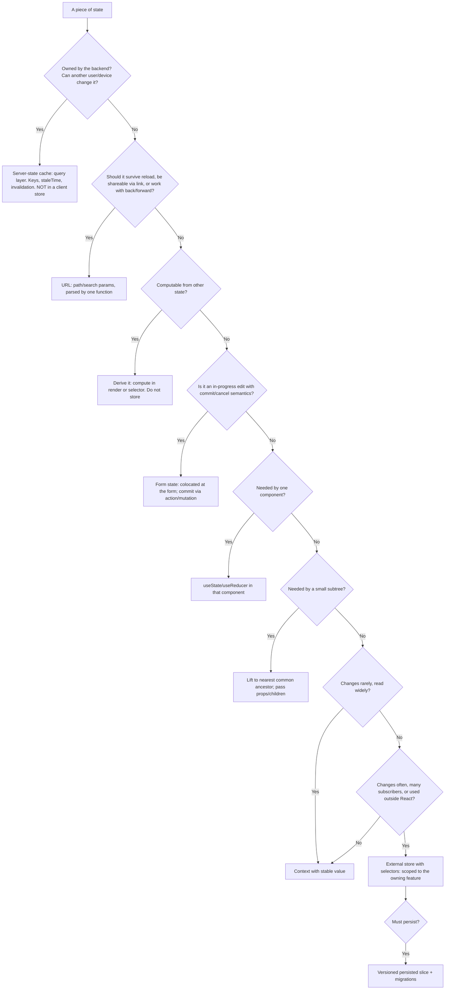
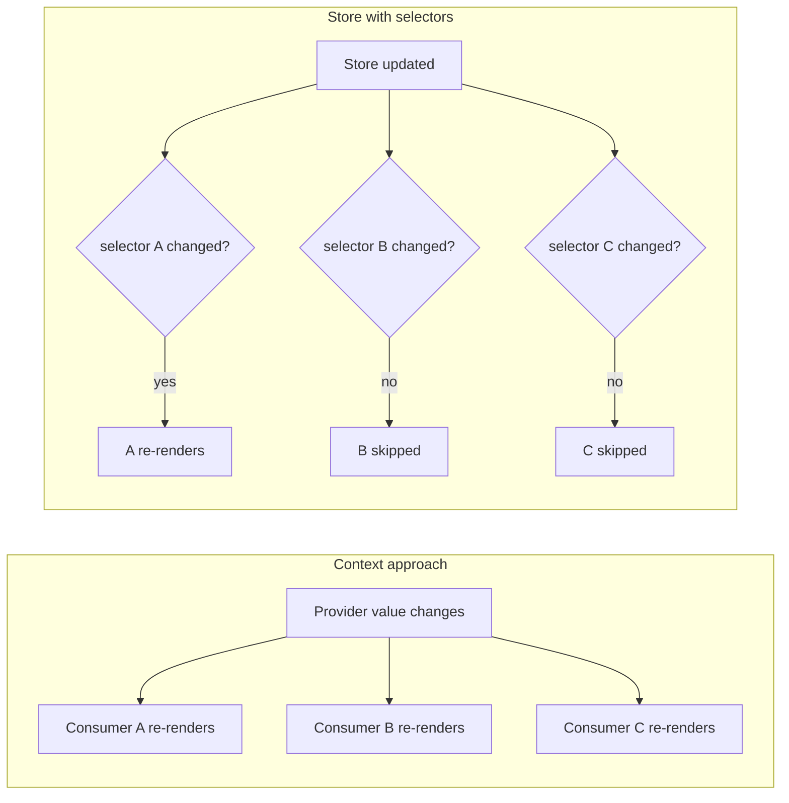
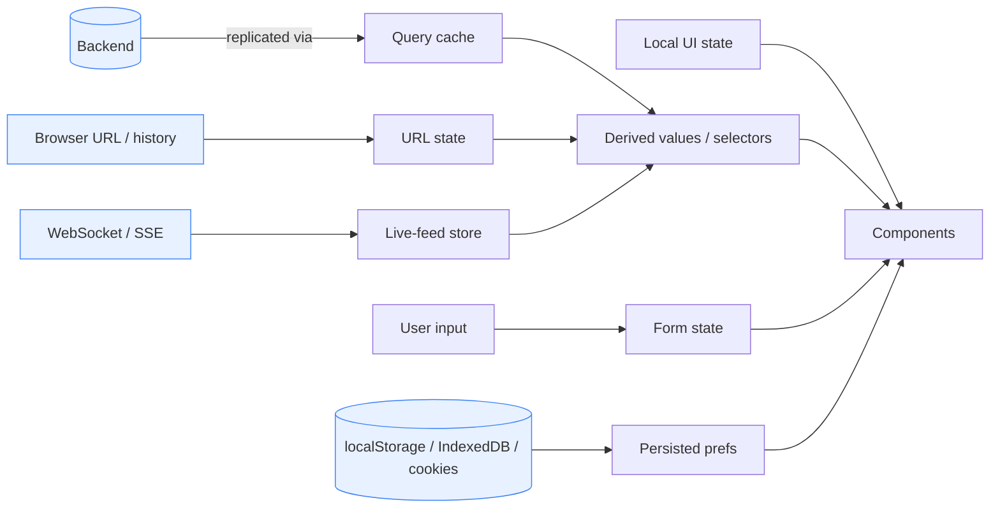
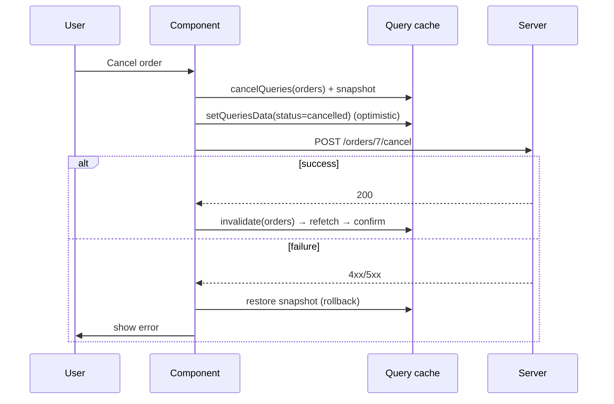
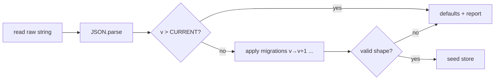

# 11 / 08 — State Architecture at Scale: Ownership, Topology, and Evolution of Application State

## 1. Lesson metadata

| | |
|---|---|
| **Level** | Architect |
| **Study time** | 7 hours (reading 3 h, worked example 1.5 h, exercises 2.5 h) |
| **Prerequisites** | [State ownership](../04-react-architecture/15-state-ownership.md), [Server vs client state](../04-react-architecture/16-server-vs-client-state.md), [Data flow architecture](../04-react-architecture/17-data-flow-architecture.md), [TanStack Query](../06-data-fetching-and-state-ecosystems/08-tanstack-query.md), [Redux Toolkit](../06-data-fetching-and-state-ecosystems/09-redux-toolkit.md), [Zustand](../06-data-fetching-and-state-ecosystems/10-zustand.md), [Context vs external stores](../06-data-fetching-and-state-ecosystems/11-context-vs-external-stores.md), [State machines and XState](../06-data-fetching-and-state-ecosystems/12-state-machines-and-xstate.md), [URL state management](../06-data-fetching-and-state-ecosystems/18-url-state-management.md), [State colocation for perf](../07-performance/07-state-colocation-for-perf.md), [05 — Application boundaries](./05-application-boundaries.md), [06 — Cross-cutting concerns](./06-cross-cutting-concerns.md) |
| **Next** | 09 — Performance budgets at scale |
| **Related** | [01 — Trade-off analysis](./01-trade-off-analysis.md), [03 — Large-scale refactoring](./03-large-scale-refactoring.md), [Optimistic updates](../06-data-fetching-and-state-ecosystems/05-optimistic-updates.md), [Offline considerations](../06-data-fetching-and-state-ecosystems/16-offline-considerations.md), [Real-time WebSockets and subscriptions](../06-data-fetching-and-state-ecosystems/17-real-time-websockets-subscriptions.md), [Context propagation cost](../07-performance/06-context-propagation-cost.md) |

**Learning objectives.** After this lesson you can:
1. Classify every piece of state in an application into a *kind* (server cache, URL, form, local UI, shared client, derived, persisted, ephemeral/real-time) and assign it an **owner**, a **lifetime**, and a **source of truth**.
2. Apply a decision procedure for *where state should live* and justify each placement with trade-offs.
3. Design **store topology** for large applications: how many stores, with what boundaries, how they communicate, and how they are provided per request on the server.
4. Prevent the dominant failure modes: duplicated truth, derived-state-in-state, god stores, unbounded global state, stale caches, hydration mismatches, and persisted-state corruption after deploys.
5. Design for **evolution**: versioned persisted state with migrations, normalisation strategy, and safe refactoring of state shape.
6. Design for **performance** at scale: subscription granularity, selectors, and render-cost containment.
7. Design for **correctness**: state machines for workflows, optimistic update reconciliation, concurrency (races, out-of-order responses), and undo/redo or audit trails.
8. Make state **observable and testable**: devtools, action logs, deterministic reducers, and test seams.

**Concepts covered:** state taxonomy, single source of truth, ownership and lifetime, colocation, lifting vs externalising, derived state, normalisation, cache keys and invalidation, URL as state, form state, persisted state and schema migration, per-request stores for SSR, `useSyncExternalStore` semantics, selector granularity and equality, event-sourced/command-based update models, finite state machines, optimistic concurrency, state observability, state testing strategies, anti-patterns (god store, mirrored server state, sync-via-effect).

---

## 2. Deep conceptual explanation

### 2.1 What problem is this lesson solving?

At small scale, "state management" means choosing between `useState`, context and a library. At large scale — dozens of engineers, hundreds of screens, years of change — the problems are different:

- **Which of the 400 pieces of state in this app is the *source of truth*, and who may change it?** When two components each hold a copy, they will eventually disagree.
- **How far does a change ripple?** A wrong global store makes any change risky and every render expensive.
- **What survives a refresh, a deploy, a tab switch, an SSR round trip?** Persisted state meets new code versions; server-rendered state meets the client.
- **Can a new team add a feature without understanding the whole state graph?**
- **When something goes wrong, can we explain *how the state got that way*?**

State architecture is the set of decisions that answers these questions *systematically* rather than case by case. It is the highest-leverage architecture topic in a React front end because state is where **correctness, performance, and team autonomy** collide ([Data flow architecture](../04-react-architecture/17-data-flow-architecture.md)).

The foundational lessons covered *mechanisms* (hooks, context, Redux, Zustand, Query). This lesson is about **topology and governance**: how the mechanisms fit together and evolve.

### 2.2 The cardinal rule: single source of truth, many projections

> Every fact in the application should have **exactly one** owner. Everything else is a *projection* (derived value, cache, view) that is recomputed or invalidated when the owner changes.

Violations are the root cause of most state bugs:
- Copying server data into `useState` ("initialise form from fetched user") creates a second truth that goes stale ([Server vs client state](../04-react-architecture/16-server-vs-client-state.md)).
- Storing `fullName` alongside `firstName` and `lastName` creates inconsistency risk; compute it.
- Syncing two stores with effects (`useEffect(() => setB(a), [a])`) produces an extra render pass, transient inconsistent frames, and loops.

The question to ask of any piece of state: **"If this value is wrong, what is the *one* place I fix it?"** If the answer is "several", you have duplicated truth.

### 2.3 A taxonomy of state

| Kind | What it is | Owner | Lifetime | Typical mechanism | Pitfall |
|---|---|---|---|---|---|
| **Server state (remote cache)** | A client-side *copy* of data owned by a backend | The backend (cache is a replica) | Until stale/evicted/invalidated | Query library (TanStack Query, SWR, RTK Query, framework loaders) | Treating the cache as an app-owned store; manual sync |
| **URL state** | Where the user is and what view they selected: route, filters, sort, page, selected id | The URL (browser history) | Navigation entry | Router search params/path params | Duplicating in component state; non-serialisable values |
| **Form state** | In-progress edits not yet committed | The form (until submit) | Form session | Form library/local state/uncontrolled inputs + `FormData` | Initialising from server cache and never reconciling; global store for form drafts |
| **Local UI state** | Open/closed, hover, focus, tab index, ephemeral selections | The component | Component mount | `useState`/`useReducer` | Lifting too high "just in case" |
| **Shared client state** | Client-only state needed by distant components: sidebar layout, multi-step wizard progress, notifications queue | A defined feature/module | Session or feature lifetime | Context, external store (Zustand/Redux), state machines | The "global store for everything" slide |
| **Derived state** | A function of other state | Not stored | Computed | Render-time computation, selectors, `useMemo` when measured | Storing and syncing it |
| **Persisted state** | State saved across sessions: preferences, drafts, offline queue | The user's device (and sometimes server) | Beyond a session | `localStorage`/IndexedDB with versioned schema; server-side preferences | Schema drift after deploys; stale data; privacy |
| **Ephemeral/real-time state** | Streaming updates (prices, presence, cursors) | The stream/server | Seconds | Subscriptions into a store with selectors; refs for non-rendering data | Re-rendering the world per tick |
| **Navigation/Router state** | Pending transitions, scroll positions, blockers | Router | Navigation | Router APIs | Re-implementing router behaviour |
| **Environment state** | Online/offline, viewport size, preferences media queries | The browser | Varies | `useSyncExternalStore` over browser APIs | Subscribing too widely |

A systematic first move on any large codebase is to **inventory and classify** state (a script plus manual review): "of 38 contexts and 12 stores, how many hold server data? how many hold URL-shaped data? how many derived values?" This inventory frequently shows that *most* "state management" problems are misclassified server/URL/derived state, solvable without a bigger state library ([01 §4](./01-trade-off-analysis.md): the question changed from "which store?" to "what kind of state?").

### 2.4 Where should state live? A decision procedure



This is a **default**, not a law: trade-offs can override. Examples of justified overrides: lifting state higher than necessary because a design-system component needs control; keeping a *derived* value in state because it is expensive and the computation must be memoised with a reset policy; keeping *server data* in a client store because a real-time subscription pushes into it (and the query cache is then fed by the stream).

### 2.5 Ownership and lifetime as first-class design attributes

For each non-trivial piece of shared state, write down:

| Attribute | Question | Example (`cart`) |
|---|---|---|
| **Owner** | Which module/team may *write* it? | `features/cart` only |
| **Readers** | Who reads it, through what interface? | Header badge, checkout; via `useCartSummary()` |
| **Source of truth** | Server, URL, client store, storage? | Server (authoritative); client optimistic copy |
| **Lifetime** | When is it created/destroyed? | Per session, restored from server on login |
| **Update pathways** | How may it change? | `addItem`, `removeItem`, server events |
| **Consistency model** | Strong, eventual, optimistic? | Optimistic with server reconciliation |
| **Persistence** | Does it survive reload/deploy? | Server-side; local fallback for anonymous carts (versioned) |
| **Privacy** | PII? clear on logout? | Cleared on logout |
| **Failure behaviour** | What if the update fails/is conflicted? | Roll back + notify |

Ownership aligns with [05 — Application boundaries](./05-application-boundaries.md): a domain owns its state; other domains see it only through the published interface (hooks/selectors), never by reaching into the store.

### 2.6 Store topology: one store, many stores, or none?

| Topology | Description | Pros | Cons | Fits |
|---|---|---|---|---|
| **No global client store** | Server cache + URL + local state + a few contexts | Fewest concepts; hard to misuse; leverages the platform | Cross-cutting client state needs another home | Most CRUD-style apps; start here |
| **Single global store (Redux-style)** | One tree, slices per domain, middleware, devtools | Single source for client state; time-travel; strong conventions | Slice coupling, central bottleneck, bundle includes all slices unless code-split; temptation to hold server state | Large apps with complex client workflows, audit needs, mature team conventions |
| **Multiple small stores (Zustand-style)** | One store per feature/concern; hook per store | Colocation with feature, code-splittable, low ceremony | Cross-store consistency by convention; fewer guard rails; devtools per store | Feature-oriented apps; autonomous teams |
| **Atomic state (Jotai/Recoil-style)** | Many small atoms with derived atoms | Fine-grained subscriptions; derived state first-class | Dependency graph can be hard to trace; global registry semantics | Highly interactive UIs with many independent pieces ⚠ verify library status/maintenance |
| **State machines/statecharts per workflow** | Explicit states and transitions | Illegal states unrepresentable; testable; visualisable | Learning curve; verbose for trivial state | Multi-step flows, payments, uploads, auth |
| **Event-sourced / command-log** | Persist a log of intents/events; derive state | Audit, undo/redo, replay, offline sync | Complexity; schema evolution of events; read-model design | Collaboration, finance audit, offline-first |

**Practical stance:** topology is chosen *per kind of state*, not once for the app. A mature architecture often looks like: **query cache** for server data, **URL** for view parameters, **local/feature stores** for client workflows (with state machines for flows), **context** for slowly-changing environment (theme/locale/session), and **at most a few** global client stores with named owners. 

### 2.7 Derived state, selectors, and normalisation

**Derived state** should be computed, not stored. Where computation is expensive, use *memoised selectors* keyed on their inputs ([Memoization trade-offs](../07-performance/04-memoization-trade-offs.md)) — and measure first ([Measure before optimizing](../07-performance/01-measure-before-optimizing.md)).

**Normalisation:** storing entities by ID (`{ byId, allIds }`) rather than nested trees, so each entity has **one** copy and updates are O(1) and consistent. This is essential when the same entity appears in many views (a user in 5 lists). Servers often return denormalised trees. Two approaches:

| Approach | Description | Trade-off |
|---|---|---|
| **Query-cache per resource** (no client normalisation) | Each query key caches its own response; invalidation refreshes | Simple; entity duplicated across queries; cross-query consistency via invalidation/`setQueryData` updates |
| **Normalised client cache** | Entities keyed by type+id; queries reference entities (GraphQL clients, `createEntityAdapter`) | Automatic consistency across views; more machinery and schema discipline |

Choose normalisation when *cross-view consistency of shared entities is a real product requirement* (e.g. editing a user's name must update every list instantly) and invalidation-based refresh is too slow or too coarse ([API normalisation](../06-data-fetching-and-state-ecosystems/04-api-normalization.md)).

### 2.8 Concurrency and consistency: the part scale makes dangerous

At scale, state updates *race*:

- **Out-of-order responses:** request A (older) resolves after request B (newer) and overwrites newer data. Remedies: cancellation (AbortController), keying by the latest request ID, "last intent wins" at the query layer ([Cancellation and race conditions](../06-data-fetching-and-state-ecosystems/02-cancellation-and-race-conditions.md)).
- **Optimistic updates** introduce a *local-ahead-of-server* state; you need rollback, reconciliation with the authoritative response, and handling of concurrent mutations on the same entity (queue them, or version them) ([Optimistic updates](../06-data-fetching-and-state-ecosystems/05-optimistic-updates.md)).
- **Multi-tab/multi-device edits:** the persisted or server state may change under you; detect by version/ETag/updatedAt and surface conflicts instead of silently overwriting.
- **Stale closures:** handlers capturing old state in async flows; use functional updates or refs to latest.
- **Real-time updates vs user edits:** a stream update to an entity the user is editing — decide the policy (merge, lock, prompt).

Explicit consistency models should be stated per state kind: *strong* (derived from the server on every read), *eventual* (cache with TTL and invalidation), or *optimistic with reconciliation*.

### 2.9 Workflows as state machines

Boolean flags (`isLoading`, `isSubmitting`, `hasError`, `isDone`) encode a 2ⁿ space where most combinations are meaningless (`isLoading && hasError && isDone`?). A **finite state machine** names the *reachable* states and the *events* that move between them, making illegal states unrepresentable and transitions testable ([State machines and XState](../06-data-fetching-and-state-ecosystems/12-state-machines-and-xstate.md)).

At architecture level the decision is: *which workflows deserve a machine?* Criteria: multi-step, has failure/retry/cancel branches, time-sensitive (timeouts), has external side effects (payments, uploads), or has bugs that reproduce as "impossible state". A library (XState) is optional; a `useReducer` with a discriminated union state and a transition function provides most of the benefit.

### 2.10 Persistence and schema evolution

Persisted client state (`localStorage`, IndexedDB) outlives code. After a deploy, **old shapes meet new code**. Consequences if unmanaged: crashes on startup, silently wrong behaviour, and users stuck with corrupted state unless they clear storage.

Design rules:
1. **Version** every persisted blob: `{ v: 3, data: … }`.
2. **Migrate** old versions forward with pure functions (`v1 → v2 → v3`), tested against fixtures of real old payloads.
3. **Validate** after migration (parse at the boundary — the storage boundary is a trust boundary: [05 §2.8](./05-application-boundaries.md)); on failure, **discard and fall back** to defaults (and report).
4. **Persist the minimum:** preferences and drafts, not caches that the query layer can refetch; never persist secrets.
5. **Namespace and size-bound** keys; storage quotas and private-browsing failures exist; `localStorage` is synchronous (blocks the main thread; avoid large payloads).
6. **Multi-tab consistency:** listen to `storage` events or use `BroadcastChannel` if tabs must agree.
7. **Privacy:** clear on logout; avoid persisting PII unless necessary and consented ⚠ legal requirements vary.

### 2.11 SSR and per-request state

With server rendering, a store module that is a *singleton* is shared across concurrent requests ([06 §3.3](./06-cross-cutting-concerns.md)). Architecture requirement: **stores and query clients are created per request** (factory functions), provided through context, and **serialised into the HTML** (a bootstrap payload) so the client initialises from the same state and hydrates without mismatch ([Hydration and selective hydration](../02-react-rendering-and-internals/25-hydration-and-selective-hydration.md)). The pattern: `createStore(initialState)` → `<StoreProvider store>` ; on the client, create the store once from the serialised initial state.

Corollaries: the serialised payload must be safe (escape `</script>`; avoid including secrets), small (it is HTML weight), and **JSON-serialisable** (no `Date`, `Map`, class instances unless you handle them).

### 2.12 Observability and testability of state

- **Observability:** an action/event log (Redux devtools-style, or logging middleware), state snapshots on error reports (scrubbed), and query-cache inspection tools. "How did the state get this way?" must be answerable for production incidents ([06 §2.8](./06-cross-cutting-concerns.md)).
- **Testability:** reducers/state machines as pure functions with table-driven tests; stores created through factories with injectable dependencies; selectors tested with fixtures; integration tests at the *component + store* level for critical flows rather than mocking the store.
- **Determinism:** avoid time, randomness, and I/O inside reducers; inject clocks and ID generators.

### 2.13 Misconceptions

| Misconception | Reality |
|---|---|
| "We need a state management library." | You need to *classify* state. Often server cache + URL + local state cover most; a store is for the remainder. |
| "Redux is for big apps, Zustand for small." | Both scale or fail depending on topology/ownership discipline; the difference is conventions/ceremony/tooling, not capacity. Evaluate by requirements (audit trail, middleware, team familiarity). |
| "Global state is bad." | *Unowned, unbounded* global state is bad. A small, owned, well-scoped global store is fine. |
| "Context is a state manager." | Context is a *dependency-injection/broadcast* mechanism. It provides no selector-granular subscription; frequent updates re-render all consumers ([Context propagation cost](../07-performance/06-context-propagation-cost.md)). |
| "Put everything in the URL." | URL state must be serialisable, bounded in size, privacy-safe, and meaningful to share. Transient UI state doesn't belong there. |
| "Memoisation fixes slow state updates." | Often the fix is *state placement* (colocation, narrower subscriptions); memoisation papers over a topology problem ([State colocation for perf](../07-performance/07-state-colocation-for-perf.md)). |
| "Derived state in `useEffect` is fine." | An effect that sets state from other state costs an extra render, creates inconsistent intermediate frames, and invites loops; compute during render ([You Might Not Need an Effect](https://react.dev/learn/you-might-not-need-an-effect)). |
| "Persisted state is just localStorage." | It's a versioned data contract with migrations, validation, quotas, and privacy implications. |

---

## 3. Internal mechanics

### 3.1 What React guarantees about state and updates

*Public guarantees:* state updates are *queued* and batched; the new state is available on the next render, not immediately after `setState`; updater functions receive the latest queued state; components re-render when their state changes or their parent re-renders (subject to bail-out rules); context consumers re-render when the context value changes by `Object.is`; `useSyncExternalStore` subscribes to an external store and ensures **tearing-free** reads (a render sees a consistent snapshot), forcing synchronous re-render on store change — i.e. updates from external stores **opt out of concurrent time-slicing** for that update ([`useSyncExternalStore` reference](https://react.dev/reference/react/useSyncExternalStore); conceptual: [Scheduler and priorities](../02-react-rendering-and-internals/13-scheduler-and-priorities.md)).

*Teaching model:* external store libraries (Redux, Zustand, etc.) integrate through `useSyncExternalStore` (or equivalent) so that components subscribe via a *selector*; the hook re-renders only if the selected slice's snapshot (compared via `Object.is` or a supplied equality) changes. *Implementation detail:* each library's exact subscription batching and equality options differ — verify per library docs.

### 3.2 The `useSyncExternalStore` contract and its pitfalls

```ts
const value = useSyncExternalStore(subscribe, getSnapshot, getServerSnapshot?);
```

Requirements:
1. `getSnapshot` must return a **cached/stable value** when the store hasn't changed. Returning a freshly allocated object each call (`() => ({ a: store.a })`) makes React see "changed" every time → infinite re-render loop or warnings.
2. `subscribe` must return an unsubscribe function and should itself be stable (otherwise resubscribe every render).
3. A selector that derives a new array/object each call must be memoised or compared with an equality function, or it re-renders on every store notification.
4. `getServerSnapshot` is required for SSR/hydration and must match what the client's first snapshot produces.

Selector patterns:

| Pattern | Re-render condition | Notes |
|---|---|---|
| `useStore(s => s.count)` (primitive) | When the number changes | Ideal |
| `useStore(s => s.items)` (reference) | When the array *reference* changes | Fine if the store updates immutably |
| `useStore(s => s.items.filter(...))` (new array each time) | **Every notification** | Memoise outside, or use shallow-equality selector support ⚠ library-specific |
| `useStore(s => ({ a: s.a, b: s.b }))` | Every notification | Same trap; use two selectors or an equality fn |

### 3.3 Why a wide context re-renders everything (and a store doesn't)



The context provider compares only its *whole value*; consumers cannot subscribe to a part. A store lets each subscriber run its own selector on each change and re-render only when its slice changes. This is the mechanical reason frequently-changing, widely-read state belongs in a store ([Context vs external stores](../06-data-fetching-and-state-ecosystems/11-context-vs-external-stores.md)).

### 3.4 Reducers, commands, and events

A reducer is `(state, action) => state`. Architecture choice: what *is* an action?

| Style | Example | Pros | Cons |
|---|---|---|---|
| **Setter-style** | `setQuantity(id, 3)` | Simple | Business rules scatter in callers; poor audit trail |
| **Command/intent** | `{ type: "cart/addItemRequested", sku }` | Rules centralised; testable; logs express intent | More ceremony |
| **Event-sourced** | `{ type: "ItemAdded", sku, at }` | Replay, audit, undo; multiple projections | Event schema evolution; heavier mental model |

Rule of thumb: **name actions by what happened or what the user intended, not by how state changes** (`orderSubmitted` vs `setStatus("submitted")`). Several reducers/slices may react to the same event — decoupling features through events instead of cross-slice imports ([05 §3.4](./05-application-boundaries.md)).

### 3.5 Query-cache mechanics relevant to architecture

*Teaching model (TanStack Query-style caches; verify specifics for your library/version):* a cache maps **query key → { data, status, updatedAt, observers }**. Components subscribe via observers; data is **stale** after `staleTime` (default is 0 in TanStack Query v5, meaning data is considered stale immediately; run-tested with @tanstack/react-query 5.104), stale data may be refetched on mount/focus/reconnect; unused entries are garbage-collected after a `gcTime` (renamed from `cacheTime` in v5; the default is 5 minutes in the browser and `Infinity` on the server). **Invalidation** marks queries stale and refetches active ones. Mutations may update the cache directly (`setQueryData`) or invalidate.

Architectural consequences:
- **Key design is API design:** keys should be hierarchical (`["orders", "list", filters]`, `["orders", "detail", id]`) to enable targeted invalidation; build keys through **factories** per feature to prevent typos and fragmentation.
- **Defaults are policy:** `staleTime`, retry, refetch triggers should be set centrally (platform) and overridden per query deliberately ([06 §2.3](./06-cross-cutting-concerns.md): data-layer defaults as a cross-cutting concern).
- **Co-ownership:** the feature that *owns* a resource owns its key factory and invalidation rules; other features invalidate through the owner's exported helpers (`invalidateOrders()`), not by guessing keys.

### 3.6 Persisted state hydration order

On startup: read storage → parse → migrate → validate → seed store → render. If this runs *after* first render (async storage like IndexedDB), the app renders defaults first and then "jumps"; and on SSR the server has no access to client storage at all — persisted client-only state must not influence the server-rendered output, or hydration will mismatch. Typical solutions: render a neutral initial UI and apply persisted preferences after mount (accepting a brief flash) **or** store critical preferences in cookies the server can read (theme, locale).

---

## 4. Step-by-step execution walkthrough

**Case: a trading-operations dashboard. We will design the state architecture from an inventory.**

**Step 1 — Inventory (scripted + manual).** Ten engineers working in six features. Findings from the existing code:

| # | State | Where today | Notes |
|---|---|---|---|
| 1 | Orders list (paged) | Redux slice, fetched in thunks | Server data in a client store |
| 2 | Order filters, sort, page | Redux + component state (duplicated) | Lost on refresh; not shareable |
| 3 | Selected order id | Redux | Should be route param |
| 4 | Order detail | Redux + local copy in editing form | Two copies drift |
| 5 | Live price ticks | Context (`PricesContext`) | 400 consumers re-render per tick |
| 6 | Watchlist (user prefs) | `localStorage`, unversioned | Parsed with `JSON.parse` unguarded |
| 7 | Theme, density | Context | Fine |
| 8 | Session/user | Redux + `localStorage` token | Duplicated; token in storage |
| 9 | Notifications queue | Redux | Client-only; frequent updates |
| 10 | Trade ticket draft (multi-step) | 9 booleans in a component | Impossible states reachable |
| 11 | Column visibility | Redux | Per-user preference |
| 12 | `totalNotional` | Redux (stored) | Derived from positions |
| 13 | Websocket connection status | Redux | Environment-ish |

**Step 2 — Classify and re-home (apply §2.4).**
- 1, 4 → **server state** (query cache). Delete the slice + thunks.
- 2, 3 → **URL state** (search/path params) with one `parse`/`serialise` pair ([02 §5.2](./02-technical-design-documents.md)).
- 5 → **real-time store** with selectors, fed by the socket; consumers subscribe per symbol.
- 6, 11 → **persisted preferences**: versioned storage module with migrations; or server-side user preferences synced via query + optimistic updates (cross-device).
- 7 → keep as **context + CSS variables** ([07 §2.3](./07-design-system-architecture.md)).
- 8 → **session service** (single owner; httpOnly cookie; read via `useSession`) ([06 §2.6](./06-cross-cutting-concerns.md)).
- 9 → **small notifications store** (feature-scoped, selectors).
- 10 → **state machine** (`idle → editing → validating → confirming → submitting → done | failed`).
- 12 → **derived** (selector computed from positions query data).
- 13 → **environment/real-time store** exposing `status` with `useSyncExternalStore`.

**Step 3 — Define topology.** Query cache (server state), URL (view params), three small stores (`liveFeed`, `notifications`, `preferences`), one machine per workflow (`tradeTicket`), context for theme/session/services. **No global Redux store** remains — but record the audit-trail requirement: the *trade ticket machine* logs transitions to telemetry; the live feed uses an action log in dev only.

**Step 4 — Define ownership and interfaces** (a table like §2.5) per store; each exposes hooks (`useQuote(symbol)`, `usePreference("watchlist")`) not the store.

**Step 5 — Migration plan** ([03](./03-large-scale-refactoring.md)): move server state first (highest bug density, mechanical), URL second, then the live feed (perf-critical), then preferences with versioned storage and fixtures from real user data samples; ratchet on `createSlice` count and on `useContext(PricesContext)`.

**Step 6 — Enforce.** Lint: no `fetch`/`axios` in components; no `localStorage` outside `preferences`; import boundaries on stores; key factories only.

**Step 7 — Measure.** Render counts on the trading view; INP; lines of state code; number of state-related bugs per quarter; time for a new engineer to add a field to a form.

---

## 5. Code examples

### 5.1 Minimal example: a per-feature external store with `useSyncExternalStore`

```ts
// features/live-feed/store.ts
export interface Quote { symbol: string; bid: number; ask: number; ts: number }

type Listener = () => void;

export interface QuoteStore {
  getQuote(symbol: string): Quote | undefined;
  setQuotes(batch: readonly Quote[]): void;
  subscribe(symbol: string, l: Listener): () => void;
}

export function createQuoteStore(): QuoteStore {
  let quotes: ReadonlyMap<string, Quote> = new Map();            // immutable snapshot
  const listeners = new Map<string, Set<Listener>>();            // per-symbol subscriptions

  return {
    getQuote: (s) => quotes.get(s),
    setQuotes(batch) {
      const next = new Map(quotes);
      const changed = new Set<string>();
      for (const q of batch) {
        const prev = next.get(q.symbol);
        if (!prev || prev.ts < q.ts) { next.set(q.symbol, q); changed.add(q.symbol); } // ignore stale/out-of-order ticks
      }
      quotes = next;
      for (const s of changed) listeners.get(s)?.forEach((l) => l());
    },
    subscribe(symbol, l) {
      let set = listeners.get(symbol);
      if (!set) listeners.set(symbol, (set = new Set()));
      set.add(l);
      return () => { set!.delete(l); if (set!.size === 0) listeners.delete(symbol); };
    },
  };
}
```

```tsx
// features/live-feed/useQuote.ts
import { useSyncExternalStore, useCallback } from "react";
import { useQuoteStore } from "./QuoteStoreProvider"; // per-request/per-app provider (see 5.4)

export function useQuote(symbol: string): Quote | undefined {
  const store = useQuoteStore();
  const subscribe = useCallback((l: () => void) => store.subscribe(symbol, l), [store, symbol]);
  const getSnapshot = useCallback(() => store.getQuote(symbol), [store, symbol]);
  return useSyncExternalStore(subscribe, getSnapshot, getSnapshot); // server snapshot = same source
}
```

**Line notes.**
- **Per-symbol listeners:** a tick for `AAPL` notifies only components subscribed to `AAPL`: *O(subscribers of that symbol)*, not O(all consumers) as in the context version.
- **Snapshot stability:** `getQuote` returns the stored object reference; it changes only when that symbol's quote object is replaced → `useSyncExternalStore` compares by `Object.is` and skips re-render otherwise.
- **Out-of-order protection:** `prev.ts < q.ts` drops stale ticks — a consistency decision made *in the owning module*, not in each component.
- **Batch updates:** `setQuotes(batch)` creates one new Map and notifies each changed symbol once, useful when a socket message carries many ticks.
- The `subscribe` and `getSnapshot` are memoised by `useCallback` so React doesn't resubscribe every render.
- Cost: hand-rolled stores need tests and care; libraries (Zustand etc.) provide this with selectors/devtools. The code shows the mechanism and the invariants you must preserve either way.

**Predict:** if 400 components each call `useQuote("AAPL")` and one tick arrives for `MSFT`, how many re-render? *Answer:* none of the 400 (only `MSFT` subscribers). With a single `PricesContext` holding all quotes, all consumers of the context would re-render on any tick.

### 5.2 Practical example: a workflow as a typed state machine with `useReducer`

```ts
// features/trade-ticket/machine.ts
export type Ticket = { symbol: string; qty: number; side: "buy" | "sell" };

export type State =
  | { tag: "editing"; ticket: Ticket; errors: Partial<Record<keyof Ticket, string>> }
  | { tag: "confirming"; ticket: Ticket }
  | { tag: "submitting"; ticket: Ticket; attempt: number }
  | { tag: "done"; orderId: string }
  | { tag: "failed"; ticket: Ticket; reason: "network" | "rejected"; message: string };

export type Event =
  | { type: "EDIT"; patch: Partial<Ticket> }
  | { type: "REVIEW" }
  | { type: "BACK" }
  | { type: "CONFIRM" }
  | { type: "SUCCEEDED"; orderId: string }
  | { type: "FAILED"; reason: "network" | "rejected"; message: string }
  | { type: "RETRY" };

const validate = (t: Ticket) => ({
  ...(t.qty > 0 ? {} : { qty: "Quantity must be positive" }),
  ...(t.symbol ? {} : { symbol: "Symbol required" }),
});

export function reduce(s: State, e: Event): State {
  switch (s.tag) {
    case "editing":
      if (e.type === "EDIT") { const ticket = { ...s.ticket, ...e.patch }; return { tag: "editing", ticket, errors: s.errors }; }
      if (e.type === "REVIEW") {
        const errors = validate(s.ticket);
        return Object.keys(errors).length ? { ...s, errors } : { tag: "confirming", ticket: s.ticket };
      }
      return s;
    case "confirming":
      if (e.type === "BACK") return { tag: "editing", ticket: s.ticket, errors: {} };
      if (e.type === "CONFIRM") return { tag: "submitting", ticket: s.ticket, attempt: 1 };
      return s;
    case "submitting":
      if (e.type === "SUCCEEDED") return { tag: "done", orderId: e.orderId };
      if (e.type === "FAILED") return { tag: "failed", ticket: s.ticket, reason: e.reason, message: e.message };
      return s; // ignore EDIT/CONFIRM while submitting: double-submit impossible
    case "failed":
      if (e.type === "RETRY" && s.reason === "network") return { tag: "submitting", ticket: s.ticket, attempt: 1 };
      if (e.type === "BACK") return { tag: "editing", ticket: s.ticket, errors: {} };
      return s;
    case "done":
      return s;
  }
}
```

```tsx
// features/trade-ticket/TradeTicket.tsx (excerpt)
const [state, send] = useReducer(reduce, { tag: "editing", ticket: { symbol: "", qty: 0, side: "buy" }, errors: {} });

useEffect(() => {
  if (state.tag !== "submitting") return;
  const ctrl = new AbortController();
  submitTrade(state.ticket, { signal: ctrl.signal })
    .then((r) => send({ type: "SUCCEEDED", orderId: r.id }))
    .catch((e) => { if (!ctrl.signal.aborted) send({ type: "FAILED", reason: e.kind ?? "network", message: String(e.message) }); });
  return () => ctrl.abort();
}, [state.tag === "submitting" ? state.attempt : null]);
```

**Line notes.**
- **Illegal states are unrepresentable:** there is no `isSubmitting && isDone`. `done` carries `orderId` and no ticket; `failed` carries `reason`.
- **Double-submit protection by construction:** in `submitting`, `CONFIRM` is ignored; no `disabled` flag choreography needed (the UI also reads `state.tag`).
- `reduce` is a **pure function**: table-driven tests need no React. The side effect (network) lives in an effect keyed by the transition into `submitting`.
- **Effect dependency subtlety:** the dependency `[state.tag === "submitting" ? state.attempt : null]` changes from `null` to `1` each time the machine enters `submitting`, so the effect re-runs on every retry *only because* the value passes through `null` while in `failed`. That works by accident: `attempt` is always `1` (the sample resets it on retry), so the key carries no information, and any future transition that goes `submitting → submitting` directly would not re-run the effect. A robust design carries and increments `attempt` through `failed` and keys the effect on it (exercise D1) — an instructive case where a machine's data and effect keys must be designed together.
- Under Strict Mode in development the effect runs, cleans up (aborting), and runs again, so `submitTrade` is called twice in dev — make the server operation idempotent via an idempotency key derived from the ticket attempt ([06 §5.4](./06-cross-cutting-concerns.md)).
- Trade-off: more lines than three booleans; fewer bugs. For a 2-state toggle this is overkill.

### 5.3 Incorrect: mirrored server state and derived state synced by effects

```tsx
function OrdersPage() {
  const { data } = useQuery({ queryKey: ["orders"], queryFn: fetchOrders });
  const [orders, setOrders] = useState<Order[]>([]);            // ✗ copy of server state
  const [filter, setFilter] = useState("open");                 // ✗ should be URL
  const [visible, setVisible] = useState<Order[]>([]);          // ✗ derived, stored
  const [total, setTotal] = useState(0);                        // ✗ derived, stored

  useEffect(() => { if (data) setOrders(data); }, [data]);                          // extra render, stale window
  useEffect(() => { setVisible(orders.filter((o) => o.status === filter)); }, [orders, filter]); // another render
  useEffect(() => { setTotal(visible.reduce((s, o) => s + o.total, 0)); }, [visible]);           // and another

  async function cancel(id: string) {
    await api.cancel(id);
    setOrders((os) => os.map((o) => (o.id === id ? { ...o, status: "cancelled" } : o))); // diverges from the cache
  }
  /* … */
}
```

What goes wrong:
1. **Three renders per data change** (data → orders → visible → total), with intermediate frames where `visible` is inconsistent with `orders`.
2. **Two truths:** the query cache and `orders` — `cancel` updates local copy; other components reading the cache show the old status until a refetch.
3. **The filter dies on refresh** and cannot be shared (URL).
4. **Race:** if `data` changes while `orders` is being edited, the effect overwrites local changes.
5. **Hard to test and reason about:** behaviour depends on effect timing.

### 5.4 Corrected: single owners, derivation in render, mutations through the cache

```tsx
function OrdersPage() {
  const [params, setParams] = useSearchParams();                 // URL owns the view parameters
  const filter = parseFilter(params);                            // one parse function ([02 §5.2])
  const qc = useQueryClient();

  const { data: orders = [] } = useQuery({ queryKey: ordersKeys.list(filter), queryFn: () => fetchOrders(filter) });

  // Derived: computed in render, not stored. (If measured expensive, memoise.)
  const total = orders.reduce((s, o) => s + o.total, 0);

  const cancel = useMutation({
    mutationFn: (id: string) => api.cancel(id),
    onMutate: async (id) => {                                    // optimistic, reconciled
      await qc.cancelQueries({ queryKey: ordersKeys.all });
      const prev = qc.getQueriesData<Order[]>({ queryKey: ordersKeys.lists() });
      qc.setQueriesData<Order[]>({ queryKey: ordersKeys.lists() }, (os) => os?.map((o) => (o.id === id ? { ...o, status: "cancelled" } : o)));
      return { prev };
    },
    onError: (_e, _id, ctx) => ctx?.prev.forEach(([key, data]) => qc.setQueryData(key, data)), // rollback
    onSettled: () => qc.invalidateQueries({ queryKey: ordersKeys.all }),                         // reconcile with server
  });
  /* render table; filter changes call setParams(serialise(next)) */
}

// features/orders/keys.ts — the owner of the cache keys
export const ordersKeys = {
  all: ["orders"] as const,
  lists: () => [...ordersKeys.all, "list"] as const,
  list: (f: OrdersFilter) => [...ordersKeys.lists(), f] as const,
  detail: (id: string) => [...ordersKeys.all, "detail", id] as const,
};
```

**Line notes.**
- **One render per change.** `total` is arithmetic during render.
- **Owners:** URL → view params; query cache → orders; the mutation updates the *cache*, not a copy.
- **Optimistic update protocol** (the §5.4 code was run against @tanstack/react-query 5.104 with RTL: the optimistic status showed first, a failing mutation rolled back, and the snippet typechecks under `strict`): cancel in-flight queries so they don't overwrite the optimistic value, snapshot, apply, roll back on error, and **always** invalidate in `onSettled` to converge on server truth.
- **Key factory** (`ordersKeys`) is exported by the owning feature; other features call `queryClient.invalidateQueries({ queryKey: ordersKeys.all })` via an exported helper rather than inventing keys.
- If `filter` is an object, key equality is by structural hashing in the library; keep it JSON-serialisable and canonical ([02 §5.5](./02-technical-design-documents.md) canonicalisation).
- Cost: requires discipline about where optimistic logic lives; for multi-entity consistency at larger scale consider normalisation (§2.7).

### 5.5 Advanced: versioned persisted state with migrations and validation; per-request store provider

**Persisted preferences with migration**

```ts
// features/preferences/persist.ts
export interface PrefsV3 { watchlist: string[]; columns: { id: string; visible: boolean }[]; density: "comfortable" | "compact" }

type Stored = { v: number; data: unknown };

const DEFAULTS: PrefsV3 = { watchlist: [], columns: [], density: "comfortable" };

// Pure migration steps: each takes the previous shape (as unknown-validated data) and returns the next.
const migrations: Record<number, (d: any) => any> = {
  1: (d) => ({ ...d, columns: d.columns ?? [] }),                                        // v1 → v2: add columns
  2: (d) => ({ ...d, density: d.compact === true ? "compact" : "comfortable", compact: undefined }), // v2 → v3: boolean → union
};
const CURRENT = 3;

function isPrefsV3(u: any): u is PrefsV3 {
  return u && Array.isArray(u.watchlist) && u.watchlist.every((s: unknown) => typeof s === "string")
    && Array.isArray(u.columns) && (u.density === "comfortable" || u.density === "compact");
}

export function loadPrefs(storage: Pick<Storage, "getItem">, report: (e: unknown) => void): PrefsV3 {
  try {
    const raw = storage.getItem("prefs");
    if (!raw) return DEFAULTS;
    const stored = JSON.parse(raw) as Stored;
    let { v, data } = stored;
    if (typeof v !== "number" || v > CURRENT) return DEFAULTS;   // from a newer build (rollback) → don't guess
    while (v < CURRENT) { data = migrations[v](data); v++; }
    return isPrefsV3(data) ? data : DEFAULTS;
  } catch (e) {
    report(e);                                                    // corrupted JSON, quota/permission errors, etc.
    return DEFAULTS;
  }
}

export function savePrefs(storage: Pick<Storage, "setItem">, prefs: PrefsV3, report: (e: unknown) => void) {
  try { storage.setItem("prefs", JSON.stringify({ v: CURRENT, data: prefs } satisfies Stored)); }
  catch (e) { report(e); } // private mode / quota: degrade silently, never crash
}
```

**Line notes.**
- **Version number in the blob** + **sequential pure migrations** make upgrades testable with fixtures of historical payloads (collect real anonymised samples before changing a shape).
- `v > CURRENT` covers **rollbacks**: an older build reading newer data should not misinterpret it; falling back to defaults is safe (accepting loss) — or keep forward-compatible additive-only changes.
- The final **validation** catches corruption and bad migrations; failure → defaults + report.
- Storage is **injected** (`Pick<Storage, …>`), making the module testable with a fake and usable with other backends (IndexedDB wrapper) ([Dependency injection](../05-design-patterns/16-dependency-injection.md)).
- The `any` in migrations is the honest boundary: historical shapes are *unknown*; validation after migration restores type safety. A schema library can tighten this ⚠ verify tools.
- Race: multiple tabs writing concurrently → last-write-wins on `prefs`; if per-field merging matters, store fields under separate keys or use a `storage` event to re-read.

**Per-request store provider for SSR**

```tsx
// features/live-feed/QuoteStoreProvider.tsx
import { createContext, useContext, useState, type ReactNode } from "react";
import { createQuoteStore, type QuoteStore } from "./store";

const Ctx = createContext<QuoteStore | null>(null);

export function QuoteStoreProvider({ initial = [], children }: { initial?: readonly Quote[]; children: ReactNode }) {
  // One store per provider instance (per request on the server; once on the client).
  const [store] = useState(() => { const s = createQuoteStore(); s.setQuotes(initial); return s; });
  return <Ctx value={store}>{children}</Ctx>;
}

export function useQuoteStore(): QuoteStore {
  const s = useContext(Ctx);
  if (!s) throw new Error("QuoteStoreProvider missing");
  return s;
}
```

**Line notes.**
- `useState(() => …)` creates the store **once per provider mount** — not a module singleton, so concurrent server requests never share it.
- `initial` is the serialised server state; on the client the provider mounts with the same `initial` so first render matches the server HTML (no mismatch). In Strict Mode development the initialiser function is invoked twice, but React keeps one result; the initialiser must be pure (no subscriptions/sockets) — **start the WebSocket in an effect**, not here.
- `<Ctx value=…>` is React 19 syntax (verified); use `<Ctx.Provider value=…>` for earlier versions.
- The context value (the store object) is **stable**, so it never triggers consumer re-renders; consumers re-render via the store's own subscription.

---

## 6. Visual explanations

### 6.1 State kinds and their sources of truth



Truth lives in blue nodes; everything else is a replica or projection.

### 6.2 Selector granularity vs re-render fan-out

```text
Update frequency vs consumers:

  consumers
   many |  STORE + selectors   |  STORE + selectors (!!)
        |  or context ok if    |  ← hot zone: per-tick updates
        |  value stable        |
        +----------------------+------------------------
   few  |  local state /       |  local state, or ref
        |  lifted state        |  if not rendered
        +----------------------+------------------------
            rare updates            frequent updates
```

### 6.3 Optimistic mutation lifecycle



### 6.4 Persisted-state migration chain



---

## 7. Alternative approaches and trade-offs

| Approach | Strengths | Weaknesses | Best when |
|---|---|---|---|
| **Query cache + URL + local state (no global store)** | Least code; correct by default for server/URL state; easy onboarding | Cross-feature client state needs another home; invalidation logic must be designed | CRUD/data-driven apps; start here |
| **Redux Toolkit (single store, slices)** | Strong conventions, devtools, middleware, time-travel, audit; RTK Query integrated option | Ceremony; global coupling; temptation to store server data; bundle if not split | Complex client workflows, auditability, large teams with familiarity |
| **Multiple Zustand-style stores** | Minimal API; feature-scoped; selectors; works outside React | Few guard rails; convention-dependent; per-request creation needs care in SSR | Feature-oriented apps; moderate complexity |
| **Atomic (Jotai-style)** | Fine-grained derived state; low re-renders | Hard to trace dependency graph; global registry; maintenance status varies ⚠ | Highly interactive/canvas-like UIs |
| **XState machines/actors** | Visual, testable workflows; handles async/cancellation | Learning curve; verbosity; not for simple state | Payment, onboarding, uploads, protocols |
| **Context + `useReducer`** | Built-in; no dependencies; fine for small scoped state | Whole-value re-render; no selectors; boilerplate | Small subtrees with infrequent updates |
| **Normalised cache (GraphQL clients / entity adapters)** | Cross-view consistency; automatic updates | Schema discipline; more machinery | Shared entities edited in many views |
| **Event sourcing / command log** | Audit, undo/redo, replay, offline sync | Complexity; event schema evolution; projection design | Collaboration, finance, offline-first |
| **Server-driven UI state (RSC/loaders + Actions)** | Less client state; data close to render | Framework coupling; client interactivity still needs local state ⚠ verify framework features | Content-heavy/dashboard apps with framework support |

**Scenario where the recommended approach (query cache + URL + small feature stores) is *not* best.**
(1) **Collaborative or offline-first editing** (documents, whiteboards): an event/CRDT-style model with a local-first store is the right primitive; server-cache semantics don't fit. (2) **Heavy client-side computation state** (spreadsheet engines, editors): the app *is* the state machine; a dedicated model layer outside React with React as a view is appropriate ([Clean and hexagonal architecture](../04-react-architecture/10-clean-and-hexagonal-architecture.md)). (3) **A strict audit-log requirement** across all user actions: a single event-logged store (Redux-style or custom) may be simpler than ad hoc logging across stores. (4) **Small app, small team**: even "query cache + URL" may be more than needed — `useState` and `fetch` in a couple of hooks is fine until pain appears ([01](./01-trade-off-analysis.md)).

---

## 8. Best practices and anti-patterns

### 8.1 Good practice
- **Inventory and classify state** before choosing tools; re-home server/URL/derived state first.
- **One owner per fact;** document owner, readers, lifetime, consistency model.
- **Colocate** by default; lift/externalise with evidence.
- **Derive, don't sync;** no effects that mirror state.
- **Expose hooks/selectors, not stores;** hide shape behind the owning module ([05 §5.1](./05-application-boundaries.md)).
- **Key factories and invalidation helpers** owned by the resource's feature.
- **Selector discipline:** primitives or stable references; equality functions where needed.
- **Model workflows as machines** when illegal states are possible.
- **Version and migrate persisted state;** validate; fall back safely.
- **Create stores per request** for SSR; serialise initial state.
- **Make state observable:** action/event logs, scrubbed snapshots on error, devtools in dev.
- **Test pure parts** (reducers, migrations, selectors) exhaustively; integration-test critical flows.
- **Set data-layer defaults centrally** and override intentionally.

### 8.2 Beginner mistakes
- Copying props or query data into state.
- Storing derived values.
- Putting everything in one context.
- Using `useEffect` to propagate state between components.

### 8.3 Experienced-developer mistakes
- **God store:** one store everyone writes to; any change risks everything.
- **Global-by-default:** adding to the global store because it is convenient.
- **Server data in client stores** with hand-rolled caching/invalidation/loading flags (re-implementing a query cache poorly).
- **Normalising prematurely** (or never, when cross-view consistency matters).
- **Optimistic updates without rollback/reconciliation or ordering.**
- **Persisted state with no version** — a time bomb.
- **Selectors that allocate new objects** causing universal re-renders.
- **Over-modelling:** state machines/event sourcing for trivial toggles.
- **Hidden coupling via shared store shape:** other features reading `state.orders.items` directly.
- **Treating the URL as a dumping ground** (large blobs, PII).

### 8.4 Smells
- `useEffect` whose body is `setX(f(y))`.
- Boolean pairs/triples describing a workflow (`isLoading`, `isError`, `isSuccess`, `isRetrying`).
- A store file > ~500 lines with unrelated domains.
- `JSON.parse(localStorage.getItem(...)!)` anywhere.
- The same entity fetched in three shapes under unrelated keys with manual syncing.
- Components reading deeply into store state (`state.a.b.c.d`).
- Tests that mock the store in every file.
- "Reset" functions that must remember to clear 14 slices on logout.

### 8.5 Justified exceptions
- **Storing derived state** is fine when computation is expensive *and* you control invalidation (memoised selector or an explicit cache with a reset policy).
- **Copying server data into form state** is correct for *editing drafts* (commit/cancel semantics) provided you define how remote changes during editing are handled.
- **A single global store** can be the best choice with strong conventions, an audit requirement, and a team fluent in it.
- **Context for moderately frequent updates** is acceptable when consumers are few and cheap.

---

## 9. Real-world application

| Domain | State architecture emphasis | Constraints |
|---|---|---|
| **E-commerce** | Cart: server-authoritative with optimistic client copy; anonymous cart persisted (versioned) and merged at login; URL for search/filters/sort; experiments snapshot | Cart merge conflicts; SSR parity for product pages; price changes during session; multi-tab cart consistency |
| **Dashboards** | Query cache for widget data, URL for time range/filters, live-feed stores with per-symbol/per-series selectors, per-widget error isolation | Update frequency; memory for long sessions (bounded buffers); widget layout preferences persisted |
| **Finance** | Event-style actions for audit; state machines for order/payment workflows; strict derived-value correctness (money as integers); session timeout handling | Reproducibility ("what did the user see at time T?"); regulatory logging; no PII in persisted state |
| **Forms-heavy** | Form-local state with schema validation; draft persistence (versioned) and recovery after session expiry; server errors mapped to fields | Large forms (performance of field subscriptions); autosave conflicts; accessibility of error summaries |
| **Auth** | Single session owner; token never in app state; permission snapshot as read model; step-up states as machine | Logout must clear all user-scoped state (**a registry of resettable stores**); cross-tab logout sync |
| **Real-time** | Connection state machine (`connecting/open/retrying/closed`), message sequencing, dedupe, backpressure, reconciliation with HTTP snapshots | Reconnect gaps (need snapshot + replay), ordering, memory bounds, throttled rendering |
| **Multi-team** | Ownership table per store; boundary rules; published hooks; key factories; central defaults | Cross-team invalidation, shared entities, versioned persisted keys per team namespace |

**Engineering constraints:**
- **Logout/identity switch** must reset *all* user-scoped state (query cache `clear()`, stores, persisted keys): design a **reset registry** where each store registers a reset function, and test that no data survives user switch.
- **Memory growth:** unbounded arrays (logs, ticks) → ring buffers, windowing, eviction ([Memory management](../00-web-and-javascript-foundations/16-memory-management-and-gc.md)).
- **Bundle:** stores per feature, code-split with routes; avoid a root reducer importing every slice eagerly.
- **Devtools in production:** disable or restrict to avoid leaking state; use scrubbed telemetry instead.
- **Compliance:** retention and deletion of persisted data; consent for storage categories.

---

## 10. Debugging and troubleshooting

| Symptom | Likely root cause | Investigation | Fix / validation |
|---|---|---|---|
| UI shows stale data after an action in another component | Duplicate truth (local copy vs cache); missing invalidation | Search for `useState(initial from query)` and `setState` mirrors; inspect query keys in devtools | Remove the copy; update/invalidate via the owner's helpers; test: perform action → both views update |
| Infinite render loop with `useSyncExternalStore` | `getSnapshot` returns a new object each call | Log snapshot identity; React warning "The result of getSnapshot should be cached" | Return stable references; memoise derived selections; use equality-aware selectors |
| Whole table re-renders per websocket tick | Wide context or selector returning new array/object | React Profiler "why did this render"; check selector code | Per-key subscriptions; stable selectors; batch updates; render throttling |
| Hydration mismatch only for logged-in users | Store seeded differently on server/client; persisted state read during first render | Compare serialised initial state vs client init; check `localStorage` reads in render | Seed client from the same payload; read storage after mount or via cookies |
| Users see another user's data after logout/login | Stores/cache not reset on identity change; module singletons | Check reset path; query cache `clear()`; reproduce with two users in one tab | Reset registry; per-user cache keys/namespaces; test identity switch |
| App crashes on start for some users after a deploy | Persisted state shape changed without migration | Reproduce with user's storage export; error reporter payload | Versioned storage + migrations + validation; fallback to defaults; add fixtures |
| Optimistic UI flickers back then forward | Refetch overwrote the optimistic value before the mutation settled | Network timeline vs cache updates | Cancel in-flight queries in `onMutate`; invalidate only in `onSettled` |
| Double submission (two orders) | Missing machine guard or idempotency; Strict Mode double effect in dev; retry middleware | Inspect network for duplicates; check state transitions allowing `CONFIRM` while submitting | State machine ignoring events in `submitting`; idempotency key; dedupe server-side |
| State "resets" unexpectedly while navigating | Component remount due to key/layout change; state colocated lower than needed | React DevTools: mount/unmount; check route layout structure | Lift to a persistent layout or store; or accept reset and document |
| Filters lost on refresh / can't share link | State in component or store instead of URL | Reload the page | Move to URL state with parse/serialise |
| Memory grows during long sessions | Unbounded buffers in stores/caches; listeners not removed | Heap snapshots over time; Performance monitor | Bounded buffers; `gcTime` tuning; unsubscribe in cleanups; verify with heap diff |
| Race: older response overwrites newer | No cancellation/ordering in manual fetches | Network panel ordering; logs of request IDs | Use query layer; AbortController; ignore stale responses by request token |

**Investigation recipe: "State bug in production."**
1. Capture the **sequence** (action/event log, breadcrumbs, trace ID) leading to the bad state.
2. Identify *which source of truth* disagrees with which projection.
3. Reproduce deterministically in a test using the pure reducer/migration/selector with the captured inputs.
4. Fix at the owner; remove any mirror/copy that allowed divergence.
5. Add a regression test and, if systemic, a lint/boundary rule.
6. **Validate** with the production signal (error rate, support-ticket category) over a release or two.

---

## 11. Exercises

### Level A — Knowledge
A1. List eight kinds of state from §2.3 and name the owner/source of truth for each.
A2. Why is copying query data into `useState` a bug source? Give two concrete failure scenarios.
A3. State the three requirements of `getSnapshot` for `useSyncExternalStore` and the symptom when one is violated.
A4. When is it correct to store derived state? Give a justification and the maintenance burden it creates.
A5. What does "illegal states unrepresentable" mean and how does a state machine achieve it?

### Level B — Code comprehension
B1. In §5.1, 400 components subscribe to `AAPL`. A batch `setQuotes` arrives containing `MSFT` (ts newer), `AAPL` (ts older than stored), and `GOOG` (new symbol). Which listeners fire, and why?
B2. In §5.2, trace the transitions and effect executions for: edit → review (valid) → confirm → network failure → retry → network failure → retry. How many times does the submit effect run, and what bug appears on the second retry?
B3. In §5.4, why is `cancelQueries` called in `onMutate` and why is `invalidateQueries` called in `onSettled` rather than `onSuccess`?
B4. In §5.5 `loadPrefs`, what happens for stored `{"v": 5, "data": {...}}` when `CURRENT = 3`? Why is that the chosen behaviour, and what is the cost?

### Level C — Implementation
C1. Implement a `createStore<S>(initial: S)` with `getState`, `setState(partial | updater)`, `subscribe(selector, listener, equality?)` that only notifies when the selected slice changes, plus a `useStore(selector, equality?)` hook using `useSyncExternalStore`. Include tests for selector isolation and stability.
C2. Write the reducer/state machine for a file upload workflow with states `idle`, `selecting`, `uploading` (with progress), `paused`, `failed` (retryable or not), `done`, and events including `CANCEL`, `PAUSE`, `RESUME`. Write table-driven tests for 8 transitions including ignored events.
C3. Write a migration suite for persisted state: given v1 `{ "theme": "dark" }`, v2 `{ "theme": "dark", "fontSize": 14 }`, v3 `{ "ui": { "theme": "dark", "fontSize": 14 } }`, implement `migrate` and tests using real-looking fixtures including a corrupted payload and a future version.

### Level D — Debugging
D1. Fix the retry bug identified in §5.2 (the effect key carries no information about the attempt) and explain the general principle about effect dependencies and machine data.
D2. A dashboard re-renders 300 components per websocket message. The store is `{ quotes: Quote[] }` replaced on every tick and each component selects `s => s.quotes.find(q => q.symbol === sym)`. Explain the cost and redesign the store and selector.
D3. After adding a "remember my filters" feature using `localStorage`, SSR pages produce hydration warnings for returning users. Explain and fix without losing the feature.
D4. A logout flow leaves the previous user's orders visible for one second to the next user on a shared kiosk. Diagnose likely causes and design the reset mechanism and test.

### Level E — Architecture and engineering decisions
E1. Given the inventory in §4, produce the ownership table (owner, readers, source of truth, lifetime, consistency, persistence) for five of the thirteen items and justify the topology.
E2. Evaluate Redux Toolkit vs multiple Zustand stores for a 12-engineer team building a finance back-office app with strict audit needs and a heavy form workload. Use weighted criteria and name what would change your answer.
E3. Design the strategy for **multi-tab consistency** of preferences and session (logout in one tab logs out others; theme change propagates), including mechanism, edge cases, and failure behaviour.

### Level F — Expert challenge
F1. Design the state architecture for an **offline-capable field-service app**: technicians edit work orders offline, sync later; conflicts possible; photos queued for upload. Specify state kinds, storage, sync protocol (event/command log vs state diff), conflict resolution, UI states, failure handling, schema migration, and testing strategy.
F2. A product has grown a Redux store of 140 slices. Propose a staged migration to the topology of §2.6 (query cache + URL + feature stores + machines) with ratchets, ownership, risk management, and measurable outcomes. Include how you decide which slices to migrate first and which to leave.

---

## 12. Detailed answers and explanations

> Attempt the exercises first.

### Level A

**A1.** Examples: *Server state* — backend (cache is a replica); *URL state* — the URL/history; *Form state* — the form until commit; *Local UI state* — the component; *Shared client state* — a named feature module/store; *Derived state* — not owned; computed from owners; *Persisted state* — the device storage (or server prefs) with a versioned schema; *Ephemeral/real-time* — the stream/server; also *Environment* — the browser (online/viewport). Any eight with the right owner.

**A2.** It creates a second truth. Failure 1: another component/tab or a background refetch updates the cache, but the copy stays stale (user acts on outdated data). Failure 2: an effect re-syncs `setState(data)` on refetch and **overwrites the user's unsaved local edits** (or vice versa, local mutation never reaches other consumers). Also: extra renders and intermediate inconsistent frames, plus subtle bugs when the key changes.

**A3.** (1) It must return a **stable/cached** value when the store hasn't changed (same reference for equal data); (2) it must be **pure and fast** (called often, during render), no side effects; (3) `subscribe` must be stable and return an unsubscribe; and the value must be consistent with what the store notifies about. Violation of (1) leads to an infinite loop or warning ("result of getSnapshot should be cached") because React sees a change every call.

**A4.** When computation is expensive *and* the derived value can't be cheaply recomputed (e.g., large aggregation) — store it as a memoised selector or an explicit cached value with a defined invalidation policy (reset when inputs change). Burden: you must keep it in sync (invalidation correctness), test it, and accept the risk of staleness; prefer memoised derivation (recompute when inputs change) over manual syncing.

**A5.** Make states that must never occur impossible to construct in the type/shape. A machine enumerates reachable states and legal transitions as a discriminated union plus a transition function: `submitting` cannot also be `done`; events not valid in a state are ignored or rejected. Compare booleans: `isLoading && isDone` is constructible but meaningless.

### Level B

**B1.** `setQuotes` iterates: `MSFT` newer → set + marked changed; `AAPL` older (`prev.ts < q.ts` false) → ignored, not marked; `GOOG` new → set + changed. Notifications: listeners for `MSFT` and `GOOG` only. The 400 `AAPL` subscribers are not notified (and even if they were, snapshot `getQuote("AAPL")` is the same object, so `useSyncExternalStore` wouldn't re-render them). This shows both layers of protection: targeted notification and snapshot stability.

**B2.** Sequence: `editing` → REVIEW (valid) → `confirming` → CONFIRM → `submitting{attempt:1}` (effect run #1: dependency goes `null → 1`) → FAILED(network) → `failed` (dependency `null`) → RETRY → `submitting{attempt:1}` (`null → 1`, effect run #2) → FAILED → `failed` → RETRY → `submitting{attempt:1}` (effect run #3). So the effect runs three times in total (each doubled in development under Strict Mode). It works only because the dependency passes through `null` in the `failed` state. The latent bug: `attempt` is always `1`, so the key carries no information, and any direct `submitting → submitting` transition (for example automatic retry with backoff) would not re-run the effect. The robust fix carries an incrementing attempt through `failed` (see D1) and keys the effect on it.

**B3.** `cancelQueries` stops in-flight refetches of the affected queries so a response that was already on its way (stale, from before the mutation) doesn't land *after* the optimistic update and overwrite it, causing flicker. `invalidateQueries` in `onSettled` runs after both success and failure, guaranteeing the cache converges to server truth (after success it confirms; after error, after rollback, it ensures we're not left with a stale snapshot if the server state changed meanwhile). Putting it only in `onSuccess` would skip reconciliation on errors.

**B4.** `v > CURRENT` → returns `DEFAULTS` (and doesn't touch the stored value). Reason: an *older* build (after a rollback) cannot know the shape of a newer version; guessing could crash or corrupt. Cost: the user's newer preferences are ignored (and might be overwritten by the next `savePrefs` with v3), i.e. data loss across rollbacks. Mitigations: design persisted changes as additive/forward-compatible so older builds can read newer data, store under a new key for breaking shapes (leaving the old key intact), or avoid overwriting when `v > CURRENT` (read-only mode).

### Level C

**C1.** Sample:

```ts
type Listener<T> = (slice: T, prev: T) => void;
const shallowEqual = (a: unknown, b: unknown) => Object.is(a, b);

export function createStore<S extends object>(initial: S) {
  let state = initial;
  const subs = new Set<() => void>();
  const getState = () => state;
  const setState = (p: Partial<S> | ((s: S) => Partial<S>)) => {
    const patch = typeof p === "function" ? p(state) : p;
    const next = { ...state, ...patch };
    if (Object.keys(patch).every((k) => Object.is((state as any)[k], (next as any)[k]))) return; // no change
    state = next;
    subs.forEach((s) => s());
  };
  const subscribe = <T,>(selector: (s: S) => T, listener: Listener<T>, eq: (a: T, b: T) => boolean = Object.is) => {
    let current = selector(state);
    const run = () => { const n = selector(state); if (!eq(current, n)) { const p = current; current = n; listener(n, p); } };
    subs.add(run);
    return () => subs.delete(run);
  };
  return { getState, setState, subscribe, _raw: (l: () => void) => (subs.add(l), () => subs.delete(l)) };
}

// hook
import { useSyncExternalStore, useRef } from "react";
export function useStore<S extends object, T>(store: ReturnType<typeof createStore<S>>, selector: (s: S) => T, eq: (a: T, b: T) => boolean = Object.is): T {
  const last = useRef<{ s: S; v: T } | null>(null);
  const getSnapshot = () => {
    const s = store.getState();
    if (last.current && last.current.s === s) return last.current.v;     // same state object → same selection
    const v = selector(s);
    if (last.current && eq(last.current.v, v)) { last.current = { s, v: last.current.v }; return last.current.v; } // equal → keep old ref
    last.current = { s, v };
    return v;
  };
  return useSyncExternalStore(store._raw, getSnapshot, getSnapshot);
}
```

Evaluation: selector isolation (only notify when slice changed by `eq`), snapshot stability via memo keyed on state identity and equality, unsubscribe returns, no-op setState skipping, SSR snapshot supplied. Tests: (1) two subscribers with different selectors; update one field; only the matching listener fires; (2) a selector returning a new array each call with a shallow-array equality doesn't re-render; (3) `getSnapshot` repeated calls return identical references without state change (guards the infinite loop); (4) unsubscribe stops notifications. Caveats: `useRef` writes during `getSnapshot` is a controlled exception (memoisation of a pure computation) — libraries implement this carefully (e.g. `use-sync-external-store/with-selector`) ⚠ prefer the vetted helper in production; selectors referencing props change identity per render — wrap in `useCallback`.

**C2.**

```ts
type U =
  | { tag: "idle" }
  | { tag: "selecting" }
  | { tag: "uploading"; file: string; progress: number }
  | { tag: "paused"; file: string; progress: number }
  | { tag: "failed"; file: string; retryable: boolean; progress: number }
  | { tag: "done"; file: string };

type E =
  | { type: "OPEN" } | { type: "CHOOSE"; file: string } | { type: "PROGRESS"; value: number }
  | { type: "PAUSE" } | { type: "RESUME" } | { type: "FAIL"; retryable: boolean }
  | { type: "RETRY" } | { type: "COMPLETE" } | { type: "CANCEL" };

export function upload(s: U, e: E): U {
  if (e.type === "CANCEL" && s.tag !== "done") return { tag: "idle" };
  switch (s.tag) {
    case "idle": return e.type === "OPEN" ? { tag: "selecting" } : s;
    case "selecting": return e.type === "CHOOSE" ? { tag: "uploading", file: e.file, progress: 0 } : s;
    case "uploading":
      if (e.type === "PROGRESS") return { ...s, progress: Math.max(s.progress, Math.min(100, e.value)) };
      if (e.type === "PAUSE") return { tag: "paused", file: s.file, progress: s.progress };
      if (e.type === "FAIL") return { tag: "failed", file: s.file, retryable: e.retryable, progress: s.progress };
      if (e.type === "COMPLETE") return { tag: "done", file: s.file };
      return s;
    case "paused": return e.type === "RESUME" ? { tag: "uploading", file: s.file, progress: s.progress } : s;
    case "failed": return e.type === "RETRY" && s.retryable ? { tag: "uploading", file: s.file, progress: s.progress } : s;
    case "done": return e.type === "OPEN" ? { tag: "selecting" } : s;
  }
}
```

Tests (table-driven; each row [state, event, expected]): idle+OPEN→selecting; selecting+CHOOSE→uploading(0); uploading(40)+PROGRESS(30)→progress stays 40 (monotonic); uploading+PAUSE→paused(progress kept); paused+RESUME→uploading; uploading+FAIL(retryable)→failed; failed(non-retryable)+RETRY→unchanged (ignored); done+PROGRESS→ignored; uploading+CANCEL→idle; done+CANCEL→done. Design notes: `CANCEL` universal guard; progress clamped and monotonic (out-of-order progress events); `RETRY` allowed only if retryable — encode as data so UI reads it.

**C3.**

```ts
type V1 = { theme: "light" | "dark" };
type V2 = V1 & { fontSize: number };
type V3 = { ui: V2 };

const steps: ((d: any) => any)[] = [
  /* 1→2 */ (d: V1): V2 => ({ ...d, fontSize: 14 }),
  /* 2→3 */ (d: V2): V3 => ({ ui: { theme: d.theme, fontSize: d.fontSize } }),
];
const CURRENT = 3;

export function migrate(raw: string | null): V3 | null {
  if (!raw) return null;
  let parsed: { v?: unknown; data?: unknown };
  try { parsed = JSON.parse(raw); } catch { return null; }
  if (typeof parsed.v !== "number" || parsed.v < 1 || parsed.v > CURRENT) return null;
  let d = parsed.data;
  for (let v = parsed.v; v < CURRENT; v++) d = steps[v - 1](d);
  const ok = (x: any): x is V3 => x?.ui && (x.ui.theme === "light" || x.ui.theme === "dark") && Number.isFinite(x.ui.fontSize);
  return ok(d) ? d : null;
}
```

Fixtures/tests: `{"v":1,"data":{"theme":"dark"}}` → `{ui:{theme:"dark",fontSize:14}}`; `{"v":2,"data":{"theme":"dark","fontSize":18}}` → fontSize 18; `{"v":3,...}` unchanged; corrupted `"{not json"` → `null`; `{"v":9,...}` → `null`; `{"v":1,"data":{"theme":"purple"}}` → `null` (fails validation, not crash). Note: using `data` of `undefined` in a step would throw — wrap steps in try/catch for robustness.

### Level D

**D1.** Carry the attempt count through `failed` and increment on retry:

```ts
| { tag: "failed"; ticket: Ticket; reason: "network" | "rejected"; message: string; attempt: number }
// submitting:
if (e.type === "FAILED") return { tag: "failed", ticket: s.ticket, reason: e.reason, message: e.message, attempt: s.attempt };
// failed:
if (e.type === "RETRY" && s.reason === "network") return { tag: "submitting", ticket: s.ticket, attempt: s.attempt + 1 };
```
and key the effect on the `attempt` value (and the tag). Principle: an effect that performs the side effect for a machine state should be keyed by **data that uniquely identifies the intent instance** (here the attempt), so each new intent re-runs it, independent of incidental intermediate states. Also derive the idempotency key from (ticket id, attempt-independent id) — a retry of the *same* intent should reuse the same idempotency key (so the server dedupes), while attempt count is for telemetry/backoff. Mention the dev Strict Mode double effect.

**D2.** Each tick replaces `quotes` (new array), so **every** selector `s => s.quotes.find(...)` re-runs (O(n) scan per subscriber → O(n × subscribers) per tick). The selected value is the `Quote` object; if the store replaced all quote objects (e.g. mapping a new array), every selection changes reference and all 300 components re-render; even if only one object changed, 300 linear scans cost CPU. Redesign: store a `Map`/record keyed by symbol (`{ [symbol]: Quote }`), update only changed keys immutably (structural sharing), selector `s => s.bySymbol[sym]` is O(1) and returns a stable reference for unchanged symbols; or per-symbol subscription as in §5.1 so only relevant listeners are even called. Add batching (apply a message's ticks in one store update) and consider throttling rendering (e.g. at animation-frame rate) for display-only widgets.

**D3.** Root cause: the first client render reads `localStorage` (client-only), producing different output than the server (which has no access), causing hydration mismatch. Fix options: (1) render with defaults on both and apply stored filters in an effect after mount (accept a brief flash; reserve layout to limit shift); (2) store the "remembered filters" in a **cookie** readable by the server, render consistently on both sides (best for above-the-fold content; mind cookie size and privacy); (3) put filters in the **URL** when the user last used them and redirect/restore on entry (shareable, SSR-friendly). Also: validate/migrate stored value; avoid blocking `localStorage` reads in render. Tradeoffs: cookies add request overhead and CDN cache key issues; URL restoration needs a redirect policy.

**D4.** Likely causes: (1) the query cache is not cleared on logout (cache keys not user-scoped) so the next user's first render uses cached data before refetch; (2) module-level stores/singletons retained user data; (3) persisted state (localStorage/IndexedDB) not cleared; (4) logout navigates but doesn't unmount providers holding state; (5) `staleTime` serves cached data without refetch. Design: a **reset registry** — each store/cache registers `reset()` with the platform; `logout()` (a) navigates to a neutral route, (b) calls `queryClient.clear()` (or removes user-scoped keys), (c) calls all registered resets, (d) clears persisted user-scoped keys, (e) optionally remounts the app subtree via a `key={userId}` on the root provider to guarantee state reset; scope query keys by user/tenant ID as defence in depth. Test: integration test logs in as A, renders orders, logs out, logs in as B with a delayed API, asserts that A's data never appears; a unit test that every store registers a reset (lint or runtime assertion listing stores).

### Level E

**E1.** Model answer (five items): 
*#1 Orders list:* owner backend; reader orders feature (+ dashboard summary via exported hook); source: server via query cache keyed by filter; lifetime: until gc/invalidate; consistency: eventual (staleTime 30s, invalidation on mutation); persistence: none (refetchable). 
*#2 Filters/sort/page:* owner URL (parse/serialise in orders feature); readers: table, filter bar, export button; lifetime: navigation entry; consistency: strong (single parse function); persistence: via URL (shareable). 
*#5 Live price ticks:* owner stream; store `liveFeed` (feature-owned); readers: price cells via `useQuote(symbol)`; lifetime: connection; consistency: last-writer by timestamp, drop stale; persistence: none; bounded memory (latest per symbol). 
*#6 Watchlist:* owner user (device + optional server prefs); store `preferences`; readers via `usePreference`; consistency: optimistic with server sync if cross-device is required; persistence: versioned storage + migrations; privacy: clear on logout. 
*#10 Trade ticket draft:* owner `tradeTicket` machine (component-scoped via `useReducer`, or a machine actor if cross-component); readers: ticket UI; lifetime: workflow; consistency: strong via reducer; persistence: optional draft in `sessionStorage` with versioning (finance may forbid); telemetry logs transitions.
Topology justification: server/URL/derived out of stores; three small stores for genuinely client-owned, frequently changing or persisted state; machines for workflows; no root store, because there is no cross-cutting requirement (like global audit) to justify it — and the decision has reversal triggers (if audit requires full action logs across features, reconsider a single event-logged store). Evaluation: each row complete; topology tied to kinds of state, with triggers.

**E2.** Model answer. *Criteria/weights (agree first):* auditability/traceability (25), form-heavy workflow ergonomics (15), team familiarity/onboarding (15), boundaries/scalability across 12 engineers (15), performance (10), testability (10), ecosystem/maintenance risk (10). *RTK:* high on audit (action log, middleware, devtools, time-travel), conventions help 12 engineers, mature; ceremony and temptation to store server data (mitigate with RTK Query or TanStack Query + lint). *Zustand multi-store:* low ceremony, feature-scoped, great ergonomics, weaker guard rails and audit story unless you add middleware/logging consistently; devtools per store. *Forms:* neither should hold form state globally; use a form library/local state for drafts; commit via mutations; both fine. *Recommendation (conditional):* RTK for the *audit-relevant client workflows* (the event log is a feature, not overhead) plus Query for server state; Zustand acceptable for isolated UI preferences — but avoid two global mechanisms without a reason (cognitive cost) unless boundaries are explicit. *What would change it:* if the audit need is satisfied at the server/API layer (immutable audit trail on mutations) and the client only needs UX state, then multi-store Zustand wins on simplicity; if the team has no Redux experience and a tight deadline, familiarity may dominate (sensitivity analysis on the familiarity weight; reversal trigger documented). Also include the migration/lock-in comparison and SSR per-request store support. Evaluation: weights with sensitivity, audit requirement analysed (client vs server), recognises forms aren't store state.

**E3.** Model answer. *Mechanisms:* `BroadcastChannel` (same-origin, modern browsers) for messages like `{type:"logout"}`, `{type:"prefs-changed"}`; fallback `storage` event on `localStorage` writes (fires in *other* tabs). Authoritative session truth should also be validated server-side (cookie invalidation) — the broadcast is a UX optimisation, not security. *Session:* on logout in tab A: invalidate server session, clear local state, broadcast `logout`; other tabs run the same `logout()` reset path and navigate to a signed-out route; protect against **echo loops** (ignore own messages; idempotent logout). On login in tab A, other tabs may refresh session/query on `focus`/broadcast. *Preferences:* write to storage, broadcast `prefs-changed` (or rely on `storage` event) → other tabs re-read + validate + update their store; last-write-wins at key level; for theme set the `data-theme` attribute. *Edge cases:* tabs open during a deploy (version skew) — include version in messages and ignore incompatible ones; private-mode/`BroadcastChannel` unavailability → degrade to polling on `visibilitychange`; background tabs throttled timers; message storms; user switching accounts in one tab while another remains logged in (impossible with a shared cookie session — design for it by scoping state per user ID and forcing reload on identity change); SSR (no `window` at server). *Failure behaviour:* if broadcast fails, server validation on next request triggers 401 → platform logout path (single-flight). Test with two simulated tabs (jsdom doesn't implement all channel behaviour — use Playwright multi-page tests). Evaluation: includes security-vs-UX distinction, idempotency, fallbacks, version skew.

### Level F

**F1.** Model answer. *State kinds:* (1) **Server-authoritative reference data** (customers, parts catalogue) — cached locally (IndexedDB) with versioning and TTL; (2) **Work order drafts/edits** — local-first command log; (3) **Media queue** — files stored as Blobs in IndexedDB with upload state machine per item; (4) **Sync state** — connectivity, last sync, pending count; (5) UI state (local). *Storage:* IndexedDB (async, larger quotas) with a thin abstraction (injected for tests); no `localStorage` for big/critical data; request persistent storage where supported ⚠ verify browser behaviour; encrypt sensitive data at rest if policy requires (WebCrypto limits: key management is the hard part). *Model:* **command/event log** per work order: `{ id, type, payload, clientTs, baseVersion, deviceId, idempotencyKey }`; local state = fold(events) over the last synced server snapshot (projection), enabling offline UI, undo, and audit. *Sync protocol:* outbox queue; on connectivity, send commands in order per entity with idempotency keys; server applies with optimistic concurrency (`baseVersion`) and returns accepted/rejected + new snapshot version; client advances snapshot, drops acknowledged commands, reapplies pending ones on top (rebasing). *Conflicts:* classify fields — last-writer-wins for scalar notes with timestamp; **domain merge rules** for lists (append-only parts used); true conflicts (two technicians changed status) → surface a resolution UI with both versions (server decides precedence by policy). CRDTs are an option for text/collaborative fields but cost complexity ⚠ evaluate need. *Photos:* upload state machine (queued → uploading → verifying → done | failed/retryable), resumable/chunked uploads if supported, background sync via service worker/Background Sync where available ⚠ browser support varies; fallbacks when closed. *UI states:* explicit sync indicators per entity ("saved locally", "syncing", "synced", "conflict"), never claim "saved" when only local; blocking states for irreversible actions requiring server (payments). *Failure handling:* retries with backoff + jitter; poison-command quarantine (reject → move to "needs attention" with user action); storage quota errors → warn and prioritise; corrupted DB → export diagnostics and rebuild from server. *Schema migration:* IndexedDB version upgrades with migrations, command-schema versions with upcasters (convert old commands on read), server must accept old command versions during rollout window. *Testing:* deterministic reducer/projection tests; sync simulation harness with fake server and network partitions/reorderings/duplicates (property-based: any interleaving converges to the same final state); e2e offline tests (Playwright offline mode); migration tests with stored fixtures. *Observability:* sync log, pending counts, conflict rate, time-to-sync metrics; scrubbed diagnostics export. Evaluation: command log + idempotency + conflict policy + honest browser-support caveats + convergence testing.

**F2.** Model answer. *Step 0 — Inventory and classify all 140 slices* (script: slice name, size, reducers count, who dispatches/selects, whether it holds API data — detect thunks/`fetch` in slice files; dependency graph between slices through `extraReducers`). Categorise: server data (migrate to query cache), URL-shaped, derived, client workflow, preferences, true shared client state. *Prioritise by (bug density × change frequency × mechanical difficulty):* server-data slices first (clear mapping, big wins: delete loading/error flags, thunks), URL-shaped slices next (shareable links), derived state (selectors/memoised computations), then workflows → machines. Leave low-churn, stable slices (e.g. a rarely changed feature) untouched — record why (ADR) — a stop-loss/justified-exception approach ([03 §8.5](./03-large-scale-refactoring.md)). *Strategy:* strangler by slice behind **hook façades** — introduce `useOrders()` hooks backed initially by Redux selectors; migrate consumers to hooks (codemod for `useSelector(state => state.orders...)` call sites where mechanical); swap hook implementations to the query cache; delete the slice. This is **branch by abstraction** at the hook level; consumers don't change when the backend of the hook changes. *Enforcement:* ratchets: count of `createSlice`, `useSelector` outside feature folders, thunks that call `fetch`; lint rule forbidding new API fetches in slices; boundary rule: only the owning feature may import its slice. *Ownership:* each slice has an owner (CODEOWNERS), assigned migrations per team with a platform team providing codemods, key-factory templates and a migration guide; weekly burn-down. *Risk management:* characterization tests around each slice's behaviour (selector tests with captured state fixtures, e2e on key flows), feature flags per migrated feature for rollout, dark-launch comparisons for derived values (old selector vs new computation logged on mismatch), observe error rate and render counts per release; keep a rollback path (flag back to slice-backed hook implementation) until deletion milestone. *Dependencies:* cross-slice listeners (`extraReducers`) must be mapped; replace with events/invalidation helpers. *Outcome metrics:* slices count (140 → target ≈ 15–25), lines of state code, render counts on key screens, state-related bug rate, time to add a field end-to-end, bundle size of the root store. *Deletion:* final milestone removes root store, middleware and legacy devtools config. Evaluation: starts with inventory, uses hook façades (branch by abstraction), ratchets, risk controls, measurable outcomes, accepts leaving some slices.

---

## 13. Senior engineer interview questions

**Q1. "How do you decide where state should live?"**
*Answer:* Classify it: server-owned → query cache; shareable/navigational → URL; computable → derive; in-progress edit → form state; used by one component → local; else lift or use context/store depending on update frequency and subscriber count. The reasoning is ownership: a fact should have one owner, and the mechanism should match its lifetime and change pattern. I validate with the inventory of the real app because misclassification is the usual root cause of "state management" pain.

**Q2. "Redux, Zustand, or context?"**
*Answer:* Decide per kind of state. Context for rarely-changing, widely-read values with stable identity; a store with selectors for frequently-changing state or non-React consumers; Redux when auditability, middleware, and strong conventions matter; Zustand-style stores for lighter feature-scoped needs. And note SSR: stores must be per-request.

**Q3. "What's wrong with syncing state with `useEffect`?"**
*Answer:* It adds extra render passes with transiently inconsistent frames, can loop, and signals duplicate truth. Prefer deriving during render, lifting state, or using a single owner. Effects are for synchronising with external systems, not with other React state.

**Q4. "How do you keep a large app's state changes safe?"**
*Answer:* Single owners behind hooks/selectors; pure reducers/machines with table tests; key factories; versioned persisted state with migrations; reset registry for identity changes; ratchets and boundary lint; observability via action logs and scrubbed snapshots.

**Q5. "How do you handle optimistic updates correctly?"**
*Answer:* Cancel in-flight reads, snapshot, apply optimistic change, roll back on error, and always invalidate/reconcile on settle. Consider ordering for multiple mutations on the same entity and conflicts from other clients. Keep the optimistic logic with the resource owner.

**Q6. "What are the dangers of persisted client state?"**
*Answer:* Old data meets new code. Version the blob, migrate with tested pure steps, validate, and fall back to defaults on failure; handle rollbacks (newer version than code), quotas, private mode, privacy and multi-tab races. Never persist secrets and clear user-scoped data on logout.

**Q7. "How would you reduce re-renders caused by state at scale?"**
*Answer:* First fix topology: colocate, narrow subscriptions with selectors, split frequently changing from rarely changing state, key per entity. Then measure with the Profiler; memoisation is the last resort. For streaming data, per-key subscriptions and batching/throttling.

---

## 14. Further learning resources

| Resource | URL | Covers / why | Level | Study |
|---|---|---|---|---|
| React docs — Managing State | <https://react.dev/learn/managing-state> | Official guidance on structuring and sharing state | Beginner–Int. | All sub-pages |
| React docs — Choosing the State Structure | <https://react.dev/learn/choosing-the-state-structure> | Avoid duplication/redundancy; derive | Intermediate | Principles list |
| React docs — You Might Not Need an Effect | <https://react.dev/learn/you-might-not-need-an-effect> | Derived state and effect misuse | Intermediate | Whole page |
| React docs — `useSyncExternalStore` | <https://react.dev/reference/react/useSyncExternalStore> | Contract for external stores and SSR snapshot | Advanced | Reference and caveats |
| React docs — Scaling Up with Reducer and Context | <https://react.dev/learn/scaling-up-with-reducer-and-context> | Reducer+context pattern and its limits | Intermediate | Whole page |
| TanStack Query docs | <https://tanstack.com/query/latest> | Query keys, invalidation, optimistic updates, SSR hydration | Intermediate | Guides: Important Defaults, Query Keys, Optimistic Updates |
| Redux Toolkit docs | <https://redux-toolkit.js.org/> | Slices, entity adapter, RTK Query | Intermediate | Usage guide |
| Redux — Style Guide | <https://redux.js.org/style-guide/> | Opinionated guidance on state shape and action naming | Intermediate | State and action sections |
| Zustand repository | <https://github.com/pmndrs/zustand> | Store creation, selectors, SSR notes | Intermediate | README and guides |
| XState docs | <https://stately.ai/docs> | State machines and actors | Advanced | Machines and actors basics |
| MDN — BroadcastChannel | <https://developer.mozilla.org/en-US/docs/Web/API/BroadcastChannel> | Cross-tab messaging | Intermediate | Whole page |
| MDN — IndexedDB API | <https://developer.mozilla.org/en-US/docs/Web/API/IndexedDB_API> | Client-side structured storage for offline state | Advanced | Using IndexedDB |
| MDN — Window: storage event | <https://developer.mozilla.org/en-US/docs/Web/API/Window/storage_event> | Cross-tab storage notifications | Intermediate | Whole page |

URLs in this table were checked for HTTP 200 on 2026-10-22; any still marked *(unverified)* could not be checked automatically (blocked or unreachable). A 200 response does not guarantee the page content still matches the description; if a link has moved, search the site for the quoted title.

---

## 15. Knowledge checkpoint

**You should now understand**
- State has kinds; each kind has an owner, a lifetime, and a natural mechanism; most "state management" problems are misclassification.
- A single source of truth with projections prevents divergence; derive rather than sync.
- Topology is chosen per state kind: query cache, URL, local, feature stores, machines, and a small amount of context.
- Persisted and server-rendered state add evolution and per-request constraints: version, migrate, validate, create per request.
- Subscription granularity (selectors, per-key listeners) determines render cost at scale.

**You should be able to explain without notes**
- Why mirroring server data in `useState` or a client store is a bug source.
- The `getSnapshot` stability rule and why wide context re-renders everything.
- How optimistic updates must be reconciled and why `onSettled` invalidation matters.

**You should be able to implement**
- A feature-scoped store with per-key subscriptions and out-of-order protection.
- A workflow reducer/state machine with table-driven tests.
- Versioned persisted state with migrations and validation; a per-request store provider.

**You should be able to debug**
- Stale data from duplicate truth, infinite loops from unstable snapshots, hydration mismatches from persisted state, cross-user leaks after logout, double submissions, and re-render storms from stream updates.

**Before moving on:** read 09 — Performance budgets at scale to turn state and rendering decisions into enforceable budgets, and revisit [01 — Trade-off analysis](./01-trade-off-analysis.md) to apply its weighted-matrix procedure to your own state-topology decision.
