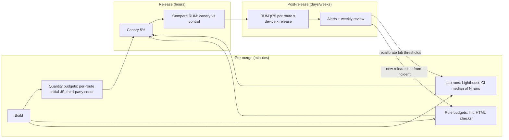
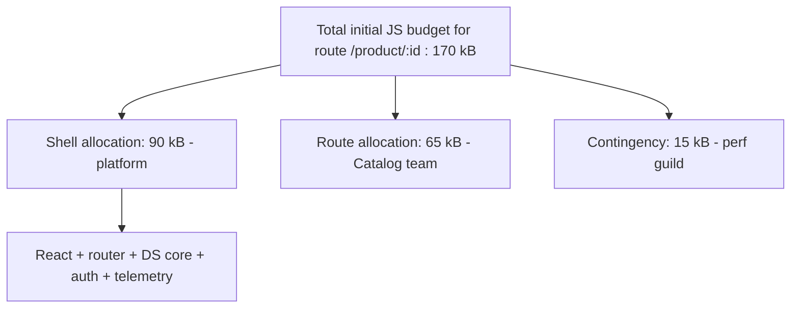

# 11 / 09 — Performance Budgets at Scale

## 1. Lesson metadata

| | |
|---|---|
| **Level** | Architect |
| **Study time** | 4–5 hours (reading 2 h, worked examples 1 h, exercises 1.5 h) |
| **Prerequisites** | [07/16 — Bundle analysis](../07-performance/16-bundle-analysis.md), [07/17 — Network waterfalls](../07-performance/17-network-waterfalls.md), [07/21 — Web Vitals and budgets](../07-performance/21-web-vitals-and-budgets.md), [07/22 — Production performance investigations](../07-performance/22-production-performance-investigations.md), [11/01 — Trade-off analysis](./01-trade-off-analysis.md), [11/06 — Cross-cutting concerns](./06-cross-cutting-concerns.md) |
| **Next** | [10 — Designing for testability](./10-designing-for-testability.md) |
| **Related** | [10/18 — Continuous delivery](../10-production-engineering/18-continuous-delivery.md), [04/25 — Architectural fitness and enforcement](../04-react-architecture/25-architectural-fitness-and-enforcement.md), [11/12 — Microfrontends](./12-microfrontends.md), [11/16 — Supporting multiple teams](./16-supporting-multiple-teams.md) |

**Learning objectives.** After this lesson you can:
1. Distinguish the four *kinds* of performance budget (quantity, timing, rule-based, cost) and say which can be enforced where (PR, CI, production).
2. Derive a budget from a user and business outcome instead of copying a number from a blog post.
3. Allocate a shared budget across many teams and explain why an unallocated budget is a commons that will be overgrazed.
4. Design an enforcement pipeline that combines lab checks (deterministic, pre-merge) with field monitoring (truthful, post-release), and explain why neither alone is sufficient.
5. Design the *human* system around the budget: ownership, exceptions, ratchets, escalation, and what happens when the budget is breached for a good reason.
6. Evaluate when budgets are the wrong tool.

**Concepts covered:** performance budget, quantity vs timing vs rule budgets, lab vs field data, percentiles and segmentation, budget allocation, ratchet, regression bisection, third-party budgets, route-level budgets, performance error budget, Goodhart's law applied to metrics.

---

## 2. Deep conceptual explanation

### 2.1 What problem is this lesson solving?

In a single-team app you can keep performance good by attention: the five people who touch the code notice when the bundle jumps. At scale — 10 teams, 400 engineers, a monorepo or several repositories, third-party tags added by marketing — that attention does not scale. Performance decays through **many individually reasonable changes**, none of which is "the" regression:

- a team adds a date library (+18 kB gzipped) because they needed one function,
- another team imports a charting package into the shared shell,
- a design-system release adds a barrel export that defeats tree shaking ([00/10](../00-web-and-javascript-foundations/10-modules-and-dependency-graphs.md)),
- the experimentation platform adds a blocking script for A/B tests,
- a feature flag SDK is upgraded and doubles its payload.

Each PR is defensible in isolation. The sum is a 4-second LCP on mid-range Android devices. Nobody did anything wrong in a way a reviewer can point to. This is the **tragedy of the commons**: the load budget of the user's device and network is a shared resource, the benefit of using it accrues to the team spending it, and the cost is borne by everybody (and by the user).

A **performance budget** converts that implicit commons into an explicit, measured, owned constraint — analogous to a financial budget or an SLO's error budget. It does three things:

1. **Makes the constraint visible** (a number, on a dashboard, in the PR).
2. **Makes trade-offs explicit** (to add 20 kB, someone must remove 20 kB or argue for an exception).
3. **Makes ownership explicit** (a specific team owns each slice).

### 2.2 What a budget is not

- It is **not a goal**. A goal says "we would like LCP under 2.5 s". A budget says "this build must not exceed N; breaching it stops the line or triggers a defined process".
- It is **not a single number**. A single "bundle ≤ 300 kB" says nothing about *which* route, *which* device class, or *which* percentile.
- It is **not a substitute for measurement of user experience**. Bytes are a proxy. A 150 kB bundle can ship a 1.2 s main-thread task; a 600 kB lazy chunk can be invisible to the user.

### 2.3 Four kinds of budget

| Kind | Example | Measured where | Deterministic? | Typical gate |
|---|---|---|---|---|
| **Quantity** | Initial JS ≤ 170 kB gzipped on `/checkout`; ≤ 6 third-party requests; image bytes ≤ 400 kB | Build output, bundler stats | Yes | PR check (blocking) |
| **Timing / experience** | p75 LCP ≤ 2.5 s, p75 INP ≤ 200 ms, CLS ≤ 0.1 (Google's "good" thresholds) per route per device class | Field RUM; synthetic lab runs as proxy | No (field) / mostly (lab) | Dashboard + alert; lab check on release candidate |
| **Rule-based** | No new synchronous third-party script in `<head>`; no import of `lodash` root; every image has dimensions | Static analysis, lint, HTML checks | Yes | PR check (blocking) |
| **Cost / capacity** | Server render p95 ≤ 150 ms; edge CPU ms per request; CDN egress per MAU | Server metrics, billing | Field | Alert, quarterly review |

⚠ *Version-sensitive.* Core Web Vitals thresholds and the metric set are defined by Google and have changed before (First Input Delay was replaced by Interaction to Next Paint as a Core Web Vital in March 2024). The "good" thresholds above (LCP 2.5 s, INP 200 ms, CLS 0.1, evaluated at the 75th percentile of page loads, mobile and desktop segmented) are current (confirmed against the `LCPThresholds`/`INPThresholds`/`CLSThresholds` exports of `web-vitals@6.2.3`, 2026-10-22); re-check <https://web.dev/articles/vitals> before encoding them in policy.

The senior insight is that these kinds are **complementary along a feedback-latency axis**:

- Quantity and rule budgets give feedback in **minutes** (in the PR) but measure a **proxy**.
- Timing budgets in the field give feedback in **days** (you need traffic) but measure **reality**.

A budget system that has only the first is gameable and drifts away from user experience. One that has only the second finds regressions after release and cannot attribute them to a PR. You want both, and a defined mapping from one to the other (§2.6).

### 2.4 Deriving a budget from evidence, not folklore

A common failure is adopting "170 kB of JS" or "LCP 2.5 s" as if they were physics. The numbers have a derivation; learn it so you can adapt it.

**Top-down derivation (from experience to bytes).** Start from the experience target and work backwards through the constraints of the *device and network you actually serve*.

1. **Pick the target population.** Look at your RUM data (or analytics) for the 75th-percentile (or the percentile you commit to) device and connection. Suppose it is a mid-range Android phone on a network with effective downlink around 4 Mbps and 150 ms RTT. *Do not assume; measure.* If you have no data, say so and choose a conservative public reference profile, labelled as an assumption.
2. **Pick the experience target.** e.g. p75 LCP ≤ 2.5 s on that profile for the product-listing route.
3. **Subtract fixed costs.** DNS/TLS/TTFB (say 600 ms), render-blocking CSS, image fetch for the LCP element (say 500 ms), leaving perhaps 1.4 s for "JS fetch + parse + execute + hydrate + first render of the LCP element" if the LCP depends on JS (client-rendered), or much less JS pressure if the LCP element is in server HTML.
4. **Convert time to bytes with a model**: transfer time ≈ bytes / bandwidth (+ round trips); parse/compile/execute time scales with *uncompressed* JS size and device CPU, and is often larger than transfer time on slow phones. A rough rule used by many teams is that JS is the most expensive byte per byte (it must be fetched, parsed, compiled, executed) versus an image of the same size, but treat any "x ms per kB" constant as device-specific and **calibrate it by measuring your own bundle on a throttled profile**.
5. **Derive the number and record the derivation and assumptions in an ADR** ([10/16 — ADRs](../10-production-engineering/16-architecture-decision-records.md)). When the population changes (new market with slower devices), the number can be re-derived rather than re-argued.

**Bottom-up validation (from bytes to experience).** Take your *current* bundles and run them on the target profile. If the current app passes the top-down budget with a 10% margin, the budget is a *guard rail*. If it fails by 40%, the budget is a *reduction programme*, not a gate (see §2.8, ratchet) — gating on it would block all work.

**Business evidence.** Executives fund performance work when it connects to conversion, retention, or support cost. The honest approach: run your own analysis — segment sessions by LCP/INP bucket and compare conversion or task completion, controlling for device and geography (slow users are often on cheaper devices that also convert differently, so naive correlation overstates the effect). Public case studies exist from large companies reporting conversion changes with latency, but they are not your users; use them to motivate the *experiment*, not as your number. If you can, run a controlled test (a deliberately delayed cohort, or a progressive rollout of an optimization) because that gives causal rather than correlational evidence.

### 2.5 Granularity: what to attach a budget to

| Level | Pros | Cons |
|---|---|---|
| Whole app | Simple | Meaningless for apps with distinct routes; a heavy admin page hides a light landing page |
| **Per route (entry)** | Matches user experience; matches ownership if routes are team-owned | Needs route-level stats from the bundler; shared chunks complicate attribution |
| Per team / package | Matches accountability | Does not correspond to what the user downloads; a team's package can be 5 kB on 30 routes |
| Per component | Fine-grained | Encourages micro-optimisation; rarely tied to user experience |
| Per third party | Third parties are the least controlled; budget limits them | Needs a tag inventory |

The architect's default: **budget per route and device class (what users feel), allocated to owning teams (what teams control)**, plus a **global shell budget** (code every route pays) and a **third-party budget**.

### 2.6 The lab ↔ field bridge

| | Lab (synthetic) | Field (RUM) |
|---|---|---|
| Question answered | "Did *this change* make things worse in controlled conditions?" | "What do *real users* experience?" |
| Variance | Low if environment pinned (still non-zero) | High: devices, networks, caches, behaviours |
| Latency | Minutes (CI) | Days (needs traffic; for a p75 over a rolling 28-day window, it can lag 2–4 weeks for full effect) |
| Attribution | Easy: PR-level | Hard: needs release markers, feature-flag tags |
| Coverage | Only the flows you scripted | Everything real users do |
| Interaction metrics (INP) | Weak: needs scripted interactions; no real user behaviour | Strong |

Practice:

1. **Lab gates** (PR): bundle sizes, rule checks, and a small number of scripted lab runs (e.g. Lighthouse CI on 3–5 key routes, running multiple times and taking the median to dampen variance). Lab thresholds are **calibrated** against field: pick lab thresholds such that passing the lab strongly predicts passing the field on the target profile. Revisit calibration quarterly.
2. **Field monitoring**: RUM using the `web-vitals` library or your observability vendor; segment by route template, device class, connection type, country, app version / release id, and experiment arm. Alert on **relative change** after a release (statistically meaningful shift in p75) as well as on **absolute threshold** breaches.
3. **Release markers** tagging every RUM beacon with the build id so a field regression can be bisected to a deploy, and with feature-flag state so it can be attributed to a flag.

### 2.7 Allocating a budget across teams

A global number without allocation reproduces the commons problem. Allocate like a financial budget:

- **Reserve** a platform/shell allocation (framework, router, design-system core, auth, telemetry): the code that *every* route pays.
- **Allocate** per-route budgets to the owning teams.
- **Hold back** a contingency (typically 5–10%) that only the performance guild/platform can grant, for exceptions and unforeseen growth.
- **Charge** third parties against a separate, small allocation owned by whoever admits tags (usually marketing + platform jointly).

Principle: *the team that pays the cost must be the team that makes the trade-off.* If the shell team owns the shell budget and product teams can push into the shell indirectly (via a shared package that grows), allocations must include a rule such as "shared-package growth is charged to the *consuming* routes in the report", so growth is visible.

### 2.8 Ratchets, thresholds, and the "boil the ocean" trap

When the app is *already over* the ideal budget, you have three options:

| Option | Mechanism | Risk |
|---|---|---|
| **Fail the build above the ideal budget** | Gate at target | Blocks everyone; teams learn to disable the check |
| **Gate at current level (ratchet)** | Threshold = last measured value (+ small slack); each improvement lowers the threshold; regressions fail | Improvements are "locked in"; no new growth; the *target* still needs a reduction programme |
| **Warn only** | Report in PR | Nobody reads it; decays |

The ratchet is the recommended default for a brownfield app: *"never worse than yesterday, with a dated plan to reach the target"*. Pair it with the burn-down plan (who removes what by when) in a visible tracker, or the ratchet merely institutionalizes mediocrity.

### 2.9 Budgets as a socio-technical system

The technical gate is the easy 20%. The remaining 80%:

- **Who can grant an exception?** Define it (e.g. the owning team's tech lead plus a platform representative), with an expiry date (exceptions without expiry become permanent).
- **What counts as "breach for a good reason"?** A legal-required consent manager adds 40 kB; the budget should accommodate it by reallocating *explicitly* ("we take 40 kB from route X, the shell budget increases 40 kB, X's budget decreases 40 kB by the end of the quarter").
- **Who sees it?** The budget report must be where decisions occur: in the PR, in the design review for new dependencies ([11/02 — Technical design documents](./02-technical-design-documents.md)), and on a team-visible dashboard.
- **Goodhart's law:** "When a measure becomes a target, it ceases to be a good measure." Teams will meet the bytes budget by moving code into a lazy chunk that loads immediately after first paint (the bundle number improves; the user's INP does not). Counter by pairing the quantity budget with a **timing budget measured in the field** and by reviewing the *shape* (e.g. waterfall depth, chunks requested before interaction), not only the sum.

---

## 3. Internal mechanics

### 3.1 How bundle-size numbers are produced

*Teaching model.* A bundler (Vite/Rollup, webpack, esbuild, Rspack) builds a module graph per entry, performs tree shaking and code splitting, emits chunks, and can emit a **stats/manifest** describing which modules ended up in which chunk. Tools such as `size-limit`, `bundlewatch`, `rollup-plugin-visualizer`, and `webpack-bundle-analyzer` consume built output or stats. *Public guarantee:* the compressed size of an emitted asset is a measurable number. *Implementation detail:* the compression algorithm (gzip vs brotli) and level used by your CDN differs from the one your CI uses unless you align them; budgets expressed in "gzipped" bytes will not equal the brotli bytes users download. Pick one reference (state it in the budget doc) and calibrate.

*Tool APIs change.* The `size-limit` option names below (`path`, `limit`, `gzip`) were checked against the size-limit README (v14, 2026-10-22); `@lhci/cli` is used only as `lhci autorun` with a repo config, and `bundlewatch` is mentioned only by name.

### 3.2 Why "initial JS" is not the only cost

For a React app, user-visible cost of JS at load is a pipeline: **fetch → decode/decompress → parse/compile → execute module top-level code → React render/hydrate → effects**. A budget in transferred bytes covers only the first stage. Two bundles of equal gzipped size can differ greatly in execute cost (one has heavy top-level initialisation such as building lookup tables or registering hundreds of locales). This is why a *timing* budget (field) or a *scripting-time* lab metric (e.g. Total Blocking Time, a lab-only proxy for responsiveness) complements the size budget. See [07/20 — Long tasks and main thread](../07-performance/20-long-tasks-and-main-thread.md).

### 3.3 Statistics of field metrics

- **Use percentiles, not means.** Latency distributions are heavily right-skewed; the mean is dominated by the tail and moves unpredictably. Core Web Vitals assessment uses p75.
- **Segment before aggregating.** A global p75 can improve while a segment worsens (Simpson's paradox): if mobile share grows, a global p75 can *worsen* even if each device class is individually unchanged.
- **Sample size matters for alerts.** An alert on "p75 LCP up 100 ms" on a route with 200 daily samples will fire randomly. Require a minimum sample and use a comparison against a baseline *from the same weekday/period*, with a confidence interval or at least a persistence condition (e.g. 3 consecutive windows).
- **Lab variance is real.** Repeat each lab run (e.g. 5–9 runs) and use the median; set thresholds with headroom larger than the run-to-run noise measured on *your* CI runners. If the noise is ±8%, a 5% regression gate is a coin flip.

### 3.4 Attribution of shared chunks

If three routes share a vendor chunk, "route X's JS" = its entry + its async chunks + shared chunks it depends on. Budget tooling should compute the **transitive closure of chunks required for the route's initial load**, not just the route's own chunk. Many "bundle size" PR checks silently measure only the entry chunk and miss shared-chunk growth, which is exactly where regressions hide. Check how your tool computes it.

---

## 4. Step-by-step execution walkthrough: a PR that adds a dependency, end to end

Scenario: engineer Mira, on the *Catalog* team, adds `fancy-date-lib` to the product page.

1. Mira opens a PR. CI builds the app with the production configuration.
2. The build emits a **manifest** mapping each route to its initial chunks.
3. A script computes, per route, the gzipped sum of initial chunks and compares with `budgets.json` (§5.2).
4. `/product/:id` goes from 161 kB to 183 kB; its budget is 170 kB. The check **fails** with a message that includes: the delta by module (from stats), the budget owner (Catalog), the exceptions process link, and the three biggest contributors.
5. Mira investigates using the visualizer: `fancy-date-lib` brings 18 kB plus locale data (4 kB each, 40 locales bundled by default).
6. Options considered: (a) configure to load only the needed locale (−15 kB), (b) use native `Intl.DateTimeFormat` (0 kB, but loses relative-time formatting nuance), (c) request an exception.
7. Mira chooses (b) for the need, keeps (a) as fallback; the check passes at 162 kB.
8. After merge, a deploy to 5% of traffic is tagged `release=2026.10.3`; RUM p75 LCP and INP for `/product/:id` are compared with the control (previous release) over the next hours/days.
9. If field metrics diverge despite passing the quantity gate (e.g. the new code path forced a layout shift), the field alert fires, and the release marker narrows the cause to that release.

The point: **the PR gate caught the cheap, deterministic problem in minutes; the field loop is the backstop for what bytes cannot see.**

---

## 5. Code examples

### 5.1 Minimal — a quantity budget with `size-limit` *(options checked against size-limit v14)*

```jsonc
// package.json (excerpt) — illustrative
{
  "scripts": { "size": "size-limit" },
  "size-limit": [
    { "name": "Shell (entry)", "path": "dist/assets/index-*.js", "limit": "70 kB", "gzip": true },
    { "name": "Product route", "path": "dist/assets/product-*.js", "limit": "40 kB", "gzip": true }
  ]
}
```

Notes: `size-limit` needs a plugin to measure files: install `@size-limit/file` (or a preset such as `@size-limit/preset-app`); without one it fails with a missing-plugin error. Its default compression is **Brotli**; the `"gzip": true` above switches to Gzip, which is why it is spelled out. This measures files by glob, which is exactly the "entry chunk only" trap of §3.4. It is fine for a first step, and wrong as an end state for an app with shared chunks.

### 5.2 Practical — route-level budgets from a build manifest

A budget file owned by teams (CODEOWNERS makes each team the required reviewer of its own line):

```jsonc
// budgets.json
{
  "unit": "gzip-bytes",
  "routes": {
    "/":              { "owner": "@acme/team-home",     "initialJs": 150000 },
    "/product/:id":   { "owner": "@acme/team-catalog",  "initialJs": 170000 },
    "/checkout":      { "owner": "@acme/team-checkout", "initialJs": 190000 }
  },
  "shell": { "owner": "@acme/platform", "initialJs": 90000 },
  "thirdParty": { "owner": "@acme/platform", "maxRequestsBeforeInteractive": 4 }
}
```

A checker script (TypeScript, Node 20+; assumes a Vite-style `manifest.json` produced with `build.manifest: true` — shape verified against a Vite 8.3 build: top-level keys are source paths (`src/routes/checkout.ts`), HTML entries use `index.html`, shared chunks use `_name-hash.js` keys, and each record has `file`, `imports`, `dynamicImports`, `isEntry`/`isDynamicEntry`):

```ts
// tools/check-budgets.ts
import { readFileSync } from 'node:fs';
import { gzipSync } from 'node:zlib';
import { join } from 'node:path';

type ManifestChunk = {
  file: string;
  imports?: string[];          // static imports: part of the initial load
  dynamicImports?: string[];   // lazy: NOT part of initial load
  isEntry?: boolean;
};
type Manifest = Record<string, ManifestChunk>;

const dist = 'dist';
const manifest: Manifest = JSON.parse(readFileSync(join(dist, '.vite/manifest.json'), 'utf8'));
const budgets = JSON.parse(readFileSync('budgets.json', 'utf8')) as {
  routes: Record<string, { owner: string; initialJs: number }>;
};

// Route -> manifest key of its entry module. In a real app, generate this
// from your router config rather than hand-maintaining it.
const routeEntries: Record<string, string> = {
  '/': 'src/routes/home.tsx',
  '/product/:id': 'src/routes/product.tsx',
  '/checkout': 'src/routes/checkout.tsx',
};

const gzipCache = new Map<string, number>();
function gzSize(file: string): number {
  const hit = gzipCache.get(file);
  if (hit !== undefined) return hit;
  const size = gzipSync(readFileSync(join(dist, file))).length;
  gzipCache.set(file, size);
  return size;
}

/** Transitive closure of STATIC imports = what the browser must fetch up-front. */
function initialChunks(entryKey: string, seen = new Set<string>()): Set<string> {
  if (seen.has(entryKey)) return seen;
  seen.add(entryKey);
  for (const dep of manifest[entryKey]?.imports ?? []) initialChunks(dep, seen);
  return seen;
}

let failed = false;
for (const [route, { owner, initialJs }] of Object.entries(budgets.routes)) {
  const keys = initialChunks(routeEntries[route]);
  // The app entry is also loaded on every route. With Vite an HTML entry is keyed by its HTML path
  // ('index.html'), not by the script's name (run-tested: a `k.includes('main')` test never matched):
  if (manifest['index.html']) initialChunks('index.html', keys);
  const files = [...new Set([...keys].map((k) => manifest[k].file))];
  const total = files.reduce((sum, f) => sum + gzSize(f), 0);
  const over = total - initialJs;
  const status = over > 0 ? 'FAIL' : 'ok  ';
  console.log(`${status} ${route.padEnd(16)} ${total} / ${initialJs} B  owner ${owner}`);
  if (over > 0) failed = true;
}
process.exit(failed ? 1 : 0);
```

Line notes:
- `imports` vs `dynamicImports`: only **static** imports are part of the initial load. A lazy `import()` does not count toward *initial* JS, which is exactly what makes "just lazy-load it" an easy way to satisfy this script without helping the user if the lazy chunk is requested immediately (§2.9, Goodhart).
- The transitive closure is what addresses the shared-chunk attribution problem (§3.4).
- Compressing each file in the checker with Node's `gzip` approximates but does not equal your CDN's compression; choose and document a reference.

*Predict:* If two routes share a 60 kB vendor chunk and the vendor chunk grows by 10 kB, which routes fail? **Both** (each includes the chunk in its closure), and both owners are told — which is the correct signal, because the cost is paid by both. The *cause* may belong to neither (a platform dependency upgrade), which is why reports must show the delta by module.

### 5.3 Incorrect — a budget as a single global number with no owner

```jsonc
{ "size-limit": [{ "path": "dist/**/*.js", "limit": "500 kB" }] }
```

Problems: (1) glob over all JS counts lazy chunks that users never download on a given route, so the limit is both too loose for the landing page and too tight for the admin; (2) no owner, so a failure is "everybody's problem"; (3) the limit is a round number with no derivation; (4) growth happens inside the 500 kB headroom unseen until a day it trips and the culprit PR is arbitrary — the *last* PR is blamed for the commons' decay.

### 5.4 Corrected — see 5.2; plus a ratchet

```ts
// tools/ratchet.ts — lower the recorded baseline when the build improves.
import { readFileSync, writeFileSync } from 'node:fs';

type Baseline = Record<string, number>; // route -> bytes
const baseline: Baseline = JSON.parse(readFileSync('budget-baseline.json', 'utf8'));
const current: Baseline = JSON.parse(readFileSync('dist/budget-current.json', 'utf8'));
const SLACK = 1024; // allow 1 kB noise from compression/hash differences

let regressed = false;
for (const [route, bytes] of Object.entries(current)) {
  const base = baseline[route] ?? Infinity;
  if (bytes > base + SLACK) {
    console.error(`REGRESSION ${route}: ${bytes} > baseline ${base} (+${bytes - base})`);
    regressed = true;
  } else if (bytes < base) {
    baseline[route] = bytes; // ratchet down; commit this file on main only
  }
}
if (!regressed && process.env.UPDATE_BASELINE === '1') {
  writeFileSync('budget-baseline.json', JSON.stringify(baseline, null, 2));
}
process.exit(regressed ? 1 : 0);
```

Design notes: the baseline update runs only on the main branch (so PR branches cannot lower the bar for themselves); `SLACK` absorbs compression noise but must be small, or it permits 1 kB × N PRs of creep — track *cumulative* drift against the dated target, not just PR-to-PR.

### 5.5 Advanced — field RUM with release markers (`web-vitals`)

```ts
// src/telemetry/vitals.ts
import { onCLS, onINP, onLCP, type Metric } from 'web-vitals';

declare const __RELEASE__: string;           // injected at build time
declare function getFlagSnapshot(): Record<string, string>; // your flag SDK

function route(): string {
  // Report the ROUTE TEMPLATE ('/product/:id'), never the raw URL (cardinality + PII).
  return (window as any).__ROUTE_TEMPLATE__ ?? 'unknown';
}

function send(metric: Metric) {
  const body = JSON.stringify({
    name: metric.name,
    value: metric.value,
    rating: metric.rating,           // 'good' | 'needs-improvement' | 'poor'
    id: metric.id,
    route: route(),
    release: __RELEASE__,
    flags: getFlagSnapshot(),
    // Coarse buckets only; do not send fingerprinting detail.
    deviceMemory: (navigator as any).deviceMemory ?? null,
    effectiveType: (navigator as any).connection?.effectiveType ?? null,
  });
  // sendBeacon survives page unload; fall back to fetch keepalive.
  if (!navigator.sendBeacon?.('/rum', body)) {
    fetch('/rum', { method: 'POST', body, keepalive: true });
  }
}

onLCP(send); onINP(send); onCLS(send);
```

Notes: `web-vitals` callbacks fire at defined moments (e.g. INP and CLS may report when the page is hidden); `onLCP`, `onINP` and `onCLS` are exported by `web-vitals@6.2.3` (`onFID` no longer exists; `onFCP` and `onTTFB` do). `navigator.deviceMemory` and `navigator.connection` are non-standard/Chromium-only; treat `null` as "unknown", never as "fast". Privacy: check your consent/regulatory obligations before collecting RUM at all ([10/06](../10-production-engineering/06-security-xss-csrf-csp.md), [10/04](../10-production-engineering/04-observability-and-logging.md)).

---

## 6. Visual explanations





Text sketch of the allocation arithmetic (§7 worked example expands):

```
route budget 170 kB = shell 90 + route 65 + contingency 15
exception request +12 kB -> draws contingency (15 -> 3), expiry 1 quarter
second request +12 kB    -> contingency exhausted -> must reallocate or cut
```

---

## 7. Alternative approaches and trade-offs

| Approach | Strength | Weakness | Best when |
|---|---|---|---|
| **Hard gates on quantity budgets (per route)** | Deterministic, fast feedback, easy to explain | Proxy metric; gameable; needs maintenance as app changes | Mature app near target; many teams |
| **Ratchet (never worse than baseline)** | Adoptable on brownfield; no mass blocking | Locks in status quo unless paired with burn-down | App is over ideal budget |
| **Field-only timing budgets with alerts** | Measures truth | Slow, hard attribution, noisy at low traffic | Traffic is high enough for stable percentiles and releases are tagged; poor fit for low-traffic routes |
| **Lab-only (Lighthouse CI score thresholds)** | Easy to set up | Score is composite and unstable; lab ≠ field; teams chase score not users | As a smoke test only |
| **Performance guild review (human gate)** | Context-aware, catches design-level problems | Bottleneck; inconsistent; doesn't scale beyond a few PRs/day | New large dependencies, architecture changes (design-review stage) |
| **No budgets; rely on culture and periodic audits** | No process overhead | Decay is guaranteed at scale; audits find damage late | One team, one app, low turnover |
| **Platform-level mitigation (shared chunking strategy, automatic image optimization, edge caching)** | Removes whole classes of regressions without teams doing anything | Does not stop dependency bloat | Complements any of the above |

**A scenario where budgets are NOT the best tool.** A 6-person team building an internal admin tool used on desktops over a corporate network with a fixed device fleet. Performance there is dominated by API latency and large table rendering, not by JS bytes; a JS-size budget would generate process overhead and false assurance. Better: a small number of **interaction** timing checks (e.g. "filter a 5,000-row table < 200 ms on the standard laptop") in a lab and an ad-hoc review when something feels slow. Similarly, if your biggest lever is a **server/data** problem (a 1.8 s TTFB), polishing the bundle budget is misallocation; budgets should reflect the actual critical path ([07/18](../07-performance/18-react-vs-browser-bottlenecks.md)).

---

## 8. Best practices and anti-patterns

**Practices**
- Express budgets per route × device profile, with an owner, a derivation, and an expiry/review date.
- Gate *both* quantity (PR) and timing (field); define the mapping and recalibrate.
- Make the failing message actionable: delta by module, owner, exception process, "how to investigate" link.
- Charge third parties to a budget; maintain a tag inventory; load them off the critical path; consider a "tag review" step in the intake process.
- Treat the *shape* of the load as a budget too: depth of the request waterfall, number of chunks requested before first interaction.
- Version the budget file; changes to a budget require review from the budget's *and* the platform's owners.

**Beginner mistakes**
- Copying "170 kB" without knowing the audience.
- Measuring minified rather than compressed bytes (or vice versa) inconsistently.
- Measuring only the entry chunk (§3.4).

**Experienced-developer mistakes**
- Moving code into lazy chunks that load right after first render, satisfying the byte gate without helping INP or total cost.
- Setting a lab threshold tighter than CI noise, leading to flaky failures that teach people to re-run until green.
- Averaging field metrics; aggregating across device classes.
- Letting exceptions accumulate with no expiry.

**Smells**
- The budget file has never been edited, or is edited only upward.
- The same person always grants exceptions.
- RUM exists but nobody owns an alert on it.
- Teams "re-run CI" on budget failures.

**Justified exceptions.** Legally required scripts (consent, accessibility overlays mandated by contract), a one-off marketing event with an explicit end date and a removal ticket, or a deliberate strategic investment (a rich editor) where the budget is *re-negotiated* with product, with the trade-off explicit. An exception that is explicit, owned, dated, and visible is a feature of a healthy budget system; an exception that is silent is the failure mode.

Do not present any of this as universal: a startup finding product-market fit rationally spends its budget on iteration speed and may postpone formal budgets until traffic and team count justify them (§7).

---

## 9. Real-world application

**E-commerce (conversion-critical, mobile-heavy).** The product listing and product detail routes dominate entry traffic from search engines and ads. Budgets per route; LCP element usually an image, so the **image budget** (bytes, format, priority hints, dimensions) matters more than JS for LCP, while JS dominates INP when filters re-render large lists. Third parties (tag manager, reviews widget, A/B testing, chat) are typically the single largest uncontrolled block; budget them explicitly and defer.

**Dashboards (authenticated, desktop, long sessions).** Initial load matters less than *sustained* performance: INP while filtering, memory growth over hours ([07/19](../07-performance/19-memory-leaks.md)). Budgets lean toward interaction timing and memory ceilings rather than first-load bytes; a code-split charting library behind a route boundary is acceptable.

**Finance / regulated.** Third-party scripts are often forbidden or tightly controlled, which makes the third-party budget easy; the pressure is instead on large client-side validation libraries and i18n/locale data, and on **auditability** — budget exceptions need approval trails.

**Multi-team platform (this lesson's focus).** A shell + many feature teams (see [12 — Microfrontends](./12-microfrontends.md)). Risks: duplicated dependencies across independently built bundles (two Reacts, three date libraries), shared-runtime version skew, and the absence of one team who "sees the whole page". The budget is attached to the *composed page*, measured on the composed output, with per-team sub-allocations; build-time per-team checks alone cannot see duplication across independently deployed artifacts, so a **composed-page lab check** plus RUM is essential.

**Constraints to name in your design doc:** supported device/network profile; traffic volume (affects feasibility of field alerts); release cadence (affects attribution); regulatory limits on RUM; org structure (who can enforce what).

---

## 10. Debugging and troubleshooting

**Symptom 1: p75 LCP regressed 300 ms last week; the bundle gate was green throughout.**
*Investigation.* (1) Confirm the regression is real: check sample size and segment (device, route, country). (2) Align with release markers: step changes line up with a deploy; slopes with a content/traffic-mix change. (3) Compare LCP *subparts* (TTFB, resource load delay, resource load duration, render delay — the LCP breakdown is available in the `web-vitals` attribution build and in DevTools; **verify the attribution API in current docs**). (4) If TTFB moved: server/edge/caching. If resource load delay moved: a new waterfall hop (e.g. the LCP image now discovered late due to client rendering). If render delay moved: main-thread contention (a new third party or a hydration cost increase).
*Root cause example.* A feature flag moved a hero banner from server HTML to client render, so the LCP image is discovered after JS executes. Bytes did not change at all.
*Validate fix.* Revert flag for a cohort; compare p75 over a window with the same traffic mix; add a **rule budget** ("LCP image must be present in server HTML") as a lint/HTML check so the class of regression is caught pre-merge.

**Symptom 2: lab check flakes ~1 in 5 runs.**
*Investigation.* Measure noise: run the lab suite 30× on an unchanged commit, compute coefficient of variation. If CV is 10%, thresholds must exceed it. Remedies: pin CPU/memory of runners, use median of ≥5 runs, disable network variability using throttling presets, warm caches deterministically, fix the build under test (no sourcemap upload during the run), move to a dedicated runner pool.
*Validate.* Re-run 30× after changes; flake rate should fall below your tolerance (e.g. <1%).

**Symptom 3: budget green; users on low-end Android complain about lag after load.**
*Investigation.* Bytes are not CPU. Record a DevTools Performance trace with 4–6× CPU throttling ([07/02](../07-performance/02-profiler-workflows.md)); look for long tasks after load: hydration, large JSON parse, a state-library initial population. Check the INP field attribution for the offending interaction's phase (input delay vs processing vs presentation).
*Root cause example.* A new locale loader parses 600 kB of JSON synchronously at startup (the *compressed* transfer was only 45 kB, so the size gate passed).
*Fix.* Lazy-load by active locale; add a **scripting-time/long-task** lab budget (e.g. TBT on the scripted route) so this category is gated.

**Symptom 4: everybody got an exception; budget is meaningless.**
Audit exception ages and owners; enforce expiry; require reallocation, not just grants; publish an "exception ledger" in the weekly review.

---

## 11. Exercises

### Level A — Knowledge
A1. Name the four kinds of budget and give one enforcement point for each.
A2. Why is a p75 used for Core Web Vitals instead of a mean?
A3. What is a ratchet, and in what situation is it preferable to a hard gate at the target?
A4. Why might a lazy-loaded chunk not count towards an "initial JS" budget, and why is that both a feature and a loophole?
A5. State two reasons a lab threshold may disagree with field data.

### Level B — Code comprehension
B1. In §5.2, why does the script follow only `imports` and not `dynamicImports`? What user-visible scenario defeats this assumption?
B2. In §5.4, why must the baseline update run only on the main branch?
B3. In §5.5, why is `route()` returning a template rather than `location.pathname`?
B4. A PR check reports `/checkout: 188 kB / 190 kB ok`, yet the PR adds a 25 kB library lazily imported on the page load of checkout (`useEffect(() => { import('./pay') }, [])`). Predict the field effect and explain whether the gate is "wrong".

### Level C — Implementation
C1. Extend `check-budgets.ts` to print, for each failing route, the **top 3 modules by size** contributing to the failure. State which bundler artifact you would read (and how you would verify the shape).
C2. Write a GitHub Actions (or generic CI) job outline that runs lab checks on the PR, uploads a budget report as a PR comment, and fails only on regressions beyond measured noise.
C3. Write the SQL (or pseudo-query) for a RUM warehouse table `vitals(name, value, route, release, device_class, ts)` that returns p75 LCP per route per release for the last 7 days with a minimum sample of 500.

### Level D — Debugging
D1. After a deploy, global p75 INP rose from 180 ms to 215 ms. Segment breakdown shows each device class's p75 INP is unchanged or slightly better. Explain the likely cause and how you would confirm it.
D2. Your CI bundle check passes locally but fails in CI by 3 kB with no code change. List four possible causes.
D3. A team reduced initial JS by 40 kB by moving a charting library into a lazy chunk, and p75 INP on the route got worse. Hypothesize and describe how you'd verify.

### Level E — Architecture and engineering decisions
E1. A 40-engineer company with one React app and 2 backend teams asks whether to invest in a full budget system. Evidence: LCP p75 is 2.1 s; traffic 30k sessions/day; 9 months ago it was 1.9 s. Decide, and state what you would implement and what you would explicitly defer.
E2. You inherit an app with 780 kB initial JS (gzipped) on the most important route against a derived target of 250 kB, and 8 teams that all ship weekly. Design the rollout of budgets over two quarters, including enforcement mode, allocation, and communication.
E3. Marketing wants to add a personalization vendor script (+55 kB, blocking). Draft the decision memo structure and the options you would put to the decision makers.

### Level F — Expert challenge
F1. Design the budget system for a **composed page** built from 6 independently deployed microfrontends ([12](./12-microfrontends.md)) where each team ships its own bundle, shares React via a runtime mechanism, and the shell composes them at runtime. Address: where measurement occurs, how you allocate, how you detect duplicate dependencies, how you attribute a field regression to a team, what the failure modes of your design are.
F2. Argue **against** your own design in F1 in 150–250 words. When would you choose a simpler system?

---

## 12. Detailed answers and explanations

> Attempt the exercises first.

**A1.** Quantity (initial JS per route — PR/CI gate), timing/experience (p75 LCP/INP per route — field alert, plus lab proxy on release candidates), rule-based (no sync third-party in head, images have dimensions — lint/HTML checks in PR), cost/capacity (server p95 render time, CDN egress — monitoring alert/quarterly review). Common wrong answer: listing metric names (LCP, INP) as "kinds"; those are timing budget *instances*.

**A2.** Latency distributions are right-skewed; the mean is dominated by a small tail of extremely slow sessions, so a handful of outliers move it more than a broad change in typical experience, and it doesn't correspond to any actual user's experience. A percentile like p75 states "three quarters of page loads are at least this good", is robust to extreme tails, and is directly interpretable. (Tail percentiles like p95/p99 are also useful operationally but are noisier and more sensitive to bots and bad devices.) Wrong answer: "because the mean is inaccurate" — it is accurate arithmetic; it is the wrong *summary* for skewed data.

**A3.** A ratchet sets the threshold at the current measured value (plus small slack) and lowers it whenever the metric improves, so the metric can only stay the same or improve. It is preferable when the current state is *already worse than the target*: a hard gate at the target would fail every PR (people disable it); the ratchet prevents further decay while a burn-down reduces the gap. Caveat: without a dated plan to reach the target, it just freezes the status quo.

**A4.** `import()` chunks are not fetched at initial load, so they do not delay first render — which is the purpose of code splitting ([07/15](../07-performance/15-code-splitting-and-lazy-loading.md)). Loophole: if the chunk is requested immediately after load (or on a path nearly all users take), its bytes and execution still hit the same user and often during the interactive window; the gate says "better" and the experience is no better. Mitigate by budgeting *total JS requested within N seconds / before first interaction* in lab, and by field INP.

**A5.** Any two: different hardware/CPU throttling than real devices; no real network variance; cold-cache assumption vs real repeat visits (field is a mix of cold and warm); scripted flows don't cover real interaction diversity (especially INP); third-party behaviour differs by geography/consent state; personalization/AB variants differ in field; lab run noise; and the lab's single page load doesn't include later SPA navigations that field metrics can include.

**B1.** `imports` are static imports required to execute the entry; they must be fetched before the route can render, so they are "initial". `dynamicImports` are fetched on demand. Assumption is defeated when a dynamic import is triggered unconditionally at load (e.g. in a mount effect, or a route's main component is `lazy()` and always requested right away) — the chunk is in the critical path though technically "dynamic". Better model: treat a lazy chunk as initial if it is *always* requested on that route before first meaningful render; this requires route-level analysis or measuring lab request logs.

**B2.** If branches could write the baseline, a PR could lower the bar for itself (or raise it), and parallel PRs would conflict. By updating only from main after merge, the baseline reflects shipped reality, and PRs are compared against it immutably. Edge case: concurrent merges — updating after each merge on main serializes updates; PR checks compare against the baseline at the PR's base, so two PRs that individually pass can jointly exceed it; re-run the check on main post-merge (merge queues help).

**B3.** Raw paths (`/product/8842`) have unbounded cardinality (making aggregation useless and storage expensive) and may contain PII (emails, tokens in URLs). Route templates give a bounded set to aggregate and budget against. Edge case: SPA navigations — the template must be updated on route change, and a metric reported at page-hide time should use the route that was active when the metric was attributed (LCP) or the *final* route (CLS/INP are session-long); decide and document which.

**B4.** The gate is green because the lazy chunk is excluded from "initial JS". Field effect: on checkout load, the browser downloads and executes an additional 25 kB right after mount, competing with hydration/first interactions; INP of early interactions may worsen slightly and the payment form may be delayed; LCP is probably unaffected. The gate isn't "wrong" per its definition; it is *incomplete*. Fix: (a) prefetch on idle or only on intent (hover/focus on pay button) rather than unconditional mount, (b) add a lab check that counts script bytes loaded by 5 s after navigation, (c) watch INP for checkout. Wrong answer: "lazy loading is always free".

**C1.** *Criteria:* uses a bundler stats artifact with per-module sizes (for Rollup/Vite, the visualizer plugin can emit JSON; for webpack, `stats.json`); maps modules to chunks in the failing route's closure; sorts by size; notes that per-module sizes are typically *pre-compression* (rendered or parsed size), so rank by that and label it so. Sample approach: parse the stats JSON, for each chunk in the closure accumulate `modules[].renderedLength`, sort descending, print top 3 with package name derived from the `node_modules/<pkg>` path segment. Verify the artifact's shape with a small script against your own build; names differ across bundlers and versions. Edge: tree-shaken modules appear with zero rendered length — filter them.

**C2.** *Criteria:* (1) build with production config and fixed `NODE_ENV`; (2) run the budget script (deterministic gate); (3) run lab tool N≥5 times per route using a pinned runner, take the median; (4) compare with a stored baseline from main with a threshold set to ≥2× measured noise; (5) post a comment containing a table (route, base, head, delta, budget, owner); (6) fail only if a gating metric exceeds the *combination* of absolute budget and regression threshold; (7) upload artifacts (stats) for investigation. Sample outline:
```yaml
jobs:
  perf:
    runs-on: perf-pool   # dedicated, pinned hardware
    steps:
      - uses: actions/checkout@v4
      - run: npm ci && npm run build
      - run: npx tsx tools/check-budgets.ts        # quantity gate (blocking)
      - run: npx lhci autorun                       # lab; configure runs + aggregationMethod in lighthouserc
      - run: npx tsx tools/report-comment.ts        # PR comment
```
*(Lighthouse CI runs 3 times by default and takes the count from `ci.collect.numberOfRuns`; note that `assert` defaults to `aggregationMethod: "optimistic"` (best run), not the median — set `"median-run"` or `"pessimistic"` explicitly if you want the stricter behaviour. Pin action versions yourself.)* Why plausible wrong answers fail: gating on a Lighthouse "performance score" is unstable and composite; running once is noise.

**C3.**
```sql
SELECT route, release,
       approx_quantiles(value, 100)[OFFSET(75)] AS p75_lcp_ms,   -- BigQuery-style
       COUNT(*) AS n
FROM vitals
WHERE name = 'LCP' AND ts >= TIMESTAMP_SUB(CURRENT_TIMESTAMP(), INTERVAL 7 DAY)
GROUP BY route, release
HAVING COUNT(*) >= 500
ORDER BY route, release;
```
Criteria: percentile not average; minimum-sample filter; segmentation (add `device_class`); function names vary by warehouse (Postgres: `percentile_cont(0.75) WITHIN GROUP (ORDER BY value)`). Edge: releases overlap during rollout; compare same-time windows.

**D1.** Simpson's paradox / mix shift: if the share of slow device classes (e.g. low-end mobile) grew — through a marketing campaign, a new market, or a bot/traffic change — the global p75 rises while each segment is unchanged. Confirm: compute segment shares before/after; compute a mix-adjusted p75 (reweight each segment to the old share); check referrer/country change. Implication: the global alert fired correctly (users overall are worse off) but the *remedy* is not a code rollback; consider whether the new traffic is a target population and whether the budget for that device class needs separate targets.

**D2.** (1) Different Node/compression library versions or levels; (2) lockfile drift or a non-pinned transitive dependency resolved differently; (3) environment variables baked into the bundle (build id, API URLs) with different lengths — also hashed filenames; (4) different build mode (`NODE_ENV`, sourcemap inline); (5) locale/data files present in CI but not locally; (6) the baseline is stale. Debug by diffing the two `manifest.json`/stats outputs, not by guessing.

**D3.** Hypotheses: (a) the chunk loads on first interaction with the chart (user taps → network + parse → input-to-paint delay becomes large, worsening INP, since INP measures the interaction latency including the work to show the result); (b) when the chunk arrives, its execution and the React render of the chart occur in one long task; (c) the lazy boundary has a fallback causing layout shift. Verify: field INP attribution for that route (which interaction/target), DevTools trace of the first-chart interaction with throttling, network log of when the chunk is requested. Fix: preload on intent/idle, split the chart's heavy part further, keep above-fold chart server-rendered or code in main chunk if the chart is the primary content. The lesson: shifting bytes in time changes *who pays and when*, not whether anyone pays.

**E1.** *Evaluation criteria:* uses evidence (LCP 2.1 s is within 2.5 s target; drift of +200 ms over 9 months is a trend of ~22 ms/month — extrapolating linearly, it crosses 2.5 s in ~18 months, with huge uncertainty); considers org size (one app, one frontend team? 40 engineers total, so maybe 15 frontend); cost/benefit. *Example answer:* Do a light-weight version: (1) implement cheap deterministic gates (per-route initial-JS check with a ratchet, ~1–2 days), (2) RUM with release markers and one alert on relative regression (the data is valuable for decisions anyway), (3) a quarterly review. **Defer**: team-level allocation, a perf guild, composed-page lab suites, exception governance — their coordination cost isn't justified with one app and few teams. Revisit triggers: headcount doubling, second frontend team, p75 within 10% of the threshold, or a new market with slower devices. Why not "do nothing": the trend is slow decay and a ratchet is nearly free; why not "full system": no commons problem yet.

**E2.** *Criteria:* acknowledges the app is 3× over target, so a hard gate is infeasible; chooses ratchet; defines allocation; communicates. *Example:* **Weeks 1–2**: baseline measurement per route; derive target (ADR); instrument RUM if missing. **Weeks 3–4**: ratchet gate (block regressions >1 kB), report-only for allocation view; publish per-team shares (using CODEOWNERS and chunk attribution). **Quarter 1**: burn-down: platform tackles shared costs (dedupe, tree-shaking fixes, swap heavy libs, remove polyfills) — typically the biggest wins and politically neutral; teams each commit a quarterly reduction (e.g. −10%) as part of planning; weekly graph of per-route bytes. **Quarter 2**: switch routes to hard gates *as they reach target* (route-by-route graduation), introduce exception process with expiry, add lab timing checks and field alerts. Communication: leadership gets one chart (p75 LCP and the byte trend), teams get PR-level feedback and a Slack-visible leaderboard of *improvement*, not blame. Risks: gaming (lazy-load everything) — mitigated by timing budgets; fatigue — keep checks fast and non-flaky.

**E3.** *Memo structure:* context; requirement (what business outcome); cost (+55 kB blocking = measured effect on LCP/INP on target profile via a lab experiment with and without the tag); options: (1) accept with budget reallocation (name who pays), (2) load asynchronously with anti-flicker alternative (server-side personalization/edge decision), (3) defer until after first interaction, (4) reject; recommendation; success metric and rollback (A/B the tag itself against conversion lift — the tag must earn its cost); expiry/review date. Key point: quantify the *cost in user terms* and demand the vendor's benefit estimate in the same units. Wrong approach: either blanket veto or silently allow.

**F1.** *Evaluation criteria:* (a) measure the **composed** result; per-team builds can pass while the page fails; (b) detect duplication; (c) attribution; (d) honest failure modes. *Example:* **Measurement**: nightly and on-release composed-page lab runs against a staging environment with all MFEs at their candidate versions; per-MFE build checks gate each team's own artifact (size, exported dependency report). **Allocation**: shell budget (host + shared runtime: React, router, design system) + per-MFE budgets summing to ≤ route budget minus contingency; the sum constraint is checked by a script reading each team's published manifest (a "budget registry" produced at deploy). **Duplicate detection**: each MFE build emits a dependency manifest (`name@version` and size); the registry job flags any package present in ≥2 MFEs and not in the shared set, and fails if a *shared singleton* (React) is not shared (verify with runtime check in lab: `window` hooks or one-React assertion); with module federation, shared-dependency config and version ranges determine this — **verify the plugin's current shared config semantics**. **Attribution**: RUM beacons tagged with the *set* of MFE versions loaded (a composite release id) plus per-MFE custom timings (`performance.measure` named per MFE mount); on regression, diff composite id against previous to find the changed MFE(s). **Failure modes**: (1) independent deploys mean the composed state is never tested before production — mitigate with contract tests and canarying the composite; (2) the registry becomes a bottleneck; (3) per-MFE gating encourages each team to externalize costs into the shell; (4) runtime composition adds waterfalls (host → remote entry → chunks) that bytes budgets don't capture — add a waterfall-depth budget; (5) version skew between shell and MFE shared-API.

**F2.** *Example argument:* The design above is a heavy apparatus: a registry, composed lab environments, per-MFE manifests, composite release ids. Each piece has an owner and an on-call cost. If six teams could instead build in one monorepo and ship one artifact, a single per-route budget on one build output would give most of the benefit with one-tenth the machinery, and composition-time duplication could not exist. The apparatus mostly pays for a *choice* (independent deploys) that may not be necessary. Also, composed-page lab tests are the flakiest and slowest tests in the system; teams will lose trust and bypass them. Choose the simpler system when: team count < ~8, deploy coordination is tolerable, a monorepo with module boundaries and path-based CODEOWNERS delivers independent *ownership* even without independent *deployment* ([13](./13-monorepo-vs-multirepo.md), [12](./12-microfrontends.md)). Evaluation: strong answers recognise that the budget design should follow the *deployment architecture*, and that the cheaper path is often to change the architecture.

---

## 13. Senior engineer interview questions

**Q1. "Our bundle is green on every PR yet the site keeps getting slower. Why, and what do you do?"**
*Strong answer:* Bytes are a proxy and the gate probably (a) measures only entry chunks or only compressed transfer, (b) excludes lazy chunks loaded on the critical path, or (c) is blind to CPU, third parties, server latency, and layout/waterfalls. Go to field data first: segment p75 by route/device/release, line up step changes with release markers, break LCP/INP into phases, and find where the time moved. Then convert each finding into a *new gate of the right kind* (rule budget for LCP-in-HTML, scripting-time lab budget, third-party count) so the class of problem is prevented, rather than just fixing one incident.

**Q2. "How do you set the initial JS budget?"**
*Strong answer:* Not a magic number. Identify the target device/network from RUM, set the experience target, subtract fixed costs (TTFB, CSS, LCP resource), convert the remaining time to bytes using a model calibrated on a throttled profile of our own bundle, and validate bottom-up against current builds. Document assumptions in an ADR, re-derive when the audience changes. Call out that JS costs more than equivalent image bytes because of parse/compile/execute.

**Q3. "What makes budgets fail organisationally?"**
*Strong answer:* No owner, no allocation (commons), unenforced or flaky enforcement (teams learn to bypass), exceptions without expiry, gameable proxies (Goodhart), and budgets that block work in a brownfield app. Fix with ownership by route, ratchet plus burn-down, an exception ledger, and pairing quantity with field timing.

**Q4. "Lab or field?"**
*Strong answer:* Different questions: lab answers "did this change cause it" quickly with low variance; field answers "what do users get" with attribution difficulty and delay. Use lab as a gate, calibrated against field; use field as the truth with release markers; never use one alone. INP in particular is weakly represented in lab.

**Q5. "A VP wants a single performance score on a dashboard. Thoughts?"**
*Strong answer:* A composite hides segments and invites Goodharting; but executives need legibility. Provide one headline per audience-visible outcome (e.g. % of sessions with "good" LCP and INP on the key routes — the Core Web Vitals pass rate), with drill-down by route/device; never let the headline be a lab score.

---

## 14. Further learning resources

| Resource | URL | Covers / why | Level | Study |
|---|---|---|---|---|
| web.dev — Web Vitals | <https://web.dev/articles/vitals> | Definitions and "good" thresholds for Core Web Vitals | Intermediate | Metrics, thresholds, field vs lab |
| web.dev — Performance budgets 101 | <https://web.dev/articles/performance-budgets-101> | Budget concept and metric choices | Intermediate | Whole article |
| web.dev — Optimize INP | <https://web.dev/articles/optimize-inp> | INP phases and remedies | Intermediate | Interaction phases |
| `web-vitals` library | <https://github.com/GoogleChrome/web-vitals> | RUM instrumentation, attribution build | Intermediate | README: usage, attribution |
| Lighthouse CI | <https://github.com/GoogleChrome/lighthouse-ci> | Lab runs in CI, assertions | Intermediate | Getting started, assertions *(verify config)* |
| size-limit | <https://github.com/ai/size-limit> | Bundle size checks in CI | Beginner–Int. | README *(verify config)* |
| React docs — Profiler | <https://react.dev/reference/react/Profiler> | React-level timing API | Intermediate | API reference |
| Chrome for Developers — DevTools Performance | <https://developer.chrome.com/docs/devtools/performance> | Traces, CPU throttling | Beginner | Analyze runtime performance |
| Google SRE Book — Service Level Objectives | <https://sre.google/sre-book/service-level-objectives/> | Error-budget thinking that this lesson borrows | Advanced | SLO and error budget sections |

URLs in this table were checked for HTTP 200 on 2026-10-22; any still marked *(unverified)* could not be checked automatically (blocked or unreachable). A 200 response does not guarantee the page content still matches the description; if a link has moved, search the site for the quoted title.

---

## 15. Knowledge checkpoint

**You should now understand**
- The four budget kinds and the feedback-latency trade-off between lab/proxy and field/truth.
- Why unallocated budgets fail (commons) and how to allocate and charge them.
- Ratchets for brownfield apps, and why lazy-loading can satisfy a gate without helping users.
- Field statistics: percentiles, segmentation, mix shift, sample sizes, lab noise.

**You should be able to explain without notes**
- How you would derive an initial-JS number from a device/network profile.
- Why a green bundle check can coexist with a worse LCP/INP.
- Where budgets are the wrong tool.

**You should be able to implement**
- A per-route budget checker using the bundler manifest's transitive static imports; a ratchet; a RUM beacon with route templates and release markers.

**You should be able to debug**
- A field regression via release markers and metric sub-parts; flaky lab gates; mix-shift illusions.

**Before moving on:** read [10 — Designing for testability](./10-designing-for-testability.md); for the multi-team composition problem that complicates budget attribution, see [12 — Microfrontends](./12-microfrontends.md).
